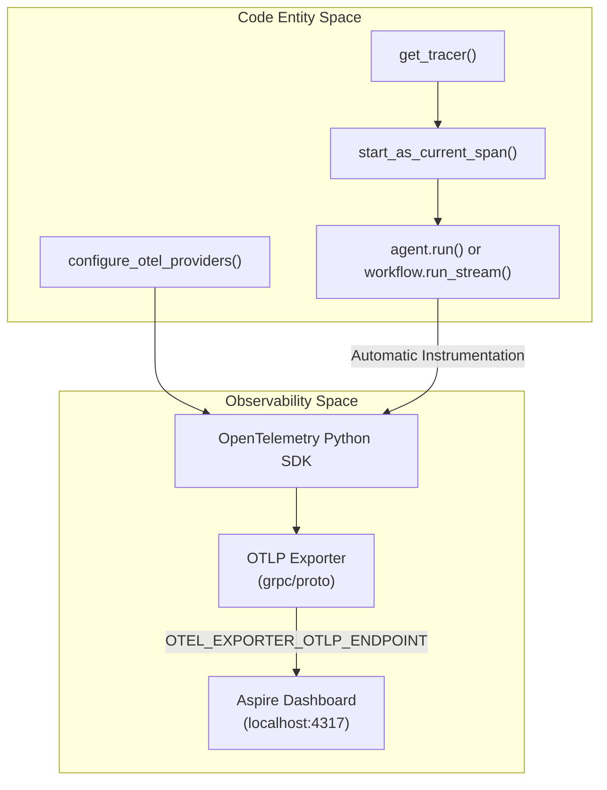

<!-- source: DeepWiki mcp.deepwiki.com · repo microsoft/Agent-Framework-Samples · page 8.2 OpenTelemetry and Tracing · fetched 2026-10-26 -->

# OpenTelemetry and Tracing

<details>
<summary>Relevant source files</summary>

The following files were used as context for generating this wiki page:

- [.env.examples](.env.examples)
- [08.EvaluationAndTracing/python/tracer_aspire/.env.example](08.EvaluationAndTracing/python/tracer_aspire/.env.example)
- [08.EvaluationAndTracing/python/tracer_aspire/README.md](08.EvaluationAndTracing/python/tracer_aspire/README.md)
- [08.EvaluationAndTracing/python/tracer_aspire/simple.py](08.EvaluationAndTracing/python/tracer_aspire/simple.py)
- [09.Cases/GHModel.AI/GHModel.Python.AI/GHModel.Python.AI.Workflow.OpenTelemetry/.vscode/settings.json](09.Cases/GHModel.AI/GHModel.Python.AI/GHModel.Python.AI.Workflow.OpenTelemetry/.vscode/settings.json)
- [09.Cases/GHModel.AI/GHModel.Python.AI/GHModel.Python.AI.Workflow.OpenTelemetry/main.py](09.Cases/GHModel.AI/GHModel.Python.AI/GHModel.Python.AI.Workflow.OpenTelemetry/main.py)
- [09.Cases/GHModel.AI/GHModel.Python.AI/GHModel.Python.AI.Workflow.OpenTelemetry/workflow/workflow.py](09.Cases/GHModel.AI/GHModel.Python.AI/GHModel.Python.AI.Workflow.OpenTelemetry/workflow/workflow.py)
- [09.Cases/GHModel.AI/src/Workflows/HrDemoWorkflow.cs](09.Cases/GHModel.AI/src/Workflows/HrDemoWorkflow.cs)
- [09.Cases/MicrosoftFoundryWithAITKAndMAF/CreateWorkflowWithYAML/Program.cs](09.Cases/MicrosoftFoundryWithAITKAndMAF/CreateWorkflowWithYAML/Program.cs)

</details>


This page covers how distributed tracing is configured and used across the Agent-Framework-Samples repository. It explains the environment variables required, the Python and .NET instrumentation APIs, how spans are created around workflow execution, and how to export traces to collectors like the .NET Aspire Dashboard.

For interactive step-through debugging using the browser-based DevUI, see [DevUI](#8.1). For safety evaluation and red teaming, see [Red Teaming and Safety Evaluation](#8.3).

---

## Overview

Tracing in this repository follows the [OpenTelemetry](https://opentelemetry.io/) standard. Both the Python and .NET samples instrument workflow and agent execution with spans, then export traces over OTLP (OpenTelemetry Protocol) to a collector. The framework provides automatic instrumentation for agent operations, tool executions, and token usage.

The primary samples demonstrating this are:

- **Python Simple Agent**: `08.EvaluationAndTracing/python/tracer_aspire/simple.py` [08.EvaluationAndTracing/python/tracer_aspire/simple.py:1-67]()
- **Python Workflow**: `09.Cases/GHModel.AI/GHModel.Python.AI/GHModel.Python.AI.Workflow.OpenTelemetry/main.py` [09.Cases/GHModel.AI/GHModel.Python.AI/GHModel.Python.AI.Workflow.OpenTelemetry/main.py:1-70]()
- **.NET Workflow**: `09.Cases/GHModel.AI/GHModel.dotNET.AI/GHModel.dotNET.AI.Workflow.OpenTelemetry/`

---

## Configuration

### Environment Variables

The OpenTelemetry SDK is configured primarily through environment variables. The most critical variable is the OTLP endpoint.

| Variable | Example Value | Purpose |
|---|---|---|
| `OTEL_EXPORTER_OTLP_ENDPOINT` | `http://localhost:4317` | OTLP gRPC endpoint for the trace collector (e.g., Aspire Dashboard) [.env.examples:19]() |
| `ENABLE_INSTRUMENTATION` | `true` | Framework-specific flag to toggle telemetry collection [08.EvaluationAndTracing/python/tracer_aspire/.env.example:7]() |
| `OTEL_SERVICE_NAME` | `weather-agent` | Optional: Identifies the service in the dashboard [08.EvaluationAndTracing/python/tracer_aspire/.env.example:15]() |
| `ENABLE_SENSITIVE_DATA` | `true` | Optional: Includes prompts and responses in spans (Dev only) [08.EvaluationAndTracing/python/tracer_aspire/.env.example:22]() |

Sources: [.env.examples:1-19](), [08.EvaluationAndTracing/python/tracer_aspire/.env.example:1-23]()

---

## Python Instrumentation

### Initialization with `configure_otel_providers`

The Python observability API is exposed through `agent_framework.observability`. The function `configure_otel_providers()` is the primary entry point for setup. It reads the standard `OTEL_*` environment variables and configures the global OpenTelemetry tracer and meter providers [08.EvaluationAndTracing/python/tracer_aspire/simple.py:41]().

```python
from agent_framework.observability import configure_otel_providers, get_tracer

# Reads OTEL_EXPORTER_OTLP_ENDPOINT and configures the SDK
configure_otel_providers()
```

### Manual Span Instrumentation

While the framework automatically instruments internal agent logic, developers can wrap high-level operations in custom spans using `get_tracer().start_as_current_span()`.

In [08.EvaluationAndTracing/python/tracer_aspire/simple.py:49-63](), a single agent chat is wrapped:
1. `get_tracer()` retrieves the framework's configured tracer [08.EvaluationAndTracing/python/tracer_aspire/simple.py:9]().
2. `start_as_current_span("Single Agent Chat", kind=SpanKind.CLIENT)` creates the root span [08.EvaluationAndTracing/python/tracer_aspire/simple.py:49]().
3. `format_trace_id(...)` is used to print the ID for easy lookup in the dashboard [08.EvaluationAndTracing/python/tracer_aspire/simple.py:50]().

In workflow scenarios, the pattern is identical, wrapping the `workflow.run_stream()` call [09.Cases/GHModel.AI/GHModel.Python.AI/GHModel.Python.AI.Workflow.OpenTelemetry/main.py:39-45]().

Sources: [08.EvaluationAndTracing/python/tracer_aspire/simple.py:1-67](), [09.Cases/GHModel.AI/GHModel.Python.AI/GHModel.Python.AI.Workflow.OpenTelemetry/main.py:1-70]()

---

**Diagram: Python Telemetry Data Flow**

This diagram maps the initialization and execution code to the OpenTelemetry export pipeline.



Sources: [08.EvaluationAndTracing/python/tracer_aspire/simple.py:37-63](), [08.EvaluationAndTracing/python/tracer_aspire/README.md:15-31]()

---

## .NET Instrumentation

### Package Dependencies

The .NET implementation utilizes standard OpenTelemetry NuGet packages to export data. Key packages include:
- `OpenTelemetry.Exporter.OpenTelemetryProtocol`: For OTLP export [09.Cases/GHModel.AI/GHModel.dotNET.AI/GHModel.dotNET.AI.Workflow.OpenTelemetry/GHModel.dotNET.AI.Workflow.OpenTelemetry.csproj:1-34]().
- `Azure.Monitor.OpenTelemetry.Exporter`: For direct export to Application Insights [09.Cases/GHModel.AI/GHModel.dotNET.AI/GHModel.dotNET.AI.Workflow.OpenTelemetry/GHModel.dotNET.AI.Workflow.OpenTelemetry.csproj:1-34]().

### Workflow and Declarative Tracing
In .NET, tracing is often integrated into the `WorkflowRunner` and `WorkflowFactory`. For example, in declarative YAML-based workflows, the `WorkflowRunner` executes the logic defined in `workflow.yaml`, and the underlying `Microsoft.Agents.AI.Workflows` library handles span propagation [09.Cases/MicrosoftFoundryWithAITKAndMAF/CreateWorkflowWithYAML/Program.cs:20-21]().

Sources: [09.Cases/GHModel.AI/GHModel.dotNET.AI/GHModel.dotNET.AI.Workflow.OpenTelemetry/GHModel.dotNET.AI.Workflow.OpenTelemetry.csproj:1-34](), [09.Cases/MicrosoftFoundryWithAITKAndMAF/CreateWorkflowWithYAML/Program.cs:1-23]()

---

## Trace Export Destinations

### .NET Aspire Dashboard
The recommended local collector is the **Aspire Dashboard**, which provides a web UI for viewing traces, metrics, and logs. It can be run via Docker [08.EvaluationAndTracing/python/tracer_aspire/README.md:27-31]():

```bash
docker run --rm -it -d \
    -p 18888:18888 \
    -p 4317:18889 \
    --name aspire-dashboard \
    mcr.microsoft.com/dotnet/aspire-dashboard:latest
```
- **Web UI**: `http://localhost:18888`
- **OTLP gRPC Endpoint**: `http://localhost:4317` (Mapped from container 18889) [08.EvaluationAndTracing/python/tracer_aspire/README.md:35-36]()

### Azure Application Insights
For production environments, the `Azure.Monitor.OpenTelemetry.Exporter` allows traces to be sent directly to Azure Monitor.

---

## Interpreting Metrics and Spans

When viewing traces in a collector, the framework provides several key data points:

1.  **End-to-End Latency**: The duration of the root span (e.g., "Single Agent Chat" or "Sequential Workflow Scenario").
2.  **Tool Invocation Metrics**: Each tool call (like `get_weather` in [08.EvaluationAndTracing/python/tracer_aspire/simple.py:28]()) appears as a child span, showing exactly how much time was spent in custom logic versus the LLM.
3.  **Chat Completions**: Spans representing the actual network request to the AI provider (Azure OpenAI or Foundry).
4.  **Token Usage**: Metadata attached to completion spans detailing prompt and completion token counts [08.EvaluationAndTracing/python/tracer_aspire/README.md:89]().

**Diagram: Sequential Workflow Span Hierarchy**

This diagram illustrates how a workflow with multiple agents appears in a trace.

```mermaid
gantt
    title "Workflow Trace Span Hierarchy"
    dateFormat  X
    axisFormat %s
    section Root
    "Sequential Workflow Scenario" : 0, 10
    section Agents
    "frontend_agent (AgentExecutor)" : 1, 4
    "concierge_agent (AgentExecutor)" : 5, 9
    section Tools
    "get_weather (Tool Call)" : 2, 3
```



Sources: [08.EvaluationAndTracing/python/tracer_aspire/simple.py:49-63](), [09.Cases/GHModel.AI/GHModel.Python.AI/GHModel.Python.AI.Workflow.OpenTelemetry/workflow/workflow.py:16-25](), [08.EvaluationAndTracing/python/tracer_aspire/README.md:78-82]()

---

