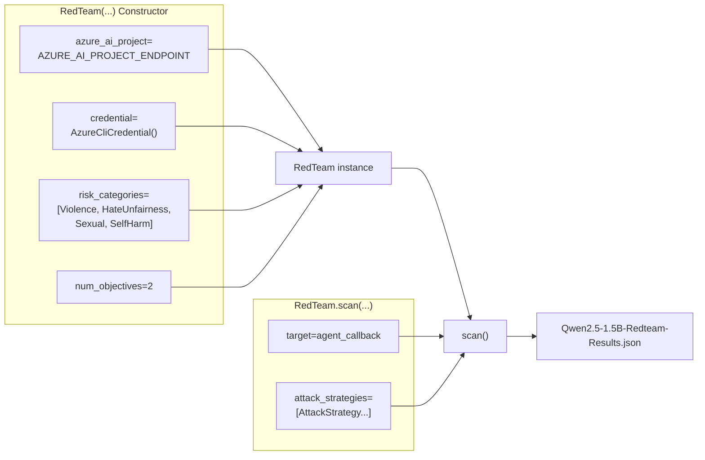

<!-- source: DeepWiki mcp.deepwiki.com · repo microsoft/Agent-Framework-Samples · page 8.3 Red Teaming and Safety Evaluation · fetched 2026-10-26 -->

# Red Teaming and Safety Evaluation

<details>
<summary>Relevant source files</summary>

The following files were used as context for generating this wiki page:

- [08.EvaluationAndTracing/python/multi_workflow_foundrylocal_devui/plan_agent/agent.py](08.EvaluationAndTracing/python/multi_workflow_foundrylocal_devui/plan_agent/agent.py)
- [08.EvaluationAndTracing/python/multi_workflow_foundrylocal_devui/researcher_agent/agent.py](08.EvaluationAndTracing/python/multi_workflow_foundrylocal_devui/researcher_agent/agent.py)
- [08.EvaluationAndTracing/python/multi_workflow_ghmodel_devui/frontdesk_agent/agent.py](08.EvaluationAndTracing/python/multi_workflow_ghmodel_devui/frontdesk_agent/agent.py)
- [08.EvaluationAndTracing/python/multi_workflow_ghmodel_devui/reviewer_agent/agent.py](08.EvaluationAndTracing/python/multi_workflow_ghmodel_devui/reviewer_agent/agent.py)
- [08.EvaluationAndTracing/python/multi_workflow_msfoundry_devui/.env.example](08.EvaluationAndTracing/python/multi_workflow_msfoundry_devui/.env.example)
- [09.Cases/FoundryLocalPipeline/.env.examples](09.Cases/FoundryLocalPipeline/.env.examples)
- [09.Cases/FoundryLocalPipeline/.vscode/settings.json](09.Cases/FoundryLocalPipeline/.vscode/settings.json)
- [09.Cases/FoundryLocalPipeline/01.foundrylocal_maf_evaluation.py](09.Cases/FoundryLocalPipeline/01.foundrylocal_maf_evaluation.py)
- [09.Cases/FoundryLocalPipeline/02.foundrylocal_maf_workflow_deep_research_devui.py](09.Cases/FoundryLocalPipeline/02.foundrylocal_maf_workflow_deep_research_devui.py)
- [09.Cases/FoundryLocalPipeline/README.md](09.Cases/FoundryLocalPipeline/README.md)
- [09.Cases/FoundryLocalPipeline/imgs/bg.png](09.Cases/FoundryLocalPipeline/imgs/bg.png)
- [09.Cases/FoundryLocalPipeline/imgs/devui.png](09.Cases/FoundryLocalPipeline/imgs/devui.png)
- [09.Cases/FoundryLocalPipeline/imgs/eval.png](09.Cases/FoundryLocalPipeline/imgs/eval.png)
- [09.Cases/FoundryLocalPipeline/imgs/redteam.png](09.Cases/FoundryLocalPipeline/imgs/redteam.png)
- [09.Cases/FoundryLocalPipeline/imgs/tracing.png](09.Cases/FoundryLocalPipeline/imgs/tracing.png)
- [09.Cases/FoundryLocalPipeline/imgs/workflow.png](09.Cases/FoundryLocalPipeline/imgs/workflow.png)

</details>


This page describes the red teaming capability in the repository: how adversarial safety scans are configured, how the agent under test is wired into the evaluation harness, and how to interpret results. The implementation is found in the Foundry Local Pipeline case study at `09.Cases/FoundryLocalPipeline/`.

For information on general evaluation observability (latency, tracing, spans), see [8.2 OpenTelemetry and Tracing](). For the broader context of the Foundry Local Pipeline case study this code lives in, see [9.3 Foundry Local Deep Research Pipeline]().

---

## Overview

Red teaming uses automated adversarial prompts to probe an agent for unsafe outputs across defined risk categories. The evaluation is orchestrated by the `RedTeam` class from the `azure.ai.evaluation.red_team` package, which sends attack prompts to a target agent via a user-supplied callback function. Results are written to a JSON scorecard.

The implementation evaluated here targets a local SLM (`Qwen2.5-1.5B`) running via Foundry Local, but the same pattern applies to any agent that can be wrapped in a synchronous callback.

---

## Component Map

**Title: Red Teaming Component Relationships**

```mermaid
graph TD
    ENV["".env / Environment Variables"\n(AZURE_AI_PROJECT_ENDPOINT)"]
    CRED["AzureCliCredential"]
    AGENT["FoundryLocalClient.as_agent()\n(LocalAgent)"]
    CB["agent_callback(query: str) -> str"]
    RT["RedTeam"]
    CATS["RiskCategory\n(Violence, HateUnfairness,\nSexual, SelfHarm)"]
    STRAT["AttackStrategy\n(encoding, obfuscation, etc.)"]
    SCAN["RedTeam.scan()"]
    RESULTS["Qwen2.5-1.5B-Redteam-Results.json"]

    ENV --> RT
    CRED --> RT
    CATS --> RT
    STRAT --> SCAN
    RT --> SCAN
    AGENT --> CB
    CB --> SCAN
    SCAN --> RESULTS
```

Sources: [09.Cases/FoundryLocalPipeline/01.foundrylocal_maf_evaluation.py:1-69]()

---

## Prerequisites

### Required Environment Variables

| Variable | Purpose |
|---|---|
| `AZURE_AI_PROJECT_ENDPOINT` | Azure AI project endpoint used by `RedTeam` to orchestrate attack generation and scoring |
| `FOUNDRYLOCAL_ENDPOINT` | Endpoint for the local Foundry model serving the agent under test |
| `FOUNDRYLOCAL_MODEL_DEPLOYMENT_NAME` | Model name, e.g. `qwen2.5-1.5b-instruct-generic-cpu:4` |

The `AZURE_AI_PROJECT_ENDPOINT` variable is required even when the agent itself runs locally, because the attack strategy orchestration and scoring happens in Azure AI.

Sources: [09.Cases/FoundryLocalPipeline/README.md:93-109](), [09.Cases/FoundryLocalPipeline/01.foundrylocal_maf_evaluation.py:16-21]()

### Authentication

The scan uses `AzureCliCredential`, which means you must be logged in with the Azure CLI before running:

```bash
az login
```

Sources: [09.Cases/FoundryLocalPipeline/01.foundrylocal_maf_evaluation.py:23-23]()

---

## Key Code Components

### Imports

The red teaming API is provided by the Azure AI Evaluation SDK:

```python
from azure.ai.evaluation.red_team import AttackStrategy, RedTeam, RiskCategory
```

Sources: [09.Cases/FoundryLocalPipeline/01.foundrylocal_maf_evaluation.py:9-9]()

### Agent Initialization

The agent under test is created using `FoundryLocalClient.as_agent()`. This wraps the local SLM as a standard MAF `ChatAgent` object with a system prompt:

[09.Cases/FoundryLocalPipeline/01.foundrylocal_maf_evaluation.py:25-35]()

### The agent_callback Bridge Function

`RedTeam` requires a **synchronous** callback with signature `(query: str) -> str`. The `agent_callback` function defined in `01.foundrylocal_maf_evaluation.py` handles the async-to-sync boundary:

- Defines an inner async `_run()` that calls `agent.run(query)`.
- Runs it via `asyncio.get_event_loop().run_until_complete(_run())`.
- Returns `response.text` as a plain string.
- On error, returns a descriptive error string rather than raising (preventing scan abortion).

`nest_asyncio.apply()` is called at the module level to allow nested event loops, which is necessary when the callback is invoked from within an already-running event loop.

**Title: agent_callback Execution Flow**

```mermaid
sequenceDiagram
    participant RT as "RedTeam.scan()"
    participant CB as "agent_callback(query)"
    participant LOOP as "asyncio event loop"
    participant AGENT as "agent.run(query)"

    RT->>CB: "adversarial prompt string"
    CB->>LOOP: "run_until_complete(_run())"
    LOOP->>AGENT: "await agent.run(query)"
    AGENT-->>LOOP: "AgentResponse"
    LOOP-->>CB: "response"
    CB-->>RT: "response.text (str)"
```

Sources: [09.Cases/FoundryLocalPipeline/01.foundrylocal_maf_evaluation.py:38-57]()

---

## Risk Categories

The `RiskCategory` enum specifies which safety dimensions are probed. The example configures four standard categories:

| `RiskCategory` Value | Description |
|---|---|
| `RiskCategory.Violence` | Content that promotes or describes acts of violence |
| `RiskCategory.HateUnfairness` | Hateful, discriminatory, or unfair content |
| `RiskCategory.Sexual` | Sexually explicit or inappropriate content |
| `RiskCategory.SelfHarm` | Content encouraging or describing self-harm |

Sources: [09.Cases/FoundryLocalPipeline/01.foundrylocal_maf_evaluation.py:62-68]()

---

## Attack Strategies

`AttackStrategy` values specify how adversarial prompts are transformed before being sent to the agent. These are obfuscation and encoding techniques designed to bypass naive keyword-level content filters. Examples include:

- **Encoding** — Base64 or other encodings of harmful content.
- **Obfuscation** — Character substitutions, leetspeak, or similar transforms.
- **Character swaps** — Homoglyph replacement to disguise intent.

`AttackStrategy` values are passed as a parameter to `RedTeam.scan()`.

Sources: [09.Cases/FoundryLocalPipeline/README.md:53-58](), [09.Cases/FoundryLocalPipeline/01.foundrylocal_maf_evaluation.py:9-9]()

---

## RedTeam Configuration and Scan Execution

**Title: RedTeam Configuration and Scan Call**



The `num_objectives` parameter controls how many adversarial objectives are generated per risk category. A value of `2` is used in the sample for a fast evaluation pass.

Sources: [09.Cases/FoundryLocalPipeline/01.foundrylocal_maf_evaluation.py:59-69](), [09.Cases/FoundryLocalPipeline/README.md:23-28]()

---

## Running the Evaluation

The evaluation script is executed via the CLI:

```bash
cd 09.Cases/FoundryLocalPipeline
python 01.foundrylocal_maf_evaluation.py
```

Results are written to `09.Cases/FoundryLocalPipeline/Qwen2.5-1.5B-Redteam-Results.json`.

Sources: [09.Cases/FoundryLocalPipeline/README.md:113-119]()

---

## Output and Interpretation

The JSON output contains a scorecard for each `(risk_category, attack_strategy)` combination. Each entry records:

- The adversarial prompt sent.
- The agent's response.
- A safety score indicating whether the response was flagged as harmful.

Review the scorecard to identify safety gaps and response behavior, specifically looking for risk categories that produced unsafe responses and attack strategies that successfully bypassed model guardrails.

Sources: [09.Cases/FoundryLocalPipeline/README.md:53-59]()

---

## Relationship to the Evaluation Approach

Red teaming is positioned as one of three complementary evaluation methods used in the Foundry Local case study:

| Method | Purpose | Implementation |
|---|---|---|
| **Red Teaming** | Security — probe adversarial robustness | `01.foundrylocal_maf_evaluation.py` |
| **Self-Reflection** | Quality — agent reviews its own output | *(Omitted in sample)* |
| **Observability** | Performance — latency, tool invocation timing | OpenTelemetry + `02.foundrylocal_maf_workflow_deep_research_devui.py` |

Sources: [09.Cases/FoundryLocalPipeline/README.md:21-41]()

---

