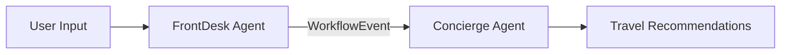
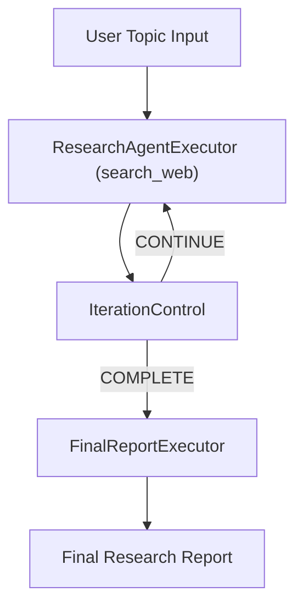

<!-- source: DeepWiki mcp.deepwiki.com · repo microsoft/Agent-Framework-Samples · page 9 Case Studies · fetched 2026-10-26 -->

# Case Studies

Relevant source files

The following files were used as context for generating this wiki page:

- [09.Cases/GHModel.AI/GHModel.Python.AI/GHModel.Python.AI.Workflow.DevUI/main.py](09.Cases/GHModel.AI/GHModel.Python.AI/GHModel.Python.AI.Workflow.DevUI/main.py)
- [09.Cases/GHModel.AI/GHModel.dotNET.AI/GHModel.dotNET.AI.Workflow.AGUI/GHModel.dotNET.AI.Workflow.AGUI.Server/GHModel.dotNET.AI.Workflow.AGUI.Server.csproj](09.Cases/GHModel.AI/GHModel.dotNET.AI/GHModel.dotNET.AI.Workflow.AGUI/GHModel.dotNET.AI.Workflow.AGUI.Server/GHModel.dotNET.AI.Workflow.AGUI.Server.csproj)
- [09.Cases/GHModel.AI/GHModel.dotNET.AI/GHModel.dotNET.AI.Workflow.DevUI/GHModel.dotNET.AI.Workflow.DevUI.csproj](09.Cases/GHModel.AI/GHModel.dotNET.AI/GHModel.dotNET.AI.Workflow.DevUI/GHModel.dotNET.AI.Workflow.DevUI.csproj)
- [09.Cases/GHModel.AI/GHModel.dotNET.AI/GHModel.dotNET.AI.Workflow.DevUI/Program.cs](09.Cases/GHModel.AI/GHModel.dotNET.AI/GHModel.dotNET.AI.Workflow.DevUI/Program.cs)
- [09.Cases/GHModel.AI/GHModel.dotNET.AI/GHModel.dotNET.AI.Workflow.OpenTelemetry/GHModel.dotNET.AI.Workflow.OpenTelemetry.csproj](09.Cases/GHModel.AI/GHModel.dotNET.AI/GHModel.dotNET.AI.Workflow.OpenTelemetry/GHModel.dotNET.AI.Workflow.OpenTelemetry.csproj)
- [09.Cases/README.md](09.Cases/README.md)
- [README.md](README.md)

This page provides an overview of the production-grade case studies in `09.Cases/`. Each case study combines multiple Microsoft Agent Framework capabilities — multi-agent workflows, tool integrations, AI model backends, and observability — into a complete, runnable scenario intended as a reference for production systems.

This page focuses on what each case study demonstrates and when to use it as a reference. Detailed documentation for each case study is available on dedicated sub-pages:

- [GHModel.AI Travel Assistant](#9.1)
- [Agentic Marketing Content Generation](#9.2)
- [Foundry Local Deep Research Pipeline](#9.3)
- [Microsoft Foundry YAML Declarative Workflows](#9.4)
- [MAF Harness Managed Agent](#9.5)
- [MAF Harness Managed Hosted Agent](#9.6)

For foundational agent and session concepts, see [Core Concepts](#3). For the workflow building blocks (sequential, concurrent, conditional) these samples build on, see [Workflow Orchestration](#7). For DevUI, OpenTelemetry, and red teaming infrastructure, see [Evaluation and Observability](#8).

---

## Summary

| Directory | Languages | AI Backend | Primary Capabilities |
|---|---|---|---|
| `GHModel.AI` | Python, .NET | GitHub Models | Sequential workflow, DevUI, AGUI SSE streaming, OpenTelemetry |
| `AgenticMarketingContentGen` | Python | GitHub Models, Tavily, FLUX, Sora-2 | Four-phase pipeline, Pydantic output schemas, CLI flags |
| `FoundryLocalPipeline` | Python | Foundry Local (Qwen2.5-1.5B) | Local SLM, iterative research loop, red teaming, DevUI |
| `MicrosoftFoundryWithAITKAndMAF` | Python, .NET | Azure AI Foundry | YAML declarative workflows, `WorkflowFactory`, checkpointing |
| `maf_harness_managed_agent` | Python | Azure AI Foundry | Managed Agent pattern, `AgentHarness`, `SessionLog`, Sandbox |
| `maf_harness_managed_hosted_agent` | Python | Azure AI Foundry | Hosted variant, `SandboxPool`, `SessionStore`, `azd` deployment |

Sources: [09.Cases/README.md:1-18](), [README.md:21-32]()

---

## Case Studies Mapped to Code Entities

**Case Studies — Primary Code Entities**

```mermaid
graph TD
    GH["GHModel.AI"]
    AM["AgenticMarketingContentGen"]
    FL["FoundryLocalPipeline"]
    MF["MicrosoftFoundryWithAITKAndMAF"]
    MH["maf_harness_managed_agent"]

    GH --> GHW["FrontDesk Agent + Concierge Agent"]
    GH --> GHV1["GHModel.dotNET.AI.Workflow.DevUI"]
    GH --> GHV2["GHModel.dotNET.AI.Workflow.AGUI.Server"]
    GH --> GHV3["GHModel.dotNET.AI.Workflow.OpenTelemetry"]

    AM --> AME1["StrategyExecutor"]
    AM --> AME2["CopywritingExecutor"]
    AM --> AMS["CampaignPackage (Pydantic)"]

    FL --> FLE1["ResearchAgentExecutor"]
    FL --> FLR["RedTeam (azure.ai.evaluation.red_team)"]
    FL --> FLU["utils.py (web_search)"]

    MF --> MFW["WorkflowFactory"]
    MF --> MFR["WorkflowRunner"]
    MF --> MFY["workflow.yaml"]

    MH --> MHA["AgentHarness (Brain)"]
    MH --> MHS["SessionLog (Memory)"]
    MH --> MHB["SandboxManager (Hands)"]
    MH --> MHV["VaultStore"]
```

Sources: [09.Cases/README.md:1-18](), [09.Cases/GHModel.AI/GHModel.dotNET.AI/GHModel.dotNET.AI.Workflow.DevUI/Program.cs:77-106](), [09.Cases/maf_harness_managed_agent/README.md:18]()

---

## GHModel.AI

**Location:** `09.Cases/GHModel.AI/`

A travel assistant scenario implemented as a two-agent sequential workflow. `FrontDesk` handles initial intake; `Concierge` provides detailed recommendations. The same workflow topology is packaged into three distinct deployment variants to demonstrate observability and serving options.

### Agent Workflow

**GHModel.AI — Agent Sequence**

### Deployment Variants

| Variant | .NET Project | Key Endpoint / Feature |
|---|---|---|
| DevUI | `GHModel.dotNET.AI.Workflow.DevUI` | `localhost:50518/devui` — visual step-through of workflow execution |
| AGUI | `GHModel.dotNET.AI.Workflow.AGUI.Server` | SSE streaming endpoint for AG-UI compliant clients |
| OpenTelemetry | `GHModel.dotNET.AI.Workflow.OpenTelemetry` | Exports spans and metrics to `OTEL_EXPORTER_OTLP_ENDPOINT` |

**Reference when:**
- You need a side-by-side Python and .NET implementation of the same sequential workflow.
- You need a working example of `MapDevUI()` with a named multi-agent workflow [09.Cases/GHModel.AI/GHModel.dotNET.AI/GHModel.dotNET.AI.Workflow.DevUI/Program.cs:121]().
- You need an AG-UI SSE streaming server serving agent responses.

Sources: [09.Cases/README.md:8-9](), [09.Cases/GHModel.AI/GHModel.dotNET.AI/GHModel.dotNET.AI.Workflow.DevUI/Program.cs:77-128]()

---

## AgenticMarketingContentGen

**Location:** `09.Cases/AgenticMarketingContentGen/`

A four-phase sequential agent pipeline that automates end-to-end marketing campaign production. A user provides a product description via CLI; the system produces strategy, copy, image assets, and a video script, all aggregated into a `CampaignPackage` and persisted under `artifacts/campaigns/`.

**Reference when:**
- You need a multi-phase pipeline where each stage's structured Pydantic output is the input to the next.
- You need to integrate external media generation APIs (image, video) as agent tools.

Sources: [09.Cases/README.md:5-6]()

---

## FoundryLocalPipeline

**Location:** `09.Cases/FoundryLocalPipeline/`

This case study demonstrates running a small language model (SLM) entirely locally using Microsoft Foundry Local. It covers three complementary evaluation approaches: red teaming (safety), iterative deep research with interactive DevUI, and OpenTelemetry performance tracing.

**FoundryLocalPipeline — Deep Research Executor Loop**

**Reference when:**
- You need to run an agent pipeline entirely offline using a local SLM.
- You need a working example of `RedTeam.scan()` applied to a custom `agent_callback`.

Sources: [09.Cases/README.md:11-12]()

---

## MicrosoftFoundryWithAITKAndMAF

**Location:** `09.Cases/MicrosoftFoundryWithAITKAndMAF/`

This case study demonstrates a configuration-as-code approach where workflow topology and agent behavior are defined in YAML files and loaded at runtime by `WorkflowFactory`. It illustrates a recruitment scenario with a `HiringManager` agent and an `ApplyAgent`.

**Reference when:**
- You want to define a multi-agent workflow topology in YAML rather than imperative code.
- You need human-in-the-loop interaction using `ExternalRequest`/`ExternalResponse`.

Sources: [09.Cases/README.md:14-15]()

---

## MAF Harness Managed Agent

**Location:** `09.Cases/maf_harness_managed_agent/`

This project implements the "Managed Agent" pattern, decoupling the "Brain" (reasoning) from the "Hands" (tool execution). It features a stateless `AgentHarness`, a durable `SessionLog` for memory, and a `SandboxManager` for isolated execution.

**Reference when:**
- You need a stateless orchestration architecture for high-scale agent deployments.
- You require durable event logging and recovery after harness crashes via `wake(session_id)`.

Sources: [09.Cases/maf_harness_managed_agent/README.md:18]()

---

## MAF Harness Managed Hosted Agent

**Location:** `09.Cases/maf_harness_managed_hosted_agent/`

A variant of the managed agent pattern specifically optimized for Azure AI Foundry hosting. It uses a `SandboxPool` for "cattle-style" sandbox provisioning and a `SessionStore` for JSONL-based session persistence.

**Reference when:**
- You are deploying managed agents to Azure using `azd` and `agent.yaml`.
- You need a generic `execute(name, input_json)` tool interface for cross-environment compatibility.

Sources: [09.Cases/README.md:17-18]()

---

