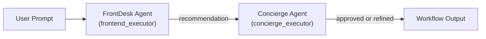
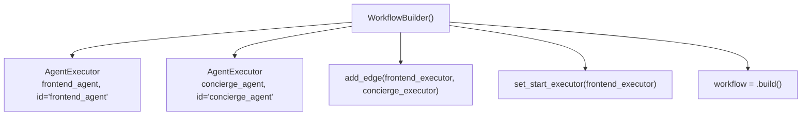
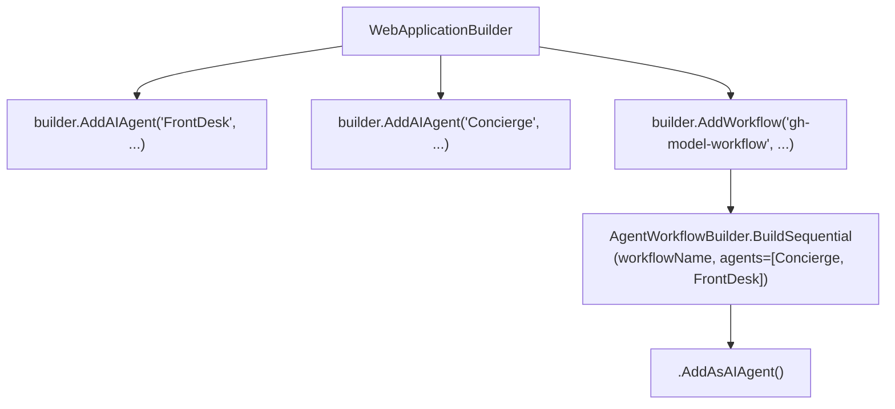
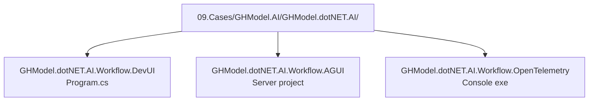
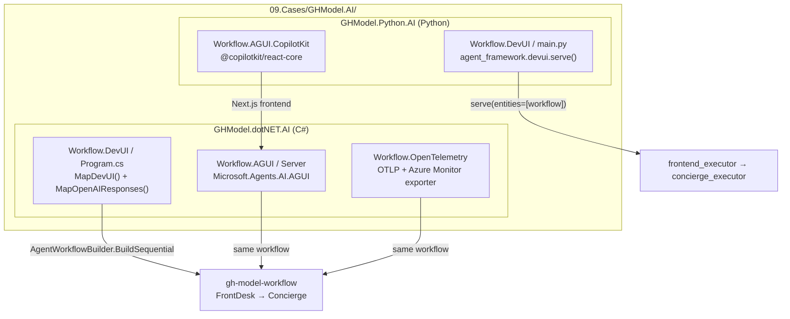

<!-- source: DeepWiki mcp.deepwiki.com · repo microsoft/Agent-Framework-Samples · page 9.1 GHModel.AI Travel Assistant · fetched 2026-10-26 -->

# GHModel.AI Travel Assistant

<details>
<summary>Relevant source files</summary>

The following files were used as context for generating this wiki page:

- [09.Cases/GHModel.AI/GHModel.Python.AI/GHModel.Python.AI.Workflow.AGUI/GHModel.Python.AI.Workflow.AGUI.CopilotKit/package-lock.json](09.Cases/GHModel.AI/GHModel.Python.AI/GHModel.Python.AI.Workflow.AGUI/GHModel.Python.AI.Workflow.AGUI.CopilotKit/package-lock.json)
- [09.Cases/GHModel.AI/GHModel.Python.AI/GHModel.Python.AI.Workflow.AGUI/GHModel.Python.AI.Workflow.AGUI.CopilotKit/package.json](09.Cases/GHModel.AI/GHModel.Python.AI/GHModel.Python.AI.Workflow.AGUI/GHModel.Python.AI.Workflow.AGUI.CopilotKit/package.json)
- [09.Cases/GHModel.AI/GHModel.Python.AI/GHModel.Python.AI.Workflow.DevUI/main.py](09.Cases/GHModel.AI/GHModel.Python.AI/GHModel.Python.AI.Workflow.DevUI/main.py)
- [09.Cases/GHModel.AI/GHModel.dotNET.AI/GHModel.dotNET.AI.Workflow.AGUI/GHModel.dotNET.AI.Workflow.AGUI.Server/GHModel.dotNET.AI.Workflow.AGUI.Server.csproj](09.Cases/GHModel.AI/GHModel.dotNET.AI/GHModel.dotNET.AI.Workflow.AGUI/GHModel.dotNET.AI.Workflow.AGUI.Server/GHModel.dotNET.AI.Workflow.AGUI.Server.csproj)
- [09.Cases/GHModel.AI/GHModel.dotNET.AI/GHModel.dotNET.AI.Workflow.DevUI/GHModel.dotNET.AI.Workflow.DevUI.csproj](09.Cases/GHModel.AI/GHModel.dotNET.AI/GHModel.dotNET.AI.Workflow.DevUI/GHModel.dotNET.AI.Workflow.DevUI.csproj)
- [09.Cases/GHModel.AI/GHModel.dotNET.AI/GHModel.dotNET.AI.Workflow.DevUI/Program.cs](09.Cases/GHModel.AI/GHModel.dotNET.AI/GHModel.dotNET.AI.Workflow.DevUI/Program.cs)
- [09.Cases/GHModel.AI/GHModel.dotNET.AI/GHModel.dotNET.AI.Workflow.OpenTelemetry/GHModel.dotNET.AI.Workflow.OpenTelemetry.csproj](09.Cases/GHModel.AI/GHModel.dotNET.AI/GHModel.dotNET.AI.Workflow.OpenTelemetry/GHModel.dotNET.AI.Workflow.OpenTelemetry.csproj)

</details>


This page documents the **GHModel.AI** production case study located at `09.Cases/GHModel.AI/`. It covers the agent roles, sequential workflow pattern, three deployment variants (DevUI, AGUI, OpenTelemetry), and how both the .NET and Python implementations are structured. For background on the underlying sequential workflow mechanics, see [Workflow Orchestration: Sequential Workflows](). For DevUI and OpenTelemetry concepts, see [DevUI]() and [OpenTelemetry and Tracing]().

---

## Overview

GHModel.AI is a travel recommendation assistant that runs a **sequential two-agent workflow**: a `FrontDesk` agent proposes a travel activity, and a `Concierge` agent reviews it for authenticity before returning a final answer to the user. The case study ships with three runnable variants, demonstrating how the same workflow logic can be exposed via different interfaces and monitoring strategies.

The AI backend is **GitHub Models**, accessed through the OpenAI-compatible endpoint at `models.inference.ai.azure.com` using a `GITHUB_TOKEN`.

---

## Agent Roles

| Agent Name | Role | Behavior |
|---|---|---|
| `FrontDesk` | Travel recommendation generator | Produces a single, concise activity or location recommendation per turn |
| `Concierge` | Recommendation reviewer | Evaluates whether the recommendation avoids tourist traps; approves or requests refinement |
| `GPTAssistant` | General-purpose fallback | Registered in DevUI variants for ad-hoc queries; not part of the core workflow |

**FrontDesk instructions** (from [09.Cases/GHModel.AI/GHModel.dotNET.AI/GHModel.dotNET.AI.Workflow.DevUI/Program.cs:88-95]()):
> "You are a Front Desk Travel Agent with ten years of experience… Only provide a single recommendation per response… Consider suggestions when refining an idea."

**Concierge instructions** (from [09.Cases/GHModel.AI/GHModel.dotNET.AI/GHModel.dotNET.AI.Workflow.DevUI/Program.cs:81-85]()):
> "You are a hotel concierge who has opinions about providing the most local and authentic experiences… If [the recommendation] is approved, state that it is approved. If not, provide insight on how to refine…"

Sources: [09.Cases/GHModel.AI/GHModel.dotNET.AI/GHModel.dotNET.AI.Workflow.DevUI/Program.cs:80-106]()

---

## Workflow Architecture

The sequential workflow chains `FrontDesk` → `Concierge`. The user's prompt enters `FrontDesk`, the output passes to `Concierge`, and the final reviewed response is returned.

**Sequential Agent Workflow**



**Python workflow construction** (`WorkflowBuilder`):



**.NET workflow construction** (`AgentWorkflowBuilder`):



Sources: [09.Cases/GHModel.AI/GHModel.dotNET.AI/GHModel.dotNET.AI.Workflow.DevUI/Program.cs:99-106]()

---

## Deployment Variants

The case study provides three independently runnable variants for each runtime:

| Variant | Language | Entry Point | Interface | Port / Endpoint |
|---|---|---|---|---|
| `DevUI` | .NET | `GHModel.dotNET.AI.Workflow.DevUI` / `Program.cs` | Browser DevUI + `/v1/responses` API | `http://localhost:50518/devui` |
| `AGUI` | .NET | `GHModel.dotNET.AI.Workflow.AGUI` / server project | AGUI server with CopilotKit | — |
| `OpenTelemetry` | .NET | `GHModel.dotNET.AI.Workflow.OpenTelemetry` | Console + OTLP export | `OTEL_EXPORTER_OTLP_ENDPOINT` |
| `DevUI` | Python | `GHModel.Python.AI.Workflow.DevUI` / `main.py` | Browser DevUI via `serve()` | `http://localhost:8090` |

Sources: [09.Cases/GHModel.AI/GHModel.dotNET.AI/GHModel.dotNET.AI.Workflow.DevUI/Program.cs:124-127](), [09.Cases/GHModel.AI/GHModel.Python.AI/GHModel.Python.AI.Workflow.DevUI/main.py:12-23](), [09.Cases/GHModel.AI/GHModel.dotNET.AI/GHModel.dotNET.AI.Workflow.OpenTelemetry/GHModel.dotNET.AI.Workflow.OpenTelemetry.csproj:1-34]()

---

## .NET Implementation

### Project Structure



### DevUI Variant

The `Program` class in [09.Cases/GHModel.AI/GHModel.dotNET.AI/GHModel.dotNET.AI.Workflow.DevUI/Program.cs]() bootstraps an ASP.NET Core server with the following setup sequence:

1. Load `.env` via `Env.Load("../../../../.env")` (DotNetEnv) [09.Cases/GHModel.AI/GHModel.dotNET.AI/GHModel.dotNET.AI.Workflow.DevUI/Program.cs:56]().
2. Construct `OpenAIClient` with `ApiKeyCredential(github_token)` pointed at `GITHUB_ENDPOINT` [09.Cases/GHModel.AI/GHModel.dotNET.AI/GHModel.dotNET.AI.Workflow.DevUI/Program.cs:61-70]().
3. Call `.GetChatClient(github_model_id).AsIChatClient()` to obtain an `IChatClient` [09.Cases/GHModel.AI/GHModel.dotNET.AI/GHModel.dotNET.AI.Workflow.DevUI/Program.cs:72]().
4. Register agents: `builder.AddAIAgent("FrontDesk", ...)` and `builder.AddAIAgent("Concierge", ...)` [09.Cases/GHModel.AI/GHModel.dotNET.AI/GHModel.dotNET.AI.Workflow.DevUI/Program.cs:99-100]().
5. Register the workflow: `builder.AddWorkflow("gh-model-workflow", ...).AddAsAIAgent()` [09.Cases/GHModel.AI/GHModel.dotNET.AI/GHModel.dotNET.AI.Workflow.DevUI/Program.cs:102-106]().
6. Map endpoints: `app.MapOpenAIResponses()`, `app.MapOpenAIConversations()`, `app.MapDevUI()` [09.Cases/GHModel.AI/GHModel.dotNET.AI/GHModel.dotNET.AI.Workflow.DevUI/Program.cs:116-121]().

The `MapOpenAIResponses()` call exposes a `/v1/responses` endpoint that routes incoming requests to a named agent or workflow based on the `model` field in the request body [09.Cases/GHModel.AI/GHModel.dotNET.AI/GHModel.dotNET.AI.Workflow.DevUI/Program.cs:44-46]().

### AGUI Variant

The AGUI implementation utilizes a React-based frontend integrated with **CopilotKit** and **Next.js** [09.Cases/GHModel.AI/GHModel.Python.AI/GHModel.Python.AI.Workflow.AGUI/GHModel.Python.AI.Workflow.AGUI.CopilotKit/package.json:16-20](). The server-side references `Microsoft.Agents.AI.AGUI` and `Microsoft.Agents.AI.Hosting.AGUI.AspNetCore`, providing a structured interface for agent-user interactions consistent with the AGUI protocol [09.Cases/GHModel.AI/GHModel.dotNET.AI/GHModel.dotNET.AI.Workflow.AGUI/GHModel.dotNET.AI.Workflow.AGUI.Server/GHModel.dotNET.AI.Workflow.AGUI.Server.csproj:18-19]().

### OpenTelemetry Variant

The OpenTelemetry project is a console executable that references:
- `OpenTelemetry.Exporter.OpenTelemetryProtocol` — exports spans via OTLP [09.Cases/GHModel.AI/GHModel.dotNET.AI/GHModel.dotNET.AI.Workflow.OpenTelemetry/GHModel.dotNET.AI.Workflow.OpenTelemetry.csproj:20]().
- `Azure.Monitor.OpenTelemetry.Exporter` — exports to Application Insights [09.Cases/GHModel.AI/GHModel.dotNET.AI/GHModel.dotNET.AI.Workflow.OpenTelemetry/GHModel.dotNET.AI.Workflow.OpenTelemetry.csproj:13]().
- `OpenTelemetry.Instrumentation.Http` and `OpenTelemetry.Instrumentation.Runtime` — auto-instruments HTTP calls and runtime metrics [09.Cases/GHModel.AI/GHModel.dotNET.AI/GHModel.dotNET.AI.Workflow.OpenTelemetry/GHModel.dotNET.AI.Workflow.OpenTelemetry.csproj:21-22]().

---

## Python Implementation

### DevUI Variant

`main.py` in `GHModel.Python.AI.Workflow.DevUI` calls `agent_framework.devui.serve` directly:

```python
serve(entities=[workflow], port=8090, auto_open=True)
```

This starts the DevUI server at `http://localhost:8090` and registers the workflow as a named entity [09.Cases/GHModel.AI/GHModel.Python.AI/GHModel.Python.AI.Workflow.DevUI/main.py:12-23]().

---

## Required Environment Variables

All variants read from a `.env` file. The variables required specifically by this case study are:

| Variable | Purpose |
|---|---|
| `GITHUB_TOKEN` | Personal Access Token for GitHub Models authentication |
| `GITHUB_ENDPOINT` | GitHub Models API endpoint (e.g., `https://models.inference.ai.azure.com`) |
| `OTEL_EXPORTER_OTLP_ENDPOINT` | OTLP collector endpoint for OpenTelemetry variants |

The .NET variants load these with `Env.Load("../../../../.env")` [09.Cases/GHModel.AI/GHModel.dotNET.AI/GHModel.dotNET.AI.Workflow.DevUI/Program.cs:56]().

---

## Component Map

The following diagram maps each deployment variant to its key code entities across both runtimes.

**GHModel.AI — Component and Code Entity Map**



Sources: [09.Cases/GHModel.AI/GHModel.dotNET.AI/GHModel.dotNET.AI.Workflow.DevUI/Program.cs:99-128](), [09.Cases/GHModel.AI/GHModel.Python.AI/GHModel.Python.AI.Workflow.DevUI/main.py:1-29](), [09.Cases/GHModel.AI/GHModel.dotNET.AI/GHModel.dotNET.AI.Workflow.AGUI/GHModel.dotNET.AI.Workflow.AGUI.Server/GHModel.dotNET.AI.Workflow.AGUI.Server.csproj:1-22](), [09.Cases/GHModel.AI/GHModel.Python.AI/GHModel.Python.AI.Workflow.AGUI/GHModel.Python.AI.Workflow.AGUI.CopilotKit/package.json:11-22]()

---

