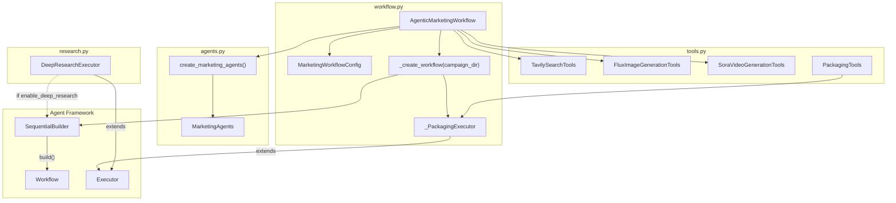
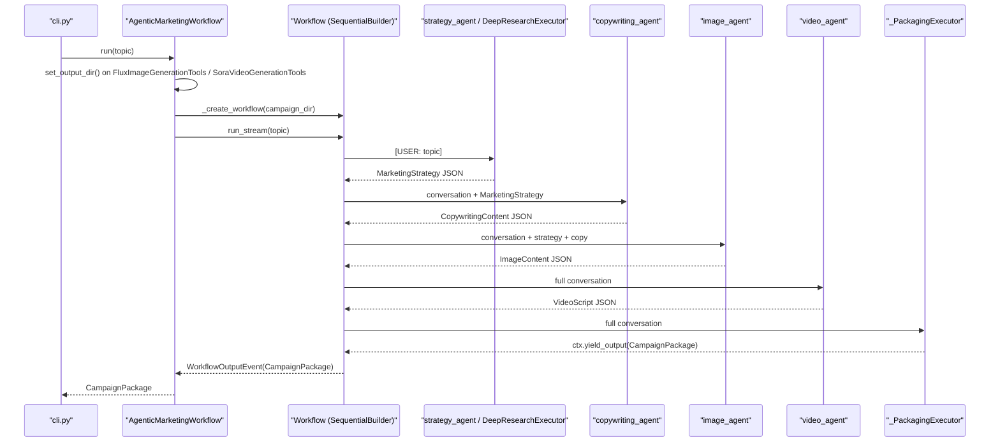
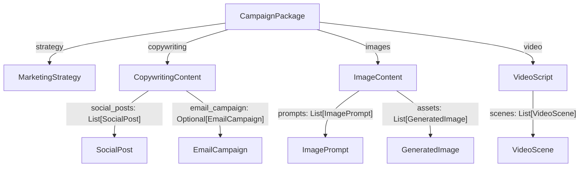
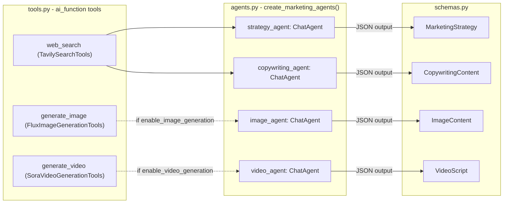

<!-- source: DeepWiki mcp.deepwiki.com · repo microsoft/Agent-Framework-Samples · page 9.2 Agentic Marketing Content Generation · fetched 2026-10-26 -->

# Agentic Marketing Content Generation

<details>
<summary>Relevant source files</summary>

The following files were used as context for generating this wiki page:

- [09.Cases/AgenticMarketingContentGen/.gitignore](09.Cases/AgenticMarketingContentGen/.gitignore)
- [09.Cases/AgenticMarketingContentGen/README.md](09.Cases/AgenticMarketingContentGen/README.md)
- [09.Cases/AgenticMarketingContentGen/README_cn.md](09.Cases/AgenticMarketingContentGen/README_cn.md)
- [09.Cases/AgenticMarketingContentGen/marketing_workflow/agents.py](09.Cases/AgenticMarketingContentGen/marketing_workflow/agents.py)
- [09.Cases/AgenticMarketingContentGen/marketing_workflow/schemas.py](09.Cases/AgenticMarketingContentGen/marketing_workflow/schemas.py)
- [09.Cases/AgenticMarketingContentGen/marketing_workflow/tools.py](09.Cases/AgenticMarketingContentGen/marketing_workflow/tools.py)
- [09.Cases/AgenticMarketingContentGen/marketing_workflow/utils.py](09.Cases/AgenticMarketingContentGen/marketing_workflow/utils.py)
- [09.Cases/AgenticMarketingContentGen/marketing_workflow/workflow.py](09.Cases/AgenticMarketingContentGen/marketing_workflow/workflow.py)
- [09.Cases/AgenticMarketingContentGen/package-lock.json](09.Cases/AgenticMarketingContentGen/package-lock.json)
- [09.Cases/AgenticMarketingContentGen/package.json](09.Cases/AgenticMarketingContentGen/package.json)
- [09.Cases/AgenticMarketingContentGen/requirements.txt](09.Cases/AgenticMarketingContentGen/requirements.txt)

</details>


This page documents the `AgenticMarketingContentGen` case study located at `09.Cases/AgenticMarketingContentGen/`. It covers the sequential multi-agent workflow, the Pydantic output schema hierarchy, agent instruction patterns, external tool integrations (Tavily, FLUX, Sora-2), the optional deep research mode, the packaging executor, and the CLI. For background on the `SequentialBuilder` API and sequential workflow patterns, see [Sequential Workflows](#7.2). For the `ChatAgent` and `Executor` abstractions used here, see [AIAgent and AgentSession](#3.2) and [Workflow Architecture](#7.1).

---

## Overview

`AgenticMarketingContentGen` converts a plain-text product or topic string into a complete, publish-ready marketing package: positioning strategy, copywriting (blog, social posts, email), AI-generated images, and AI-generated video clips. The pipeline is a five-participant sequential workflow. Four `ChatAgent` instances each output a structured JSON payload that downstream agents consume. A final `_PackagingExecutor` assembles the outputs into a `CampaignPackage` Pydantic model and persists artifacts to disk.

**Module layout:**

```
marketing_workflow/
├── workflow.py     # AgenticMarketingWorkflow, _PackagingExecutor, MarketingWorkflowConfig
├── agents.py       # MarketingAgents dataclass, create_marketing_agents()
├── research.py     # DeepResearchExecutor
├── schemas.py      # CampaignPackage and all nested Pydantic models
├── tools.py        # TavilySearchTools, FluxImageGenerationTools, SoraVideoGenerationTools, PackagingTools
├── utils.py        # extract_json_object(), slugify(), dump_json(), timestamp_id()
└── cli.py          # CLI entry point
```

Sources: [09.Cases/AgenticMarketingContentGen/README.md:222-232]()

---

## Workflow Architecture

### Component Map

The `AgenticMarketingWorkflow` class owns all sub-components. The actual `Workflow` object is created per-run inside `_create_workflow()` so that per-run output paths can be injected into image and video tool instances before execution.

**Diagram: Class relationships in `AgenticMarketingWorkflow`**



Sources: [09.Cases/AgenticMarketingContentGen/marketing_workflow/workflow.py:52-156]()

### Sequential Execution Flow

`AgenticMarketingWorkflow.run(topic)` calls `workflow.run_stream(topic)` and consumes the event stream. Each agent receives the full conversation history including all prior agents' outputs. The `_PackagingExecutor` runs last, reading the conversation to extract and assemble the final package.

**Diagram: `run_stream(topic)` message flow through workflow participants**



Sources: [09.Cases/AgenticMarketingContentGen/marketing_workflow/workflow.py:161-275]()

---

## Pipeline Phases

| Phase | Participant Class | Agent Name | Output Schema | Tool(s) |
|---|---|---|---|---|
| Strategy | `ChatAgent` | `strategy_agent` | `MarketingStrategy` | `web_search` (Tavily) |
| Strategy (deep) | `DeepResearchExecutor` | — | `MarketingStrategy` | `web_search` (Tavily) |
| Copywriting | `ChatAgent` | `copywriting_agent` | `CopywritingContent` | `web_search` (Tavily) |
| Image | `ChatAgent` | `image_agent` | `ImageContent` | `generate_image` (FLUX, optional) |
| Video | `ChatAgent` | `video_agent` | `VideoScript` | `generate_video` (Sora-2, optional) |
| Packaging | `_PackagingExecutor` | `packaging-executor` | `CampaignPackage` | `PackagingTools.persist_package()` |

Sources: [09.Cases/AgenticMarketingContentGen/marketing_workflow/workflow.py:136-155]()

---

## Pydantic Schema Hierarchy

All structured data is defined in `marketing_workflow/schemas.py`. Each agent outputs raw JSON text; `_PackagingExecutor._extract_model()` calls `extract_json_object()` then `model_validate_json()` to parse it.

**Diagram: Schema class relationships (`schemas.py`)**



### Schema Field Reference

| Model | Notable Fields |
|---|---|
| `CampaignPackage` | `campaign_id`, `topic`, `created_at`, `strategy`, `copywriting`, `images`, `video`, `package_path` |
| `MarketingStrategy` | `topic`, `user_intent`, `output_language`, `target_audience`, `pain_points`, `selling_points`, `content_framework`, `tone_of_voice`, `brand_pillars`, `keywords` |
| `CopywritingContent` | `hero_message`, `blog_article`, `blog_outline`, `social_posts`, `email_campaign`, `pain_point_analysis`, `cta_variations` |
| `SocialPost` | `platform`, `tone`, `hook`, `body`, `cta`, `hashtags` |
| `EmailCampaign` | `subject_lines`, `preview_text`, `email_type`, `headline`, `body_html`, `body_plain`, `cta_button_text`, `ps_line` |
| `ImageContent` | `prompts: List[ImagePrompt]`, `assets: List[GeneratedImage]` |
| `ImagePrompt` | `prompt_id`, `prompt` (English), `scene_description`, `style`, `aspect_ratio` |
| `GeneratedImage` | `prompt_id`, `url`, `local_path`, `revised_prompt` |
| `VideoScript` | `structure_notes`, `scenes`, `total_duration_seconds`, `cta`, `srt_caption` |
| `VideoScene` | `scene_number`, `act` (Problem/Solution/Transformation), `visuals`, `voiceover`, `screen_text`, `duration_seconds` |

The `output_language` field in `MarketingStrategy` (e.g., `"en"`, `"zh"`, `"ja"`) propagates through the entire pipeline: all agent instructions enforce that written content follows this language, while image and video generation prompts must always be in English regardless.

The `SocialPost` and `VideoScene` models include several aliased fields (e.g., `copy_text`, `post_text`, `audio_narration`, `on_screen_text`) to accommodate LLM output variation. `model_post_init()` normalizes these alternative field names into the canonical fields at parse time.

Sources: [09.Cases/AgenticMarketingContentGen/marketing_workflow/schemas.py:11-223]()

---

## Agent Definitions

Agents are created by `create_marketing_agents()` in `agents.py`. The function returns a `MarketingAgents` dataclass holding all four `ChatAgent` instances. System prompts embed the target schema description via `_schema_prompt(ModelClass)`, which introspects the model's JSON schema and formats each field as a human-readable line.

**Diagram: Agent-to-schema and agent-to-tool bindings**



### Strategy Agent

- **Name**: `strategy_agent`
- **Output**: `MarketingStrategy` JSON
- **Tools**: `web_search`, with instructions requiring a minimum of 3 searches
- **Key behavior**: Detects input language and sets `output_language`; writes `user_intent` summary for downstream agents; performs market, audience, and competitor research before outputting strategy.

Sources: [09.Cases/AgenticMarketingContentGen/marketing_workflow/agents.py:105-149]()

### Copywriting Agent

- **Name**: `copywriting_agent`
- **Output**: `CopywritingContent` JSON
- **Tools**: `web_search` (for trending phrases and competitor references)
- **Key behavior**: Consumes all `MarketingStrategy` fields from conversation history. Writes a 1500–2500 word blog article, social posts for at minimum LinkedIn / Instagram / Rednote, a complete HTML email campaign, CTA variations, and pain-point analysis. All text in `output_language`.

Sources: [09.Cases/AgenticMarketingContentGen/marketing_workflow/agents.py:154-228]()

### Image Agent

- **Name**: `image_agent`
- **Output**: `ImageContent` JSON
- **Tools**: `generate_image` when `enable_image_generation=True`
- **Key behavior**: Designs 2–5 image prompts. `scene_description` in `output_language`; `prompt` field always English. When the tool is available, the agent calls it sequentially for each prompt and collects results into the `assets` array.

Sources: [09.Cases/AgenticMarketingContentGen/marketing_workflow/agents.py:229-267]()

### Video Agent

- **Name**: `video_agent`
- **Output**: `VideoScript` JSON
- **Tools**: `generate_video` when `enable_video_generation=True`
- **Key behavior**: Three-act structure (Problem → Solution → Transformation). Maximum 6 scenes; each `duration_seconds` must be exactly 4, 8, or 12 (Sora-2 API constraint). Videos generated one at a time due to API concurrency limits. Prompts must be English; `voiceover`, `screen_text`, and `srt_caption` in `output_language`.

Sources: [09.Cases/AgenticMarketingContentGen/marketing_workflow/agents.py:274-352]()

---

## Tool Integrations

All tools use the `@ai_function` decorator from `agent_framework`, which makes them callable by `ChatAgent` instances. Each tool class uses lazy initialization for its external API client.

### TavilySearchTools

The `web_search` function is created inside `_create_search_tool()` as a closure bound to the `TavilySearchTools` instance. It is exposed via the `search` property and registered to both `strategy_agent` and `copywriting_agent`.

- **Env var**: `Tvly_API_KEY`
- **Parameters**: `query` (str), `search_depth` (`"basic"` | `"advanced"`), `max_results` (1–10)
- **Returns**: `{"query": ..., "results": [{title, url, content, score}], "answer": ...}`
- **Error handling**: Returns an error dict instead of raising exceptions, so agents can continue gracefully.

Sources: [09.Cases/AgenticMarketingContentGen/marketing_workflow/tools.py:19-105]()

### FluxImageGenerationTools

Wraps the FLUX image model on Azure OpenAI. Saves images as `.png` to the campaign's `images/` subdirectory.

- **Env vars**: `AZURE_IMAGE_ENDPOINT`, `AZURE_IMAGE_API_KEY`, `AZURE_IMAGE_DEPLOYMENT_NAME` (default: `FLUX.1-Kontext-pro`)
- **Client**: Lazily initialized `openai.OpenAI(base_url=endpoint, api_key=api_key)`
- **Parameters**: `prompt` (English), `prompt_id`, `size` (e.g., `"1024x1024"`)
- **Returns**: `{"prompt_id", "url", "revised_prompt", "local_path", "prompt"}`
- **Output dir**: Injected at run-time by `AgenticMarketingWorkflow.run()` via `set_output_dir()` before the workflow starts.

Sources: [09.Cases/AgenticMarketingContentGen/marketing_workflow/tools.py:339-484]()

### SoraVideoGenerationTools

Wraps the Azure Sora-2 video generation API using HTTP polling. Due to the API's concurrency limit, a class-level `threading.Lock` (`_generation_lock`) ensures all video generation calls happen sequentially even if agents attempt concurrent calls.

- **Env vars**: `AZURE_VIDEO_ENDPOINT`, `AZURE_VIDEO_API_KEY`, `AZURE_VIDEO_DEPLOYMENT_NAME` (default: `sora-2`)
- **Parameters**: `prompt` (English), `scene_id`, `seconds` (must be 4, 8, or 12), `size`
- **Polling**: POSTs a job, polls `{endpoint}/{video_id}` every 5 seconds, fetches content at `{endpoint}/{video_id}/content`. 300-second timeout.
- **Returns**: `{"scene_id", "prompt", "video_id", "url", "local_path", "duration_seconds", "size"}`

Sources: [09.Cases/AgenticMarketingContentGen/marketing_workflow/tools.py:107-336]()

### PackagingTools

A `dataclass` that writes a `CampaignPackage` to disk in a structured directory layout.

- **Base dir**: Configurable via `MarketingWorkflowConfig.output_dir` (default: `"artifacts/campaigns"`)
- **Key method**: `persist_package(package, campaign_dir)` creates all subdirectories and files.
- **Email handling**: If `email_campaign` is present, writes `email_campaign.html` (a complete, email-client-compatible HTML document with inline styles), `email_campaign.txt`, `email_campaign.json`, and `subject_lines.txt` to `copywriting/email/`.

Sources: [09.Cases/AgenticMarketingContentGen/marketing_workflow/tools.py:532-711]()

---

## Deep Research Mode

When `enable_deep_research=True`, `DeepResearchExecutor` from `research.py` replaces the `strategy_agent` as the first sequential participant. It is itself a sub-workflow with three internal agents:

| Sub-Agent | Role |
|---|---|
| Planner | Breaks the topic into specific research questions |
| Researcher | Executes `web_search` for each question (receives the same `TavilySearchTools.search` tool) |
| Analyst | Synthesizes findings into a `MarketingStrategy` JSON |

The executor outputs a `MarketingStrategy` in the same format as `strategy_agent`, so all downstream agents are unaffected. The executor's `_debug` flag is updated per-run from `MarketingWorkflowConfig.debug`.

Sources: [09.Cases/AgenticMarketingContentGen/marketing_workflow/workflow.py:91-98, 136-142](), [09.Cases/AgenticMarketingContentGen/README.md:57-66]()

---

## Packaging Executor

`_PackagingExecutor` is a concrete `Executor` subclass registered with `id="packaging-executor"`. Its `@handler`-decorated `handle()` method runs after all agents complete.

**Execution steps inside `handle()`:**

1. `_extract_topic(conversation)` — finds the first `Role.USER` message for the topic string.
2. `_extract_model(conversation, "strategy_agent", MarketingStrategy)` — searches the conversation in reverse for the agent's last `Role.ASSISTANT` message, calls `extract_json_object()` from `utils.py` to strip markdown fences and fix common LLM JSON issues, then calls `model_validate_json()`.
3. Same for `copywriting_agent` → `CopywritingContent`.
4. Same for `image_agent` → `ImageContent` (with `allow_empty=True`; returns empty model if parsing fails).
5. Same for `video_agent` → `VideoScript` (with `allow_empty=True`).
6. Assembles `CampaignPackage` via `_build_package()`.
7. If `PackagingTools` is configured, calls `persist_package()` and updates `package_path` via `package.with_package_path()`.
8. Calls `ctx.yield_output(package)`, emitting a `WorkflowOutputEvent` consumed by `AgenticMarketingWorkflow.run()`.

The `extract_json_object()` utility in `utils.py` handles: JSON wrapped in markdown code blocks, trailing commas before `}` or `]`, unescaped control characters inside strings, and invalid escape sequences — all common in raw LLM output.

Sources: [09.Cases/AgenticMarketingContentGen/marketing_workflow/workflow.py:311-424](), [09.Cases/AgenticMarketingContentGen/marketing_workflow/utils.py:25-172]()

### Output Directory Structure

```
artifacts/campaigns/<timestamp>_campaign/
├── manifest.json                    # Full CampaignPackage JSON
├── strategy/
│   ├── strategy.json
│   └── strategy.md
├── copywriting/
│   ├── hero_message.md
│   ├── blog.md
│   ├── blog_outline.json
│   ├── social_posts.json
│   ├── pain_point_analysis.json
│   ├── cta_variations.json
│   └── email/
│       ├── email_campaign.json
│       ├── email_campaign.html
│       ├── email_campaign.txt
│       └── subject_lines.txt
├── images/
│   ├── prompts.json
│   ├── assets.json
│   └── *.png
└── video/
    ├── video_script.json
    ├── scenes.json
    ├── script.md
    ├── cta.md
    ├── structure_notes.md
    └── *.mp4
```

Sources: [09.Cases/AgenticMarketingContentGen/marketing_workflow/tools.py:541-608](), [09.Cases/AgenticMarketingContentGen/README.md:179-196]()

---

## Configuration

`MarketingWorkflowConfig` is a `dataclass` in `workflow.py` that controls all workflow behavior:

| Field | Type | Default | Description |
|---|---|---|---|
| `persist_output` | `bool` | `True` | Write artifacts to disk via `PackagingTools` |
| `output_dir` | `str` | `"artifacts/campaigns"` | Base path for output directories |
| `enable_image_generation` | `bool` | `False` | Create and register `FluxImageGenerationTools` |
| `enable_video_generation` | `bool` | `False` | Create and register `SoraVideoGenerationTools` |
| `enable_deep_research` | `bool` | `False` | Replace `strategy_agent` with `DeepResearchExecutor` |
| `debug` | `bool` | `False` | Stream `ExecutorInvokedEvent`, `AgentRunUpdateEvent`, tool calls to stderr |
| `checkpoint_storage` | `Optional[CheckpointStorage]` | `None` | Defaults to `InMemoryCheckpointStorage()` |
| `default_agent_options` | `Optional[Mapping]` | `None` | Kwargs forwarded to all `ChatAgent()` constructors |
| `per_agent_options` | `Optional[Mapping]` | `None` | Per-agent name overrides for `ChatAgent()` constructors |

Sources: [09.Cases/AgenticMarketingContentGen/marketing_workflow/workflow.py:37-50]()

### Environment Variables

| Variable | Required | Component |
|---|---|---|
| `AZURE_OPENAI_ENDPOINT` | Yes | Main `AzureOpenAIChatClient` |
| `AZURE_OPENAI_API_KEY` | Yes | Main `AzureOpenAIChatClient` |
| `AZURE_OPENAI_CHAT_DEPLOYMENT_NAME` | Yes | Main `AzureOpenAIChatClient` |
| `AZURE_OPENAI_API_VERSION` | Yes | Main `AzureOpenAIChatClient` |
| `Tvly_API_KEY` | Yes | `TavilySearchTools` |
| `AZURE_IMAGE_ENDPOINT` | Optional | `FluxImageGenerationTools` |
| `AZURE_IMAGE_API_KEY` | Optional | `FluxImageGenerationTools` |
| `AZURE_IMAGE_DEPLOYMENT_NAME` | Optional | `FluxImageGenerationTools` (default: `FLUX.1-Kontext-pro`) |
| `AZURE_VIDEO_ENDPOINT` | Optional | `SoraVideoGenerationTools` |
| `AZURE_VIDEO_API_KEY` | Optional | `SoraVideoGenerationTools` |
| `AZURE_VIDEO_DEPLOYMENT_NAME` | Optional | `SoraVideoGenerationTools` (default: `sora-2`) |

Sources: [09.Cases/AgenticMarketingContentGen/README.md:127-151](), [09.Cases/AgenticMarketingContentGen/marketing_workflow/tools.py:22-23, 130-131, 350-353]()

---

## CLI Interface

The CLI entry point is `marketing_workflow/cli.py`, invoked as:

```bash
python -m marketing_workflow.cli "<topic>" [options]
```

| Flag | `MarketingWorkflowConfig` field | Effect |
|---|---|---|
| `--deep-research` | `enable_deep_research=True` | Use `DeepResearchExecutor` instead of `strategy_agent` |
| `--enable-image-gen` | `enable_image_generation=True` | Register `FluxImageGenerationTools` with image agent |
| `--enable-video-gen` | `enable_video_generation=True` | Register `SoraVideoGenerationTools` with video agent |
| `--debug` | `debug=True` | Print executor events and tool calls to stderr |
| `--no-persist` | `persist_output=False` | Skip `PackagingTools.persist_package()` |

**Example invocations:**

```bash
# Minimal run (strategy + copy + image prompts + video script, no media generation)
python -m marketing_workflow.cli "AI Fitness Coach"

# Full pipeline with all media generation and deep research
python -m marketing_workflow.cli "AI Fitness Coach" --deep-research --enable-image-gen --enable-video-gen

# Debug mode, no files written
python -m marketing_workflow.cli "AI Fitness Coach" --debug --no-persist
```

Sources: [09.Cases/AgenticMarketingContentGen/README.md:152-176]()

---

## Programmatic Usage

`AgenticMarketingWorkflow` can be embedded directly in an async application. `run()` is async; `run_sync()` wraps it with `asyncio.run()` for synchronous callers.

```python
from agent_framework.azure import AzureOpenAIChatClient
from marketing_workflow import AgenticMarketingWorkflow, MarketingWorkflowConfig

client = AzureOpenAIChatClient(
    endpoint="https://<resource>.openai.azure.com/",
    deployment_name="gpt-5",
    api_key="<your-key>",
)

workflow = AgenticMarketingWorkflow(
    client,
    config=MarketingWorkflowConfig(
        enable_deep_research=True,
        enable_image_generation=True,
    ),
)

package = await workflow.run("AI Fitness Coach")
print(package.copywriting.hero_message)
print(package.package_path)  # Path to persisted artifacts directory
```

The returned `CampaignPackage` contains all structured data regardless of whether `persist_output` is enabled. `package_path` will be `None` if `persist_output=False`.

Sources: [09.Cases/AgenticMarketingContentGen/README.md:199-220](), [09.Cases/AgenticMarketingContentGen/marketing_workflow/workflow.py:161-308]()

---

