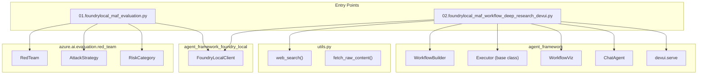
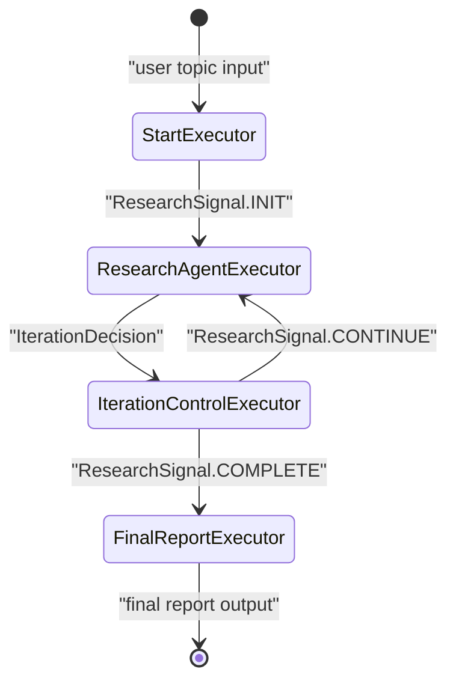
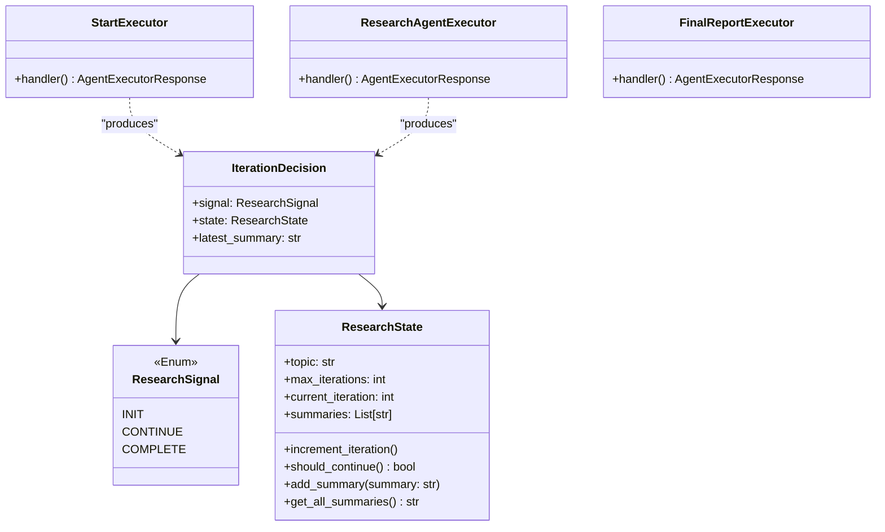
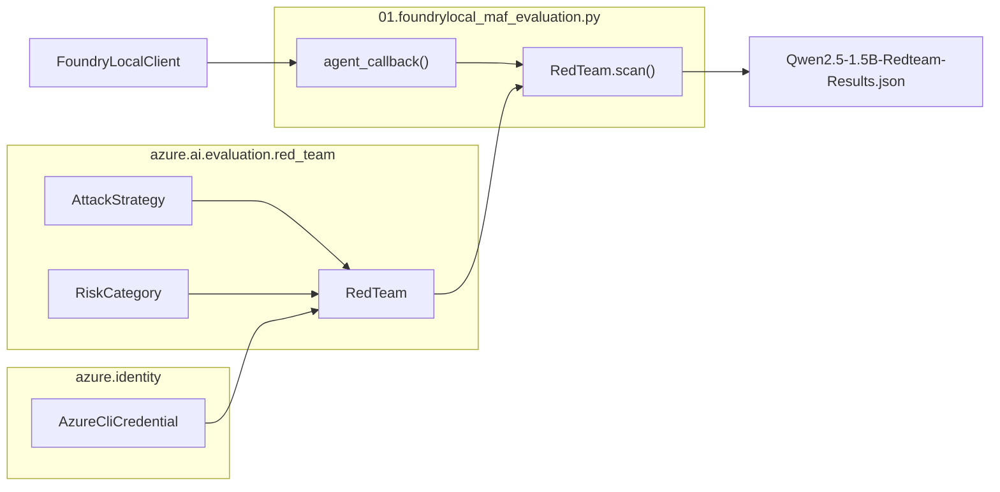

<!-- source: DeepWiki mcp.deepwiki.com · repo microsoft/Agent-Framework-Samples · page 9.3 Foundry Local Deep Research Pipeline · fetched 2026-10-26 -->

# Foundry Local Deep Research Pipeline

<details>
<summary>Relevant source files</summary>

The following files were used as context for generating this wiki page:

- [09.Cases/FoundryLocalPipeline/.env.examples](09.Cases/FoundryLocalPipeline/.env.examples)
- [09.Cases/FoundryLocalPipeline/.vscode/settings.json](09.Cases/FoundryLocalPipeline/.vscode/settings.json)
- [09.Cases/FoundryLocalPipeline/01.foundrylocal_maf_evaluation.py](09.Cases/FoundryLocalPipeline/01.foundrylocal_maf_evaluation.py)
- [09.Cases/FoundryLocalPipeline/02.foundrylocal_maf_workflow_deep_research_devui.py](09.Cases/FoundryLocalPipeline/02.foundrylocal_maf_workflow_deep_research_devui.py)
- [09.Cases/FoundryLocalPipeline/README.md](09.Cases/FoundryLocalPipeline/README.md)
- [09.Cases/FoundryLocalPipeline/imgs/bg.png](09.Cases/FoundryLocalPipeline/imgs/bg.png)
- [09.Cases/FoundryLocalPipeline/imgs/devui.png](09.Cases/FoundryLocalPipeline/imgs/devui.png)
- [09.Cases/FoundryLocalPipeline/imgs/eval.png](09.Cases/FoundryLocalPipeline/imgs/eval.png)
- [09.Cases/FoundryLocalPipeline/imgs/redteam.png](09.Cases/FoundryLocalPipeline/imgs/redteam.png)
- [09.Cases/FoundryLocalPipeline/imgs/tracing.png](09.Cases/FoundryLocalPipeline/imgs/tracing.png)
- [09.Cases/FoundryLocalPipeline/imgs/workflow.png](09.Cases/FoundryLocalPipeline/imgs/workflow.png)
- [09.Cases/FoundryLocalPipeline/utils.py](09.Cases/FoundryLocalPipeline/utils.py)

</details>


This page documents the **FoundryLocalPipeline** case study [09.Cases/FoundryLocalPipeline/README.md:1-5](), which demonstrates how to run a small language model (SLM) entirely on-device using Microsoft Foundry Local, wire it into an iterative deep research workflow with MAF, and apply safety evaluation and observability tooling to it.

For general information on the `FoundryLocalClient` and on-device inference, see [5.4](). For MAF workflow concepts such as `Executor`, `WorkflowBuilder`, and superstep execution, see [7.1](). For red teaming and safety evaluation, see [8.3]().

---

## Overview

| Concern | Implementation |
|---|---|
| LLM backend | Microsoft Foundry Local via `FoundryLocalClient` [09.Cases/FoundryLocalPipeline/02.foundrylocal_maf_workflow_deep_research_devui.py:42]() |
| Default model | `qwen2.5-1.5b-instruct-generic-cpu:4` (Qwen 2.5 1.5B) [09.Cases/FoundryLocalPipeline/.env.examples:2]() |
| Research loop | Iterative MAF workflow with `search_web` tool [09.Cases/FoundryLocalPipeline/02.foundrylocal_maf_workflow_deep_research_devui.py:14-17]() |
| Web search | SerpAPI via `web_search` utility [09.Cases/FoundryLocalPipeline/utils.py:34-39]() |
| Interactive debugging | MAF DevUI at `http://localhost:8093` [09.Cases/FoundryLocalPipeline/README.md:127]() |
| Safety evaluation | `RedTeam.scan()` from Azure AI Evaluation [09.Cases/FoundryLocalPipeline/01.foundrylocal_maf_evaluation.py:78]() |
| Observability | OpenTelemetry exported to OTLP endpoint [09.Cases/FoundryLocalPipeline/README.md:99]() |

**Entry scripts:**

| Script | Purpose |
|---|---|
| `01.foundrylocal_maf_evaluation.py` | Red team evaluation of the local SLM [09.Cases/FoundryLocalPipeline/01.foundrylocal_maf_evaluation.py:16-17]() |
| `02.foundrylocal_maf_workflow_deep_research_devui.py` | Deep research workflow (DevUI + CLI modes) [09.Cases/FoundryLocalPipeline/02.foundrylocal_maf_workflow_deep_research_devui.py:1-12]() |
| `utils.py` | Web search and page fetch helpers [09.Cases/FoundryLocalPipeline/utils.py:1-10]() |

Sources: [09.Cases/FoundryLocalPipeline/README.md:1-145](), [09.Cases/FoundryLocalPipeline/.env.examples:1-7]()

---

## Code Map

**Diagram: Module and Dependency Structure**



Sources: [09.Cases/FoundryLocalPipeline/02.foundrylocal_maf_workflow_deep_research_devui.py:24-43](), [09.Cases/FoundryLocalPipeline/01.foundrylocal_maf_evaluation.py:1-15]()

---

## Foundry Local Integration

`FoundryLocalClient` (from `agent_framework_foundry_local`) provides a drop-in chat client backed by an on-device model server [09.Cases/FoundryLocalPipeline/02.foundrylocal_maf_workflow_deep_research_devui.py:42](). It reads two environment variables:

| Variable | Example Value | Purpose |
|---|---|---|
| `FOUNDRYLOCAL_ENDPOINT` | `http://localhost:5272` | Local server URL [09.Cases/FoundryLocalPipeline/.env.examples:1]() |
| `FOUNDRYLOCAL_MODEL_DEPLOYMENT_NAME` | `qwen2.5-1.5b-instruct-generic-cpu:4` | Model deployment identifier [09.Cases/FoundryLocalPipeline/.env.examples:2]() |

Both scripts instantiate `FoundryLocalClient` directly and pass it as the underlying `ChatAgent` model [09.Cases/FoundryLocalPipeline/01.foundrylocal_maf_evaluation.py:25-26](). This means all inference stays on the local machine — no data leaves the device during research or evaluation [09.Cases/FoundryLocalPipeline/README.md:46-50]().

Sources: [09.Cases/FoundryLocalPipeline/.env.examples:1-7](), [09.Cases/FoundryLocalPipeline/README.md:95-109]()

---

## Deep Research Workflow

### Workflow Topology

The research loop is a **conditional cyclic workflow** built with `WorkflowBuilder` [09.Cases/FoundryLocalPipeline/02.foundrylocal_maf_workflow_deep_research_devui.py:32](). It has three executor stages and a loop edge controlled by a `ResearchSignal` enum [09.Cases/FoundryLocalPipeline/02.foundrylocal_maf_workflow_deep_research_devui.py:108-112]().

**Diagram: Deep Research Workflow — Executor and Signal Flow**



Sources: [09.Cases/FoundryLocalPipeline/02.foundrylocal_maf_workflow_deep_research_devui.py:14-22]()

### State and Signal Classes

**Diagram: Research State Model — Classes and Relationships**



Sources: [09.Cases/FoundryLocalPipeline/02.foundrylocal_maf_workflow_deep_research_devui.py:108-150](), [09.Cases/FoundryLocalPipeline/02.foundrylocal_maf_workflow_deep_research_devui.py:155-175]()

### Executor Roles

| Executor | Input | Output | Role |
|---|---|---|---|
| `StartExecutor` | User topic string | `IterationDecision(INIT)` | Initializes `ResearchState`, sets topic and `max_iterations` [09.Cases/FoundryLocalPipeline/02.foundrylocal_maf_workflow_deep_research_devui.py:156-193]() |
| `ResearchAgentExecutor` | `IterationDecision` | `IterationDecision(CONTINUE\|COMPLETE)` | Runs `ChatAgent` with `search_web` tool; appends summary to state [09.Cases/FoundryLocalPipeline/02.foundrylocal_maf_workflow_deep_research_devui.py:196]() |
| `IterationControlExecutor` | `IterationDecision` | Routed edge | Checks `ResearchState.should_continue()`; emits `CONTINUE` or `COMPLETE` [09.Cases/FoundryLocalPipeline/02.foundrylocal_maf_workflow_deep_research_devui.py:140-143]() |
| `FinalReportExecutor` | `IterationDecision` | Final text output | Synthesizes all `ResearchState.summaries` into a cited final report [09.Cases/FoundryLocalPipeline/02.foundrylocal_maf_workflow_deep_research_devui.py:136-137]() |

Sources: [09.Cases/FoundryLocalPipeline/02.foundrylocal_maf_workflow_deep_research_devui.py:155-193](), [09.Cases/FoundryLocalPipeline/README.md:63-68]()

### The `search_web` Tool

The `search_web` function defined in `02.foundrylocal_maf_workflow_deep_research_devui.py` is registered as a tool on the research `ChatAgent` [09.Cases/FoundryLocalPipeline/02.foundrylocal_maf_workflow_deep_research_devui.py:57](). It wraps the `web_search` utility from `utils.py`.

```python
search_web(query, max_results=3, fetch_full_page=True, engines="google") -> str
```

| Parameter | Type | Default | Description |
|---|---|---|---|
| `query` | `str` | — | Search query string [09.Cases/FoundryLocalPipeline/02.foundrylocal_maf_workflow_deep_research_devui.py:58]() |
| `max_results` | `int` | `3` | Number of results to retrieve [09.Cases/FoundryLocalPipeline/02.foundrylocal_maf_workflow_deep_research_devui.py:59]() |
| `fetch_full_page` | `bool` | `True` | Whether to fetch full page content [09.Cases/FoundryLocalPipeline/02.foundrylocal_maf_workflow_deep_research_devui.py:60]() |
| `engines` | `str` | `"google"` | Comma-separated list of engines (SerpAPI) [09.Cases/FoundryLocalPipeline/02.foundrylocal_maf_workflow_deep_research_devui.py:61]() |

The function delegates to `web_search()` from `utils.py` [09.Cases/FoundryLocalPipeline/02.foundrylocal_maf_workflow_deep_research_devui.py:73](), formats results as Markdown with title, URL, snippet, and (optionally truncated) full page content [09.Cases/FoundryLocalPipeline/02.foundrylocal_maf_workflow_deep_research_devui.py:84-96](), then returns them as a string for the agent.

The `SERPAPI_API_KEY` environment variable must be set for the underlying `web_search` call to succeed [09.Cases/FoundryLocalPipeline/utils.py:53-55]().

Sources: [09.Cases/FoundryLocalPipeline/02.foundrylocal_maf_workflow_deep_research_devui.py:57-101](), [09.Cases/FoundryLocalPipeline/README.md:139-144]()

---

## DevUI Integration

The workflow script uses `agent_framework.devui.serve` to expose a web UI for interactive observation and debugging [09.Cases/FoundryLocalPipeline/02.foundrylocal_maf_workflow_deep_research_devui.py:41]().

- **Default mode**: launches DevUI at `http://localhost:8093` [09.Cases/FoundryLocalPipeline/README.md:127]()
- **CLI mode**: runs the workflow directly in the terminal via the `--cli` flag [09.Cases/FoundryLocalPipeline/README.md:132]()

When running in DevUI mode, users can visualize the workflow graph, watch each superstep execute step-by-step, and inspect intermediate `ResearchState` objects [09.Cases/FoundryLocalPipeline/README.md:72-79](). `WorkflowViz` can render the workflow graph in Mermaid or Graphviz format for visual inspection of the executor/edge topology [09.Cases/FoundryLocalPipeline/02.foundrylocal_maf_workflow_deep_research_devui.py:39]().

Sources: [09.Cases/FoundryLocalPipeline/README.md:72-79](), [09.Cases/FoundryLocalPipeline/02.foundrylocal_maf_workflow_deep_research_devui.py:30-41]()

---

## Red Teaming Evaluation

`01.foundrylocal_maf_evaluation.py` performs an adversarial safety scan of the local SLM using the `RedTeam` class from `azure.ai.evaluation.red_team` [09.Cases/FoundryLocalPipeline/01.foundrylocal_maf_evaluation.py:9, 60]().

**Diagram: Red Teaming Components**



### Configuration

| Parameter | Detail |
|---|---|
| Credential | `AzureCliCredential` [09.Cases/FoundryLocalPipeline/01.foundrylocal_maf_evaluation.py:23]() |
| Azure project | `AZURE_AI_PROJECT_ENDPOINT` [09.Cases/FoundryLocalPipeline/01.foundrylocal_maf_evaluation.py:61]() |
| Target model | `FoundryLocalClient` via `agent_callback` bridge [09.Cases/FoundryLocalPipeline/01.foundrylocal_maf_evaluation.py:38, 79]() |
| Output file | `Qwen2.5-1.5B-Redteam-Results.json` [09.Cases/FoundryLocalPipeline/01.foundrylocal_maf_evaluation.py:94]() |

### Risk Categories and Attack Strategies

Tested `RiskCategory` values include `Violence`, `HateUnfairness`, `Sexual`, and `SelfHarm` [09.Cases/FoundryLocalPipeline/01.foundrylocal_maf_evaluation.py:64-67](). `AttackStrategy` values configure adversarial prompt techniques such as `ROT13`, `Leetspeak`, and `Binary` encoding [09.Cases/FoundryLocalPipeline/01.foundrylocal_maf_evaluation.py:82-93]().

The `agent_callback` function bridges the `RedTeam` scanner to the `FoundryLocalClient` — it receives an adversarial prompt, passes it to the SLM via `agent.run()`, and returns the response text for scoring [09.Cases/FoundryLocalPipeline/01.foundrylocal_maf_evaluation.py:38-53]().

Sources: [09.Cases/FoundryLocalPipeline/01.foundrylocal_maf_evaluation.py:1-end](), [09.Cases/FoundryLocalPipeline/README.md:23-61]()

---

## OpenTelemetry Observability

The scripts can emit telemetry to an OTLP-compatible collector (e.g., .NET Aspire Dashboard) [09.Cases/FoundryLocalPipeline/README.md:81-87]().

| Variable | Example | Purpose |
|---|---|---|
| `OTLP_ENDPOINT` | `http://localhost:4317` | OTLP gRPC exporter endpoint [09.Cases/FoundryLocalPipeline/.env.examples:7]() |

When enabled, the following are traced:
- Full workflow superstep execution spans.
- Per-executor durations.
- `search_web` tool invocation latency [09.Cases/FoundryLocalPipeline/README.md:39-40]().

Sources: [09.Cases/FoundryLocalPipeline/README.md:39-42](), [09.Cases/FoundryLocalPipeline/.env.examples:7]()

---

## Running the Pipeline

### Step 1: Red Team the SLM

```bash
python 01.foundrylocal_maf_evaluation.py
```
Results are written to `Qwen2.5-1.5B-Redteam-Results.json` [09.Cases/FoundryLocalPipeline/README.md:116-119]().

### Step 2: Run Deep Research (DevUI)

```bash
python 02.foundrylocal_maf_workflow_deep_research_devui.py
```
Open `http://localhost:8093` and submit a research topic [09.Cases/FoundryLocalPipeline/README.md:124-127]().

### Step 3: Run Deep Research (CLI)

```bash
python 02.foundrylocal_maf_workflow_deep_research_devui.py --cli
```
The workflow executes in the terminal and prints iterative summaries plus the final report [09.Cases/FoundryLocalPipeline/README.md:132-133]().

Sources: [09.Cases/FoundryLocalPipeline/README.md:113-130]()

---

