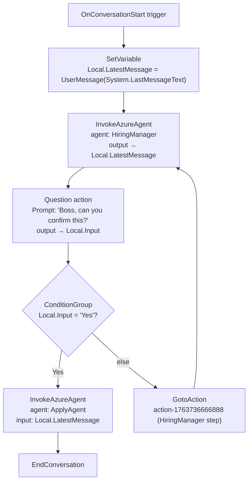
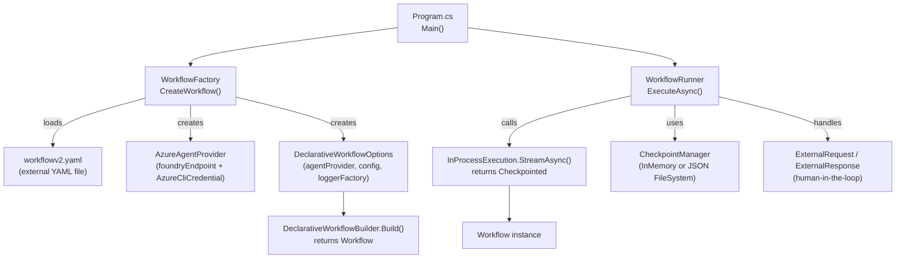
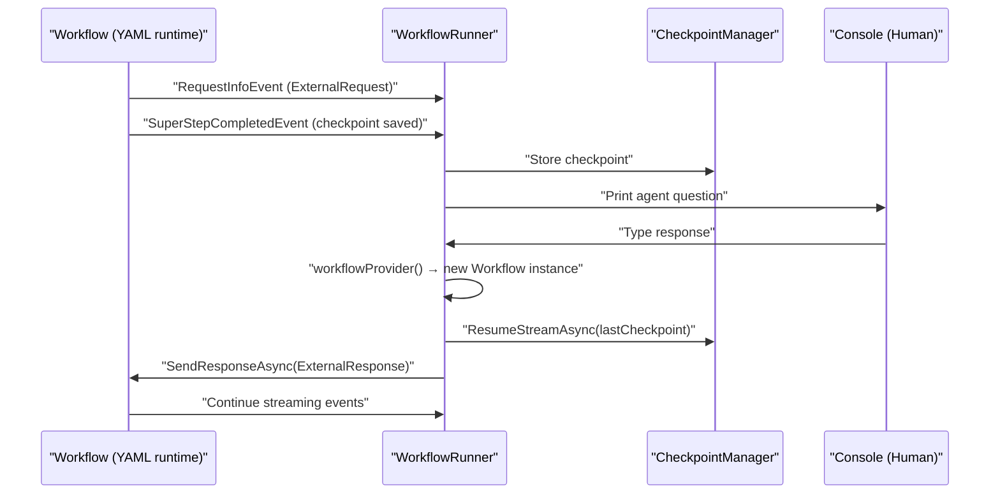
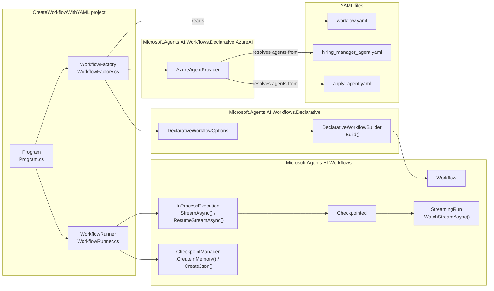

<!-- source: DeepWiki mcp.deepwiki.com · repo microsoft/Agent-Framework-Samples · page 9.4 Microsoft Foundry YAML Declarative Workflows · fetched 2026-10-26 -->

# Microsoft Foundry YAML Declarative Workflows

<details>
<summary>Relevant source files</summary>

The following files were used as context for generating this wiki page:

- [.env.examples](.env.examples)
- [09.Cases/GHModel.AI/GHModel.Python.AI/GHModel.Python.AI.Workflow.OpenTelemetry/.vscode/settings.json](09.Cases/GHModel.AI/GHModel.Python.AI/GHModel.Python.AI.Workflow.OpenTelemetry/.vscode/settings.json)
- [09.Cases/GHModel.AI/GHModel.Python.AI/GHModel.Python.AI.Workflow.OpenTelemetry/main.py](09.Cases/GHModel.AI/GHModel.Python.AI/GHModel.Python.AI.Workflow.OpenTelemetry/main.py)
- [09.Cases/GHModel.AI/GHModel.Python.AI/GHModel.Python.AI.Workflow.OpenTelemetry/workflow/workflow.py](09.Cases/GHModel.AI/GHModel.Python.AI/GHModel.Python.AI.Workflow.OpenTelemetry/workflow/workflow.py)
- [09.Cases/GHModel.AI/src/Workflows/HrDemoWorkflow.cs](09.Cases/GHModel.AI/src/Workflows/HrDemoWorkflow.cs)
- [09.Cases/MicrosoftFoundryWithAITKAndMAF/CreateWorkflowWithYAML/CreateWorkflowWithYAML.csproj](09.Cases/MicrosoftFoundryWithAITKAndMAF/CreateWorkflowWithYAML/CreateWorkflowWithYAML.csproj)
- [09.Cases/MicrosoftFoundryWithAITKAndMAF/CreateWorkflowWithYAML/CreateWorkflowWithYAML.sln](09.Cases/MicrosoftFoundryWithAITKAndMAF/CreateWorkflowWithYAML/CreateWorkflowWithYAML.sln)
- [09.Cases/MicrosoftFoundryWithAITKAndMAF/CreateWorkflowWithYAML/Program.cs](09.Cases/MicrosoftFoundryWithAITKAndMAF/CreateWorkflowWithYAML/Program.cs)
- [09.Cases/MicrosoftFoundryWithAITKAndMAF/CreateWorkflowWithYAML/WorkflowFactory.cs](09.Cases/MicrosoftFoundryWithAITKAndMAF/CreateWorkflowWithYAML/WorkflowFactory.cs)
- [09.Cases/MicrosoftFoundryWithAITKAndMAF/CreateWorkflowWithYAML/WorkflowRunner.cs](09.Cases/MicrosoftFoundryWithAITKAndMAF/CreateWorkflowWithYAML/WorkflowRunner.cs)
- [09.Cases/MicrosoftFoundryWithAITKAndMAF/CreateWorkflowWithYAML/architecture.md](09.Cases/MicrosoftFoundryWithAITKAndMAF/CreateWorkflowWithYAML/architecture.md)
- [09.Cases/MicrosoftFoundryWithAITKAndMAF/README.md](09.Cases/MicrosoftFoundryWithAITKAndMAF/README.md)
- [09.Cases/MicrosoftFoundryWithAITKAndMAF/YAML/apply_agent.yaml](09.Cases/MicrosoftFoundryWithAITKAndMAF/YAML/apply_agent.yaml)
- [09.Cases/MicrosoftFoundryWithAITKAndMAF/YAML/hiring_manager_agent.yaml](09.Cases/MicrosoftFoundryWithAITKAndMAF/YAML/hiring_manager_agent.yaml)
- [09.Cases/MicrosoftFoundryWithAITKAndMAF/YAML/workflow.yaml](09.Cases/MicrosoftFoundryWithAITKAndMAF/YAML/workflow.yaml)
- [09.Cases/MicrosoftFoundryWithAITKAndMAF/imgs/mulitiagents_workflow.png](09.Cases/MicrosoftFoundryWithAITKAndMAF/imgs/mulitiagents_workflow.png)

</details>


This page documents the `MicrosoftFoundryWithAITKAndMAF` case study, which demonstrates a configuration-as-code approach to multi-agent orchestration. The central technique is exporting a workflow from Microsoft Foundry as YAML and executing it directly in the Microsoft Agent Framework (MAF) without rewriting the logic in C#. The recruitment scenario (HiringManager + ApplyAgent) is used throughout as the concrete example.

For the general workflow orchestration patterns (sequential, concurrent, conditional) and the `WorkflowBuilder` Python API, see [Workflow Orchestration](#7). For how agent YAML files relate to Azure AI Foundry persistent agents, see [Azure AI Foundry](#5.3).

---

## Overview and Development Phases

The case study is organized into three progressive phases:

| Phase | Tool | Artifact | Location |
|---|---|---|---|
| Design | Microsoft Foundry visual canvas | `workflow.yaml`, `*.yaml` agent files | `09.Cases/MicrosoftFoundryWithAITKAndMAF/YAML/` |
| Develop | Microsoft Foundry VSCode Extension | Synced YAML, scaffolded code | Local SDLC |
| Deploy | Microsoft Agent Framework (MAF) | `WorkflowFactory`, `WorkflowRunner`, `Program.cs` | `09.Cases/MicrosoftFoundryWithAITKAndMAF/CreateWorkflowWithYAML/` |

The key principle is that the YAML artifacts produced during the Design phase are consumed **directly** by the Deploy phase. No logic needs to be rewritten; the framework natively parses and executes the declarative files.

Sources: [09.Cases/MicrosoftFoundryWithAITKAndMAF/README.md:1-51]()

---

## The Recruitment Scenario

The workflow implements an automated recruitment interview loop between two agents and a human approver:

1. The user's message is captured as the initial applicant description.
2. The **HiringManager** agent (GPT-4.1-mini) generates interview questions.
3. The workflow pauses and asks the human ("Boss") for confirmation.
4. If the human responds `"Yes"`, the **ApplyAgent** (Claude Sonnet) provides answers in JSON format, and the conversation ends.
5. If the human responds with anything else, control loops back to the HiringManager.

**Workflow Logic Diagram**



Sources: [09.Cases/MicrosoftFoundryWithAITKAndMAF/YAML/workflow.yaml:1-46]()

---

## YAML Artifacts

### `workflow.yaml`

The workflow definition lives at [09.Cases/MicrosoftFoundryWithAITKAndMAF/YAML/workflow.yaml:1-46](). Key structural fields:

| Field | Value | Purpose |
|---|---|---|
| `kind` | `workflow` | Identifies this as a top-level workflow definition |
| `trigger.kind` | `OnConversationStart` | Fires when a new conversation begins |
| `name` | `HRDotNETDemo` | Workflow identifier |
| Action `SetVariable` | `Local.LatestMessage` | Captures the user's message into a workflow variable |
| Action `InvokeAzureAgent` | `HiringManager` | Calls a named Foundry agent by name |
| Action `Question` | `Local.Input` | Suspends the workflow and requests external human input |
| Action `ConditionGroup` | `=Local.Input="Yes"` | Declarative branching using Foundry expression syntax |
| Action `GotoAction` | `action-1763736666888` | Loop-back using action IDs as targets |
| Action `EndConversation` | — | Terminates the workflow session |

The expression syntax (`=UserMessage(...)`, `=System.LastMessage`, `=Local.Input="Yes"`) is the Foundry expression language evaluated by the MAF declarative runtime.

Sources: [09.Cases/MicrosoftFoundryWithAITKAndMAF/YAML/workflow.yaml:1-46]()

### Agent YAML Files

Each agent is defined in its own YAML file, also exported from Foundry:

**`hiring_manager_agent.yaml`** — [09.Cases/MicrosoftFoundryWithAITKAndMAF/YAML/hiring_manager_agent.yaml:1-17]()

| Field | Value |
|---|---|
| `name` | `HiringManager` |
| `definition.kind` | `prompt` |
| `definition.model` | `gpt-4.1-mini` |
| `definition.temperature` | `0.7` |

**`apply_agent.yaml`** — [09.Cases/MicrosoftFoundryWithAITKAndMAF/YAML/apply_agent.yaml:1-18]()

| Field | Value |
|---|---|
| `name` | `ApplyAgent` |
| `definition.kind` | `prompt` |
| `definition.model` | `claude-sonnet-4-5` |
| `definition.instructions` | Respond to Hiring Manager questions in `{"Answer":"..."}` JSON format |
| `definition.temperature` | `0.7` |

The `name` field in each YAML file matches the `agent.name` referenced inside `workflow.yaml`'s `InvokeAzureAgent` actions. The MAF runtime resolves agents by this name via the `AzureAgentProvider`.

Sources: [09.Cases/MicrosoftFoundryWithAITKAndMAF/YAML/apply_agent.yaml:1-18](), [09.Cases/MicrosoftFoundryWithAITKAndMAF/YAML/hiring_manager_agent.yaml:1-17](), [09.Cases/MicrosoftFoundryWithAITKAndMAF/YAML/workflow.yaml:11-16]()

---

## Code Architecture

**Architecture Diagram**



Sources: [09.Cases/MicrosoftFoundryWithAITKAndMAF/CreateWorkflowWithYAML/WorkflowFactory.cs:1-49](), [09.Cases/MicrosoftFoundryWithAITKAndMAF/CreateWorkflowWithYAML/WorkflowRunner.cs:1-50](), [09.Cases/MicrosoftFoundryWithAITKAndMAF/CreateWorkflowWithYAML/Program.cs:1-23](), [09.Cases/MicrosoftFoundryWithAITKAndMAF/CreateWorkflowWithYAML/architecture.md:1-17]()

### `WorkflowFactory`

Defined in [09.Cases/MicrosoftFoundryWithAITKAndMAF/CreateWorkflowWithYAML/WorkflowFactory.cs:1-49]().

`WorkflowFactory` is a sealed class with two constructor parameters: the path to the YAML file (`workflowFile`) and the Azure AI Foundry project `Uri` (`foundryEndpoint`).

Its single public method, `CreateWorkflow()`, performs three steps:

1. Instantiates `AzureAgentProvider` with the Foundry endpoint and `AzureCliCredential`. Any `AIFunction` instances in the `Functions` property are registered here for auto-execution.
2. Constructs `DeclarativeWorkflowOptions`, wiring in the agent provider, optional `IConfiguration`, optional `ConversationId` for resuming an existing conversation, and an `ILoggerFactory`.
3. Calls `DeclarativeWorkflowBuilder.Build<string>(workflowPath, options)` to parse the YAML and return a `Workflow` object.

The method is designed to be called repeatedly — each call returns a fresh `Workflow` instance, enabling checkpoint-based resume on a new instance (see WorkflowRunner below).

### `WorkflowRunner`

Defined in [09.Cases/MicrosoftFoundryWithAITKAndMAF/CreateWorkflowWithYAML/WorkflowRunner.cs:1-381]().

`WorkflowRunner` orchestrates the execution lifecycle. Its primary method is `ExecuteAsync(Func<Workflow> workflowProvider, string input)`.

**Execution loop:**

```
1. Invoke workflowProvider() → Workflow instance
2. Create CheckpointManager (in-memory or JSON file-system)
3. Call InProcessExecution.StreamAsync(workflow, input, checkpointManager) → Checkpointed<StreamingRun>
4. Loop:
   a. Call MonitorAndDisposeWorkflowRunAsync(run, requestResponse)
   b. If ExternalRequest returned → yield to human, collect response, resume
   c. If no ExternalRequest → workflow is complete, exit loop
```

**Checkpoint strategy:** `UseJsonCheckpoints` (bool property) switches between `CheckpointManager.CreateInMemory()` and `CheckpointManager.CreateJson(FileSystemJsonCheckpointStore(...))`. JSON checkpoints persist state to disk under a timestamped directory, enabling durable cross-process resume.

**Resume from checkpoint:** When resuming after an `ExternalRequest`, a new `Workflow` instance is created via `workflowProvider()`, and `InProcessExecution.ResumeStreamAsync(workflow, lastCheckpoint, checkpointManager, runId)` restores the workflow to its saved state.

### `Program.cs`

Defined in [09.Cases/MicrosoftFoundryWithAITKAndMAF/CreateWorkflowWithYAML/Program.cs:1-23]().

The entry point is minimal by design — this demonstrates that the YAML fully encodes the workflow logic:

```
WorkflowFactory workflowFactory = new(<yaml-path>, <foundryEndpoint>);
WorkflowRunner runner = new();
await runner.ExecuteAsync(workflowFactory.CreateWorkflow, "junior developer");
```

The `"junior developer"` string is the initial user input that triggers the `OnConversationStart` event.

Sources: [09.Cases/MicrosoftFoundryWithAITKAndMAF/CreateWorkflowWithYAML/Program.cs:1-23](), [09.Cases/MicrosoftFoundryWithAITKAndMAF/CreateWorkflowWithYAML/WorkflowFactory.cs:27-49](), [09.Cases/MicrosoftFoundryWithAITKAndMAF/CreateWorkflowWithYAML/WorkflowRunner.cs:56-111]()

---

## Workflow Event Handling

`MonitorAndDisposeWorkflowRunAsync` in `WorkflowRunner` consumes an `IAsyncEnumerable<WorkflowEvent>` from `run.Run.WatchStreamAsync()`. Each event type carries specific semantics:

| Event Type | Action Taken |
|---|---|
| `ExecutorInvokedEvent` | Debug log: executor entered |
| `ExecutorCompletedEvent` | Debug log: executor exited |
| `DeclarativeActionInvokedEvent` | Debug log: action entered (with action type) |
| `DeclarativeActionCompletedEvent` | Debug log: action exited |
| `ExecutorFailedEvent` | Debug log: error message |
| `WorkflowErrorEvent` | Throws the contained exception |
| `SuperStepCompletedEvent` | Saves `LastCheckpoint`; triggers exit if an `ExternalRequest` is pending |
| `RequestInfoEvent` | Captures the `ExternalRequest` for the human-in-the-loop handler |
| `ConversationUpdateEvent` | Debug log: conversation state update |
| `MessageActivityEvent` | Prints activity message to console in yellow |
| `AgentRunUpdateEvent` | Streams agent text token-by-token; also handles `ImageGenerationCallResponseItem`, `FunctionCallResponseItem`, `McpToolCallItem` |
| `AgentRunResponseEvent` | Prints token usage (total / input / output) |

Sources: [09.Cases/MicrosoftFoundryWithAITKAndMAF/CreateWorkflowWithYAML/WorkflowRunner.cs:113-265]()

---

## Human-in-the-Loop: ExternalRequest / ExternalResponse

The `Question` action in `workflow.yaml` causes the workflow to emit an `ExternalRequest` and suspend. `WorkflowRunner` handles this in `HandleExternalRequestAsync`:

**External request handling diagram**



`HandleExternalRequestAsync` extracts an `ExternalInputRequest` from the request payload. It inspects each `AIContent` item in the agent's response messages:

- `FunctionCallContent` → invokes the matching `AIFunction` from `FunctionMap` and returns a `FunctionResultContent`
- `FunctionApprovalRequestContent` → auto-approves and returns approval
- `McpServerToolApprovalRequestContent` → auto-approves MCP tool call
- Unrecognized content → falls through to `HandleUserInputRequest`, which reads a line from the console

The `ExternalResponse` is created with `externalRequest.CreateResponse(response)` and delivered via `run.Run.SendResponseAsync(requestResponse)` at the start of the next monitoring loop iteration.

Sources: [09.Cases/MicrosoftFoundryWithAITKAndMAF/CreateWorkflowWithYAML/WorkflowRunner.cs:271-365]()

---

## NuGet Package Dependencies

The project targets `.NET 10` and references three MAF-specific packages:

| Package | Role |
|---|---|
| `Microsoft.Agents.AI.Workflows` | Core workflow runtime (`Workflow`, `InProcessExecution`, `CheckpointManager`) |
| `Microsoft.Agents.AI.Workflows.Declarative` | YAML parser and `DeclarativeWorkflowBuilder` |
| `Microsoft.Agents.AI.Workflows.Declarative.AzureAI` | `AzureAgentProvider` for routing `InvokeAzureAgent` actions to Foundry |

Sources: [09.Cases/MicrosoftFoundryWithAITKAndMAF/CreateWorkflowWithYAML/CreateWorkflowWithYAML.csproj:11-14]()

---

## Key Classes and Their Responsibilities

**Class-to-file mapping diagram**



Sources: [09.Cases/MicrosoftFoundryWithAITKAndMAF/CreateWorkflowWithYAML/WorkflowFactory.cs:1-49](), [09.Cases/MicrosoftFoundryWithAITKAndMAF/CreateWorkflowWithYAML/WorkflowRunner.cs:1-50](), [09.Cases/MicrosoftFoundryWithAITKAndMAF/CreateWorkflowWithYAML/Program.cs:1-23](), [09.Cases/MicrosoftFoundryWithAITKAndMAF/CreateWorkflowWithYAML/architecture.md:1-17]()

---

## Relationship to Other Case Studies

The recruitment scenario logic also appears as a pure .NET class in the GHModel.AI case study: `HrDemoWorkflow` in [09.Cases/GHModel.AI/src/Workflows/HrDemoWorkflow.cs:41-134](). That implementation encodes the same loop (HiringManager → human approval → ApplyAgent or loop back) directly in C# rather than in YAML. Comparing the two shows the trade-off:

| Approach | Logic location | Human approval | Portability |
|---|---|---|---|
| YAML declarative (`MicrosoftFoundryWithAITKAndMAF`) | `workflow.yaml` | `Question` action + `ExternalRequest` | YAML is cloud-designable, framework-portable |
| Imperative C# (`HrDemoWorkflow`) | `HrDemoWorkflow.RunAsync()` | `IHumanApprovalService.AskAsync()` | Full C# flexibility, but no visual canvas |

For the GHModel.AI workflow case study (DevUI, AGUI, OpenTelemetry variants), see [GHModel.AI Travel Assistant](#9.1).

---

