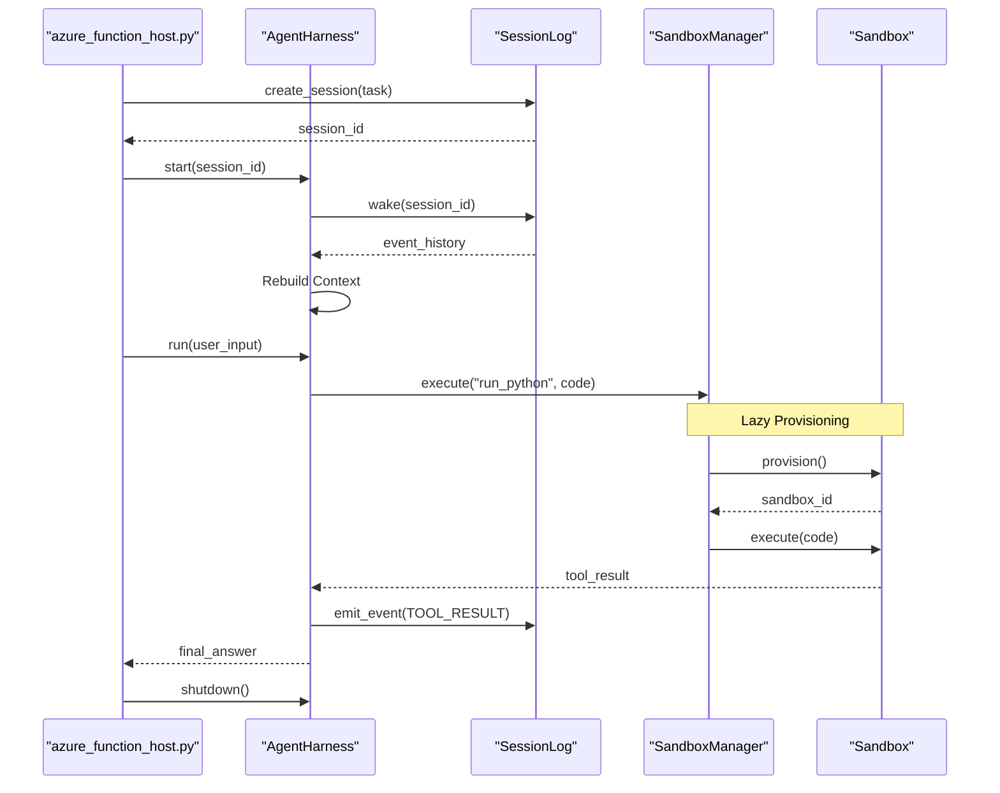

<!-- source: DeepWiki mcp.deepwiki.com · repo microsoft/Agent-Framework-Samples · page 9.5 MAF Harness Managed Agent · fetched 2026-10-26 -->

# MAF Harness Managed Agent

<details>
<summary>Relevant source files</summary>

The following files were used as context for generating this wiki page:

- [09.Cases/maf_harness_managed_agent/.env.example](09.Cases/maf_harness_managed_agent/.env.example)
- [09.Cases/maf_harness_managed_agent/.vscode/settings.json](09.Cases/maf_harness_managed_agent/.vscode/settings.json)
- [09.Cases/maf_harness_managed_agent/README.md](09.Cases/maf_harness_managed_agent/README.md)
- [09.Cases/maf_harness_managed_agent/README.zh.md](09.Cases/maf_harness_managed_agent/README.zh.md)
- [09.Cases/maf_harness_managed_agent/blog_en.md](09.Cases/maf_harness_managed_agent/blog_en.md)
- [09.Cases/maf_harness_managed_agent/blog_zh.md](09.Cases/maf_harness_managed_agent/blog_zh.md)
- [09.Cases/maf_harness_managed_agent/imgs/logo.png](09.Cases/maf_harness_managed_agent/imgs/logo.png)
- [09.Cases/maf_harness_managed_agent/local.settings.json](09.Cases/maf_harness_managed_agent/local.settings.json)
- [09.Cases/maf_harness_managed_agent/maf_harness/__init__.py](09.Cases/maf_harness_managed_agent/maf_harness/__init__.py)
- [09.Cases/maf_harness_managed_agent/maf_harness/harness/__init__.py](09.Cases/maf_harness_managed_agent/maf_harness/harness/__init__.py)
- [09.Cases/maf_harness_managed_agent/maf_harness/harness/harness.py](09.Cases/maf_harness_managed_agent/maf_harness/harness/harness.py)
- [09.Cases/maf_harness_managed_agent/maf_harness/hosting/azure_function_host.py](09.Cases/maf_harness_managed_agent/maf_harness/hosting/azure_function_host.py)
- [09.Cases/maf_harness_managed_agent/maf_harness/middleware/middleware.py](09.Cases/maf_harness_managed_agent/maf_harness/middleware/middleware.py)
- [09.Cases/maf_harness_managed_agent/maf_harness/orchestration/multi_agent.py](09.Cases/maf_harness_managed_agent/maf_harness/orchestration/multi_agent.py)
- [09.Cases/maf_harness_managed_agent/maf_harness/sandbox/sandbox.py](09.Cases/maf_harness_managed_agent/maf_harness/sandbox/sandbox.py)
- [09.Cases/maf_harness_managed_agent/maf_harness/session/session_log.py](09.Cases/maf_harness_managed_agent/maf_harness/session/session_log.py)
- [09.Cases/maf_harness_managed_agent/maf_harness/skills/skills.py](09.Cases/maf_harness_managed_agent/maf_harness/skills/skills.py)
- [09.Cases/maf_harness_managed_agent/main.py](09.Cases/maf_harness_managed_agent/main.py)

</details>


The `maf_harness_managed_agent` case study implements the "Brain-Hands-Memory" architecture proposed by Anthropic in their "Scaling Managed Agents" paper. This architecture decouples the agent's reasoning (the Brain) from its execution environment (the Hands) and its state (the Memory) to achieve high reliability, horizontal scalability, and improved security.

The implementation uses the **Microsoft Agent Framework (MAF)** for orchestration and **Microsoft Foundry** (`FoundryChatClient`) as the primary LLM backend, avoiding direct dependencies on the OpenAI SDK [09.Cases/maf_harness_managed_agent/maf_harness/harness/harness.py:1-10]().

## Architecture Overview

The system is structured into three distinct layers that can fail and recover independently:

1.  **Session (Memory):** A durable, append-only event log (`SessionLog`) that stores the complete history of an agent's life, independent of the runtime process [09.Cases/maf_harness_managed_agent/maf_harness/session/session_log.py:65-72]().
2.  **Harness (Brain):** A stateless orchestrator (`AgentHarness`) that rehydrates its context from the session log using a `wake()` command [09.Cases/maf_harness_managed_agent/maf_harness/harness/harness.py:189-195]().
3.  **Sandbox (Hands):** Isolated execution environments (`Sandbox`) managed by a `SandboxManager`. These are treated as "cattle"—disposable resources created on-demand when a tool call is required [09.Cases/maf_harness_managed_agent/maf_harness/sandbox/sandbox.py:4-14]().

### System Component Interaction

The following diagram bridges the conceptual "Managed Agent" layers to the specific classes and files in the codebase.

**Managed Agent Architecture Mapping**
```mermaid
graph TD
    subgraph "Session Layer (Memory)"
        SL["SessionLog (session_log.py)"]
        SE["SessionEvent (session_log.py)"]
    end

    subgraph "Harness Layer (Brain)"
        AH["AgentHarness (harness.py)"]
        FC["FoundryChatClient (foundry.py)"]
        MW["Middleware Stack (middleware.py)"]
    end

    subgraph "Sandbox Layer (Hands)"
        SM["SandboxManager (sandbox.py)"]
        SB["Sandbox (sandbox.py)"]
        VS["VaultStore (sandbox.py)"]
    end

    User -->|POST /run| AH
    AH -->|wake()| SL
    SL -->|events| AH
    AH -->|emit_event()| SL
    AH -->|execute()| SM
    SM -->|provision| SB
    SB -->|fetch token| VS
    AH -.->|reasoning| FC
```
Sources: [09.Cases/maf_harness_managed_agent/maf_harness/harness/harness.py:4-20](), [09.Cases/maf_harness_managed_agent/maf_harness/session/session_log.py:4-15](), [09.Cases/maf_harness_managed_agent/maf_harness/sandbox/sandbox.py:4-14]()

## Core Components

### AgentHarness (The Brain)
The `AgentHarness` class is the central orchestrator. It is designed to be completely stateless. When a turn starts, it calls `session_log.wake(session_id)` to retrieve all historical events and rebuild the conversation context for the `FoundryChatClient` [09.Cases/maf_harness_managed_agent/maf_harness/harness/harness.py:228-235]().

Key methods:
*   `start(session_id)`: Rehydrates the agent from the durable log [09.Cases/maf_harness_managed_agent/maf_harness/harness/harness.py:214-219]().
*   `run(input)`: Executes a reasoning loop using `Agent.run()` [09.Cases/maf_harness_managed_agent/maf_harness/harness/harness.py:246-250]().
*   `shutdown()`: Emits a `SESSION_END` event and cleans up resources [09.Cases/maf_harness_managed_agent/maf_harness/harness/harness.py:262-265]().

### SessionLog (The Memory)
Unlike a standard chat history, the `SessionLog` uses a structured `SessionEvent` model. This allows the harness to perform "Context Engineering"—slicing the event stream to provide only relevant context to the LLM (e.g., the last N events or only tool results) [09.Cases/maf_harness_managed_agent/maf_harness/session/session_log.py:161-168]().

Supported `EventKind` types include `SESSION_START`, `USER_INPUT`, `TOOL_CALL`, `TOOL_RESULT`, `HARNESS_WAKE`, and `COMPACTION` [09.Cases/maf_harness_managed_agent/maf_harness/session/session_log.py:31-42]().

### Sandbox & VaultStore (The Hands)
The `SandboxManager` provides isolated environments for tool execution.
*   **Lazy Provisioning:** Sandboxes are only created when the first tool call occurs, significantly reducing Time-to-First-Token (TTFT) for reasoning-only queries [09.Cases/maf_harness_managed_agent/maf_harness/harness/harness.py:102-111]().
*   **VaultStore:** A secure credential store. Tokens are injected into tools at execution time but never stored within the sandbox filesystem or model context [09.Cases/maf_harness_managed_agent/maf_harness/sandbox/sandbox.py:27-34]().

Sources: [09.Cases/maf_harness_managed_agent/maf_harness/harness/harness.py:189-210](), [09.Cases/maf_harness_managed_agent/maf_harness/session/session_log.py:29-61](), [09.Cases/maf_harness_managed_agent/maf_harness/sandbox/sandbox.py:139-155]()

## Middleware Stack

The implementation uses the MAF `@agent_middleware` pattern to intercept agent turns for cross-cutting concerns [09.Cases/maf_harness_managed_agent/maf_harness/middleware/middleware.py:1-14]():

| Middleware | Purpose | Implementation |
| :--- | :--- | :--- |
| **SessionLogging** | Writes every turn as structured events to the durable `SessionLog`. | `make_session_logging_middleware` |
| **Security** | Scrubs credential patterns (e.g., `AZURE_`, `sk-`) from the context before they reach the LLM. | `make_security_middleware` |
| **RateLimit** | Implements a token bucket rate limiter to control Requests Per Minute (RPM). | `make_rate_limit_middleware` |
| **Observability** | Tracks TTFT (Time to First Token) and total run metrics. | `make_observability_middleware` |

Sources: [09.Cases/maf_harness_managed_agent/maf_harness/middleware/middleware.py:29-112](), [09.Cases/maf_harness_managed_agent/maf_harness/middleware/middleware.py:156-184]()

## Data Flow: Request Execution

The following diagram illustrates the sequence of operations when a user submits a task to the managed agent via the Azure Function host.

**Managed Agent Execution Flow**

Sources: [09.Cases/maf_harness_managed_agent/maf_harness/hosting/azure_function_host.py:83-103](), [09.Cases/maf_harness_managed_agent/maf_harness/harness/harness.py:228-255](), [09.Cases/maf_harness_managed_agent/maf_harness/harness/harness.py:114-128]()

## Hosting and Deployment

### Azure Functions
The harness is hosted as an Azure Function with HTTP triggers. Because the `AgentHarness` is stateless, any function instance can handle any `session_id` by rehydrating from the `SessionLog` [09.Cases/maf_harness_managed_agent/maf_harness/hosting/azure_function_host.py:1-15]().

Endpoints defined in `azure_function_host.py`:
*   `POST /sessions`: Creates a new session [09.Cases/maf_harness_managed_agent/maf_harness/hosting/azure_function_host.py:134-139]().
*   `POST /sessions/{id}/run`: Executes a single agent turn [09.Cases/maf_harness_managed_agent/maf_harness/hosting/azure_function_host.py:141-153]().
*   `GET /sessions/{id}/events`: Queries the event log with optional `start` and `end` slicing [09.Cases/maf_harness_managed_agent/maf_harness/hosting/azure_function_host.py:155-162]().
*   `POST /sessions/{id}/wake`: Explicitly rehydrates the harness [09.Cases/maf_harness_managed_agent/maf_harness/hosting/azure_function_host.py:164-171]().

### Multi-Agent Routing
The system supports multi-agent scenarios where a "Many Brains" pattern is implemented. This is handled via `run_many_brains` in `orchestration/multi_agent.py`, which uses a `WorkflowBuilder` to parallelize multiple stateless harnesses, each with its own isolated sandbox [09.Cases/maf_harness_managed_agent/maf_harness/orchestration/multi_agent.py:1-20]().

Sources: [09.Cases/maf_harness_managed_agent/maf_harness/hosting/azure_function_host.py:7-12](), [09.Cases/maf_harness_managed_agent/main.py:186-198]()

---

