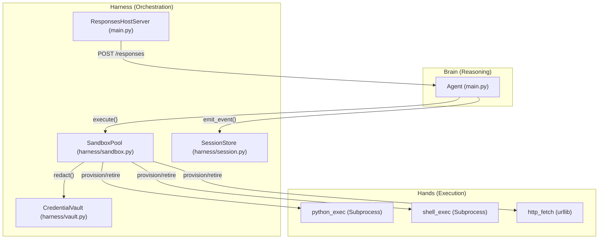
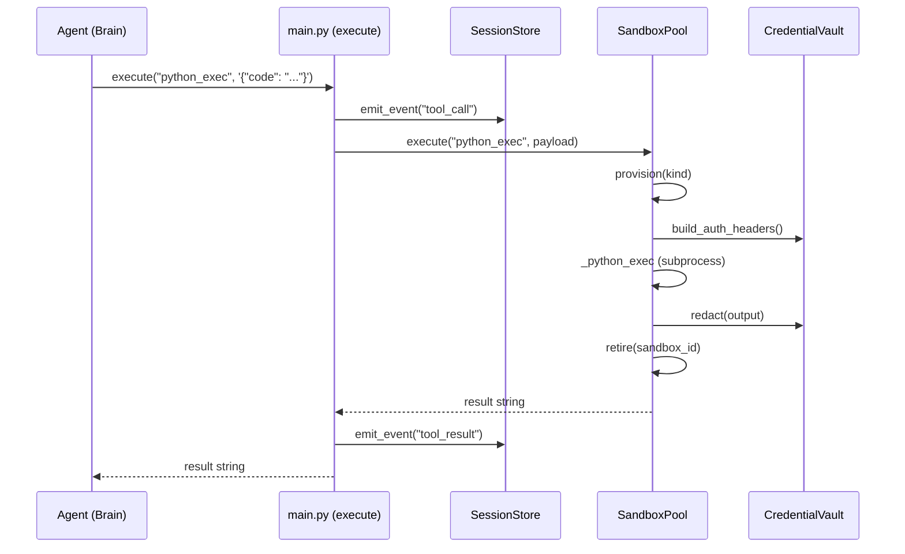

<!-- source: DeepWiki mcp.deepwiki.com · repo microsoft/Agent-Framework-Samples · page 9.6 MAF Harness Managed Hosted Agent · fetched 2026-10-26 -->

# MAF Harness Managed Hosted Agent

Relevant source files

The following files were used as context for generating this wiki page:

- [09.Cases/maf_harness_managed_hosted_agent/README.md](09.Cases/maf_harness_managed_hosted_agent/README.md)
- [09.Cases/maf_harness_managed_hosted_agent/README.zh.md](09.Cases/maf_harness_managed_hosted_agent/README.zh.md)
- [09.Cases/maf_harness_managed_hosted_agent/agent.yaml](09.Cases/maf_harness_managed_hosted_agent/agent.yaml)
- [09.Cases/maf_harness_managed_hosted_agent/azure.yaml](09.Cases/maf_harness_managed_hosted_agent/azure.yaml)
- [09.Cases/maf_harness_managed_hosted_agent/harness/__init__.py](09.Cases/maf_harness_managed_hosted_agent/harness/__init__.py)
- [09.Cases/maf_harness_managed_hosted_agent/harness/sandbox.py](09.Cases/maf_harness_managed_hosted_agent/harness/sandbox.py)
- [09.Cases/maf_harness_managed_hosted_agent/harness/session.py](09.Cases/maf_harness_managed_hosted_agent/harness/session.py)
- [09.Cases/maf_harness_managed_hosted_agent/harness/vault.py](09.Cases/maf_harness_managed_hosted_agent/harness/vault.py)
- [09.Cases/maf_harness_managed_hosted_agent/main.py](09.Cases/maf_harness_managed_hosted_agent/main.py)

The `maf_harness_managed_hosted_agent` case study demonstrates a Microsoft Foundry **Hosted Agent** implementation that adheres to the "Managed Agents" architectural principles described by Anthropic. This design decouples the agent's reasoning engine (the "Brain") from its execution capabilities (the "Hands") and its long-term memory (the "Session") [09.Cases/maf_harness_managed_hosted_agent/README.md:1-15]().

## Architectural Principles

The implementation is built on five core "Managed" principles:
1.  **Cattle, not pets:** Every tool invocation provisions a fresh, stateless sandbox that is retired immediately after use. This ensures that failures are isolated and do not require complex state recovery [09.Cases/maf_harness_managed_hosted_agent/README.md:19-21]().
2.  **Decoupled Brain and Hands:** The model interacts with the world through a single, generic `execute(name, input_json)` tool. The harness is agnostic to whether the "hand" is a local process, a container, or a remote API [09.Cases/maf_harness_managed_hosted_agent/README.md:22-22]().
3.  **Session vs. Context Window:** Meaningful events are stored in a durable JSONL log. The model can use `get_events` to retrieve specific slices of history, preventing context window saturation [09.Cases/maf_harness_managed_hosted_agent/README.md:23-23]().
4.  **Credential Isolation:** Real tokens are stored in a `CredentialVault` outside the sandbox. The model only passes logical names (e.g., `"github"`), and the vault redacts sensitive strings from tool outputs [09.Cases/maf_harness_managed_hosted_agent/README.md:24-24]().
5.  **Stateless Scalability:** Multiple harness replicas can operate against the same session log simultaneously [09.Cases/maf_harness_managed_hosted_agent/README.md:25-25]().

### Managed Agent Data Flow
This diagram maps the natural language concepts of the Managed Agent architecture to the specific Python classes and files in the codebase.

Sources: [09.Cases/maf_harness_managed_hosted_agent/README.md:9-17](), [09.Cases/maf_harness_managed_hosted_agent/main.py:5-19](), [09.Cases/maf_harness_managed_hosted_agent/harness/sandbox.py:42-50]()

## The Harness Components

### SandboxPool ("Hands")
The `SandboxPool` class manages the lifecycle of "hands." It provides a `list_tools()` method for discovery and the primary `execute()` entry point [09.Cases/maf_harness_managed_hosted_agent/harness/sandbox.py:42-57]().

*   **Provisioning:** The `provision(kind)` method generates a unique `sandbox_id` and tracks the active instance [09.Cases/maf_harness_managed_hosted_agent/harness/sandbox.py:60-63]().
*   **Execution Loop:** When `execute()` is called, it provisions a sandbox, executes the registered `ToolFn`, redacts secrets using the vault, and then calls `retire()` to ensure the environment is destroyed [09.Cases/maf_harness_managed_hosted_agent/harness/sandbox.py:69-90]().

### SessionStore ("Memory")
The `SessionStore` provides a file-backed, append-only log of `SessionEvent` objects [09.Cases/maf_harness_managed_hosted_agent/harness/session.py:37-40](). 

| Method | Description |
| :--- | :--- |
| `emit_event` | Appends a new event (e.g., `tool_call`, `note`) to the session's `.jsonl` file [09.Cases/maf_harness_managed_hosted_agent/harness/session.py:57-69](). |
| `get_events` | Reads a positional slice (start/end) of events from the log [09.Cases/maf_harness_managed_hosted_agent/harness/session.py:72-89](). |
| `wake` | Recovers a session by replaying all existing events [09.Cases/maf_harness_managed_hosted_agent/harness/session.py:52-54](). |

### CredentialVault ("Security")
The `CredentialVault` manages sensitive tokens. It uses a logical mapping (e.g., "github" -> `GITHUB_TOKEN`) so that the model never handles raw secrets [09.Cases/maf_harness_managed_hosted_agent/harness/vault.py:15-24]().
*   **Redaction:** The `redact()` method scans tool output strings and replaces any known secret values with `***REDACTED***` before they reach the LLM [09.Cases/maf_harness_managed_hosted_agent/harness/vault.py:42-47]().

Sources: [09.Cases/maf_harness_managed_hosted_agent/harness/sandbox.py:1-11](), [09.Cases/maf_harness_managed_hosted_agent/harness/session.py:1-12](), [09.Cases/maf_harness_managed_hosted_agent/harness/vault.py:1-8]()

## Implementation Details

### Model-Facing Tools
The agent is configured with four primary functions defined in `main.py`:

1.  **`execute(name, input_json)`**: The core tool for action. It logs a `tool_call` event, runs the sandbox, logs a `tool_result` event, and returns the output [09.Cases/maf_harness_managed_hosted_agent/main.py:88-115]().
2.  **`list_tools()`**: Returns a JSON list of available sandbox capabilities [09.Cases/maf_harness_managed_hosted_agent/main.py:118-120]().
3.  **`get_events(start, end)`**: Allows the model to query the `SessionStore` for past events [09.Cases/maf_harness_managed_hosted_agent/main.py:123-137]().
4.  **`emit_note(note)`**: Allows the model to checkpoint its internal reasoning into the durable log [09.Cases/maf_harness_managed_hosted_agent/main.py:140-146]().

### Execution Flow: tool_call to tool_result
This diagram illustrates the internal sequence when the Agent decides to use a tool.

Sources: [09.Cases/maf_harness_managed_hosted_agent/main.py:88-115](), [09.Cases/maf_harness_managed_hosted_agent/harness/sandbox.py:69-90]()

## Deployment and Configuration

The agent is designed to be deployed as a containerized service within Azure AI Foundry using `azd` and the `ai agent` CLI [09.Cases/maf_harness_managed_hosted_agent/README.md:49-55]().

### Configuration Files
*   **`agent.yaml`**: Defines the agent as `kind: hosted` and specifies the `responses` protocol (version 1.0.0). It maps environment variables like `FOUNDRY_PROJECT_ENDPOINT` and `SESSION_DIR` [09.Cases/maf_harness_managed_hosted_agent/agent.yaml:1-17]().
*   **`azure.yaml`**: Configures the Azure Developer CLI (`azd`) to host the service as an `azure.ai.agent` using Docker [09.Cases/maf_harness_managed_hosted_agent/azure.yaml:1-13]().

### Hosting Endpoint
The agent exposes an OpenAI-compatible `POST /responses` endpoint via the `ResponsesHostServer` [09.Cases/maf_harness_managed_hosted_agent/main.py:34](). This allows standard clients to interact with the agent using a simple JSON payload containing the user's input [09.Cases/maf_harness_managed_hosted_agent/README.md:58-63]().

Sources: [09.Cases/maf_harness_managed_hosted_agent/agent.yaml:1-17](), [09.Cases/maf_harness_managed_hosted_agent/azure.yaml:1-13](), [09.Cases/maf_harness_managed_hosted_agent/main.py:34-80]()

---

