# Page: Overview

# Overview

<details>
<summary>Relevant source files</summary>

The following files were used as context for generating this wiki page:

- [.devcontainer/devcontainer.json](.devcontainer/devcontainer.json)
- [.devcontainer/setup.sh](.devcontainer/setup.sh)
- [.github/dependabot.yml](.github/dependabot.yml)
- [.vscode/settings.json](.vscode/settings.json)
- [00.ForBeginners/04-tool-use/code_samples/dotnet-agent-framework-ghmodels-tool/Program.cs](00.ForBeginners/04-tool-use/code_samples/dotnet-agent-framework-ghmodels-tool/Program.cs)
- [09.Cases/README.md](09.Cases/README.md)
- [Installation/requirements.txt](Installation/requirements.txt)
- [README.md](README.md)

</details>


This page describes the purpose, structure, and scope of the **Agent-Framework-Samples** repository. It covers the folder layout, supported languages, AI backends, and the learning progression the repository is designed to follow. For environment setup and credential configuration, see **Getting Started**. For a deep dive into the agent runtime abstractions (`AIAgent`, `AgentSession`), see **Core Concepts**.

---

## Purpose

The repository is a hands-on, structured guide for building AI agents with the **Microsoft Agent Framework (MAF)**. It provides runnable samples in both **Python** and **.NET (C#)**, organized as a progressive curriculum from first principles through production case studies [README.md:1-8]().

The samples demonstrate how to leverage the LLM as a reasoning engine, integrate tools for action execution, and manage conversation state through sessions [README.md:6-18]().

Sources: [README.md:1-18]()

---

## Supported Languages and AI Backends

The framework exposes a consistent abstraction layer across two runtimes and multiple AI backends.

| Language | Package install | Key classes |
|---|---|---|
| Python | `pip install -r Installation/requirements.txt` | `ChatAgent`, `OpenAIChatClient`, `AzureAIAgentClient` |
| .NET (C#) | Build from source (`dotnet build`) | `AIAgent`, `OpenAIClient`, `AgentSession` |

**Python package breakdown** ([Installation/requirements.txt:1-14]()):

| Package | Purpose |
|---|---|
| `agent-framework-core` | Core agent runtime and base abstractions |
| `agent-framework-foundry` | Azure AI Foundry integration |
| `agent-framework-devui` | Local debugging and visualization UI |
| `agent-framework-ag-ui` | AG-UI streaming SSE server integration |
| `agent-framework-a2a` | Agent-to-Agent communication patterns |
| `agent-framework-declarative` | YAML-based workflow and agent definitions |
| `agent-framework-foundry-local` | Foundry Local (SLM) runtime support |
| `agent-framework-tools` | Built-in tool implementations (Code Interpreter, Bing, etc.) |

**Supported AI backends:**

| Backend | Environment Variable(s) | Client Class |
|---|---|---|
| GitHub Models | `GITHUB_TOKEN`, `GITHUB_ENDPOINT`, `GITHUB_MODEL_ID` | `OpenAIClient` / `OpenAIChatClient` |
| Azure OpenAI Service | `AZURE_OPENAI_ENDPOINT`, `AZURE_OPENAI_CHAT_DEPLOYMENT_NAME` | `AzureOpenAIClient` / `AzureOpenAIChatClient` |
| Azure AI Foundry | `AZURE_AI_PROJECT_ENDPOINT`, `AZURE_AI_MODEL_DEPLOYMENT_NAME` | `AIProjectClient` / `AzureAIAgentClient` |
| Foundry Local | `FOUNDRYLOCAL_ENDPOINT`, `FOUNDRYLOCAL_MODEL_DEPLOYMENT_NAME` | `FoundryLocalClient` / `OpenAIChatClient` |

Sources: [README.md:26-30](), [Installation/requirements.txt:1-14](), [00.ForBeginners/04-tool-use/code_samples/dotnet-agent-framework-ghmodels-tool/Program.cs:34-46]()

---

## Repository Folder Structure

**Top-level directory map:**

```mermaid
graph TD
    root["Agent-Framework-Samples (root)"]
    root --> d00["00.ForBeginners\nTutorials extending ai-agents-for-beginners"]
    root --> d01["01.AgentFoundation\nConcept documentation"]
    root --> d02["02.CreateYourFirstAgent\nFirst travel agent (GitHub Models)"]
    root --> d03["03.ExploreAgentFramework\nProvider integrations (AOAI, GHModels, Foundry, Local)"]
    root --> d04["04.Tools\nVision, Code Interpreter, Bing, File Search"]
    root --> d05["05.Providers\nMCP + A2A patterns"]
    root --> d06["06.RAGs\nFile Search + Vector Store RAG"]
    root --> d07["07.Workflow\nSequential, Concurrent, Conditional workflows"]
    root --> d08["08.EvaluationAndTracing\nDevUI, OpenTelemetry, Red Teaming"]
    root --> d09["09.Cases\nProduction case studies"]
    root --> inst["Installation/requirements.txt"]
```

Sources: [README.md:19-33]()

**Detailed folder contents:**

| Directory | .NET Samples | Python Samples |
|---|---|---|
| `00.ForBeginners` | Travel Agent, Basic Agent, Design Patterns, Tool Use, RAG Search, Planning, Multi-Agent | Same (Jupyter notebooks) |
| `01.AgentFoundation` | Documentation only | Documentation only |
| `02.CreateYourFirstAgent` | `dotnet-travelagent-ghmodel/` | `python-travelagent-ghmodel.ipynb` |
| `03.ExploreAgentFramework` | AOAI, GHModels, MS Foundry, Foundry Local | Same |
| `04.Tools` | Vision, Code Interpreter, Bing Grounding, File Search | Same |
| `05.Providers` | MCP with Microsoft Learn | Same |
| `06.RAGs` | File Search RAG | Same |
| `07.Workflow` | Basic, Sequential, Concurrent, Conditional | Same |
| `08.EvaluationAndTracing` | GitHub Models Workflow DevUI | Single agent DevUI, multi-agent DevUI variants |
| `09.Cases` | GHModel.AI, MicrosoftFoundryWithAITKAndMAF | AgenticMarketing, FoundryLocalPipeline, maf_harness_managed_agent |

Sources: [README.md:21-33](), [09.Cases/README.md:1-18]()

---

## Core Architecture

Every sample in the repository is built on a common set of abstractions. The diagram below maps conceptual roles to concrete code entities found in the repository.

**Diagram: Core runtime abstractions and provider wiring**

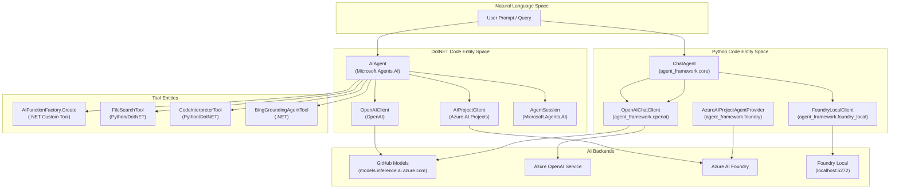

Sources: [00.ForBeginners/04-tool-use/code_samples/dotnet-agent-framework-ghmodels-tool/Program.cs:42-59](), [09.Cases/README.md:11-12](), [Installation/requirements.txt:1-14]()

---

## Learning Path

The modules are designed to be followed in order. The `00.ForBeginners` track runs in parallel as a conceptual primer.

**Diagram: Module dependency and progression**

```mermaid
graph LR
    subgraph "Foundation"
        M01["01.AgentFoundation\n(Concepts)"]
        M02["02.CreateYourFirstAgent\n(AIAgent + GitHub Models)"]
    end

    subgraph "Intermediate"
        M03["03.ExploreAgentFramework\n(Providers: AOAI, Foundry, Local)"]
        M04["04.Tools\n(Vision, Code Interpreter, Bing)"]
        M06["06.RAGs\n(File Search)"]
    end

    subgraph "Advanced"
        M05["05.Providers\n(MCP, Agent-to-Agent)"]
        M07["07.Workflow\n(Sequential, Concurrent)"]
        M08["08.Evaluation\n(DevUI, OpenTelemetry, RedTeaming)"]
    end

    subgraph "Case Studies"
        C1["09.Cases\n(Production Scenarios)"]
    end

    M01 --> M02
    M02 --> M03
    M03 --> M04
    M04 --> M06
    M06 --> M05
    M05 --> M07
    M07 --> M08
    M08 --> C1
```

Sources: [README.md:19-33]()

---

## Key Abstractions at a Glance

| Concept | Python symbol | .NET symbol | Primary Role |
|---|---|---|---|
| **Agent** | `ChatAgent` | `AIAgent` | The entity configured with instructions and tools [00.ForBeginners/04-tool-use/code_samples/dotnet-agent-framework-ghmodels-tool/Program.cs:49-52](). |
| **Session** | `thread` | `AgentSession` | Manages conversation state and history [00.ForBeginners/04-tool-use/code_samples/dotnet-agent-framework-ghmodels-tool/Program.cs:56](). |
| **Execution** | `run()` / `run_stream()` | `RunAsync()` / `RunStreamingAsync()` | Invokes the agent loop to process a query [00.ForBeginners/04-tool-use/code_samples/dotnet-agent-framework-ghmodels-tool/Program.cs:59](). |
| **Tooling** | Function docstrings | `AIFunctionFactory.Create` | Bridges code functions to LLM tool calls [00.ForBeginners/04-tool-use/code_samples/dotnet-agent-framework-ghmodels-tool/Program.cs:51](). |
| **Workflow** | `WorkflowBuilder` | `AgentWorkflowBuilder` | Orchestrates multi-agent interactions [README.md:30](). |

Sources: [00.ForBeginners/04-tool-use/code_samples/dotnet-agent-framework-ghmodels-tool/Program.cs:49-59](), [README.md:30]()

---

## Production Case Studies (`09.Cases`)

The `09.Cases` directory contains standalone applications that combine multiple framework capabilities into realistic scenarios.

*   **GHModel.AI**: Demonstrates a dual-agent workflow (FrontDesk + Concierge) with DevUI and OpenTelemetry tracing [09.Cases/README.md:8-9]().
*   **AgenticMarketingContentGen**: A four-phase workflow (Strategy, Copywriting, Image, Video) using Pydantic schemas and tools like Tavily and FLUX [09.Cases/README.md:5-6]().
*   **FoundryLocalPipeline**: Iterative Deep Research using local SLMs (Qwen2.5) via `FoundryLocalClient` and red teaming for safety evaluation [09.Cases/README.md:11-12]().
*   **MicrosoftFoundryWithAITKAndMAF**: A declarative "configuration as code" approach using `workflow.yaml` for recruitment scenarios [09.Cases/README.md:14-15]().
*   **maf_harness_managed_agent**: Implements a "Brain-Hands-Memory" architecture with stateless orchestrators and durable session logs [09.Cases/README.md:17-18]().

Sources: [09.Cases/README.md:1-18]()

---

# Page: Getting Started

# Getting Started

<details>
<summary>Relevant source files</summary>

The following files were used as context for generating this wiki page:

- [.devcontainer/devcontainer.json](.devcontainer/devcontainer.json)
- [.devcontainer/setup.sh](.devcontainer/setup.sh)
- [.env.examples](.env.examples)
- [.github/dependabot.yml](.github/dependabot.yml)
- [.vscode/settings.json](.vscode/settings.json)
- [00.ForBeginners/04-tool-use/code_samples/dotnet-agent-framework-ghmodels-tool/Program.cs](00.ForBeginners/04-tool-use/code_samples/dotnet-agent-framework-ghmodels-tool/Program.cs)
- [09.Cases/GHModel.AI/GHModel.Python.AI/GHModel.Python.AI.Workflow.OpenTelemetry/.vscode/settings.json](09.Cases/GHModel.AI/GHModel.Python.AI/GHModel.Python.AI.Workflow.OpenTelemetry/.vscode/settings.json)
- [09.Cases/GHModel.AI/GHModel.Python.AI/GHModel.Python.AI.Workflow.OpenTelemetry/main.py](09.Cases/GHModel.AI/GHModel.Python.AI/GHModel.Python.AI.Workflow.OpenTelemetry/main.py)
- [09.Cases/GHModel.AI/GHModel.Python.AI/GHModel.Python.AI.Workflow.OpenTelemetry/workflow/workflow.py](09.Cases/GHModel.AI/GHModel.Python.AI/GHModel.Python.AI.Workflow.OpenTelemetry/workflow/workflow.py)
- [09.Cases/GHModel.AI/src/Workflows/HrDemoWorkflow.cs](09.Cases/GHModel.AI/src/Workflows/HrDemoWorkflow.cs)
- [09.Cases/MicrosoftFoundryWithAITKAndMAF/CreateWorkflowWithYAML/Program.cs](09.Cases/MicrosoftFoundryWithAITKAndMAF/CreateWorkflowWithYAML/Program.cs)
- [Installation/requirements.txt](Installation/requirements.txt)

</details>


This page covers the minimum steps required to get the Agent-Framework-Samples repository running on your machine: installing language runtimes, pulling the framework source, and supplying the credentials that the samples read at startup. It does not go deep into any individual sample; it establishes the baseline that every sample depends on.

For detailed coverage of the dev container and VS Code tooling, see [Development Environment Setup](#2.1). For a full reference of every environment variable and how it is loaded, see [Configuration Reference](#2.2).

---

## Overview of What You Need

Before running any sample you need three things:

| Requirement | Purpose |
|---|---|
| Language runtime (.NET 9 or Python 3.10+) | Execute the sample code |
| Microsoft Agent Framework source | Provides `Microsoft.Agents.AI` (.NET) and `agent-framework-*` (Python) packages |
| A populated `.env` file | Supplies endpoints and credentials to the samples at runtime |

The repository contains samples in both languages and they can be used independently. You do not need both runtimes unless you want to run both.

Sources: [README.md:34-71]()

---

## Framework Installation

> ⚠️ The Microsoft Agent Framework is in preview (RC2). NuGet and PyPI packages may lag behind the source. **Building from source is strongly recommended.**

### Python

**Runtime requirement:** Python 3.10 or higher.

**Step 1 – Install pre-built convenience packages (quick start):**

The file [Installation/requirements.txt:1-14]() installs all Python sub-packages directly from the `main` branch of the `microsoft/agent-framework` repository using pip's VCS install syntax. This includes core logic, Foundry integration, and specialized tools:

```
agent-framework-core
agent-framework-foundry
agent-framework-devui
agent-framework-ag-ui
agent-framework-anthropic
agent-framework-ollama
agent-framework-a2a
agent-framework-github-copilot
agent-framework-declarative
agent-framework-foundry-local
agent-framework-orchestrations
agent-framework-hyperlight
agent-framework-monty
agent-framework-tools
```

Run:
```bash
pip install -r ./Installation/requirements.txt -U
```

**Step 2 (recommended) – Build from source instead:**

```bash
git clone https://github.com/microsoft/agent-framework.git
cd agent-framework/python
pip install -e .
```

Sources: [README.md:44-58](), [Installation/requirements.txt:1-14]()

---

### .NET

**Runtime requirement:** .NET 9.0 or higher. Visual Studio 2022 or VS Code with the C# extension.

**Build from source:**

```bash
git clone https://github.com/microsoft/agent-framework.git
cd agent-framework/dotnet
dotnet build agent-framework-dotnet.slnx
```

After building, `.csproj` files reference the local source via `<ProjectReference>` instead of NuGet. The case-study projects in `09.Cases` illustrate this pattern — for example, [09.Cases/GHModel.AI/GHModel.dotNET.AI/GHModel.dotNET.AI.Workflow.DevUI/GHModel.dotNET.AI.Workflow.DevUI.csproj:9-13]() references `Microsoft.Agents.AI.DevUI`, `Microsoft.Agents.AI.Hosting`, `Microsoft.Agents.AI.Workflows`, and `Microsoft.Agents.AI.Hosting.OpenAI` directly from disk.

The NuGet packages used across samples include `DotNetEnv` (for `.env` loading), `Azure.Identity`, `Azure.AI.OpenAI`, and `Microsoft.Extensions.AI.OpenAI`.

Sources: [README.md:60-71](), [09.Cases/GHModel.AI/GHModel.dotNET.AI/GHModel.dotNET.AI.Workflow.DevUI/GHModel.dotNET.AI.Workflow.DevUI.csproj:1-25]()

---

## Dev Container (Optional)

The repository ships a pre-configured dev container at [.devcontainer/devcontainer.json:1-43]() that removes most manual setup steps.

**What the container provides:**

| Component | Source |
|---|---|
| Base image: `mcr.microsoft.com/devcontainers/dotnet:1-9.0-bookworm` | [.devcontainer/devcontainer.json:6-6]() |
| `azure-cli` feature | [.devcontainer/devcontainer.json:9-9]() |
| `github-cli` feature | [.devcontainer/devcontainer.json:10-10]() |
| `miniforge` feature | [.devcontainer/devcontainer.json:11-11]() |
| `azd` (Azure Developer CLI) feature | [.devcontainer/devcontainer.json:12-12]() |
| VS Code extensions: `ms-dotnettools.vscode-dotnet-pack`, `ms-python.vscode-python-envs`, `ms-python.python` | [.devcontainer/devcontainer.json:17-19]() |
| `graphviz` system package | [.devcontainer/setup.sh:1-2]() |

The `postCreateCommand` runs [.devcontainer/setup.sh:1-3]() which installs `graphviz` (required by the workflow visualization utilities) and activates the `conda` base environment.

The workspace-level VS Code settings at [.vscode/settings.json:3-4]() configure the Python environment manager to use `conda` by default.

**Dev container flow:**

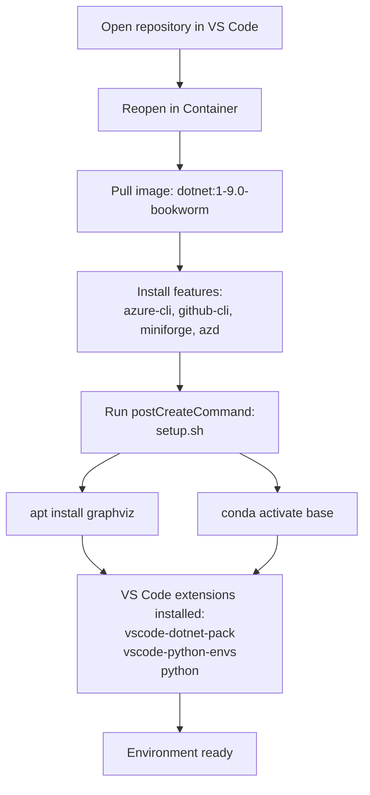

Sources: [.devcontainer/devcontainer.json:1-43](), [.devcontainer/setup.sh:1-3](), [.vscode/settings.json:1-15]()

---

## Environment Configuration

All samples read credentials from a `.env` file in the repository root. Copy [.env.examples:1-19]() to `.env` and fill in the values that apply to the providers you intend to use.

```
GITHUB_TOKEN="Your GitHub Models Token"
GITHUB_ENDPOINT="Your GitHub Models Endpoint"
GITHUB_MODEL_ID="Your GitHub Model ID"

AZURE_OPENAI_ENDPOINT="Your Azure OpenAI Endpoint"
AZURE_OPENAI_CHAT_DEPLOYMENT_NAME="Your Azure OpenAI Model Deployment Name"

FOUNDRYLOCAL_ENDPOINT="http://localhost:5272/v1"
FOUNDRYLOCAL_MODEL_DEPLOYMENT_NAME="Your Foundry Local Model Deployment Name"

FOUNDRY_PROJECT_ENDPOINT="Your Azure AI Foundry Project Endpoint"
FOUNDRY_MODEL="Your Azure AI Foundry Model Deployment Name"

BING_CONNECTION_ID="Your Bing Connection ID"
BING_CONNECTION_NAME="Your Bing Connection Name"

OTEL_EXPORTER_OTLP_ENDPOINT="http://localhost:4317"
```

**Which variables are required by which provider group:**

| Variable(s) | Required for |
|---|---|
| `GITHUB_TOKEN`, `GITHUB_ENDPOINT`, `GITHUB_MODEL_ID` | GitHub Models samples |
| `AZURE_OPENAI_ENDPOINT`, `AZURE_OPENAI_CHAT_DEPLOYMENT_NAME` | Azure OpenAI samples |
| `FOUNDRY_PROJECT_ENDPOINT`, `FOUNDRY_MODEL` | Azure AI Foundry samples |
| `FOUNDRYLOCAL_ENDPOINT`, `FOUNDRYLOCAL_MODEL_DEPLOYMENT_NAME` | Foundry Local samples (e.g., `09.Cases/FoundryLocalPipeline`) |
| `BING_CONNECTION_ID`, `BING_CONNECTION_NAME` | Bing Grounding tool samples |
| `OTEL_EXPORTER_OTLP_ENDPOINT` | OpenTelemetry tracing (e.g., `GHModel.AI.Workflow.OpenTelemetry`) |

**How `.env` is loaded at runtime:**

- **Python:** `from dotenv import load_dotenv` followed by `load_dotenv()` — seen in [09.Cases/GHModel.AI/GHModel.Python.AI/GHModel.Python.AI.Workflow.OpenTelemetry/main.py:2-16]()
- **.NET:** `DotNetEnv.Env.Load("../../../../.env")` — seen in [00.ForBeginners/04-tool-use/code_samples/dotnet-agent-framework-ghmodels-tool/Program.cs:10-10]()

The path passed to `Env.Load` is relative to the project directory and traverses up to the repository root where `.env` lives.

For a complete description of every variable and its semantics, see [Configuration Reference](#2.2).

Sources: [.env.examples:1-19](), [README.md:99-125](), [09.Cases/GHModel.AI/GHModel.Python.AI/GHModel.Python.AI.Workflow.OpenTelemetry/main.py:2-16](), [00.ForBeginners/04-tool-use/code_samples/dotnet-agent-framework-ghmodels-tool/Program.cs:10-10]()

---

## Credential and Provider Map

The diagram below maps each environment variable group to the framework client class that consumes it, grounding the `.env` file entries in concrete code symbols.

**Environment Variables → Client Classes**

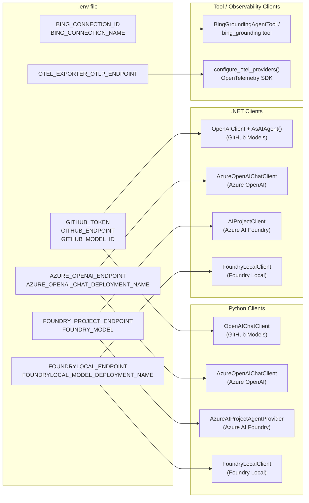

Sources: [.env.examples:1-19](), [00.ForBeginners/04-tool-use/code_samples/dotnet-agent-framework-ghmodels-tool/Program.cs:35-52](), [09.Cases/GHModel.AI/GHModel.Python.AI/GHModel.Python.AI.Workflow.OpenTelemetry/main.py:25-25]()

---

## Platform-Specific Notes

| Platform | Notes |
|---|---|
| **Linux** | Standard `pip install` and `dotnet build`. No extra steps. |
| **macOS** | Use Homebrew for `graphviz` if not using the dev container. |
| **Windows x64** | Standard Windows installation. |
| **Windows ARM64** | Requires OpenSSL for certain Python dependencies. See below. |

**Windows ARM64 – OpenSSL setup:**

```powershell
git config --global core.longpaths true
winget install ShiningLight.OpenSSL.Dev
$env:OPENSSL_DIR="C:\Program Files\OpenSSL-Win64-ARM"
$env:OPENSSL_LIB_DIR="C:\Program Files\OpenSSL-Win64-ARM\lib\VC\arm64\MT"
$env:OPENSSL_STATIC="1"
```

These environment variables must be set before running `pip install`.

Sources: [README.md:75-97]()

---

## Required Azure and GitHub Services

Depending on which samples you intend to run, you will need accounts or access for:

| Service | Used in |
|---|---|
| **GitHub Models** (`gh.io/models`) | Beginner samples and most sequential workflows |
| **Azure OpenAI Service** | Module 03 (AOAI variant) |
| **Azure AI Foundry (V2)** | Advanced tool samples (File Search, Code Interpreter) |
| **Azure CLI** (`az login`) | Required for `AzureCliCredential` used in RBAC-based auth |
| **Azure Developer CLI** (`azd`) | Required for some deployment scenarios |
| **Foundry Local** | Module 03 and local SLM research pipelines |

Sources: [README.md:93-97](), [README.md:40-42]()

---

## Next Steps

Once your environment is set up and `.env` is populated, proceed in this order:

1. **[Core Concepts](#3)** — understand `AIAgent`, `AgentSession`, and tools before touching samples.
2. **[Your First Python Agent](#4.1)** or **[Your First .NET Agent](#4.2)** — run a working agent end-to-end.
3. **[AI Provider Integrations](#5)** — configure the specific backend you have credentials for.

---

# Page: Development Environment Setup

# Development Environment Setup

<details>
<summary>Relevant source files</summary>

The following files were used as context for generating this wiki page:

- [.devcontainer/devcontainer.json](.devcontainer/devcontainer.json)
- [.devcontainer/setup.sh](.devcontainer/setup.sh)
- [.github/dependabot.yml](.github/dependabot.yml)
- [.gitignore](.gitignore)
- [.vscode/settings.json](.vscode/settings.json)
- [00.ForBeginners/04-tool-use/code_samples/dotnet-agent-framework-ghmodels-tool/Program.cs](00.ForBeginners/04-tool-use/code_samples/dotnet-agent-framework-ghmodels-tool/Program.cs)
- [Installation/requirements.txt](Installation/requirements.txt)

</details>


This page describes the pre-configured development environment for the Agent-Framework-Samples repository, covering the dev container definition, system-level dependencies, CLI tooling, and VS Code configuration. The goal is to let contributors open the repository and run any sample without manual dependency installation.

For information on credentials and environment variables required after the environment is running, see [Configuration Reference]().

---

## Dev Container Overview

The repository ships a [Dev Containers](https://containers.dev/) configuration under `.devcontainer/`. Opening the repository in VS Code (or GitHub Codespaces) automatically provisions a fully configured Linux environment.

**Base image:** `mcr.microsoft.com/devcontainers/dotnet:1-9.0-bookworm`

This is a Debian Bookworm image with .NET 9 SDK pre-installed, which satisfies the .NET sample requirements without any additional SDK setup.

Sources: [.devcontainer/devcontainer.json:6-6]()

---

## Installed Features

The dev container installs four feature bundles at container creation time. Each feature is pulled from a versioned OCI registry reference.

| Feature Reference | What It Provides |
|---|---|
| `ghcr.io/devcontainers/features/azure-cli:1` | `az` CLI for Azure authentication and resource management |
| `ghcr.io/devcontainers/features/github-cli:1` | `gh` CLI for GitHub Models authentication (`GITHUB_TOKEN` workflows) |
| `ghcr.io/rocker-org/devcontainer-features/miniforge:2` | Conda package manager (`conda` / `mamba`) for Python environment management |
| `ghcr.io/azure/azure-dev/azd:0` | Azure Developer CLI (`azd`) for Azure resource provisioning |

Sources: [.devcontainer/devcontainer.json:8-13]()

---

## Post-Create Setup Script

After the container is built, the `postCreateCommand` runs [.devcontainer/setup.sh](), which performs the following system-level configurations:

```bash
sudo apt update
sudo apt install graphviz -y
conda activate base
```

**`graphviz`** is a system-level dependency required by the workflow visualization utilities (`WorkflowViz`) used in the workflow orchestration samples. Without it, Graphviz-format diagram exports will fail at runtime.

**`conda activate base`** ensures that the Conda `base` environment is active in all subsequent terminal sessions, so Python samples can be run immediately from the integrated terminal.

Sources: [.devcontainer/setup.sh:1-3](), [.devcontainer/devcontainer.json:7-7]()

---

## Dev Container Provisioning Flow

The diagram below maps the provisioning sequence to the concrete files and registry references involved.

### Provisioning Logic to Code Entity Map
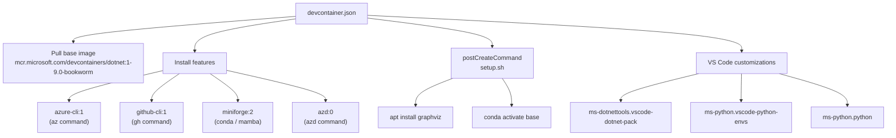

Sources: [.devcontainer/devcontainer.json:1-43](), [.devcontainer/setup.sh:1-3]()

---

## Python Environment and Dependencies

Python samples rely on a specific set of packages from the `agent-framework` ecosystem. These are defined in `Installation/requirements.txt` and include core, foundry, and UI components.

The environment is pinned to specific OpenTelemetry versions to ensure compatibility across the stack, specifically using `opentelemetry-api==1.40.0` and `opentelemetry-sdk==1.40.0`.

### Python Package Stack
| Package | Source |
|---|---|
| `agent-framework-core` | `python/packages/core` |
| `agent-framework-foundry` | `python/packages/foundry` |
| `agent-framework-devui` | `python/packages/devui` |
| `agent-framework-orchestrations`| `python/packages/orchestrations` |

Sources: [Installation/requirements.txt:1-14](), [Installation/requirements.txt:24-25]()

---

## VS Code Configuration

### Extensions
Three extensions are auto-installed into the dev container when VS Code attaches:
1. `ms-dotnettools.vscode-dotnet-pack`: .NET support.
2. `ms-python.vscode-python-envs`: Python environment management.
3. `ms-python.python`: Python language support.

Sources: [.devcontainer/devcontainer.json:16-20]()

### Workspace Settings
The `.vscode/settings.json` file configures Conda as the default Python environment manager and package manager. It also defines `chat.agentSkillsLocations` for Copilot and Agent skills.

| Setting Key | Value |
|---|---|
| `python-envs.defaultEnvManager` | `ms-python.python:conda` |
| `python-envs.defaultPackageManager` | `ms-python.python:conda` |
| `FSharp.suggestGitignore` | `false` |

Sources: [.vscode/settings.json:1-6]()

---

## Dependency Map: Language Runtime to Environment Component

The following diagram shows which runtime each category of samples depends on, and which environment component provides it.

### Language Runtime to Code Entity Map
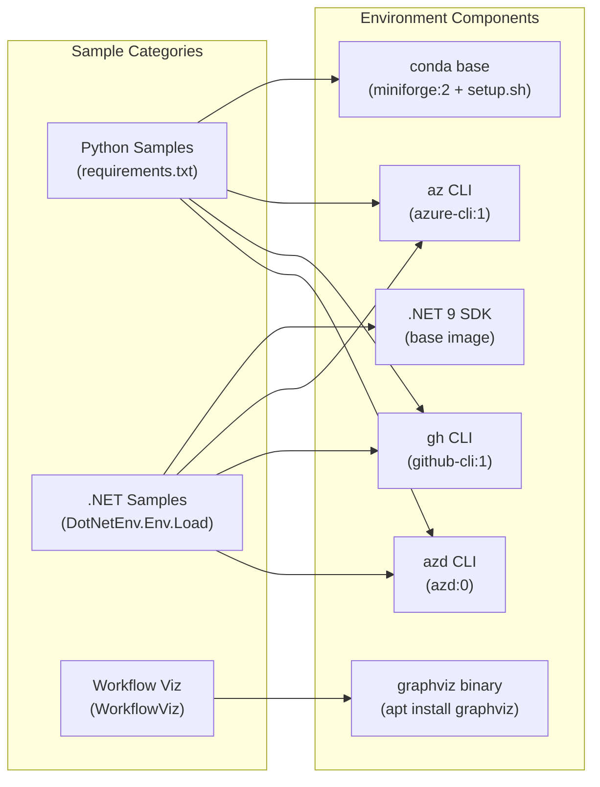

Sources: [.devcontainer/devcontainer.json:1-43](), [.devcontainer/setup.sh:1-3](), [Installation/requirements.txt:1-11](), [00.ForBeginners/04-tool-use/code_samples/dotnet-agent-framework-ghmodels-tool/Program.cs:10-10]()

---

## Dependabot

The `.github/dependabot.yml` file configures weekly automated version-bump pull requests for the `devcontainers` ecosystem, targeting the `devcontainer.json` at the repository root. This keeps the feature bundle versions current without manual intervention.

Sources: [.github/dependabot.yml:1-12]()

---

## Quick Reference: What Each Tool Is Used For

| Tool | Command | Used By |
|---|---|---|
| Azure CLI | `az` | Authentication for Azure OpenAI, Foundry, and Bing samples |
| GitHub CLI | `gh` | Obtaining `GITHUB_TOKEN` for GitHub Models samples |
| Azure Developer CLI | `azd` | Provisioning Azure infrastructure for case study deployments |
| Conda | `conda` | Managing Python interpreter and packages for Python samples |
| Graphviz | `dot` | Rendering workflow diagrams from `WorkflowViz` |
| .NET 9 SDK | `dotnet` | Building and running all C# samples |

For how these tools are used with specific credentials and environment variables, see [Configuration Reference]().

---

# Page: Configuration Reference

# Configuration Reference

<details>
<summary>Relevant source files</summary>

The following files were used as context for generating this wiki page:

- [.devcontainer/devcontainer.json](.devcontainer/devcontainer.json)
- [.devcontainer/setup.sh](.devcontainer/setup.sh)
- [.env.examples](.env.examples)
- [.github/dependabot.yml](.github/dependabot.yml)
- [.vscode/settings.json](.vscode/settings.json)
- [00.ForBeginners/04-tool-use/code_samples/dotnet-agent-framework-ghmodels-tool/Program.cs](00.ForBeginners/04-tool-use/code_samples/dotnet-agent-framework-ghmodels-tool/Program.cs)
- [09.Cases/GHModel.AI/GHModel.Python.AI/GHModel.Python.AI.Workflow.OpenTelemetry/.vscode/settings.json](09.Cases/GHModel.AI/GHModel.Python.AI/GHModel.Python.AI.Workflow.OpenTelemetry/.vscode/settings.json)
- [09.Cases/GHModel.AI/GHModel.Python.AI/GHModel.Python.AI.Workflow.OpenTelemetry/main.py](09.Cases/GHModel.AI/GHModel.Python.AI/GHModel.Python.AI.Workflow.OpenTelemetry/main.py)
- [09.Cases/GHModel.AI/GHModel.Python.AI/GHModel.Python.AI.Workflow.OpenTelemetry/workflow/workflow.py](09.Cases/GHModel.AI/GHModel.Python.AI/GHModel.Python.AI.Workflow.OpenTelemetry/workflow/workflow.py)
- [09.Cases/GHModel.AI/src/Workflows/HrDemoWorkflow.cs](09.Cases/GHModel.AI/src/Workflows/HrDemoWorkflow.cs)
- [09.Cases/MicrosoftFoundryWithAITKAndMAF/CreateWorkflowWithYAML/Program.cs](09.Cases/MicrosoftFoundryWithAITKAndMAF/CreateWorkflowWithYAML/Program.cs)
- [Installation/requirements.txt](Installation/requirements.txt)

</details>


This page documents every environment variable used across the Agent-Framework-Samples repository, explains the purpose of each variable, and describes how variables are loaded at runtime in both Python and .NET projects.

---

## The `.env` File

All samples share a single template for environment variables: [.env.examples:1-19](). Copy this file to `.env` in your working directory and fill in the values appropriate for the providers you intend to use. You do not need to populate every variable—only those relevant to the samples you are running.

```
.env.examples  →  copy to  →  .env  (not committed to source control)
```

The file is structured in provider groups:
[.env.examples:1-19]()

---

## Variable Reference

### GitHub Models

| Variable | Example Value | Purpose |
|---|---|---|
| `GITHUB_TOKEN` | `ghp_...` | Personal Access Token used as the API key for the GitHub Models inference endpoint |
| `GITHUB_ENDPOINT` | `https://models.inference.ai.azure.com` | Base URL for the GitHub Models API |
| `GITHUB_MODEL_ID` | `gpt-4o-mini` | Model identifier to select from the GitHub Models catalog |

These variables are read together to initialize `OpenAIChatClient` (Python) or `OpenAIClient` (C#) pointed at GitHub's inference service. 
Sources: [.env.examples:1-3](), [00.ForBeginners/04-tool-use/code_samples/dotnet-agent-framework-ghmodels-tool/Program.cs:35-46]()

### Azure OpenAI Service

| Variable | Example Value | Purpose |
|---|---|---|
| `AZURE_OPENAI_ENDPOINT` | `https://<resource>.openai.azure.com/` | Endpoint URL of the Azure OpenAI resource |
| `AZURE_OPENAI_CHAT_DEPLOYMENT_NAME` | `gpt-4o` | Name of the model deployment within the Azure OpenAI resource |

Sources: [.env.examples:5-6]()

### Azure AI Foundry

| Variable | Example Value | Purpose |
|---|---|---|
| `FOUNDRY_PROJECT_ENDPOINT` | `https://<hub>.services.ai.azure.com/api/projects/<project>` | Endpoint URL for an Azure AI Foundry project; used to initialize `AIProjectClient` (.NET) or `AzureAIProjectAgentProvider` (Python) |
| `FOUNDRY_MODEL` | `gpt-4o` | Deployment name within the Foundry project |

Sources: [.env.examples:13-14](), [09.Cases/MicrosoftFoundryWithAITKAndMAF/CreateWorkflowWithYAML/Program.cs:17-19]()

### Foundry Local

| Variable | Example Value | Purpose |
|---|---|---|
| `FOUNDRYLOCAL_ENDPOINT` | `http://localhost:5272/v1` | Base URL of the locally running Foundry Local server |
| `FOUNDRYLOCAL_MODEL_DEPLOYMENT_NAME` | `Qwen2.5-1.5B-Instruct` | Name of the SLM loaded in Foundry Local |

Sources: [.env.examples:9-10]()

### Bing Grounding

| Variable | Example Value | Purpose |
|---|---|---|
| `BING_CONNECTION_ID` | `/subscriptions/.../connections/bing-search` | Full Azure resource ID of the Bing Search connection in your AI Foundry hub |
| `BING_CONNECTION_NAME` | `bing-search` | Friendly name used to look up the connection via `AIProjectClient.GetConnectionAsync` |

Sources: [.env.examples:16-17]()

### OpenTelemetry

| Variable | Example Value | Purpose |
|---|---|---|
| `OTEL_EXPORTER_OTLP_ENDPOINT` | `http://localhost:4317` | OTLP collector endpoint for exporting traces and metrics; consumed by `configure_otel_providers()` |

Sources: [.env.examples:19](), [09.Cases/GHModel.AI/GHModel.Python.AI/GHModel.Python.AI.Workflow.OpenTelemetry/main.py:25]()

---

## Variable-to-Provider Map

The diagram below maps each environment variable to the provider or tool it configures and the code entity that reads it.

**Variable Mapping Architecture**
```mermaid
graph TD
    subgraph "GitHubModels"
        G_TOKEN["GITHUB_TOKEN"]
        G_EP["GITHUB_ENDPOINT"]
        G_MID["GITHUB_MODEL_ID"]
        OCClient["OpenAIChatClient (Python) / OpenAIClient (.NET)"]
        G_TOKEN --> OCClient
        G_EP --> OCClient
        G_MID --> OCClient
    end

    subgraph "AzureOpenAI"
        AOAI_EP["AZURE_OPENAI_ENDPOINT"]
        AOAI_DEP["AZURE_OPENAI_CHAT_DEPLOYMENT_NAME"]
        AzOCClient["AzureOpenAIChatClient (Python)"]
        AOAI_EP --> AzOCClient
        AOAI_DEP --> AzOCClient
    end

    subgraph "AzureAIFoundry"
        F_PROJ_EP["FOUNDRY_PROJECT_ENDPOINT"]
        F_MODEL["FOUNDRY_MODEL"]
        B_ID["BING_CONNECTION_ID"]
        B_NAME["BING_CONNECTION_NAME"]
        ProjClient["AIProjectClient (.NET) / AzureAIProjectAgentProvider (Python)"]
        BingTool["BingGroundingSearchConfiguration / bing_grounding tool"]
        F_PROJ_EP --> ProjClient
        F_MODEL --> ProjClient
        B_ID --> BingTool
        B_NAME --> BingTool
    end

    subgraph "FoundryLocal"
        FL_EP["FOUNDRYLOCAL_ENDPOINT"]
        FL_MOD["FOUNDRYLOCAL_MODEL_DEPLOYMENT_NAME"]
        FLClient["FoundryLocalClient"]
        FL_EP --> FLClient
        FL_MOD --> FLClient
    end

    subgraph "Observability"
        OTEL_EP["OTEL_EXPORTER_OTLP_ENDPOINT"]
        OtelProv["configure_otel_providers()"]
        OTEL_EP --> OtelProv
    end
```
Sources: [.env.examples:1-19](), [00.ForBeginners/04-tool-use/code_samples/dotnet-agent-framework-ghmodels-tool/Program.cs:35-46]()

---

## How Variables Are Loaded

### Python — `python-dotenv`

Python samples use the `python-dotenv` package. A call to `load_dotenv()` at the top of the entry-point file reads `.env` and populates `os.environ`.

The standard pattern is:
[09.Cases/GHModel.AI/GHModel.Python.AI/GHModel.Python.AI.Workflow.OpenTelemetry/main.py:15-17]()

```python
from dotenv import load_dotenv
import os

load_dotenv() # Reads .env into os.environ
```

In OpenTelemetry-enabled samples, `load_dotenv()` is called before `configure_otel_providers()` so that `OTEL_EXPORTER_OTLP_ENDPOINT` is available during SDK initialization.
Sources: [09.Cases/GHModel.AI/GHModel.Python.AI/GHModel.Python.AI.Workflow.OpenTelemetry/main.py:16-25]()

### .NET — `DotNetEnv`

.NET samples use the `DotNetEnv` NuGet package. The call `Env.Load()` reads the `.env` file and injects values into `Environment.GetEnvironmentVariable`.

Example usage in .NET:
[00.ForBeginners/04-tool-use/code_samples/dotnet-agent-framework-ghmodels-tool/Program.cs:10-40]()

```csharp
using DotNetEnv;

// Load environment variables from .env file
Env.Load("../../../../.env");

var github_endpoint = Environment.GetEnvironmentVariable("GITHUB_ENDPOINT");
```

---

## Load Order and Runtime Behavior

The diagram below shows the execution sequence from startup to variable consumption.

**Runtime Environment Initialization**
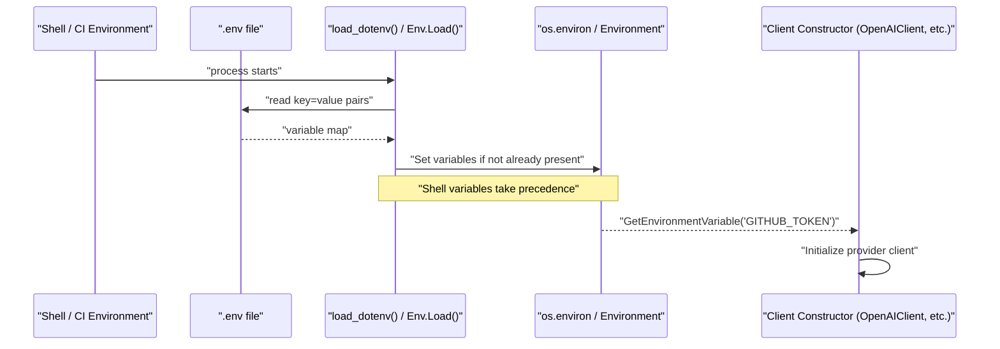
Sources: [00.ForBeginners/04-tool-use/code_samples/dotnet-agent-framework-ghmodels-tool/Program.cs:10-46](), [09.Cases/GHModel.AI/GHModel.Python.AI/GHModel.Python.AI.Workflow.OpenTelemetry/main.py:16-25]()

**Key behaviors:**
- **Precedence:** Shell environment variables take priority over values in `.env`.
- **Timing:** In Python, `load_dotenv()` must be called before importing modules that rely on environment variables for static configuration.
- **Fail-fast:** Most samples check for required variables and throw exceptions if missing, such as the `InvalidOperationException` in .NET.
  Sources: [00.ForBeginners/04-tool-use/code_samples/dotnet-agent-framework-ghmodels-tool/Program.cs:35-39]()

---

## Quick-Start Checklist

| Module Group | Required Variables |
|---|---|
| GitHub Models samples | `GITHUB_TOKEN`, `GITHUB_ENDPOINT`, `GITHUB_MODEL_ID` |
| Azure OpenAI samples | `AZURE_OPENAI_ENDPOINT`, `AZURE_OPENAI_CHAT_DEPLOYMENT_NAME` |
| Azure AI Foundry samples | `FOUNDRY_PROJECT_ENDPOINT`, `FOUNDRY_MODEL` |
| Bing Grounding | `FOUNDRY_PROJECT_ENDPOINT` + `BING_CONNECTION_ID` |
| Foundry Local | `FOUNDRYLOCAL_ENDPOINT`, `FOUNDRYLOCAL_MODEL_DEPLOYMENT_NAME` |
| OpenTelemetry tracing | `OTEL_EXPORTER_OTLP_ENDPOINT` |

Sources: [.env.examples:1-19]()

---

# Page: Core Concepts

# Core Concepts

<details>
<summary>Relevant source files</summary>

The following files were used as context for generating this wiki page:

- [00.ForBeginners/01-intro-to-ai-agents/code_samples/python-agent-framework-travelagent.ipynb](00.ForBeginners/01-intro-to-ai-agents/code_samples/python-agent-framework-travelagent.ipynb)
- [00.ForBeginners/02-explore-agentic-frameworks/code_samples/python-agent-framework-basicagent.ipynb](00.ForBeginners/02-explore-agentic-frameworks/code_samples/python-agent-framework-basicagent.ipynb)
- [00.ForBeginners/03-agentic-design-patterns/code_samples/python-agent-framework-ghmodel-basicagent.ipynb](00.ForBeginners/03-agentic-design-patterns/code_samples/python-agent-framework-ghmodel-basicagent.ipynb)
- [00.ForBeginners/04-tool-use/code_samples/python-agent-framework-ghmodel-tools.ipynb](00.ForBeginners/04-tool-use/code_samples/python-agent-framework-ghmodel-tools.ipynb)
- [00.ForBeginners/05-agentic-rag/code_samples/dotnet-agent-framework-msfoundry-file-search/Program.cs](00.ForBeginners/05-agentic-rag/code_samples/dotnet-agent-framework-msfoundry-file-search/Program.cs)
- [00.ForBeginners/05-agentic-rag/code_samples/python-agent-framework-msfoundry-file-search.ipynb](00.ForBeginners/05-agentic-rag/code_samples/python-agent-framework-msfoundry-file-search.ipynb)
- [00.ForBeginners/07-planning-design/code_samples/python-agent-framrwork-ghmodel-planningdesign.ipynb](00.ForBeginners/07-planning-design/code_samples/python-agent-framrwork-ghmodel-planningdesign.ipynb)
- [00.ForBeginners/08-multi-agent/code_samples/python-agent-framework-ghmodel-workflow-multi-agents.ipynb](00.ForBeginners/08-multi-agent/code_samples/python-agent-framework-ghmodel-workflow-multi-agents.ipynb)
- [09.Cases/README.md](09.Cases/README.md)
- [README.md](README.md)

</details>


This page explains the foundational abstractions that every sample in this repository uses: what an AI agent is in the framework's model, how the Microsoft Agent Framework is structured, and which code entities appear in every sample regardless of provider or workflow complexity.

This page provides orientation and overview. The child pages go deeper on each topic: [What Is an AI Agent?](#3.1) covers the agent model and the framework's relationship to Semantic Kernel and AutoGen; [AIAgent and AgentSession](#3.2) documents the two primary runtime classes; [Tools Overview](#3.3) covers the tool registration system. For practical construction steps, see [Building Agents](#4). For per-provider configuration, see [AI Provider Integrations](#5).

---

## What Is an AI Agent?

In this framework, an agent is a runtime component that combines three core elements to achieve autonomy, reactivity, and proactivity [00.ForBeginners/02-explore-agentic-frameworks/code_samples/python-agent-framework-basicagent.ipynb:22-26]():

| Component | Role | Framework Names |
|-----------|------|-----------------|
| **LLM (Reasoning Engine)** | Interprets instructions, decides which tools to call, generates responses | Configured via `IChatClient` (.NET) or `OpenAIChatCompletionClient` / `FoundryChatClient` (Python) |
| **Tools (Action Executors)** | Functions the agent can invoke to retrieve information or perform actions | `AIFunctionFactory.Create()` (.NET); plain Python functions with docstrings |
| **Session / Thread (Memory)** | Persists conversation history across turns in a single interaction | `AgentSession` (.NET); `AgentThread` / `thread` (Python) |

An agent operates in a loop: receive a user message → analyze the request → select a tool → execute tool → synthesize response [00.ForBeginners/04-tool-use/code_samples/python-agent-framework-ghmodel-tools.ipynb:42-45](). This loop is managed by the framework; application code only sees the final answer.

Sources: [00.ForBeginners/02-explore-agentic-frameworks/code_samples/python-agent-framework-basicagent.ipynb:15-33](), [00.ForBeginners/04-tool-use/code_samples/python-agent-framework-ghmodel-tools.ipynb:42-45]()

---

## The Microsoft Agent Framework

The Microsoft Agent Framework (MAF) is designed to be enterprise-ready and simple to integrate [00.ForBeginners/02-explore-agentic-frameworks/code_samples/python-agent-framework-basicagent.ipynb:67-73](). It is distributed as a set of independently installable packages.

**Python packages** [00.ForBeginners/05-agentic-rag/code_samples/python-agent-framework-msfoundry-file-search.ipynb:51-54]():

| Package | Purpose |
|---------|---------|
| `agent-framework-core` | Core agent, session, and workflow abstractions |
| `agent-framework-foundry` | Azure AI Foundry clients and file search integration |
| `agent-framework-devui` | Local DevUI for step-through debugging |
| `agent-framework-a2a` | Agent-to-Agent communication |

**.NET assemblies** referenced across samples [00.ForBeginners/05-agentic-rag/code_samples/dotnet-agent-framework-msfoundry-file-search/Program.cs:2-12]():

| Assembly | Purpose |
|----------|---------|
| `Microsoft.Agents.AI` | Core `AIAgent`, `AgentSession`, and workflow logic |
| `Microsoft.Agents.AI.Foundry` | Integration with Azure AI Projects and persistent agents |
| `Azure.AI.Projects.Agents` | Low-level Azure AI Agent service bindings |

Sources: [00.ForBeginners/02-explore-agentic-frameworks/code_samples/python-agent-framework-basicagent.ipynb:67-73](), [00.ForBeginners/05-agentic-rag/code_samples/python-agent-framework-msfoundry-file-search.ipynb:51-54](), [00.ForBeginners/05-agentic-rag/code_samples/dotnet-agent-framework-msfoundry-file-search/Program.cs:2-12]()

---

## Primary Abstractions

The following diagram maps conceptual roles to the concrete class names used in the codebase.

**Core Abstractions: Concept to Code**

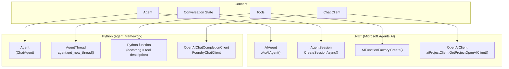

Sources: [00.ForBeginners/05-agentic-rag/code_samples/dotnet-agent-framework-msfoundry-file-search/Program.cs:58-62](), [00.ForBeginners/02-explore-agentic-frameworks/code_samples/python-agent-framework-basicagent.ipynb:113-117](), [00.ForBeginners/05-agentic-rag/code_samples/python-agent-framework-msfoundry-file-search.ipynb:37-41]()

### AIAgent and AgentSession (.NET)

`AIAgent` is the primary entity. In Azure AI Foundry scenarios, it is created by calling `.AsAIAgent()` on an `AIProjectClient` [00.ForBeginners/05-agentic-rag/code_samples/dotnet-agent-framework-msfoundry-file-search/Program.cs:58]().

`AgentSession` manages the stateful context. It is created via `agent.CreateSessionAsync()` [00.ForBeginners/05-agentic-rag/code_samples/dotnet-agent-framework-msfoundry-file-search/Program.cs:62](). To run the agent, you call `agent.RunAsync(query, session)` [00.ForBeginners/05-agentic-rag/code_samples/dotnet-agent-framework-msfoundry-file-search/Program.cs:64]().

### Agent and thread (Python)

In Python, the `Agent` class (often aliased from `ChatAgent`) serves as the orchestrator [00.ForBeginners/02-explore-agentic-frameworks/code_samples/python-agent-framework-basicagent.ipynb:116](). It is initialized with a client, instructions, and tools [00.ForBeginners/01-intro-to-ai-agents/code_samples/python-agent-framework-travelagent.ipynb:196-200]().

For details, see [AIAgent and AgentSession](#3.2).

---

## The Agent Loop

The framework handles the iterative reasoning process where the agent determines if it needs to use a tool before providing a final answer.

**Agent Execution Flow**

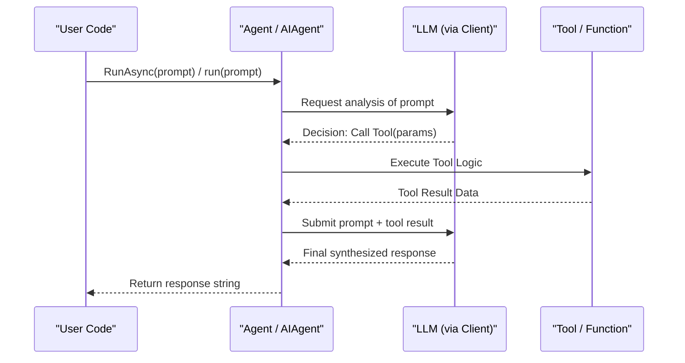

Sources: [00.ForBeginners/04-tool-use/code_samples/python-agent-framework-ghmodel-tools.ipynb:42-45](), [00.ForBeginners/01-intro-to-ai-agents/code_samples/python-agent-framework-travelagent.ipynb:28-33]()

---

## Tools

Tools extend agent capabilities beyond text generation [00.ForBeginners/02-explore-agentic-frameworks/code_samples/python-agent-framework-basicagent.ipynb:153-154]().

| Category | Description | Examples |
|----------|-------------|-----------|
| **Custom Functions** | Local code defined by the developer | `get_random_destination` [00.ForBeginners/01-intro-to-ai-agents/code_samples/python-agent-framework-travelagent.ipynb:146-166]() |
| **Hosted Tools** | Managed services provided by Azure AI Foundry | `FileSearchTool` [00.ForBeginners/05-agentic-rag/code_samples/dotnet-agent-framework-msfoundry-file-search/Program.cs:41](), Code Interpreter, Bing Grounding |

**Tool registration:**
- **Python**: Uses function docstrings for the LLM to understand the tool's purpose and return types [00.ForBeginners/02-explore-agentic-frameworks/code_samples/python-agent-framework-basicagent.ipynb:154-162]().
- **.NET**: Uses `AIFunctionFactory.Create` to wrap methods into callable tool definitions.

For details, see [Tools Overview](#3.3).

Sources: [00.ForBeginners/01-intro-to-ai-agents/code_samples/python-agent-framework-travelagent.ipynb:146-166](), [00.ForBeginners/05-agentic-rag/code_samples/dotnet-agent-framework-msfoundry-file-search/Program.cs:41-55]()

---

# Page: What Is an AI Agent?

# What Is an AI Agent?

<details>
<summary>Relevant source files</summary>

The following files were used as context for generating this wiki page:

- [00.ForBeginners/01-intro-to-ai-agents/code_samples/dotnet-agent-framework-travelagent/dotnet-agent-framework-travelagent.csproj](00.ForBeginners/01-intro-to-ai-agents/code_samples/dotnet-agent-framework-travelagent/dotnet-agent-framework-travelagent.csproj)
- [00.ForBeginners/02-explore-agentic-frameworks/code_samples/dotnet-agent-framework-basicagent/dotnet-agent-framework-basicagent.csproj](00.ForBeginners/02-explore-agentic-frameworks/code_samples/dotnet-agent-framework-basicagent/dotnet-agent-framework-basicagent.csproj)
- [00.ForBeginners/03-agentic-design-patterns/code_samples/dotnet-agent-framework-basicagent/dotnet-agent-framework-basicagent.csproj](00.ForBeginners/03-agentic-design-patterns/code_samples/dotnet-agent-framework-basicagent/dotnet-agent-framework-basicagent.csproj)
- [00.ForBeginners/04-tool-use/code_samples/dotnet-agent-framework-ghmodels-tool/dotnet-agent-framework-ghmodels-tool.csproj](00.ForBeginners/04-tool-use/code_samples/dotnet-agent-framework-ghmodels-tool/dotnet-agent-framework-ghmodels-tool.csproj)
- [00.ForBeginners/05-agentic-rag/code_samples/dotnet-agent-framework-msfoundry-file-search/dotnet-agent-framework-msfoundry-file-search.csproj](00.ForBeginners/05-agentic-rag/code_samples/dotnet-agent-framework-msfoundry-file-search/dotnet-agent-framework-msfoundry-file-search.csproj)
- [00.ForBeginners/07-planning-design/code_samples/dotnet-agent-framrwork-ghmodel-planningdesign/dotnet-agent-framrwork-ghmodel-planningdesign.csproj](00.ForBeginners/07-planning-design/code_samples/dotnet-agent-framrwork-ghmodel-planningdesign/dotnet-agent-framrwork-ghmodel-planningdesign.csproj)
- [00.ForBeginners/08-multi-agent/code_samples/dotnet-agent-framework-ghmodel-workflow-multi-agents/dotnet-agent-framework-ghmodel-workflow-multi-agents.csproj](00.ForBeginners/08-multi-agent/code_samples/dotnet-agent-framework-ghmodel-workflow-multi-agents/dotnet-agent-framework-ghmodel-workflow-multi-agents.csproj)
- [09.Cases/README.md](09.Cases/README.md)
- [README.md](README.md)

</details>


This page defines AI agents as the term is used throughout this repository and explains the three constituent parts every agent is built from: a reasoning engine (LLM), tools (action executors), and memory (conversation context). It also explains how the Microsoft Agent Framework relates to its predecessors, Semantic Kernel and AutoGen.

For the runtime classes that implement these concepts (`AIAgent`, `AgentSession`, `AgentThread`), see [AIAgent and AgentSession](#3.2). For a guide to registering specific tool types, see [Tools Overview](#3.3).

---

## The Agent Model

An AI agent is a system that combines an LLM's reasoning capability with the ability to call external functions and maintain conversational state, enabling it to pursue multi-step goals autonomously rather than just responding to a single prompt.

The `01.AgentFoundation` module summarizes the three core components directly:

| Component | Role | Framework Representation |
|---|---|---|
| **LLM (Reasoning Engine)** | Interprets goals, selects actions, generates text | `IChatClient` / `OpenAIChatClient` / `AzureOpenAIChatClient` |
| **Tools (Action Executors)** | Call APIs, run code, search files, access the web | `AIFunctionFactory.Create`, `HostedCodeInterpreterTool`, `FileSearchTool`, `MCPStreamableHTTPTool` |
| **Memory (Context)** | Tracks conversation history across turns | `AgentSession` (Python) / `AgentThread` (.NET) |

Sources: [01.AgentFoundation/README.md:9-15]()

---

## Core Components in Detail

### LLM as Reasoning Engine

The LLM is the decision-making core. It receives the system instructions, conversation history, tool results, and the current user prompt, then decides whether to respond directly or invoke a tool. In the framework, the LLM is accessed through a *chat client* abstraction (`IChatClient`) and never called directly by application code; the agent layer wraps it.

The same agent logic works across multiple LLM backends because the framework normalizes the interface:

| Backend | .NET Client | Python Client |
|---|---|---|
| GitHub Models | `OpenAIClient` (with `models.inference.ai.azure.com` endpoint) | `OpenAIChatClient` |
| Azure OpenAI Service | `AzureOpenAIClient` | `AzureOpenAIChatClient` |
| Azure AI Foundry | `PersistentAgentsClient` → `GetAIAgentAsync` | `AzureAIAgentClient` |
| Foundry Local | `OpenAIClient` (with `localhost:5272/v1` endpoint) | `OpenAIChatClient` |
| Anthropic | — | `agent_framework_anthropic` package |
| Ollama | — | `agent_framework_ollama` package |

Sources: [03.ExploerAgentFramework/README.md:30-310](), [03.ExploerAgentFramework/code_samples/dotNET/04-dotnet-agent-framework-foundrylocal/Program.cs:15-30]()

---

### Tools as Action Executors

Tools are the mechanism by which an agent affects the world beyond generating text. The agent loop determines *when* to call a tool based on the LLM's output; the framework handles actually invoking it and feeding the result back to the LLM.

Tools fall into two categories:

**Custom function tools** — user-defined functions wrapped so the LLM can call them. In .NET, `AIFunctionFactory.Create` wraps a static method annotated with `[Description(...)]`. In Python, a regular function's docstring serves as the tool description. See [00.ForBeginners/04-tool-use/code_samples/dotnet-agent-framework-ghmodels-tool/Program.cs:13-51]() for a concrete example.

**Hosted tools** — pre-built capabilities provided by the platform (Azure AI Foundry). These include:
- `HostedCodeInterpreterTool` / `CodeInterpreterToolDefinition` — sandboxed code execution
- `FileSearchTool` / `FileSearchToolDefinition` — vector store RAG
- `HostedWebSearchTool` / `BingGroundingToolDefinition` — Bing-grounded search
- `MCPStreamableHTTPTool` / `MCPToolDefinition` — Model Context Protocol endpoints

Sources: [01.AgentFoundation/README.md:12-13](), [04.Tools/README.md:1-401](), [05.Providers/README.md:1-30]()

---

### Memory as Conversation Context

An agent without memory resets after every response. The framework provides session/thread objects that accumulate message history across multiple turns so the LLM has full context for follow-up questions.

- **Python**: `AgentSession`, obtained via `agent.create_session_async()` or implicitly managed per-run.
- **.NET**: `AgentThread`, obtained via `agent.GetNewThread()`, or `AgentSession` via `agent.CreateSessionAsync()`.

For persistent agents backed by Azure AI Foundry, the thread is server-side; the client just holds a reference to the thread ID via `Azure.AI.Agents.Persistent`.

Sources: [03.ExploerAgentFramework/README.md:200-260](), [00.ForBeginners/04-tool-use/code_samples/dotnet-agent-framework-ghmodels-tool/Program.cs:54-62](), [00.ForBeginners/08-multi-agent/code_samples/dotnet-agent-framework-ghmodel-workflow-multi-agents/dotnet-agent-framework-ghmodel-workflow-multi-agents.csproj:16-16]()

---

## The Agent Loop

The agent does not simply call the LLM once and return. It runs a loop:

**Agent Execution Loop**

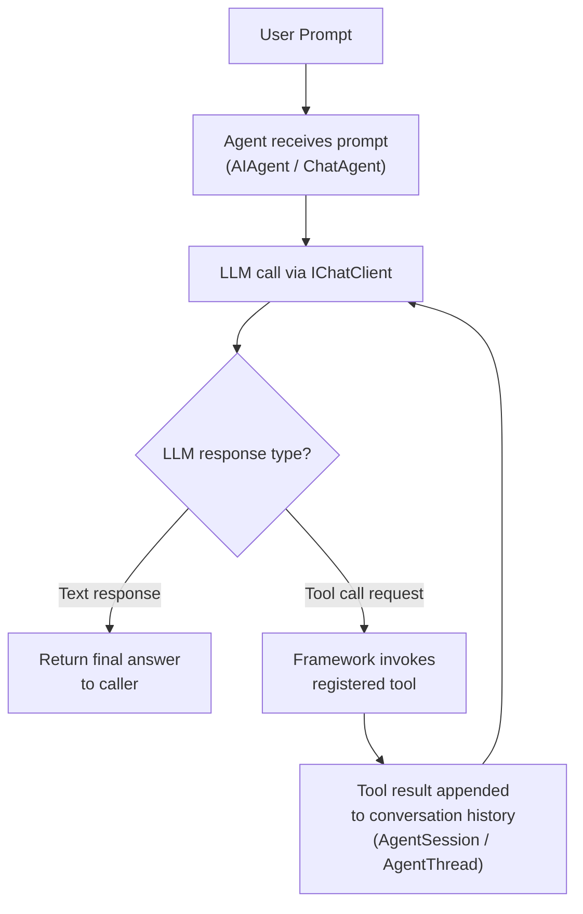

Sources: [01.AgentFoundation/README.md:9-15](), [07.Workflow/README.md:25-37]()

The loop is transparent to application code: calling `agent.RunAsync(prompt)` or `await agent.run(prompt)` blocks until the LLM has finished all tool calls and produced a final text response. Streaming variants (`RunStreamingAsync` / `agent.run_stream`) emit tokens incrementally but follow the same loop internally.

---

## Code Entity Map: Agent Concepts → Framework Classes

**Agent Component to Code Entity Mapping**

```mermaid
graph TD
    subgraph Concept["Conceptual Layer"]
        LLM["Reasoning Engine\n(LLM)"]
        TOOLS["Tools\n(Action Executors)"]
        MEM["Memory\n(Context)"]
        AGENT["Agent"]
    end

    subgraph DotNET[".NET Entities"]
        IChatClient["IChatClient"]
        AIAgent["AIAgent"]
        AIFunctionFactory["AIFunctionFactory.Create()"]
        CodeInterp["CodeInterpreterToolDefinition"]
        FileSearch["FileSearchToolDefinition"]
        BingTool["BingGroundingToolDefinition"]
        MCPTool["MCPToolDefinition"]
        AgentThread["AgentThread"]
        AgentSessionDN["AgentSession"]
    end

    subgraph Python["Python Entities"]
        OpenAIChatClient["OpenAIChatClient"]
        ChatAgent["ChatAgent"]
        FuncTool["Python function\n(docstring as description)"]
        HostedCI["HostedCodeInterpreterTool"]
        HostedFS["HostedFileSearchTool"]
        HostedWS["HostedWebSearchTool"]
        MCPHttp["MCPStreamableHTTPTool"]
        AgentSessionPY["AgentSession"]
    end

    LLM --> IChatClient
    LLM --> OpenAIChatClient
    AGENT --> AIAgent
    AGENT --> ChatAgent
    TOOLS --> AIFunctionFactory
    TOOLS --> CodeInterp
    TOOLS --> FileSearch
    TOOLS --> BingTool
    TOOLS --> MCPTool
    TOOLS --> FuncTool
    TOOLS --> HostedCI
    TOOLS --> HostedFS
    TOOLS --> HostedWS
    TOOLS --> MCPHttp
    MEM --> AgentThread
    MEM --> AgentSessionDN
    MEM --> AgentSessionPY
```

Sources: [00.ForBeginners/04-tool-use/code_samples/dotnet-agent-framework-ghmodels-tool/Program.cs:48-62](), [02.CreateYourFirstAgent/README.md:99-210](), [04.Tools/README.md:1-401](), [05.Providers/README.md:115-163]()

---

## Microsoft Agent Framework and Its Predecessors

The `01.AgentFoundation` README describes the framework as:

> "the spiritual successor and consolidation of learnings from pioneering projects like **Semantic Kernel** and **AutoGen**."

| Framework | Role |
|---|---|
| **Semantic Kernel** | Plugin/skill orchestration, memory connectors, planner primitives |
| **AutoGen** | Multi-agent conversation patterns, agent-to-agent messaging |
| **Microsoft Agent Framework** | Unified successor; merges both into a single runtime with `AIAgent`, `WorkflowBuilder`, and consistent .NET + Python APIs |

The Microsoft Agent Framework does not replace Semantic Kernel or AutoGen for users already invested in them, but for new projects this framework provides a single surface covering all the same capabilities.

**Framework Lineage**

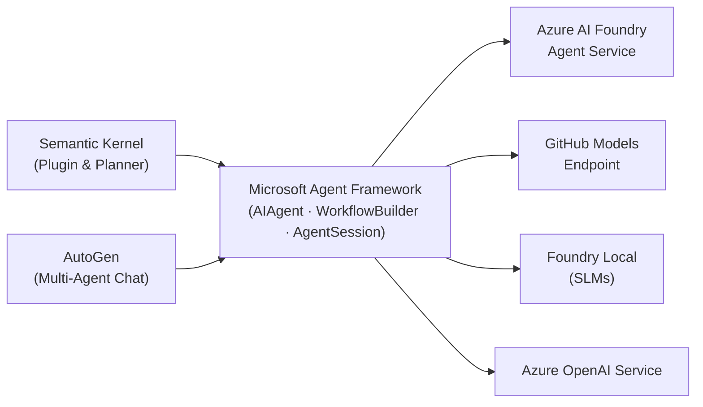

Sources: [01.AgentFoundation/README.md:33-40]()

---

## How a Minimal Agent Is Assembled

The following summary maps the conceptual steps to the actual symbols used in both languages.

| Step | .NET symbol | Python symbol |
|---|---|---|
| 1. Configure LLM connection | `OpenAIClient` / `AzureOpenAIClient` | `OpenAIChatClient` / `AzureOpenAIChatClient` |
| 2. Wrap as agent with instructions | `.AsAIAgent(instructions:...)` or `CreateAIAgent(...)` | `ChatAgent(chat_client=..., instructions=...)` |
| 3. Register tools | `tools: [AIFunctionFactory.Create(...)]` | `tools=[my_function]` |
| 4. Create session/thread | `agent.CreateSessionAsync()` | `agent.create_session_async()` |
| 5. Run | `agent.RunAsync(prompt, session)` | `await agent.run(prompt)` |
| 5a. Streaming variant | `agent.RunStreamingAsync(prompt, session)` | `agent.run_stream(prompt)` |

A concrete .NET example can be seen at [00.ForBeginners/04-tool-use/code_samples/dotnet-agent-framework-ghmodels-tool/Program.cs:48-62](). A Python example is at [02.CreateYourFirstAgent/README.md:186-210]().

For a step-by-step walkthrough of building your first agent in each language, see [Your First Python Agent](#4.1) and [Your First .NET Agent](#4.2).

Sources: [02.CreateYourFirstAgent/README.md:99-228](), [00.ForBeginners/04-tool-use/code_samples/dotnet-agent-framework-ghmodels-tool/Program.cs:1-63](), [03.ExploerAgentFramework/README.md:47-100]()

---

# Page: AIAgent and AgentSession

# AIAgent and AgentSession

<details>
<summary>Relevant source files</summary>

The following files were used as context for generating this wiki page:

- [.devcontainer/devcontainer.json](.devcontainer/devcontainer.json)
- [.devcontainer/setup.sh](.devcontainer/setup.sh)
- [.github/dependabot.yml](.github/dependabot.yml)
- [.vscode/settings.json](.vscode/settings.json)
- [00.ForBeginners/04-tool-use/code_samples/dotnet-agent-framework-ghmodels-tool/Program.cs](00.ForBeginners/04-tool-use/code_samples/dotnet-agent-framework-ghmodels-tool/Program.cs)
- [02.CreateYourFirstAgent/code_samples/dotNET/dotnet-travelagent-ghmodel/dotnet-travelagent-ghmodel.csproj](02.CreateYourFirstAgent/code_samples/dotNET/dotnet-travelagent-ghmodel/dotnet-travelagent-ghmodel.csproj)
- [02.CreateYourFirstAgent/code_samples/python/python-travelagent-ghmodel.ipynb](02.CreateYourFirstAgent/code_samples/python/python-travelagent-ghmodel.ipynb)
- [03.ExploerAgentFramework/code_samples/python/01-python-agent-framework-aoai.ipynb](03.ExploerAgentFramework/code_samples/python/01-python-agent-framework-aoai.ipynb)
- [03.ExploerAgentFramework/code_samples/python/02-python-agent-framrwork-ghmodel.ipynb](03.ExploerAgentFramework/code_samples/python/02-python-agent-framrwork-ghmodel.ipynb)
- [Installation/requirements.txt](Installation/requirements.txt)

</details>


This page documents the two primary runtime abstractions in the Microsoft Agent Framework: the agent entity (`Agent` in Python / `AIAgent` in .NET) and the conversation state container (`AgentSession`). It covers how each is constructed, how sessions are created and attached, and how agent execution methods differ between the two languages.

For information on how to choose and configure the underlying chat client (GitHub Models, Azure OpenAI, Foundry, etc.), see **AI Provider Integrations**. For how to define tools that agents can invoke, see **Tools Overview**. For building complete agents from scratch with step-by-step examples, see **Building Agents**.

---

## Conceptual Role of Agent and Session

Every sample in this repository operates around the same two-object model:

**Agent Lifecycle and Runtime Data Flow**

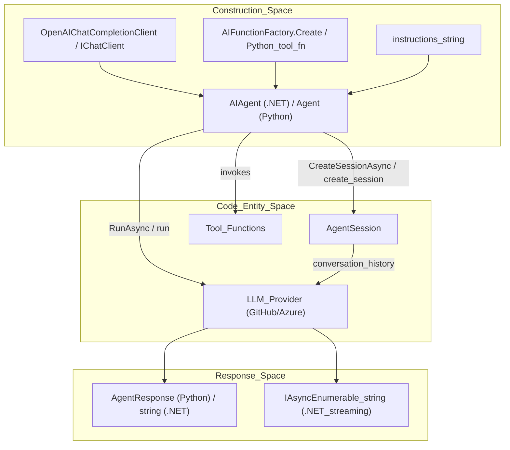

Sources: [00.ForBeginners/04-tool-use/code_samples/dotnet-agent-framework-ghmodels-tool/Program.cs:49-59](), [02.CreateYourFirstAgent/code_samples/python/python-travelagent-ghmodel.ipynb:145-146]()

---

## Python: The `Agent` Class

### Construction

The Python `Agent` class lives in the `agent_framework` package. It is the central orchestrator that combines a client, instructions, and tools.

**Direct Constructor Pattern:**

```python
from agent_framework import Agent
from agent_framework.openai import OpenAIChatCompletionClient

agent = Agent(
    client=openai_chat_client,
    instructions="You are a helpful AI Agent...",
    tools=[get_random_destination],
    name="TravelAgent"
)
```

| Parameter | Type | Purpose |
|---|---|---|
| `client` | `OpenAIChatCompletionClient` | The inference client (e.g., GitHub Models or Azure OpenAI) [03.ExploerAgentFramework/code_samples/python/02-python-agent-framrwork-ghmodel.ipynb:128-132]() |
| `instructions` | `str` | System prompt defining the agent's persona and rules [03.ExploerAgentFramework/code_samples/python/01-python-agent-framework-aoai.ipynb:176-176]() |
| `tools` | `list` | Python functions the agent can call [02.CreateYourFirstAgent/code_samples/python/python-travelagent-ghmodel.ipynb:183-189]() |
| `name` | `str` | Identifier for the agent, used in logs and multi-agent scenarios [03.ExploerAgentFramework/code_samples/python/01-python-agent-framework-aoai.ipynb:175-175]() |

Sources: [03.ExploerAgentFramework/code_samples/python/02-python-agent-framrwork-ghmodel.ipynb:92-93](), [02.CreateYourFirstAgent/code_samples/python/python-travelagent-ghmodel.ipynb:145-146]()

### Sessions: `create_session()`

An `AgentSession` holds the conversation history. In Python, sessions are typically managed explicitly to maintain context across multiple turns.

```python
session = agent.create_session()
```

### Running: `run()` and `run_stream()`

**Non-streaming:**
Returns an `AgentResponse` object containing the full message history and the final text.
```python
response = await agent.run("Plan me a day trip", session=session)
```

**Streaming:**
Used for real-time token delivery to the UI.
```python
async for chunk in agent.run_stream("Plan me a day trip", session=session):
    print(chunk, end="")
```

Sources: [03.ExploerAgentFramework/code_samples/python/02-python-agent-framrwork-ghmodel.ipynb:160-160](), [03.ExploerAgentFramework/code_samples/python/01-python-agent-framework-aoai.ipynb:189-190]()

---

## .NET: The `AIAgent` Class

### Construction

In .NET, `AIAgent` is defined in `Microsoft.Agents.AI`. It is often produced using the `AsAIAgent()` extension method on an `IChatClient`.

**Extension Method Chain:**

```csharp
using Microsoft.Agents.AI;

AIAgent agent = openAIClient
    .GetChatClient(github_model_id)
    .AsIChatClient()
    .AsAIAgent(
        instructions: "You are a helpful AI Agent...",
        tools: [AIFunctionFactory.Create((Func<string>)GetRandomDestination)]
    );
```

| Method/Parameter | Purpose |
|---|---|
| `AsIChatClient()` | Converts `OpenAI.ChatClient` to the generic `IChatClient` interface [00.ForBeginners/04-tool-use/code_samples/dotnet-agent-framework-ghmodels-tool/Program.cs:49-49]() |
| `AsAIAgent()` | Wraps the client with agent-specific logic (instructions, tools) [00.ForBeginners/04-tool-use/code_samples/dotnet-agent-framework-ghmodels-tool/Program.cs:49-52]() |
| `AIFunctionFactory.Create` | Wraps a standard C# method into a tool the agent can understand [00.ForBeginners/04-tool-use/code_samples/dotnet-agent-framework-ghmodels-tool/Program.cs:51-51]() |

Sources: [00.ForBeginners/04-tool-use/code_samples/dotnet-agent-framework-ghmodels-tool/Program.cs:49-52](), [02.CreateYourFirstAgent/code_samples/dotNET/dotnet-travelagent-ghmodel/dotnet-travelagent-ghmodel.csproj:13-14]()

### Sessions: `CreateSessionAsync()`

The `.NET` implementation requires an explicit session to maintain state across calls to the same agent.

```csharp
AgentSession session = await agent.CreateSessionAsync();
```

Sources: [00.ForBeginners/04-tool-use/code_samples/dotnet-agent-framework-ghmodels-tool/Program.cs:56-56]()

### Running: `RunAsync` and `RunStreamingAsync`

**Blocking Execution:**
Returns the final string response from the agent.
```csharp
string response = await agent.RunAsync("Plan me a day trip", session);
```

**Streaming Execution:**
Returns an `IAsyncEnumerable<string>` for real-time output.
```csharp
await foreach (var update in agent.RunStreamingAsync("Plan me a day trip", session))
{
    Console.Write(update);
}
```

Sources: [00.ForBeginners/04-tool-use/code_samples/dotnet-agent-framework-ghmodels-tool/Program.cs:59-62]()

---

## Side-by-Side Comparison

**Natural Language to Code Entity Mapping**

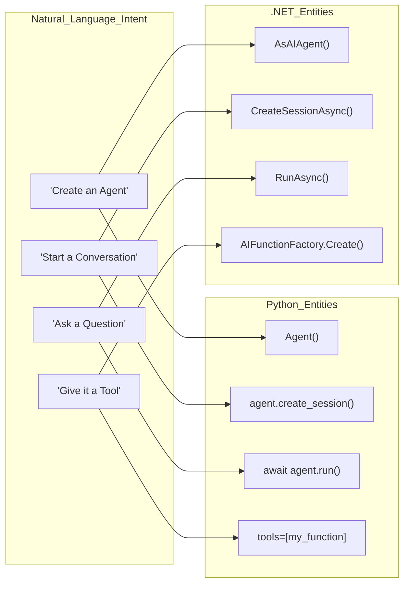

| Feature | Python | .NET |
|---|---|---|
| **Class Name** | `Agent` | `AIAgent` |
| **Session Class** | `AgentSession` | `AgentSession` |
| **Creation** | Constructor or `as_agent()` | Extension `AsAIAgent()` |
| **Primary Run** | `run()` (async) | `RunAsync()` |
| **Streaming** | `run_stream()` | `RunStreamingAsync()` |
| **Tool Registration** | List of functions | `AIFunctionFactory.Create` |
| **Session Init** | `create_session()` (sync) | `CreateSessionAsync()` (async) |

Sources: [02.CreateYourFirstAgent/code_samples/python/python-travelagent-ghmodel.ipynb:145-160](), [00.ForBeginners/04-tool-use/code_samples/dotnet-agent-framework-ghmodels-tool/Program.cs:49-59]()

---

## Implementation Detail: The Agent Loop

When `run()` or `RunAsync()` is called, the framework enters a loop:
1. **Context Assembly**: The `AgentSession` history is combined with the `AIAgent` instructions.
2. **LLM Call**: The request is sent to the `IChatClient` (OpenAI/Azure).
3. **Tool Resolution**: If the LLM returns a tool call, the agent executes the corresponding local function (Python) or `AIFunction` (.NET).
4. **Iteration**: The tool result is appended to the session, and the LLM is called again until a final text response is generated.
5. **Finalization**: The complete turn is saved to the `AgentSession`.

Sources: [00.ForBeginners/04-tool-use/code_samples/dotnet-agent-framework-ghmodels-tool/Program.cs:13-32](), [02.CreateYourFirstAgent/code_samples/python/python-travelagent-ghmodel.ipynb:183-196]()

---

# Page: Tools Overview

# Tools Overview

<details>
<summary>Relevant source files</summary>

The following files were used as context for generating this wiki page:

- [00.ForBeginners/01-intro-to-ai-agents/code_samples/python-agent-framework-travelagent.ipynb](00.ForBeginners/01-intro-to-ai-agents/code_samples/python-agent-framework-travelagent.ipynb)
- [00.ForBeginners/02-explore-agentic-frameworks/code_samples/python-agent-framework-basicagent.ipynb](00.ForBeginners/02-explore-agentic-frameworks/code_samples/python-agent-framework-basicagent.ipynb)
- [00.ForBeginners/03-agentic-design-patterns/code_samples/python-agent-framework-ghmodel-basicagent.ipynb](00.ForBeginners/03-agentic-design-patterns/code_samples/python-agent-framework-ghmodel-basicagent.ipynb)
- [00.ForBeginners/04-tool-use/code_samples/python-agent-framework-ghmodel-tools.ipynb](00.ForBeginners/04-tool-use/code_samples/python-agent-framework-ghmodel-tools.ipynb)
- [00.ForBeginners/05-agentic-rag/code_samples/dotnet-agent-framework-msfoundry-file-search/Program.cs](00.ForBeginners/05-agentic-rag/code_samples/dotnet-agent-framework-msfoundry-file-search/Program.cs)
- [00.ForBeginners/05-agentic-rag/code_samples/python-agent-framework-msfoundry-file-search.ipynb](00.ForBeginners/05-agentic-rag/code_samples/python-agent-framework-msfoundry-file-search.ipynb)
- [00.ForBeginners/07-planning-design/code_samples/python-agent-framrwork-ghmodel-planningdesign.ipynb](00.ForBeginners/07-planning-design/code_samples/python-agent-framrwork-ghmodel-planningdesign.ipynb)
- [00.ForBeginners/08-multi-agent/code_samples/python-agent-framework-ghmodel-workflow-multi-agents.ipynb](00.ForBeginners/08-multi-agent/code_samples/python-agent-framework-ghmodel-workflow-multi-agents.ipynb)
- [04.Tools/code_samples/dotNET/msfoundry/01-dotnet-agent-framework-msfoundry-vision/01-dotnet-agent-framework-msfoundry-vision.csproj](04.Tools/code_samples/dotNET/msfoundry/01-dotnet-agent-framework-msfoundry-vision/01-dotnet-agent-framework-msfoundry-vision.csproj)
- [04.Tools/code_samples/dotNET/msfoundry/01-dotnet-agent-framework-msfoundry-vision/Program.cs](04.Tools/code_samples/dotNET/msfoundry/01-dotnet-agent-framework-msfoundry-vision/Program.cs)
- [04.Tools/code_samples/dotNET/msfoundry/02-dotnet-agent-framework-msfoundry-code-interpreter/02-dotnet-agent-framework-msfoundry-code-interpreter.csproj](04.Tools/code_samples/dotNET/msfoundry/02-dotnet-agent-framework-msfoundry-code-interpreter/02-dotnet-agent-framework-msfoundry-code-interpreter.csproj)
- [04.Tools/code_samples/dotNET/msfoundry/02-dotnet-agent-framework-msfoundry-code-interpreter/Program.cs](04.Tools/code_samples/dotNET/msfoundry/02-dotnet-agent-framework-msfoundry-code-interpreter/Program.cs)
- [04.Tools/code_samples/dotNET/msfoundry/03-dotnet-agent-framework-msfoundry-web-search/03-dotnet-agent-framework-msfoundry-web-search.csproj](04.Tools/code_samples/dotNET/msfoundry/03-dotnet-agent-framework-msfoundry-web-search/03-dotnet-agent-framework-msfoundry-web-search.csproj)
- [04.Tools/code_samples/dotNET/msfoundry/03-dotnet-agent-framework-msfoundry-web-search/Program.cs](04.Tools/code_samples/dotNET/msfoundry/03-dotnet-agent-framework-msfoundry-web-search/Program.cs)
- [04.Tools/code_samples/dotNET/msfoundry/04-dotnet-agent-framework-msfoundry-file-search/04-dotnet-agent-framework-msfoundry-file-search.csproj](04.Tools/code_samples/dotNET/msfoundry/04-dotnet-agent-framework-msfoundry-file-search/04-dotnet-agent-framework-msfoundry-file-search.csproj)
- [04.Tools/code_samples/dotNET/msfoundry/04-dotnet-agent-framework-msfoundry-file-search/Program.cs](04.Tools/code_samples/dotNET/msfoundry/04-dotnet-agent-framework-msfoundry-file-search/Program.cs)

</details>


This page covers the concept of tools in the Microsoft Agent Framework: how custom Python functions and .NET methods become callable tools, the role of factory methods in .NET, function docstrings in Python, and what built-in hosted tools look like at a conceptual level.

---

## What Is a Tool

A **tool** is a callable unit of work that the LLM can request during an agent run. When the model determines it needs external data or needs to perform an action, it emits a structured tool-call. The framework intercepts the call, executes the associated function or hosted service, and feeds the result back to the LLM. This loop repeats until the LLM produces a final text response.

Tools divide into three kinds:

| Kind | Runs where | Python representation | .NET representation |
|---|---|---|---|
| Custom function | Locally, in your process | Python function with docstring | Static method + `[Description]` + `AIFunctionFactory.Create()` |
| Hosted / built-in | Server-side (Azure AI Foundry) | `HostedFileSearchTool`, `HostedCodeInterpreterTool` | `FileSearchTool`, `CodeInterpreterToolDefinition` |
| Protocol-based | External MCP server | `MCPStreamableHTTPTool` | `MCPToolDefinition` |

---

## Tool Invocation Lifecycle

The sequence below shows how a tool call is inserted into the agent loop, bridging the natural language request to code execution.

**Tool Invocation Lifecycle**

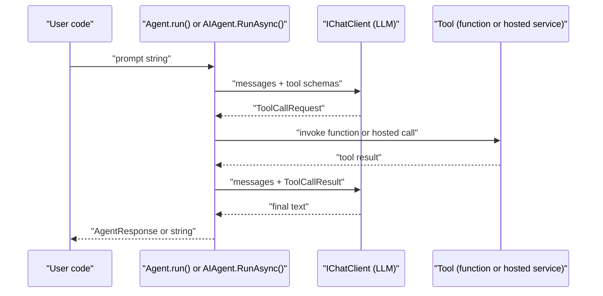

Sources: [00.ForBeginners/04-tool-use/code_samples/python-agent-framework-ghmodel-tools.ipynb:42-45](), [00.ForBeginners/02-explore-agentic-frameworks/code_samples/python-agent-framework-basicagent.ipynb:151-177]()

---

## Custom Function Tools

### Python — Docstring as Description

Any regular Python function can be registered as a tool. The framework reads the function's **docstring** to produce the description that the LLM uses when deciding whether to call the tool. Parameter type annotations generate the argument schema.

The function is registered by including it in the `tools` list passed to the `Agent` constructor:

[00.ForBeginners/01-intro-to-ai-agents/code_samples/python-agent-framework-travelagent.ipynb:143-167]()

[00.ForBeginners/01-intro-to-ai-agents/code_samples/python-agent-framework-travelagent.ipynb:200-206]()

### .NET — `[Description]` Attribute and `AIFunctionFactory`

In .NET, tool registration has two steps:

1. Annotate the method with `[Description("...")]` from `System.ComponentModel`. This string becomes the tool description the LLM reads.
2. Wrap the method with `AIFunctionFactory.Create()` from `Microsoft.Extensions.AI` to produce an `AIFunction` object.

The resulting `AIFunction` is passed in the `tools` array during agent creation (e.g., via `AsAIAgent`).

**Custom Tool Registration Code Paths**

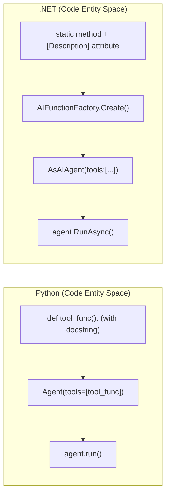

Sources: [00.ForBeginners/01-intro-to-ai-agents/code_samples/python-agent-framework-travelagent.ipynb:143-206](), [00.ForBeginners/03-agentic-design-patterns/code_samples/python-agent-framework-ghmodel-basicagent.ipynb:166-190]()

---

## Built-in Hosted Tools

Hosted tools are services provided by the Azure AI Foundry platform. They run server-side and are represented as objects passed into the agent's `tools` parameter at creation time.

**Hosted Tool Class Names Mapped to Platform Capabilities**

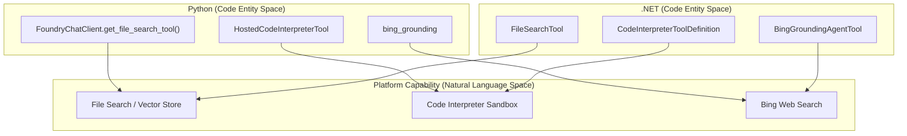

Sources: [00.ForBeginners/05-agentic-rag/code_samples/python-agent-framework-msfoundry-file-search.ipynb:37-41](), [00.ForBeginners/05-agentic-rag/code_samples/dotnet-agent-framework-msfoundry-file-search/Program.cs:41-55](), [04.Tools/code_samples/dotNET/msfoundry/04-dotnet-agent-framework-msfoundry-file-search/Program.cs:39-49]()

### File Search (RAG)

File search provides Retrieval-Augmented Generation (RAG) by querying a vector store of uploaded documents.

1. **Upload**: Files are uploaded via `OpenAIFileClient` with `FileUploadPurpose.Assistants`.
2. **Vector Store**: A `VectorStore` is created using `VectorStoreClient` and linked to the file IDs.
3. **Tool Creation**: A `FileSearchTool` (.NET) or the result of `get_file_search_tool()` (Python) is instantiated using the vector store ID.
4. **Agent Registration**: The tool is added to the `Tools` collection of the agent definition.

Sources: [00.ForBeginners/05-agentic-rag/code_samples/dotnet-agent-framework-msfoundry-file-search/Program.cs:27-55](), [04.Tools/code_samples/dotNET/msfoundry/04-dotnet-agent-framework-msfoundry-file-search/Program.cs:25-49]()

### Code Interpreter

The code interpreter provides a sandboxed execution environment on the platform. The agent writes code and the platform runs it, returning results including stdout and generated files.

- **Python:** `HostedCodeInterpreterTool()` is passed in the `tools` argument.
- **.NET:** `CodeInterpreterToolDefinition` is used within `ProjectsAgentVersionCreationOptions`.

Sources: [04.Tools/code_samples/dotNET/msfoundry/02-dotnet-agent-framework-msfoundry-code-interpreter/02-dotnet-agent-framework-msfoundry-code-interpreter.csproj:1-20]()

### Bing Grounding

Bing grounding enables live web searches, with citations included in the agent response.

- **Python:** Integrated via `AzureAIProjectAgentProvider` and specified as `bing_grounding`.
- **.NET:** `BingGroundingAgentTool` is configured with a connection ID from the Azure AI Project.

Sources: [04.Tools/code_samples/dotNET/msfoundry/03-dotnet-agent-framework-msfoundry-web-search/Program.cs:1-30]()

---

## Protocol-Based Tools (MCP)

Model Context Protocol (MCP) tools connect an agent to an external tool server over HTTP or stdio.

- **Python:** `MCPStreamableHTTPTool` acts as a client to an MCP server.
- **.NET:** `IMcpClient` is created via `McpClientFactory`, and tools are listed using `ListToolsAsync()`.

Detailed implementation details for MCP and Agent-to-Agent (A2A) patterns are covered in sections [6.6]() and [6.7]().

Sources: [00.ForBeginners/07-planning-design/code_samples/python-agent-framrwork-ghmodel-planningdesign.ipynb:95-99](), [00.ForBeginners/08-multi-agent/code_samples/python-agent-framework-ghmodel-workflow-multi-agents.ipynb:129-134]()

---

# Page: Building Agents

# Building Agents

<details>
<summary>Relevant source files</summary>

The following files were used as context for generating this wiki page:

- [02.CreateYourFirstAgent/code_samples/dotNET/dotnet-travelagent-ghmodel/dotnet-travelagent-ghmodel.csproj](02.CreateYourFirstAgent/code_samples/dotNET/dotnet-travelagent-ghmodel/dotnet-travelagent-ghmodel.csproj)
- [02.CreateYourFirstAgent/code_samples/python/python-travelagent-ghmodel.ipynb](02.CreateYourFirstAgent/code_samples/python/python-travelagent-ghmodel.ipynb)
- [03.ExploerAgentFramework/code_samples/dotNET/01-dotnet-agent-framework-aoai/01-dotnet-agent-framework-aoai.csproj](03.ExploerAgentFramework/code_samples/dotNET/01-dotnet-agent-framework-aoai/01-dotnet-agent-framework-aoai.csproj)
- [03.ExploerAgentFramework/code_samples/dotNET/01-dotnet-agent-framework-aoai/Program.cs](03.ExploerAgentFramework/code_samples/dotNET/01-dotnet-agent-framework-aoai/Program.cs)
- [03.ExploerAgentFramework/code_samples/dotNET/02-dotnet-agent-framework-ghmodel/02-dotnet-agent-framework-ghmodel.csproj](03.ExploerAgentFramework/code_samples/dotNET/02-dotnet-agent-framework-ghmodel/02-dotnet-agent-framework-ghmodel.csproj)
- [03.ExploerAgentFramework/code_samples/dotNET/03-dotnet-agent-framework-msfoundry/03-dotnet-agent-framework-msfoundry.csproj](03.ExploerAgentFramework/code_samples/dotNET/03-dotnet-agent-framework-msfoundry/03-dotnet-agent-framework-msfoundry.csproj)
- [03.ExploerAgentFramework/code_samples/dotNET/03-dotnet-agent-framework-msfoundry/Program.cs](03.ExploerAgentFramework/code_samples/dotNET/03-dotnet-agent-framework-msfoundry/Program.cs)
- [03.ExploerAgentFramework/code_samples/dotNET/04-dotnet-agent-framework-foundrylocal/04-dotnet-agent-framework-foundrylocal.csproj](03.ExploerAgentFramework/code_samples/dotNET/04-dotnet-agent-framework-foundrylocal/04-dotnet-agent-framework-foundrylocal.csproj)
- [03.ExploerAgentFramework/code_samples/python/01-python-agent-framework-aoai.ipynb](03.ExploerAgentFramework/code_samples/python/01-python-agent-framework-aoai.ipynb)
- [03.ExploerAgentFramework/code_samples/python/02-python-agent-framrwork-ghmodel.ipynb](03.ExploerAgentFramework/code_samples/python/02-python-agent-framrwork-ghmodel.ipynb)
- [03.ExploerAgentFramework/code_samples/python/03-python-agent-framework-msfoundry.ipynb](03.ExploerAgentFramework/code_samples/python/03-python-agent-framework-msfoundry.ipynb)
- [03.ExploerAgentFramework/code_samples/python/04-python-agent-framework-foundrylocal.ipynb](03.ExploerAgentFramework/code_samples/python/04-python-agent-framework-foundrylocal.ipynb)

</details>


This page covers the end-to-end mechanics of constructing an agent using the Microsoft Agent Framework in both Python and .NET. It describes the mandatory components — the chat client, agent object, instructions, and tools — and explains how they fit together before an agent can process a request.

For foundational definitions of `AIAgent`, `AgentSession`, and the agent loop, see [Core Concepts](#3). For configuration of the underlying AI provider (GitHub Models, Azure OpenAI, Azure AI Foundry, Foundry Local), see [AI Provider Integrations](#5). For detailed, step-by-step language-specific tutorials, see [Your First Python Agent](#4.1) and [Your First .NET Agent](#4.2).

---

## Component Model

Every agent, regardless of language or AI provider, is assembled from the same three components.

**Agent assembly diagram**

```mermaid
graph TD
    subgraph "Configuration"
        ENV["".env file\n(GITHUB_TOKEN, GITHUB_ENDPOINT, etc.)""]
    end

    subgraph "Python"
        PY_CLIENT[""OpenAIChatCompletionClient\n(agent_framework.openai)""]
        PY_AGENT[""Agent\n(agent_framework)""]
        PY_TOOL[""Python function\n(e.g. get_random_destination)""]
    end

    subgraph ".NET"
        NET_CLIENT[""OpenAIClient\n(OpenAI namespace)""]
        NET_CHAT[""IChatClient\n(.AsIChatClient())""]
        NET_AGENT[""AIAgent\n(.AsAIAgent())""]
        NET_TOOL[""AIFunctionFactory.Create\n(Microsoft.Extensions.AI)""]
    end

    ENV --> PY_CLIENT
    ENV --> NET_CLIENT
    PY_CLIENT --> PY_AGENT
    PY_TOOL --> PY_AGENT
    NET_CLIENT --> NET_CHAT
    NET_CHAT --> NET_AGENT
    NET_TOOL --> NET_AGENT
```

Sources: [02.CreateYourFirstAgent/code_samples/python/python-travelagent-ghmodel.ipynb:140-248](), [03.ExploerAgentFramework/code_samples/python/02-python-agent-framrwork-ghmodel.ipynb:90-148](), [02.CreateYourFirstAgent/code_samples/dotNET/dotnet-travelagent-ghmodel/dotnet-travelagent-ghmodel.csproj:11-16]()

---

## Step 1 — Load Environment Variables

Both runtimes load credentials from a `.env` file before any agent object is constructed.

| Language | Mechanism | Relevant Line(s) |
|---|---|---|
| Python | `dotenv.load_dotenv()` | [02.CreateYourFirstAgent/code_samples/python/python-travelagent-ghmodel.ipynb:170-170]() |
| .NET | `DotNetEnv.Env.Load(path)` | [03.ExploerAgentFramework/code_samples/dotNET/03-dotnet-agent-framework-msfoundry/Program.cs:10-10]() |

The key environment variables consumed at this stage are `GITHUB_TOKEN`, `GITHUB_ENDPOINT`, and `GITHUB_MODEL_ID`. See [Configuration Reference](#2.2) for the complete list.

Sources: [02.CreateYourFirstAgent/code_samples/python/python-travelagent-ghmodel.ipynb:166-171](), [03.ExploerAgentFramework/code_samples/dotNET/01-dotnet-agent-framework-aoai/Program.cs:7-10]()

---

## Step 2 — Initialize the Chat Client

The chat client is the object that communicates with the model provider. It is constructed before the agent and passed into it.

**Python** uses `OpenAIChatCompletionClient` from `agent_framework.openai`:

```python
openai_chat_client = OpenAIChatCompletionClient(
    base_url=os.environ.get("GITHUB_ENDPOINT"),
    api_key=os.environ.get("GITHUB_TOKEN"),
    model=os.environ.get("GITHUB_MODEL_ID")
)
```
[03.ExploerAgentFramework/code_samples/python/02-python-agent-framrwork-ghmodel.ipynb:126-132]()

**.NET** constructs an `OpenAIClient` (or `AzureOpenAIClient`) then adapts it to the framework's needs. For Azure OpenAI, it uses `AzureCliCredential` for secure access:

[03.ExploerAgentFramework/code_samples/dotNET/01-dotnet-agent-framework-aoai/Program.cs:15-19]()

The framework provides the `AsAIAgent()` extension to bridge the client to the `AIAgent` abstraction.

Sources: [03.ExploerAgentFramework/code_samples/python/02-python-agent-framrwork-ghmodel.ipynb:126-132](), [03.ExploerAgentFramework/code_samples/dotNET/01-dotnet-agent-framework-aoai/Program.cs:15-19]()

---

## Step 3 — Define Tools

Tools are ordinary functions decorated with descriptive docstrings (Python) or `[Description]` attributes (.NET). The framework reflects on these at registration time to produce the tool schema that the model sees.

**Tool definition comparison**

```mermaid
graph LR
    subgraph "Python"
        PY_FN[""def get_random_destination() -> str\n\"\"\"docstring used as tool description\"\"\"""]
    end

    subgraph ".NET"
        NET_FN[""static string GetRandomDestination()\n[Description(\"...\")] attribute""]
        NET_WRAP[""AIFunctionFactory.Create(\n  (Func<string>)GetRandomDestination\n)""]
        NET_FN --> NET_WRAP
    end

    PY_FN --> AGENT_PY[""Agent(tools=[get_random_destination])""]
    NET_WRAP --> AGENT_NET[""AIAgent via .AsAIAgent(tools: [...])""]
```

- **Python**: Pass the function object directly in the `tools` list. The docstring and `Annotated` type hints become the tool description visible to the model. [03.ExploerAgentFramework/code_samples/python/04-python-agent-framework-foundrylocal.ipynb:87-93]()
- **.NET**: Wrap the method in `AIFunctionFactory.Create(...)` before passing it to `AsAIAgent`.

Sources: [02.CreateYourFirstAgent/code_samples/python/python-travelagent-ghmodel.ipynb:181-215](), [03.ExploerAgentFramework/code_samples/python/04-python-agent-framework-foundrylocal.ipynb:139-143]()

---

## Step 4 — Create the Agent

With the client and tools ready, the agent object is constructed.

| Parameter | Python (`Agent`) | .NET (`AsAIAgent`) |
|---|---|---|
| Chat client | `client=openai_chat_client` | called on the `IChatClient` instance |
| System instructions | `instructions="..."` | `instructions: "..."` |
| Tool list | `tools=[get_weather]` | `tools: [AIFunctionFactory.Create(...)]` |
| Agent name | `name="LocalAgent"` | `name: "MAFDemoAgent"` |

**Python:**
[03.ExploerAgentFramework/code_samples/python/02-python-agent-framrwork-ghmodel.ipynb:142-148]()

**.NET:**
[03.ExploerAgentFramework/code_samples/dotNET/01-dotnet-agent-framework-aoai/Program.cs:15-19]()

Sources: [03.ExploerAgentFramework/code_samples/python/02-python-agent-framrwork-ghmodel.ipynb:142-148](), [03.ExploerAgentFramework/code_samples/dotNET/01-dotnet-agent-framework-aoai/Program.cs:15-19]()

---

## Step 5 — Run the Agent

Both runtimes offer two execution modes: a complete response and a streaming response.

**Execution methods**

```mermaid
graph TD
    subgraph "Python (Agent)"
        PY_RUN[""agent.run(prompt)\n→ AgentResponse""]
        PY_STREAM[""agent.run_stream(prompt)\n→ async iterator of chunks""]
    end

    subgraph ".NET (AIAgent)"
        NET_RUN[""await agent.RunAsync(prompt)\n→ string""]
        NET_STREAM[""await foreach agent.RunStreamingAsync(prompt)\n→ IAsyncEnumerable<string>""]
    end
```

**Python — complete response:**
[03.ExploerAgentFramework/code_samples/python/02-python-agent-framrwork-ghmodel.ipynb:157-160]()
The response is an `AgentResponse` object. The final text is typically accessed via `response.text` or by inspecting `response.messages`. [03.ExploerAgentFramework/code_samples/python/03-python-agent-framework-msfoundry.ipynb:107-107]()

**.NET — complete and streaming:**
[03.ExploerAgentFramework/code_samples/dotNET/01-dotnet-agent-framework-aoai/Program.cs:22-27]()

Sources: [03.ExploerAgentFramework/code_samples/python/02-python-agent-framrwork-ghmodel.ipynb:157-160](), [03.ExploerAgentFramework/code_samples/dotNET/01-dotnet-agent-framework-aoai/Program.cs:22-27]()

---

## Full Data Flow

The diagram below maps the complete request lifecycle from user prompt to rendered output, using the concrete class names from the codebase.

```mermaid
sequenceDiagram
    participant U as "User / Caller"
    participant A as "Agent / AIAgent"
    participant C as "OpenAIChatCompletionClient\n/ IChatClient"
    participant M as "Model Provider\n(GitHub Models / AOAI)"
    participant T as "get_weather\n/ GetWeather"

    U->>A: "agent.run(prompt) / RunAsync(prompt)"
    A->>C: "Send messages + tool schema"
    C->>M: "HTTP request"
    M-->>C: "Tool call request"
    C-->>A: "Tool invocation signal"
    A->>T: "Execute registered tool"
    T-->>A: "Return weather data string"
    A->>C: "Send tool result"
    C->>M: "Continue conversation"
    M-->>C: "Final text response"
    C-->>A: "AgentResponse / string"
    A-->>U: "Return result"
```

Sources: [03.ExploerAgentFramework/code_samples/python/04-python-agent-framework-foundrylocal.ipynb:156-168](), [03.ExploerAgentFramework/code_samples/dotNET/01-dotnet-agent-framework-aoai/Program.cs:15-27]()

---

## Project Setup Reference

### Python Dependencies

Install the core package before running any Python sample:

```bash
pip install agent-framework-core -U
```
[03.ExploerAgentFramework/code_samples/python/02-python-agent-framrwork-ghmodel.ipynb:41-41]()

Key imports used in Python agent files:

| Symbol | Module |
|---|---|
| `Agent` | `agent_framework` |
| `OpenAIChatCompletionClient` | `agent_framework.openai` |
| `FoundryChatClient` | `agent_framework.foundry` |
| `FoundryLocalClient` | `agent_framework_foundry_local` |

Sources: [03.ExploerAgentFramework/code_samples/python/02-python-agent-framrwork-ghmodel.ipynb:92-93](), [03.ExploerAgentFramework/code_samples/python/03-python-agent-framework-msfoundry.ipynb:26-27](), [03.ExploerAgentFramework/code_samples/python/04-python-agent-framework-foundrylocal.ipynb:32-32]()

### .NET NuGet Package References

[02.CreateYourFirstAgent/code_samples/dotNET/dotnet-travelagent-ghmodel/dotnet-travelagent-ghmodel.csproj:11-16]()

| Package | Purpose |
|---|---|
| `Microsoft.Agents.AI` | Core `AIAgent` abstraction and `AsAIAgent()` extension |
| `Microsoft.Extensions.AI.OpenAI` | `IChatClient` adapter for OpenAI SDK |
| `Azure.AI.Projects` | Integration with Azure AI Foundry |
| `Azure.Identity` | `AzureCliCredential` for secure auth |
| `DotNetEnv` | `.env` file loading via `Env.Load()` |

Sources: [02.CreateYourFirstAgent/code_samples/dotNET/dotnet-travelagent-ghmodel/dotnet-travelagent-ghmodel.csproj:11-16](), [03.ExploerAgentFramework/code_samples/dotNET/03-dotnet-agent-framework-msfoundry/03-dotnet-agent-framework-msfoundry.csproj:11-19]()

---

## Azure AI Foundry Variant (.NET)

When targeting Azure AI Foundry, `AIProjectClient` is used to manage agent versions. The `AsAIAgent()` method is called on the project client by passing a `ProjectsAgentVersion`.

[03.ExploerAgentFramework/code_samples/dotNET/03-dotnet-agent-framework-msfoundry/Program.cs:16-33]()

The `FoundryAgent` produced this way integrates with the persistent capabilities of the Foundry platform. For full details on this distinction, see [Azure AI Foundry](#5.3).

Sources: [03.ExploerAgentFramework/code_samples/dotNET/03-dotnet-agent-framework-msfoundry/Program.cs:16-33]()

---

# Page: Your First Python Agent

# Your First Python Agent

<details>
<summary>Relevant source files</summary>

The following files were used as context for generating this wiki page:

- [00.ForBeginners/01-intro-to-ai-agents/code_samples/python-agent-framework-travelagent.ipynb](00.ForBeginners/01-intro-to-ai-agents/code_samples/python-agent-framework-travelagent.ipynb)
- [00.ForBeginners/02-explore-agentic-frameworks/code_samples/python-agent-framework-basicagent.ipynb](00.ForBeginners/02-explore-agentic-frameworks/code_samples/python-agent-framework-basicagent.ipynb)
- [00.ForBeginners/03-agentic-design-patterns/code_samples/python-agent-framework-ghmodel-basicagent.ipynb](00.ForBeginners/03-agentic-design-patterns/code_samples/python-agent-framework-ghmodel-basicagent.ipynb)
- [00.ForBeginners/04-tool-use/code_samples/python-agent-framework-ghmodel-tools.ipynb](00.ForBeginners/04-tool-use/code_samples/python-agent-framework-ghmodel-tools.ipynb)
- [00.ForBeginners/05-agentic-rag/code_samples/dotnet-agent-framework-msfoundry-file-search/Program.cs](00.ForBeginners/05-agentic-rag/code_samples/dotnet-agent-framework-msfoundry-file-search/Program.cs)
- [00.ForBeginners/05-agentic-rag/code_samples/python-agent-framework-msfoundry-file-search.ipynb](00.ForBeginners/05-agentic-rag/code_samples/python-agent-framework-msfoundry-file-search.ipynb)
- [00.ForBeginners/07-planning-design/code_samples/python-agent-framrwork-ghmodel-planningdesign.ipynb](00.ForBeginners/07-planning-design/code_samples/python-agent-framrwork-ghmodel-planningdesign.ipynb)
- [00.ForBeginners/08-multi-agent/code_samples/python-agent-framework-ghmodel-workflow-multi-agents.ipynb](00.ForBeginners/08-multi-agent/code_samples/python-agent-framework-ghmodel-workflow-multi-agents.ipynb)
- [02.CreateYourFirstAgent/code_samples/dotNET/dotnet-travelagent-ghmodel/dotnet-travelagent-ghmodel.csproj](02.CreateYourFirstAgent/code_samples/dotNET/dotnet-travelagent-ghmodel/dotnet-travelagent-ghmodel.csproj)
- [02.CreateYourFirstAgent/code_samples/python/python-travelagent-ghmodel.ipynb](02.CreateYourFirstAgent/code_samples/python/python-travelagent-ghmodel.ipynb)
- [03.ExploerAgentFramework/code_samples/python/01-python-agent-framework-aoai.ipynb](03.ExploerAgentFramework/code_samples/python/01-python-agent-framework-aoai.ipynb)
- [03.ExploerAgentFramework/code_samples/python/02-python-agent-framrwork-ghmodel.ipynb](03.ExploerAgentFramework/code_samples/python/02-python-agent-framrwork-ghmodel.ipynb)

</details>


This page walks through every step required to build a working Python agent using the Microsoft Agent Framework: initializing the chat client, writing agent instructions, registering a custom tool function, creating a session, invoking the agent, and reading the response. The travel planning agent from `02.CreateYourFirstAgent/code_samples/python/python-travelagent-ghmodel.ipynb` is used as the concrete working example throughout.

For the equivalent .NET walkthrough, see [Your First .NET Agent](#4.2). For a conceptual explanation of what `Agent` and `AgentSession` represent in the framework, see [AIAgent and AgentSession](#3.2). For details on all supported AI backends, see [AI Provider Integrations](#5).

---

## Prerequisites

Before running any Python agent, three environment variables must be present in a `.env` file or exported to the shell. `python-dotenv` loads these at runtime.

| Variable | Purpose | Example Value |
|---|---|---|
| `GITHUB_TOKEN` | Personal access token for GitHub Models authentication | `ghp_...` |
| `GITHUB_ENDPOINT` | Base URL for the OpenAI-compatible inference endpoint | `https://models.inference.ai.azure.com` |
| `GITHUB_MODEL_ID` | Model identifier sent with every request | `gpt-4o-mini` |

See [Configuration Reference](#2.2) for the full list of environment variables used across the repository, and [GitHub Models](#5.1) for an explanation of the GitHub Models backend specifically.

Install the required Python package:

```bash
pip install agent-framework-core -U
```

---

## Key Imports

Every Python agent built with this framework starts with the same two imports:

[02.CreateYourFirstAgent/code_samples/python/python-travelagent-ghmodel.ipynb:141-147]()

- `Agent` — the top-level agent class from `agent_framework`. It owns instructions, tools, and the chat client.
- `OpenAIChatCompletionClient` — the adapter in `agent_framework.openai` that wraps any OpenAI-compatible HTTP endpoint, including GitHub Models, Azure OpenAI, and Foundry Local.

`load_dotenv()` from `python-dotenv` is called immediately after imports to populate `os.environ` from the `.env` file.

[02.CreateYourFirstAgent/code_samples/python/python-travelagent-ghmodel.ipynb:163-171]()

Sources: `02.CreateYourFirstAgent/code_samples/python/python-travelagent-ghmodel.ipynb`

---

## Step 1 — Define a Tool Function

A tool is an ordinary Python function. The framework reads the function's docstring to generate the tool description that the LLM sees. The function signature determines the parameters the model can pass.

[02.CreateYourFirstAgent/code_samples/python/python-travelagent-ghmodel.ipynb:179-215]()

Key points about the `get_random_destination` tool function:

- **Return type annotation** (`-> str`) is required so the framework knows how to serialize the result.
- **Docstring** becomes the tool description visible to the model. A clear, specific docstring improves tool selection accuracy.
- The function contains no agent-specific code — it is plain Python and can be tested independently.

The same pattern appears across all beginner notebooks: `00.ForBeginners/01-intro-to-ai-agents/code_samples/python-agent-framework-travelagent.ipynb`, `00.ForBeginners/02-explore-agentic-frameworks/code_samples/python-agent-framework-basicagent.ipynb`, and `00.ForBeginners/04-tool-use/code_samples/python-agent-framework-ghmodel-tools.ipynb`.

For a deeper treatment of custom tools, see [Custom Function Tools](#6.1).

Sources: `02.CreateYourFirstAgent/code_samples/python/python-travelagent-ghmodel.ipynb`, `00.ForBeginners/01-intro-to-ai-agents/code_samples/python-agent-framework-travelagent.ipynb`

---

## Step 2 — Initialize OpenAIChatCompletionClient

`OpenAIChatCompletionClient` is constructed with three keyword arguments pulled from environment variables:

[02.CreateYourFirstAgent/code_samples/python/python-travelagent-ghmodel.ipynb:223-231]()

| Parameter | Environment Variable | Role |
|---|---|---|
| `base_url` | `GITHUB_ENDPOINT` | Points to the OpenAI-compatible inference endpoint |
| `api_key` | `GITHUB_TOKEN` | Authenticates the HTTP request |
| `model` | `GITHUB_MODEL_ID` | Sent as the `model` field in each request |

`OpenAIChatCompletionClient` is the Python equivalent of `OpenAIClient` in .NET. The same constructor signature is reused when targeting Azure OpenAI or Foundry Local by changing only the environment variable values.

Sources: `02.CreateYourFirstAgent/code_samples/python/python-travelagent-ghmodel.ipynb`, `00.ForBeginners/02-explore-agentic-frameworks/code_samples/python-agent-framework-basicagent.ipynb`

---

## Step 3 — Create the Agent

The `Agent` constructor accepts the client, a plain-text instructions string, and a list of tool callables:

[02.CreateYourFirstAgent/code_samples/python/python-travelagent-ghmodel.ipynb:240-248]()

| Parameter | Type | Purpose |
|---|---|---|
| `client` | `OpenAIChatCompletionClient` | Underlying LLM connection |
| `instructions` | `str` | System-level instructions prepended to every conversation |
| `tools` | `list[Callable]` | Python functions the agent may call via function-calling |
| `name` | `str` (optional) | Agent identifier used in workflow routing and logs |

When `name` is omitted (as in the simplest form above), the agent has no named identity — relevant for single-agent scenarios. When building workflows, `name` is required so `WorkflowBuilder` can address the executor.

An alternative construction path, used in several beginner notebooks, calls `chat_client.as_agent(instructions=..., name=...)` on the `OpenAIChatCompletionClient` instance directly:

[03.ExploerAgentFramework/code_samples/python/01-python-agent-framework-aoai.ipynb:164-166]()

Both forms produce the same `Agent` object.

Sources: `02.CreateYourFirstAgent/code_samples/python/python-travelagent-ghmodel.ipynb`, `03.ExploerAgentFramework/code_samples/python/01-python-agent-framework-aoai.ipynb`

---

## Step 4 — Run the Agent

`agent.run()` is an `async` method. It accepts a user message string and returns an `AgentResponse`.

[02.CreateYourFirstAgent/code_samples/python/python-travelagent-ghmodel.ipynb:256-260]()

The method executes the complete agent loop internally:

**Agent execution loop: `agent.run()`**

```mermaid
sequenceDiagram
    participant "Caller" as Caller
    participant "Agent" as Agent
    participant "OpenAIChatCompletionClient" as Client
    participant "LLM" as LLM
    participant "get_random_destination()" as Tool

    Caller->>"Agent": "run(user_message)"
    "Agent"->>"Client": "complete(messages)"
    "Client"->>"LLM": "POST /chat/completions"
    "LLM"-->>"Client": "tool_call: get_random_destination"
    "Client"-->>"Agent": "tool_call response"
    "Agent"->>"get_random_destination()": "invoke()"
    "get_random_destination()"-->>"Agent": "\"Cairo, Egypt\""
    "Agent"->>"Client": "complete(messages + tool_result)"
    "Client"->>"LLM": "POST /chat/completions"
    "LLM"-->>"Client": "final text"
    "Client"-->>"Agent": "final text"
    "Agent"-->>Caller: "AgentResponse"
```

Sources: `02.CreateYourFirstAgent/code_samples/python/python-travelagent-ghmodel.ipynb`, `00.ForBeginners/01-intro-to-ai-agents/code_samples/python-agent-framework-travelagent.ipynb`

---

## Step 5 — Read the AgentResponse

`agent.run()` returns an `AgentResponse`. The final assistant message is the last element of `response.messages`:

[02.CreateYourFirstAgent/code_samples/python/python-travelagent-ghmodel.ipynb:309-325]()

The response structure has two levels of nesting:

**`AgentResponse` object model**

```mermaid
graph TD
    AR["AgentResponse"]
    AR --> ML["messages: list[Message]"]
    ML --> M["Message (last)"]
    M --> CL["contents: list[Content]"]
    CL --> C["Content"]
    C --> T[".text: str"]
    M --> AN[".author_name: str"]
```

| Access path | Type | Value |
|---|---|---|
| `response.messages[-1]` | `Message` | The final assistant turn |
| `response.messages[-1].contents[0]` | `Content` | First content block of the message |
| `response.messages[-1].contents[0].text` | `str` | The text of the response |
| `response.text` | `str` | Shorthand for the full text of the response |

`response.text` provides a shortcut that combines all content blocks into a single string, as seen in the RAG example:

[00.ForBeginners/05-agentic-rag/code_samples/python-agent-framework-msfoundry-file-search.ipynb:259-261]()

Sources: `02.CreateYourFirstAgent/code_samples/python/python-travelagent-ghmodel.ipynb`, `00.ForBeginners/05-agentic-rag/code_samples/python-agent-framework-msfoundry-file-search.ipynb`

---

## Step 6 — Multi-Turn Conversations with Sessions

A session preserves conversation history across multiple `run()` calls. Without a session, each call is stateless.

[00.ForBeginners/02-explore-agentic-frameworks/code_samples/python-agent-framework-basicagent.ipynb:218-232]()

`agent.create_session()` returns an `AgentSession` object. Pass it as the `session` keyword argument to `agent.run()`:

[00.ForBeginners/03-agentic-design-patterns/code_samples/python-agent-framework-ghmodel-basicagent.ipynb:309-311]()

The session accumulates the full message history so that follow-up turns like `"I don't like that destination. Plan me another vacation."` can reference the previous exchange:

[00.ForBeginners/03-agentic-design-patterns/code_samples/python-agent-framework-ghmodel-basicagent.ipynb:364-367]()

**Session-based multi-turn flow**

```mermaid
sequenceDiagram
    participant "Caller" as Caller
    participant "Agent" as Agent
    participant "AgentSession" as AgentSession
    participant "LLM" as LLM

    Caller->>"Agent": "create_session()"
    "Agent"-->>"Caller": "AgentSession"
    Caller->>"Agent": "run(turn_1, session=s)"
    "Agent"->>"AgentSession": "append(user_msg)"
    "Agent"->>"LLM": "complete(history)"
    "LLM"-->>"Agent": "response_1"
    "Agent"->>"AgentSession": "append(assistant_msg)"
    "Agent"-->>"Caller": "AgentResponse"
    Caller->>"Agent": "run(turn_2, session=s)"
    "Agent"->>"AgentSession": "append(user_msg)"
    "Agent"->>"LLM": "complete(full_history)"
    "LLM"-->>"Agent": "response_2"
    "Agent"-->>"Caller": "AgentResponse"
```

Sources: `00.ForBeginners/02-explore-agentic-frameworks/code_samples/python-agent-framework-basicagent.ipynb`, `00.ForBeginners/03-agentic-design-patterns/code_samples/python-agent-framework-ghmodel-basicagent.ipynb`, `00.ForBeginners/04-tool-use/code_samples/python-agent-framework-ghmodel-tools.ipynb`

---

## Complete Component Map

The diagram below maps the conceptual agent components to the exact Python symbols used in the code.

**Python agent component map**

```mermaid
graph LR
    subgraph "agent_framework.openai"
        OCC["OpenAIChatCompletionClient\n(base_url, api_key, model)"]
    end

    subgraph "agent_framework"
        AG["Agent\n(client, instructions, tools, name)"]
        AS["AgentSession\n(create_session())"]
        AR["AgentResponse\n(.messages, .text)"]
    end

    subgraph "User Code"
        TF["get_random_destination()\n-> str"]
        ENV["load_dotenv()\nGITHUB_TOKEN\nGITHUB_ENDPOINT\nGITHUB_MODEL_ID"]
    end

    subgraph "GitHub Models"
        LLM["LLM Inference\n(models.inference.ai.azure.com)"]
    end

    ENV --> OCC
    OCC --> AG
    TF --> AG
    AG --> AS
    AG -->|"run(prompt, session)"| AR
    OCC --> LLM
```

Sources: `02.CreateYourFirstAgent/code_samples/python/python-travelagent-ghmodel.ipynb`, `00.ForBeginners/01-intro-to-ai-agents/code_samples/python-agent-framework-travelagent.ipynb`, `00.ForBeginners/02-explore-agentic-frameworks/code_samples/python-agent-framework-basicagent.ipynb`

---

## Summary of the Pattern

The five concrete steps to build a minimal Python agent are:

1. Call `load_dotenv()` to populate credentials.
2. Construct `OpenAIChatCompletionClient(base_url=..., api_key=..., model=...)`.
3. Define one or more plain Python functions as tools (with docstrings and return type annotations).
4. Construct `Agent(client=..., instructions=..., tools=[...])`.
5. `await agent.run("user message")` and read `.messages[-1].contents[0].text` or `.text` from the returned `AgentResponse`.

Add `session = await agent.create_session()` and pass `session=session` to `run()` when conversation history must persist across turns.

---

## Where to Go Next

| Topic | Page |
|---|---|
| Equivalent .NET walkthrough | [Your First .NET Agent](#4.2) |
| Connecting to Azure OpenAI instead of GitHub Models | [Azure OpenAI Service](#5.2) |
| Using Azure AI Foundry as the backend | [Azure AI Foundry](#5.3) |
| Running a model locally with Foundry Local | [Foundry Local](#5.4) |
| Built-in tools: file search, code interpreter, Bing | [Tools and Capabilities](#6) |
| Combining multiple agents into a workflow | [Workflow Orchestration](#7) |

---

# Page: Your First .NET Agent

# Your First .NET Agent

<details>
<summary>Relevant source files</summary>

The following files were used as context for generating this wiki page:

- [00.ForBeginners/01-intro-to-ai-agents/code_samples/dotnet-agent-framework-travelagent/dotnet-agent-framework-travelagent.csproj](00.ForBeginners/01-intro-to-ai-agents/code_samples/dotnet-agent-framework-travelagent/dotnet-agent-framework-travelagent.csproj)
- [00.ForBeginners/02-explore-agentic-frameworks/code_samples/dotnet-agent-framework-basicagent/dotnet-agent-framework-basicagent.csproj](00.ForBeginners/02-explore-agentic-frameworks/code_samples/dotnet-agent-framework-basicagent/dotnet-agent-framework-basicagent.csproj)
- [00.ForBeginners/03-agentic-design-patterns/code_samples/dotnet-agent-framework-basicagent/dotnet-agent-framework-basicagent.csproj](00.ForBeginners/03-agentic-design-patterns/code_samples/dotnet-agent-framework-basicagent/dotnet-agent-framework-basicagent.csproj)
- [00.ForBeginners/04-tool-use/code_samples/dotnet-agent-framework-ghmodels-tool/dotnet-agent-framework-ghmodels-tool.csproj](00.ForBeginners/04-tool-use/code_samples/dotnet-agent-framework-ghmodels-tool/dotnet-agent-framework-ghmodels-tool.csproj)
- [00.ForBeginners/05-agentic-rag/code_samples/dotnet-agent-framework-msfoundry-file-search/dotnet-agent-framework-msfoundry-file-search.csproj](00.ForBeginners/05-agentic-rag/code_samples/dotnet-agent-framework-msfoundry-file-search/dotnet-agent-framework-msfoundry-file-search.csproj)
- [00.ForBeginners/07-planning-design/code_samples/dotnet-agent-framrwork-ghmodel-planningdesign/dotnet-agent-framrwork-ghmodel-planningdesign.csproj](00.ForBeginners/07-planning-design/code_samples/dotnet-agent-framrwork-ghmodel-planningdesign/dotnet-agent-framrwork-ghmodel-planningdesign.csproj)
- [00.ForBeginners/08-multi-agent/code_samples/dotnet-agent-framework-ghmodel-workflow-multi-agents/dotnet-agent-framework-ghmodel-workflow-multi-agents.csproj](00.ForBeginners/08-multi-agent/code_samples/dotnet-agent-framework-ghmodel-workflow-multi-agents/dotnet-agent-framework-ghmodel-workflow-multi-agents.csproj)
- [02.CreateYourFirstAgent/code_samples/dotNET/dotnet-travelagent-ghmodel/dotnet-travelagent-ghmodel.csproj](02.CreateYourFirstAgent/code_samples/dotNET/dotnet-travelagent-ghmodel/dotnet-travelagent-ghmodel.csproj)
- [02.CreateYourFirstAgent/code_samples/python/python-travelagent-ghmodel.ipynb](02.CreateYourFirstAgent/code_samples/python/python-travelagent-ghmodel.ipynb)
- [03.ExploerAgentFramework/code_samples/python/01-python-agent-framework-aoai.ipynb](03.ExploerAgentFramework/code_samples/python/01-python-agent-framework-aoai.ipynb)
- [03.ExploerAgentFramework/code_samples/python/02-python-agent-framrwork-ghmodel.ipynb](03.ExploerAgentFramework/code_samples/python/02-python-agent-framrwork-ghmodel.ipynb)

</details>


This page walks through the complete process of building a .NET agent using the Microsoft Agent Framework: setting up the project, loading credentials, constructing the AI client, registering tools, and invoking the agent. The example used throughout is the travel planning agent in `02.CreateYourFirstAgent/code_samples/dotNET/dotnet-travelagent-ghmodel/`.

For the equivalent Python walkthrough, see [4.1](). For a broader discussion of `AIAgent` and `AgentSession` as framework abstractions, see [3.2](). For details on connecting to providers other than GitHub Models, see [5]().

---

## Project Setup

Every .NET agent sample in this repository targets `net10.0` and depends on a consistent set of packages.

**Required package references** (from [02.CreateYourFirstAgent/code_samples/dotNET/dotnet-travelagent-ghmodel/dotnet-travelagent-ghmodel.csproj:1-23]()):

| Package | Version | Purpose |
|---------|---------|---------|
| `DotNetEnv` | 3.1.1 | Loads environment variables from a `.env` file |
| `Microsoft.Extensions.AI` | 10.4.0 | Core AI abstractions (`IChatClient`, `AIFunctionFactory`) |
| `Microsoft.Extensions.AI.OpenAI` | 10.4.0 | OpenAI-compatible client implementation |
| `OpenAI` | 2.9.1 | `OpenAIClient`, `OpenAIClientOptions`, `ApiKeyCredential` |

In addition to these NuGet packages, two framework assemblies must be referenced. Because the framework is in preview, the samples reference the projects directly:

- `Microsoft.Agents.AI` — core agent types (`AIAgent`, `AgentSession`, extension methods)
- `Microsoft.Agents.AI.OpenAI` — `AsAIAgent()` extension on OpenAI chat clients

> **Note**: The `.csproj` files in the repository use local `<ProjectReference>` paths pointing to a cloned copy of the `agent-framework` repository [02.CreateYourFirstAgent/code_samples/dotNET/dotnet-travelagent-ghmodel/dotnet-travelagent-ghmodel.csproj:18-20]().

Sources: [02.CreateYourFirstAgent/code_samples/dotNET/dotnet-travelagent-ghmodel/dotnet-travelagent-ghmodel.csproj:1-23](), [00.ForBeginners/04-tool-use/code_samples/dotnet-agent-framework-ghmodels-tool/dotnet-agent-framework-ghmodels-tool.csproj:1-24]()

---

## Environment Variables

The sample reads three environment variables at startup. These must be present in a `.env` file at the root of the repository (or set in the shell environment).

| Variable | Required | Description |
|----------|----------|-------------|
| `GITHUB_ENDPOINT` | Yes | GitHub Models inference endpoint (`https://models.inference.ai.azure.com`) |
| `GITHUB_TOKEN` | Yes | Personal Access Token for GitHub Models authentication |
| `GITHUB_MODEL_ID` | No | Model identifier; defaults to `gpt-4o-mini` if unset |

`DotNetEnv.Env.Load()` is called at program startup to populate `Environment.GetEnvironmentVariable()` from the `.env` file.

Sources: [02.CreateYourFirstAgent/code_samples/python/python-travelagent-ghmodel.ipynb:62-67](), [03.ExploerAgentFramework/code_samples/python/02-python-agent-framrwork-ghmodel.ipynb:52-56]()

---

## Constructing the Client Chain

The framework uses a layered client construction pattern. Each layer wraps the previous one:

**Diagram: Client Construction Chain**

```mermaid
flowchart LR
    A["OpenAIClientOptions\n(Endpoint = GITHUB_ENDPOINT)"]
    B["OpenAIClient\n(ApiKeyCredential + options)"]
    C["ChatClient\n(.GetChatClient(modelId))"]
    D["IChatClient\n(.AsIChatClient())"]
    E["AIAgent\n(.AsAIAgent(name, instructions, tools))"]

    A --> B --> C --> D --> E
```

### Step 1 — Configure the `OpenAIClientOptions`

`OpenAIClientOptions` carries the custom endpoint URI that redirects the OpenAI SDK to GitHub Models instead of `api.openai.com`.

### Step 2 — Create the `OpenAIClient`

`OpenAIClient` is initialized with an `ApiKeyCredential` (wrapping `GITHUB_TOKEN`) and the options object above.

### Step 3 — Call `.GetChatClient(modelId)` then `.AsIChatClient()`

`.GetChatClient(modelId)` returns an OpenAI `ChatClient` scoped to the specified deployment. `.AsIChatClient()` adapts it to the `IChatClient` interface expected by the framework.

### Step 4 — Call `.AsAIAgent()`

`.AsAIAgent()` is an extension method from `Microsoft.Agents.AI.OpenAI` that wraps the `IChatClient` in an `AIAgent`. It accepts:

| Parameter | Type | Description |
|-----------|------|-------------|
| `name` | `string` | Identifies the agent (used in logging and DevUI) |
| `instructions` | `string` | System prompt that defines the agent's behavior |
| `tools` | `IList<AITool>` | Tools the agent may invoke during a run |

Sources: [03.ExploerAgentFramework/code_samples/python/02-python-agent-framrwork-ghmodel.ipynb:126-132](), [03.ExploerAgentFramework/code_samples/python/02-python-agent-framrwork-ghmodel.ipynb:142-148]()

---

## Defining and Registering Tools

**Diagram: Tool Registration Flow**

```mermaid
flowchart TD
    F["GetRandomDestination()\nstatic string method\n[Description] attribute"]
    FAF["AIFunctionFactory.Create(\n  (Func<string>)GetRandomDestination\n)"]
    TOOL["AITool instance"]
    AGENT["AIAgent\ntools: [ AITool ]"]

    F --> FAF --> TOOL --> AGENT
```

Tools are ordinary C# static methods decorated with `[System.ComponentModel.Description]`. The `[Description]` attribute text becomes the tool's description in the function-calling schema sent to the LLM.

`AIFunctionFactory.Create()` converts a delegate into an `AITool` instance that the agent runtime can invoke. The cast to `(Func<string>)` is often used when the method is a local function so that the compiler can resolve the overload.

Sources: [02.CreateYourFirstAgent/code_samples/python/python-travelagent-ghmodel.ipynb:180-205](), [00.ForBeginners/04-tool-use/code_samples/dotnet-agent-framework-ghmodels-tool/dotnet-agent-framework-ghmodels-tool.csproj:1-24]()

---

## Running the Agent

The `AIAgent` exposes two execution methods. Both are `async` and can be awaited.

| Method | Returns | Use when |
|--------|---------|----------|
| `RunAsync(prompt)` | `Task<string>` | You want the complete response after the agent finishes |
| `RunStreamingAsync(prompt)` | `IAsyncEnumerable<string>` | You want to display tokens as they arrive |

### `RunAsync`

Returns a single string containing the agent's final text response.

### `RunStreamingAsync`

Yields `string` chunks via `await foreach`. Each chunk is a token or small token group from the LLM. The loop writes each chunk immediately to the console, producing a streaming output effect.

Sources: [03.ExploerAgentFramework/code_samples/python/02-python-agent-framrwork-ghmodel.ipynb:157-162](), [03.ExploerAgentFramework/code_samples/python/01-python-agent-framework-aoai.ipynb:187-200]()

---

## Managing Conversation State with `AgentSession`

By default, each call to `RunAsync` starts a stateless turn. To maintain conversation history across multiple turns, create an `AgentSession` using `CreateSessionAsync()` and pass it to subsequent `RunAsync` calls.

**Diagram: Multi-Turn Conversation with `AgentSession`**

```mermaid
sequenceDiagram
    participant App as "Application"
    participant Agent as "AIAgent"
    participant Session as "AgentSession"
    participant LLM as "IChatClient (GitHub Models)"

    App->>Agent: "CreateSessionAsync()"
    Agent-->>App: "AgentSession session"

    App->>Agent: "RunAsync(prompt1, session)"
    Agent->>Session: "Append user message"
    Agent->>LLM: "Send full history"
    LLM-->>Agent: "Response1"
    Agent->>Session: "Append assistant message"
    Agent-->>App: "Response1 string"

    App->>Agent: "RunAsync(prompt2, session)"
    Agent->>Session: "Append user message"
    Agent->>LLM: "Send full history (incl. Response1)"
    LLM-->>Agent: "Response2"
    Agent->>Session: "Append assistant message"
    Agent-->>App: "Response2 string"
```

When a session is not passed, the agent treats each `RunAsync` call as a fresh, independent conversation.

Sources: [02.CreateYourFirstAgent/code_samples/python/python-travelagent-ghmodel.ipynb:40-42]()

---

## End-to-End Summary

**Diagram: Full `.NET` Agent Assembly (code entity view)**

```mermaid
flowchart TD
    subgraph "DotNetEnv"
        ENV["Env.Load('.env')"]
    end

    subgraph "OpenAI SDK"
        OPT["OpenAIClientOptions\n(Endpoint URI)"]
        CRED["ApiKeyCredential\n(GITHUB_TOKEN)"]
        OAC["OpenAIClient"]
        CC["ChatClient\n.GetChatClient(GITHUB_MODEL_ID)"]
    end

    subgraph "Microsoft.Extensions.AI"
        ICC["IChatClient\n.AsIChatClient()"]
        AFF["AIFunctionFactory.Create()\n→ AITool"]
    end

    subgraph "Microsoft.Agents.AI"
        AA["AIAgent\n.AsAIAgent(name, instructions, tools)"]
        AS["AgentSession\n.CreateSessionAsync()"]
        RUN["RunAsync(prompt, session?)"]
        RSTR["RunStreamingAsync(prompt)\nIAsyncEnumerable<string>"]
    end

    subgraph "User-defined"
        TOOL["GetRandomDestination()\n[Description] attribute"]
    end

    ENV --> OPT
    ENV --> CRED
    OPT --> OAC
    CRED --> OAC
    OAC --> CC --> ICC --> AA
    TOOL --> AFF --> AA
    AA --> AS
    AA --> RUN
    AA --> RSTR
```

Sources: [02.CreateYourFirstAgent/code_samples/dotNET/dotnet-travelagent-ghmodel/dotnet-travelagent-ghmodel.csproj:1-23](), [03.ExploerAgentFramework/code_samples/python/02-python-agent-framrwork-ghmodel.ipynb:1-196]()

---

## Common Variations

| Scenario | Change required |
|----------|----------------|
| Use Azure OpenAI instead of GitHub Models | Replace `OpenAIClientOptions.Endpoint` with your Azure endpoint; use `AzureOpenAIChatClient` or equivalent — see [5.2]() |
| Use Azure AI Foundry persistent agents | Replace the `AsAIAgent()` call with `AIProjectClient.CreateAIAgentAsync()` — see [5.3]() |
| Use Foundry Local (offline SLMs) | Point `OpenAIClientOptions.Endpoint` at `FOUNDRYLOCAL_ENDPOINT` — see [5.4]() |
| Add more tools | Pass additional `AIFunctionFactory.Create(...)` entries in the `tools` array |
| Use streaming by default | Replace `RunAsync` with `RunStreamingAsync` and iterate with `await foreach` |
| Share state across turns | Call `CreateSessionAsync()` once and pass the `AgentSession` to every `RunAsync` call |

---

# Page: AI Provider Integrations

# AI Provider Integrations

<details>
<summary>Relevant source files</summary>

The following files were used as context for generating this wiki page:

- [00.ForBeginners/README.md](00.ForBeginners/README.md)
- [01.AgentFoundation/README.md](01.AgentFoundation/README.md)
- [02.CreateYourFirstAgent/README.md](02.CreateYourFirstAgent/README.md)
- [03.ExploerAgentFramework/README.md](03.ExploerAgentFramework/README.md)
- [03.ExploerAgentFramework/code_samples/dotNET/01-dotnet-agent-framework-aoai/01-dotnet-agent-framework-aoai.csproj](03.ExploerAgentFramework/code_samples/dotNET/01-dotnet-agent-framework-aoai/01-dotnet-agent-framework-aoai.csproj)
- [03.ExploerAgentFramework/code_samples/dotNET/01-dotnet-agent-framework-aoai/Program.cs](03.ExploerAgentFramework/code_samples/dotNET/01-dotnet-agent-framework-aoai/Program.cs)
- [03.ExploerAgentFramework/code_samples/dotNET/02-dotnet-agent-framework-ghmodel/02-dotnet-agent-framework-ghmodel.csproj](03.ExploerAgentFramework/code_samples/dotNET/02-dotnet-agent-framework-ghmodel/02-dotnet-agent-framework-ghmodel.csproj)
- [03.ExploerAgentFramework/code_samples/dotNET/03-dotnet-agent-framework-msfoundry/03-dotnet-agent-framework-msfoundry.csproj](03.ExploerAgentFramework/code_samples/dotNET/03-dotnet-agent-framework-msfoundry/03-dotnet-agent-framework-msfoundry.csproj)
- [03.ExploerAgentFramework/code_samples/dotNET/03-dotnet-agent-framework-msfoundry/Program.cs](03.ExploerAgentFramework/code_samples/dotNET/03-dotnet-agent-framework-msfoundry/Program.cs)
- [03.ExploerAgentFramework/code_samples/dotNET/04-dotnet-agent-framework-foundrylocal/04-dotnet-agent-framework-foundrylocal.csproj](03.ExploerAgentFramework/code_samples/dotNET/04-dotnet-agent-framework-foundrylocal/04-dotnet-agent-framework-foundrylocal.csproj)
- [03.ExploerAgentFramework/code_samples/python/03-python-agent-framework-msfoundry.ipynb](03.ExploerAgentFramework/code_samples/python/03-python-agent-framework-msfoundry.ipynb)
- [03.ExploerAgentFramework/code_samples/python/04-python-agent-framework-foundrylocal.ipynb](03.ExploerAgentFramework/code_samples/python/04-python-agent-framework-foundrylocal.ipynb)
- [04.Tools/README.md](04.Tools/README.md)
- [05.Providers/README.md](05.Providers/README.md)
- [06.RAGs/README.md](06.RAGs/README.md)
- [07.Workflow/README.md](07.Workflow/README.md)

</details>


This page describes the four AI backends (providers) supported across the Microsoft Agent Framework samples: the client classes used to connect to each, required environment variables, authentication patterns, and the agent creation call chains. This page covers provider configuration at the framework level.

For step-by-step agent construction using a configured client, see [Building Agents](#4). For hosted tools that require a specific provider (Bing Grounding, Code Interpreter, File Search), see [Tools and Capabilities](#6).

---

## Provider Overview

| Provider | Base Endpoint | Auth Mechanism | Agent Persistence |
|---|---|---|---|
| **GitHub Models** | `https://models.inference.ai.azure.com` | `GITHUB_TOKEN` (PAT) | Stateless, in-process |
| **Azure OpenAI Service** | Customer-owned Azure endpoint | `AzureCliCredential` | Stateless, in-process |
| **Azure AI Foundry** | Azure AI Project endpoint | `AzureCliCredential` | Persistent — server-side threads |
| **Foundry Local** | `http://localhost:5272/v1` | No auth (`"nokey"`) | Stateless, in-process |

Sources: [03.ExploerAgentFramework/README.md:1-30]()

---

**Provider-to-Client-Class Mapping**

```mermaid
graph LR
    subgraph prov["Providers"]
        GHM["GitHub Models"]
        AOAI["Azure OpenAI Service"]
        AF["Azure AI Foundry"]
        FL["Foundry Local"]
    end

    subgraph pylib["Python - agent_framework"]
        OCC["OpenAIChatClient"]
        AOAICC["AzureOpenAIChatClient"]
        AAAC["AzureAIAgentClient"]
        FCC["FoundryChatClient"]
        FLC["FoundryLocalClient"]
    end

    subgraph netlib[".NET"]
        OC["OpenAIClient"]
        AOC["AzureOpenAIClient"]
        PAC["PersistentAgentsClient"]
        APC["AIProjectClient"]
    end

    GHM --> OCC
    GHM --> OC
    AOAI --> AOAICC
    AOAI --> AOC
    AF --> AAAC
    AF --> PAC
    AF --> APC
    AF --> FCC
    FL --> FLC
    FL --> OCC
    FL --> OC
```

Sources: [03.ExploerAgentFramework/README.md:48-340](), [03.ExploerAgentFramework/code_samples/python/03-python-agent-framework-msfoundry.ipynb:26-27](), [03.ExploerAgentFramework/code_samples/python/04-python-agent-framework-foundrylocal.ipynb:32-32](), [03.ExploerAgentFramework/code_samples/dotNET/03-dotnet-agent-framework-msfoundry/Program.cs:16-18]()

---

**(.NET) Agent Creation Call Chain per Provider**

```mermaid
graph TD
    subgraph standard["GitHub Models / Azure OpenAI Service / Foundry Local"]
        S_CLIENT["OpenAIClient or AzureOpenAIClient(credentials, options)"]
        S_CHAT["GetChatClient(model_id)"]
        S_AGENT["CreateAIAgent(instructions, tools)"]
        S_RUN["RunAsync(prompt)"]
        S_CLIENT --> S_CHAT --> S_AGENT --> S_RUN
    end

    subgraph foundry["Azure AI Foundry - Persistent Agents"]
        F_CLIENT["new PersistentAgentsClient(endpoint, AzureCliCredential)"]
        F_CREATE["Administration.CreateAgentAsync(model, name, instructions)"]
        F_GET["GetAIAgentAsync(agentMetadata.Value.Id)"]
        F_THREAD["agent.GetNewThread()"]
        F_RUN["agent.RunAsync(prompt, thread)"]
        F_CLIENT --> F_CREATE --> F_GET --> F_THREAD --> F_RUN
    end

    subgraph foundry_proj["Azure AI Foundry - AIProjectClient"]
        P_CLIENT["new AIProjectClient(endpoint, AzureCliCredential)"]
        P_VER["AgentAdministrationClient.CreateAgentVersionAsync(name, options)"]
        P_AGENT["aiProjectClient.AsAIAgent(agentVersion)"]
        P_RUN["agent.RunAsync(prompt)"]
        P_CLIENT --> P_VER --> P_AGENT --> P_RUN
    end
```

The key distinction for Azure AI Foundry is the **two-step agent creation**: the agent is first registered with the service (via `CreateAgentAsync` or `CreateAgentVersionAsync`), then a runnable `AIAgent` is retrieved. Conversation state can be tracked in an `AgentThread` held server-side.

Sources: [03.ExploerAgentFramework/README.md:57-230](), [03.ExploerAgentFramework/code_samples/dotNET/03-dotnet-agent-framework-msfoundry/Program.cs:16-33](), [05.Providers/README.md:51-68]()

---

## GitHub Models

GitHub Models exposes an OpenAI-compatible inference API. Both `OpenAIChatClient` (Python) and `OpenAIClient` (.NET) target the same endpoint using the GitHub personal access token as the API key.

For details, see [GitHub Models](#5.1).

### Environment Variables

| Variable | Description |
|---|---|
| `GITHUB_TOKEN` | GitHub Personal Access Token (PAT) |
| `GITHUB_ENDPOINT` | `https://models.inference.ai.azure.com` |
| `GITHUB_MODEL_ID` | Model identifier, e.g. `gpt-4o-mini` |

Sources: [02.CreateYourFirstAgent/README.md:17-21](), [03.ExploerAgentFramework/README.md:14-16]()

---

## Azure OpenAI Service

Azure OpenAI uses Azure Identity for credential-free authentication. `AzureCliCredential` reads the signed-in Azure CLI session (`az login`). This approach is preferred for production to avoid hard-coded keys.

For details, see [Azure OpenAI Service](#5.2).

### Environment Variables

| Variable | Description |
|---|---|
| `AZURE_OPENAI_ENDPOINT` | Azure OpenAI resource URL, e.g. `https://<name>.openai.azure.com` |
| `AZURE_OPENAI_CHAT_DEPLOYMENT_NAME` | Deployment name (also seen as `AZURE_OPENAI_RESPONSES_DEPLOYMENT_NAME`) |

Sources: [03.ExploerAgentFramework/README.md:18-19](), [03.ExploerAgentFramework/code_samples/dotNET/01-dotnet-agent-framework-aoai/Program.cs:9-10]()

---

## Azure AI Foundry

Azure AI Foundry (formerly MS Foundry) hosts **persistent agents** — the agent definition and conversation threads are stored server-side. This enables hosted tools like Bing Grounding, Code Interpreter, and File Search.

For details, see [Azure AI Foundry](#5.3).

### Environment Variables

| Variable | Description |
|---|---|
| `AZURE_AI_PROJECT_ENDPOINT` | Azure AI project endpoint URL (also seen as `FOUNDRY_PROJECT_ENDPOINT`) |
| `AZURE_AI_MODEL_DEPLOYMENT_NAME` | Model deployment name (also seen as `FOUNDRY_MODEL`) |

Sources: [03.ExploerAgentFramework/README.md:24-26](), [03.ExploerAgentFramework/code_samples/dotNET/03-dotnet-agent-framework-msfoundry/Program.cs:12-13]()

---

## Foundry Local

Foundry Local runs small language models (SLMs) on the local machine and exposes an OpenAI-compatible HTTP API. It is ideal for privacy, offline scenarios, and low-latency local inference.

For details, see [Foundry Local](#5.4).

### Environment Variables

| Variable | Description |
|---|---|
| `FOUNDRYLOCAL_ENDPOINT` | Local server URL, default `http://localhost:5272/v1` |
| `FOUNDRYLOCAL_MODEL_DEPLOYMENT_NAME` | SLM name, e.g. `qwen2.5-1.5b-instruct-generic-cpu:4` |

Sources: [03.ExploerAgentFramework/README.md:21-22](), [03.ExploerAgentFramework/code_samples/python/04-python-agent-framework-foundrylocal.ipynb:131-131]()

---

## Authentication Summary

| Provider | .NET Credential | Python Credential | Package |
|---|---|---|---|
| GitHub Models | `new ApiKeyCredential(GITHUB_TOKEN)` | `api_key=GITHUB_TOKEN` | Built-in / `dotenv` |
| Azure OpenAI | `new AzureCliCredential()` | `AzureCliCredential()` | `Azure.Identity` / `azure-identity` |
| Azure AI Foundry | `new AzureCliCredential()` | `AzureCliCredential()` (async) | `Azure.Identity` / `azure-identity` |
| Foundry Local | `new ApiKeyCredential("nokey")` | `api_key="nokey"` | None required |

Sources: [03.ExploerAgentFramework/README.md:120-147](), [03.ExploerAgentFramework/README.md:57-71](), [03.ExploerAgentFramework/README.md:212-230](), [03.ExploerAgentFramework/README.md:288-307]()

---

# Page: GitHub Models

# GitHub Models

<details>
<summary>Relevant source files</summary>

The following files were used as context for generating this wiki page:

- [00.ForBeginners/README.md](00.ForBeginners/README.md)
- [01.AgentFoundation/README.md](01.AgentFoundation/README.md)
- [02.CreateYourFirstAgent/README.md](02.CreateYourFirstAgent/README.md)
- [02.CreateYourFirstAgent/code_samples/dotNET/dotnet-travelagent-ghmodel/Program.cs](02.CreateYourFirstAgent/code_samples/dotNET/dotnet-travelagent-ghmodel/Program.cs)
- [03.ExploerAgentFramework/README.md](03.ExploerAgentFramework/README.md)
- [03.ExploerAgentFramework/code_samples/dotNET/02-dotnet-agent-framework-ghmodel/Program.cs](03.ExploerAgentFramework/code_samples/dotNET/02-dotnet-agent-framework-ghmodel/Program.cs)
- [04.Tools/README.md](04.Tools/README.md)
- [05.Providers/README.md](05.Providers/README.md)
- [06.RAGs/README.md](06.RAGs/README.md)
- [07.Workflow/README.md](07.Workflow/README.md)

</details>


This page covers how to configure the Microsoft Agent Framework to use **GitHub Models** as the LLM backend. It explains the required environment variables, the client initialization patterns in both Python and .NET, and how the resulting client connects to the rest of the framework.

For the counterpart providers — Azure OpenAI, Azure AI Foundry, and Foundry Local — see pages [5.2](), [5.3](), and [5.4](). For a general introduction to the client layer and how providers plug into the framework, see [5]().

---

## What Is GitHub Models?

GitHub Models is a hosted model inference service accessible at `https://models.inference.ai.azure.com`. It exposes an OpenAI-compatible API, so the same `OpenAIClient` / `OpenAIChatClient` classes used for standard OpenAI calls work here without modification — the only difference is the base URL and the credential type (a GitHub Personal Access Token rather than an OpenAI API key). [03.ExploerAgentFramework/README.md:103-116]()

Because the endpoint is OpenAI-compatible, no special SDK is needed. The framework uses `OpenAIChatClient` (Python) and `OpenAIClient` (C#) against the GitHub endpoint. [03.ExploerAgentFramework/README.md:103-106]()

---

## Environment Variables

All GitHub Models samples read three variables from the environment. These are typically stored in a `.env` file at the repository root and loaded at startup. [02.CreateYourFirstAgent/README.md:11-21]()

| Variable | Required | Example Value | Purpose |
|---|---|---|---|
| `GITHUB_TOKEN` | Yes | `ghp_xxxxxxxxxxxx` | GitHub Personal Access Token used as the API key |
| `GITHUB_ENDPOINT` | Yes | `https://models.inference.ai.azure.com` | Base URL of the GitHub Models inference service |
| `GITHUB_MODEL_ID` | No (has default) | `gpt-4o-mini` | Model deployment name to use for completions |

Sources: [02.CreateYourFirstAgent/README.md:17-29](), [03.ExploerAgentFramework/README.md:12-15](), [00.ForBeginners/README.md:92-95]()

---

## Connection Architecture

**Diagram: GitHub Models client initialization flow**

```mermaid
graph TD
    subgraph "Environment"
        ENV1["GITHUB_TOKEN"]
        ENV2["GITHUB_ENDPOINT\nhttps://models.inference.ai.azure.com"]
        ENV3["GITHUB_MODEL_ID\ne.g. gpt-4o-mini"]
    end

    subgraph "Python_Space"
        PY_CLIENT["OpenAIChatClient\n(agent_framework.openai)"]
        PY_AGENT["ChatAgent\n(agent_framework)"]
        ENV1 --> |"api_key"| PY_CLIENT
        ENV2 --> |"base_url"| PY_CLIENT
        ENV3 --> |"ai_model_id"| PY_CLIENT
        PY_CLIENT --> PY_AGENT
    end

    subgraph "DotNet_Space"
        CS_CRED["ApiKeyCredential\n(System.ClientModel)"]
        CS_OPTIONS["OpenAIClientOptions\n{Endpoint}"]
        CS_OAI["OpenAIClient\n(OpenAI)"]
        CS_CHAT["IChatClient\n.GetChatClient().AsIChatClient()"]
        CS_AGENT["AIAgent\n.AsAIAgent()"]
        ENV1 --> |"new ApiKeyCredential(...)"| CS_CRED
        ENV2 --> |"new Uri(...)"| CS_OPTIONS
        ENV3 --> |"GetChatClient(model_id)"| CS_CHAT
        CS_CRED --> CS_OAI
        CS_OPTIONS --> CS_OAI
        CS_OAI --> CS_CHAT
        CS_CHAT --> CS_AGENT
    end
```

Sources: [03.ExploerAgentFramework/README.md:126-173](), [02.CreateYourFirstAgent/code_samples/dotNET/dotnet-travelagent-ghmodel/Program.cs:19-33]()

---

## Python Integration

### Loading Environment Variables

Python samples use `python-dotenv` to load the `.env` file. [03.ExploerAgentFramework/README.md:161-165]()

### Constructing the Client

`OpenAIChatClient` is imported from `agent_framework.openai`. Its constructor accepts three keyword arguments that map directly to the environment variables. [03.ExploerAgentFramework/README.md:167-172]()

| Constructor Parameter | Environment Variable | Notes |
|---|---|---|
| `base_url` | `GITHUB_ENDPOINT` | Points to the GitHub Models inference endpoint |
| `api_key` | `GITHUB_TOKEN` | GitHub PAT, used in place of an OpenAI API key |
| `ai_model_id` | `GITHUB_MODEL_ID` | The model to use (e.g., `gpt-4o-mini`) |

### Creating an Agent

The `OpenAIChatClient` instance is passed to the `ChatAgent` constructor or used via the `create_agent` method. [03.ExploerAgentFramework/README.md:151-156]()

### Running the Agent

| Method | Returns | Use when |
|---|---|---|
| `await agent.run(prompt)` | `AgentResponse` | Full response after completion |
| `async for chunk in agent.run_stream(prompt)` | Streamed chunks | Real-time token-by-token output |

Sources: [03.ExploerAgentFramework/README.md:174-180](), [02.CreateYourFirstAgent/README.md:150-160]()

---

## .NET Integration

### Loading Environment Variables

.NET samples use `DotNetEnv` to load the `.env` file. [03.ExploerAgentFramework/code_samples/dotNET/02-dotnet-agent-framework-ghmodel/Program.cs:9]()

### Project Dependencies

The .NET implementation requires several packages to bridge the standard OpenAI client to the Agent Framework. [02.CreateYourFirstAgent/README.md:41-51]()

| Package | Purpose |
|---|---|
| `DotNetEnv` | Load `.env` files |
| `Microsoft.Extensions.AI` | `IChatClient` abstraction |
| `Microsoft.Extensions.AI.OpenAI` | OpenAI-compatible client adapter |
| `OpenAI` | `OpenAIClient`, `OpenAIClientOptions`, `ApiKeyCredential` |
| `Microsoft.Agents.AI` | `AIAgent`, `AIFunctionFactory` |

### Client Initialization Chain

The .NET integration uses a method chain to go from raw credentials to an `AIAgent`. [03.ExploerAgentFramework/README.md:126-147]()

**Diagram: .NET GitHub Models initialization chain**

```mermaid
graph LR
    A["new OpenAIClient\n(ApiKeyCredential, OpenAIClientOptions)"]
    B[".GetChatClient(github_model_id)"]
    C[".AsIChatClient()"]
    D[".AsAIAgent(instructions, tools)"]

    A --> B --> C --> D
```

Sources: [03.ExploerAgentFramework/code_samples/dotNET/02-dotnet-agent-framework-ghmodel/Program.cs:18-30](), [02.CreateYourFirstAgent/code_samples/dotNET/dotnet-travelagent-ghmodel/Program.cs:19-33]()

- `OpenAIClientOptions.Endpoint` is set to `new Uri(github_endpoint)`. [02.CreateYourFirstAgent/code_samples/dotNET/dotnet-travelagent-ghmodel/Program.cs:20-23]()
- `ApiKeyCredential` wraps the `GITHUB_TOKEN` string. [02.CreateYourFirstAgent/code_samples/dotNET/dotnet-travelagent-ghmodel/Program.cs:26]()
- `.GetChatClient(github_model_id)` selects the model deployment. [03.ExploerAgentFramework/code_samples/dotNET/02-dotnet-agent-framework-ghmodel/Program.cs:28]()
- `.AsIChatClient()` adapts the OpenAI chat client to the `IChatClient` interface. [03.ExploerAgentFramework/code_samples/dotNET/02-dotnet-agent-framework-ghmodel/Program.cs:29]()
- `.AsAIAgent(...)` wraps the chat client in an `AIAgent`. [03.ExploerAgentFramework/code_samples/dotNET/02-dotnet-agent-framework-ghmodel/Program.cs:30]()

### Running the Agent

| Method | Returns | Use when |
|---|---|---|
| `await agent.RunAsync(prompt)` | `string` | Full response after completion |
| `await foreach (var update in agent.RunStreamingAsync(prompt))` | `IAsyncEnumerable<string>` | Streamed token output |

Sources: [03.ExploerAgentFramework/code_samples/dotNET/02-dotnet-agent-framework-ghmodel/Program.cs:34-41](), [02.CreateYourFirstAgent/code_samples/dotNET/dotnet-travelagent-ghmodel/Program.cs:37-44]()

---

## Registering Tools

GitHub Models supports function calling. Tools are registered at agent construction time. [02.CreateYourFirstAgent/README.md:121-122]()

**Python** — Define a function and pass it as the `tools` argument. The framework uses the function's docstring for the tool description. [02.CreateYourFirstAgent/README.md:155-160]()

**C#** — Wrap a method with `AIFunctionFactory.Create(...)` and include it in the `tools` array passed to `.AsAIAgent(...)`. Use the `[Description]` attribute on the method for the tool description. [02.CreateYourFirstAgent/code_samples/dotNET/dotnet-travelagent-ghmodel/Program.cs:32-33](), [02.CreateYourFirstAgent/code_samples/dotNET/dotnet-travelagent-ghmodel/Program.cs:48-49]()

For a full treatment of tool patterns, see [6.1]().

---

## Summary: Python vs. .NET at a Glance

**Diagram: Side-by-side class mapping for GitHub Models**

```mermaid
graph TD
    subgraph "Python_Entity_Space"
        P1["OpenAIChatClient\nbase_url / api_key / ai_model_id"]
        P2["ChatAgent\ninstructions / tools"]
        P1 --> P2
    end

    subgraph "DotNet_Entity_Space"
        C1["OpenAIClientOptions\nEndpoint = Uri(GITHUB_ENDPOINT)"]
        C2["OpenAIClient\nApiKeyCredential(GITHUB_TOKEN)"]
        C3["IChatClient\n.AsIChatClient()"]
        C4["AIAgent\n.AsAIAgent(name, instructions, tools)"]
        C1 --> C2
        C2 --> C3
        C3 --> C4
    end

    ENV["GITHUB_TOKEN\nGITHUB_ENDPOINT\nGITHUB_MODEL_ID"] --> P1
    ENV --> C2
```

Sources: [03.ExploerAgentFramework/README.md:126-173](), [02.CreateYourFirstAgent/code_samples/dotNET/dotnet-travelagent-ghmodel/Program.cs:19-33]()

| Aspect | Python | C# |
|---|---|---|
| Client class | `OpenAIChatClient` | `OpenAIClient` + `.AsIChatClient()` |
| Agent class | `ChatAgent` | `AIAgent` via `.AsAIAgent()` |
| Env loading | `load_dotenv()` | `Env.Load(path)` |
| Tool wrapping | Plain function in `tools=` | `AIFunctionFactory.Create(func)` |
| Blocking run | `await agent.run(prompt)` | `await agent.RunAsync(prompt)` |
| Streaming run | `async for chunk in agent.run_stream(prompt)` | `await foreach` over `agent.RunStreamingAsync(prompt)` |

---

# Page: Azure OpenAI Service

# Azure OpenAI Service

<details>
<summary>Relevant source files</summary>

The following files were used as context for generating this wiki page:

- [00.ForBeginners/README.md](00.ForBeginners/README.md)
- [01.AgentFoundation/README.md](01.AgentFoundation/README.md)
- [02.CreateYourFirstAgent/README.md](02.CreateYourFirstAgent/README.md)
- [03.ExploerAgentFramework/README.md](03.ExploerAgentFramework/README.md)
- [03.ExploerAgentFramework/code_samples/dotNET/01-dotnet-agent-framework-aoai/01-dotnet-agent-framework-aoai.csproj](03.ExploerAgentFramework/code_samples/dotNET/01-dotnet-agent-framework-aoai/01-dotnet-agent-framework-aoai.csproj)
- [03.ExploerAgentFramework/code_samples/dotNET/01-dotnet-agent-framework-aoai/Program.cs](03.ExploerAgentFramework/code_samples/dotNET/01-dotnet-agent-framework-aoai/Program.cs)
- [03.ExploerAgentFramework/code_samples/dotNET/02-dotnet-agent-framework-ghmodel/02-dotnet-agent-framework-ghmodel.csproj](03.ExploerAgentFramework/code_samples/dotNET/02-dotnet-agent-framework-ghmodel/02-dotnet-agent-framework-ghmodel.csproj)
- [03.ExploerAgentFramework/code_samples/dotNET/03-dotnet-agent-framework-msfoundry/03-dotnet-agent-framework-msfoundry.csproj](03.ExploerAgentFramework/code_samples/dotNET/03-dotnet-agent-framework-msfoundry/03-dotnet-agent-framework-msfoundry.csproj)
- [03.ExploerAgentFramework/code_samples/dotNET/03-dotnet-agent-framework-msfoundry/Program.cs](03.ExploerAgentFramework/code_samples/dotNET/03-dotnet-agent-framework-msfoundry/Program.cs)
- [03.ExploerAgentFramework/code_samples/dotNET/04-dotnet-agent-framework-foundrylocal/04-dotnet-agent-framework-foundrylocal.csproj](03.ExploerAgentFramework/code_samples/dotNET/04-dotnet-agent-framework-foundrylocal/04-dotnet-agent-framework-foundrylocal.csproj)
- [03.ExploerAgentFramework/code_samples/python/03-python-agent-framework-msfoundry.ipynb](03.ExploerAgentFramework/code_samples/python/03-python-agent-framework-msfoundry.ipynb)
- [03.ExploerAgentFramework/code_samples/python/04-python-agent-framework-foundrylocal.ipynb](03.ExploerAgentFramework/code_samples/python/04-python-agent-framework-foundrylocal.ipynb)
- [04.Tools/README.md](04.Tools/README.md)
- [05.Providers/README.md](05.Providers/README.md)
- [06.RAGs/README.md](06.RAGs/README.md)
- [07.Workflow/README.md](07.Workflow/README.md)

</details>


This page covers how to configure and connect agents to **Azure OpenAI Service** using the Microsoft Agent Framework. It focuses on the `AzureOpenAIChatClient` (Python) and `AzureOpenAIClient` (.NET) classes, `AzureCliCredential`-based authentication, and the relevant environment variables for production-ready, RBAC-compliant integrations.

---

## Overview

Azure OpenAI Service is Microsoft's managed deployment of OpenAI models. Within this repository, it is a primary production-grade backend. The key distinction from other providers (like GitHub Models) is that it uses **Azure Identity** for authentication rather than a static API key, enabling Role-Based Access Control (RBAC) and audit-logged access.

The primary samples demonstrating this integration are:
- **Python**: [03.ExploerAgentFramework/code_samples/python/01-python-agent-framework-aoai.ipynb]()
- **.NET**: [03.ExploerAgentFramework/code_samples/dotNET/01-dotnet-agent-framework-aoai/Program.cs]()

---

## Authentication Model

The repository utilizes `AzureCliCredential` from the `azure-identity` package. This approach delegates credential resolution to the Azure CLI session established by `az login`, avoiding hard-coded secrets.

**Required Azure permissions for the calling identity:**

| Role | Scope |
|---|---|
| `Cognitive Services User` | Azure OpenAI resource |
| `Cognitive Services OpenAI User` | Azure OpenAI resource (narrower scope) |

**Prerequisites:**
1. An Azure OpenAI resource with a model deployment.
2. The calling identity assigned one of the roles above.
3. Azure CLI installed and authenticated via `az login`.

Sources: [03.ExploerAgentFramework/README.md:36-45](), [03.ExploerAgentFramework/code_samples/dotNET/01-dotnet-agent-framework-aoai/Program.cs:15-19]()

---

## Environment Variables

The following variables must be configured in the `.env` file for the framework to resolve the service endpoint and deployment name.

| Variable | Purpose |
|---|---|
| `AZURE_OPENAI_ENDPOINT` | The HTTPS endpoint of the Azure OpenAI resource (e.g., `https://<resource>.openai.azure.com/`) |
| `AZURE_OPENAI_CHAT_DEPLOYMENT_NAME` | The name of the specific model deployment (e.g., `gpt-4o-mini`) |

Sources: [03.ExploerAgentFramework/README.md:17-19](), [03.ExploerAgentFramework/code_samples/dotNET/01-dotnet-agent-framework-aoai/Program.cs:9-10]()

---

## Implementation Details

### Python Integration

The Python implementation uses `AzureOpenAIChatClient` to wrap the service connection. It leverages the `.create_agent()` (or `.as_agent()` in some variants) method to configure the agent's behavior.

**Key Steps:**
1. Initialize `AzureCliCredential`.
2. Instantiate `AzureOpenAIChatClient` with the credential.
3. Create the agent with `instructions`.

Sources: [03.ExploerAgentFramework/README.md:85-91]()

### .NET Integration

The .NET implementation uses the `Azure.AI.OpenAI` client in conjunction with `Microsoft.Agents.AI` extension methods.

**Key Steps:**
1. Load environment variables using `DotNetEnv.Env.Load()`. [03.ExploerAgentFramework/code_samples/dotNET/01-dotnet-agent-framework-aoai/Program.cs:7]()
2. Create an `AzureOpenAIClient` using the endpoint and `AzureCliCredential`. [03.ExploerAgentFramework/code_samples/dotNET/01-dotnet-agent-framework-aoai/Program.cs:15-17]()
3. Call `.GetChatClient(aoai_model_id)` and extend it using `.AsAIAgent()`. [03.ExploerAgentFramework/code_samples/dotNET/01-dotnet-agent-framework-aoai/Program.cs:18-19]()

---

## Architecture Diagrams

### Azure OpenAI Authentication and Invocation Flow

This diagram illustrates how the `AzureCliCredential` bridges the local environment to the cloud service.

```mermaid
sequenceDiagram
    participant CLI as "Azure CLI (az login)"
    participant Cred as "AzureCliCredential"
    participant Client as "AzureOpenAIChatClient / AzureOpenAIClient"
    participant Agent as "AIAgent (Entity)"
    participant AOAI as "Azure OpenAI Service"

    CLI->>Cred: "Provides token from local session"
    Cred->>Client: "Injected as credential="
    Client->>Agent: ".create_agent() / .AsAIAgent()"
    Agent->>AOAI: "RunAsync / run_stream → RBAC Bearer Token"
    AOAI-->>Agent: "Model completion / Streaming chunks"
    Agent-->>Agent: "Process result"
```

Sources: [03.ExploerAgentFramework/README.md:36-45](), [03.ExploerAgentFramework/code_samples/dotNET/01-dotnet-agent-framework-aoai/Program.cs:15-27]()

### Code Entity Map: From Environment to Execution

This diagram maps the environment configuration to the specific code entities used in the framework.

```mermaid
graph TD
    subgraph "Configuration Space (.env)"
        ENV_EP["AZURE_OPENAI_ENDPOINT"]
        ENV_DEP["AZURE_OPENAI_CHAT_DEPLOYMENT_NAME"]
    end

    subgraph "Azure Identity Space"
        ACC["AzureCliCredential"]
    end

    subgraph "Code Entity Space (.NET/Python)"
        direction TB
        CL_PY["AzureOpenAIChatClient (Python)"]
        CL_NET["AzureOpenAIClient (.NET)"]
        AGENT["AIAgent / Agent"]
    end

    subgraph "Execution Space"
        RUN["RunAsync() / run()"]
        STR["RunStreamingAsync() / run_stream()"]
    end

    ENV_EP --> CL_PY
    ENV_EP --> CL_NET
    ENV_DEP --> CL_PY
    ENV_DEP --> CL_NET
    ACC --> CL_PY
    ACC --> CL_NET
    CL_PY --> AGENT
    CL_NET --> AGENT
    AGENT --> RUN
    AGENT --> STR
```

Sources: [03.ExploerAgentFramework/code_samples/dotNET/01-dotnet-agent-framework-aoai/Program.cs:9-27](), [03.ExploerAgentFramework/README.md:58-99]()

---

## Provider Comparison

Azure OpenAI is the preferred choice for production due to its security posture.

| Feature | Azure OpenAI | GitHub Models | Foundry Local |
|---|---|---|---|
| **Client Class** | `AzureOpenAIChatClient` | `OpenAIChatClient` | `FoundryLocalClient` |
| **Authentication** | `AzureCliCredential` (RBAC) | `ApiKeyCredential` (PAT) | None (Local) |
| **Endpoint** | `*.openai.azure.com` | `models.inference.ai.azure.com` | `localhost` |
| **Key Variable** | `AZURE_OPENAI_ENDPOINT` | `GITHUB_TOKEN` | `FOUNDRYLOCAL_ENDPOINT` |

Sources: [03.ExploerAgentFramework/README.md:11-28](), [03.ExploerAgentFramework/code_samples/dotNET/01-dotnet-agent-framework-aoai/Program.cs:1-31]()

---

## Why Use This Approach?

1. **Credential-Free Development**: Developers do not need to manage or rotate API keys; access is tied to their Azure identity.
2. **Production Parity**: Using `AzureCliCredential` locally and `DefaultAzureCredential` in production (e.g., via Managed Identity) allows the same code to run in both environments without modification.
3. **Security**: Fine-grained RBAC allows administrators to grant "User" access without exposing the management plane or the primary service keys.

Sources: [03.ExploerAgentFramework/README.md:32-45](), [03.ExploerAgentFramework/code_samples/dotNET/01-dotnet-agent-framework-aoai/Program.cs:15-19]()

---

# Page: Azure AI Foundry

# Azure AI Foundry

<details>
<summary>Relevant source files</summary>

The following files were used as context for generating this wiki page:

- [03.ExploerAgentFramework/code_samples/dotNET/01-dotnet-agent-framework-aoai/01-dotnet-agent-framework-aoai.csproj](03.ExploerAgentFramework/code_samples/dotNET/01-dotnet-agent-framework-aoai/01-dotnet-agent-framework-aoai.csproj)
- [03.ExploerAgentFramework/code_samples/dotNET/01-dotnet-agent-framework-aoai/Program.cs](03.ExploerAgentFramework/code_samples/dotNET/01-dotnet-agent-framework-aoai/Program.cs)
- [03.ExploerAgentFramework/code_samples/dotNET/02-dotnet-agent-framework-ghmodel/02-dotnet-agent-framework-ghmodel.csproj](03.ExploerAgentFramework/code_samples/dotNET/02-dotnet-agent-framework-ghmodel/02-dotnet-agent-framework-ghmodel.csproj)
- [03.ExploerAgentFramework/code_samples/dotNET/03-dotnet-agent-framework-msfoundry/03-dotnet-agent-framework-msfoundry.csproj](03.ExploerAgentFramework/code_samples/dotNET/03-dotnet-agent-framework-msfoundry/03-dotnet-agent-framework-msfoundry.csproj)
- [03.ExploerAgentFramework/code_samples/dotNET/03-dotnet-agent-framework-msfoundry/Program.cs](03.ExploerAgentFramework/code_samples/dotNET/03-dotnet-agent-framework-msfoundry/Program.cs)
- [03.ExploerAgentFramework/code_samples/dotNET/04-dotnet-agent-framework-foundrylocal/04-dotnet-agent-framework-foundrylocal.csproj](03.ExploerAgentFramework/code_samples/dotNET/04-dotnet-agent-framework-foundrylocal/04-dotnet-agent-framework-foundrylocal.csproj)
- [03.ExploerAgentFramework/code_samples/python/03-python-agent-framework-msfoundry.ipynb](03.ExploerAgentFramework/code_samples/python/03-python-agent-framework-msfoundry.ipynb)
- [03.ExploerAgentFramework/code_samples/python/04-python-agent-framework-foundrylocal.ipynb](03.ExploerAgentFramework/code_samples/python/04-python-agent-framework-foundrylocal.ipynb)
- [05.Providers/code_samples/dotNET/01-dotnet-agent-framework-aifoundry-mcp/AgentMCP.Console/AgentMCP.Console.csproj](05.Providers/code_samples/dotNET/01-dotnet-agent-framework-aifoundry-mcp/AgentMCP.Console/AgentMCP.Console.csproj)
- [05.Providers/code_samples/dotNET/01-dotnet-agent-framework-aifoundry-mcp/AgentMCP.Console/Program.cs](05.Providers/code_samples/dotNET/01-dotnet-agent-framework-aifoundry-mcp/AgentMCP.Console/Program.cs)
- [05.Providers/code_samples/python/01-python-agent-framework-aifoundry-mcp.ipynb](05.Providers/code_samples/python/01-python-agent-framework-aifoundry-mcp.ipynb)
- [06.RAGs/code_samples/dotNET/dotnet-agent-framework-msfoundry-file-search/Program.cs](06.RAGs/code_samples/dotNET/dotnet-agent-framework-msfoundry-file-search/Program.cs)
- [06.RAGs/code_samples/dotNET/dotnet-agent-framework-msfoundry-file-search/dotnet-agent-framework-msfoundry-file-search.csproj](06.RAGs/code_samples/dotNET/dotnet-agent-framework-msfoundry-file-search/dotnet-agent-framework-msfoundry-file-search.csproj)
- [06.RAGs/code_samples/python/python-agent-framework-msfoundry-file-search.ipynb](06.RAGs/code_samples/python/python-agent-framework-msfoundry-file-search.ipynb)

</details>


This page covers how the Microsoft Agent Framework (MAF) samples connect to **Azure AI Foundry** (formerly MS Foundry) as an AI backend. It details how to initialize clients, authenticate using Azure identity, create persistent agents, and leverage hosted capabilities like file search, code interpreter, and the Model Context Protocol (MCP).

---

## What Azure AI Foundry Provides

Unlike standard OpenAI or Azure OpenAI endpoints, Azure AI Foundry exposes a **project endpoint** that manages stateful, persistent agents server-side. 

Key features include:
- **Persistence**: Agent definitions and conversation threads are stored in the Foundry project, surviving client-side process restarts [05.Providers/code_samples/dotNET/01-dotnet-agent-framework-aifoundry-mcp/AgentMCP.Console/Program.cs:36-43]().
- **Hosted Tools**: Tools like File Search and Code Interpreter run in managed infrastructure [06.RAGs/code_samples/python/python-agent-framework-msfoundry-file-search.ipynb:22-26]().
- **Enterprise Integration**: Native support for Model Context Protocol (MCP) and Bing Grounding [05.Providers/code_samples/python/01-python-agent-framework-aifoundry-mcp.ipynb:10-20]().

---

## Configuration

The following environment variables are used to connect to Azure AI Foundry:

| Variable | Description |
|---|---|
| `FOUNDRY_PROJECT_ENDPOINT` | The full URL of the Azure AI Foundry project endpoint [05.Providers/code_samples/dotNET/01-dotnet-agent-framework-aifoundry-mcp/AgentMCP.Console/Program.cs:15-15]() |
| `FOUNDRY_MODEL` | The deployment name of the model (e.g., `gpt-4o-mini`) [05.Providers/code_samples/dotNET/01-dotnet-agent-framework-aifoundry-mcp/AgentMCP.Console/Program.cs:16-16]() |

These are loaded via `load_dotenv()` in Python [05.Providers/code_samples/python/01-python-agent-framework-aifoundry-mcp.ipynb:174-174]() and `Env.Load()` in .NET [05.Providers/code_samples/dotNET/01-dotnet-agent-framework-aifoundry-mcp/AgentMCP.Console/Program.cs:12-12]().

---

## Client Architecture

The framework uses specific client classes to bridge the gap between local code and the Foundry service.

### Entity Mapping: Natural Language to Code

This diagram maps conceptual Foundry components to the specific classes used in the codebase.

**Foundry Entity Mapping**

```mermaid
graph TD
    subgraph "Natural Language Space"
        Project["Foundry Project"]
        PAgent["Persistent Agent"]
        HSearch["File Search Tool"]
        HMCP["MCP Tool"]
    end

    subgraph "Code Entity Space (.NET)"
        APC_DN["AIProjectClient"]
        AA_DN["AIAgent"]
        FS_DN["FileSearchTool"]
        RT_DN["ResponseTool.CreateMcpTool"]
    end

    subgraph "Code Entity Space (Python)"
        FCC_PY["FoundryChatClient"]
        A_PY["Agent"]
        FST_PY["get_file_search_tool()"]
        MCP_PY["client.get_mcp_tool"]
    end

    Project --> APC_DN
    Project --> FCC_PY
    PAgent --> AA_DN
    PAgent --> A_PY
    HSearch --> FS_DN
    HSearch --> FST_PY
    HMCP --> RT_DN
    HMCP --> MCP_PY
```

**Sources:** [05.Providers/code_samples/dotNET/01-dotnet-agent-framework-aifoundry-mcp/AgentMCP.Console/Program.cs:22-33](), [06.RAGs/code_samples/dotNET/dotnet-agent-framework-msfoundry-file-search/Program.cs:19-39](), [05.Providers/code_samples/python/01-python-agent-framework-aifoundry-mcp.ipynb:150-195](), [06.RAGs/code_samples/python/python-agent-framework-msfoundry-file-search.ipynb:116-117]()

---

## Implementation Details

### .NET: AIProjectClient and AIAgent

In .NET, the `AIProjectClient` from `Azure.AI.Projects` is the primary entry point. It is used to manage agents and retrieve specialized clients for files or vector stores.

1. **Initialization**: Connect using `DefaultAzureCredential` or `AzureCliCredential` [05.Providers/code_samples/dotNET/01-dotnet-agent-framework-aifoundry-mcp/AgentMCP.Console/Program.cs:22-22]().
2. **Agent Creation**: Use `aiProjectClient.AgentAdministrationClient.CreateAgentVersionAsync` to define the agent's model, instructions, and tools [05.Providers/code_samples/dotNET/01-dotnet-agent-framework-aifoundry-mcp/AgentMCP.Console/Program.cs:36-43]().
3. **Execution**: Convert the version to an `AIAgent` using `aiProjectClient.AsAIAgent(agentVersion)` [05.Providers/code_samples/dotNET/01-dotnet-agent-framework-aifoundry-mcp/AgentMCP.Console/Program.cs:45-45]().

**Sources:** [05.Providers/code_samples/dotNET/01-dotnet-agent-framework-aifoundry-mcp/AgentMCP.Console/Program.cs:15-50](), [06.RAGs/code_samples/dotNET/dotnet-agent-framework-msfoundry-file-search/Program.cs:19-52]()

### Python: FoundryChatClient and Agent

In Python, the `FoundryChatClient` simplifies interaction with the Foundry project.

1. **Initialization**: Instantiate `FoundryChatClient(credential=AzureCliCredential())` [03.ExploerAgentFramework/code_samples/python/03-python-agent-framework-msfoundry.ipynb:60-60]().
2. **Agent Definition**: Create an `Agent` instance passing the client. The client handles the underlying communication with the Foundry project endpoint [03.ExploerAgentFramework/code_samples/python/03-python-agent-framework-msfoundry.ipynb:70-74]().
3. **Run**: Execute queries via `agent.run(query)` [03.ExploerAgentFramework/code_samples/python/03-python-agent-framework-msfoundry.ipynb:86-86]().

**Sources:** [03.ExploerAgentFramework/code_samples/python/03-python-agent-framework-msfoundry.ipynb:60-86](), [05.Providers/code_samples/python/01-python-agent-framework-aifoundry-mcp.ipynb:184-185]()

---

## Hosted Tool Integration

Foundry agents support tools that run entirely server-side.

### File Search and RAG
This requires uploading files to the Foundry service and creating a `VectorStore`.

- **.NET**: Use `OpenAIFileClient` to upload and `VectorStoreClient` to index [06.RAGs/code_samples/dotNET/dotnet-agent-framework-msfoundry-file-search/Program.cs:25-36]().
- **Python**: Use `FoundryChatClient`'s underlying client to manage vector stores [06.RAGs/code_samples/python/python-agent-framework-msfoundry-file-search.ipynb:196-197]().

### Model Context Protocol (MCP)
Foundry supports connecting to MCP servers (like Microsoft Learn) to retrieve external data.

- **Approval Policy**: In .NET, you can set a `toolCallApprovalPolicy` (e.g., `AlwaysRequireApproval`). The agent response will then contain `ToolApprovalRequestContent`, which the application must handle by prompting the user [05.Providers/code_samples/dotNET/01-dotnet-agent-framework-aifoundry-mcp/AgentMCP.Console/Program.cs:29-33, 51-73]().
- **Python**: Connect using `client.get_mcp_tool(name, url)` [05.Providers/code_samples/python/01-python-agent-framework-aifoundry-mcp.ipynb:195-201]().

---

## Data Flow Diagram

The following diagram illustrates the interaction between the local application, the Microsoft Agent Framework, and the Azure AI Foundry service.

**Foundry Agent Execution Flow**

```mermaid
sequenceDiagram
    participant App as "Application Code"
    participant MAF as "Agent Framework (AIAgent/Agent)"
    participant APC as "AIProjectClient / FoundryChatClient"
    participant Foundry as "Azure AI Foundry Service"

    App->>APC: Initialize with AzureCliCredential
    App->>APC: CreateAgentVersionAsync / get_mcp_tool
    APC->>Foundry: Provision Agent / Tool Metadata
    App->>MAF: CreateSessionAsync / Create Agent Object
    App->>MAF: RunAsync("User Query")
    MAF->>Foundry: Execute Run (Agent ID + Thread ID)
    Note over Foundry: Hosted Tools (File Search, MCP) execute in cloud
    Foundry-->>MAF: AgentResponse (Messages + Tool Calls)
    MAF-->>App: Return Result
```

**Sources:** [05.Providers/code_samples/dotNET/01-dotnet-agent-framework-aifoundry-mcp/AgentMCP.Console/Program.cs:22-50](), [06.RAGs/code_samples/dotNET/dotnet-agent-framework-msfoundry-file-search/Program.cs:19-58](), [03.ExploerAgentFramework/code_samples/python/03-python-agent-framework-msfoundry.ipynb:60-86]()

---

## NuGet Package Reference (.NET)

For .NET projects, the following packages are essential for Foundry integration:

| Package | Purpose |
|---|---|
| `Azure.AI.Projects` | Core project and agent management [05.Providers/code_samples/dotNET/01-dotnet-agent-framework-aifoundry-mcp/AgentMCP.Console/AgentMCP.Console.csproj:18-18]() |
| `Azure.AI.Projects.OpenAI` | Integration between Foundry and OpenAI protocols [05.Providers/code_samples/dotNET/01-dotnet-agent-framework-aifoundry-mcp/AgentMCP.Console/AgentMCP.Console.csproj:16-16]() |
| `Azure.AI.Agents.Persistent` | Support for stateful, server-side agent sessions [05.Providers/code_samples/dotNET/01-dotnet-agent-framework-aifoundry-mcp/AgentMCP.Console/AgentMCP.Console.csproj:17-17]() |
| `Azure.Identity` | Token-based authentication [05.Providers/code_samples/dotNET/01-dotnet-agent-framework-aifoundry-mcp/AgentMCP.Console/AgentMCP.Console.csproj:12-12]() |

**Sources:** [05.Providers/code_samples/dotNET/01-dotnet-agent-framework-aifoundry-mcp/AgentMCP.Console/AgentMCP.Console.csproj:11-20](), [06.RAGs/code_samples/dotNET/dotnet-agent-framework-msfoundry-file-search/dotnet-agent-framework-msfoundry-file-search.csproj:12-20]()

---

# Page: Foundry Local

# Foundry Local

<details>
<summary>Relevant source files</summary>

The following files were used as context for generating this wiki page:

- [00.ForBeginners/README.md](00.ForBeginners/README.md)
- [01.AgentFoundation/README.md](01.AgentFoundation/README.md)
- [02.CreateYourFirstAgent/README.md](02.CreateYourFirstAgent/README.md)
- [03.ExploerAgentFramework/README.md](03.ExploerAgentFramework/README.md)
- [03.ExploerAgentFramework/code_samples/dotNET/04-dotnet-agent-framework-foundrylocal/Program.cs](03.ExploerAgentFramework/code_samples/dotNET/04-dotnet-agent-framework-foundrylocal/Program.cs)
- [04.Tools/README.md](04.Tools/README.md)
- [05.Providers/README.md](05.Providers/README.md)
- [06.RAGs/README.md](06.RAGs/README.md)
- [07.Workflow/README.md](07.Workflow/README.md)

</details>


This page covers how to configure and use **Microsoft Foundry Local** as an AI model provider within the Microsoft Agent Framework. It explains the `FoundryLocalClient` class, the required environment variables, and the initialization pattern for creating agents that run inference locally.

---

## What Is Foundry Local

Foundry Local is Microsoft's runtime for executing small language models (SLMs) on a local machine [03.ExploerAgentFramework/README.md:21-23](). It exposes an OpenAI-compatible HTTP endpoint that the Microsoft Agent Framework can connect to through the `FoundryLocalClient` class (Python) or by configuring a standard `OpenAIClient` with a local endpoint (.NET) [03.ExploerAgentFramework/code_samples/dotNET/04-dotnet-agent-framework-foundrylocal/Program.cs:21-26]().

From the framework's perspective, local inference is one of several interchangeable chat client implementations. It can be swapped for GitHub Models or Azure OpenAI Service without changing core agent logic [03.ExploerAgentFramework/README.md:1-3]().

**When to prefer local inference:**

| Concern | Benefit |
|---|---|
| **Privacy** | Data remains on-device; prompts and responses never leave the machine. |
| **Offline** | No cloud connectivity required at inference time. |
| **Latency** | No network round-trip to a remote cloud endpoint. |
| **Cost** | No per-token API billing during development or testing. |

Sources: [03.ExploerAgentFramework/README.md:21-23](), [03.ExploerAgentFramework/code_samples/dotNET/04-dotnet-agent-framework-foundrylocal/Program.cs:20-26]()

---

## Environment Variables

Foundry Local requires two primary environment variables to be defined in a `.env` file [03.ExploerAgentFramework/README.md:21-23]().

| Variable | Purpose | Example value |
|---|---|---|
| `FOUNDRYLOCAL_ENDPOINT` | HTTP base URL where the local runtime is listening. | `http://localhost:5272/v1` |
| `FOUNDRYLOCAL_MODEL_DEPLOYMENT_NAME` | The specific name of the local model deployment. | `Qwen3-0.6b-cpu` |

Sources: [03.ExploerAgentFramework/README.md:21-23](), [03.ExploerAgentFramework/code_samples/dotNET/04-dotnet-agent-framework-foundrylocal/Program.cs:12-15]()

---

## Client and Agent Initialization

### .NET Implementation
In .NET, Foundry Local is accessed by configuring a standard `OpenAIClient` with the local endpoint and a placeholder API key [03.ExploerAgentFramework/code_samples/dotNET/04-dotnet-agent-framework-foundrylocal/Program.cs:21-26](). The client is then converted to an `AIAgent` using the `AsAIAgent()` extension method [03.ExploerAgentFramework/code_samples/dotNET/04-dotnet-agent-framework-foundrylocal/Program.cs:29-32]().

```csharp
// Configure OpenAI client for Foundry Local
var openAIOptions = new OpenAIClientOptions()
{
    Endpoint = new Uri(foundryLocalEndpoint)
};

// No real API key is required for local inference
var openAIClient = new OpenAIClient(new ApiKeyCredential("nokey"), openAIOptions);

// Create AI Agent
AIAgent agent = openAIClient
    .GetChatClient(foundryLocalModelId)
    .AsIChatClient()
    .AsAIAgent(instructions: "You are a helpful assistant.", name: "FoundryLocalAgent");
```

### Python Implementation
The Python implementation uses `FoundryLocalClient` from the `agent_framework` library. It follows the same `.create_agent()` or `.as_agent()` pattern used by cloud providers.

### Initialization Flow

**Title: Foundry Local Connection Flow**

```mermaid
flowchart TD
    subgraph "Local Environment"
        ENV[".env file"]
        LR["Foundry Local Runtime\n(localhost:5272)"]
    end

    subgraph "Code Entity Space"
        DOTNET["OpenAIClient (.NET)"]
        PY["FoundryLocalClient (Python)"]
        AGENT["AIAgent / ChatAgent"]
    end

    ENV -->|"Read Endpoint/Model"| DOTNET
    ENV -->|"Read Endpoint/Model"| PY
    DOTNET --> AGENT
    PY --> AGENT
    AGENT -->|"Inference Request"| LR
```

Sources: [03.ExploerAgentFramework/code_samples/dotNET/04-dotnet-agent-framework-foundrylocal/Program.cs:12-32](), [03.ExploerAgentFramework/README.md:21-23]()

---

## Provider Comparison

The diagram below illustrates how local inference sits alongside cloud-based providers in the Agent Framework architecture.

**Title: AI Provider Integration Architecture**

```mermaid
graph TD
    subgraph "Natural Language Space"
        USER["User Query"]
    end

    subgraph "Agent Framework Core"
        AI_AGENT["AIAgent (C#)\nChatAgent (Python)"]
    end

    subgraph "Provider Implementations"
        LOCAL["FoundryLocalClient\n(Local SLM)"]
        GH["OpenAIChatClient\n(GitHub Models)"]
        AOAI["AzureOpenAIChatClient\n(Azure OpenAI)"]
        FOUNDRY["AIProjectClient\n(Azure AI Foundry)"]
    end

    subgraph "Execution Targets"
        TARGET_LOCAL["Local Host\n(localhost:5272)"]
        TARGET_CLOUD["Azure / GitHub Cloud"]
    end

    USER --> AI_AGENT
    AI_AGENT --> LOCAL
    AI_AGENT --> GH
    AI_AGENT --> AOAI
    AI_AGENT --> FOUNDRY

    LOCAL --> TARGET_LOCAL
    GH --> TARGET_CLOUD
    AOAI --> TARGET_CLOUD
    FOUNDRY --> TARGET_CLOUD
```

Sources: [03.ExploerAgentFramework/README.md:32-116](), [03.ExploerAgentFramework/code_samples/dotNET/04-dotnet-agent-framework-foundrylocal/Program.cs:29-32]()

---

## Running Local Agents

Once initialized, a local agent supports both standard execution (`RunAsync`) and streaming (`RunStreamingAsync`) [03.ExploerAgentFramework/code_samples/dotNET/04-dotnet-agent-framework-foundrylocal/Program.cs:36-43]().

**Example execution (.NET):**
```csharp
// Standard Run
Console.WriteLine(await agent.RunAsync("Can you introduce yourself?"));

// Streaming Run
await foreach (var update in agent.RunStreamingAsync("What can you help me with?"))
{
    Console.Write(update);
}
```

> [!IMPORTANT]
> **Model Capacity:** Local Small Language Models (SLMs) like Qwen-0.6B have significantly lower reasoning capacity than cloud-hosted models like GPT-4o. When using Foundry Local, ensure instructions are concise and tool definitions are simple to maintain reliability [03.ExploerAgentFramework/README.md:23]().

Sources: [03.ExploerAgentFramework/code_samples/dotNET/04-dotnet-agent-framework-foundrylocal/Program.cs:34-45](), [03.ExploerAgentFramework/README.md:21-23]()

---

# Page: Tools and Capabilities

# Tools and Capabilities

<details>
<summary>Relevant source files</summary>

The following files were used as context for generating this wiki page:

- [04.Tools/code_samples/dotNET/msfoundry/01-dotnet-agent-framework-msfoundry-vision/01-dotnet-agent-framework-msfoundry-vision.csproj](04.Tools/code_samples/dotNET/msfoundry/01-dotnet-agent-framework-msfoundry-vision/01-dotnet-agent-framework-msfoundry-vision.csproj)
- [04.Tools/code_samples/dotNET/msfoundry/01-dotnet-agent-framework-msfoundry-vision/Program.cs](04.Tools/code_samples/dotNET/msfoundry/01-dotnet-agent-framework-msfoundry-vision/Program.cs)
- [04.Tools/code_samples/dotNET/msfoundry/02-dotnet-agent-framework-msfoundry-code-interpreter/02-dotnet-agent-framework-msfoundry-code-interpreter.csproj](04.Tools/code_samples/dotNET/msfoundry/02-dotnet-agent-framework-msfoundry-code-interpreter/02-dotnet-agent-framework-msfoundry-code-interpreter.csproj)
- [04.Tools/code_samples/dotNET/msfoundry/02-dotnet-agent-framework-msfoundry-code-interpreter/Program.cs](04.Tools/code_samples/dotNET/msfoundry/02-dotnet-agent-framework-msfoundry-code-interpreter/Program.cs)
- [04.Tools/code_samples/dotNET/msfoundry/03-dotnet-agent-framework-msfoundry-web-search/03-dotnet-agent-framework-msfoundry-web-search.csproj](04.Tools/code_samples/dotNET/msfoundry/03-dotnet-agent-framework-msfoundry-web-search/03-dotnet-agent-framework-msfoundry-web-search.csproj)
- [04.Tools/code_samples/dotNET/msfoundry/03-dotnet-agent-framework-msfoundry-web-search/Program.cs](04.Tools/code_samples/dotNET/msfoundry/03-dotnet-agent-framework-msfoundry-web-search/Program.cs)
- [04.Tools/code_samples/dotNET/msfoundry/04-dotnet-agent-framework-msfoundry-file-search/04-dotnet-agent-framework-msfoundry-file-search.csproj](04.Tools/code_samples/dotNET/msfoundry/04-dotnet-agent-framework-msfoundry-file-search/04-dotnet-agent-framework-msfoundry-file-search.csproj)
- [04.Tools/code_samples/dotNET/msfoundry/04-dotnet-agent-framework-msfoundry-file-search/Program.cs](04.Tools/code_samples/dotNET/msfoundry/04-dotnet-agent-framework-msfoundry-file-search/Program.cs)
- [04.Tools/code_samples/python/msfoundry/01.python-agent-framework-msfoundry-vision.ipynb](04.Tools/code_samples/python/msfoundry/01.python-agent-framework-msfoundry-vision.ipynb)
- [04.Tools/code_samples/python/msfoundry/02.python-agent-framework-msfoundry-code-interpreter.ipynb](04.Tools/code_samples/python/msfoundry/02.python-agent-framework-msfoundry-code-interpreter.ipynb)
- [04.Tools/code_samples/python/msfoundry/04.python-agent-framework-msfoundry-file-search.ipynb](04.Tools/code_samples/python/msfoundry/04.python-agent-framework-msfoundry-file-search.ipynb)

</details>


This page is a reference for all tool types supported by the Microsoft Agent Framework samples, covering configuration requirements, key API classes, and how tools are registered with agents in both Python and .NET. It covers samples found in the `04.Tools/` and `05.Providers/` directories.

For foundational context on what tools are and how the agent loop invokes them, see [Tools Overview](#3.3). For workflow orchestration across multiple agents, see [Workflow Orchestration](#7). For observability of tool calls during execution, see [OpenTelemetry and Tracing](#8.2).

---

## Tool Types at a Glance

The framework supports two categories of tools: **custom function tools** (user-defined functions elevated to callable tools) and **hosted/built-in tools** (platform-managed capabilities such as code execution, web search, and file retrieval).

| Tool Type | Python Class / Object | .NET Class | Provider Required |
|---|---|---|---|
| Custom Function | Python function + docstring | `AIFunctionFactory.Create` | Any |
| Vision (multimodal input) | `DataContent` in `ChatMessage` | `DataContent` in `ChatMessage` | Azure AI Foundry (`gpt-4o`) |
| Code Interpreter | `HostedCodeInterpreterTool` | `HostedCodeInterpreterTool` | Azure AI Foundry |
| Bing Grounding | `HostedWebSearchTool` | `HostedWebSearchTool` | Azure AI Foundry + Bing connection |
| File Search (RAG) | `FileSearchTool` | `FileSearchTool` | Azure AI Foundry |
| MCP Tools | `MCPStreamableHTTPTool` | `MCPToolDefinition` | Any MCP-compatible server |
| Agent-to-Agent (A2A) | Sub-agent as callable | Sub-agent delegation | Any |

Sources: [04.Tools/code_samples/python/msfoundry/02.python-agent-framework-msfoundry-code-interpreter.ipynb:71-71](), [04.Tools/code_samples/dotNET/msfoundry/02-dotnet-agent-framework-msfoundry-code-interpreter/Program.cs:26-26](), [04.Tools/code_samples/dotNET/msfoundry/03-dotnet-agent-framework-msfoundry-web-search/Program.cs:28-28]()

---

## Tool Registration Architecture

The following diagram maps the tool system from natural language concepts to concrete code entities used across the samples.

**Tool types and their code entities**

```mermaid
graph TD
    subgraph "Agent (Python: Agent / .NET: AIAgent)"
        TOOLS["Registered Tools"]
    end

    subgraph "Custom Function Tools"
        PY_FUNC["Python: function + docstring\n→ passed in tools=[] list"]
        DOTNET_FUNC["AIFunctionFactory.Create()\n→ passed in tools:[]"]
    end

    subgraph "Hosted / Built-in Tools"
        VISION["Vision\nPython: Content.from_uri\n.NET: DataContent.LoadFromAsync"]
        CODE["Code Interpreter\nPython: FoundryChatClient.get_code_interpreter_tool\n.NET: HostedCodeInterpreterTool"]
        BING["Bing Grounding\nPython: HostedWebSearchTool\n.NET: HostedWebSearchTool"]
        FILESEARCH["File Search / RAG\nPython: get_file_search_tool\n.NET: FileSearchTool"]
    end

    subgraph "Protocol-Based Tools"
        MCP["MCP\nPython: MCPStreamableHTTPTool\n.NET: MCPToolDefinition"]
        A2A["A2A\nSub-agent delegation"]
    end

    TOOLS --> PY_FUNC
    TOOLS --> DOTNET_FUNC
    TOOLS --> VISION
    TOOLS --> CODE
    TOOLS --> BING
    TOOLS --> FILESEARCH
    TOOLS --> MCP
    TOOLS --> A2A
```

Sources: [04.Tools/code_samples/python/msfoundry/01.python-agent-framework-msfoundry-vision.ipynb:132-152](), [04.Tools/code_samples/dotNET/msfoundry/01-dotnet-agent-framework-msfoundry-vision/Program.cs:24-32](), [04.Tools/code_samples/dotNET/msfoundry/02-dotnet-agent-framework-msfoundry-code-interpreter/Program.cs:22-26](), [04.Tools/code_samples/dotNET/msfoundry/04-dotnet-agent-framework-msfoundry-file-search/Program.cs:39-49]()

---

## Custom Function Tools

Custom function tools let any ordinary function become part of an agent's decision loop. The agent's LLM decides when to call the function based on its name and description.

**How tool description is conveyed:**

| Language | Mechanism |
|---|---|
| Python | Function docstring (`"""..."""`) |
| .NET | `[Description("...")]` attribute on the method |

**Tool invocation lifecycle:**

```mermaid
sequenceDiagram
    participant "User Prompt" as USER
    participant "AIAgent / Agent" as AGENT
    participant "LLM" as LLM
    participant "Tool Function" as TOOL

    USER->>AGENT: "run(prompt)"
    AGENT->>LLM: "Send prompt + tool definitions"
    LLM-->>AGENT: "tool_call: GetWeather(city)"
    AGENT->>TOOL: "Invoke function"
    TOOL-->>AGENT: "Return value"
    AGENT->>LLM: "Send tool result"
    LLM-->>AGENT: "Final text response"
    AGENT-->>USER: "AgentResponse / AgentRunResponse"
```

For complete details including .NET `AIFunctionFactory.Create` and Python docstring patterns, see [Custom Function Tools](#6.1).

---

## Vision

Vision enables an agent to accept image data as part of a user message. The image is embedded in a `ChatMessage` using `DataContent` alongside a `TextContent` prompt.

**Requirements:**
- Model must be vision-capable (e.g., `gpt-4o-mini` or `gpt-4o`)
- Azure AI Foundry endpoint (`FOUNDRY_PROJECT_ENDPOINT`)

**Key classes:**

| Language | Message Construction | Image Encoding |
|---|---|---|
| Python | `Content.from_uri(uri=image_uri, media_type="image/png")` | Base64 Data URI |
| .NET | `await DataContent.LoadFromAsync(imgPath)` | File path or Stream |

**Python flow:**  
[04.Tools/code_samples/python/msfoundry/01.python-agent-framework-msfoundry-vision.ipynb:139-152]()

**NET flow:**  
[04.Tools/code_samples/dotNET/msfoundry/01-dotnet-agent-framework-msfoundry-vision/Program.cs:29-32]()

The `.NET` sample uses `aiProjectClient.AsAIAgent()` and constructs a `ChatMessage` containing both `TextContent` and `DataContent`.

Sources: [04.Tools/code_samples/dotNET/msfoundry/01-dotnet-agent-framework-msfoundry-vision/Program.cs:11-32](), [04.Tools/code_samples/python/msfoundry/01.python-agent-framework-msfoundry-vision.ipynb:132-154]()

For the complete walkthrough, see [Vision](#6.2).

---

## Code Interpreter

The Code Interpreter tool provisions a sandboxed execution container. The agent writes Python code and receives the output.

**Key classes:**

| Language | Tool Class | Response Content Types |
|---|---|---|
| Python | `FoundryChatClient.get_code_interpreter_tool()` | `result.text` |
| .NET | `HostedCodeInterpreterTool` | `CodeInterpreterToolCallContent`, `CodeInterpreterToolResultContent` |

**Python registration:**
[04.Tools/code_samples/python/msfoundry/02.python-agent-framework-msfoundry-code-interpreter.ipynb:67-72]()

**NET registration and response parsing:**
[04.Tools/code_samples/dotNET/msfoundry/02-dotnet-agent-framework-msfoundry-code-interpreter/Program.cs:22-46]()

In .NET, `CodeInterpreterToolCallContent` is used to inspect the code generated by the agent, while `CodeInterpreterToolResultContent` contains the actual execution output from the sandbox.

**Response content model (.NET):**

```mermaid
graph LR
    subgraph "AgentResponse.Messages"
        MSG["Message contents"]
    end

    MSG --> TCC["CodeInterpreterToolCallContent\n.Inputs → DataContent (code text)"]
    MSG --> TRC["CodeInterpreterToolResultContent\n.Outputs → TextContent (result)"]
    MSG --> ANN["AIAnnotation\n.RawRepresentation → TextAnnotationUpdate\n(output file references)"]
```

Sources: [04.Tools/code_samples/dotNET/msfoundry/02-dotnet-agent-framework-msfoundry-code-interpreter/Program.cs:31-59](), [04.Tools/code_samples/python/msfoundry/02.python-agent-framework-msfoundry-code-interpreter.ipynb:101-104]()

For the full guide, see [Code Interpreter](#6.3).

---

## Bing Grounding

Bing Grounding connects an agent to live web search results. This is implemented via the `HostedWebSearchTool`.

**Required environment variables:**
- `FOUNDRY_PROJECT_ENDPOINT`: Your Azure AI Foundry project endpoint.
- `FOUNDRY_MODEL`: Deployment name (e.g., `gpt-4o-mini`).

**Python registration:**
[04.Tools/code_samples/python/msfoundry/04.python-agent-framework-msfoundry-file-search.ipynb:38-41]() (Conceptually similar to File Search tool resolution).

**NET registration:**
[04.Tools/code_samples/dotNET/msfoundry/03-dotnet-agent-framework-msfoundry-web-search/Program.cs:25-28]()

The agent uses `HostedWebSearchTool` to find up-to-date information. Citations are returned as `UriCitationMessageAnnotation` objects within the message contents.

**NET Bing tool wiring:**

```mermaid
graph LR
    ENV["FOUNDRY_PROJECT_ENDPOINT\n(env var)"]
    ENV --> CLI["AIProjectClient"]
    CLI --> AGENT["aiProjectClient.AsAIAgent()"]
    TOOL["HostedWebSearchTool"] --> AGENT
    AGENT --> RUN["agent.RunAsync()"]
    RUN --> CIT["UriCitationMessageAnnotation\n(Title, Uri)"]
```

Sources: [04.Tools/code_samples/dotNET/msfoundry/03-dotnet-agent-framework-msfoundry-web-search/Program.cs:16-46]()

For the complete guide including citation handling, see [Bing Grounding](#6.4).

---

## File Search and RAG

File Search enables Retrieval-Augmented Generation (RAG) by indexing documents into a vector store.

**Setup sequence:**

```mermaid
graph LR
    FILE["Local File\n(demo.md)"]
    FILE --> UPLOAD["OpenAIFileClient.UploadFileAsync\n(purpose: Assistants)"]
    UPLOAD --> FILEID["File ID"]
    FILEID --> VS["VectorStoreClient.CreateVectorStoreAsync"]
    VS --> VSID["Vector Store ID"]
    VSID --> TOOL_DEF["FileSearchTool([vsId])"]
    TOOL_DEF --> AGENT["AIAgent / Agent"]
```

**Python:** Uses `FoundryChatClient` and `get_file_search_tool()`.
[04.Tools/code_samples/python/msfoundry/04.python-agent-framework-msfoundry-file-search.ipynb:38-42]()

**NET:** Uses `OpenAIFileClient` to upload documents and `VectorStoreClient` to create the searchable index.
[04.Tools/code_samples/dotNET/msfoundry/04-dotnet-agent-framework-msfoundry-file-search/Program.cs:25-49]()

Sources: [04.Tools/code_samples/dotNET/msfoundry/04-dotnet-agent-framework-msfoundry-file-search/Program.cs:19-58](), [04.Tools/code_samples/python/msfoundry/04.python-agent-framework-msfoundry-file-search.ipynb:195-205]()

For the complete walkthrough, see [File Search and RAG](#6.5).

---

## Model Context Protocol (MCP)

MCP is a standard protocol for discovering and invoking external tools at runtime. 

For the full guide including the A2A/MCP interplay, see [Model Context Protocol (MCP)](#6.6).

---

## Agent-to-Agent Communication (A2A)

A2A is a compositional pattern where one agent delegates to another specialized agent as if calling a tool.

**Conceptual pattern:**

```mermaid
graph LR
    USER["User Request"]
    USER --> COORD["Coordinator Agent"]
    COORD -->|"delegates task"| SPECIALIST["Specialist Agent"]
    SPECIALIST --> COORD
    COORD --> USER
```

For implementation details, see [Agent-to-Agent Communication (A2A)](#6.7).

---

# Page: Custom Function Tools

# Custom Function Tools

<details>
<summary>Relevant source files</summary>

The following files were used as context for generating this wiki page:

- [.devcontainer/devcontainer.json](.devcontainer/devcontainer.json)
- [.devcontainer/setup.sh](.devcontainer/setup.sh)
- [.github/dependabot.yml](.github/dependabot.yml)
- [.vscode/settings.json](.vscode/settings.json)
- [00.ForBeginners/01-intro-to-ai-agents/code_samples/python-agent-framework-travelagent.ipynb](00.ForBeginners/01-intro-to-ai-agents/code_samples/python-agent-framework-travelagent.ipynb)
- [00.ForBeginners/02-explore-agentic-frameworks/code_samples/python-agent-framework-basicagent.ipynb](00.ForBeginners/02-explore-agentic-frameworks/code_samples/python-agent-framework-basicagent.ipynb)
- [00.ForBeginners/03-agentic-design-patterns/code_samples/python-agent-framework-ghmodel-basicagent.ipynb](00.ForBeginners/03-agentic-design-patterns/code_samples/python-agent-framework-ghmodel-basicagent.ipynb)
- [00.ForBeginners/04-tool-use/code_samples/dotnet-agent-framework-ghmodels-tool/Program.cs](00.ForBeginners/04-tool-use/code_samples/dotnet-agent-framework-ghmodels-tool/Program.cs)
- [00.ForBeginners/04-tool-use/code_samples/python-agent-framework-ghmodel-tools.ipynb](00.ForBeginners/04-tool-use/code_samples/python-agent-framework-ghmodel-tools.ipynb)
- [00.ForBeginners/05-agentic-rag/code_samples/dotnet-agent-framework-msfoundry-file-search/Program.cs](00.ForBeginners/05-agentic-rag/code_samples/dotnet-agent-framework-msfoundry-file-search/Program.cs)
- [00.ForBeginners/05-agentic-rag/code_samples/python-agent-framework-msfoundry-file-search.ipynb](00.ForBeginners/05-agentic-rag/code_samples/python-agent-framework-msfoundry-file-search.ipynb)
- [00.ForBeginners/07-planning-design/code_samples/python-agent-framrwork-ghmodel-planningdesign.ipynb](00.ForBeginners/07-planning-design/code_samples/python-agent-framrwork-ghmodel-planningdesign.ipynb)
- [00.ForBeginners/08-multi-agent/code_samples/python-agent-framework-ghmodel-workflow-multi-agents.ipynb](00.ForBeginners/08-multi-agent/code_samples/python-agent-framework-ghmodel-workflow-multi-agents.ipynb)
- [Installation/requirements.txt](Installation/requirements.txt)

</details>


This page explains how to define, register, and invoke custom function tools in the Microsoft Agent Framework, covering both Python and .NET. It focuses on plain user-defined functions as tools — not built-in hosted tools such as file search, code interpreter, or Bing grounding. For those, see [File Search and RAG](#6.5), [Code Interpreter](#6.3), and [Bing Grounding](#6.4). For MCP-based tools, see [Model Context Protocol (MCP)](#6.6).

---

## What Custom Function Tools Are

Custom function tools are ordinary Python functions or .NET static methods that an agent can call during its reasoning loop. When an agent receives a user message, it sends the message plus the schemas of all registered tools to the LLM. The LLM may respond with a tool-call request. The framework then invokes the matching function and feeds the result back to the LLM, which uses it to produce the final response [00.ForBeginners/04-tool-use/code_samples/python-agent-framework-ghmodel-tools.ipynb:42-45]().

The tool schema — the name, description, and parameter types sent to the LLM — is derived automatically from the function's signature and documentation:

| Element | Python source | .NET source |
|---|---|---|
| Tool name | Function name (`get_random_destination`) | Method name (`GetRandomDestination`) |
| Tool description | Docstring [00.ForBeginners/02-explore-agentic-frameworks/code_samples/python-agent-framework-basicagent.ipynb:154-162]() | `[Description("...")]` attribute |
| Parameter types | Type annotations | Method parameter types |
| Return type | Return annotation (`-> str`) | Method return type |

---

## Tool Invocation Lifecycle

**Tool Call Sequence**

```mermaid
sequenceDiagram
    participant U as "User"
    participant A as "Agent / AIAgent"
    participant LLM as "LLM (via OpenAIChatCompletionClient / OpenAIClient)"
    participant T as "Tool Function"

    U->>A: "run() / RunAsync()"
    A->>LLM: "Messages + tool schemas"
    LLM-->>A: "Tool-call request (function name + args)"
    A->>T: "Invoke function with args"
    T-->>A: "Return value"
    A->>LLM: "Tool result"
    LLM-->>A: "Final text response"
    A-->>U: "AgentResponse / string"
```

Sources: [00.ForBeginners/04-tool-use/code_samples/python-agent-framework-ghmodel-tools.ipynb:42-45](), [00.ForBeginners/01-intro-to-ai-agents/code_samples/python-agent-framework-travelagent.ipynb:28-33]()

---

## Python: Defining and Registering Tools

### Defining a Tool Function

Any Python function can be a tool. The framework inspects the function's docstring and type annotations to build the tool schema that is sent to the LLM. A meaningful docstring is required for the LLM to know when and how to invoke the tool [00.ForBeginners/04-tool-use/code_samples/python-agent-framework-ghmodel-tools.ipynb:107-111]().

```python
def get_random_destination() -> str:
    """Get a random vacation destination.
    
    This function serves as a tool that the agent can call when it needs
    to suggest a random destination for travel planning.
    
    Returns:
        str: A randomly selected destination from the predefined list
    """
    destinations = ["Barcelona, Spain", "Paris, France", "Tokyo, Japan"]
    return destinations[randint(0, len(destinations) - 1)]
```

See [00.ForBeginners/02-explore-agentic-frameworks/code_samples/python-agent-framework-basicagent.ipynb:154-177]().

### Registering Tools with an Agent

Tool functions are passed as a list to the `tools` parameter of the `Agent` constructor. The agent handles all schema extraction, serialization, and invocation internally [00.ForBeginners/01-intro-to-ai-agents/code_samples/python-agent-framework-travelagent.ipynb:196-205]().

```python
agent = Agent(
    client=openai_chat_client,
    instructions="You are a helpful travel planning agent.",
    tools=[get_random_destination]
)
```

See [00.ForBeginners/01-intro-to-ai-agents/code_samples/python-agent-framework-travelagent.ipynb:196-205]().

### Running the Agent

```python
session = agent.create_session()
response = await agent.run("Plan me a day trip", session=session)
```

- `create_session()` returns an `AgentSession` that maintains conversation history [00.ForBeginners/01-intro-to-ai-agents/code_samples/python-agent-framework-travelagent.ipynb:35-37]().
- `await agent.run(...)` triggers the full agent loop including any tool calls [00.ForBeginners/04-tool-use/code_samples/python-agent-framework-ghmodel-tools.ipynb:42-45]().

---

## .NET: Defining and Registering Tools

### Defining a Tool Method

In .NET, tool functions are typically static methods annotated with `[Description]` from `System.ComponentModel`. The description string becomes the tool's description in the LLM schema.

```csharp
[Description("Get a random vacation destination.")]
static string GetRandomDestination()
{
    var destinations = new List<string> { "Barcelona, Spain", "Paris, France" };
    return destinations[new Random().Next(destinations.Count)];
}
```

### Wrapping with AIFunctionFactory.Create

Before passing a method to the agent, it must be wrapped using `AIFunctionFactory.Create` from `Microsoft.Extensions.AI`. This converts the method reference into an `AIFunction` object carrying the tool schema.

```csharp
AIFunctionFactory.Create((Func<string>)GetRandomDestination)
```

### Registering Tools with an Agent

Tools are registered by adding them to the `Tools` collection of the agent configuration. When using Azure AI Foundry, tools are added to the `DeclarativeAgentDefinition` [00.ForBeginners/05-agentic-rag/code_samples/dotnet-agent-framework-msfoundry-file-search/Program.cs:44-55]().

```csharp
ProjectsAgentVersion agentVersion = await aiProjectClient.AgentAdministrationClient.CreateAgentVersionAsync(
    "dotNETAgent",
    new ProjectsAgentVersionCreationOptions(
        new DeclarativeAgentDefinition(model: deploymentName)
        {
            Instructions = "You are a helpful assistant.",
            Tools = { fileSearchTool } // Add custom AIFunctions here
        }));
```

Sources: [00.ForBeginners/05-agentic-rag/code_samples/dotnet-agent-framework-msfoundry-file-search/Program.cs:44-55]()

---

## Code Entity Map

The following diagram maps the conceptual tool pipeline to the actual code entities in both languages.

**Custom Tool Code Entity Map**

```mermaid
graph TD
    subgraph Python ["Python Space"]
        PF["get_random_destination()
        (Function with docstring)"]
        PA["Agent(tools=[get_random_destination])
        (agent_framework.Agent)"]
        PS["agent.create_session()
        (AgentSession)"]
        PR["await agent.run(prompt, session)
        (AgentResponse)"]
        PF -->|"passed to"| PA
        PA --> PS
        PS --> PR
    end

    subgraph DotNET [".NET Space"]
        NF["GetRandomDestination()
        ([Description] method)"]
        NW["AIFunctionFactory.Create()
        (Microsoft.Extensions.AI)"]
        NA["aiProjectClient.AsAIAgent()
        (Microsoft.Agents.AI.Foundry)"]
        NS["agent.CreateSessionAsync()
        (AgentSession)"]
        NR["agent.RunAsync(prompt, session)
        (AgentResponse)"]
        NF -->|"wrapped by"| NW
        NW -->|"registered in"| NA
        NA --> NS
        NS --> NR
    end
```

Sources: [00.ForBeginners/02-explore-agentic-frameworks/code_samples/python-agent-framework-basicagent.ipynb:116-117](), [00.ForBeginners/01-intro-to-ai-agents/code_samples/python-agent-framework-travelagent.ipynb:196-205](), [00.ForBeginners/05-agentic-rag/code_samples/dotnet-agent-framework-msfoundry-file-search/Program.cs:58-64]()

---

## Side-by-Side Comparison

The following diagram shows the parallel between Python and .NET constructs at each stage.

**Python vs .NET Tool Registration**

```mermaid
flowchart LR
    subgraph PythonFlow ["Python"]
        direction TB
        P1["def tool_func(): docstring"]
        P2["Agent(tools=[tool_func])"]
        P3["agent.create_session()"]
        P4["await agent.run()"]
        P1 --> P2 --> P3 --> P4
    end

    subgraph DotNETFlow [".NET"]
        direction TB
        N1["[Description] static method"]
        N2["AIFunctionFactory.Create()"]
        N3["DeclarativeAgentDefinition.Tools.Add()"]
        N4["await agent.CreateSessionAsync()"]
        N5["await agent.RunAsync()"]
        N1 --> N2 --> N3 --> N4 --> N5
    end
```

Sources: [00.ForBeginners/03-agentic-design-patterns/code_samples/python-agent-framework-ghmodel-basicagent.ipynb:128-132](), [00.ForBeginners/05-agentic-rag/code_samples/dotnet-agent-framework-msfoundry-file-search/Program.cs:44-64]()

---

## Multi-Turn Tool Use

Both Python and .NET implementations use an `AgentSession` to accumulate conversation history. When `run()` or `RunAsync()` is called multiple times on the same session, the agent retains prior tool results and context [00.ForBeginners/01-intro-to-ai-agents/code_samples/python-agent-framework-travelagent.ipynb:35-37]().

**Python multi-turn example:**
```python
session = agent.create_session()
# Turn 1: Agent calls tool
res1 = await agent.run("Plan a trip", session=session)
# Turn 2: Agent remembers the destination from Turn 1
res2 = await agent.run("What is the weather there?", session=session)
```

---

## Required Packages and Imports

| Language | Package / Import | Purpose |
|---|---|---|
| Python | `from agent_framework import Agent` | Main agent class [00.ForBeginners/02-explore-agentic-frameworks/code_samples/python-agent-framework-basicagent.ipynb:116]() |
| Python | `from agent_framework.openai import OpenAIChatCompletionClient` | AI client for GitHub Models [00.ForBeginners/02-explore-agentic-frameworks/code_samples/python-agent-framework-basicagent.ipynb:117]() |
| .NET | `Microsoft.Agents.AI` | Core AI agent abstractions [00.ForBeginners/05-agentic-rag/code_samples/dotnet-agent-framework-msfoundry-file-search/Program.cs:6]() |
| .NET | `Microsoft.Agents.AI.Foundry` | Azure AI Foundry integration [00.ForBeginners/05-agentic-rag/code_samples/dotnet-agent-framework-msfoundry-file-search/Program.cs:7]() |
| .NET | `Microsoft.Extensions.AI` | Tool factory and common AI interfaces |

Sources: [Installation/requirements.txt:1-2](), [00.ForBeginners/05-agentic-rag/code_samples/dotnet-agent-framework-msfoundry-file-search/Program.cs:1-12]()

---

## Key Guidelines

- **Docstrings are mandatory for Python tools.** The LLM relies on the docstring to understand the tool's purpose and how to populate parameters [00.ForBeginners/04-tool-use/code_samples/python-agent-framework-ghmodel-tools.ipynb:107-111]().
- **Return types should be simple.** Prefer strings or JSON-serializable objects so the framework can easily pass them back to the LLM [00.ForBeginners/04-tool-use/code_samples/python-agent-framework-ghmodel-tools.ipynb:109-110]().
- **Single Responsibility.** Each tool should have a focused purpose (e.g., `get_random_destination`) to improve tool selection accuracy [00.ForBeginners/04-tool-use/code_samples/python-agent-framework-ghmodel-tools.ipynb:23-26]().
- **Type Safety.** Use Python type hints (e.g., `-> str`) and .NET strong typing to ensure the framework generates valid JSON schemas for the LLM [00.ForBeginners/04-tool-use/code_samples/python-agent-framework-ghmodel-tools.ipynb:24]().

For building your first agent end-to-end with custom tools, see [Your First Python Agent](#4.1) and [Your First .NET Agent](#4.2). For hosted tools that run inside the Azure AI Foundry service, see [Tools and Capabilities](#6).

---

# Page: Vision

# Vision

<details>
<summary>Relevant source files</summary>

The following files were used as context for generating this wiki page:

- [04.Tools/code_samples/dotNET/msfoundry/01-dotnet-agent-framework-msfoundry-vision/01-dotnet-agent-framework-msfoundry-vision.csproj](04.Tools/code_samples/dotNET/msfoundry/01-dotnet-agent-framework-msfoundry-vision/01-dotnet-agent-framework-msfoundry-vision.csproj)
- [04.Tools/code_samples/dotNET/msfoundry/01-dotnet-agent-framework-msfoundry-vision/Program.cs](04.Tools/code_samples/dotNET/msfoundry/01-dotnet-agent-framework-msfoundry-vision/Program.cs)
- [04.Tools/code_samples/dotNET/msfoundry/02-dotnet-agent-framework-msfoundry-code-interpreter/02-dotnet-agent-framework-msfoundry-code-interpreter.csproj](04.Tools/code_samples/dotNET/msfoundry/02-dotnet-agent-framework-msfoundry-code-interpreter/02-dotnet-agent-framework-msfoundry-code-interpreter.csproj)
- [04.Tools/code_samples/dotNET/msfoundry/02-dotnet-agent-framework-msfoundry-code-interpreter/Program.cs](04.Tools/code_samples/dotNET/msfoundry/02-dotnet-agent-framework-msfoundry-code-interpreter/Program.cs)
- [04.Tools/code_samples/dotNET/msfoundry/03-dotnet-agent-framework-msfoundry-web-search/03-dotnet-agent-framework-msfoundry-web-search.csproj](04.Tools/code_samples/dotNET/msfoundry/03-dotnet-agent-framework-msfoundry-web-search/03-dotnet-agent-framework-msfoundry-web-search.csproj)
- [04.Tools/code_samples/dotNET/msfoundry/03-dotnet-agent-framework-msfoundry-web-search/Program.cs](04.Tools/code_samples/dotNET/msfoundry/03-dotnet-agent-framework-msfoundry-web-search/Program.cs)
- [04.Tools/code_samples/dotNET/msfoundry/04-dotnet-agent-framework-msfoundry-file-search/04-dotnet-agent-framework-msfoundry-file-search.csproj](04.Tools/code_samples/dotNET/msfoundry/04-dotnet-agent-framework-msfoundry-file-search/04-dotnet-agent-framework-msfoundry-file-search.csproj)
- [04.Tools/code_samples/dotNET/msfoundry/04-dotnet-agent-framework-msfoundry-file-search/Program.cs](04.Tools/code_samples/dotNET/msfoundry/04-dotnet-agent-framework-msfoundry-file-search/Program.cs)
- [04.Tools/code_samples/python/msfoundry/01.python-agent-framework-msfoundry-vision.ipynb](04.Tools/code_samples/python/msfoundry/01.python-agent-framework-msfoundry-vision.ipynb)
- [04.Tools/code_samples/python/msfoundry/02.python-agent-framework-msfoundry-code-interpreter.ipynb](04.Tools/code_samples/python/msfoundry/02.python-agent-framework-msfoundry-code-interpreter.ipynb)
- [04.Tools/code_samples/python/msfoundry/04.python-agent-framework-msfoundry-file-search.ipynb](04.Tools/code_samples/python/msfoundry/04.python-agent-framework-msfoundry-file-search.ipynb)

</details>


This page explains how to pass image data to an agent using the Microsoft Agent Framework. It covers model configuration, the message construction pattern using `ChatMessage` with `DataContent`, and both Python and .NET implementations against Azure AI Foundry.

## Overview

Vision queries send image data alongside a text prompt within a single `ChatMessage`. Multimodal models like `gpt-4o` or `gpt-4o-mini` process both modalities to interpret visual context. Unlike specialized tools like [Code Interpreter](6.3) or [Bing Grounding](6.4), vision is an intrinsic capability of the model and does not require explicit tool registration.

**Key Requirements:**
- **Model**: A vision-capable model deployment (e.g., `gpt-4o` or `gpt-4o-mini`).
- **Data Format**: Images are typically passed as `image/png` or `image/jpeg`.
- **Environment**: Configuration of `FOUNDRY_PROJECT_ENDPOINT` and `FOUNDRY_MODEL` environment variables.

Sources: [04.Tools/code_samples/dotNET/msfoundry/01-dotnet-agent-framework-msfoundry-vision/Program.cs:11-12](), [04.Tools/code_samples/python/msfoundry/01.python-agent-framework-msfoundry-vision.ipynb:67-68]()

---

## Message Construction

The core pattern involves wrapping image data in a `DataContent` object and combining it with `TextContent` inside a `ChatMessage`.

**Vision Data Flow:**

```mermaid
flowchart TD
    subgraph "Input Preparation"
        A["Image file (home.png)"] --> B1["Read bytes (.NET)"]
        A --> B2["Base64 Encode (Python)"]
    end

    subgraph "Entity Construction"
        B1 --> C1["DataContent"]
        B2 --> C2["DataContent (URI)"]
        D["Text Prompt"] --> E["TextContent"]
        C1 & E --> F["ChatMessage"]
        C2 & E --> F
    end

    subgraph "Execution Space"
        F --> G["agent.run() / agent.RunStreamingAsync()"]
        G --> H["Azure AI Foundry (gpt-4o)"]
        H --> I["AgentResponse / AgentResponseUpdate"]
    end
```

Sources: [04.Tools/code_samples/dotNET/msfoundry/01-dotnet-agent-framework-msfoundry-vision/Program.cs:29-32](), [04.Tools/code_samples/python/msfoundry/01.python-agent-framework-msfoundry-vision.ipynb:139-151]()

---

## Python Implementation

The Python implementation uses `FoundryChatClient` to interact with Azure AI Foundry. It reads the image from disk, encodes it to base64, and constructs a data URI.

**Implementation Details:**
- **Client**: `FoundryChatClient` initialized with `AzureCliCredential` [04.Tools/code_samples/python/msfoundry/01.python-agent-framework-msfoundry-vision.ipynb:134]().
- **Encoding**: Uses `base64.b64encode` to create a `data:image/png;base64,...` URI [04.Tools/code_samples/python/msfoundry/01.python-agent-framework-msfoundry-vision.ipynb:141-143]().
- **Execution**: The `agent.run()` method accepts a list of `Content` objects [04.Tools/code_samples/python/msfoundry/01.python-agent-framework-msfoundry-vision.ipynb:147-152]().

**Python Code Entity Space:**

```mermaid
flowchart LR
    subgraph "agent_framework"
        Agent["Agent Class"]
        Content["Content.from_text()\nContent.from_uri()"]
    end
    subgraph "agent_framework.foundry"
        FoundryChatClient["FoundryChatClient"]
    end
    subgraph "azure.identity"
        AzureCliCredential["AzureCliCredential"]
    end

    AzureCliCredential --> FoundryChatClient
    FoundryChatClient --> Agent
    Content --> Agent
    Agent --> Run["agent.run()"]
```

Sources: [04.Tools/code_samples/python/msfoundry/01.python-agent-framework-msfoundry-vision.ipynb:21-23](), [04.Tools/code_samples/python/msfoundry/01.python-agent-framework-msfoundry-vision.ipynb:133-137]()

---

## .NET Implementation

The .NET implementation leverages `Microsoft.Agents.AI` and `Microsoft.Extensions.AI` abstractions. It uses `DataContent.LoadFromAsync` to simplify image loading.

**Implementation Details:**
- **Client**: `AIProjectClient` from `Azure.AI.Projects` [04.Tools/code_samples/dotNET/msfoundry/01-dotnet-agent-framework-msfoundry-vision/Program.cs:22]().
- **Agent Extension**: The `AsAIAgent()` extension method creates an `AIAgent` instance from the project client [04.Tools/code_samples/dotNET/msfoundry/01-dotnet-agent-framework-msfoundry-vision/Program.cs:24-27]().
- **Data Loading**: `DataContent.LoadFromAsync(imgPath)` automatically handles reading and media type detection [04.Tools/code_samples/dotNET/msfoundry/01-dotnet-agent-framework-msfoundry-vision/Program.cs:31]().
- **Streaming**: Demonstrates `agent.RunStreamingAsync()` to process partial updates [04.Tools/code_samples/dotNET/msfoundry/01-dotnet-agent-framework-msfoundry-vision/Program.cs:36-39]().

**.NET Code Entity Space:**

```mermaid
flowchart TD
    subgraph "Azure.AI.Projects"
        AIProjectClient["AIProjectClient"]
    end
    subgraph "Microsoft.Agents.AI"
        AIAgent["AIAgent"]
        AgentSession["AgentSession"]
        AsAIAgent["AsAIAgent() Extension"]
    end
    subgraph "Microsoft.Extensions.AI"
        ChatMessage[".NET ChatMessage"]
        DataContent[".NET DataContent"]
    end

    AIProjectClient --> AsAIAgent
    AsAIAgent --> AIAgent
    AIAgent --> AgentSession
    DataContent --> ChatMessage
    ChatMessage --> RunStreamingAsync["AIAgent.RunStreamingAsync()"]
```

Sources: [04.Tools/code_samples/dotNET/msfoundry/01-dotnet-agent-framework-msfoundry-vision/Program.cs:22-36](), [04.Tools/code_samples/dotNET/msfoundry/01-dotnet-agent-framework-msfoundry-vision/01-dotnet-agent-framework-msfoundry-vision.csproj:12-19]()

---

## Comparison Table

| Feature | Python Implementation | .NET Implementation |
| :--- | :--- | :--- |
| **Primary Client** | `FoundryChatClient` | `AIProjectClient` |
| **Agent Class** | `Agent` | `AIAgent` |
| **Image Loading** | Manual `base64` encoding | `DataContent.LoadFromAsync` |
| **Message Structure** | List of `Content` objects | Array of `AIContent` objects |
| **Streaming** | Supported via `run_stream` | Supported via `RunStreamingAsync` |
| **Auth** | `AzureCliCredential` | `DefaultAzureCredential` |

Sources: [04.Tools/code_samples/python/msfoundry/01.python-agent-framework-msfoundry-vision.ipynb:133-152](), [04.Tools/code_samples/dotNET/msfoundry/01-dotnet-agent-framework-msfoundry-vision/Program.cs:22-39]()

---

## Example Scenario: Furniture Consultant

Both implementations demonstrate a "Furniture Sales Consultant" agent.

1. **Instructions**: "You are my furniture sales consultant, you can find different furniture elements from the pictures and give me a purchase suggestion" [04.Tools/code_samples/dotNET/msfoundry/01-dotnet-agent-framework-msfoundry-vision/Program.cs:17]().
2. **Input**: A picture of a living room (`home.png`) and a text query asking to identify items for a modern living room [04.Tools/code_samples/dotNET/msfoundry/01-dotnet-agent-framework-msfoundry-vision/Program.cs:30]().
3. **Output**: The agent identifies items (e.g., 3-seat sofa, accent lounge chair) and provides estimated market prices and purchase suggestions [04.Tools/code_samples/python/msfoundry/01.python-agent-framework-msfoundry-vision.ipynb:82-127]().

Sources: [04.Tools/code_samples/dotNET/msfoundry/01-dotnet-agent-framework-msfoundry-vision/Program.cs:14-17](), [04.Tools/code_samples/python/msfoundry/01.python-agent-framework-msfoundry-vision.ipynb:81-128]()

---

# Page: Code Interpreter

# Code Interpreter

<details>
<summary>Relevant source files</summary>

The following files were used as context for generating this wiki page:

- [04.Tools/code_samples/dotNET/msfoundry/01-dotnet-agent-framework-msfoundry-vision/01-dotnet-agent-framework-msfoundry-vision.csproj](04.Tools/code_samples/dotNET/msfoundry/01-dotnet-agent-framework-msfoundry-vision/01-dotnet-agent-framework-msfoundry-vision.csproj)
- [04.Tools/code_samples/dotNET/msfoundry/01-dotnet-agent-framework-msfoundry-vision/Program.cs](04.Tools/code_samples/dotNET/msfoundry/01-dotnet-agent-framework-msfoundry-vision/Program.cs)
- [04.Tools/code_samples/dotNET/msfoundry/02-dotnet-agent-framework-msfoundry-code-interpreter/02-dotnet-agent-framework-msfoundry-code-interpreter.csproj](04.Tools/code_samples/dotNET/msfoundry/02-dotnet-agent-framework-msfoundry-code-interpreter/02-dotnet-agent-framework-msfoundry-code-interpreter.csproj)
- [04.Tools/code_samples/dotNET/msfoundry/02-dotnet-agent-framework-msfoundry-code-interpreter/Program.cs](04.Tools/code_samples/dotNET/msfoundry/02-dotnet-agent-framework-msfoundry-code-interpreter/Program.cs)
- [04.Tools/code_samples/dotNET/msfoundry/03-dotnet-agent-framework-msfoundry-web-search/03-dotnet-agent-framework-msfoundry-web-search.csproj](04.Tools/code_samples/dotNET/msfoundry/03-dotnet-agent-framework-msfoundry-web-search/03-dotnet-agent-framework-msfoundry-web-search.csproj)
- [04.Tools/code_samples/dotNET/msfoundry/03-dotnet-agent-framework-msfoundry-web-search/Program.cs](04.Tools/code_samples/dotNET/msfoundry/03-dotnet-agent-framework-msfoundry-web-search/Program.cs)
- [04.Tools/code_samples/dotNET/msfoundry/04-dotnet-agent-framework-msfoundry-file-search/04-dotnet-agent-framework-msfoundry-file-search.csproj](04.Tools/code_samples/dotNET/msfoundry/04-dotnet-agent-framework-msfoundry-file-search/04-dotnet-agent-framework-msfoundry-file-search.csproj)
- [04.Tools/code_samples/dotNET/msfoundry/04-dotnet-agent-framework-msfoundry-file-search/Program.cs](04.Tools/code_samples/dotNET/msfoundry/04-dotnet-agent-framework-msfoundry-file-search/Program.cs)
- [04.Tools/code_samples/python/msfoundry/01.python-agent-framework-msfoundry-vision.ipynb](04.Tools/code_samples/python/msfoundry/01.python-agent-framework-msfoundry-vision.ipynb)
- [04.Tools/code_samples/python/msfoundry/02.python-agent-framework-msfoundry-code-interpreter.ipynb](04.Tools/code_samples/python/msfoundry/02.python-agent-framework-msfoundry-code-interpreter.ipynb)
- [04.Tools/code_samples/python/msfoundry/04.python-agent-framework-msfoundry-file-search.ipynb](04.Tools/code_samples/python/msfoundry/04.python-agent-framework-msfoundry-file-search.ipynb)

</details>


This page covers how to enable the Code Interpreter hosted tool in agent definitions, how the tool container is configured, and how to extract structured output from agent responses—including the generated code, execution results, and file annotations. Both the Python and .NET implementations against Azure AI Foundry are covered.

For general tool concepts (function tools, tool registration lifecycle), see **6.1 Custom Function Tools**. For file search and vector store RAG, see **6.5 File Search and RAG**. For Bing Grounding, see **6.4 Bing Grounding**.

---

## What Is the Code Interpreter Tool?

The Code Interpreter is a **hosted tool** provided by Azure AI Foundry. When enabled on an agent, the model can write and execute Python code in a sandboxed container managed by the service. The agent uses this tool autonomously when a user prompt calls for computation, data transformation, or algorithmic reasoning that is better handled with code than plain language.

Unlike custom function tools (see [6.1 Custom Function Tools]()), the Code Interpreter does not require any local function implementation. The execution environment is entirely cloud-managed.

---

## Prerequisites

The Code Interpreter tool requires an Azure AI Foundry project. The following environment variable must be set:

| Variable | Purpose |
|---|---|
| `FOUNDRY_PROJECT_ENDPOINT` | The Azure AI Foundry project endpoint URL |

For loading this variable in .NET, `DotNetEnv` is used [04.Tools/code_samples/dotNET/msfoundry/02-dotnet-agent-framework-msfoundry-code-interpreter/Program.cs:9](). In Python, `python-dotenv` is used [04.Tools/code_samples/python/msfoundry/02.python-agent-framework-msfoundry-code-interpreter.ipynb:46]().

---

## Architecture

The diagram below maps the Code Interpreter flow from user prompt through tool invocation to structured response parsing, using the exact class names from the codebase.

**Diagram: Code Interpreter Request and Response Flow**

```mermaid
sequenceDiagram
    participant "User Code" as user
    participant "AIAgent" as AIAgent
    participant "AIProjectClient" as AIProjectClient
    participant "Azure AI Foundry" as foundry
    participant "Python Sandbox" as sandbox

    user->>AIAgent: "RunAsync(prompt)"
    AIAgent->>foundry: "Submit prompt + HostedCodeInterpreterTool"
    foundry->>sandbox: "Execute generated Python code"
    sandbox-->>foundry: "stdout / results"
    foundry-->>AIAgent: "AgentResponse with messages"
    AIAgent-->>user: "CodeInterpreterToolCallContent (Inputs)"
    AIAgent-->>user: "CodeInterpreterToolResultContent (Outputs)"
    AIAgent-->>user: "AIAnnotation (Citations)"
```
Sources: [04.Tools/code_samples/dotNET/msfoundry/02-dotnet-agent-framework-msfoundry-code-interpreter/Program.cs:28-46]()

---

## Python Implementation

In Python, the `FoundryChatClient` provides a static method `get_code_interpreter_tool()` to simplify the configuration.

**Diagram: Python Code Interpreter Class Relationships**

```mermaid
graph TD
    Agent["Agent\n(agent_framework)"]
    FoundryChatClient["FoundryChatClient\n(agent_framework.foundry)"]
    AzureCliCredential["AzureCliCredential\n(azure.identity)"]
    
    FoundryChatClient -->|"get_code_interpreter_tool()"| ToolList["Tool Definition"]
    ToolList -->|"passed to tools="| Agent
    AzureCliCredential -->|"authenticated via"| FoundryChatClient
    Agent -->|"run(query)"| Result["Agent Result"]
```
Sources: [04.Tools/code_samples/python/msfoundry/02.python-agent-framework-msfoundry-code-interpreter.ipynb:67-73]()

### Implementation Details
The agent is initialized by passing the tool definition to the `Agent` constructor. The `FoundryChatClient` handles the communication with Azure AI Foundry.

```python
# Create a Foundry-backed agent with code interpreter
agent = Agent(
    client=FoundryChatClient(credential=AzureCliCredential()),
    name="Coding-Agent",
    instructions="You are a helpful assistant that can write and execute Python code.",
    tools=FoundryChatClient.get_code_interpreter_tool(),
)

result = await agent.run("Write a python function that returns a random even number.")
```
Sources: [04.Tools/code_samples/python/msfoundry/02.python-agent-framework-msfoundry-code-interpreter.ipynb:67-103]()

---

## .NET Implementation

The .NET implementation uses the `AIProjectClient` to create an `AIAgent` with `HostedCodeInterpreterTool`.

**Diagram: .NET Code Interpreter Class Relationships**

```mermaid
graph TD
    AIProjectClient["AIProjectClient\n(Azure.AI.Projects)"]
    AIAgent["AIAgent\n(Microsoft.Agents.AI)"]
    HostedCodeInterpreterTool["HostedCodeInterpreterTool\n(Microsoft.Agents.AI)"]
    AgentResponse["AgentResponse\n(Microsoft.Agents.AI)"]
    CodeInterpreterToolCallContent["CodeInterpreterToolCallContent"]
    CodeInterpreterToolResultContent["CodeInterpreterToolResultContent"]

    AIProjectClient -->|"AsAIAgent()"| AIAgent
    HostedCodeInterpreterTool -->|"added to tools: []"| AIAgent
    AIAgent -->|"RunAsync()"| AgentResponse
    AgentResponse -->|"Contents.OfType<>()"| CodeInterpreterToolCallContent
    AgentResponse -->|"Contents.OfType<>()"| CodeInterpreterToolResultContent
```
Sources: [04.Tools/code_samples/dotNET/msfoundry/02-dotnet-agent-framework-msfoundry-code-interpreter/Program.cs:22-42]()

### Tool Configuration
The tool is enabled by passing a new instance of `HostedCodeInterpreterTool` to the `AsAIAgent` extension method.
```csharp
AIAgent agent = aiProjectClient.AsAIAgent(
    deploymentName,
    instructions: AgentInstructions,
    name: AgentName,
    tools: [new HostedCodeInterpreterTool() { Inputs = [] }]);
```
Sources: [04.Tools/code_samples/dotNET/msfoundry/02-dotnet-agent-framework-msfoundry-code-interpreter/Program.cs:22-26]()

### Parsing the Response
After `agent.RunAsync(prompt)` returns an `AgentResponse`, structured content can be extracted:

| Content Type | How to Extract | Purpose |
|---|---|---|
| `CodeInterpreterToolCallContent` | `.OfType<CodeInterpreterToolCallContent>()` | Access the code generated by the model [04.Tools/code_samples/dotNET/msfoundry/02-dotnet-agent-framework-msfoundry-code-interpreter/Program.cs:31](). |
| `CodeInterpreterToolResultContent` | `.OfType<CodeInterpreterToolResultContent>()` | Access the stdout/results of the execution [04.Tools/code_samples/dotNET/msfoundry/02-dotnet-agent-framework-msfoundry-code-interpreter/Program.cs:42](). |
| `AIAnnotation` | `.SelectMany(C => C.Annotations)` | Access file citations (e.g., `TextAnnotationUpdate`) [04.Tools/code_samples/dotNET/msfoundry/02-dotnet-agent-framework-msfoundry-code-interpreter/Program.cs:49](). |

**Extracting Code Input:**
The code text is stored in `DataContent` within the `Inputs` collection.
```csharp
if (toolCallContent?.Inputs is not null)
{
    DataContent? codeInput = toolCallContent.Inputs.OfType<DataContent>().FirstOrDefault();
    if (codeInput?.HasTopLevelMediaType("text") ?? false)
    {
        Console.WriteLine($"Code Input: {Encoding.UTF8.GetString(codeInput.Data.ToArray())}");
    }
}
```
Sources: [04.Tools/code_samples/dotNET/msfoundry/02-dotnet-agent-framework-msfoundry-code-interpreter/Program.cs:32-39]()

---

## NuGet Package Dependencies (.NET)

The following packages are required for the Code Interpreter sample:

| Package | Version | Purpose |
|---|---|---|
| `Azure.AI.Projects` | 2.0.0 | Core AI Foundry Project client [04.Tools/code_samples/dotNET/msfoundry/02-dotnet-agent-framework-msfoundry-code-interpreter/02-dotnet-agent-framework-msfoundry-code-interpreter.csproj:16](). |
| `Azure.AI.Agents.Persistent` | 1.2.0-beta.10 | Persistent agent state management [04.Tools/code_samples/dotNET/msfoundry/02-dotnet-agent-framework-msfoundry-code-interpreter/02-dotnet-agent-framework-msfoundry-code-interpreter.csproj:18](). |
| `Azure.Identity` | 1.20.0 | `DefaultAzureCredential` or `AzureCliCredential` [04.Tools/code_samples/dotNET/msfoundry/02-dotnet-agent-framework-msfoundry-code-interpreter/02-dotnet-agent-framework-msfoundry-code-interpreter.csproj:14](). |
| `DotNetEnv` | 3.1.1 | Environment variable management [04.Tools/code_samples/dotNET/msfoundry/02-dotnet-agent-framework-msfoundry-code-interpreter/02-dotnet-agent-framework-msfoundry-code-interpreter.csproj:15](). |

Sources: [04.Tools/code_samples/dotNET/msfoundry/02-dotnet-agent-framework-msfoundry-code-interpreter/02-dotnet-agent-framework-msfoundry-code-interpreter.csproj:12-20]()

---

# Page: Bing Grounding

# Bing Grounding

<details>
<summary>Relevant source files</summary>

The following files were used as context for generating this wiki page:

- [04.Tools/code_samples/dotNET/msfoundry/01-dotnet-agent-framework-msfoundry-vision/01-dotnet-agent-framework-msfoundry-vision.csproj](04.Tools/code_samples/dotNET/msfoundry/01-dotnet-agent-framework-msfoundry-vision/01-dotnet-agent-framework-msfoundry-vision.csproj)
- [04.Tools/code_samples/dotNET/msfoundry/01-dotnet-agent-framework-msfoundry-vision/Program.cs](04.Tools/code_samples/dotNET/msfoundry/01-dotnet-agent-framework-msfoundry-vision/Program.cs)
- [04.Tools/code_samples/dotNET/msfoundry/02-dotnet-agent-framework-msfoundry-code-interpreter/02-dotnet-agent-framework-msfoundry-code-interpreter.csproj](04.Tools/code_samples/dotNET/msfoundry/02-dotnet-agent-framework-msfoundry-code-interpreter/02-dotnet-agent-framework-msfoundry-code-interpreter.csproj)
- [04.Tools/code_samples/dotNET/msfoundry/02-dotnet-agent-framework-msfoundry-code-interpreter/Program.cs](04.Tools/code_samples/dotNET/msfoundry/02-dotnet-agent-framework-msfoundry-code-interpreter/Program.cs)
- [04.Tools/code_samples/dotNET/msfoundry/03-dotnet-agent-framework-msfoundry-web-search/03-dotnet-agent-framework-msfoundry-web-search.csproj](04.Tools/code_samples/dotNET/msfoundry/03-dotnet-agent-framework-msfoundry-web-search/03-dotnet-agent-framework-msfoundry-web-search.csproj)
- [04.Tools/code_samples/dotNET/msfoundry/03-dotnet-agent-framework-msfoundry-web-search/Program.cs](04.Tools/code_samples/dotNET/msfoundry/03-dotnet-agent-framework-msfoundry-web-search/Program.cs)
- [04.Tools/code_samples/dotNET/msfoundry/04-dotnet-agent-framework-msfoundry-file-search/04-dotnet-agent-framework-msfoundry-file-search.csproj](04.Tools/code_samples/dotNET/msfoundry/04-dotnet-agent-framework-msfoundry-file-search/04-dotnet-agent-framework-msfoundry-file-search.csproj)
- [04.Tools/code_samples/dotNET/msfoundry/04-dotnet-agent-framework-msfoundry-file-search/Program.cs](04.Tools/code_samples/dotNET/msfoundry/04-dotnet-agent-framework-msfoundry-file-search/Program.cs)
- [04.Tools/code_samples/python/msfoundry/03.python-agent-framework-msfoundry-web-search.ipynb](04.Tools/code_samples/python/msfoundry/03.python-agent-framework-msfoundry-web-search.ipynb)

</details>


This page covers how to configure and use the Bing grounding tool within the Microsoft Agent Framework, enabling agents to retrieve live web information and include citations in their responses. Both .NET and Python implementations are described.

Bing grounding is one of several hosted tool types available in the framework. For an overview of all tool types, see [Tools Overview](#3.3). For the Azure AI Foundry provider that hosts this tool, see [Azure AI Foundry](#5.3).

---

## Overview

Bing grounding is a **hosted tool** provided by Azure AI Foundry. When enabled, the agent can issue search queries to Bing during inference and incorporate retrieved web content into its answers, including source citations. The tool is not invoked by application code—the model decides when to use it based on the conversation context and its instructions.

Because this tool is hosted by the Foundry service, it requires:

1. An **Azure AI Foundry project** (not a plain Azure OpenAI endpoint).
2. A **Bing connection** registered in that Foundry project.
3. The connection's **ID or name** passed to the tool configuration at agent creation time.

---

## Request Flow

**Diagram: Bing Grounding Request Flow**

```mermaid
sequenceDiagram
    participant "App Code" as App
    participant "AIProjectClient / FoundryChatClient" as Client
    participant "Azure AI Foundry Service" as Foundry
    participant "Bing Search (via Connection)" as Bing

    App->>Client: "AsAIAgent / Agent() with HostedWebSearchTool"
    Client->>Foundry: "Register agent + Web Search Tool"
    App->>Client: "agent.RunAsync(query) / agent.run(query)"
    Client->>Foundry: "Submit user message"
    Foundry->>Bing: "Search request (via registered connection)"
    Bing-->>Foundry: "Search results"
    Foundry-->>Client: "Grounded response with citations"
    Client-->>App: "AgentResponse / result.text"
```

Sources: [04.Tools/code_samples/dotNET/msfoundry/03-dotnet-agent-framework-msfoundry-web-search/Program.cs:25-30](), [04.Tools/code_samples/python/msfoundry/03.python-agent-framework-msfoundry-web-search.ipynb:83-96]()

---

## Environment Variables

| Variable | Language | Purpose |
|---|---|---|
| `FOUNDRY_PROJECT_ENDPOINT` | Both | Azure AI Foundry project endpoint URL [04.Tools/code_samples/dotNET/msfoundry/03-dotnet-agent-framework-msfoundry-web-search/Program.cs:16]() |
| `FOUNDRY_MODEL` | Both | Model deployment name (e.g., `gpt-4o-mini`) [04.Tools/code_samples/dotNET/msfoundry/03-dotnet-agent-framework-msfoundry-web-search/Program.cs:17]() |

For a full reference of all environment variables used across the samples, see [Configuration Reference](#2.2).

---

## .NET Implementation

### NuGet Dependencies

The web search sample targets `net10.0` and requires the following packages (see [04.Tools/code_samples/dotNET/msfoundry/03-dotnet-agent-framework-msfoundry-web-search/03-dotnet-agent-framework-msfoundry-web-search.csproj:13-19]()):

| Package | Version |
|---|---|
| `Azure.AI.Projects` | 2.0.0 |
| `Azure.AI.Projects.OpenAI` | 2.0.0-beta.1 |
| `Azure.AI.Agents.Persistent` | 1.2.0-beta.10 |
| `Azure.Identity` | 1.20.0 |
| `DotNetEnv` | 3.1.1 |
| `Microsoft.Extensions.AI.OpenAI` | 10.4.0 |

### Step-by-Step Setup

**Diagram: .NET Class and Object Relationships**

```mermaid
graph TD
    EnvVars["\"FOUNDRY_PROJECT_ENDPOINT\n FOUNDRY_MODEL\""]
    DefaultAzureCredential["DefaultAzureCredential"]
    AIProjectClient["AIProjectClient"]
    HostedWebSearchTool["HostedWebSearchTool"]
    AIAgent["AIAgent"]
    AgentResponse["AgentResponse"]
    AIAnnotation["AIAnnotation"]
    UriCitation["UriCitationMessageAnnotation"]

    EnvVars --> AIProjectClient
    DefaultAzureCredential --> AIProjectClient
    AIProjectClient -->|"AsAIAgent(deploymentName, tools: [HostedWebSearchTool])"| AIAgent
    HostedWebSearchTool --> AIAgent
    AIAgent -->|"RunAsync(query)"| AgentResponse
    AgentResponse -->|"Messages.Contents.Annotations"| AIAnnotation
    AIAnnotation -->|"RawRepresentation"| UriCitation
```

Sources: [04.Tools/code_samples/dotNET/msfoundry/03-dotnet-agent-framework-msfoundry-web-search/Program.cs:22-46]()

**1. Create the project client**

Instantiate `AIProjectClient` with the Foundry endpoint and `DefaultAzureCredential`:

[04.Tools/code_samples/dotNET/msfoundry/03-dotnet-agent-framework-msfoundry-web-search/Program.cs:22-22]()

**2. Create the AIAgent with HostedWebSearchTool**

Use the `AsAIAgent` extension method to configure the agent. The `tools` parameter receives a list containing a new instance of `HostedWebSearchTool`:

[04.Tools/code_samples/dotNET/msfoundry/03-dotnet-agent-framework-msfoundry-web-search/Program.cs:25-28]()

**3. Run the agent and handle citations**

`RunAsync` returns an `AgentResponse`. Grounded responses often include `AIAnnotation` objects within the message contents. For web searches, these can be cast to `UriCitationMessageAnnotation` to retrieve the source `Title` and `Uri`:

[04.Tools/code_samples/dotNET/msfoundry/03-dotnet-agent-framework-msfoundry-web-search/Program.cs:30-46]()

---

## Python Implementation

### Step-by-Step Setup

**Diagram: Python Class and Object Relationships**

```mermaid
graph TD
    EnvVars["\"FOUNDRY_PROJECT_ENDPOINT\n FOUNDRY_MODEL\""]
    AzureCliCredential["AzureCliCredential"]
    FoundryChatClient["FoundryChatClient"]
    Agent["Agent"]
    web_search_tool["web_search_tool\n(via get_web_search_tool)"]
    result["result\n(AgentResponse)"]

    EnvVars --> FoundryChatClient
    AzureCliCredential --> FoundryChatClient
    FoundryChatClient -->|"get_web_search_tool()"| web_search_tool
    FoundryChatClient --> Agent
    web_search_tool --> Agent
    Agent -->|"await agent.run(query)"| result
```

Sources: [04.Tools/code_samples/python/msfoundry/03.python-agent-framework-msfoundry-web-search.ipynb:83-96]()

**1. Import and configure the client**

`FoundryChatClient` from `agent_framework.foundry` is the Python abstraction for interacting with Azure AI Foundry. It is initialized with a credential:

[04.Tools/code_samples/python/msfoundry/03.python-agent-framework-msfoundry-web-search.ipynb:87-87]()

**2. Retrieve the web search tool**

The `FoundryChatClient` provides a static helper method `get_web_search_tool()` to generate the necessary tool definition for Bing grounding:

[04.Tools/code_samples/python/msfoundry/03.python-agent-framework-msfoundry-web-search.ipynb:83-83]()

**3. Create and run the agent**

Pass the retrieved `web_search_tool` to the `Agent` constructor. Calling `await agent.run(query)` executes the reasoning loop where the agent can invoke Bing:

[04.Tools/code_samples/python/msfoundry/03.python-agent-framework-msfoundry-web-search.ipynb:86-96]()

---

## Side-by-Side Comparison

| Aspect | .NET | Python |
|---|---|---|
| Provider class | `AIProjectClient` | `FoundryChatClient` |
| Tool Initialization | `new HostedWebSearchTool()` | `FoundryChatClient.get_web_search_tool()` |
| Agent creation | `aiProjectClient.AsAIAgent(...)` | `Agent(client=FoundryChatClient(...), ...)` |
| Execution | `await agent.RunAsync(query)` | `await agent.run(query)` |
| Citation Access | `annotation.RawRepresentation as UriCitationMessageAnnotation` | Accessed via `result.text` or message metadata |

---

## Agent Instructions Pattern

Both samples use a similar instruction pattern to ensure the model utilizes the search tool and provides citations:

> *"You are a helpful assistant that can search the web for current information. Use the Bing search tool to find up-to-date information and provide accurate, well-sourced answers. Always cite your sources when possible."*

[04.Tools/code_samples/dotNET/msfoundry/03-dotnet-agent-framework-msfoundry-web-search/Program.cs:11-13](), [04.Tools/code_samples/python/msfoundry/03.python-agent-framework-msfoundry-web-search.ipynb:57-59]()

---

## Prerequisites and Notes

- **Bing connection must be registered in the Foundry project.** The search tool relies on a valid connection existing within the Azure AI Foundry project targeted by the endpoint.
- **Authentication:** .NET samples typically use `DefaultAzureCredential` [04.Tools/code_samples/dotNET/msfoundry/03-dotnet-agent-framework-msfoundry-web-search/Program.cs:22](), while Python samples often use `AzureCliCredential` [04.Tools/code_samples/python/msfoundry/03.python-agent-framework-msfoundry-web-search.ipynb:87](). Ensure you have run `az login` or configured managed identity.
- **Model selection:** The model must support tool calling. The samples default to `gpt-4o-mini` [04.Tools/code_samples/dotNET/msfoundry/03-dotnet-agent-framework-msfoundry-web-search/Program.cs:17]().

---

## Sample File Locations

| Language | File |
|---|---|
| .NET | [04.Tools/code_samples/dotNET/msfoundry/03-dotnet-agent-framework-msfoundry-web-search/Program.cs]() |
| .NET project | [04.Tools/code_samples/dotNET/msfoundry/03-dotnet-agent-framework-msfoundry-web-search/03-dotnet-agent-framework-msfoundry-web-search.csproj]() |
| Python | [04.Tools/code_samples/python/msfoundry/03.python-agent-framework-msfoundry-web-search.ipynb]() |

---

# Page: File Search and RAG

# File Search and RAG

<details>
<summary>Relevant source files</summary>

The following files were used as context for generating this wiki page:

- [04.Tools/code_samples/python/msfoundry/01.python-agent-framework-msfoundry-vision.ipynb](04.Tools/code_samples/python/msfoundry/01.python-agent-framework-msfoundry-vision.ipynb)
- [04.Tools/code_samples/python/msfoundry/02.python-agent-framework-msfoundry-code-interpreter.ipynb](04.Tools/code_samples/python/msfoundry/02.python-agent-framework-msfoundry-code-interpreter.ipynb)
- [04.Tools/code_samples/python/msfoundry/04.python-agent-framework-msfoundry-file-search.ipynb](04.Tools/code_samples/python/msfoundry/04.python-agent-framework-msfoundry-file-search.ipynb)
- [05.Providers/code_samples/dotNET/01-dotnet-agent-framework-aifoundry-mcp/AgentMCP.Console/AgentMCP.Console.csproj](05.Providers/code_samples/dotNET/01-dotnet-agent-framework-aifoundry-mcp/AgentMCP.Console/AgentMCP.Console.csproj)
- [05.Providers/code_samples/dotNET/01-dotnet-agent-framework-aifoundry-mcp/AgentMCP.Console/Program.cs](05.Providers/code_samples/dotNET/01-dotnet-agent-framework-aifoundry-mcp/AgentMCP.Console/Program.cs)
- [05.Providers/code_samples/python/01-python-agent-framework-aifoundry-mcp.ipynb](05.Providers/code_samples/python/01-python-agent-framework-aifoundry-mcp.ipynb)
- [06.RAGs/code_samples/dotNET/dotnet-agent-framework-msfoundry-file-search/Program.cs](06.RAGs/code_samples/dotNET/dotnet-agent-framework-msfoundry-file-search/Program.cs)
- [06.RAGs/code_samples/dotNET/dotnet-agent-framework-msfoundry-file-search/dotnet-agent-framework-msfoundry-file-search.csproj](06.RAGs/code_samples/dotNET/dotnet-agent-framework-msfoundry-file-search/dotnet-agent-framework-msfoundry-file-search.csproj)
- [06.RAGs/code_samples/python/python-agent-framework-msfoundry-file-search.ipynb](06.RAGs/code_samples/python/python-agent-framework-msfoundry-file-search.ipynb)

</details>


This page explains how to build Retrieval-Augmented Generation (RAG) agents using the file search tool in the Microsoft Agent Framework. It covers uploading documents, creating vector stores, configuring the file search tool, querying agents with grounded responses, and cleaning up cloud resources.

For background on what agents and sessions are, see [3.2](). For the Azure AI Foundry provider that backs these hosted tools, see [5.3](). For other hosted tools such as Code Interpreter or Bing Grounding, see [6.3]() and [6.4]().

---

## What Is Agentic RAG?

RAG (Retrieval-Augmented Generation) grounds an agent's responses in external documents rather than the model's training data. The file search tool indexes uploaded documents into a **vector store** on the Azure AI Foundry service. When a user asks a question, the tool performs semantic search over that vector store and supplies the retrieved passages as context before the LLM generates its answer.

This pattern is appropriate when:
- Answers must be traceable to specific documents (compliance, legal, technical documentation) [04.Tools/code_samples/python/msfoundry/04.python-agent-framework-msfoundry-file-search.ipynb:17-18]().
- The knowledge base changes frequently and model fine-tuning is impractical.
- The agent must refuse to answer questions not covered by uploaded content [04.Tools/code_samples/python/msfoundry/04.python-agent-framework-msfoundry-file-search.ipynb:43-47]().

---

## End-to-End Workflow

**Diagram: RAG Workflow — Natural Language to Code Entities**

```mermaid
flowchart TD
    A["Local document file\n(e.g. demo.md)"] --> B["fileClient.UploadFileAsync\n/ client.client.upload_file\n(purpose: Assistants)"]
    B --> C["uploadResult.Value.Id\n/ file_id\n(Uploaded file reference)"]
    C --> D["vectorStoreClient.CreateVectorStoreAsync\n/ client.client.create_vector_store\n(file_ids=[file_id])"]
    D --> E["vectorStoreCreate.Value.Id\n/ vector_store_id\n(Vector store reference)"]
    E --> F["FileSearchTool\n/ get_file_search_tool(vector_store_ids)"]
    F --> G["aiProjectClient.CreateAgentVersionAsync\n/ Agent(tools=[file_search_tool])"]
    G --> H["agent.CreateSessionAsync\n/ agent.run(query)"]
    H --> I["Grounded response text\n(response.text)"]
    I --> J["Cleanup:\ndelete_vector_store\n+ delete_file"]
```

Sources: [06.RAGs/code_samples/dotNET/dotnet-agent-framework-msfoundry-file-search/Program.cs:24-58](), [04.Tools/code_samples/python/msfoundry/04.python-agent-framework-msfoundry-file-search.ipynb:191-228]()

---

## Prerequisites

| Requirement | Details |
|---|---|
| Azure subscription | Azure AI Foundry workspace with a deployed model [04.Tools/code_samples/python/msfoundry/04.python-agent-framework-msfoundry-file-search.ipynb:56-58]() |
| Authentication | `az login` with `AzureCliCredential` [06.RAGs/code_samples/dotNET/dotnet-agent-framework-msfoundry-file-search/Program.cs:21]() |
| Environment variable | `FOUNDRY_PROJECT_ENDPOINT` — your Foundry project endpoint [06.RAGs/code_samples/dotNET/dotnet-agent-framework-msfoundry-file-search/Program.cs:15]() |
| Environment variable | `FOUNDRY_MODEL` — deployment name (e.g., `gpt-4o`) [06.RAGs/code_samples/dotNET/dotnet-agent-framework-msfoundry-file-search/Program.cs:16]() |
| .NET packages | `Azure.AI.Projects`, `OpenAI`, `Microsoft.Agents.AI.Foundry` [06.RAGs/code_samples/dotNET/dotnet-agent-framework-msfoundry-file-search/dotnet-agent-framework-msfoundry-file-search.csproj:12-25]() |
| Python packages | `agent-framework-core`, `agent-framework-foundry`, `azure-identity` [04.Tools/code_samples/python/msfoundry/04.python-agent-framework-msfoundry-file-search.ipynb:51-54]() |

---

## Key Types and Classes

**Diagram: Code Entities Involved in File Search RAG**

```mermaid
graph LR
    subgraph "Azure & OpenAI SDKs"
        AIP["AIProjectClient\n(Azure.AI.Projects)"]
        OAI["OpenAIClient\n(from GetProjectOpenAIClient)"]
        FC["OpenAIFileClient\n(OpenAI.Files)"]
        VSC["VectorStoreClient\n(OpenAI.VectorStores)"]
    end

    subgraph "Agent Framework .NET"
        FST_NET["FileSearchTool\n(OpenAI.Responses)"]
        AGENT_NET["FoundryAgent\n(Microsoft.Agents.AI.Foundry)"]
        SESSION_NET["AgentSession\n(Microsoft.Agents.AI)"]
    end

    subgraph "Agent Framework Python"
        FST_PY["get_file_search_tool()\n(FoundryChatClient)"]
        CLIENT_PY["FoundryChatClient\n(agent_framework.foundry)"]
        AGENT_PY["Agent\n(agent_framework)"]
    end

    AIP --> OAI
    OAI --> FC
    OAI --> VSC
    FC -- "UploadFileAsync" --> AGENT_NET
    VSC -- "CreateVectorStoreAsync" --> FST_NET
    FST_NET --> AGENT_NET
    AGENT_NET --> SESSION_NET

    CLIENT_PY -- "client.client.upload_file" --> AGENT_PY
    CLIENT_PY -- "get_file_search_tool" --> FST_PY
    FST_PY --> AGENT_PY
```

Sources: [06.RAGs/code_samples/dotNET/dotnet-agent-framework-msfoundry-file-search/Program.cs:19-56](), [04.Tools/code_samples/python/msfoundry/04.python-agent-framework-msfoundry-file-search.ipynb:112-212]()

---

## .NET Implementation

The .NET RAG sample demonstrates using the `AIProjectClient` to orchestrate file uploads and vector store management.

### Step 1 — Initialize Clients
[06.RAGs/code_samples/dotNET/dotnet-agent-framework-msfoundry-file-search/Program.cs:19-22]()

`AIProjectClient` is initialized with the project endpoint and `AzureCliCredential`. `GetProjectOpenAIClient()` returns an `OpenAIClient` configured for the project.

### Step 2 — Upload the Document
[06.RAGs/code_samples/dotNET/dotnet-agent-framework-msfoundry-file-search/Program.cs:24-28]()

`OpenAIFileClient.UploadFileAsync` takes a local file path and `FileUploadPurpose.Assistants`. The returned `Id` is used for indexing.

### Step 3 — Create a Vector Store
[06.RAGs/code_samples/dotNET/dotnet-agent-framework-msfoundry-file-search/Program.cs:31-36]()

`VectorStoreClient.CreateVectorStoreAsync` indexes the file. Note the `#pragma warning disable OPENAI001` as these are preview APIs.

### Step 4 — Configure the File Search Tool
[06.RAGs/code_samples/dotNET/dotnet-agent-framework-msfoundry-file-search/Program.cs:38-40]()

A `FileSearchTool` is instantiated using the vector store ID. This tool is then added to the `DeclarativeAgentDefinition` [06.RAGs/code_samples/dotNET/dotnet-agent-framework-msfoundry-file-search/Program.cs:48]().

### Step 5 — Create the Agent and Run
[06.RAGs/code_samples/dotNET/dotnet-agent-framework-msfoundry-file-search/Program.cs:42-58]()

The agent is created via `CreateAgentVersionAsync`. It is then cast to a `FoundryAgent` using `aiProjectClient.AsAIAgent(agentVersion)`. A session is created, and `RunAsync` is called with the user query.

---

## Python Implementation

The Python implementation uses `FoundryChatClient` which provides convenient access to the underlying Azure AI client for RAG operations.

### Step 1 — Initialize Client
[04.Tools/code_samples/python/msfoundry/04.python-agent-framework-msfoundry-file-search.ipynb:188-189]()

Initialize `FoundryChatClient` with `AzureCliCredential`.

### Step 2 — Upload and Index
[04.Tools/code_samples/python/msfoundry/04.python-agent-framework-msfoundry-file-search.ipynb:191-198]()

The sample uses `client.client.upload_file` and `client.client.create_vector_store`. It then associates the file with the vector store using `client.client.create_vector_store_file`.

### Step 3 — Configure File Search Tool
[04.Tools/code_samples/python/msfoundry/04.python-agent-framework-msfoundry-file-search.ipynb:210-212]()

The `FoundryChatClient.get_file_search_tool(vector_store_ids=[vector_store.id])` method generates the tool definition required for the agent.

### Step 4 — Create Agent and Query
[04.Tools/code_samples/python/msfoundry/04.python-agent-framework-msfoundry-file-search.ipynb:214-228]()

The `Agent` is initialized with the `FoundryChatClient` and the `file_search_tool`. The `agent.run(query)` method executes the RAG loop.

---

## Agent Instructions for Strict Grounding

Both implementations use a system prompt to ensure the agent only answers from document content:

> *"You are an AI assistant that helps people find information in a set of documents. Use the File Search tool to look up relevant information from the files when needed to answer user questions. If you don't know the answer, just say you don't know. Do not make up answers."* [06.RAGs/code_samples/dotNET/dotnet-agent-framework-msfoundry-file-search/Program.cs:47]()

The Python version uses a similar instruction to avoid general knowledge responses [04.Tools/code_samples/python/msfoundry/04.python-agent-framework-msfoundry-file-search.ipynb:43-48]().

---

## Resource Cleanup

Cloud resources (vector stores and files) should be deleted to avoid costs and clutter.

**Python cleanup pattern:**
[04.Tools/code_samples/python/msfoundry/04.python-agent-framework-msfoundry-file-search.ipynb:230-234]()

```python
# Cleanup vector store and file
client.client.delete_vector_store(vector_store.id)
client.client.delete_file(file.id)
```

In .NET, use `vectorStoreClient.DeleteVectorStoreAsync(vectorStoreId)` and `fileClient.DeleteFileAsync(fileId)` to perform similar cleanup.

Sources: [06.RAGs/code_samples/dotNET/dotnet-agent-framework-msfoundry-file-search/Program.cs:1-60](), [04.Tools/code_samples/python/msfoundry/04.python-agent-framework-msfoundry-file-search.ipynb:1-235]()

---

# Page: Model Context Protocol (MCP)

# Model Context Protocol (MCP)

<details>
<summary>Relevant source files</summary>

The following files were used as context for generating this wiki page:

- [.devcontainer/devcontainer.json](.devcontainer/devcontainer.json)
- [.devcontainer/setup.sh](.devcontainer/setup.sh)
- [.github/dependabot.yml](.github/dependabot.yml)
- [.vscode/settings.json](.vscode/settings.json)
- [00.ForBeginners/04-tool-use/code_samples/dotnet-agent-framework-ghmodels-tool/Program.cs](00.ForBeginners/04-tool-use/code_samples/dotnet-agent-framework-ghmodels-tool/Program.cs)
- [05.Providers/code_samples/dotNET/01-dotnet-agent-framework-aifoundry-mcp/AgentMCP.Console/AgentMCP.Console.csproj](05.Providers/code_samples/dotNET/01-dotnet-agent-framework-aifoundry-mcp/AgentMCP.Console/AgentMCP.Console.csproj)
- [05.Providers/code_samples/dotNET/01-dotnet-agent-framework-aifoundry-mcp/AgentMCP.Console/Program.cs](05.Providers/code_samples/dotNET/01-dotnet-agent-framework-aifoundry-mcp/AgentMCP.Console/Program.cs)
- [05.Providers/code_samples/python/01-python-agent-framework-aifoundry-mcp.ipynb](05.Providers/code_samples/python/01-python-agent-framework-aifoundry-mcp.ipynb)
- [06.RAGs/code_samples/dotNET/dotnet-agent-framework-msfoundry-file-search/Program.cs](06.RAGs/code_samples/dotNET/dotnet-agent-framework-msfoundry-file-search/Program.cs)
- [06.RAGs/code_samples/dotNET/dotnet-agent-framework-msfoundry-file-search/dotnet-agent-framework-msfoundry-file-search.csproj](06.RAGs/code_samples/dotNET/dotnet-agent-framework-msfoundry-file-search/dotnet-agent-framework-msfoundry-file-search.csproj)
- [06.RAGs/code_samples/python/python-agent-framework-msfoundry-file-search.ipynb](06.RAGs/code_samples/python/python-agent-framework-msfoundry-file-search.ipynb)
- [Installation/requirements.txt](Installation/requirements.txt)

</details>


This page explains the Model Context Protocol (MCP) integration within the Agent Framework Samples. It covers how to connect AI agents to external data sources using standardized MCP interfaces, creating clients, and managing tool approvals in both .NET and Python.

---

## What Is MCP?

The Model Context Protocol (MCP) is an open standard that enables AI agents to discover and interact with tools hosted on remote servers. Instead of hard-coding API integrations, an agent connects to an MCP endpoint, retrieves a list of available capabilities, and invokes them as needed.

The samples primarily demonstrate connecting to the **Microsoft Learn MCP endpoint** (`https://learn.microsoft.com/api/mcp`) to allow agents to search technical documentation in real-time.

**Enterprise Applications:**
*   **Knowledge Base Integration:** Connecting to corporate wikis or documentation systems [05.Providers/code_samples/python/01-python-agent-framework-aifoundry-mcp.ipynb:81-86]().
*   **Business System Integration:** Accessing CRM, ERP, or database queries through standardized protocols [05.Providers/code_samples/python/01-python-agent-framework-aifoundry-mcp.ipynb:87-92]().
*   **Real-Time Data:** Streaming live metrics from IoT platforms or monitoring systems [05.Providers/code_samples/python/01-python-agent-framework-aifoundry-mcp.ipynb:93-98]().

Sources: [05.Providers/code_samples/python/01-python-agent-framework-aifoundry-mcp.ipynb:8-33]()

---

## MCP Architecture and Data Flow

The following diagram bridges the high-level protocol concepts to the specific code entities used in the framework.

**Diagram: MCP Code-to-Entity Mapping**

```mermaid
graph TD
    subgraph "Natural Language Space"
        User["'Search Azure docs'"]
    end

    subgraph "Code Entity Space (.NET)"
        AIA["AIAgent [Program.cs]"]
        McpTool["ResponseTool.CreateMcpTool [Program.cs]"]
        AppReq["ToolApprovalRequestContent [Program.cs]"]
    end

    subgraph "Code Entity Space (Python)"
        FCT["FoundryChatClient [01-python-agent-framework-aifoundry-mcp.ipynb]"]
        MCPH["MCPStreamableHTTPTool [01-python-agent-framework-aifoundry-mcp.ipynb]"]
    end

    subgraph "External World"
        MCPServer["https://learn.microsoft.com/api/mcp"]
    end

    User --> AIA
    User --> FCT
    AIA --> McpTool
    McpTool --> MCPServer
    FCT --> MCPH
    MCPH --> MCPServer
    MCPServer -- "Request Approval" --> AppReq
```

Sources: [05.Providers/code_samples/dotNET/01-dotnet-agent-framework-aifoundry-mcp/AgentMCP.Console/Program.cs:29-51](), [05.Providers/code_samples/python/01-python-agent-framework-aifoundry-mcp.ipynb:195-210]()

---

## .NET Implementation

### Implementation Details
In .NET, MCP tools are integrated using the `Azure.AI.Projects` and `Microsoft.Agents.AI` libraries. Tools are defined as `ResponseTool` objects and attached to an `AIAgent`.

**Key Components:**
*   **`AIProjectClient`**: The primary entry point for interacting with Azure AI Foundry [05.Providers/code_samples/dotNET/01-dotnet-agent-framework-aifoundry-mcp/AgentMCP.Console/Program.cs:22]().
*   **`ResponseTool.CreateMcpTool`**: Factory method to define the MCP server URI, allowed tools, and approval policies [05.Providers/code_samples/dotNET/01-dotnet-agent-framework-aifoundry-mcp/AgentMCP.Console/Program.cs:29-33]().
*   **`McpToolCallApprovalPolicy`**: Controls whether the agent requires explicit user consent before executing a remote tool call [05.Providers/code_samples/dotNET/01-dotnet-agent-framework-aifoundry-mcp/AgentMCP.Console/Program.cs:33]().

### Approval Workflow
When `GlobalMcpToolCallApprovalPolicy.AlwaysRequireApproval` is set, the `RunAsync` method returns `ToolApprovalRequestContent`. The application must iterate through these requests, collect user input, and submit the approval back to the agent.

**Diagram: .NET Tool Approval Logic**

```mermaid
flowchart TD
    Start["RunAsync(prompt)"] --> Resp["AgentResponse"]
    Resp --> Check{"Has ToolApprovalRequestContent?"}
    Check -- "Yes" --> UI["Console.WriteLine(ServerName, ToolName, Args)"]
    UI --> Input["Console.ReadLine() == 'Y'"]
    Input --> Submit["RunAsync(userInputResponses)"]
    Submit --> Resp
    Check -- "No" --> End["Print Final Agent Response"]
```

Sources: [05.Providers/code_samples/dotNET/01-dotnet-agent-framework-aifoundry-mcp/AgentMCP.Console/Program.cs:50-75]()

---

## Python Implementation

### Implementation Details
Python uses the `FoundryChatClient` to manage MCP interactions. Tools can be retrieved dynamically or defined as streamable HTTP tools.

**Key Components:**
*   **`FoundryChatClient`**: Configured with `AzureCliCredential` for secure access to AI Foundry resources [05.Providers/code_samples/python/01-python-agent-framework-aifoundry-mcp.ipynb:184-185]().
*   **`client.get_mcp_tool`**: Retrieves an MCP tool definition from a URL. Setting `require_approval=False` allows the agent to execute tools autonomously [05.Providers/code_samples/python/01-python-agent-framework-aifoundry-mcp.ipynb:195-200]().
*   **`MCPStreamableHTTPTool`**: Used for HTTP-based MCP services requiring real-time data streaming [05.Providers/code_samples/python/01-python-agent-framework-aifoundry-mcp.ipynb:75]().

### Pattern: Multi-Source Data
Python agents can be configured with multiple MCP sources simultaneously, allowing them to aggregate data from CRM, ERP, and documentation systems in a single reasoning step.

```python
# Multiple MCP sources in single workflow
tools = [
    MCPTool("crm", "https://crm.company.com/mcp"),
    MCPTool("erp", "https://erp.company.com/mcp"), 
    MCPTool("docs", "https://docs.company.com/mcp")
]
```
Sources: [05.Providers/code_samples/python/01-python-agent-framework-aifoundry-mcp.ipynb:112-120]()

---

## Configuration Reference

The following environment variables are required to run the MCP samples:

| Variable | Purpose | Source |
|---|---|---|
| `FOUNDRY_PROJECT_ENDPOINT` | The URI for the Azure AI Foundry project. | [05.Providers/code_samples/dotNET/01-dotnet-agent-framework-aifoundry-mcp/AgentMCP.Console/Program.cs:15]() |
| `FOUNDRY_MODEL` | The deployment name of the LLM (e.g., `gpt-4o-mini`). | [05.Providers/code_samples/dotNET/01-dotnet-agent-framework-aifoundry-mcp/AgentMCP.Console/Program.cs:16]() |

**Dependencies:**
*   **.NET**: Requires `ModelContextProtocol` (v1.2.0) and `Azure.AI.Agents.Persistent` [05.Providers/code_samples/dotNET/01-dotnet-agent-framework-aifoundry-mcp/AgentMCP.Console/AgentMCP.Console.csproj:14-17]().
*   **Python**: Requires `agent-framework-azure-ai` and `azure-identity` [05.Providers/code_samples/python/01-python-agent-framework-aifoundry-mcp.ipynb:41-54]().

Sources: [05.Providers/code_samples/dotNET/01-dotnet-agent-framework-aifoundry-mcp/AgentMCP.Console/Program.cs:12-22](), [05.Providers/code_samples/python/01-python-agent-framework-aifoundry-mcp.ipynb:143-153]()

---

# Page: Agent-to-Agent Communication (A2A)

# Agent-to-Agent Communication (A2A)

<details>
<summary>Relevant source files</summary>

The following files were used as context for generating this wiki page:

- [.devcontainer/devcontainer.json](.devcontainer/devcontainer.json)
- [.devcontainer/setup.sh](.devcontainer/setup.sh)
- [.github/dependabot.yml](.github/dependabot.yml)
- [.vscode/settings.json](.vscode/settings.json)
- [00.ForBeginners/04-tool-use/code_samples/dotnet-agent-framework-ghmodels-tool/Program.cs](00.ForBeginners/04-tool-use/code_samples/dotnet-agent-framework-ghmodels-tool/Program.cs)
- [09.Cases/README.md](09.Cases/README.md)
- [Installation/requirements.txt](Installation/requirements.txt)
- [README.md](README.md)

</details>


This page covers the Agent-to-Agent (A2A) pattern in the Microsoft Agent Framework: what it is, why it exists, the `agent-framework-a2a` Python package, and how to compose specialized agents into hierarchical systems. The **05.Providers** module is the primary home for A2A material in this repository.

**Related pages:**
- For MCP (Model Context Protocol) tool integration, see [6.6]().
- For workflow-based multi-agent orchestration (sequential, concurrent, conditional pipelines), see [7]() and [7.5]().
- For the core `AIAgent` / `ChatAgent` abstractions that A2A builds on, see [3.2]().

---

## What Is the A2A Pattern?

A2A (Agent-to-Agent) describes a composition pattern where one agent invokes another agent as if it were a tool or sub-agent. The calling agent remains the orchestrator; the called agent is responsible for a narrower, specialized domain. Each participant is a fully self-contained agent with its own instructions, tools, and optionally its own backing model.

This is distinct from:

| Approach | How agents relate | Key abstraction |
|---|---|---|
| **A2A** | One agent calls another as a delegate/tool | `agent-framework-a2a` package |
| **Workflow (sequential/concurrent/conditional)** | Agents exchange `WorkflowEvent` messages via a graph | `WorkflowBuilder`, `ConcurrentBuilder` |
| **MCP** | Agent calls an external tool server over HTTP | `MCPStreamableHTTPTool`, `HostedMCPTool` |

Sources: [README.md:14](), [Installation/requirements.txt:7]()

---

## The `agent-framework-a2a` Package

The Python ecosystem provides A2A support through a dedicated package, listed in the repository's consolidated requirements file:

[Installation/requirements.txt:7]()

```python
agent-framework-a2a @ git+https://github.com/microsoft/agent-framework.git@main#subdirectory=python/packages/a2a
```

This package lives in the `python/packages/a2a` subdirectory of the upstream `agent-framework` repository. It is installed alongside the other agent-framework packages (`agent-framework-core`, `agent-framework-foundry`, `agent-framework-devui`, etc.) using:

```bash
pip install -r ./Installation/requirements.txt -U
```

Sources: [Installation/requirements.txt:1-10](), [README.md:46-58]()

---

## A2A Architecture

The following diagram maps the conceptual A2A pattern to concrete code entities in the framework.

**Diagram: A2A Agent Composition Model**

```mermaid
graph TD
    subgraph "User / Application"
        U["User Prompt"]
    end

    subgraph "Orchestrator Agent (agent-framework-core)"
        OA["AIAgent\n(orchestrator)"]
        OI["instructions:\norchestrator role"]
        OT["registered sub-agent\nas callable tool"]
        OA --> OI
        OA --> OT
    end

    subgraph "Sub-Agent A (agent-framework-a2a)"
        SA["AIAgent\n(specialist A)"]
        SAI["instructions:\nspecialized domain A"]
        SATools["domain-specific tools"]
        SA --> SAI
        SA --> SATools
    end

    subgraph "Sub-Agent B (agent-framework-a2a)"
        SB["AIAgent\n(specialist B)"]
        SBI["instructions:\nspecialized domain B"]
        SBTools["domain-specific tools"]
        SB --> SBI
        SB --> SBTools
    end

    subgraph "AI Model Providers"
        P1["GitHub Models\nOpenAIChatClient"]
        P2["Azure AI Foundry\nAzureAIProjectAgentProvider"]
    end

    U --> OA
    OT -- "delegation" --> SA
    OT -- "delegation" --> SB
    SA --> P1
    SB --> P2
```

Sources: [Installation/requirements.txt:1-10](), [README.md:23-31](), [00.ForBeginners/04-tool-use/code_samples/dotnet-agent-framework-ghmodels-tool/Program.cs:49-52]()

---

**Diagram: A2A vs. Workflow Topologies**

```mermaid
graph LR
    subgraph "A2A Pattern (Compositional)"
        A2A_O["AIAgent\n(orchestrator)"]
        A2A_S1["AIAgent\n(specialist-1)"]
        A2A_S2["AIAgent\n(specialist-2)"]
        A2A_O -- "delegates via tool call" --> A2A_S1
        A2A_O -- "delegates via tool call" --> A2A_S2
    end

    subgraph "Workflow Pattern (Graph-based)"
        WF_A["AIAgent\n(FrontDesk)"]
        WF_B["AIAgent\n(Concierge)"]
        WF_A -- "WorkflowEvent\nadd_edge()" --> WF_B
    end

    subgraph "Concurrent Pattern (Fan-out)"
        CB_D["dispatcher"]
        CB_R["AIAgent\n(Researcher)"]
        CB_P["AIAgent\n(Planner)"]
        CB_AGG["aggregator"]
        CB_D -- "fan-out" --> CB_R
        CB_D -- "fan-out" --> CB_P
        CB_R -- "fan-in" --> CB_AGG
        CB_P -- "fan-in" --> CB_AGG
    end
```

Sources: [README.md:30](), [09.Cases/README.md:8-9](), [Installation/requirements.txt:11]()

---

## Application Scenarios

The A2A pattern is utilized in several advanced scenarios within the framework:

| Scenario | Description | Example in Repo |
|---|---|---|
| **Task Delegation** | A "manager" agent decomposes complex requests into sub-tasks, routing each to a specialized worker agent. | `GHModel.AI` (FrontDesk to Concierge) [09.Cases/README.md:8-9]() |
| **Managed Agents** | Decoupling the reasoning engine (Brain) from the tool execution layer (Hands). | `maf_harness_managed_agent` [09.Cases/README.md:17-18]() |
| **Specialized Expertise** | A generalist agent consults a domain-expert agent (e.g., for code interpretation or deep research). | `FoundryLocalPipeline` [09.Cases/README.md:11-12]() |

Sources: [09.Cases/README.md:1-18]()

---

## Positioning Within the Learning Path

A2A is an **Advanced Level** topic in the repository's tutorial progression, bridging the gap between single-agent tool use and full-scale multi-agent orchestration.

```mermaid
graph LR
    B["02 · Create Your First Agent\nChatAgent basics"] --> C["04 · Tools\nCustom functions, vision, code"]
    C --> D["06 · RAGs\nFile search, vector stores"]
    D --> E["05 · Providers\nMCP + A2A\nagent-framework-a2a"]
    E --> F["07 · Workflow\nWorkflowBuilder\nConcurrentBuilder"]
    F --> G["09 · Cases\nProduction scenarios"]
```

A2A assumes familiarity with single-agent patterns (see [4]()) and tool registration (see [6.1]()) before composing agents together. For production-scale multi-agent scenarios that use A2A alongside workflow orchestration and observability, see the case studies in [9]().

Sources: [README.md:6-18](), [README.md:128-145]()

---

## Summary

| Item | Value |
|---|---|
| Python package | `agent-framework-a2a` [Installation/requirements.txt:7]() |
| Package source path | `python/packages/a2a` in the upstream `agent-framework` repo |
| Module location | `05.Providers` [README.md:28]() |
| Primary concept | One `AIAgent` calls another `AIAgent` as a delegated tool |
| Differs from workflows | No `WorkflowBuilder` graph; delegation is driven by the orchestrator agent's tool calls |
| Differs from MCP | Callee is a full agent, not an external tool server |

Sources: [Installation/requirements.txt:7](), [README.md:28](), [09.Cases/README.md:1-18]()

---

# Page: Workflow Orchestration

# Workflow Orchestration

<details>
<summary>Relevant source files</summary>

The following files were used as context for generating this wiki page:

- [07.Workflow/code_samples/dotNET/01.dotnet-agent-framework-workflow-ghmodel-basic/01.dotnet-agent-framework-workflow-ghmodel-basic.csproj](07.Workflow/code_samples/dotNET/01.dotnet-agent-framework-workflow-ghmodel-basic/01.dotnet-agent-framework-workflow-ghmodel-basic.csproj)
- [07.Workflow/code_samples/dotNET/01.dotnet-agent-framework-workflow-ghmodel-basic/workflow.dot](07.Workflow/code_samples/dotNET/01.dotnet-agent-framework-workflow-ghmodel-basic/workflow.dot)
- [07.Workflow/code_samples/dotNET/02.dotnet-agent-framework-workflow-ghmodel-sequential/02.dotnet-agent-framework-workflow-ghmodel-sequential.csproj](07.Workflow/code_samples/dotNET/02.dotnet-agent-framework-workflow-ghmodel-sequential/02.dotnet-agent-framework-workflow-ghmodel-sequential.csproj)
- [07.Workflow/code_samples/dotNET/02.dotnet-agent-framework-workflow-ghmodel-sequential/workflow.dot](07.Workflow/code_samples/dotNET/02.dotnet-agent-framework-workflow-ghmodel-sequential/workflow.dot)
- [07.Workflow/code_samples/dotNET/03.dotnet-agent-framework-workflow-ghmodel-concurrent/03.dotnet-agent-framework-workflow-ghmodel-concurrent.csproj](07.Workflow/code_samples/dotNET/03.dotnet-agent-framework-workflow-ghmodel-concurrent/03.dotnet-agent-framework-workflow-ghmodel-concurrent.csproj)
- [07.Workflow/code_samples/dotNET/03.dotnet-agent-framework-workflow-ghmodel-concurrent/Program.cs](07.Workflow/code_samples/dotNET/03.dotnet-agent-framework-workflow-ghmodel-concurrent/Program.cs)
- [07.Workflow/code_samples/dotNET/03.dotnet-agent-framework-workflow-ghmodel-concurrent/workflow.dot](07.Workflow/code_samples/dotNET/03.dotnet-agent-framework-workflow-ghmodel-concurrent/workflow.dot)
- [07.Workflow/code_samples/dotNET/04.dotnet-agent-framework-workflow-msfoundry-condition/04.dotnet-agent-framework-workflow-msfoundry-condition.csproj](07.Workflow/code_samples/dotNET/04.dotnet-agent-framework-workflow-msfoundry-condition/04.dotnet-agent-framework-workflow-msfoundry-condition.csproj)
- [07.Workflow/code_samples/dotNET/04.dotnet-agent-framework-workflow-msfoundry-condition/Program.cs](07.Workflow/code_samples/dotNET/04.dotnet-agent-framework-workflow-msfoundry-condition/Program.cs)
- [07.Workflow/code_samples/python/01.python-agent-framework-workflow-ghmodel-basic.ipynb](07.Workflow/code_samples/python/01.python-agent-framework-workflow-ghmodel-basic.ipynb)
- [07.Workflow/code_samples/python/02.python-agent-framework-workflow-ghmodel-sequential.ipynb](07.Workflow/code_samples/python/02.python-agent-framework-workflow-ghmodel-sequential.ipynb)
- [07.Workflow/code_samples/python/03.python-agent-framework-workflow-ghmodel-concurrent.ipynb](07.Workflow/code_samples/python/03.python-agent-framework-workflow-ghmodel-concurrent.ipynb)
- [07.Workflow/code_samples/python/04.python-agent-framework-workflow-msfoundry-condition.ipynb](07.Workflow/code_samples/python/04.python-agent-framework-workflow-msfoundry-condition.ipynb)

</details>


This page describes the MAF (Microsoft Agent Framework) workflow system: its graph-based execution model, the builder APIs used to construct workflows, and the four supported topologies (sequential, multi-step sequential, concurrent, and conditional). It covers both Python and .NET implementations.

For information on individual agent setup and configuration before placing agents into a workflow, see [Building Agents](#4). For the production case studies that apply these patterns, see [Case Studies](#9).

---

## What the Workflow System Does

The workflow system orchestrates multiple `AIAgent` instances so they communicate through typed events in a defined graph topology. Rather than writing manual plumbing code between agents, you declare **executors** (nodes) and **edges** (directed connections), and the runtime processes them in synchronized steps.

The underlying model is based on the [Pregel](https://kowshik.github.io/JPregel/pregel_paper.pdf) graph computation model: execution proceeds in **supersteps**, where every active executor processes its incoming messages before the next superstep begins. This gives the system deterministic, auditable execution.

Sources: [07.Workflow/README.md:22-35]()

---

## Core Abstractions

### Component Roles

| Component | Python Symbol | .NET Symbol | Role |
|---|---|---|---|
| Processing node | `Agent` / `AgentExecutor` | `AIAgent` / custom executor class | Runs agent logic on incoming messages |
| Directed connection | `add_edge(a, b)` | `.AddEdge(a, b)` | Routes output from one executor to another |
| Conditional branch | `add_multi_selection_edge_group(...)` | `.AddEdge(..., condition:...)` | Routes to different executors based on output content |
| Fan-out node | built into `ConcurrentBuilder` | `ConcurrentStartExecutor` | Broadcasts a message to multiple agents simultaneously |
| Fan-in node | built into `ConcurrentBuilder` | `ConcurrentAggregationExecutor` | Waits for all parallel branches and merges results |
| Workflow object | `workflow.run_stream(prompt)` | `InProcessExecution.RunStreamingAsync(...)` | Entry point; returns an async stream of `WorkflowEvent` |
| Event type | `WorkflowEvent` | `WorkflowEvent` | Carries data between executors and out to callers |
| Visualization | `WorkflowViz` | `.ToMermaidString()` / `.ToDotString()` | Exports Mermaid and Graphviz representations of the graph |

Sources: [07.Workflow/README.md:29-37](), [07.Workflow/code_samples/python/01.python-agent-framework-workflow-ghmodel-basic.ipynb:123-128](), [07.Workflow/code_samples/python/03.python-agent-framework-workflow-ghmodel-concurrent.ipynb:162-166](), [07.Workflow/code_samples/dotNET/03.dotnet-agent-framework-workflow-ghmodel-concurrent/Program.cs:57-61]()

---

### WorkflowBuilder API (Python)

**WorkflowBuilder** is the primary builder for sequential and conditional workflows. It follows a fluent interface:

```python
WorkflowBuilder()
  .set_start_executor(executor)   # designates the entry node
  .add_edge(source, target)       # adds a directed edge
  .add_multi_selection_edge_group(source, [a, b], selection_func=fn)
  .build()                        # returns the runnable workflow object
```

**ConcurrentBuilder** is the builder for fan-out/fan-in topologies:

```python
ConcurrentBuilder()
  .participants([agent_a, agent_b])   # all agents run in parallel
  .build()
```

Sources: [07.Workflow/code_samples/python/01.python-agent-framework-workflow-ghmodel-basic.ipynb:246-246](), [07.Workflow/code_samples/python/02.python-agent-framework-workflow-ghmodel-sequential.ipynb:248-248](), [07.Workflow/code_samples/python/03.python-agent-framework-workflow-ghmodel-concurrent.ipynb:166-166](), [07.Workflow/code_samples/python/03.python-agent-framework-workflow-ghmodel-concurrent.ipynb:230-230]()

---

### WorkflowBuilder API (.NET)

The .NET `WorkflowBuilder` takes the start executor in its constructor and uses method chaining:

```csharp
var workflow = new WorkflowBuilder(startExecutor)
  .AddEdge(a, b)
  .AddFanOutEdge(startExecutor, [researcherAgent, plannerAgent])
  .AddFanInBarrierEdge([researcherAgent, plannerAgent], aggregationExecutor)
  .WithOutputFrom(aggregationExecutor)
  .Build();
```

For conditional routing, the `.AddEdge` overload accepts a `condition` parameter of type `Func<object?, bool>`.

Sources: [07.Workflow/code_samples/dotNET/03.dotnet-agent-framework-workflow-ghmodel-concurrent/Program.cs:50-54](), [07.Workflow/README.md:122-136](), [07.Workflow/README.md:355-365]()

---

### WorkflowViz (Python & .NET)

Workflows can be visualized to debug the topology. Python uses a dedicated `WorkflowViz` class, while .NET provides extension methods on the built workflow.

| Method (Python) | Method (.NET) | Output |
|---|---|---|
| `viz.to_mermaid()` | `workflow.ToMermaidString()` | Mermaid `flowchart TD` or `digraph` string |
| `viz.to_digraph()` | `workflow.ToDotString()` | Graphviz `digraph` DOT string |
| `viz.export(format="svg")` | — | SVG file (Python requires `graphviz` system package) |

Sources: [07.Workflow/code_samples/python/01.python-agent-framework-workflow-ghmodel-basic.ipynb:284-296](), [07.Workflow/code_samples/dotNET/03.dotnet-agent-framework-workflow-ghmodel-concurrent/Program.cs:83-88]()

---

## Execution Model

**Diagram: Superstep Execution Model**

```mermaid
sequenceDiagram
    participant "Caller" as C
    participant "Workflow" as W
    participant "ExecutorA" as A
    participant "ExecutorB" as B
    participant "ExecutorC" as C2

    C->>W: "run_stream(prompt)"
    Note over W: "Superstep 1"
    W->>A: "WorkflowEvent(data=prompt)"
    A-->>W: "WorkflowEvent(data=responseA)"
    Note over W: "Superstep 2"
    W->>B: "WorkflowEvent(data=responseA)"
    B-->>W: "WorkflowEvent(data=responseB)"
    Note over W: "Superstep 3"
    W->>C2: "WorkflowEvent(data=responseB)"
    C2-->>W: "WorkflowEvent(data=responseC)"
    W-->>C: "stream of WorkflowEvent objects"
```

Sources: [07.Workflow/README.md:22-37]()

Each executor processes its inbox, produces output, and the workflow routes output along declared edges into the next superstep's inboxes.

---

## Workflow Patterns

### Pattern 1 — Basic Sequential

One agent's output is passed directly to the next. This is the two-node case: `FrontDesk → Concierge`.

**Diagram: FrontDesk → Concierge (WorkflowBuilder)**

```mermaid
flowchart TD
    WB["WorkflowBuilder"]
    FD["FrontDesk_Agent\n(set_start_executor)"]
    CON["Concierge_Agent\n(add_edge)"]
    WF["workflow.run_stream(prompt)"]

    WB --> FD
    FD --> CON
    WF --> FD
```

Sources: [07.Workflow/code_samples/python/01.python-agent-framework-workflow-ghmodel-basic.ipynb:224-246](), [07.Workflow/code_samples/dotNET/01.dotnet-agent-framework-workflow-ghmodel-basic/workflow.dot:1-9]()

**Python construction:**
[07.Workflow/code_samples/python/01.python-agent-framework-workflow-ghmodel-basic.ipynb:246-246]()

**.NET equivalent:**
[07.Workflow/README.md:122-136]()

---

### Pattern 2 — Multi-Step Sequential

Extends the basic chain to three or more agents. Each agent specializes in one transformation.

**Example:** `Sales-Agent → Price-Agent → Quote-Agent` (furniture sales pipeline)

**Diagram: Three-Stage Sequential Pipeline (WorkflowBuilder)**

```mermaid
flowchart TD
    SA["Sales_Agent_4959211a\n(Start)"]
    PA["Price_Agent_6edfe498"]
    QA["Quote_Agent_45888fcc"]
    IN["ChatMessage(role=USER)"]
    OUT["WorkflowEvent stream"]

    IN --> SA
    SA --> PA
    PA --> QA
    QA --> OUT
```

Sources: [07.Workflow/code_samples/dotNET/02.dotnet-agent-framework-workflow-ghmodel-sequential/workflow.dot:1-11](), [07.Workflow/code_samples/python/02.python-agent-framework-workflow-ghmodel-sequential.ipynb:219-248]()

---

### Pattern 3 — Concurrent (Fan-Out / Fan-In)

Multiple agents receive the same input simultaneously and their outputs are merged by an aggregator.

**Diagram: Concurrent Execution Structure**

```mermaid
flowchart TD
    D["ConcurrentStartExecutor\n(Start)"]
    RA["Researcher_Agent\n(researcherAgent)"]
    PA["Plan_Agent\n(plannerAgent)"]
    FI["fan-in barrier\n(internal)"]
    AG["ConcurrentAggregationExecutor\n(aggregator)"]

    D --> RA
    D --> PA
    RA --> FI
    PA --> FI
    FI --> AG
```

Sources: [07.Workflow/code_samples/dotNET/03.dotnet-agent-framework-workflow-ghmodel-concurrent/Program.cs:46-54](), [07.Workflow/code_samples/dotNET/03.dotnet-agent-framework-workflow-ghmodel-concurrent/workflow.dot:1-17]()

**.NET explicit executors:**
- `ConcurrentStartExecutor`: Broadcasts `ChatMessage` and `TurnToken` to kick off parallel agents [07.Workflow/code_samples/dotNET/03.dotnet-agent-framework-workflow-ghmodel-concurrent/Program.cs:100-112]().
- `ConcurrentAggregationExecutor`: Collects results and yields final output once all messages are received [07.Workflow/code_samples/dotNET/03.dotnet-agent-framework-workflow-ghmodel-concurrent/Program.cs:118-140]().

---

### Pattern 4 — Conditional

The workflow takes different paths based on the content of an agent's output.

**Diagram: Conditional Routing Logic**

```mermaid
flowchart TD
    EV["evangelist_agent\n(Start)"]
    REV["reviewer_agent"]
    DEC["select_targets\n(Condition Function)"]
    PUB["publisher_agent\n(Approval Path)"]
    REJ["handle_review\n(Rejection Path)"]

    EV --> REV
    REV --> DEC
    DEC -- "Approved" --> PUB
    DEC -- "Needs Revision" --> REJ
```

Sources: [07.Workflow/README.md:311-343](), [07.Workflow/code_samples/python/04.python-agent-framework-workflow-msfoundry-condition.ipynb:63-77]()

**.NET implementation:** Uses the `.AddEdge` overload with a `condition` predicate [07.Workflow/README.md:350-365]().

---

## WorkflowEvent and Event Filtering

All data flowing through a workflow is wrapped in `WorkflowEvent`. Callers consume the event stream and dispatch on event type.

**Typical consumption pattern (Python):**
[07.Workflow/code_samples/python/01.python-agent-framework-workflow-ghmodel-basic.ipynb:391-413]()

```python
async for event in workflow.run_stream(prompt):
    if isinstance(event, WorkflowOutputEvent):
        print(f"Final Output: {event.data}")
```

**Typical consumption pattern (.NET):**
[07.Workflow/code_samples/dotNET/03.dotnet-agent-framework-workflow-ghmodel-concurrent/Program.cs:61-75]()

```csharp
await foreach (WorkflowEvent evt in run.WatchStreamAsync())
{
    if (evt is WorkflowOutputEvent output) { /* ... */ }
}
```

---

## Sub-pages

Detailed coverage of each pattern is in the following sub-pages:

- [Workflow Architecture](#7.1) — `WorkflowBuilder`, `WorkflowEvent`, `WorkflowViz`, superstep model.
- [Sequential Workflows](#7.2) — FrontDesk/Concierge and Sales/Price/Quote examples.
- [Concurrent Workflows](#7.3) — `ConcurrentBuilder`, dispatcher, and aggregator patterns.
- [Conditional Workflows](#7.4) — Dynamic branching and selection functions.
- [Multi-Agent Systems](#7.5) — Collaboration between multiple `AIAgent` instances.

---

# Page: Workflow Architecture

# Workflow Architecture

<details>
<summary>Relevant source files</summary>

The following files were used as context for generating this wiki page:

- [07.Workflow/code_samples/dotNET/01.dotnet-agent-framework-workflow-ghmodel-basic/01.dotnet-agent-framework-workflow-ghmodel-basic.csproj](07.Workflow/code_samples/dotNET/01.dotnet-agent-framework-workflow-ghmodel-basic/01.dotnet-agent-framework-workflow-ghmodel-basic.csproj)
- [07.Workflow/code_samples/dotNET/01.dotnet-agent-framework-workflow-ghmodel-basic/workflow.dot](07.Workflow/code_samples/dotNET/01.dotnet-agent-framework-workflow-ghmodel-basic/workflow.dot)
- [07.Workflow/code_samples/dotNET/02.dotnet-agent-framework-workflow-ghmodel-sequential/02.dotnet-agent-framework-workflow-ghmodel-sequential.csproj](07.Workflow/code_samples/dotNET/02.dotnet-agent-framework-workflow-ghmodel-sequential/02.dotnet-agent-framework-workflow-ghmodel-sequential.csproj)
- [07.Workflow/code_samples/dotNET/02.dotnet-agent-framework-workflow-ghmodel-sequential/workflow.dot](07.Workflow/code_samples/dotNET/02.dotnet-agent-framework-workflow-ghmodel-sequential/workflow.dot)
- [07.Workflow/code_samples/dotNET/03.dotnet-agent-framework-workflow-ghmodel-concurrent/03.dotnet-agent-framework-workflow-ghmodel-concurrent.csproj](07.Workflow/code_samples/dotNET/03.dotnet-agent-framework-workflow-ghmodel-concurrent/03.dotnet-agent-framework-workflow-ghmodel-concurrent.csproj)
- [07.Workflow/code_samples/dotNET/03.dotnet-agent-framework-workflow-ghmodel-concurrent/Program.cs](07.Workflow/code_samples/dotNET/03.dotnet-agent-framework-workflow-ghmodel-concurrent/Program.cs)
- [07.Workflow/code_samples/dotNET/03.dotnet-agent-framework-workflow-ghmodel-concurrent/workflow.dot](07.Workflow/code_samples/dotNET/03.dotnet-agent-framework-workflow-ghmodel-concurrent/workflow.dot)
- [07.Workflow/code_samples/dotNET/04.dotnet-agent-framework-workflow-msfoundry-condition/04.dotnet-agent-framework-workflow-msfoundry-condition.csproj](07.Workflow/code_samples/dotNET/04.dotnet-agent-framework-workflow-msfoundry-condition/04.dotnet-agent-framework-workflow-msfoundry-condition.csproj)
- [07.Workflow/code_samples/dotNET/04.dotnet-agent-framework-workflow-msfoundry-condition/Program.cs](07.Workflow/code_samples/dotNET/04.dotnet-agent-framework-workflow-msfoundry-condition/Program.cs)
- [07.Workflow/code_samples/python/01.python-agent-framework-workflow-ghmodel-basic.ipynb](07.Workflow/code_samples/python/01.python-agent-framework-workflow-ghmodel-basic.ipynb)
- [07.Workflow/code_samples/python/02.python-agent-framework-workflow-ghmodel-sequential.ipynb](07.Workflow/code_samples/python/02.python-agent-framework-workflow-ghmodel-sequential.ipynb)
- [07.Workflow/code_samples/python/03.python-agent-framework-workflow-ghmodel-concurrent.ipynb](07.Workflow/code_samples/python/03.python-agent-framework-workflow-ghmodel-concurrent.ipynb)
- [07.Workflow/code_samples/python/04.python-agent-framework-workflow-msfoundry-condition.ipynb](07.Workflow/code_samples/python/04.python-agent-framework-workflow-msfoundry-condition.ipynb)

</details>


This page describes the internal architecture of the MAF Workflow system: its execution model, core abstractions, and the two primary builder APIs (`WorkflowBuilder` and `ConcurrentBuilder`). It covers how agents are wrapped as Executors, how Edges connect them, how events are streamed, and how `WorkflowViz` produces visual representations.

For the practical patterns built on top of this architecture, see:
- Sequential chaining: [Sequential Workflows](#7.2)
- Parallel execution: [Concurrent Workflows](#7.3)
- Branching logic: [Conditional Workflows](#7.4)
- Multi-agent collaboration: [Multi-Agent Systems](#7.5)

---

## Execution Model

The workflow system is built on a **Pregel-style graph execution model**. Processing advances in synchronized steps called **supersteps**. In each superstep, every active executor that has received a message processes it and may emit messages to neighboring executors (via Edges). The runtime advances superstep-by-step until no more messages are in flight and all terminal executors have completed.

**Workflow Execution Model (Pregel-style Supersteps)**

```mermaid
graph LR
  subgraph "Superstep 1"
    direction TB
    s1_input["Input Message"] --> s1_exec["Executor A"]
    s1_exec --> s1_out["Output Message"]
  end
  subgraph "Superstep 2"
    direction TB
    s2_input["Output Message"] --> s2_exec["Executor B"]
    s2_exec --> s2_out["WorkflowEvent (streamed)"]
  end
  "Superstep 1" --> "Superstep 2"
```

Sources: [07.Workflow/code_samples/python/01.python-agent-framework-workflow-ghmodel-basic.ipynb:16-19](), [07.Workflow/code_samples/python/03.python-agent-framework-workflow-ghmodel-concurrent.ipynb:16-19]()

---

## Core Abstractions

### Executors

An **Executor** is the fundamental unit of processing in a workflow graph. Every agent participating in a workflow is treated as an executor. Custom non-agent executors can also be defined for tasks like dispatching, aggregating, or converting message types.

In Python, an agent becomes an executor by being passed directly to `WorkflowBuilder` or `ConcurrentBuilder`. In .NET, executors are classes that inherit from `Executor` [07.Workflow/code_samples/dotNET/03.dotnet-agent-framework-workflow-ghmodel-concurrent/Program.cs:100-101]().

Each executor can have **message handlers** that are invoked automatically. In .NET, these are marked with the `[MessageHandler]` attribute [07.Workflow/code_samples/dotNET/03.dotnet-agent-framework-workflow-ghmodel-concurrent/Program.cs:103-104]().

### Edges

An **Edge** defines a directed connection between two executors, determining where messages travel after an executor completes a step.

| Edge Type | Python API | .NET API | Behavior |
|---|---|---|---|
| Simple | `.add_edge(a, b)` | `.AddEdge(a, b)` | Unconditional forward |
| Conditional | `.add_multi_selection_edge_group(src, targets, selection_func)` | `.AddEdge(src, tgt, condition: ...)` | Route based on logic |
| Fan-out | (auto via `ConcurrentBuilder`) | `.AddFanOutEdge(src, targets)` | Broadcast to multiple targets [07.Workflow/code_samples/dotNET/03.dotnet-agent-framework-workflow-ghmodel-concurrent/Program.cs:51-51]() |
| Fan-in | (auto via `ConcurrentBuilder`) | `.AddFanInBarrierEdge(sources, agg)` | Collect from multiple sources [07.Workflow/code_samples/dotNET/03.dotnet-agent-framework-workflow-ghmodel-concurrent/Program.cs:52-52]() |

Sources: [07.Workflow/code_samples/dotNET/03.dotnet-agent-framework-workflow-ghmodel-concurrent/Program.cs:50-54](), [07.Workflow/code_samples/python/01.python-agent-framework-workflow-ghmodel-basic.ipynb:246-246]()

### WorkflowEvent

`WorkflowEvent` is the base event type emitted during streaming execution [07.Workflow/code_samples/dotNET/03.dotnet-agent-framework-workflow-ghmodel-concurrent/Program.cs:61-61](). Every significant transition or message is surfaced as a `WorkflowEvent` through `run.WatchStreamAsync()` (.NET) or `run_stream()` (Python).

In .NET, specialized events include:
- `WorkflowOutputEvent`: Emitted when an executor yields a final result [07.Workflow/code_samples/dotNET/03.dotnet-agent-framework-workflow-ghmodel-concurrent/Program.cs:66-66]().

Sources: [07.Workflow/code_samples/dotNET/03.dotnet-agent-framework-workflow-ghmodel-concurrent/Program.cs:61-75](), [07.Workflow/code_samples/python/01.python-agent-framework-workflow-ghmodel-basic.ipynb:127-127]()

---

## Primary Builder APIs

**API Surface: WorkflowBuilder vs. ConcurrentBuilder**

```mermaid
classDiagram
  class WorkflowBuilder {
    +set_start_executor(executor) WorkflowBuilder
    +add_edge(from_exec, to_exec) WorkflowBuilder
    +add_multi_selection_edge_group(src, targets, selection_func) WorkflowBuilder
    +build() Workflow
  }
  class ConcurrentBuilder {
    +participants(agent_list) ConcurrentBuilder
    +build() Workflow
  }
  class Workflow {
    +run_stream(input) AsyncGenerator~WorkflowEvent~
    +run(input) WorkflowResult
    +to_mermaid() str
    +to_dot() str
  }
  class WorkflowViz {
    +to_mermaid() str
    +to_digraph() str
  }
  WorkflowBuilder --> Workflow : "builds"
  ConcurrentBuilder --> Workflow : "builds"
  WorkflowViz --> Workflow : "wraps (Python)"
```

Sources: [07.Workflow/code_samples/python/01.python-agent-framework-workflow-ghmodel-basic.ipynb:127-127](), [07.Workflow/code_samples/python/03.python-agent-framework-workflow-ghmodel-concurrent.ipynb:166-166](), [07.Workflow/code_samples/dotNET/03.dotnet-agent-framework-workflow-ghmodel-concurrent/Program.cs:50-54]()

### WorkflowBuilder

`WorkflowBuilder` constructs directed graphs of executors.

**Python example — three-node sequential chain:**
[07.Workflow/code_samples/python/02.python-agent-framework-workflow-ghmodel-sequential.ipynb:248-253]()
```python
workflow = (WorkflowBuilder()
    .set_start_executor(sales_agent)
    .add_edge(sales_agent, price_agent)
    .add_edge(price_agent, quote_agent)
    .build())
```

**.NET equivalent:**
[07.Workflow/code_samples/dotNET/03.dotnet-agent-framework-workflow-ghmodel-concurrent/Program.cs:50-54]()
```csharp
var workflow = new WorkflowBuilder(startExecutor)
            .AddFanOutEdge(startExecutor, [researcherAgent, plannerAgent])
            .AddFanInBarrierEdge([researcherAgent, plannerAgent], aggregationExecutor)
            .WithOutputFrom(aggregationExecutor)
            .Build();
```

### ConcurrentBuilder (Python)

`ConcurrentBuilder` is a higher-level Python API that automatically inserts a dispatcher and an aggregator around parallel agents [07.Workflow/code_samples/python/03.python-agent-framework-workflow-ghmodel-concurrent.ipynb:166-166]().

**Concurrent Workflow Internal Graph**

```mermaid
flowchart TD
  dispatcher["ConcurrentStartExecutor (Start)"]
  agentA["Researcher-Agent"]
  agentB["Plan-Agent"]
  fanin(["fan-in / Barrier"])
  aggregator["ConcurrentAggregationExecutor"]
  dispatcher --> agentA
  dispatcher --> agentB
  agentA --> fanin
  agentB --> fanin
  fanin --> aggregator
```

Sources: [07.Workflow/code_samples/dotNET/03.dotnet-agent-framework-workflow-ghmodel-concurrent/workflow.dot:1-17](), [07.Workflow/code_samples/python/03.python-agent-framework-workflow-ghmodel-concurrent.ipynb:60-74]()

---

## Workflow Visualization

The framework provides tools to export the graph structure for debugging.

| Method | Output | Language |
|---|---|---|
| `ToMermaidString()` / `to_mermaid()` | Mermaid `flowchart TD` string | .NET [07.Workflow/code_samples/dotNET/03.dotnet-agent-framework-workflow-ghmodel-concurrent/Program.cs:83-83]() / Python |
| `ToDotString()` / `to_digraph()` | Graphviz `digraph` DOT string | .NET [07.Workflow/code_samples/dotNET/03.dotnet-agent-framework-workflow-ghmodel-concurrent/Program.cs:88-88]() / Python |

**Example Graphviz DOT output:**
[07.Workflow/code_samples/dotNET/03.dotnet-agent-framework-workflow-ghmodel-concurrent/workflow.dot:1-17]()
```dot
digraph Workflow {
  rankdir=TD;
  node [shape=box, style=filled, fillcolor=lightblue];
  "ConcurrentStartExecutor" [fillcolor=lightgreen, label="ConcurrentStartExecutor\n(Start)"];
  "Researcher_Agent_..." [label="Researcher_Agent_..."];
  "ConcurrentStartExecutor" -> "Researcher_Agent_...";
}
```

---

## Import and Module Map

**Python imports and their origin module**

```mermaid
graph TD
  subgraph "agent_framework (top-level)"
    WB["WorkflowBuilder"]
    WE["WorkflowEvent"]
    WV["WorkflowViz"]
  end
  subgraph "agent_framework.orchestrations"
    CB["ConcurrentBuilder"]
  end
  subgraph "agent_framework.openai"
    OCC["OpenAIChatCompletionClient"]
  end
  OCC --> WB
  WB --> WE
  WB --> WV
  CB --> WE
```

Sources: [07.Workflow/code_samples/python/01.python-agent-framework-workflow-ghmodel-basic.ipynb:126-127](), [07.Workflow/code_samples/python/03.python-agent-framework-workflow-ghmodel-concurrent.ipynb:165-167]()

---

## Summary of Key Types

| Type | Language | Role |
|---|---|---|
| `WorkflowBuilder` | Python & .NET | Constructs directed executor graphs [07.Workflow/code_samples/dotNET/03.dotnet-agent-framework-workflow-ghmodel-concurrent/Program.cs:50-50]() |
| `ConcurrentBuilder` | Python | Shorthand for parallel agent execution [07.Workflow/code_samples/python/03.python-agent-framework-workflow-ghmodel-concurrent.ipynb:166-166]() |
| `Executor` | .NET | Base class for workflow nodes [07.Workflow/code_samples/dotNET/03.dotnet-agent-framework-workflow-ghmodel-concurrent/Program.cs:101-101]() |
| `WorkflowEvent` | Python & .NET | Streamed execution update [07.Workflow/code_samples/dotNET/03.dotnet-agent-framework-workflow-ghmodel-concurrent/Program.cs:61-61]() |
| `IWorkflowContext` | .NET | Interface for sending messages within an executor [07.Workflow/code_samples/dotNET/03.dotnet-agent-framework-workflow-ghmodel-concurrent/Program.cs:104-104]() |
| `WorkflowViz` | Python | Utility for rendering graph strings [07.Workflow/code_samples/python/01.python-agent-framework-workflow-ghmodel-basic.ipynb:127-127]() |

---

# Page: Sequential Workflows

# Sequential Workflows

<details>
<summary>Relevant source files</summary>

The following files were used as context for generating this wiki page:

- [07.Workflow/code_samples/dotNET/01.dotnet-agent-framework-workflow-ghmodel-basic/Program.cs](07.Workflow/code_samples/dotNET/01.dotnet-agent-framework-workflow-ghmodel-basic/Program.cs)
- [07.Workflow/code_samples/dotNET/01.dotnet-agent-framework-workflow-ghmodel-basic/workflow.dot](07.Workflow/code_samples/dotNET/01.dotnet-agent-framework-workflow-ghmodel-basic/workflow.dot)
- [07.Workflow/code_samples/dotNET/02.dotnet-agent-framework-workflow-ghmodel-sequential/Program.cs](07.Workflow/code_samples/dotNET/02.dotnet-agent-framework-workflow-ghmodel-sequential/Program.cs)
- [07.Workflow/code_samples/dotNET/02.dotnet-agent-framework-workflow-ghmodel-sequential/workflow.dot](07.Workflow/code_samples/dotNET/02.dotnet-agent-framework-workflow-ghmodel-sequential/workflow.dot)
- [07.Workflow/code_samples/dotNET/03.dotnet-agent-framework-workflow-ghmodel-concurrent/workflow.dot](07.Workflow/code_samples/dotNET/03.dotnet-agent-framework-workflow-ghmodel-concurrent/workflow.dot)
- [07.Workflow/code_samples/python/01.python-agent-framework-workflow-ghmodel-basic.ipynb](07.Workflow/code_samples/python/01.python-agent-framework-workflow-ghmodel-basic.ipynb)
- [07.Workflow/code_samples/python/02.python-agent-framework-workflow-ghmodel-sequential.ipynb](07.Workflow/code_samples/python/02.python-agent-framework-workflow-ghmodel-sequential.ipynb)
- [07.Workflow/code_samples/python/03.python-agent-framework-workflow-ghmodel-concurrent.ipynb](07.Workflow/code_samples/python/03.python-agent-framework-workflow-ghmodel-concurrent.ipynb)
- [07.Workflow/code_samples/python/04.python-agent-framework-workflow-msfoundry-condition.ipynb](07.Workflow/code_samples/python/04.python-agent-framework-workflow-msfoundry-condition.ipynb)

</details>


This page covers how to chain multiple agents in a fixed linear order using the `WorkflowBuilder` API (Python) and the `WorkflowBuilder` class (.NET). Each agent in the chain receives the accumulated conversation context from all preceding agents and appends its own response before passing control forward.

For the general workflow architecture and the Pregel superstep execution model that underpins all workflow types, see [Workflow Architecture](#7.1). For fan-out patterns where agents run in parallel, see [Concurrent Workflows](#7.3). For branch-on-condition patterns, see [Conditional Workflows](#7.4).

---

## What a Sequential Workflow Does

A sequential workflow defines a directed path through a set of agents: A → B → C. When a user prompt is submitted, the first agent processes it, then its full response is appended to the conversation and forwarded to the next agent, and so on. The final agent's response is the terminal output.

The conversation state is cumulative—each downstream agent sees everything that came before it in the thread, including the original user message and all prior agent responses.

**Topology diagram — FrontDesk → Concierge (2-agent chain)**

```mermaid
flowchart TD
  FD["FrontDesk_Agent (Start)\nset_start_executor"]
  CO["Concierge_Agent\nadd_edge"]
  FD --> CO
```

**Topology diagram — Sales → Price → Quote (3-agent chain)**

```mermaid
flowchart TD
  SA["Sales-Agent (Start)\nset_start_executor"]
  PA["Price-Agent\nadd_edge"]
  QA["Quote-Agent\nadd_edge"]
  SA --> PA
  PA --> QA
```

Sources: [07.Workflow/code_samples/python/01.python-agent-framework-workflow-ghmodel-basic.ipynb:241-247](), [07.Workflow/code_samples/python/02.python-agent-framework-workflow-ghmodel-sequential.ipynb:241-249]()

---

## Python API

### Core Imports

```python
from agent_framework.openai import OpenAIChatCompletionClient
from agent_framework import WorkflowBuilder, WorkflowEvent, WorkflowViz
```

Sources: [07.Workflow/code_samples/python/01.python-agent-framework-workflow-ghmodel-basic.ipynb:123-128](), [07.Workflow/code_samples/python/02.python-agent-framework-workflow-ghmodel-sequential.ipynb:116-118]()

### WorkflowBuilder API Reference (Python)

| Method | Description |
|---|---|
| `WorkflowBuilder()` | Creates a new empty workflow graph. |
| `.set_start_executor(agent)` | Marks the given agent (or `AgentExecutor`) as the entry point. [07.Workflow/code_samples/python/01.python-agent-framework-workflow-ghmodel-basic.ipynb:242]() |
| `.add_edge(from_agent, to_agent)` | Adds a directed edge, meaning `to_agent` runs after `from_agent`. [07.Workflow/code_samples/python/01.python-agent-framework-workflow-ghmodel-basic.ipynb:243]() |
| `.build()` | Compiles the graph and returns a runnable workflow object. [07.Workflow/code_samples/python/01.python-agent-framework-workflow-ghmodel-basic.ipynb:244]() |
| `workflow.run_stream(prompt)` | Async generator that yields `WorkflowEvent` instances during execution. [07.Workflow/code_samples/python/01.python-agent-framework-workflow-ghmodel-basic.ipynb:388]() |

---

### Example 1: Two-Agent Chain (FrontDesk → Concierge)

This is the canonical introductory example used in the basic workflow notebook.

**Agents defined in:** [07.Workflow/code_samples/python/01.python-agent-framework-workflow-ghmodel-basic.ipynb:186-237]()

**Workflow assembly:**
[07.Workflow/code_samples/python/01.python-agent-framework-workflow-ghmodel-basic.ipynb:241-247]()

```python
workflow = WorkflowBuilder() \
    .set_start_executor(front_desk_agent) \
    .add_edge(front_desk_agent, reviewer_agent) \
    .build()
```

- `front_desk_agent`: Provides a single activity recommendation for a travel destination.
- `reviewer_agent` (named `"Concierge"`): Evaluates the recommendation and approves or requests a refinement.

**Running the workflow:**
[07.Workflow/code_samples/python/01.python-agent-framework-workflow-ghmodel-basic.ipynb:388-397]()

```python
async for event in workflow.run_stream('I would like to go to Paris.'):
    if isinstance(event, WorkflowEvent):
        # Process streaming data
        print(event.data)
```

---

### Example 2: Three-Agent Chain (Sales → Price → Quote)

This example extends the chain to three agents and demonstrates a multi-stage document-generation pipeline. It also uses an image input via `ChatMessage`.

**Agents defined in:** [07.Workflow/code_samples/python/02.python-agent-framework-workflow-ghmodel-sequential.ipynb:170-239]()

**Workflow assembly:**
[07.Workflow/code_samples/python/02.python-agent-framework-workflow-ghmodel-sequential.ipynb:241-249]()

```python
workflow = WorkflowBuilder() \
    .set_start_executor(sales_agent) \
    .add_edge(sales_agent, price_agent) \
    .add_edge(price_agent, quote_agent) \
    .build()
```

| Agent Name | Role |
|---|---|
| `Sales-Agent` | Identifies furniture items from an image and suggests purchases. |
| `Price-Agent` | Provides price ranges and budget alternatives for identified items. |
| `Quote-Agent` | Formats the combined output as a structured Markdown quote document. |

**Submitting a multimodal message:**
[07.Workflow/code_samples/python/02.python-agent-framework-workflow-ghmodel-sequential.ipynb:419-442]()

```python
message = ChatMessage(
    role=Role.USER,
    contents=[
        Content.from_data(image_bytes, "image/png"),
        Content.from_text("Please find the relevant furniture...")
    ]
)
async for event in workflow.run_stream(message):
    ...
```

---

## .NET API

### WorkflowBuilder (Sequential)

In .NET, sequential workflows are constructed using the `WorkflowBuilder` class found in `Microsoft.Agents.AI.Workflows`.

**Workflow assembly:** [07.Workflow/code_samples/dotNET/02.dotnet-agent-framework-workflow-ghmodel-sequential/Program.cs:68-72]()

```csharp
var workflow = new WorkflowBuilder(salesagent)
            .AddEdge(salesagent, priceagent)
            .AddEdge(priceagent, quoteagent)
            .Build();
```

**Execution via InProcessExecution:** [07.Workflow/code_samples/dotNET/02.dotnet-agent-framework-workflow-ghmodel-sequential/Program.cs:81-87]()

```csharp
StreamingRun run = await InProcessExecution.RunStreamingAsync(workflow, userMessage);
await foreach (WorkflowEvent evt in run.WatchStreamAsync())
{
    if (evt is AgentResponseUpdateEvent executorComplete)
    {
        Console.WriteLine($"{executorComplete.ExecutorId}: {executorComplete.Data}");
    }
}
```

**Code Entity Mapping — .NET Sequential Workflow**

```mermaid
flowchart LR
  subgraph "Code Entities (Program.cs)"
    SA["salesagent (AIAgent)"]
    PA["priceagent (AIAgent)"]
    QA["quoteagent (AIAgent)"]
    WB["WorkflowBuilder"]
    IPE["InProcessExecution.RunStreamingAsync"]
  end
  SA --> WB
  PA --> WB
  QA --> WB
  WB -- ".Build()" --> WF["Workflow Instance"]
  WF --> IPE
```

Sources: [07.Workflow/code_samples/dotNET/02.dotnet-agent-framework-workflow-ghmodel-sequential/Program.cs:61-81]()

---

## Python vs .NET API Comparison

| Concept | Python | .NET |
|---|---|---|
| Build a sequential chain | `WorkflowBuilder().set_start_executor(a).add_edge(a,b).build()` | `new WorkflowBuilder(a).AddEdge(a,b).Build()` |
| Agent instantiation | `chat_client.as_agent(...)` | `chatClient.AsAIAgent(...)` |
| Stream execution | `async for event in workflow.run_stream(prompt)` | `InProcessExecution.RunStreamingAsync(workflow, message)` |
| Event handling | `isinstance(event, WorkflowEvent)` | `evt is AgentResponseUpdateEvent` |

Sources: [07.Workflow/code_samples/python/02.python-agent-framework-workflow-ghmodel-sequential.ipynb:241-249](), [07.Workflow/code_samples/dotNET/02.dotnet-agent-framework-workflow-ghmodel-sequential/Program.cs:69-81]()

---

## Event Model

During execution, the workflow yields `WorkflowEvent` objects. In .NET, these are specialized as `AgentResponseUpdateEvent` when an agent produces output.

| Event Property | Description |
|---|---|
| `ExecutorId` / `executor_id` | The ID of the agent currently executing. |
| `Data` / `data` | The text chunk or message content produced by the agent. |

Sources: [07.Workflow/code_samples/dotNET/02.dotnet-agent-framework-workflow-ghmodel-sequential/Program.cs:89-94](), [07.Workflow/code_samples/python/01.python-agent-framework-workflow-ghmodel-basic.ipynb:392-397]()

---

## Workflow Visualization

The `WorkflowViz` class (Python) and methods like `ToMermaidString()` (.NET) produce renderable representations of the sequential graph.

| Method | Output |
|---|---|
| `workflow.ToMermaidString()` (.NET) | Mermaid `flowchart TD` or `graph TD` string. [07.Workflow/code_samples/dotNET/02.dotnet-agent-framework-workflow-ghmodel-sequential/Program.cs:99]() |
| `workflow.ToDotString()` (.NET) | Graphviz DOT language string. [07.Workflow/code_samples/dotNET/02.dotnet-agent-framework-workflow-ghmodel-sequential/Program.cs:104]() |
| `WorkflowViz(workflow).to_mermaid()` (Python) | Mermaid string representation. [07.Workflow/code_samples/python/01.python-agent-framework-workflow-ghmodel-basic.ipynb:254]() |

**Example DOT Output (Sales → Price → Quote):**
[07.Workflow/code_samples/dotNET/02.dotnet-agent-framework-workflow-ghmodel-sequential/workflow.dot:1-11]()

```mermaid
digraph Workflow {
  rankdir=TD;
  node [shape=box];
  "Sales_Agent" [label="Sales_Agent\n(Start)"];
  "Price_Agent" [label="Price_Agent"];
  "Quote_Agent" [label="Quote_Agent"];
  "Sales_Agent" -> "Price_Agent";
  "Price_Agent" -> "Quote_Agent";
}
```

---

## Where Sequential Workflows Appear in the Repository

| Module | File(s) | Notes |
|---|---|---|
| 07.Workflow basics (Python) | `01.python-agent-framework-workflow-ghmodel-basic.ipynb` | Intro 2-agent chain (FrontDesk → Concierge) |
| 07.Workflow sequential (Python) | `02.python-agent-framework-workflow-ghmodel-sequential.ipynb` | 3-agent chain with image input (Sales → Price → Quote) |
| 07.Workflow basic (.NET) | `07.Workflow/code_samples/dotNET/01.dotnet-agent-framework-workflow-ghmodel-basic/Program.cs` | .NET implementation of FrontDesk → Concierge |
| 07.Workflow sequential (.NET) | `07.Workflow/code_samples/dotNET/02.dotnet-agent-framework-workflow-ghmodel-sequential/Program.cs` | .NET implementation of Sales → Price → Quote |

Sources: [07.Workflow/code_samples/dotNET/01.dotnet-agent-framework-workflow-ghmodel-basic/Program.cs:52-54](), [07.Workflow/code_samples/dotNET/02.dotnet-agent-framework-workflow-ghmodel-sequential/Program.cs:69-72]()

---

# Page: Concurrent Workflows

# Concurrent Workflows

<details>
<summary>Relevant source files</summary>

The following files were used as context for generating this wiki page:

- [07.Workflow/code_samples/dotNET/01.dotnet-agent-framework-workflow-ghmodel-basic/01.dotnet-agent-framework-workflow-ghmodel-basic.csproj](07.Workflow/code_samples/dotNET/01.dotnet-agent-framework-workflow-ghmodel-basic/01.dotnet-agent-framework-workflow-ghmodel-basic.csproj)
- [07.Workflow/code_samples/dotNET/01.dotnet-agent-framework-workflow-ghmodel-basic/workflow.dot](07.Workflow/code_samples/dotNET/01.dotnet-agent-framework-workflow-ghmodel-basic/workflow.dot)
- [07.Workflow/code_samples/dotNET/02.dotnet-agent-framework-workflow-ghmodel-sequential/02.dotnet-agent-framework-workflow-ghmodel-sequential.csproj](07.Workflow/code_samples/dotNET/02.dotnet-agent-framework-workflow-ghmodel-sequential/02.dotnet-agent-framework-workflow-ghmodel-sequential.csproj)
- [07.Workflow/code_samples/dotNET/02.dotnet-agent-framework-workflow-ghmodel-sequential/workflow.dot](07.Workflow/code_samples/dotNET/02.dotnet-agent-framework-workflow-ghmodel-sequential/workflow.dot)
- [07.Workflow/code_samples/dotNET/03.dotnet-agent-framework-workflow-ghmodel-concurrent/03.dotnet-agent-framework-workflow-ghmodel-concurrent.csproj](07.Workflow/code_samples/dotNET/03.dotnet-agent-framework-workflow-ghmodel-concurrent/03.dotnet-agent-framework-workflow-ghmodel-concurrent.csproj)
- [07.Workflow/code_samples/dotNET/03.dotnet-agent-framework-workflow-ghmodel-concurrent/Program.cs](07.Workflow/code_samples/dotNET/03.dotnet-agent-framework-workflow-ghmodel-concurrent/Program.cs)
- [07.Workflow/code_samples/dotNET/03.dotnet-agent-framework-workflow-ghmodel-concurrent/workflow.dot](07.Workflow/code_samples/dotNET/03.dotnet-agent-framework-workflow-ghmodel-concurrent/workflow.dot)
- [07.Workflow/code_samples/dotNET/04.dotnet-agent-framework-workflow-msfoundry-condition/04.dotnet-agent-framework-workflow-msfoundry-condition.csproj](07.Workflow/code_samples/dotNET/04.dotnet-agent-framework-workflow-msfoundry-condition/04.dotnet-agent-framework-workflow-msfoundry-condition.csproj)
- [07.Workflow/code_samples/dotNET/04.dotnet-agent-framework-workflow-msfoundry-condition/Program.cs](07.Workflow/code_samples/dotNET/04.dotnet-agent-framework-workflow-msfoundry-condition/Program.cs)
- [07.Workflow/code_samples/python/01.python-agent-framework-workflow-ghmodel-basic.ipynb](07.Workflow/code_samples/python/01.python-agent-framework-workflow-ghmodel-basic.ipynb)
- [07.Workflow/code_samples/python/02.python-agent-framework-workflow-ghmodel-sequential.ipynb](07.Workflow/code_samples/python/02.python-agent-framework-workflow-ghmodel-sequential.ipynb)
- [07.Workflow/code_samples/python/03.python-agent-framework-workflow-ghmodel-concurrent.ipynb](07.Workflow/code_samples/python/03.python-agent-framework-workflow-ghmodel-concurrent.ipynb)
- [07.Workflow/code_samples/python/04.python-agent-framework-workflow-msfoundry-condition.ipynb](07.Workflow/code_samples/python/04.python-agent-framework-workflow-msfoundry-condition.ipynb)

</details>


This page documents the concurrent (parallel) workflow pattern in the Microsoft Agent Framework: how to fan out a single input to multiple agents simultaneously, the differences between the Python `ConcurrentBuilder` and the .NET `WorkflowBuilder` fan-out implementation, and how to retrieve aggregated results. For foundational workflow concepts including the Pregel-style execution model, see [Workflow Architecture](7.1). For sequential chaining, see [Sequential Workflows](7.2).

---

## Concept Overview

A concurrent workflow sends the same input to multiple agents at the same time. All participant agents run in parallel within a single superstep (or concurrent turns), and their outputs are collected by an aggregator before the workflow terminates.

This pattern is appropriate when:
- Multiple perspectives on the same input are independently useful (e.g., a **Researcher-Agent** and a **Plan-Agent** analyzing a destination simultaneously).
- There is no data dependency between parallel agents—neither needs the other's output to begin.
- Reducing total latency by parallelizing work is a priority.

---

## Architecture and Data Flow

The framework handles concurrency through a "Fan-Out/Fan-In" pattern. 

1.  **Dispatcher/Start Node**: Receives the initial input and broadcasts it to all parallel participants.
2.  **Parallel Participants**: Multiple agents (e.g., `researcherAgent`, `plannerAgent`) execute their logic simultaneously.
3.  **Fan-In Barrier**: A synchronization point that waits for all parallel branches to complete.
4.  **Aggregator**: Collects the individual results into a single collection or formatted string.

### Logic Flow Diagram

```mermaid
flowchart TD
  Start["Input: 'Plan a trip to Seattle'"]
  Dispatcher["Dispatcher / ConcurrentStartExecutor"]
  Researcher["Researcher-Agent"]
  Planner["Plan-Agent"]
  FanIn(["fan-in barrier"])
  Aggregator["Aggregator / ConcurrentAggregationExecutor"]
  Output["Final Aggregated Output"]

  Start --> Dispatcher
  Dispatcher --> Researcher
  Dispatcher --> Planner
  Researcher --> FanIn
  Planner --> FanIn
  FanIn --> Aggregator
  Aggregator --> Output
```
Sources: [07.Workflow/code_samples/dotNET/03.dotnet-agent-framework-workflow-ghmodel-concurrent/Program.cs:46-54](), [07.Workflow/code_samples/python/03.python-agent-framework-workflow-ghmodel-concurrent.ipynb:60-74]()

---

## Implementation: Python

In Python, the `ConcurrentBuilder` provides a high-level abstraction that automatically injects the dispatcher and aggregator nodes.

### Code Example
[07.Workflow/code_samples/python/03.python-agent-framework-workflow-ghmodel-concurrent.ipynb:225-232]()
```python
from agent_framework.orchestrations import ConcurrentBuilder

# Build the workflow by passing a list of agents
workflow = ConcurrentBuilder().participants([research_agent, plan_agent]).build()

# Execute and retrieve results
events = await workflow.run("Plan a trip to Seattle in December")
outputs = events.get_outputs()
```

### Key Python Classes
- **`ConcurrentBuilder`**: Specialized builder for parallel execution [07.Workflow/code_samples/python/03.python-agent-framework-workflow-ghmodel-concurrent.ipynb:166-166]().
- **`WorkflowViz`**: Used to visualize the concurrent structure as Mermaid or DOT [07.Workflow/code_samples/python/03.python-agent-framework-workflow-ghmodel-concurrent.ipynb:165-165]().

---

## Implementation: .NET

In .NET, concurrency is expressed more explicitly using `AddFanOutEdge` and `AddFanInBarrierEdge` within the standard `WorkflowBuilder`. Developers define custom `Executor` classes to handle the start (dispatch) and end (aggregation) logic.

### 1. The Dispatcher (`ConcurrentStartExecutor`)
The dispatcher broadcasts the user message and a `TurnToken` to all connected agents.
[07.Workflow/code_samples/dotNET/03.dotnet-agent-framework-workflow-ghmodel-concurrent/Program.cs:100-112]()

### 2. The Aggregator (`ConcurrentAggregationExecutor`)
The aggregator inherits from `Executor<List<ChatMessage>>`. It collects messages until the expected count (e.g., 2) is reached, then yields the final output.
[07.Workflow/code_samples/dotNET/03.dotnet-agent-framework-workflow-ghmodel-concurrent/Program.cs:118-140]()

### 3. Building the Workflow
[07.Workflow/code_samples/dotNET/03.dotnet-agent-framework-workflow-ghmodel-concurrent/Program.cs:50-54]()
```csharp
var workflow = new WorkflowBuilder(startExecutor)
            .AddFanOutEdge(startExecutor, [researcherAgent, plannerAgent])
            .AddFanInBarrierEdge([researcherAgent, plannerAgent], aggregationExecutor)
            .WithOutputFrom(aggregationExecutor)
            .Build();
```

---

## Code Entity Map

The following diagram maps the .NET code entities to their roles in the concurrent execution space.

```mermaid
flowchart LR
  subgraph "Input Space"
    Input["string: 'Seattle trip'"]
  end

  subgraph "Core Entities"
    WB["WorkflowBuilder"]
    CSE["ConcurrentStartExecutor"]
    CAE["ConcurrentAggregationExecutor"]
    RA["ChatClientAgent (Researcher)"]
    PA["ChatClientAgent (Planner)"]
  end

  subgraph "Methods"
    FOE["AddFanOutEdge"]
    FIB["AddFanInBarrierEdge"]
    YLD["context.YieldOutputAsync"]
    SND["context.SendMessageAsync"]
  end

  Input --> CSE
  CSE -- SND --> RA
  CSE -- SND --> PA
  WB -- FOE --> RA & PA
  RA & PA -- FIB --> CAE
  CAE -- YLD --> Result["Aggregated string"]
```
Sources: [07.Workflow/code_samples/dotNET/03.dotnet-agent-framework-workflow-ghmodel-concurrent/Program.cs:35-54](), [07.Workflow/code_samples/dotNET/03.dotnet-agent-framework-workflow-ghmodel-concurrent/Program.cs:108-110](), [07.Workflow/code_samples/dotNET/03.dotnet-agent-framework-workflow-ghmodel-concurrent/Program.cs:133-133]()

---

## Comparison: Python vs. .NET

| Feature | Python (`ConcurrentBuilder`) | .NET (`WorkflowBuilder`) |
|---|---|---|
| **Abstraction Level** | High (Auto-generates infrastructure) | Low (Explicitly define executors) |
| **Start Node** | Internal `dispatcher` | `ConcurrentStartExecutor` |
| **End Node** | Internal `aggregator` | `ConcurrentAggregationExecutor` |
| **Edge Type** | Implicit parallel edges | `AddFanOutEdge` / `AddFanInBarrierEdge` |
| **Result Access** | `events.get_outputs()` | `WorkflowOutputEvent` data |

Sources: [07.Workflow/code_samples/python/03.python-agent-framework-workflow-ghmodel-concurrent.ipynb:229-231](), [07.Workflow/code_samples/dotNET/03.dotnet-agent-framework-workflow-ghmodel-concurrent/Program.cs:50-54]()

---

## Workflow Visualization

The framework can export the concurrent topology to Graphviz (DOT) format. This reveals the `fan-in` barrier used to synchronize the parallel agents before aggregation.

**Example DOT Output (Simplified):**
[07.Workflow/code_samples/dotNET/03.dotnet-agent-framework-workflow-ghmodel-concurrent/workflow.dot:1-17]()
```dot
digraph Workflow {
  "ConcurrentStartExecutor" -> "Researcher_Agent_...";
  "ConcurrentStartExecutor" -> "Plan_Agent_...";
  "Researcher_Agent_..." -> "fan_in_ConcurrentAggregationExecutor";
  "Plan_Agent_..." -> "fan_in_ConcurrentAggregationExecutor";
  "fan_in_ConcurrentAggregationExecutor" -> "ConcurrentAggregationExecutor";
}
```

---

## Usage Notes

- **Rate Limits**: Because agents execute simultaneously, they consume LLM API quota (tokens/min and requests/min) concurrently. Ensure your backend (e.g., GitHub Models) has sufficient headroom [07.Workflow/code_samples/python/03.python-agent-framework-workflow-ghmodel-concurrent.ipynb:53-57]().
- **Agent Isolation**: Parallel agents do not share state during the turn. Each receives the same initial context but cannot see the "intermediate" thoughts of its peers until the aggregation step [07.Workflow/code_samples/python/03.python-agent-framework-workflow-ghmodel-concurrent.ipynb:100-102]().
- **Streaming**: You can watch the progress of concurrent workflows using `run.WatchStreamAsync()` (.NET) or `workflow.run_stream()` (Python) to see events from all agents as they arrive [07.Workflow/code_samples/dotNET/03.dotnet-agent-framework-workflow-ghmodel-concurrent/Program.cs:61-64]().

---

# Page: Conditional Workflows

# Conditional Workflows

<details>
<summary>Relevant source files</summary>

The following files were used as context for generating this wiki page:

- [07.Workflow/code_samples/dotNET/01.dotnet-agent-framework-workflow-ghmodel-basic/01.dotnet-agent-framework-workflow-ghmodel-basic.csproj](07.Workflow/code_samples/dotNET/01.dotnet-agent-framework-workflow-ghmodel-basic/01.dotnet-agent-framework-workflow-ghmodel-basic.csproj)
- [07.Workflow/code_samples/dotNET/01.dotnet-agent-framework-workflow-ghmodel-basic/workflow.dot](07.Workflow/code_samples/dotNET/01.dotnet-agent-framework-workflow-ghmodel-basic/workflow.dot)
- [07.Workflow/code_samples/dotNET/02.dotnet-agent-framework-workflow-ghmodel-sequential/02.dotnet-agent-framework-workflow-ghmodel-sequential.csproj](07.Workflow/code_samples/dotNET/02.dotnet-agent-framework-workflow-ghmodel-sequential/02.dotnet-agent-framework-workflow-ghmodel-sequential.csproj)
- [07.Workflow/code_samples/dotNET/02.dotnet-agent-framework-workflow-ghmodel-sequential/workflow.dot](07.Workflow/code_samples/dotNET/02.dotnet-agent-framework-workflow-ghmodel-sequential/workflow.dot)
- [07.Workflow/code_samples/dotNET/03.dotnet-agent-framework-workflow-ghmodel-concurrent/03.dotnet-agent-framework-workflow-ghmodel-concurrent.csproj](07.Workflow/code_samples/dotNET/03.dotnet-agent-framework-workflow-ghmodel-concurrent/03.dotnet-agent-framework-workflow-ghmodel-concurrent.csproj)
- [07.Workflow/code_samples/dotNET/03.dotnet-agent-framework-workflow-ghmodel-concurrent/Program.cs](07.Workflow/code_samples/dotNET/03.dotnet-agent-framework-workflow-ghmodel-concurrent/Program.cs)
- [07.Workflow/code_samples/dotNET/03.dotnet-agent-framework-workflow-ghmodel-concurrent/workflow.dot](07.Workflow/code_samples/dotNET/03.dotnet-agent-framework-workflow-ghmodel-concurrent/workflow.dot)
- [07.Workflow/code_samples/dotNET/04.dotnet-agent-framework-workflow-msfoundry-condition/04.dotnet-agent-framework-workflow-msfoundry-condition.csproj](07.Workflow/code_samples/dotNET/04.dotnet-agent-framework-workflow-msfoundry-condition/04.dotnet-agent-framework-workflow-msfoundry-condition.csproj)
- [07.Workflow/code_samples/dotNET/04.dotnet-agent-framework-workflow-msfoundry-condition/Program.cs](07.Workflow/code_samples/dotNET/04.dotnet-agent-framework-workflow-msfoundry-condition/Program.cs)
- [07.Workflow/code_samples/python/01.python-agent-framework-workflow-ghmodel-basic.ipynb](07.Workflow/code_samples/python/01.python-agent-framework-workflow-ghmodel-basic.ipynb)
- [07.Workflow/code_samples/python/02.python-agent-framework-workflow-ghmodel-sequential.ipynb](07.Workflow/code_samples/python/02.python-agent-framework-workflow-ghmodel-sequential.ipynb)
- [07.Workflow/code_samples/python/03.python-agent-framework-workflow-ghmodel-concurrent.ipynb](07.Workflow/code_samples/python/03.python-agent-framework-workflow-ghmodel-concurrent.ipynb)
- [07.Workflow/code_samples/python/04.python-agent-framework-workflow-msfoundry-condition.ipynb](07.Workflow/code_samples/python/04.python-agent-framework-workflow-msfoundry-condition.ipynb)

</details>


This page explains how to implement dynamic branching logic in the Microsoft Agent Framework (MAF) workflow system. It covers the `@executor` decorator pattern, the `select_targets` routing function, `WorkflowContext` message passing, and the structured-output pattern that drives conditional edges in both Python and .NET.

For foundational workflow concepts (`WorkflowBuilder`, `WorkflowEvent`, superstep execution), see [Workflow Architecture](7.1). For linear pipelines without branching, see [Sequential Workflows](7.2). For parallel fan-out, see [Concurrent Workflows](7.3).

---

## Overview

A conditional workflow routes execution to different downstream nodes based on the output of an intermediate step. In MAF, this is achieved by:

1.  **Defining custom executor nodes**: Using the `@executor` decorator in Python or inheriting from `Executor` in .NET.
2.  **Implementing Routing Logic**: In Python, a `select_targets` function inspects messages; in .NET, developers can use specialized edges or custom logic within the `HandleAsync` method.
3.  **Typed Message Passing**: Using `WorkflowContext.send_message()` (Python) or `context.SendMessageAsync()` (.NET) to pass structured data between nodes.

The primary samples are:
*   **Python**: `07.Workflow/code_samples/python/04.python-agent-framework-workflow-msfoundry-condition.ipynb` [07.Workflow/code_samples/python/04.python-agent-framework-workflow-msfoundry-condition.ipynb:1-13]()
*   ** .NET**: `07.Workflow/code_samples/dotNET/04.dotnet-agent-framework-workflow-msfoundry-condition/Program.cs` [07.Workflow/code_samples/dotNET/04.dotnet-agent-framework-workflow-msfoundry-condition/04.dotnet-agent-framework-workflow-msfoundry-condition.csproj:1-34]()

---

## The Content-Review/Publish Example

The sample models a publishing pipeline where:
1.  An **Evangelist agent** writes a draft.
2.  A **Reviewer agent** checks it against specific requirements (e.g., word count).
3.  A **custom executor** parses the review decision and branches:
    *   **If approved** → `save_draft` executor → **Publisher agent** saves the file.
    *   **If rejected** → `handle_review` executor → outputs a failure message.

### Workflow Topology (Content-Review)

```mermaid
flowchart TD
  evangelist_agent["evangelist_agent (Start)"]
  reviewer_agent["reviewer_agent"]
  to_reviewer_result["to_reviewer_result\n(@executor / Executor class)"]
  handle_review["handle_review\n(reject path)"]
  save_draft["save_draft\n(approve path)"]
  publisher_agent["publisher_agent"]

  evangelist_agent --> reviewer_agent
  reviewer_agent --> to_reviewer_result
  to_reviewer_result --> handle_review
  to_reviewer_result --> save_draft
  save_draft --> publisher_agent
```
Sources: [07.Workflow/code_samples/python/04.python-agent-framework-workflow-msfoundry-condition.ipynb:63-77](), [07.Workflow/code_samples/python/04.python-agent-framework-workflow-msfoundry-condition.ipynb:418-454]()

---

## Key Code Constructs

| Concept | Python Construct | .NET Construct | Description |
| :--- | :--- | :--- | :--- |
| **Custom node** | `@executor(id="...")` | `class MyExecutor : Executor` | Marks a function/class as a named workflow node. |
| **Branch routing** | `select_targets(msg, target_ids)` | Custom `HandleAsync` logic | Logic determining which downstream target IDs to activate. |
| **State container** | `ReviewResult` (`@dataclass`) | `ReviewResult` (class/record) | Typed object passed between nodes. |
| **Structured LLM** | `ReviewAgent(BaseModel)` | `ReviewAgent` (class) | Schema for parsing agent JSON response. |
| **Message passing** | `ctx.send_message(...)` | `context.SendMessageAsync(...)` | Sends typed messages to downstream executors. |
| **Terminal output** | `ctx.yield_output(...)` | `context.YieldOutputAsync(...)` | Emits a final result string from the workflow. |

Sources: [07.Workflow/code_samples/python/04.python-agent-framework-workflow-msfoundry-condition.ipynb:327-386](), [07.Workflow/code_samples/dotNET/03.dotnet-agent-framework-workflow-ghmodel-concurrent/Program.cs:100-140]()

---

## Structured Output and Routing

Agent responses must be converted to typed objects before routing decisions can be made.

### Data Flow Space to Code Entity Space

```mermaid
graph LR
  subgraph LLM_Space ["Natural Language Space"]
    A["Agent JSON String"]
  end

  subgraph Code_Space ["Code Entity Space"]
    B["pydantic.BaseModel (Python)"]
    C["ReviewResult (Dataclass/Class)"]
    D["WorkflowContext (send_message)"]
  end

  A -- "model_validate_json()" --> B
  B -- "Instantiation" --> C
  C -- "ctx.send_message()" --> D
```

In the Python sample, `ReviewAgent` is a `pydantic.BaseModel` used with `model_validate_json()` to parse the LLM's raw JSON text. `ReviewResult` is a `@dataclass` that flows through the `WorkflowContext` as a typed message. [07.Workflow/code_samples/python/04.python-agent-framework-workflow-msfoundry-condition.ipynb:327-358]()

---

## The Executor Pattern

### Python: `@executor`
Functions decorated with `@executor(id="...")` accept a typed input and a `WorkflowContext`.
*   **`to_reviewer_result`**: Receives `AgentExecutorResponse`, parses JSON into `ReviewResult`, and forwards it. [07.Workflow/code_samples/python/04.python-agent-framework-workflow-msfoundry-condition.ipynb:344-357]()
*   **`handle_review`**: The rejection branch. Calls `ctx.yield_output()` to terminate execution with an error. [07.Workflow/code_samples/python/04.python-agent-framework-workflow-msfoundry-condition.ipynb:370-378]()
*   **`save_draft`**: The approval branch. Wraps content in `AgentExecutorRequest` to trigger the next agent. [07.Workflow/code_samples/python/04.python-agent-framework-workflow-msfoundry-condition.ipynb:380-385]()

### .NET: `Executor` Classes
In .NET, executors are classes inheriting from `Executor` or `Executor<T>`.
*   **`ConcurrentStartExecutor`**: Broadcasts `ChatMessage` and `TurnToken`. [07.Workflow/code_samples/dotNET/03.dotnet-agent-framework-workflow-ghmodel-concurrent/Program.cs:100-112]()
*   **`ConcurrentAggregationExecutor`**: Aggregates messages and calls `YieldOutputAsync` when a threshold is met. [07.Workflow/code_samples/dotNET/03.dotnet-agent-framework-workflow-ghmodel-concurrent/Program.cs:118-140]()

---

## Routing Logic: `select_targets`

In Python, the routing function is a non-decorated function passed to the `WorkflowBuilder`.

```python
def select_targets(review: ReviewResult, target_ids: list[str]) -> list[str]:
    # target_ids = [handle_review_id, save_draft_id]
    if review.review_result == "Yes":
        return [target_ids[1]] # save_draft
    return [target_ids[0]]     # handle_review
```
Sources: [07.Workflow/code_samples/python/04.python-agent-framework-workflow-msfoundry-condition.ipynb:360-366]()

### Runtime Branching Diagram

```mermaid
flowchart TD
  node_in["to_reviewer_result\n(Sends ReviewResult)"]
  router["select_targets\n(Logic)"]
  path_a["handle_review\n(Target ID 0)"]
  path_b["save_draft\n(Target ID 1)"]

  node_in --> router
  router -- "review.review_result == 'No'" --> path_a
  router -- "review.review_result == 'Yes'" --> path_b
```

---

## Workflow Visualization

The `WorkflowViz` tool renders the static topology. Even if a branch is conditional, both potential paths are displayed in the graph visualization because the structure is declared at build time.

**Generated Mermaid Example:**
```mermaid
flowchart TD
  evangelist_agent["evangelist_agent (Start)"];
  reviewer_agent["reviewer_agent"];
  to_reviewer_result["to_reviewer_result"];
  handle_review["handle_review"];
  save_draft["save_draft"];
  publisher_agent["publisher_agent"];
  evangelist_agent --> reviewer_agent;
  reviewer_agent --> to_reviewer_result;
  to_reviewer_result --> handle_review;
  to_reviewer_result --> save_draft;
  save_draft --> publisher_agent;
```
Sources: [07.Workflow/code_samples/python/04.python-agent-framework-workflow-msfoundry-condition.ipynb:418-454](), [07.Workflow/code_samples/dotNET/03.dotnet-agent-framework-workflow-ghmodel-concurrent/workflow.dot:1-17]()

---

## WorkflowContext Capabilities

The `WorkflowContext` (Python) and `IWorkflowContext` (.NET) provide the primary interface for node interaction during a superstep.

| Method | Role |
| :--- | :--- |
| `send_message` / `SendMessageAsync` | Forwards a typed message to the next superstep's executors. |
| `yield_output` / `YieldOutputAsync` | Marks the workflow as complete and provides the final result. |

Sources: [07.Workflow/code_samples/python/04.python-agent-framework-workflow-msfoundry-condition.ipynb:370-385](), [07.Workflow/code_samples/dotNET/03.dotnet-agent-framework-workflow-ghmodel-concurrent/Program.cs:133-133]()

---

## Comparison of Workflow Patterns

| Feature | Sequential | Concurrent | Conditional |
| :--- | :--- | :--- | :--- |
| **Edge Type** | Static, 1:1 | Static, 1:N (Fan-out) | Dynamic, 1:Subset |
| **Routing Logic** | Implicit | Implicit (Broadcast) | `select_targets` / Custom Logic |
| **Node Types** | Agents | Agents + Aggregators | Agents + Custom Executors |
| **Data Flow** | Linear | Parallel | Branching |

Sources: [07.Workflow/code_samples/python/01.python-agent-framework-workflow-ghmodel-basic.ipynb:67-85](), [07.Workflow/code_samples/python/02.python-agent-framework-workflow-ghmodel-sequential.ipynb:70-78](), [07.Workflow/code_samples/python/03.python-agent-framework-workflow-ghmodel-concurrent.ipynb:58-81]()

---

# Page: Multi-Agent Systems

# Multi-Agent Systems

<details>
<summary>Relevant source files</summary>

The following files were used as context for generating this wiki page:

- [00.ForBeginners/01-intro-to-ai-agents/code_samples/python-agent-framework-travelagent.ipynb](00.ForBeginners/01-intro-to-ai-agents/code_samples/python-agent-framework-travelagent.ipynb)
- [00.ForBeginners/02-explore-agentic-frameworks/code_samples/python-agent-framework-basicagent.ipynb](00.ForBeginners/02-explore-agentic-frameworks/code_samples/python-agent-framework-basicagent.ipynb)
- [00.ForBeginners/03-agentic-design-patterns/code_samples/python-agent-framework-ghmodel-basicagent.ipynb](00.ForBeginners/03-agentic-design-patterns/code_samples/python-agent-framework-ghmodel-basicagent.ipynb)
- [00.ForBeginners/04-tool-use/code_samples/python-agent-framework-ghmodel-tools.ipynb](00.ForBeginners/04-tool-use/code_samples/python-agent-framework-ghmodel-tools.ipynb)
- [00.ForBeginners/05-agentic-rag/code_samples/dotnet-agent-framework-msfoundry-file-search/Program.cs](00.ForBeginners/05-agentic-rag/code_samples/dotnet-agent-framework-msfoundry-file-search/Program.cs)
- [00.ForBeginners/05-agentic-rag/code_samples/python-agent-framework-msfoundry-file-search.ipynb](00.ForBeginners/05-agentic-rag/code_samples/python-agent-framework-msfoundry-file-search.ipynb)
- [00.ForBeginners/07-planning-design/code_samples/python-agent-framrwork-ghmodel-planningdesign.ipynb](00.ForBeginners/07-planning-design/code_samples/python-agent-framrwork-ghmodel-planningdesign.ipynb)
- [00.ForBeginners/08-multi-agent/code_samples/dotnet-agent-framework-ghmodel-workflow-multi-agents/Program.cs](00.ForBeginners/08-multi-agent/code_samples/dotnet-agent-framework-ghmodel-workflow-multi-agents/Program.cs)
- [00.ForBeginners/08-multi-agent/code_samples/python-agent-framework-ghmodel-workflow-multi-agents.ipynb](00.ForBeginners/08-multi-agent/code_samples/python-agent-framework-ghmodel-workflow-multi-agents.ipynb)

</details>


This page explains how multiple `AIAgent` instances are defined, wired together, and executed within the Microsoft Agent Framework workflow system. It covers the Python `WorkflowBuilder` API and the equivalent .NET implementation, and describes how agent outputs are passed between stages via `WorkflowEvent` objects.

For background on the workflow execution model (Pregel supersteps, `WorkflowBuilder` internals, `WorkflowViz`), see [Workflow Architecture](#7.1). For patterns that govern how agents are chained (sequential, concurrent, conditional), see [Sequential Workflows](#7.2), [Concurrent Workflows](#7.3), and [Conditional Workflows](#7.4). For agent-to-agent communication at the protocol level (A2A), see [Agent-to-Agent Communication (A2A)](#6.7).

---

## Conceptual Overview

A multi-agent system in this framework is a workflow where each node is a distinct `Agent` (Python) or `AIAgent` (.NET) instance, each configured with its own name, instructions, and optional tools. Agents are connected by directed edges; the workflow engine routes the output of one agent as the context input to the next.

The canonical example throughout the repository is a two-agent hotel concierge system:

| Agent name | Role | Behavior |
|---|---|---|
| `FrontDesk` | Travel specialist | Provides a single, concise travel recommendation |
| `Concierge` | Quality reviewer | Evaluates the recommendation for local authenticity; approves or requests refinement |

This producer–reviewer pattern appears in the beginner module (`00.ForBeginners/08-multi-agent`) and the foundational workflow module (`07.Workflow`), in both Python and .NET.

Sources: [00.ForBeginners/08-multi-agent/code_samples/python-agent-framework-ghmodel-workflow-multi-agents.ipynb:51-63](), [00.ForBeginners/08-multi-agent/code_samples/dotnet-agent-framework-ghmodel-workflow-multi-agents/Program.cs:28-46]()

---

## Python: Agent Creation and Wiring

### Creating Agents from a Shared Client

All agents in a Python multi-agent workflow share a single `OpenAIChatCompletionClient` (or similar). Each agent is initialized as an `Agent` instance, supplying a `name`, `instructions` string, and the client.

**Agent creation in Python**
[00.ForBeginners/02-explore-agentic-frameworks/code_samples/python-agent-framework-basicagent.ipynb:190-210]()

```python
# Configure the client
openai_chat_client = OpenAIChatCompletionClient(
    base_url=os.environ.get("GITHUB_ENDPOINT"),
    api_key=os.environ.get("GITHUB_TOKEN"),
    model=os.environ.get("GITHUB_MODEL_ID")
)

# Create agents
front_desk_agent = Agent(
    client=openai_chat_client,
    instructions=FRONTDESK_INSTRUCTIONS,
    name=FRONTDESK_NAME,
)

concierge_agent = Agent(
    client=openai_chat_client,
    instructions=REVIEWER_INSTRUCTIONS,
    name=REVIEWER_NAME,
)
```

The `name` field controls the `author_name` value on outgoing messages and the `executor_id` in workflow events, making agent attribution traceable through the output.

### Building the Workflow

`WorkflowBuilder` accepts the start executor and one or more `add_edge` calls, then produces a compiled workflow via `build()`.

[00.ForBeginners/08-multi-agent/code_samples/python-agent-framework-ghmodel-workflow-multi-agents.ipynb:43-46]()

```python
workflow = WorkflowBuilder(start_executor=front_desk_agent)
    .add_edge(front_desk_agent, concierge_agent)
    .build()
```

### Running the Workflow and Reading Output

#### Batch run (`workflow.run`)

`events.get_outputs()` returns a `list[AgentResponse]`. Each `AgentResponse` carries:
- `messages[0].author_name` — the agent name that produced this message.
- `text` — the final text content of the agent's reply.

`events.get_final_state()` returns a `WorkflowRunState` enum value, e.g. `WorkflowRunState.IDLE`.

#### Streaming run (`workflow.run_stream`)

Each `WorkflowEvent` carries a `data` attribute containing the partial or complete agent output at that step.

Sources: [00.ForBeginners/08-multi-agent/code_samples/python-agent-framework-ghmodel-workflow-multi-agents.ipynb:66-77](), [00.ForBeginners/01-intro-to-ai-agents/code_samples/python-agent-framework-travelagent.ipynb:108-109]()

---

## .NET: Agent Creation and Wiring

### Creating Agents

In .NET, agents are created by chaining calls from `OpenAIClient` using the `AsAIAgent` extension method:

[00.ForBeginners/08-multi-agent/code_samples/dotnet-agent-framework-ghmodel-workflow-multi-agents/Program.cs:49-63]()

```csharp
ChatClientAgentOptions frontdeskAgentOptions = new()
{
    Name = FRONTDESK_NAME,
    Description = FRONTDESK_INSTRUCTIONS
};

ChatClientAgentOptions reviewerAgentOptions = new()
{
    Name = REVIEWER_NAME,
    Description = REVIEWER_INSTRUCTIONS
};

AIAgent reviewerAgent  = openAIClient
    .GetChatClient(github_model_id)
    .AsIChatClient()
    .AsAIAgent(reviewerAgentOptions);

AIAgent frontdeskAgent = openAIClient
    .GetChatClient(github_model_id)
    .AsIChatClient()
    .AsAIAgent(frontdeskAgentOptions);
```

`ChatClientAgentOptions.Name` sets the agent identity. `ChatClientAgentOptions.Description` carries the system instructions.

### Building the Workflow

[00.ForBeginners/08-multi-agent/code_samples/dotnet-agent-framework-ghmodel-workflow-multi-agents/Program.cs:66-68]()

```csharp
var workflow = new WorkflowBuilder(frontdeskAgent)
    .AddEdge(frontdeskAgent, reviewerAgent)
    .Build();
```

### Running the Workflow with Streaming

[00.ForBeginners/08-multi-agent/code_samples/dotnet-agent-framework-ghmodel-workflow-multi-agents/Program.cs:71-85]()

```csharp
StreamingRun run = await InProcessExecution.RunStreamingAsync(
    workflow,
    new ChatMessage(ChatRole.User, "I would like to go to Paris."));

// Send message to start workflow
await run.TrySendMessageAsync(new TurnToken(emitEvents: true));

// Process streaming workflow events
await foreach (WorkflowEvent evt in run.WatchStreamAsync())
{
    if (evt is AgentResponseUpdateEvent executorComplete)
    {
        Console.WriteLine($"{executorComplete.ExecutorId}: {executorComplete.Data}");
    }
}
```

Key types:
- `StreamingRun` — handle to an in-flight workflow execution.
- `TurnToken` — controls event emission during a workflow turn.
- `AgentResponseUpdateEvent` — a `WorkflowEvent` subtype; exposes `ExecutorId` (agent name) and `Data` (text chunk).

Sources: [00.ForBeginners/08-multi-agent/code_samples/dotnet-agent-framework-ghmodel-workflow-multi-agents/Program.cs:1-89]()

---

## .NET Project Dependencies

The multi-agent .NET sample requires the following NuGet packages:

| Package | Purpose |
|---|---|
| `Microsoft.Agents.AI` | Core `AIAgent`, `AgentSession` types |
| `Microsoft.Agents.AI.Workflows` | `WorkflowBuilder`, `InProcessExecution`, `WorkflowEvent` |
| `Microsoft.Agents.AI.OpenAI` | `AsAIAgent()` extension for OpenAI clients |
| `Azure.AI.Agents.Persistent` | Persistent agent backend (Azure AI Foundry) |
| `OpenTelemetry.Api` | Distributed tracing instrumentation |
| `DotNetEnv` | `.env` file loading |
| `OpenAI` | `OpenAIClient`, `ChatClient` |

Sources: [00.ForBeginners/08-multi-agent/code_samples/dotnet-agent-framework-ghmodel-workflow-multi-agents/Program.cs:1-9]()

---

## Diagrams

### Python Multi-Agent Assembly

**Python: class and call chain for building a two-agent workflow**

```mermaid
flowchart TD
    subgraph "Configuration"
        ENV["os.environ\n(GITHUB_ENDPOINT, GITHUB_TOKEN,\nGITHUB_MODEL_ID)"]
    end

    subgraph "Client Layer"
        OCC["OpenAIChatCompletionClient\nopenai_chat_client"]
    end

    subgraph "Agent Instances"
        WA["Agent\nconcierge_agent\n(name='Concierge')"]
        AR["Agent\nfront_desk_agent\n(name='FrontDesk')"]
    end

    subgraph "Workflow Assembly"
        WB["WorkflowBuilder\n(start_executor=front_desk_agent)"]
        AE[".add_edge(front_desk_agent, concierge_agent)"]
        BLD[".build()"]
        WF["workflow"]
    end

    subgraph "Execution"
        RUN["workflow.run(prompt)"]
        EVT["WorkflowResult\nevents"]
        OUT["events.get_outputs()\nlist[AgentResponse]"]
    end

    ENV --> OCC
    OCC -->|"Agent(client, instructions, name)"| WA
    OCC -->|"Agent(client, instructions, name)"| AR
    AR --> WB
    WA --> AE
    WB --> AE
    AE --> BLD
    BLD --> WF
    WF --> RUN
    RUN --> EVT
    EVT --> OUT
```

Sources: [00.ForBeginners/08-multi-agent/code_samples/python-agent-framework-ghmodel-workflow-multi-agents.ipynb:36-46](), [00.ForBeginners/02-explore-agentic-frameworks/code_samples/python-agent-framework-basicagent.ipynb:190-210]()

---

### .NET Multi-Agent Assembly

**.NET: class and call chain for building a two-agent streaming workflow**

```mermaid
flowchart TD
    subgraph "Configuration"
        ENV2["Environment.GetEnvironmentVariable\n(GITHUB_ENDPOINT, GITHUB_TOKEN,\nGITHUB_MODEL_ID)"]
        CRED["ApiKeyCredential\ngithub_token"]
        OPTS["OpenAIClientOptions\nEndpoint=github_endpoint"]
    end

    subgraph "Client Construction"
        OAC["OpenAIClient\nopenAIClient"]
        CC["ChatClient\n.GetChatClient(github_model_id)"]
        ICC["IChatClient\n.AsIChatClient()"]
    end

    subgraph "Agent Options"
        FDOPT["ChatClientAgentOptions\nfrontdeskAgentOptions\nName=FRONTDESK_NAME"]
        RVOPT["ChatClientAgentOptions\nreviewerAgentOptions\nName=REVIEWER_NAME"]
    end

    subgraph "Agent Instances"
        FDA["AIAgent\nfrontdeskAgent"]
        RVA["AIAgent\nreviewerAgent"]
    end

    subgraph "Workflow"
        WBN["WorkflowBuilder(frontdeskAgent)"]
        AEDGE[".AddEdge(frontdeskAgent, reviewerAgent)"]
        BLDN[".Build()"]
        WFN["workflow"]
    end

    subgraph "Streaming Execution"
        IPE["InProcessExecution\n.RunStreamingAsync(workflow, ChatMessage)"]
        SR["StreamingRun\nrun"]
        TT["run.TrySendMessageAsync\n(new TurnToken(emitEvents:true))"]
        WAS["run.WatchStreamAsync()\nIAsyncEnumerable<WorkflowEvent>"]
        ARE["AgentResponseUpdateEvent\nexecutorComplete\n.ExecutorId / .Data"]
    end

    ENV2 --> CRED
    ENV2 --> OPTS
    CRED --> OAC
    OPTS --> OAC
    OAC --> CC
    CC --> ICC
    ICC -->|"AsAIAgent(frontdeskAgentOptions)"| FDA
    ICC -->|"AsAIAgent(reviewerAgentOptions)"| RVA
    FDOPT --> FDA
    RVOPT --> RVA
    FDA --> WBN
    RVA --> AEDGE
    WBN --> AEDGE
    AEDGE --> BLDN
    BLDN --> WFN
    WFN --> IPE
    IPE --> SR
    SR --> TT
    TT --> WAS
    WAS -->|"evt is AgentResponseUpdateEvent"| ARE
```

Sources: [00.ForBeginners/08-multi-agent/code_samples/dotnet-agent-framework-ghmodel-workflow-multi-agents/Program.cs:1-89]()

---

### Message Flow Through a Two-Agent Workflow

**How a user prompt propagates through FrontDesk → Concierge**

```mermaid
sequenceDiagram
    participant "User" as U
    participant "WorkflowBuilder" as WF
    participant "FrontDesk (Agent)" as FD
    participant "WorkflowEvent" as EVT
    participant "Concierge (Agent)" as CON
    participant "Result" as RES

    U->>WF: prompt string
    WF->>FD: ChatMessage(role=user, text=prompt)
    FD-->>EVT: AgentResponseUpdateEvent(data=FD_output)
    EVT->>CON: ChatMessage(role=user, text=FD_output)
    CON-->>EVT: AgentResponseUpdateEvent(data=CON_output)
    EVT->>RES: Final Aggregated Result
    RES-->>U: Final Output
```

Sources: [00.ForBeginners/08-multi-agent/code_samples/python-agent-framework-ghmodel-workflow-multi-agents.ipynb:43-46](), [00.ForBeginners/08-multi-agent/code_samples/dotnet-agent-framework-ghmodel-workflow-multi-agents/Program.cs:71-85]()

---

## Multi-Agent Design Patterns Used in Samples

The following patterns appear concretely in the sample code. All can be implemented using the same `WorkflowBuilder` API; the difference is in the instructions and edge topology.

| Pattern | Topology | Example in repo |
|---|---|---|
| Producer–Reviewer | FrontDesk → Concierge | `08-multi-agent` beginner notebook |
| Pipeline Pattern | Sequential stages | `08-multi-agent` Technical Architecture |
| Hierarchical Pattern | Lead coordinates specialists | `08-multi-agent` Design Patterns |
| Committee Pattern | Multiple contributors | `08-multi-agent` Design Patterns |

Sources: [00.ForBeginners/08-multi-agent/code_samples/python-agent-framework-ghmodel-workflow-multi-agents.ipynb:97-120]()

---

## Key Identifiers Summary

| Symbol | Language | Package / Module | Role |
|---|---|---|---|
| `Agent` | Python | `agent_framework` | Per-agent instance with instructions and tools |
| `OpenAIChatCompletionClient` | Python | `agent_framework.openai` | Client for connecting to OpenAI-compatible APIs |
| `WorkflowBuilder` | Python / .NET | `agent_framework` / `Microsoft.Agents.AI.Workflows` | Workflow graph builder |
| `WorkflowEvent` | Python / .NET | `agent_framework` / `Microsoft.Agents.AI.Workflows` | Base class for events emitted during execution |
| `AIAgent` | .NET | `Microsoft.Agents.AI` | Per-agent instance |
| `ChatClientAgentOptions` | .NET | `Microsoft.Agents.AI` | Agent name + description (instructions) |
| `InProcessExecution` | .NET | `Microsoft.Agents.AI.Workflows` | Executes workflow in-process; returns `StreamingRun` |
| `StreamingRun` | .NET | `Microsoft.Agents.AI.Workflows` | Handle to a running workflow; `.WatchStreamAsync()` |
| `AgentResponseUpdateEvent` | .NET | `Microsoft.Agents.AI.Workflows` | `WorkflowEvent` subtype; `.ExecutorId`, `.Data` |

Sources: [00.ForBeginners/08-multi-agent/code_samples/python-agent-framework-ghmodel-workflow-multi-agents.ipynb:36-46](), [00.ForBeginners/08-multi-agent/code_samples/dotnet-agent-framework-ghmodel-workflow-multi-agents/Program.cs:1-89]()

---

# Page: Evaluation and Observability

# Evaluation and Observability

<details>
<summary>Relevant source files</summary>

The following files were used as context for generating this wiki page:

- [08.EvaluationAndTracing/dotNET/GHModel.dotNET.AI.Workflow.DevUI/GHModel.dotNET.AI.Workflow.DevUI.csproj](08.EvaluationAndTracing/dotNET/GHModel.dotNET.AI.Workflow.DevUI/GHModel.dotNET.AI.Workflow.DevUI.csproj)
- [08.EvaluationAndTracing/python/multi_workflow_msfoundry_devui/workflow/workflow.py](08.EvaluationAndTracing/python/multi_workflow_msfoundry_devui/workflow/workflow.py)
- [08.EvaluationAndTracing/python/singe_msfoundry_agent_devui/agent.py](08.EvaluationAndTracing/python/singe_msfoundry_agent_devui/agent.py)
- [08.EvaluationAndTracing/python/tracer_aspire/.env.example](08.EvaluationAndTracing/python/tracer_aspire/.env.example)
- [08.EvaluationAndTracing/python/tracer_aspire/README.md](08.EvaluationAndTracing/python/tracer_aspire/README.md)
- [08.EvaluationAndTracing/python/tracer_aspire/simple.py](08.EvaluationAndTracing/python/tracer_aspire/simple.py)

</details>


This page covers the tools provided in module `08.EvaluationAndTracing` and used throughout the production case studies for monitoring, debugging, and evaluating agent behavior. Three distinct mechanisms are documented here: **DevUI** for interactive visual debugging, **OpenTelemetry** for distributed tracing and performance metrics, and **Red Teaming** for automated safety evaluation.

For the underlying workflow architecture that these tools observe, see [Workflow Orchestration](#7). For the specific case study that demonstrates all three tools together, see [Foundry Local Deep Research Pipeline](#9.3).

---

## Overview

The framework approaches agent quality from three complementary angles:

| Dimension | Tool | Entry Point | Purpose |
|---|---|---|---|
| Interactive Debugging | MAF DevUI | `MapDevUI()` / `serve()` | Step-through workflow execution in a browser UI |
| Performance Observability | OpenTelemetry (OTEL) | `configure_otel_providers` / `OTLP_ENDPOINT` | Distributed tracing, latency, tool invocation spans |
| Safety Evaluation | Azure AI Red Team | `RedTeam.scan()` | Adversarial probing for risk category violations |

**Overview diagram: evaluation tools mapped to code entities**

```mermaid
graph TD
    subgraph "Evaluation_and_Observability"
        DUI["DevUI\n(Interactive Debugger)"]
        OTEL["OpenTelemetry\n(Distributed Tracing)"]
        RT["Red_Team\n(Safety Evaluation)"]
    end

    subgraph "dotNET_Code_Entities"
        MapDevUI["MapDevUI()"]
        MapOAR["MapOpenAIResponses()"]
        AddAIAgent["AddAIAgent()"]
        AddWorkflow["AddWorkflow()"]
    end

    subgraph "Python_Code_Entities"
        serve["agent_framework.devui.serve"]
        configure_otel["configure_otel_providers()"]
        get_tracer["get_tracer().start_as_current_span()"]
        RedTeamClass["RedTeam (azure.ai.evaluation.red_team)"]
        RiskCat["RiskCategory"]
        AtkStrat["AttackStrategy"]
        agent_cb["agent_callback"]
    end

    DUI --> MapDevUI
    DUI --> MapOAR
    DUI --> serve
    MapOAR --> AddAIAgent
    MapOAR --> AddWorkflow

    OTEL --> configure_otel
    OTEL --> get_tracer

    RT --> RedTeamClass
    RedTeamClass --> RiskCat
    RedTeamClass --> AtkStrat
    RedTeamClass --> agent_cb
```

Sources: [08.EvaluationAndTracing/python/tracer_aspire/simple.py:38-41](), [08.EvaluationAndTracing/python/singe_msfoundry_agent_devui/agent.py:66-80](), [08.EvaluationAndTracing/dotNET/GHModel.dotNET.AI.Workflow.DevUI/GHModel.dotNET.AI.Workflow.DevUI.csproj:9-13]()

---

## DevUI

The MAF DevUI is a browser-based interface for interacting with registered agents and workflows. It exposes an OpenAI-compatible `/v1/responses` endpoint that routes requests to named agents or workflows by matching the `model` field in the request body to a registered agent or workflow name.

### .NET Setup

In .NET, DevUI is activated in an ASP.NET Core application. The key project references required include `Microsoft.Agents.AI.DevUI` and `Microsoft.Agents.AI.Hosting.OpenAI`.

- `builder.AddAIAgent(name, instructions)` — registers an agent under a name.
- `builder.AddWorkflow(name, factory)` — registers a workflow under a name.
- `app.MapOpenAIResponses()` — exposes `/v1/responses`, routes by `model` field.
- `app.MapDevUI()` — serves the DevUI web assets at `/devui`.

Sources: [08.EvaluationAndTracing/dotNET/GHModel.dotNET.AI.Workflow.DevUI/GHModel.dotNET.AI.Workflow.DevUI.csproj:9-12]()

### Python Setup

In Python, the DevUI is served via the `serve` function from `agent_framework.devui`. It can host both individual `Agent` instances and complex `Workflow` objects.

[08.EvaluationAndTracing/python/singe_msfoundry_agent_devui/agent.py:79-80]()
[08.EvaluationAndTracing/python/multi_workflow_msfoundry_devui/workflow/workflow.py:154-167]()

The default Python DevUI port is typically `8090` or `8093` depending on the sample configuration.

### DevUI Request Routing

**Diagram: DevUI request routing through code entities**

```mermaid
sequenceDiagram
    participant Browser as "Browser / Client"
    participant Resp as "v1/responses\n(OpenAI Compatible)"
    participant Router as "Agent Router\n(model field matching)"
    participant AgentReg as "Agent/Workflow\nRegistry"
    participant Agent as "Agent.run()\nor Workflow.run()"

    Browser->>Resp: "POST /v1/responses\n{ 'model': 'FoundryWeatherAgent', ... }"
    Resp->>Router: "Extract 'model' field"
    Router->>AgentReg: "Resolve 'FoundryWeatherAgent'"
    AgentReg->>Agent: "Dispatch to registered entity"
    Agent-->>Browser: "Streaming response"
```

Sources: [08.EvaluationAndTracing/python/singe_msfoundry_agent_devui/agent.py:72-80](), [08.EvaluationAndTracing/python/multi_workflow_msfoundry_devui/workflow/workflow.py:134-167]()

---

## OpenTelemetry and Tracing

OpenTelemetry (OTEL) is used to capture end-to-end latency, workflow stage timings, and tool invocation overhead. Traces are exported to a collector endpoint, such as the .NET Aspire Dashboard.

### Configuration

The relevant environment variable for exporting traces is:

```env
OTEL_EXPORTER_OTLP_ENDPOINT=http://localhost:4317
```

In Python, the provider is initialized via `configure_otel_providers()` which reads standard OTEL environment variables and `ENABLE_INSTRUMENTATION`.

[08.EvaluationAndTracing/python/tracer_aspire/simple.py:38-41]()
[08.EvaluationAndTracing/python/tracer_aspire/.env.example:7-12]()

### What Gets Traced

| Span Type | Description |
|---|---|
| **Client Span** | Created using `get_tracer().start_as_current_span("Name", kind=SpanKind.CLIENT)`. |
| **Agent Run** | Automatically instrumented by the framework to track `agent.run()` duration. |
| **Tool Execution** | Tracks duration and status of tools like `get_weather`. |
| **LLM Inference** | Captures chat completion latency and token usage. |

**Diagram: OpenTelemetry span hierarchy**

```mermaid
graph TD
    WF["get_tracer().start_as_current_span()\n(Parent Trace)"]
    WF --> AG["agent.run()\n(Agent Span)"]
    AG --> LLM["Chat_Completions\n(Inference Span)"]
    AG --> TOOL["get_weather\n(Tool Span)"]
    
    subgraph "Metrics_Captured"
        M1["Token Usage"]
        M2["Latency (ms)"]
        M3["Success/Failure"]
    end
    
    LLM -.-> M1
    WF -.-> M2
```

Sources: [08.EvaluationAndTracing/python/tracer_aspire/simple.py:49-63](), [08.EvaluationAndTracing/python/tracer_aspire/README.md:84-90]()

---

## Red Teaming and Safety Evaluation

Red teaming evaluates agents against safety risk categories (Violence, HateUnfairness, Sexual, SelfHarm). This is typically performed using the `RedTeam` class from `azure.ai.evaluation`.

### The Evaluation Bridge

A bridge function (often named `agent_callback`) is defined to connect the Red Team scanner to the specific agent instance. This function handles the conversion between the scanner's prompt and the agent's `run()` or `run_stream()` methods.

### Running a Scan

1.  **Define Risk Categories**: Specify which harms to test for.
2.  **Select Attack Strategies**: Choose how the adversarial prompts are generated.
3.  **Execute Scan**: Run `RedTeam.scan()` and interpret the resulting scores.

For details, see [Red Teaming and Safety Evaluation](#8.3).

---

## Sub-pages

Detailed implementation guides for each tool are in the following sub-pages:

- [DevUI](#8.1) — Explain the MAF DevUI: how to launch it in .NET and Python, and how it is used for interactive step-through debugging.
- [OpenTelemetry and Tracing](#8.2) — Explain how to configure `configure_otel_providers`, instrument workflow spans, and export traces to the Aspire Dashboard.
- [Red Teaming and Safety Evaluation](#8.3) — Explain how to use the `RedTeam` class to evaluate agents for safety risk categories and interpret results.

---

# Page: DevUI

# DevUI

<details>
<summary>Relevant source files</summary>

The following files were used as context for generating this wiki page:

- [08.EvaluationAndTracing/dotNET/GHModel.dotNET.AI.Workflow.DevUI/GHModel.dotNET.AI.Workflow.DevUI.csproj](08.EvaluationAndTracing/dotNET/GHModel.dotNET.AI.Workflow.DevUI/GHModel.dotNET.AI.Workflow.DevUI.csproj)
- [08.EvaluationAndTracing/python/multi_workflow_msfoundry_devui/workflow/workflow.py](08.EvaluationAndTracing/python/multi_workflow_msfoundry_devui/workflow/workflow.py)
- [08.EvaluationAndTracing/python/singe_msfoundry_agent_devui/agent.py](08.EvaluationAndTracing/python/singe_msfoundry_agent_devui/agent.py)
- [09.Cases/GHModel.AI/GHModel.Python.AI/GHModel.Python.AI.Workflow.DevUI/main.py](09.Cases/GHModel.AI/GHModel.Python.AI/GHModel.Python.AI.Workflow.DevUI/main.py)
- [09.Cases/GHModel.AI/GHModel.dotNET.AI/GHModel.dotNET.AI.Workflow.AGUI/GHModel.dotNET.AI.Workflow.AGUI.Server/GHModel.dotNET.AI.Workflow.AGUI.Server.csproj](09.Cases/GHModel.AI/GHModel.dotNET.AI/GHModel.dotNET.AI.Workflow.AGUI/GHModel.dotNET.AI.Workflow.AGUI.Server/GHModel.dotNET.AI.Workflow.AGUI.Server.csproj)
- [09.Cases/GHModel.AI/GHModel.dotNET.AI/GHModel.dotNET.AI.Workflow.DevUI/GHModel.dotNET.AI.Workflow.DevUI.csproj](09.Cases/GHModel.AI/GHModel.dotNET.AI/GHModel.dotNET.AI.Workflow.DevUI/GHModel.dotNET.AI.Workflow.DevUI.csproj)
- [09.Cases/GHModel.AI/GHModel.dotNET.AI/GHModel.dotNET.AI.Workflow.DevUI/Program.cs](09.Cases/GHModel.AI/GHModel.dotNET.AI/GHModel.dotNET.AI.Workflow.DevUI/Program.cs)
- [09.Cases/GHModel.AI/GHModel.dotNET.AI/GHModel.dotNET.AI.Workflow.OpenTelemetry/GHModel.dotNET.AI.Workflow.OpenTelemetry.csproj](09.Cases/GHModel.AI/GHModel.dotNET.AI/GHModel.dotNET.AI.Workflow.OpenTelemetry/GHModel.dotNET.AI.Workflow.OpenTelemetry.csproj)

</details>


The DevUI is an interactive web interface provided by the Microsoft Agent Framework (MAF) for debugging and observing agent and workflow execution. This page covers how to configure and launch DevUI in both .NET and Python, how the OpenAI-compatible `/v1/responses` endpoint routes requests to named agents or workflows, and how the interface supports interactive step-through of multi-agent workflows.

For information about OpenTelemetry-based distributed tracing used alongside DevUI, see [OpenTelemetry and Tracing](#8.2). For the production case study that ships with DevUI enabled by default, see [GHModel.AI Travel Assistant](#9.1).

---

## What DevUI Provides

DevUI serves two concerns simultaneously:

| Concern | Mechanism |
|---|---|
| Interactive web UI for sending prompts and inspecting agent responses | Served from embedded assembly resources via `MapDevUI()` in .NET or `serve()` in Python |
| OpenAI-compatible REST endpoint for routing requests to agents/workflows by name | Exposed via `MapOpenAIResponses()` at `/v1/responses` |

The routing mechanism is the key integration point: the `model` field in an OpenAI Responses API request is interpreted as the **name of a registered agent or workflow** rather than an LLM model identifier. This allows the DevUI frontend (or any OpenAI-compatible client) to address specific agents or workflows by name.

---

## .NET Setup

### Dependencies and Namespaces

The .NET DevUI is provided by the `Microsoft.Agents.AI.DevUI` and `Microsoft.Agents.AI.Hosting` packages. The relevant usings are:

[09.Cases/GHModel.AI/GHModel.dotNET.AI/GHModel.dotNET.AI.Workflow.DevUI/Program.cs:18-22]()

```csharp
using Microsoft.Agents.AI;
using Microsoft.Agents.AI.DevUI;
using Microsoft.Agents.AI.Hosting;
using Microsoft.Agents.AI.Workflows;
```

### ASP.NET Core Wiring

The following diagram maps the configuration sequence to the specific API calls made in `Program.cs`:

**DevUI .NET Configuration Flow**

```mermaid
flowchart TD
    A["WebApplication.CreateBuilder(args)"]
    B["builder.Services.AddChatClient(chatClient)"]
    C["builder.AddAIAgent(name, instructions)"]
    D["builder.AddWorkflow(name, factory).AddAsAIAgent()"]
    E["builder.Services.AddOpenAIResponses()"]
    F["builder.Services.AddOpenAIConversations()"]
    G["builder.Build()"]
    H["app.MapOpenAIResponses()\n/v1/responses"]
    I["app.MapOpenAIConversations()\n/v1/conversations"]
    J["app.MapDevUI()\n/devui"]
    K["app.Run()"]

    A --> B --> C --> D --> E --> F --> G --> H --> I --> J --> K
```

Sources: [09.Cases/GHModel.AI/GHModel.dotNET.AI/GHModel.dotNET.AI.Workflow.DevUI/Program.cs:58-127]()

### Service Registration

All agent and workflow registrations must happen on `builder` before `builder.Build()`:

| Call | Purpose |
|---|---|
| `builder.Services.AddChatClient(chatClient)` | Registers the underlying `IChatClient` (e.g., `OpenAIClient`) [09.Cases/GHModel.AI/GHModel.dotNET.AI/GHModel.dotNET.AI.Workflow.DevUI/Program.cs:75]() |
| `builder.AddAIAgent(name, instructions)` | Registers a named `AIAgent` in the DI container [09.Cases/GHModel.AI/GHModel.dotNET.AI/GHModel.dotNET.AI.Workflow.DevUI/Program.cs:78]() |
| `builder.AddWorkflow(name, factory).AddAsAIAgent()` | Registers a workflow and exposes it as a named `AIAgent` [09.Cases/GHModel.AI/GHModel.dotNET.AI/GHModel.dotNET.AI.Workflow.DevUI/Program.cs:102-106]() |
| `builder.Services.AddOpenAIResponses()` | Registers request-handling services for `/v1/responses` [09.Cases/GHModel.AI/GHModel.dotNET.AI/GHModel.dotNET.AI.Workflow.DevUI/Program.cs:108]() |

Example registration:

[09.Cases/GHModel.AI/GHModel.dotNET.AI/GHModel.dotNET.AI.Workflow.DevUI/Program.cs:99-106]()

```csharp
var reviewerAgentBuilder = builder.AddAIAgent(ReviewerAgentName, ReviewerAgentInstructions);
var frontDeskAgentBuilder = builder.AddAIAgent(FrontDeskAgentName, FrontDeskAgentInstructions);

builder.AddWorkflow("gh-model-workflow", (sp, key) =>
{
    var agents = new List<IHostedAgentBuilder>() { reviewerAgentBuilder, frontDeskAgentBuilder }.Select(ab => sp.GetRequiredKeyedService<AIAgent>(ab.Name));
    return AgentWorkflowBuilder.BuildSequential(workflowName: key, agents: agents);
}).AddAsAIAgent();
```

### Endpoint Mapping

After `builder.Build()`, map the endpoints on `app`. `MapDevUI()` should typically be guarded by an environment check:

[09.Cases/GHModel.AI/GHModel.dotNET.AI/GHModel.dotNET.AI.Workflow.DevUI/Program.cs:116-121]()

```csharp
app.MapOpenAIResponses();
app.MapOpenAIConversations();

if (builder.Environment.IsDevelopment())
{
    app.MapDevUI();
}
```

### Default URLs

| Endpoint | URL |
|---|---|
| DevUI web interface | `http://localhost:50518/devui` [09.Cases/GHModel.AI/GHModel.dotNET.AI/GHModel.dotNET.AI.Workflow.DevUI/Program.cs:124]() |
| OpenAI Responses API | `http://localhost:50518/v1/responses` [09.Cases/GHModel.AI/GHModel.dotNET.AI/GHModel.dotNET.AI.Workflow.DevUI/Program.cs:125]() |

---

## Python Setup

In Python, DevUI is launched using the `serve` function from `agent_framework.devui`. It accepts a list of `entities` which can be `Agent` instances or `Workflow` objects.

### Launching with an Agent
[08.EvaluationAndTracing/python/singe_msfoundry_agent_devui/agent.py:66-80]()
```python
from agent_framework.devui import serve

# ... agent setup ...
agent = asyncio.run(_foundry_setup())

# Launch server with the agent
serve(entities=[agent], port=8090, auto_open=True)
```

### Launching with a Workflow
[09.Cases/GHModel.AI/GHModel.Python.AI/GHModel.Python.AI.Workflow.DevUI/main.py:12-23]()
```python
from agent_framework.devui import serve
from workflow import workflow

# Launch server with the workflow
serve(entities=[workflow], port=8090, auto_open=True)
```

| Runtime | Default DevUI URL |
|---|---|
| .NET | `http://localhost:50518/devui` |
| Python | `http://localhost:8090` (Configurable via `port` parameter) |

---

## Request Routing via the `model` Field

The parameterless `MapOpenAIResponses()` in .NET and the `serve()` function in Python create a **dynamic routing** endpoint. Rather than forwarding requests to a specific LLM, it interprets the `model` field in the OpenAI Responses API request body as a registered agent or workflow name.

**Routing Diagram: `model` Field → Named Agent or Workflow**

```mermaid
flowchart LR
    CLIENT["OpenAI-compatible client\nor DevUI frontend"]
    ENDPOINT["POST /v1/responses\nMapOpenAIResponses() / serve()"]
    ROUTER["Dynamic Router\n(reads 'model' field)"]

    AGENT1["AIAgent / Agent:\n'FoundryWeatherAgent'"]
    AGENT2["AIAgent / Agent:\n'FrontDesk'"]
    WF1["Workflow as AIAgent:\n'gh-model-workflow'"]

    CLIENT -- "{ model: 'FoundryWeatherAgent', ... }" --> ENDPOINT
    ENDPOINT --> ROUTER
    ROUTER -- "model == 'FoundryWeatherAgent'" --> AGENT1
    ROUTER -- "model == 'FrontDesk'" --> AGENT2
    ROUTER -- "model == 'gh-model-workflow'" --> WF1
```

Sources: [09.Cases/GHModel.AI/GHModel.dotNET.AI/GHModel.dotNET.AI.Workflow.DevUI/Program.cs:44-46](), [08.EvaluationAndTracing/python/singe_msfoundry_agent_devui/agent.py:72-80]()

---

## Workflow Step-Through and Visualization

DevUI is specifically designed for interactive step-through debugging of multi-agent workflows. When a workflow is served:

1.  **Visualization**: It renders the workflow graph (e.g., sequential, conditional, or concurrent) defined via `WorkflowBuilder`.
2.  **Superstep Execution**: In Pregel-style workflows, DevUI allows the user to observe transitions between executors.
3.  **State Inspection**: Users can inspect the `WorkflowContext` and the messages passed between agents.

For example, in a conditional workflow, DevUI shows the decision point where a `selection_func` routes execution to different branches based on an agent's response.

[08.EvaluationAndTracing/python/multi_workflow_msfoundry_devui/workflow/workflow.py:56-73]()
[08.EvaluationAndTracing/python/multi_workflow_msfoundry_devui/workflow/workflow.py:154-165]()

---

## Full .NET Component Map

**DevUI .NET Component Relationships**

```mermaid
graph TD
    subgraph "ASP.NET Core Host"
        WB["WebApplicationBuilder"]
        APP["WebApplication (app)"]
    end

    subgraph "Service Registration (builder.*)"
        AC["AddChatClient()\nIChatClient in DI"]
        AA["AddAIAgent(name, instructions)\nAIAgent keyed by name"]
        AW["AddWorkflow(name, factory)\n.AddAsAIAgent()\nWorkflow as AIAgent"]
        AOR["Services.AddOpenAIResponses()"]
        AOC["Services.AddOpenAIConversations()"]
    end

    subgraph "Endpoint Mapping (app.*)"
        MOR["MapOpenAIResponses()\nPOST /v1/responses"]
        MOC["MapOpenAIConversations()\nPOST /v1/conversations"]
        MDU["MapDevUI()\nGET /devui"]
    end

    subgraph "Microsoft.Agents.AI.DevUI"
        DUI_ASSETS["Embedded HTML/JS/CSS Assets"]
        ROUTER["Dynamic Agent Router\n(routes by 'model' field)"]
    end

    subgraph "Microsoft.Agents.AI.Workflows"
        AWFB["AgentWorkflowBuilder\n.BuildSequential()"]
    end

    WB --> AC
    WB --> AA
    WB --> AW
    WB --> AOR
    WB --> AOC
    WB --> APP
    APP --> MOR
    APP --> MOC
    APP --> MDU
    MDU --> DUI_ASSETS
    MOR --> ROUTER
    ROUTER --> AA
    ROUTER --> AW
    AW --> AWFB
```

Sources: [09.Cases/GHModel.AI/GHModel.dotNET.AI/GHModel.dotNET.AI.Workflow.DevUI/Program.cs:55-128]()

---

# Page: OpenTelemetry and Tracing

# OpenTelemetry and Tracing

<details>
<summary>Relevant source files</summary>

The following files were used as context for generating this wiki page:

- [.env.examples](.env.examples)
- [08.EvaluationAndTracing/python/tracer_aspire/.env.example](08.EvaluationAndTracing/python/tracer_aspire/.env.example)
- [08.EvaluationAndTracing/python/tracer_aspire/README.md](08.EvaluationAndTracing/python/tracer_aspire/README.md)
- [08.EvaluationAndTracing/python/tracer_aspire/simple.py](08.EvaluationAndTracing/python/tracer_aspire/simple.py)
- [09.Cases/GHModel.AI/GHModel.Python.AI/GHModel.Python.AI.Workflow.OpenTelemetry/.vscode/settings.json](09.Cases/GHModel.AI/GHModel.Python.AI/GHModel.Python.AI.Workflow.OpenTelemetry/.vscode/settings.json)
- [09.Cases/GHModel.AI/GHModel.Python.AI/GHModel.Python.AI.Workflow.OpenTelemetry/main.py](09.Cases/GHModel.AI/GHModel.Python.AI/GHModel.Python.AI.Workflow.OpenTelemetry/main.py)
- [09.Cases/GHModel.AI/GHModel.Python.AI/GHModel.Python.AI.Workflow.OpenTelemetry/workflow/workflow.py](09.Cases/GHModel.AI/GHModel.Python.AI/GHModel.Python.AI.Workflow.OpenTelemetry/workflow/workflow.py)
- [09.Cases/GHModel.AI/src/Workflows/HrDemoWorkflow.cs](09.Cases/GHModel.AI/src/Workflows/HrDemoWorkflow.cs)
- [09.Cases/MicrosoftFoundryWithAITKAndMAF/CreateWorkflowWithYAML/Program.cs](09.Cases/MicrosoftFoundryWithAITKAndMAF/CreateWorkflowWithYAML/Program.cs)

</details>


This page covers how distributed tracing is configured and used across the Agent-Framework-Samples repository. It explains the environment variables required, the Python and .NET instrumentation APIs, how spans are created around workflow execution, and how to export traces to collectors like the .NET Aspire Dashboard.

For interactive step-through debugging using the browser-based DevUI, see [DevUI](#8.1). For safety evaluation and red teaming, see [Red Teaming and Safety Evaluation](#8.3).

---

## Overview

Tracing in this repository follows the [OpenTelemetry](https://opentelemetry.io/) standard. Both the Python and .NET samples instrument workflow and agent execution with spans, then export traces over OTLP (OpenTelemetry Protocol) to a collector. The framework provides automatic instrumentation for agent operations, tool executions, and token usage.

The primary samples demonstrating this are:

- **Python Simple Agent**: `08.EvaluationAndTracing/python/tracer_aspire/simple.py` [08.EvaluationAndTracing/python/tracer_aspire/simple.py:1-67]()
- **Python Workflow**: `09.Cases/GHModel.AI/GHModel.Python.AI/GHModel.Python.AI.Workflow.OpenTelemetry/main.py` [09.Cases/GHModel.AI/GHModel.Python.AI/GHModel.Python.AI.Workflow.OpenTelemetry/main.py:1-70]()
- **.NET Workflow**: `09.Cases/GHModel.AI/GHModel.dotNET.AI/GHModel.dotNET.AI.Workflow.OpenTelemetry/`

---

## Configuration

### Environment Variables

The OpenTelemetry SDK is configured primarily through environment variables. The most critical variable is the OTLP endpoint.

| Variable | Example Value | Purpose |
|---|---|---|
| `OTEL_EXPORTER_OTLP_ENDPOINT` | `http://localhost:4317` | OTLP gRPC endpoint for the trace collector (e.g., Aspire Dashboard) [.env.examples:19]() |
| `ENABLE_INSTRUMENTATION` | `true` | Framework-specific flag to toggle telemetry collection [08.EvaluationAndTracing/python/tracer_aspire/.env.example:7]() |
| `OTEL_SERVICE_NAME` | `weather-agent` | Optional: Identifies the service in the dashboard [08.EvaluationAndTracing/python/tracer_aspire/.env.example:15]() |
| `ENABLE_SENSITIVE_DATA` | `true` | Optional: Includes prompts and responses in spans (Dev only) [08.EvaluationAndTracing/python/tracer_aspire/.env.example:22]() |

Sources: [.env.examples:1-19](), [08.EvaluationAndTracing/python/tracer_aspire/.env.example:1-23]()

---

## Python Instrumentation

### Initialization with `configure_otel_providers`

The Python observability API is exposed through `agent_framework.observability`. The function `configure_otel_providers()` is the primary entry point for setup. It reads the standard `OTEL_*` environment variables and configures the global OpenTelemetry tracer and meter providers [08.EvaluationAndTracing/python/tracer_aspire/simple.py:41]().

```python
from agent_framework.observability import configure_otel_providers, get_tracer

# Reads OTEL_EXPORTER_OTLP_ENDPOINT and configures the SDK
configure_otel_providers()
```

### Manual Span Instrumentation

While the framework automatically instruments internal agent logic, developers can wrap high-level operations in custom spans using `get_tracer().start_as_current_span()`.

In [08.EvaluationAndTracing/python/tracer_aspire/simple.py:49-63](), a single agent chat is wrapped:
1. `get_tracer()` retrieves the framework's configured tracer [08.EvaluationAndTracing/python/tracer_aspire/simple.py:9]().
2. `start_as_current_span("Single Agent Chat", kind=SpanKind.CLIENT)` creates the root span [08.EvaluationAndTracing/python/tracer_aspire/simple.py:49]().
3. `format_trace_id(...)` is used to print the ID for easy lookup in the dashboard [08.EvaluationAndTracing/python/tracer_aspire/simple.py:50]().

In workflow scenarios, the pattern is identical, wrapping the `workflow.run_stream()` call [09.Cases/GHModel.AI/GHModel.Python.AI/GHModel.Python.AI.Workflow.OpenTelemetry/main.py:39-45]().

Sources: [08.EvaluationAndTracing/python/tracer_aspire/simple.py:1-67](), [09.Cases/GHModel.AI/GHModel.Python.AI/GHModel.Python.AI.Workflow.OpenTelemetry/main.py:1-70]()

---

**Diagram: Python Telemetry Data Flow**

This diagram maps the initialization and execution code to the OpenTelemetry export pipeline.

```mermaid
flowchart TD
    subgraph "Code Entity Space"
        Init["configure_otel_providers()"]
        Tracer["get_tracer()"]
        Span["start_as_current_span()"]
        AgentRun["agent.run() or workflow.run_stream()"]
    end

    subgraph "Observability Space"
        SDK["OpenTelemetry Python SDK"]
        Exporter["OTLP Exporter\n(grpc/proto)"]
        Collector["Aspire Dashboard\n(localhost:4317)"]
    end

    Init --> SDK
    Tracer --> Span
    Span --> AgentRun
    AgentRun -- "Automatic Instrumentation" --> SDK
    SDK --> Exporter
    Exporter -- "OTEL_EXPORTER_OTLP_ENDPOINT" --> Collector
```

Sources: [08.EvaluationAndTracing/python/tracer_aspire/simple.py:37-63](), [08.EvaluationAndTracing/python/tracer_aspire/README.md:15-31]()

---

## .NET Instrumentation

### Package Dependencies

The .NET implementation utilizes standard OpenTelemetry NuGet packages to export data. Key packages include:
- `OpenTelemetry.Exporter.OpenTelemetryProtocol`: For OTLP export [09.Cases/GHModel.AI/GHModel.dotNET.AI/GHModel.dotNET.AI.Workflow.OpenTelemetry/GHModel.dotNET.AI.Workflow.OpenTelemetry.csproj:1-34]().
- `Azure.Monitor.OpenTelemetry.Exporter`: For direct export to Application Insights [09.Cases/GHModel.AI/GHModel.dotNET.AI/GHModel.dotNET.AI.Workflow.OpenTelemetry/GHModel.dotNET.AI.Workflow.OpenTelemetry.csproj:1-34]().

### Workflow and Declarative Tracing
In .NET, tracing is often integrated into the `WorkflowRunner` and `WorkflowFactory`. For example, in declarative YAML-based workflows, the `WorkflowRunner` executes the logic defined in `workflow.yaml`, and the underlying `Microsoft.Agents.AI.Workflows` library handles span propagation [09.Cases/MicrosoftFoundryWithAITKAndMAF/CreateWorkflowWithYAML/Program.cs:20-21]().

Sources: [09.Cases/GHModel.AI/GHModel.dotNET.AI/GHModel.dotNET.AI.Workflow.OpenTelemetry/GHModel.dotNET.AI.Workflow.OpenTelemetry.csproj:1-34](), [09.Cases/MicrosoftFoundryWithAITKAndMAF/CreateWorkflowWithYAML/Program.cs:1-23]()

---

## Trace Export Destinations

### .NET Aspire Dashboard
The recommended local collector is the **Aspire Dashboard**, which provides a web UI for viewing traces, metrics, and logs. It can be run via Docker [08.EvaluationAndTracing/python/tracer_aspire/README.md:27-31]():

```bash
docker run --rm -it -d \
    -p 18888:18888 \
    -p 4317:18889 \
    --name aspire-dashboard \
    mcr.microsoft.com/dotnet/aspire-dashboard:latest
```
- **Web UI**: `http://localhost:18888`
- **OTLP gRPC Endpoint**: `http://localhost:4317` (Mapped from container 18889) [08.EvaluationAndTracing/python/tracer_aspire/README.md:35-36]()

### Azure Application Insights
For production environments, the `Azure.Monitor.OpenTelemetry.Exporter` allows traces to be sent directly to Azure Monitor.

---

## Interpreting Metrics and Spans

When viewing traces in a collector, the framework provides several key data points:

1.  **End-to-End Latency**: The duration of the root span (e.g., "Single Agent Chat" or "Sequential Workflow Scenario").
2.  **Tool Invocation Metrics**: Each tool call (like `get_weather` in [08.EvaluationAndTracing/python/tracer_aspire/simple.py:28]()) appears as a child span, showing exactly how much time was spent in custom logic versus the LLM.
3.  **Chat Completions**: Spans representing the actual network request to the AI provider (Azure OpenAI or Foundry).
4.  **Token Usage**: Metadata attached to completion spans detailing prompt and completion token counts [08.EvaluationAndTracing/python/tracer_aspire/README.md:89]().

**Diagram: Sequential Workflow Span Hierarchy**

This diagram illustrates how a workflow with multiple agents appears in a trace.

```mermaid
gantt
    title "Workflow Trace Span Hierarchy"
    dateFormat  X
    axisFormat %s
    section Root
    "Sequential Workflow Scenario" : 0, 10
    section Agents
    "frontend_agent (AgentExecutor)" : 1, 4
    "concierge_agent (AgentExecutor)" : 5, 9
    section Tools
    "get_weather (Tool Call)" : 2, 3
```

Sources: [08.EvaluationAndTracing/python/tracer_aspire/simple.py:49-63](), [09.Cases/GHModel.AI/GHModel.Python.AI/GHModel.Python.AI.Workflow.OpenTelemetry/workflow/workflow.py:16-25](), [08.EvaluationAndTracing/python/tracer_aspire/README.md:78-82]()

---

# Page: Red Teaming and Safety Evaluation

# Red Teaming and Safety Evaluation

<details>
<summary>Relevant source files</summary>

The following files were used as context for generating this wiki page:

- [08.EvaluationAndTracing/python/multi_workflow_foundrylocal_devui/plan_agent/agent.py](08.EvaluationAndTracing/python/multi_workflow_foundrylocal_devui/plan_agent/agent.py)
- [08.EvaluationAndTracing/python/multi_workflow_foundrylocal_devui/researcher_agent/agent.py](08.EvaluationAndTracing/python/multi_workflow_foundrylocal_devui/researcher_agent/agent.py)
- [08.EvaluationAndTracing/python/multi_workflow_ghmodel_devui/frontdesk_agent/agent.py](08.EvaluationAndTracing/python/multi_workflow_ghmodel_devui/frontdesk_agent/agent.py)
- [08.EvaluationAndTracing/python/multi_workflow_ghmodel_devui/reviewer_agent/agent.py](08.EvaluationAndTracing/python/multi_workflow_ghmodel_devui/reviewer_agent/agent.py)
- [08.EvaluationAndTracing/python/multi_workflow_msfoundry_devui/.env.example](08.EvaluationAndTracing/python/multi_workflow_msfoundry_devui/.env.example)
- [09.Cases/FoundryLocalPipeline/.env.examples](09.Cases/FoundryLocalPipeline/.env.examples)
- [09.Cases/FoundryLocalPipeline/.vscode/settings.json](09.Cases/FoundryLocalPipeline/.vscode/settings.json)
- [09.Cases/FoundryLocalPipeline/01.foundrylocal_maf_evaluation.py](09.Cases/FoundryLocalPipeline/01.foundrylocal_maf_evaluation.py)
- [09.Cases/FoundryLocalPipeline/02.foundrylocal_maf_workflow_deep_research_devui.py](09.Cases/FoundryLocalPipeline/02.foundrylocal_maf_workflow_deep_research_devui.py)
- [09.Cases/FoundryLocalPipeline/README.md](09.Cases/FoundryLocalPipeline/README.md)
- [09.Cases/FoundryLocalPipeline/imgs/bg.png](09.Cases/FoundryLocalPipeline/imgs/bg.png)
- [09.Cases/FoundryLocalPipeline/imgs/devui.png](09.Cases/FoundryLocalPipeline/imgs/devui.png)
- [09.Cases/FoundryLocalPipeline/imgs/eval.png](09.Cases/FoundryLocalPipeline/imgs/eval.png)
- [09.Cases/FoundryLocalPipeline/imgs/redteam.png](09.Cases/FoundryLocalPipeline/imgs/redteam.png)
- [09.Cases/FoundryLocalPipeline/imgs/tracing.png](09.Cases/FoundryLocalPipeline/imgs/tracing.png)
- [09.Cases/FoundryLocalPipeline/imgs/workflow.png](09.Cases/FoundryLocalPipeline/imgs/workflow.png)

</details>


This page describes the red teaming capability in the repository: how adversarial safety scans are configured, how the agent under test is wired into the evaluation harness, and how to interpret results. The implementation is found in the Foundry Local Pipeline case study at `09.Cases/FoundryLocalPipeline/`.

For information on general evaluation observability (latency, tracing, spans), see [8.2 OpenTelemetry and Tracing](). For the broader context of the Foundry Local Pipeline case study this code lives in, see [9.3 Foundry Local Deep Research Pipeline]().

---

## Overview

Red teaming uses automated adversarial prompts to probe an agent for unsafe outputs across defined risk categories. The evaluation is orchestrated by the `RedTeam` class from the `azure.ai.evaluation.red_team` package, which sends attack prompts to a target agent via a user-supplied callback function. Results are written to a JSON scorecard.

The implementation evaluated here targets a local SLM (`Qwen2.5-1.5B`) running via Foundry Local, but the same pattern applies to any agent that can be wrapped in a synchronous callback.

---

## Component Map

**Title: Red Teaming Component Relationships**

```mermaid
graph TD
    ENV["".env / Environment Variables"\n(AZURE_AI_PROJECT_ENDPOINT)"]
    CRED["AzureCliCredential"]
    AGENT["FoundryLocalClient.as_agent()\n(LocalAgent)"]
    CB["agent_callback(query: str) -> str"]
    RT["RedTeam"]
    CATS["RiskCategory\n(Violence, HateUnfairness,\nSexual, SelfHarm)"]
    STRAT["AttackStrategy\n(encoding, obfuscation, etc.)"]
    SCAN["RedTeam.scan()"]
    RESULTS["Qwen2.5-1.5B-Redteam-Results.json"]

    ENV --> RT
    CRED --> RT
    CATS --> RT
    STRAT --> SCAN
    RT --> SCAN
    AGENT --> CB
    CB --> SCAN
    SCAN --> RESULTS
```

Sources: [09.Cases/FoundryLocalPipeline/01.foundrylocal_maf_evaluation.py:1-69]()

---

## Prerequisites

### Required Environment Variables

| Variable | Purpose |
|---|---|
| `AZURE_AI_PROJECT_ENDPOINT` | Azure AI project endpoint used by `RedTeam` to orchestrate attack generation and scoring |
| `FOUNDRYLOCAL_ENDPOINT` | Endpoint for the local Foundry model serving the agent under test |
| `FOUNDRYLOCAL_MODEL_DEPLOYMENT_NAME` | Model name, e.g. `qwen2.5-1.5b-instruct-generic-cpu:4` |

The `AZURE_AI_PROJECT_ENDPOINT` variable is required even when the agent itself runs locally, because the attack strategy orchestration and scoring happens in Azure AI.

Sources: [09.Cases/FoundryLocalPipeline/README.md:93-109](), [09.Cases/FoundryLocalPipeline/01.foundrylocal_maf_evaluation.py:16-21]()

### Authentication

The scan uses `AzureCliCredential`, which means you must be logged in with the Azure CLI before running:

```bash
az login
```

Sources: [09.Cases/FoundryLocalPipeline/01.foundrylocal_maf_evaluation.py:23-23]()

---

## Key Code Components

### Imports

The red teaming API is provided by the Azure AI Evaluation SDK:

```python
from azure.ai.evaluation.red_team import AttackStrategy, RedTeam, RiskCategory
```

Sources: [09.Cases/FoundryLocalPipeline/01.foundrylocal_maf_evaluation.py:9-9]()

### Agent Initialization

The agent under test is created using `FoundryLocalClient.as_agent()`. This wraps the local SLM as a standard MAF `ChatAgent` object with a system prompt:

[09.Cases/FoundryLocalPipeline/01.foundrylocal_maf_evaluation.py:25-35]()

### The agent_callback Bridge Function

`RedTeam` requires a **synchronous** callback with signature `(query: str) -> str`. The `agent_callback` function defined in `01.foundrylocal_maf_evaluation.py` handles the async-to-sync boundary:

- Defines an inner async `_run()` that calls `agent.run(query)`.
- Runs it via `asyncio.get_event_loop().run_until_complete(_run())`.
- Returns `response.text` as a plain string.
- On error, returns a descriptive error string rather than raising (preventing scan abortion).

`nest_asyncio.apply()` is called at the module level to allow nested event loops, which is necessary when the callback is invoked from within an already-running event loop.

**Title: agent_callback Execution Flow**

```mermaid
sequenceDiagram
    participant RT as "RedTeam.scan()"
    participant CB as "agent_callback(query)"
    participant LOOP as "asyncio event loop"
    participant AGENT as "agent.run(query)"

    RT->>CB: "adversarial prompt string"
    CB->>LOOP: "run_until_complete(_run())"
    LOOP->>AGENT: "await agent.run(query)"
    AGENT-->>LOOP: "AgentResponse"
    LOOP-->>CB: "response"
    CB-->>RT: "response.text (str)"
```

Sources: [09.Cases/FoundryLocalPipeline/01.foundrylocal_maf_evaluation.py:38-57]()

---

## Risk Categories

The `RiskCategory` enum specifies which safety dimensions are probed. The example configures four standard categories:

| `RiskCategory` Value | Description |
|---|---|
| `RiskCategory.Violence` | Content that promotes or describes acts of violence |
| `RiskCategory.HateUnfairness` | Hateful, discriminatory, or unfair content |
| `RiskCategory.Sexual` | Sexually explicit or inappropriate content |
| `RiskCategory.SelfHarm` | Content encouraging or describing self-harm |

Sources: [09.Cases/FoundryLocalPipeline/01.foundrylocal_maf_evaluation.py:62-68]()

---

## Attack Strategies

`AttackStrategy` values specify how adversarial prompts are transformed before being sent to the agent. These are obfuscation and encoding techniques designed to bypass naive keyword-level content filters. Examples include:

- **Encoding** — Base64 or other encodings of harmful content.
- **Obfuscation** — Character substitutions, leetspeak, or similar transforms.
- **Character swaps** — Homoglyph replacement to disguise intent.

`AttackStrategy` values are passed as a parameter to `RedTeam.scan()`.

Sources: [09.Cases/FoundryLocalPipeline/README.md:53-58](), [09.Cases/FoundryLocalPipeline/01.foundrylocal_maf_evaluation.py:9-9]()

---

## RedTeam Configuration and Scan Execution

**Title: RedTeam Configuration and Scan Call**

```mermaid
graph LR
    subgraph "RedTeam(...) Constructor"
        P1["azure_ai_project=\nAZURE_AI_PROJECT_ENDPOINT"]
        P2["credential=\nAzureCliCredential()"]
        P3["risk_categories=\n[Violence, HateUnfairness,\nSexual, SelfHarm]"]
        P4["num_objectives=2"]
    end

    subgraph "RedTeam.scan(...)"
        S1["target=agent_callback"]
        S2["attack_strategies=\n[AttackStrategy...]"]
    end

    P1 --> RT["RedTeam instance"]
    P2 --> RT
    P3 --> RT
    P4 --> RT
    RT --> SCAN["scan()"]
    S1 --> SCAN
    S2 --> SCAN
    SCAN --> OUT["Qwen2.5-1.5B-Redteam-Results.json"]
```

The `num_objectives` parameter controls how many adversarial objectives are generated per risk category. A value of `2` is used in the sample for a fast evaluation pass.

Sources: [09.Cases/FoundryLocalPipeline/01.foundrylocal_maf_evaluation.py:59-69](), [09.Cases/FoundryLocalPipeline/README.md:23-28]()

---

## Running the Evaluation

The evaluation script is executed via the CLI:

```bash
cd 09.Cases/FoundryLocalPipeline
python 01.foundrylocal_maf_evaluation.py
```

Results are written to `09.Cases/FoundryLocalPipeline/Qwen2.5-1.5B-Redteam-Results.json`.

Sources: [09.Cases/FoundryLocalPipeline/README.md:113-119]()

---

## Output and Interpretation

The JSON output contains a scorecard for each `(risk_category, attack_strategy)` combination. Each entry records:

- The adversarial prompt sent.
- The agent's response.
- A safety score indicating whether the response was flagged as harmful.

Review the scorecard to identify safety gaps and response behavior, specifically looking for risk categories that produced unsafe responses and attack strategies that successfully bypassed model guardrails.

Sources: [09.Cases/FoundryLocalPipeline/README.md:53-59]()

---

## Relationship to the Evaluation Approach

Red teaming is positioned as one of three complementary evaluation methods used in the Foundry Local case study:

| Method | Purpose | Implementation |
|---|---|---|
| **Red Teaming** | Security — probe adversarial robustness | `01.foundrylocal_maf_evaluation.py` |
| **Self-Reflection** | Quality — agent reviews its own output | *(Omitted in sample)* |
| **Observability** | Performance — latency, tool invocation timing | OpenTelemetry + `02.foundrylocal_maf_workflow_deep_research_devui.py` |

Sources: [09.Cases/FoundryLocalPipeline/README.md:21-41]()

---

# Page: Case Studies

# Case Studies

<details>
<summary>Relevant source files</summary>

The following files were used as context for generating this wiki page:

- [09.Cases/GHModel.AI/GHModel.Python.AI/GHModel.Python.AI.Workflow.DevUI/main.py](09.Cases/GHModel.AI/GHModel.Python.AI/GHModel.Python.AI.Workflow.DevUI/main.py)
- [09.Cases/GHModel.AI/GHModel.dotNET.AI/GHModel.dotNET.AI.Workflow.AGUI/GHModel.dotNET.AI.Workflow.AGUI.Server/GHModel.dotNET.AI.Workflow.AGUI.Server.csproj](09.Cases/GHModel.AI/GHModel.dotNET.AI/GHModel.dotNET.AI.Workflow.AGUI/GHModel.dotNET.AI.Workflow.AGUI.Server/GHModel.dotNET.AI.Workflow.AGUI.Server.csproj)
- [09.Cases/GHModel.AI/GHModel.dotNET.AI/GHModel.dotNET.AI.Workflow.DevUI/GHModel.dotNET.AI.Workflow.DevUI.csproj](09.Cases/GHModel.AI/GHModel.dotNET.AI/GHModel.dotNET.AI.Workflow.DevUI/GHModel.dotNET.AI.Workflow.DevUI.csproj)
- [09.Cases/GHModel.AI/GHModel.dotNET.AI/GHModel.dotNET.AI.Workflow.DevUI/Program.cs](09.Cases/GHModel.AI/GHModel.dotNET.AI/GHModel.dotNET.AI.Workflow.DevUI/Program.cs)
- [09.Cases/GHModel.AI/GHModel.dotNET.AI/GHModel.dotNET.AI.Workflow.OpenTelemetry/GHModel.dotNET.AI.Workflow.OpenTelemetry.csproj](09.Cases/GHModel.AI/GHModel.dotNET.AI/GHModel.dotNET.AI.Workflow.OpenTelemetry/GHModel.dotNET.AI.Workflow.OpenTelemetry.csproj)
- [09.Cases/README.md](09.Cases/README.md)
- [README.md](README.md)

</details>


This page provides an overview of the production-grade case studies in `09.Cases/`. Each case study combines multiple Microsoft Agent Framework capabilities — multi-agent workflows, tool integrations, AI model backends, and observability — into a complete, runnable scenario intended as a reference for production systems.

This page focuses on what each case study demonstrates and when to use it as a reference. Detailed documentation for each case study is available on dedicated sub-pages:

- [GHModel.AI Travel Assistant](#9.1)
- [Agentic Marketing Content Generation](#9.2)
- [Foundry Local Deep Research Pipeline](#9.3)
- [Microsoft Foundry YAML Declarative Workflows](#9.4)
- [MAF Harness Managed Agent](#9.5)
- [MAF Harness Managed Hosted Agent](#9.6)

For foundational agent and session concepts, see [Core Concepts](#3). For the workflow building blocks (sequential, concurrent, conditional) these samples build on, see [Workflow Orchestration](#7). For DevUI, OpenTelemetry, and red teaming infrastructure, see [Evaluation and Observability](#8).

---

## Summary

| Directory | Languages | AI Backend | Primary Capabilities |
|---|---|---|---|
| `GHModel.AI` | Python, .NET | GitHub Models | Sequential workflow, DevUI, AGUI SSE streaming, OpenTelemetry |
| `AgenticMarketingContentGen` | Python | GitHub Models, Tavily, FLUX, Sora-2 | Four-phase pipeline, Pydantic output schemas, CLI flags |
| `FoundryLocalPipeline` | Python | Foundry Local (Qwen2.5-1.5B) | Local SLM, iterative research loop, red teaming, DevUI |
| `MicrosoftFoundryWithAITKAndMAF` | Python, .NET | Azure AI Foundry | YAML declarative workflows, `WorkflowFactory`, checkpointing |
| `maf_harness_managed_agent` | Python | Azure AI Foundry | Managed Agent pattern, `AgentHarness`, `SessionLog`, Sandbox |
| `maf_harness_managed_hosted_agent` | Python | Azure AI Foundry | Hosted variant, `SandboxPool`, `SessionStore`, `azd` deployment |

Sources: [09.Cases/README.md:1-18](), [README.md:21-32]()

---

## Case Studies Mapped to Code Entities

**Case Studies — Primary Code Entities**

```mermaid
graph TD
    GH["GHModel.AI"]
    AM["AgenticMarketingContentGen"]
    FL["FoundryLocalPipeline"]
    MF["MicrosoftFoundryWithAITKAndMAF"]
    MH["maf_harness_managed_agent"]

    GH --> GHW["FrontDesk Agent + Concierge Agent"]
    GH --> GHV1["GHModel.dotNET.AI.Workflow.DevUI"]
    GH --> GHV2["GHModel.dotNET.AI.Workflow.AGUI.Server"]
    GH --> GHV3["GHModel.dotNET.AI.Workflow.OpenTelemetry"]

    AM --> AME1["StrategyExecutor"]
    AM --> AME2["CopywritingExecutor"]
    AM --> AMS["CampaignPackage (Pydantic)"]

    FL --> FLE1["ResearchAgentExecutor"]
    FL --> FLR["RedTeam (azure.ai.evaluation.red_team)"]
    FL --> FLU["utils.py (web_search)"]

    MF --> MFW["WorkflowFactory"]
    MF --> MFR["WorkflowRunner"]
    MF --> MFY["workflow.yaml"]

    MH --> MHA["AgentHarness (Brain)"]
    MH --> MHS["SessionLog (Memory)"]
    MH --> MHB["SandboxManager (Hands)"]
    MH --> MHV["VaultStore"]
```

Sources: [09.Cases/README.md:1-18](), [09.Cases/GHModel.AI/GHModel.dotNET.AI/GHModel.dotNET.AI.Workflow.DevUI/Program.cs:77-106](), [09.Cases/maf_harness_managed_agent/README.md:18]()

---

## GHModel.AI

**Location:** `09.Cases/GHModel.AI/`

A travel assistant scenario implemented as a two-agent sequential workflow. `FrontDesk` handles initial intake; `Concierge` provides detailed recommendations. The same workflow topology is packaged into three distinct deployment variants to demonstrate observability and serving options.

### Agent Workflow

**GHModel.AI — Agent Sequence**

```mermaid
flowchart LR
    USER["User Input"]
    FD["FrontDesk Agent"]
    CO["Concierge Agent"]
    OUT["Travel Recommendations"]

    USER --> FD
    FD -->|"WorkflowEvent"| CO
    CO --> OUT
```

### Deployment Variants

| Variant | .NET Project | Key Endpoint / Feature |
|---|---|---|
| DevUI | `GHModel.dotNET.AI.Workflow.DevUI` | `localhost:50518/devui` — visual step-through of workflow execution |
| AGUI | `GHModel.dotNET.AI.Workflow.AGUI.Server` | SSE streaming endpoint for AG-UI compliant clients |
| OpenTelemetry | `GHModel.dotNET.AI.Workflow.OpenTelemetry` | Exports spans and metrics to `OTEL_EXPORTER_OTLP_ENDPOINT` |

**Reference when:**
- You need a side-by-side Python and .NET implementation of the same sequential workflow.
- You need a working example of `MapDevUI()` with a named multi-agent workflow [09.Cases/GHModel.AI/GHModel.dotNET.AI/GHModel.dotNET.AI.Workflow.DevUI/Program.cs:121]().
- You need an AG-UI SSE streaming server serving agent responses.

Sources: [09.Cases/README.md:8-9](), [09.Cases/GHModel.AI/GHModel.dotNET.AI/GHModel.dotNET.AI.Workflow.DevUI/Program.cs:77-128]()

---

## AgenticMarketingContentGen

**Location:** `09.Cases/AgenticMarketingContentGen/`

A four-phase sequential agent pipeline that automates end-to-end marketing campaign production. A user provides a product description via CLI; the system produces strategy, copy, image assets, and a video script, all aggregated into a `CampaignPackage` and persisted under `artifacts/campaigns/`.

**Reference when:**
- You need a multi-phase pipeline where each stage's structured Pydantic output is the input to the next.
- You need to integrate external media generation APIs (image, video) as agent tools.

Sources: [09.Cases/README.md:5-6]()

---

## FoundryLocalPipeline

**Location:** `09.Cases/FoundryLocalPipeline/`

This case study demonstrates running a small language model (SLM) entirely locally using Microsoft Foundry Local. It covers three complementary evaluation approaches: red teaming (safety), iterative deep research with interactive DevUI, and OpenTelemetry performance tracing.

**FoundryLocalPipeline — Deep Research Executor Loop**

```mermaid
flowchart TD
    INPUT["User Topic Input"]
    RAE["ResearchAgentExecutor (search_web)"]
    IC["IterationControl"]
    FRE["FinalReportExecutor"]
    OUTPUT["Final Research Report"]

    INPUT --> RAE
    RAE --> IC
    IC -->|"CONTINUE"| RAE
    IC -->|"COMPLETE"| FRE
    FRE --> OUTPUT
```

**Reference when:**
- You need to run an agent pipeline entirely offline using a local SLM.
- You need a working example of `RedTeam.scan()` applied to a custom `agent_callback`.

Sources: [09.Cases/README.md:11-12]()

---

## MicrosoftFoundryWithAITKAndMAF

**Location:** `09.Cases/MicrosoftFoundryWithAITKAndMAF/`

This case study demonstrates a configuration-as-code approach where workflow topology and agent behavior are defined in YAML files and loaded at runtime by `WorkflowFactory`. It illustrates a recruitment scenario with a `HiringManager` agent and an `ApplyAgent`.

**Reference when:**
- You want to define a multi-agent workflow topology in YAML rather than imperative code.
- You need human-in-the-loop interaction using `ExternalRequest`/`ExternalResponse`.

Sources: [09.Cases/README.md:14-15]()

---

## MAF Harness Managed Agent

**Location:** `09.Cases/maf_harness_managed_agent/`

This project implements the "Managed Agent" pattern, decoupling the "Brain" (reasoning) from the "Hands" (tool execution). It features a stateless `AgentHarness`, a durable `SessionLog` for memory, and a `SandboxManager` for isolated execution.

**Reference when:**
- You need a stateless orchestration architecture for high-scale agent deployments.
- You require durable event logging and recovery after harness crashes via `wake(session_id)`.

Sources: [09.Cases/maf_harness_managed_agent/README.md:18]()

---

## MAF Harness Managed Hosted Agent

**Location:** `09.Cases/maf_harness_managed_hosted_agent/`

A variant of the managed agent pattern specifically optimized for Azure AI Foundry hosting. It uses a `SandboxPool` for "cattle-style" sandbox provisioning and a `SessionStore` for JSONL-based session persistence.

**Reference when:**
- You are deploying managed agents to Azure using `azd` and `agent.yaml`.
- You need a generic `execute(name, input_json)` tool interface for cross-environment compatibility.

Sources: [09.Cases/README.md:17-18]()

---

# Page: GHModel.AI Travel Assistant

# GHModel.AI Travel Assistant

<details>
<summary>Relevant source files</summary>

The following files were used as context for generating this wiki page:

- [09.Cases/GHModel.AI/GHModel.Python.AI/GHModel.Python.AI.Workflow.AGUI/GHModel.Python.AI.Workflow.AGUI.CopilotKit/package-lock.json](09.Cases/GHModel.AI/GHModel.Python.AI/GHModel.Python.AI.Workflow.AGUI/GHModel.Python.AI.Workflow.AGUI.CopilotKit/package-lock.json)
- [09.Cases/GHModel.AI/GHModel.Python.AI/GHModel.Python.AI.Workflow.AGUI/GHModel.Python.AI.Workflow.AGUI.CopilotKit/package.json](09.Cases/GHModel.AI/GHModel.Python.AI/GHModel.Python.AI.Workflow.AGUI/GHModel.Python.AI.Workflow.AGUI.CopilotKit/package.json)
- [09.Cases/GHModel.AI/GHModel.Python.AI/GHModel.Python.AI.Workflow.DevUI/main.py](09.Cases/GHModel.AI/GHModel.Python.AI/GHModel.Python.AI.Workflow.DevUI/main.py)
- [09.Cases/GHModel.AI/GHModel.dotNET.AI/GHModel.dotNET.AI.Workflow.AGUI/GHModel.dotNET.AI.Workflow.AGUI.Server/GHModel.dotNET.AI.Workflow.AGUI.Server.csproj](09.Cases/GHModel.AI/GHModel.dotNET.AI/GHModel.dotNET.AI.Workflow.AGUI/GHModel.dotNET.AI.Workflow.AGUI.Server/GHModel.dotNET.AI.Workflow.AGUI.Server.csproj)
- [09.Cases/GHModel.AI/GHModel.dotNET.AI/GHModel.dotNET.AI.Workflow.DevUI/GHModel.dotNET.AI.Workflow.DevUI.csproj](09.Cases/GHModel.AI/GHModel.dotNET.AI/GHModel.dotNET.AI.Workflow.DevUI/GHModel.dotNET.AI.Workflow.DevUI.csproj)
- [09.Cases/GHModel.AI/GHModel.dotNET.AI/GHModel.dotNET.AI.Workflow.DevUI/Program.cs](09.Cases/GHModel.AI/GHModel.dotNET.AI/GHModel.dotNET.AI.Workflow.DevUI/Program.cs)
- [09.Cases/GHModel.AI/GHModel.dotNET.AI/GHModel.dotNET.AI.Workflow.OpenTelemetry/GHModel.dotNET.AI.Workflow.OpenTelemetry.csproj](09.Cases/GHModel.AI/GHModel.dotNET.AI/GHModel.dotNET.AI.Workflow.OpenTelemetry/GHModel.dotNET.AI.Workflow.OpenTelemetry.csproj)

</details>


This page documents the **GHModel.AI** production case study located at `09.Cases/GHModel.AI/`. It covers the agent roles, sequential workflow pattern, three deployment variants (DevUI, AGUI, OpenTelemetry), and how both the .NET and Python implementations are structured. For background on the underlying sequential workflow mechanics, see [Workflow Orchestration: Sequential Workflows](). For DevUI and OpenTelemetry concepts, see [DevUI]() and [OpenTelemetry and Tracing]().

---

## Overview

GHModel.AI is a travel recommendation assistant that runs a **sequential two-agent workflow**: a `FrontDesk` agent proposes a travel activity, and a `Concierge` agent reviews it for authenticity before returning a final answer to the user. The case study ships with three runnable variants, demonstrating how the same workflow logic can be exposed via different interfaces and monitoring strategies.

The AI backend is **GitHub Models**, accessed through the OpenAI-compatible endpoint at `models.inference.ai.azure.com` using a `GITHUB_TOKEN`.

---

## Agent Roles

| Agent Name | Role | Behavior |
|---|---|---|
| `FrontDesk` | Travel recommendation generator | Produces a single, concise activity or location recommendation per turn |
| `Concierge` | Recommendation reviewer | Evaluates whether the recommendation avoids tourist traps; approves or requests refinement |
| `GPTAssistant` | General-purpose fallback | Registered in DevUI variants for ad-hoc queries; not part of the core workflow |

**FrontDesk instructions** (from [09.Cases/GHModel.AI/GHModel.dotNET.AI/GHModel.dotNET.AI.Workflow.DevUI/Program.cs:88-95]()):
> "You are a Front Desk Travel Agent with ten years of experience… Only provide a single recommendation per response… Consider suggestions when refining an idea."

**Concierge instructions** (from [09.Cases/GHModel.AI/GHModel.dotNET.AI/GHModel.dotNET.AI.Workflow.DevUI/Program.cs:81-85]()):
> "You are a hotel concierge who has opinions about providing the most local and authentic experiences… If [the recommendation] is approved, state that it is approved. If not, provide insight on how to refine…"

Sources: [09.Cases/GHModel.AI/GHModel.dotNET.AI/GHModel.dotNET.AI.Workflow.DevUI/Program.cs:80-106]()

---

## Workflow Architecture

The sequential workflow chains `FrontDesk` → `Concierge`. The user's prompt enters `FrontDesk`, the output passes to `Concierge`, and the final reviewed response is returned.

**Sequential Agent Workflow**

```mermaid
flowchart LR
    U["User Prompt"] --> FD["FrontDesk Agent\n(frontend_executor)"]
    FD -->|"recommendation"| C["Concierge Agent\n(concierge_executor)"]
    C -->|"approved or refined"| OUT["Workflow Output"]
```

**Python workflow construction** (`WorkflowBuilder`):

```mermaid
flowchart TD
    WB["WorkflowBuilder()"] --> AE1["AgentExecutor\nfrontend_agent, id='frontend_agent'"]
    WB --> AE2["AgentExecutor\nconcierge_agent, id='concierge_agent'"]
    WB --> E["add_edge(frontend_executor, concierge_executor)"]
    WB --> S["set_start_executor(frontend_executor)"]
    WB --> BLD["workflow = .build()"]
```

**.NET workflow construction** (`AgentWorkflowBuilder`):

```mermaid
flowchart TD
    B["WebApplicationBuilder"] --> R1["builder.AddAIAgent('FrontDesk', ...)"]
    B --> R2["builder.AddAIAgent('Concierge', ...)"]
    B --> WF["builder.AddWorkflow('gh-model-workflow', ...)"]
    WF --> SEQ["AgentWorkflowBuilder.BuildSequential\n(workflowName, agents=[Concierge, FrontDesk])"]
    SEQ --> AA[".AddAsAIAgent()"]
```

Sources: [09.Cases/GHModel.AI/GHModel.dotNET.AI/GHModel.dotNET.AI.Workflow.DevUI/Program.cs:99-106]()

---

## Deployment Variants

The case study provides three independently runnable variants for each runtime:

| Variant | Language | Entry Point | Interface | Port / Endpoint |
|---|---|---|---|---|
| `DevUI` | .NET | `GHModel.dotNET.AI.Workflow.DevUI` / `Program.cs` | Browser DevUI + `/v1/responses` API | `http://localhost:50518/devui` |
| `AGUI` | .NET | `GHModel.dotNET.AI.Workflow.AGUI` / server project | AGUI server with CopilotKit | — |
| `OpenTelemetry` | .NET | `GHModel.dotNET.AI.Workflow.OpenTelemetry` | Console + OTLP export | `OTEL_EXPORTER_OTLP_ENDPOINT` |
| `DevUI` | Python | `GHModel.Python.AI.Workflow.DevUI` / `main.py` | Browser DevUI via `serve()` | `http://localhost:8090` |

Sources: [09.Cases/GHModel.AI/GHModel.dotNET.AI/GHModel.dotNET.AI.Workflow.DevUI/Program.cs:124-127](), [09.Cases/GHModel.AI/GHModel.Python.AI/GHModel.Python.AI.Workflow.DevUI/main.py:12-23](), [09.Cases/GHModel.AI/GHModel.dotNET.AI/GHModel.dotNET.AI.Workflow.OpenTelemetry/GHModel.dotNET.AI.Workflow.OpenTelemetry.csproj:1-34]()

---

## .NET Implementation

### Project Structure

```mermaid
graph TD
    GH["09.Cases/GHModel.AI/GHModel.dotNET.AI/"]
    GH --> DV["GHModel.dotNET.AI.Workflow.DevUI\nProgram.cs"]
    GH --> AG["GHModel.dotNET.AI.Workflow.AGUI\nServer project"]
    GH --> OT["GHModel.dotNET.AI.Workflow.OpenTelemetry\nConsole exe"]
```

### DevUI Variant

The `Program` class in [09.Cases/GHModel.AI/GHModel.dotNET.AI/GHModel.dotNET.AI.Workflow.DevUI/Program.cs]() bootstraps an ASP.NET Core server with the following setup sequence:

1. Load `.env` via `Env.Load("../../../../.env")` (DotNetEnv) [09.Cases/GHModel.AI/GHModel.dotNET.AI/GHModel.dotNET.AI.Workflow.DevUI/Program.cs:56]().
2. Construct `OpenAIClient` with `ApiKeyCredential(github_token)` pointed at `GITHUB_ENDPOINT` [09.Cases/GHModel.AI/GHModel.dotNET.AI/GHModel.dotNET.AI.Workflow.DevUI/Program.cs:61-70]().
3. Call `.GetChatClient(github_model_id).AsIChatClient()` to obtain an `IChatClient` [09.Cases/GHModel.AI/GHModel.dotNET.AI/GHModel.dotNET.AI.Workflow.DevUI/Program.cs:72]().
4. Register agents: `builder.AddAIAgent("FrontDesk", ...)` and `builder.AddAIAgent("Concierge", ...)` [09.Cases/GHModel.AI/GHModel.dotNET.AI/GHModel.dotNET.AI.Workflow.DevUI/Program.cs:99-100]().
5. Register the workflow: `builder.AddWorkflow("gh-model-workflow", ...).AddAsAIAgent()` [09.Cases/GHModel.AI/GHModel.dotNET.AI/GHModel.dotNET.AI.Workflow.DevUI/Program.cs:102-106]().
6. Map endpoints: `app.MapOpenAIResponses()`, `app.MapOpenAIConversations()`, `app.MapDevUI()` [09.Cases/GHModel.AI/GHModel.dotNET.AI/GHModel.dotNET.AI.Workflow.DevUI/Program.cs:116-121]().

The `MapOpenAIResponses()` call exposes a `/v1/responses` endpoint that routes incoming requests to a named agent or workflow based on the `model` field in the request body [09.Cases/GHModel.AI/GHModel.dotNET.AI/GHModel.dotNET.AI.Workflow.DevUI/Program.cs:44-46]().

### AGUI Variant

The AGUI implementation utilizes a React-based frontend integrated with **CopilotKit** and **Next.js** [09.Cases/GHModel.AI/GHModel.Python.AI/GHModel.Python.AI.Workflow.AGUI/GHModel.Python.AI.Workflow.AGUI.CopilotKit/package.json:16-20](). The server-side references `Microsoft.Agents.AI.AGUI` and `Microsoft.Agents.AI.Hosting.AGUI.AspNetCore`, providing a structured interface for agent-user interactions consistent with the AGUI protocol [09.Cases/GHModel.AI/GHModel.dotNET.AI/GHModel.dotNET.AI.Workflow.AGUI/GHModel.dotNET.AI.Workflow.AGUI.Server/GHModel.dotNET.AI.Workflow.AGUI.Server.csproj:18-19]().

### OpenTelemetry Variant

The OpenTelemetry project is a console executable that references:
- `OpenTelemetry.Exporter.OpenTelemetryProtocol` — exports spans via OTLP [09.Cases/GHModel.AI/GHModel.dotNET.AI/GHModel.dotNET.AI.Workflow.OpenTelemetry/GHModel.dotNET.AI.Workflow.OpenTelemetry.csproj:20]().
- `Azure.Monitor.OpenTelemetry.Exporter` — exports to Application Insights [09.Cases/GHModel.AI/GHModel.dotNET.AI/GHModel.dotNET.AI.Workflow.OpenTelemetry/GHModel.dotNET.AI.Workflow.OpenTelemetry.csproj:13]().
- `OpenTelemetry.Instrumentation.Http` and `OpenTelemetry.Instrumentation.Runtime` — auto-instruments HTTP calls and runtime metrics [09.Cases/GHModel.AI/GHModel.dotNET.AI/GHModel.dotNET.AI.Workflow.OpenTelemetry/GHModel.dotNET.AI.Workflow.OpenTelemetry.csproj:21-22]().

---

## Python Implementation

### DevUI Variant

`main.py` in `GHModel.Python.AI.Workflow.DevUI` calls `agent_framework.devui.serve` directly:

```python
serve(entities=[workflow], port=8090, auto_open=True)
```

This starts the DevUI server at `http://localhost:8090` and registers the workflow as a named entity [09.Cases/GHModel.AI/GHModel.Python.AI/GHModel.Python.AI.Workflow.DevUI/main.py:12-23]().

---

## Required Environment Variables

All variants read from a `.env` file. The variables required specifically by this case study are:

| Variable | Purpose |
|---|---|
| `GITHUB_TOKEN` | Personal Access Token for GitHub Models authentication |
| `GITHUB_ENDPOINT` | GitHub Models API endpoint (e.g., `https://models.inference.ai.azure.com`) |
| `OTEL_EXPORTER_OTLP_ENDPOINT` | OTLP collector endpoint for OpenTelemetry variants |

The .NET variants load these with `Env.Load("../../../../.env")` [09.Cases/GHModel.AI/GHModel.dotNET.AI/GHModel.dotNET.AI.Workflow.DevUI/Program.cs:56]().

---

## Component Map

The following diagram maps each deployment variant to its key code entities across both runtimes.

**GHModel.AI — Component and Code Entity Map**

```mermaid
graph TD
    subgraph "09.Cases/GHModel.AI/"
        subgraph "GHModel.dotNET.AI (C#)"
            DEVUI_NET["Workflow.DevUI / Program.cs\nMapDevUI() + MapOpenAIResponses()"]
            AGUI_NET["Workflow.AGUI / Server\nMicrosoft.Agents.AI.AGUI"]
            OTEL_NET["Workflow.OpenTelemetry\nOTLP + Azure Monitor exporter"]
        end
        subgraph "GHModel.Python.AI (Python)"
            DEVUI_PY["Workflow.DevUI / main.py\nagent_framework.devui.serve()"]
            AGUI_FRONT["Workflow.AGUI.CopilotKit\n@copilotkit/react-core"]
        end
    end

    DEVUI_NET -->|"AgentWorkflowBuilder.BuildSequential"| SEQ["gh-model-workflow\nFrontDesk → Concierge"]
    AGUI_NET -->|"same workflow"| SEQ
    OTEL_NET -->|"same workflow"| SEQ

    DEVUI_PY -->|"serve(entities=[workflow])"| SEQ2["frontend_executor → concierge_executor"]
    AGUI_FRONT -->|"Next.js frontend"| AGUI_NET
```

Sources: [09.Cases/GHModel.AI/GHModel.dotNET.AI/GHModel.dotNET.AI.Workflow.DevUI/Program.cs:99-128](), [09.Cases/GHModel.AI/GHModel.Python.AI/GHModel.Python.AI.Workflow.DevUI/main.py:1-29](), [09.Cases/GHModel.AI/GHModel.dotNET.AI/GHModel.dotNET.AI.Workflow.AGUI/GHModel.dotNET.AI.Workflow.AGUI.Server/GHModel.dotNET.AI.Workflow.AGUI.Server.csproj:1-22](), [09.Cases/GHModel.AI/GHModel.Python.AI/GHModel.Python.AI.Workflow.AGUI/GHModel.Python.AI.Workflow.AGUI.CopilotKit/package.json:11-22]()

---

# Page: Agentic Marketing Content Generation

# Agentic Marketing Content Generation

<details>
<summary>Relevant source files</summary>

The following files were used as context for generating this wiki page:

- [09.Cases/AgenticMarketingContentGen/.gitignore](09.Cases/AgenticMarketingContentGen/.gitignore)
- [09.Cases/AgenticMarketingContentGen/README.md](09.Cases/AgenticMarketingContentGen/README.md)
- [09.Cases/AgenticMarketingContentGen/README_cn.md](09.Cases/AgenticMarketingContentGen/README_cn.md)
- [09.Cases/AgenticMarketingContentGen/marketing_workflow/agents.py](09.Cases/AgenticMarketingContentGen/marketing_workflow/agents.py)
- [09.Cases/AgenticMarketingContentGen/marketing_workflow/schemas.py](09.Cases/AgenticMarketingContentGen/marketing_workflow/schemas.py)
- [09.Cases/AgenticMarketingContentGen/marketing_workflow/tools.py](09.Cases/AgenticMarketingContentGen/marketing_workflow/tools.py)
- [09.Cases/AgenticMarketingContentGen/marketing_workflow/utils.py](09.Cases/AgenticMarketingContentGen/marketing_workflow/utils.py)
- [09.Cases/AgenticMarketingContentGen/marketing_workflow/workflow.py](09.Cases/AgenticMarketingContentGen/marketing_workflow/workflow.py)
- [09.Cases/AgenticMarketingContentGen/package-lock.json](09.Cases/AgenticMarketingContentGen/package-lock.json)
- [09.Cases/AgenticMarketingContentGen/package.json](09.Cases/AgenticMarketingContentGen/package.json)
- [09.Cases/AgenticMarketingContentGen/requirements.txt](09.Cases/AgenticMarketingContentGen/requirements.txt)

</details>


This page documents the `AgenticMarketingContentGen` case study located at `09.Cases/AgenticMarketingContentGen/`. It covers the sequential multi-agent workflow, the Pydantic output schema hierarchy, agent instruction patterns, external tool integrations (Tavily, FLUX, Sora-2), the optional deep research mode, the packaging executor, and the CLI. For background on the `SequentialBuilder` API and sequential workflow patterns, see [Sequential Workflows](#7.2). For the `ChatAgent` and `Executor` abstractions used here, see [AIAgent and AgentSession](#3.2) and [Workflow Architecture](#7.1).

---

## Overview

`AgenticMarketingContentGen` converts a plain-text product or topic string into a complete, publish-ready marketing package: positioning strategy, copywriting (blog, social posts, email), AI-generated images, and AI-generated video clips. The pipeline is a five-participant sequential workflow. Four `ChatAgent` instances each output a structured JSON payload that downstream agents consume. A final `_PackagingExecutor` assembles the outputs into a `CampaignPackage` Pydantic model and persists artifacts to disk.

**Module layout:**

```
marketing_workflow/
├── workflow.py     # AgenticMarketingWorkflow, _PackagingExecutor, MarketingWorkflowConfig
├── agents.py       # MarketingAgents dataclass, create_marketing_agents()
├── research.py     # DeepResearchExecutor
├── schemas.py      # CampaignPackage and all nested Pydantic models
├── tools.py        # TavilySearchTools, FluxImageGenerationTools, SoraVideoGenerationTools, PackagingTools
├── utils.py        # extract_json_object(), slugify(), dump_json(), timestamp_id()
└── cli.py          # CLI entry point
```

Sources: [09.Cases/AgenticMarketingContentGen/README.md:222-232]()

---

## Workflow Architecture

### Component Map

The `AgenticMarketingWorkflow` class owns all sub-components. The actual `Workflow` object is created per-run inside `_create_workflow()` so that per-run output paths can be injected into image and video tool instances before execution.

**Diagram: Class relationships in `AgenticMarketingWorkflow`**

```mermaid
graph TD
    subgraph "workflow.py"
        AMW["AgenticMarketingWorkflow"]
        MWC["MarketingWorkflowConfig"]
        CWF["_create_workflow(campaign_dir)"]
        PKE["_PackagingExecutor"]
    end
    subgraph "agents.py"
        CAG["create_marketing_agents()"]
        MA["MarketingAgents"]
    end
    subgraph "research.py"
        DRE["DeepResearchExecutor"]
    end
    subgraph "tools.py"
        TST["TavilySearchTools"]
        FIT["FluxImageGenerationTools"]
        SVT["SoraVideoGenerationTools"]
        PKT["PackagingTools"]
    end
    subgraph "Agent Framework"
        SB["SequentialBuilder"]
        WF["Workflow"]
        EX["Executor"]
    end

    AMW --> MWC
    AMW --> TST
    AMW --> FIT
    AMW --> SVT
    AMW --> CAG
    AMW --> CWF
    CWF --> SB
    CWF --> PKE
    SB -->|"build()"| WF
    PKE -->|"extends"| EX
    DRE -->|"extends"| EX
    DRE -.->|"if enable_deep_research"| SB
    CAG --> MA
    PKT --> PKE
```

Sources: [09.Cases/AgenticMarketingContentGen/marketing_workflow/workflow.py:52-156]()

### Sequential Execution Flow

`AgenticMarketingWorkflow.run(topic)` calls `workflow.run_stream(topic)` and consumes the event stream. Each agent receives the full conversation history including all prior agents' outputs. The `_PackagingExecutor` runs last, reading the conversation to extract and assemble the final package.

**Diagram: `run_stream(topic)` message flow through workflow participants**

```mermaid
sequenceDiagram
    participant C as "cli.py"
    participant AMW as "AgenticMarketingWorkflow"
    participant WF as "Workflow (SequentialBuilder)"
    participant S1 as "strategy_agent / DeepResearchExecutor"
    participant S2 as "copywriting_agent"
    participant S3 as "image_agent"
    participant S4 as "video_agent"
    participant PKE as "_PackagingExecutor"

    C->>AMW: run(topic)
    AMW->>AMW: set_output_dir() on FluxImageGenerationTools / SoraVideoGenerationTools
    AMW->>WF: _create_workflow(campaign_dir)
    AMW->>WF: run_stream(topic)
    WF->>S1: [USER: topic]
    S1-->>WF: MarketingStrategy JSON
    WF->>S2: conversation + MarketingStrategy
    S2-->>WF: CopywritingContent JSON
    WF->>S3: conversation + strategy + copy
    S3-->>WF: ImageContent JSON
    WF->>S4: full conversation
    S4-->>WF: VideoScript JSON
    WF->>PKE: full conversation
    PKE-->>WF: ctx.yield_output(CampaignPackage)
    WF-->>AMW: WorkflowOutputEvent(CampaignPackage)
    AMW-->>C: CampaignPackage
```

Sources: [09.Cases/AgenticMarketingContentGen/marketing_workflow/workflow.py:161-275]()

---

## Pipeline Phases

| Phase | Participant Class | Agent Name | Output Schema | Tool(s) |
|---|---|---|---|---|
| Strategy | `ChatAgent` | `strategy_agent` | `MarketingStrategy` | `web_search` (Tavily) |
| Strategy (deep) | `DeepResearchExecutor` | — | `MarketingStrategy` | `web_search` (Tavily) |
| Copywriting | `ChatAgent` | `copywriting_agent` | `CopywritingContent` | `web_search` (Tavily) |
| Image | `ChatAgent` | `image_agent` | `ImageContent` | `generate_image` (FLUX, optional) |
| Video | `ChatAgent` | `video_agent` | `VideoScript` | `generate_video` (Sora-2, optional) |
| Packaging | `_PackagingExecutor` | `packaging-executor` | `CampaignPackage` | `PackagingTools.persist_package()` |

Sources: [09.Cases/AgenticMarketingContentGen/marketing_workflow/workflow.py:136-155]()

---

## Pydantic Schema Hierarchy

All structured data is defined in `marketing_workflow/schemas.py`. Each agent outputs raw JSON text; `_PackagingExecutor._extract_model()` calls `extract_json_object()` then `model_validate_json()` to parse it.

**Diagram: Schema class relationships (`schemas.py`)**

```mermaid
graph TD
    CP["CampaignPackage"]
    MS["MarketingStrategy"]
    CC["CopywritingContent"]
    IC["ImageContent"]
    VS["VideoScript"]
    SP["SocialPost"]
    EC["EmailCampaign"]
    IP["ImagePrompt"]
    GI["GeneratedImage"]
    VC["VideoScene"]

    CP -->|"strategy"| MS
    CP -->|"copywriting"| CC
    CP -->|"images"| IC
    CP -->|"video"| VS
    CC -->|"social_posts: List[SocialPost]"| SP
    CC -->|"email_campaign: Optional[EmailCampaign]"| EC
    IC -->|"prompts: List[ImagePrompt]"| IP
    IC -->|"assets: List[GeneratedImage]"| GI
    VS -->|"scenes: List[VideoScene]"| VC
```

### Schema Field Reference

| Model | Notable Fields |
|---|---|
| `CampaignPackage` | `campaign_id`, `topic`, `created_at`, `strategy`, `copywriting`, `images`, `video`, `package_path` |
| `MarketingStrategy` | `topic`, `user_intent`, `output_language`, `target_audience`, `pain_points`, `selling_points`, `content_framework`, `tone_of_voice`, `brand_pillars`, `keywords` |
| `CopywritingContent` | `hero_message`, `blog_article`, `blog_outline`, `social_posts`, `email_campaign`, `pain_point_analysis`, `cta_variations` |
| `SocialPost` | `platform`, `tone`, `hook`, `body`, `cta`, `hashtags` |
| `EmailCampaign` | `subject_lines`, `preview_text`, `email_type`, `headline`, `body_html`, `body_plain`, `cta_button_text`, `ps_line` |
| `ImageContent` | `prompts: List[ImagePrompt]`, `assets: List[GeneratedImage]` |
| `ImagePrompt` | `prompt_id`, `prompt` (English), `scene_description`, `style`, `aspect_ratio` |
| `GeneratedImage` | `prompt_id`, `url`, `local_path`, `revised_prompt` |
| `VideoScript` | `structure_notes`, `scenes`, `total_duration_seconds`, `cta`, `srt_caption` |
| `VideoScene` | `scene_number`, `act` (Problem/Solution/Transformation), `visuals`, `voiceover`, `screen_text`, `duration_seconds` |

The `output_language` field in `MarketingStrategy` (e.g., `"en"`, `"zh"`, `"ja"`) propagates through the entire pipeline: all agent instructions enforce that written content follows this language, while image and video generation prompts must always be in English regardless.

The `SocialPost` and `VideoScene` models include several aliased fields (e.g., `copy_text`, `post_text`, `audio_narration`, `on_screen_text`) to accommodate LLM output variation. `model_post_init()` normalizes these alternative field names into the canonical fields at parse time.

Sources: [09.Cases/AgenticMarketingContentGen/marketing_workflow/schemas.py:11-223]()

---

## Agent Definitions

Agents are created by `create_marketing_agents()` in `agents.py`. The function returns a `MarketingAgents` dataclass holding all four `ChatAgent` instances. System prompts embed the target schema description via `_schema_prompt(ModelClass)`, which introspects the model's JSON schema and formats each field as a human-readable line.

**Diagram: Agent-to-schema and agent-to-tool bindings**

```mermaid
graph LR
    subgraph "agents.py - create_marketing_agents()"
        SA["strategy_agent: ChatAgent"]
        CA["copywriting_agent: ChatAgent"]
        IA["image_agent: ChatAgent"]
        VA["video_agent: ChatAgent"]
    end
    subgraph "schemas.py"
        MS["MarketingStrategy"]
        CC["CopywritingContent"]
        IC["ImageContent"]
        VS["VideoScript"]
    end
    subgraph "tools.py - ai_function tools"
        WS["web_search (TavilySearchTools)"]
        GI["generate_image (FluxImageGenerationTools)"]
        GV["generate_video (SoraVideoGenerationTools)"]
    end

    SA -->|"JSON output"| MS
    CA -->|"JSON output"| CC
    IA -->|"JSON output"| IC
    VA -->|"JSON output"| VS
    WS --> SA
    WS --> CA
    GI -.->|"if enable_image_generation"| IA
    GV -.->|"if enable_video_generation"| VA
```

### Strategy Agent

- **Name**: `strategy_agent`
- **Output**: `MarketingStrategy` JSON
- **Tools**: `web_search`, with instructions requiring a minimum of 3 searches
- **Key behavior**: Detects input language and sets `output_language`; writes `user_intent` summary for downstream agents; performs market, audience, and competitor research before outputting strategy.

Sources: [09.Cases/AgenticMarketingContentGen/marketing_workflow/agents.py:105-149]()

### Copywriting Agent

- **Name**: `copywriting_agent`
- **Output**: `CopywritingContent` JSON
- **Tools**: `web_search` (for trending phrases and competitor references)
- **Key behavior**: Consumes all `MarketingStrategy` fields from conversation history. Writes a 1500–2500 word blog article, social posts for at minimum LinkedIn / Instagram / Rednote, a complete HTML email campaign, CTA variations, and pain-point analysis. All text in `output_language`.

Sources: [09.Cases/AgenticMarketingContentGen/marketing_workflow/agents.py:154-228]()

### Image Agent

- **Name**: `image_agent`
- **Output**: `ImageContent` JSON
- **Tools**: `generate_image` when `enable_image_generation=True`
- **Key behavior**: Designs 2–5 image prompts. `scene_description` in `output_language`; `prompt` field always English. When the tool is available, the agent calls it sequentially for each prompt and collects results into the `assets` array.

Sources: [09.Cases/AgenticMarketingContentGen/marketing_workflow/agents.py:229-267]()

### Video Agent

- **Name**: `video_agent`
- **Output**: `VideoScript` JSON
- **Tools**: `generate_video` when `enable_video_generation=True`
- **Key behavior**: Three-act structure (Problem → Solution → Transformation). Maximum 6 scenes; each `duration_seconds` must be exactly 4, 8, or 12 (Sora-2 API constraint). Videos generated one at a time due to API concurrency limits. Prompts must be English; `voiceover`, `screen_text`, and `srt_caption` in `output_language`.

Sources: [09.Cases/AgenticMarketingContentGen/marketing_workflow/agents.py:274-352]()

---

## Tool Integrations

All tools use the `@ai_function` decorator from `agent_framework`, which makes them callable by `ChatAgent` instances. Each tool class uses lazy initialization for its external API client.

### TavilySearchTools

The `web_search` function is created inside `_create_search_tool()` as a closure bound to the `TavilySearchTools` instance. It is exposed via the `search` property and registered to both `strategy_agent` and `copywriting_agent`.

- **Env var**: `Tvly_API_KEY`
- **Parameters**: `query` (str), `search_depth` (`"basic"` | `"advanced"`), `max_results` (1–10)
- **Returns**: `{"query": ..., "results": [{title, url, content, score}], "answer": ...}`
- **Error handling**: Returns an error dict instead of raising exceptions, so agents can continue gracefully.

Sources: [09.Cases/AgenticMarketingContentGen/marketing_workflow/tools.py:19-105]()

### FluxImageGenerationTools

Wraps the FLUX image model on Azure OpenAI. Saves images as `.png` to the campaign's `images/` subdirectory.

- **Env vars**: `AZURE_IMAGE_ENDPOINT`, `AZURE_IMAGE_API_KEY`, `AZURE_IMAGE_DEPLOYMENT_NAME` (default: `FLUX.1-Kontext-pro`)
- **Client**: Lazily initialized `openai.OpenAI(base_url=endpoint, api_key=api_key)`
- **Parameters**: `prompt` (English), `prompt_id`, `size` (e.g., `"1024x1024"`)
- **Returns**: `{"prompt_id", "url", "revised_prompt", "local_path", "prompt"}`
- **Output dir**: Injected at run-time by `AgenticMarketingWorkflow.run()` via `set_output_dir()` before the workflow starts.

Sources: [09.Cases/AgenticMarketingContentGen/marketing_workflow/tools.py:339-484]()

### SoraVideoGenerationTools

Wraps the Azure Sora-2 video generation API using HTTP polling. Due to the API's concurrency limit, a class-level `threading.Lock` (`_generation_lock`) ensures all video generation calls happen sequentially even if agents attempt concurrent calls.

- **Env vars**: `AZURE_VIDEO_ENDPOINT`, `AZURE_VIDEO_API_KEY`, `AZURE_VIDEO_DEPLOYMENT_NAME` (default: `sora-2`)
- **Parameters**: `prompt` (English), `scene_id`, `seconds` (must be 4, 8, or 12), `size`
- **Polling**: POSTs a job, polls `{endpoint}/{video_id}` every 5 seconds, fetches content at `{endpoint}/{video_id}/content`. 300-second timeout.
- **Returns**: `{"scene_id", "prompt", "video_id", "url", "local_path", "duration_seconds", "size"}`

Sources: [09.Cases/AgenticMarketingContentGen/marketing_workflow/tools.py:107-336]()

### PackagingTools

A `dataclass` that writes a `CampaignPackage` to disk in a structured directory layout.

- **Base dir**: Configurable via `MarketingWorkflowConfig.output_dir` (default: `"artifacts/campaigns"`)
- **Key method**: `persist_package(package, campaign_dir)` creates all subdirectories and files.
- **Email handling**: If `email_campaign` is present, writes `email_campaign.html` (a complete, email-client-compatible HTML document with inline styles), `email_campaign.txt`, `email_campaign.json`, and `subject_lines.txt` to `copywriting/email/`.

Sources: [09.Cases/AgenticMarketingContentGen/marketing_workflow/tools.py:532-711]()

---

## Deep Research Mode

When `enable_deep_research=True`, `DeepResearchExecutor` from `research.py` replaces the `strategy_agent` as the first sequential participant. It is itself a sub-workflow with three internal agents:

| Sub-Agent | Role |
|---|---|
| Planner | Breaks the topic into specific research questions |
| Researcher | Executes `web_search` for each question (receives the same `TavilySearchTools.search` tool) |
| Analyst | Synthesizes findings into a `MarketingStrategy` JSON |

The executor outputs a `MarketingStrategy` in the same format as `strategy_agent`, so all downstream agents are unaffected. The executor's `_debug` flag is updated per-run from `MarketingWorkflowConfig.debug`.

Sources: [09.Cases/AgenticMarketingContentGen/marketing_workflow/workflow.py:91-98, 136-142](), [09.Cases/AgenticMarketingContentGen/README.md:57-66]()

---

## Packaging Executor

`_PackagingExecutor` is a concrete `Executor` subclass registered with `id="packaging-executor"`. Its `@handler`-decorated `handle()` method runs after all agents complete.

**Execution steps inside `handle()`:**

1. `_extract_topic(conversation)` — finds the first `Role.USER` message for the topic string.
2. `_extract_model(conversation, "strategy_agent", MarketingStrategy)` — searches the conversation in reverse for the agent's last `Role.ASSISTANT` message, calls `extract_json_object()` from `utils.py` to strip markdown fences and fix common LLM JSON issues, then calls `model_validate_json()`.
3. Same for `copywriting_agent` → `CopywritingContent`.
4. Same for `image_agent` → `ImageContent` (with `allow_empty=True`; returns empty model if parsing fails).
5. Same for `video_agent` → `VideoScript` (with `allow_empty=True`).
6. Assembles `CampaignPackage` via `_build_package()`.
7. If `PackagingTools` is configured, calls `persist_package()` and updates `package_path` via `package.with_package_path()`.
8. Calls `ctx.yield_output(package)`, emitting a `WorkflowOutputEvent` consumed by `AgenticMarketingWorkflow.run()`.

The `extract_json_object()` utility in `utils.py` handles: JSON wrapped in markdown code blocks, trailing commas before `}` or `]`, unescaped control characters inside strings, and invalid escape sequences — all common in raw LLM output.

Sources: [09.Cases/AgenticMarketingContentGen/marketing_workflow/workflow.py:311-424](), [09.Cases/AgenticMarketingContentGen/marketing_workflow/utils.py:25-172]()

### Output Directory Structure

```
artifacts/campaigns/<timestamp>_campaign/
├── manifest.json                    # Full CampaignPackage JSON
├── strategy/
│   ├── strategy.json
│   └── strategy.md
├── copywriting/
│   ├── hero_message.md
│   ├── blog.md
│   ├── blog_outline.json
│   ├── social_posts.json
│   ├── pain_point_analysis.json
│   ├── cta_variations.json
│   └── email/
│       ├── email_campaign.json
│       ├── email_campaign.html
│       ├── email_campaign.txt
│       └── subject_lines.txt
├── images/
│   ├── prompts.json
│   ├── assets.json
│   └── *.png
└── video/
    ├── video_script.json
    ├── scenes.json
    ├── script.md
    ├── cta.md
    ├── structure_notes.md
    └── *.mp4
```

Sources: [09.Cases/AgenticMarketingContentGen/marketing_workflow/tools.py:541-608](), [09.Cases/AgenticMarketingContentGen/README.md:179-196]()

---

## Configuration

`MarketingWorkflowConfig` is a `dataclass` in `workflow.py` that controls all workflow behavior:

| Field | Type | Default | Description |
|---|---|---|---|
| `persist_output` | `bool` | `True` | Write artifacts to disk via `PackagingTools` |
| `output_dir` | `str` | `"artifacts/campaigns"` | Base path for output directories |
| `enable_image_generation` | `bool` | `False` | Create and register `FluxImageGenerationTools` |
| `enable_video_generation` | `bool` | `False` | Create and register `SoraVideoGenerationTools` |
| `enable_deep_research` | `bool` | `False` | Replace `strategy_agent` with `DeepResearchExecutor` |
| `debug` | `bool` | `False` | Stream `ExecutorInvokedEvent`, `AgentRunUpdateEvent`, tool calls to stderr |
| `checkpoint_storage` | `Optional[CheckpointStorage]` | `None` | Defaults to `InMemoryCheckpointStorage()` |
| `default_agent_options` | `Optional[Mapping]` | `None` | Kwargs forwarded to all `ChatAgent()` constructors |
| `per_agent_options` | `Optional[Mapping]` | `None` | Per-agent name overrides for `ChatAgent()` constructors |

Sources: [09.Cases/AgenticMarketingContentGen/marketing_workflow/workflow.py:37-50]()

### Environment Variables

| Variable | Required | Component |
|---|---|---|
| `AZURE_OPENAI_ENDPOINT` | Yes | Main `AzureOpenAIChatClient` |
| `AZURE_OPENAI_API_KEY` | Yes | Main `AzureOpenAIChatClient` |
| `AZURE_OPENAI_CHAT_DEPLOYMENT_NAME` | Yes | Main `AzureOpenAIChatClient` |
| `AZURE_OPENAI_API_VERSION` | Yes | Main `AzureOpenAIChatClient` |
| `Tvly_API_KEY` | Yes | `TavilySearchTools` |
| `AZURE_IMAGE_ENDPOINT` | Optional | `FluxImageGenerationTools` |
| `AZURE_IMAGE_API_KEY` | Optional | `FluxImageGenerationTools` |
| `AZURE_IMAGE_DEPLOYMENT_NAME` | Optional | `FluxImageGenerationTools` (default: `FLUX.1-Kontext-pro`) |
| `AZURE_VIDEO_ENDPOINT` | Optional | `SoraVideoGenerationTools` |
| `AZURE_VIDEO_API_KEY` | Optional | `SoraVideoGenerationTools` |
| `AZURE_VIDEO_DEPLOYMENT_NAME` | Optional | `SoraVideoGenerationTools` (default: `sora-2`) |

Sources: [09.Cases/AgenticMarketingContentGen/README.md:127-151](), [09.Cases/AgenticMarketingContentGen/marketing_workflow/tools.py:22-23, 130-131, 350-353]()

---

## CLI Interface

The CLI entry point is `marketing_workflow/cli.py`, invoked as:

```bash
python -m marketing_workflow.cli "<topic>" [options]
```

| Flag | `MarketingWorkflowConfig` field | Effect |
|---|---|---|
| `--deep-research` | `enable_deep_research=True` | Use `DeepResearchExecutor` instead of `strategy_agent` |
| `--enable-image-gen` | `enable_image_generation=True` | Register `FluxImageGenerationTools` with image agent |
| `--enable-video-gen` | `enable_video_generation=True` | Register `SoraVideoGenerationTools` with video agent |
| `--debug` | `debug=True` | Print executor events and tool calls to stderr |
| `--no-persist` | `persist_output=False` | Skip `PackagingTools.persist_package()` |

**Example invocations:**

```bash
# Minimal run (strategy + copy + image prompts + video script, no media generation)
python -m marketing_workflow.cli "AI Fitness Coach"

# Full pipeline with all media generation and deep research
python -m marketing_workflow.cli "AI Fitness Coach" --deep-research --enable-image-gen --enable-video-gen

# Debug mode, no files written
python -m marketing_workflow.cli "AI Fitness Coach" --debug --no-persist
```

Sources: [09.Cases/AgenticMarketingContentGen/README.md:152-176]()

---

## Programmatic Usage

`AgenticMarketingWorkflow` can be embedded directly in an async application. `run()` is async; `run_sync()` wraps it with `asyncio.run()` for synchronous callers.

```python
from agent_framework.azure import AzureOpenAIChatClient
from marketing_workflow import AgenticMarketingWorkflow, MarketingWorkflowConfig

client = AzureOpenAIChatClient(
    endpoint="https://<resource>.openai.azure.com/",
    deployment_name="gpt-5",
    api_key="<your-key>",
)

workflow = AgenticMarketingWorkflow(
    client,
    config=MarketingWorkflowConfig(
        enable_deep_research=True,
        enable_image_generation=True,
    ),
)

package = await workflow.run("AI Fitness Coach")
print(package.copywriting.hero_message)
print(package.package_path)  # Path to persisted artifacts directory
```

The returned `CampaignPackage` contains all structured data regardless of whether `persist_output` is enabled. `package_path` will be `None` if `persist_output=False`.

Sources: [09.Cases/AgenticMarketingContentGen/README.md:199-220](), [09.Cases/AgenticMarketingContentGen/marketing_workflow/workflow.py:161-308]()

---

# Page: Foundry Local Deep Research Pipeline

# Foundry Local Deep Research Pipeline

<details>
<summary>Relevant source files</summary>

The following files were used as context for generating this wiki page:

- [09.Cases/FoundryLocalPipeline/.env.examples](09.Cases/FoundryLocalPipeline/.env.examples)
- [09.Cases/FoundryLocalPipeline/.vscode/settings.json](09.Cases/FoundryLocalPipeline/.vscode/settings.json)
- [09.Cases/FoundryLocalPipeline/01.foundrylocal_maf_evaluation.py](09.Cases/FoundryLocalPipeline/01.foundrylocal_maf_evaluation.py)
- [09.Cases/FoundryLocalPipeline/02.foundrylocal_maf_workflow_deep_research_devui.py](09.Cases/FoundryLocalPipeline/02.foundrylocal_maf_workflow_deep_research_devui.py)
- [09.Cases/FoundryLocalPipeline/README.md](09.Cases/FoundryLocalPipeline/README.md)
- [09.Cases/FoundryLocalPipeline/imgs/bg.png](09.Cases/FoundryLocalPipeline/imgs/bg.png)
- [09.Cases/FoundryLocalPipeline/imgs/devui.png](09.Cases/FoundryLocalPipeline/imgs/devui.png)
- [09.Cases/FoundryLocalPipeline/imgs/eval.png](09.Cases/FoundryLocalPipeline/imgs/eval.png)
- [09.Cases/FoundryLocalPipeline/imgs/redteam.png](09.Cases/FoundryLocalPipeline/imgs/redteam.png)
- [09.Cases/FoundryLocalPipeline/imgs/tracing.png](09.Cases/FoundryLocalPipeline/imgs/tracing.png)
- [09.Cases/FoundryLocalPipeline/imgs/workflow.png](09.Cases/FoundryLocalPipeline/imgs/workflow.png)
- [09.Cases/FoundryLocalPipeline/utils.py](09.Cases/FoundryLocalPipeline/utils.py)

</details>


This page documents the **FoundryLocalPipeline** case study [09.Cases/FoundryLocalPipeline/README.md:1-5](), which demonstrates how to run a small language model (SLM) entirely on-device using Microsoft Foundry Local, wire it into an iterative deep research workflow with MAF, and apply safety evaluation and observability tooling to it.

For general information on the `FoundryLocalClient` and on-device inference, see [5.4](). For MAF workflow concepts such as `Executor`, `WorkflowBuilder`, and superstep execution, see [7.1](). For red teaming and safety evaluation, see [8.3]().

---

## Overview

| Concern | Implementation |
|---|---|
| LLM backend | Microsoft Foundry Local via `FoundryLocalClient` [09.Cases/FoundryLocalPipeline/02.foundrylocal_maf_workflow_deep_research_devui.py:42]() |
| Default model | `qwen2.5-1.5b-instruct-generic-cpu:4` (Qwen 2.5 1.5B) [09.Cases/FoundryLocalPipeline/.env.examples:2]() |
| Research loop | Iterative MAF workflow with `search_web` tool [09.Cases/FoundryLocalPipeline/02.foundrylocal_maf_workflow_deep_research_devui.py:14-17]() |
| Web search | SerpAPI via `web_search` utility [09.Cases/FoundryLocalPipeline/utils.py:34-39]() |
| Interactive debugging | MAF DevUI at `http://localhost:8093` [09.Cases/FoundryLocalPipeline/README.md:127]() |
| Safety evaluation | `RedTeam.scan()` from Azure AI Evaluation [09.Cases/FoundryLocalPipeline/01.foundrylocal_maf_evaluation.py:78]() |
| Observability | OpenTelemetry exported to OTLP endpoint [09.Cases/FoundryLocalPipeline/README.md:99]() |

**Entry scripts:**

| Script | Purpose |
|---|---|
| `01.foundrylocal_maf_evaluation.py` | Red team evaluation of the local SLM [09.Cases/FoundryLocalPipeline/01.foundrylocal_maf_evaluation.py:16-17]() |
| `02.foundrylocal_maf_workflow_deep_research_devui.py` | Deep research workflow (DevUI + CLI modes) [09.Cases/FoundryLocalPipeline/02.foundrylocal_maf_workflow_deep_research_devui.py:1-12]() |
| `utils.py` | Web search and page fetch helpers [09.Cases/FoundryLocalPipeline/utils.py:1-10]() |

Sources: [09.Cases/FoundryLocalPipeline/README.md:1-145](), [09.Cases/FoundryLocalPipeline/.env.examples:1-7]()

---

## Code Map

**Diagram: Module and Dependency Structure**

```mermaid
graph TD
    subgraph "Entry Points"
        E1["01.foundrylocal_maf_evaluation.py"]
        E2["02.foundrylocal_maf_workflow_deep_research_devui.py"]
    end

    subgraph "agent_framework"
        WB["WorkflowBuilder"]
        EX["Executor (base class)"]
        WV["WorkflowViz"]
        CH["ChatAgent"]
        DS["devui.serve"]
    end

    subgraph "agent_framework_foundry_local"
        FL["FoundryLocalClient"]
    end

    subgraph "azure.ai.evaluation.red_team"
        RT["RedTeam"]
        AS["AttackStrategy"]
        RC["RiskCategory"]
    end

    subgraph "utils.py"
        WS["web_search()"]
        FR["fetch_raw_content()"]
    end

    E1 --> FL
    E1 --> RT
    E1 --> AS
    E1 --> RC
    E2 --> WB
    E2 --> EX
    E2 --> WV
    E2 --> CH
    E2 --> DS
    E2 --> FL
    E2 --> WS
```

Sources: [09.Cases/FoundryLocalPipeline/02.foundrylocal_maf_workflow_deep_research_devui.py:24-43](), [09.Cases/FoundryLocalPipeline/01.foundrylocal_maf_evaluation.py:1-15]()

---

## Foundry Local Integration

`FoundryLocalClient` (from `agent_framework_foundry_local`) provides a drop-in chat client backed by an on-device model server [09.Cases/FoundryLocalPipeline/02.foundrylocal_maf_workflow_deep_research_devui.py:42](). It reads two environment variables:

| Variable | Example Value | Purpose |
|---|---|---|
| `FOUNDRYLOCAL_ENDPOINT` | `http://localhost:5272` | Local server URL [09.Cases/FoundryLocalPipeline/.env.examples:1]() |
| `FOUNDRYLOCAL_MODEL_DEPLOYMENT_NAME` | `qwen2.5-1.5b-instruct-generic-cpu:4` | Model deployment identifier [09.Cases/FoundryLocalPipeline/.env.examples:2]() |

Both scripts instantiate `FoundryLocalClient` directly and pass it as the underlying `ChatAgent` model [09.Cases/FoundryLocalPipeline/01.foundrylocal_maf_evaluation.py:25-26](). This means all inference stays on the local machine — no data leaves the device during research or evaluation [09.Cases/FoundryLocalPipeline/README.md:46-50]().

Sources: [09.Cases/FoundryLocalPipeline/.env.examples:1-7](), [09.Cases/FoundryLocalPipeline/README.md:95-109]()

---

## Deep Research Workflow

### Workflow Topology

The research loop is a **conditional cyclic workflow** built with `WorkflowBuilder` [09.Cases/FoundryLocalPipeline/02.foundrylocal_maf_workflow_deep_research_devui.py:32](). It has three executor stages and a loop edge controlled by a `ResearchSignal` enum [09.Cases/FoundryLocalPipeline/02.foundrylocal_maf_workflow_deep_research_devui.py:108-112]().

**Diagram: Deep Research Workflow — Executor and Signal Flow**

```mermaid
stateDiagram-v2
    [*] --> StartExecutor : "user topic input"
    StartExecutor --> ResearchAgentExecutor : "ResearchSignal.INIT"
    ResearchAgentExecutor --> IterationControlExecutor : "IterationDecision"
    IterationControlExecutor --> ResearchAgentExecutor : "ResearchSignal.CONTINUE"
    IterationControlExecutor --> FinalReportExecutor : "ResearchSignal.COMPLETE"
    FinalReportExecutor --> [*] : "final report output"
```

Sources: [09.Cases/FoundryLocalPipeline/02.foundrylocal_maf_workflow_deep_research_devui.py:14-22]()

### State and Signal Classes

**Diagram: Research State Model — Classes and Relationships**

```mermaid
classDiagram
    class ResearchSignal {
        <<Enum>>
        INIT
        CONTINUE
        COMPLETE
    }

    class ResearchState {
        +topic: str
        +max_iterations: int
        +current_iteration: int
        +summaries: List[str]
        +increment_iteration()
        +should_continue() bool
        +add_summary(summary: str)
        +get_all_summaries() str
    }

    class IterationDecision {
        +signal: ResearchSignal
        +state: ResearchState
        +latest_summary: str
    }

    class StartExecutor {
        +handler() AgentExecutorResponse
    }

    class ResearchAgentExecutor {
        +handler() AgentExecutorResponse
    }

    class FinalReportExecutor {
        +handler() AgentExecutorResponse
    }

    IterationDecision --> ResearchSignal
    IterationDecision --> ResearchState
    StartExecutor ..> IterationDecision : "produces"
    ResearchAgentExecutor ..> IterationDecision : "produces"
```

Sources: [09.Cases/FoundryLocalPipeline/02.foundrylocal_maf_workflow_deep_research_devui.py:108-150](), [09.Cases/FoundryLocalPipeline/02.foundrylocal_maf_workflow_deep_research_devui.py:155-175]()

### Executor Roles

| Executor | Input | Output | Role |
|---|---|---|---|
| `StartExecutor` | User topic string | `IterationDecision(INIT)` | Initializes `ResearchState`, sets topic and `max_iterations` [09.Cases/FoundryLocalPipeline/02.foundrylocal_maf_workflow_deep_research_devui.py:156-193]() |
| `ResearchAgentExecutor` | `IterationDecision` | `IterationDecision(CONTINUE\|COMPLETE)` | Runs `ChatAgent` with `search_web` tool; appends summary to state [09.Cases/FoundryLocalPipeline/02.foundrylocal_maf_workflow_deep_research_devui.py:196]() |
| `IterationControlExecutor` | `IterationDecision` | Routed edge | Checks `ResearchState.should_continue()`; emits `CONTINUE` or `COMPLETE` [09.Cases/FoundryLocalPipeline/02.foundrylocal_maf_workflow_deep_research_devui.py:140-143]() |
| `FinalReportExecutor` | `IterationDecision` | Final text output | Synthesizes all `ResearchState.summaries` into a cited final report [09.Cases/FoundryLocalPipeline/02.foundrylocal_maf_workflow_deep_research_devui.py:136-137]() |

Sources: [09.Cases/FoundryLocalPipeline/02.foundrylocal_maf_workflow_deep_research_devui.py:155-193](), [09.Cases/FoundryLocalPipeline/README.md:63-68]()

### The `search_web` Tool

The `search_web` function defined in `02.foundrylocal_maf_workflow_deep_research_devui.py` is registered as a tool on the research `ChatAgent` [09.Cases/FoundryLocalPipeline/02.foundrylocal_maf_workflow_deep_research_devui.py:57](). It wraps the `web_search` utility from `utils.py`.

```python
search_web(query, max_results=3, fetch_full_page=True, engines="google") -> str
```

| Parameter | Type | Default | Description |
|---|---|---|---|
| `query` | `str` | — | Search query string [09.Cases/FoundryLocalPipeline/02.foundrylocal_maf_workflow_deep_research_devui.py:58]() |
| `max_results` | `int` | `3` | Number of results to retrieve [09.Cases/FoundryLocalPipeline/02.foundrylocal_maf_workflow_deep_research_devui.py:59]() |
| `fetch_full_page` | `bool` | `True` | Whether to fetch full page content [09.Cases/FoundryLocalPipeline/02.foundrylocal_maf_workflow_deep_research_devui.py:60]() |
| `engines` | `str` | `"google"` | Comma-separated list of engines (SerpAPI) [09.Cases/FoundryLocalPipeline/02.foundrylocal_maf_workflow_deep_research_devui.py:61]() |

The function delegates to `web_search()` from `utils.py` [09.Cases/FoundryLocalPipeline/02.foundrylocal_maf_workflow_deep_research_devui.py:73](), formats results as Markdown with title, URL, snippet, and (optionally truncated) full page content [09.Cases/FoundryLocalPipeline/02.foundrylocal_maf_workflow_deep_research_devui.py:84-96](), then returns them as a string for the agent.

The `SERPAPI_API_KEY` environment variable must be set for the underlying `web_search` call to succeed [09.Cases/FoundryLocalPipeline/utils.py:53-55]().

Sources: [09.Cases/FoundryLocalPipeline/02.foundrylocal_maf_workflow_deep_research_devui.py:57-101](), [09.Cases/FoundryLocalPipeline/README.md:139-144]()

---

## DevUI Integration

The workflow script uses `agent_framework.devui.serve` to expose a web UI for interactive observation and debugging [09.Cases/FoundryLocalPipeline/02.foundrylocal_maf_workflow_deep_research_devui.py:41]().

- **Default mode**: launches DevUI at `http://localhost:8093` [09.Cases/FoundryLocalPipeline/README.md:127]()
- **CLI mode**: runs the workflow directly in the terminal via the `--cli` flag [09.Cases/FoundryLocalPipeline/README.md:132]()

When running in DevUI mode, users can visualize the workflow graph, watch each superstep execute step-by-step, and inspect intermediate `ResearchState` objects [09.Cases/FoundryLocalPipeline/README.md:72-79](). `WorkflowViz` can render the workflow graph in Mermaid or Graphviz format for visual inspection of the executor/edge topology [09.Cases/FoundryLocalPipeline/02.foundrylocal_maf_workflow_deep_research_devui.py:39]().

Sources: [09.Cases/FoundryLocalPipeline/README.md:72-79](), [09.Cases/FoundryLocalPipeline/02.foundrylocal_maf_workflow_deep_research_devui.py:30-41]()

---

## Red Teaming Evaluation

`01.foundrylocal_maf_evaluation.py` performs an adversarial safety scan of the local SLM using the `RedTeam` class from `azure.ai.evaluation.red_team` [09.Cases/FoundryLocalPipeline/01.foundrylocal_maf_evaluation.py:9, 60]().

**Diagram: Red Teaming Components**

```mermaid
graph LR
    subgraph "01.foundrylocal_maf_evaluation.py"
        CB["agent_callback()"]
        SCAN["RedTeam.scan()"]
    end

    subgraph "azure.ai.evaluation.red_team"
        RT["RedTeam"]
        AS["AttackStrategy"]
        RC["RiskCategory"]
    end

    subgraph "azure.identity"
        AZ["AzureCliCredential"]
    end

    FL["FoundryLocalClient"] --> CB
    CB --> SCAN
    RT --> SCAN
    AS --> RT
    RC --> RT
    AZ --> RT
    SCAN --> OUT["Qwen2.5-1.5B-Redteam-Results.json"]
```

### Configuration

| Parameter | Detail |
|---|---|
| Credential | `AzureCliCredential` [09.Cases/FoundryLocalPipeline/01.foundrylocal_maf_evaluation.py:23]() |
| Azure project | `AZURE_AI_PROJECT_ENDPOINT` [09.Cases/FoundryLocalPipeline/01.foundrylocal_maf_evaluation.py:61]() |
| Target model | `FoundryLocalClient` via `agent_callback` bridge [09.Cases/FoundryLocalPipeline/01.foundrylocal_maf_evaluation.py:38, 79]() |
| Output file | `Qwen2.5-1.5B-Redteam-Results.json` [09.Cases/FoundryLocalPipeline/01.foundrylocal_maf_evaluation.py:94]() |

### Risk Categories and Attack Strategies

Tested `RiskCategory` values include `Violence`, `HateUnfairness`, `Sexual`, and `SelfHarm` [09.Cases/FoundryLocalPipeline/01.foundrylocal_maf_evaluation.py:64-67](). `AttackStrategy` values configure adversarial prompt techniques such as `ROT13`, `Leetspeak`, and `Binary` encoding [09.Cases/FoundryLocalPipeline/01.foundrylocal_maf_evaluation.py:82-93]().

The `agent_callback` function bridges the `RedTeam` scanner to the `FoundryLocalClient` — it receives an adversarial prompt, passes it to the SLM via `agent.run()`, and returns the response text for scoring [09.Cases/FoundryLocalPipeline/01.foundrylocal_maf_evaluation.py:38-53]().

Sources: [09.Cases/FoundryLocalPipeline/01.foundrylocal_maf_evaluation.py:1-end](), [09.Cases/FoundryLocalPipeline/README.md:23-61]()

---

## OpenTelemetry Observability

The scripts can emit telemetry to an OTLP-compatible collector (e.g., .NET Aspire Dashboard) [09.Cases/FoundryLocalPipeline/README.md:81-87]().

| Variable | Example | Purpose |
|---|---|---|
| `OTLP_ENDPOINT` | `http://localhost:4317` | OTLP gRPC exporter endpoint [09.Cases/FoundryLocalPipeline/.env.examples:7]() |

When enabled, the following are traced:
- Full workflow superstep execution spans.
- Per-executor durations.
- `search_web` tool invocation latency [09.Cases/FoundryLocalPipeline/README.md:39-40]().

Sources: [09.Cases/FoundryLocalPipeline/README.md:39-42](), [09.Cases/FoundryLocalPipeline/.env.examples:7]()

---

## Running the Pipeline

### Step 1: Red Team the SLM

```bash
python 01.foundrylocal_maf_evaluation.py
```
Results are written to `Qwen2.5-1.5B-Redteam-Results.json` [09.Cases/FoundryLocalPipeline/README.md:116-119]().

### Step 2: Run Deep Research (DevUI)

```bash
python 02.foundrylocal_maf_workflow_deep_research_devui.py
```
Open `http://localhost:8093` and submit a research topic [09.Cases/FoundryLocalPipeline/README.md:124-127]().

### Step 3: Run Deep Research (CLI)

```bash
python 02.foundrylocal_maf_workflow_deep_research_devui.py --cli
```
The workflow executes in the terminal and prints iterative summaries plus the final report [09.Cases/FoundryLocalPipeline/README.md:132-133]().

Sources: [09.Cases/FoundryLocalPipeline/README.md:113-130]()

---

# Page: Microsoft Foundry YAML Declarative Workflows

# Microsoft Foundry YAML Declarative Workflows

<details>
<summary>Relevant source files</summary>

The following files were used as context for generating this wiki page:

- [.env.examples](.env.examples)
- [09.Cases/GHModel.AI/GHModel.Python.AI/GHModel.Python.AI.Workflow.OpenTelemetry/.vscode/settings.json](09.Cases/GHModel.AI/GHModel.Python.AI/GHModel.Python.AI.Workflow.OpenTelemetry/.vscode/settings.json)
- [09.Cases/GHModel.AI/GHModel.Python.AI/GHModel.Python.AI.Workflow.OpenTelemetry/main.py](09.Cases/GHModel.AI/GHModel.Python.AI/GHModel.Python.AI.Workflow.OpenTelemetry/main.py)
- [09.Cases/GHModel.AI/GHModel.Python.AI/GHModel.Python.AI.Workflow.OpenTelemetry/workflow/workflow.py](09.Cases/GHModel.AI/GHModel.Python.AI/GHModel.Python.AI.Workflow.OpenTelemetry/workflow/workflow.py)
- [09.Cases/GHModel.AI/src/Workflows/HrDemoWorkflow.cs](09.Cases/GHModel.AI/src/Workflows/HrDemoWorkflow.cs)
- [09.Cases/MicrosoftFoundryWithAITKAndMAF/CreateWorkflowWithYAML/CreateWorkflowWithYAML.csproj](09.Cases/MicrosoftFoundryWithAITKAndMAF/CreateWorkflowWithYAML/CreateWorkflowWithYAML.csproj)
- [09.Cases/MicrosoftFoundryWithAITKAndMAF/CreateWorkflowWithYAML/CreateWorkflowWithYAML.sln](09.Cases/MicrosoftFoundryWithAITKAndMAF/CreateWorkflowWithYAML/CreateWorkflowWithYAML.sln)
- [09.Cases/MicrosoftFoundryWithAITKAndMAF/CreateWorkflowWithYAML/Program.cs](09.Cases/MicrosoftFoundryWithAITKAndMAF/CreateWorkflowWithYAML/Program.cs)
- [09.Cases/MicrosoftFoundryWithAITKAndMAF/CreateWorkflowWithYAML/WorkflowFactory.cs](09.Cases/MicrosoftFoundryWithAITKAndMAF/CreateWorkflowWithYAML/WorkflowFactory.cs)
- [09.Cases/MicrosoftFoundryWithAITKAndMAF/CreateWorkflowWithYAML/WorkflowRunner.cs](09.Cases/MicrosoftFoundryWithAITKAndMAF/CreateWorkflowWithYAML/WorkflowRunner.cs)
- [09.Cases/MicrosoftFoundryWithAITKAndMAF/CreateWorkflowWithYAML/architecture.md](09.Cases/MicrosoftFoundryWithAITKAndMAF/CreateWorkflowWithYAML/architecture.md)
- [09.Cases/MicrosoftFoundryWithAITKAndMAF/README.md](09.Cases/MicrosoftFoundryWithAITKAndMAF/README.md)
- [09.Cases/MicrosoftFoundryWithAITKAndMAF/YAML/apply_agent.yaml](09.Cases/MicrosoftFoundryWithAITKAndMAF/YAML/apply_agent.yaml)
- [09.Cases/MicrosoftFoundryWithAITKAndMAF/YAML/hiring_manager_agent.yaml](09.Cases/MicrosoftFoundryWithAITKAndMAF/YAML/hiring_manager_agent.yaml)
- [09.Cases/MicrosoftFoundryWithAITKAndMAF/YAML/workflow.yaml](09.Cases/MicrosoftFoundryWithAITKAndMAF/YAML/workflow.yaml)
- [09.Cases/MicrosoftFoundryWithAITKAndMAF/imgs/mulitiagents_workflow.png](09.Cases/MicrosoftFoundryWithAITKAndMAF/imgs/mulitiagents_workflow.png)

</details>


This page documents the `MicrosoftFoundryWithAITKAndMAF` case study, which demonstrates a configuration-as-code approach to multi-agent orchestration. The central technique is exporting a workflow from Microsoft Foundry as YAML and executing it directly in the Microsoft Agent Framework (MAF) without rewriting the logic in C#. The recruitment scenario (HiringManager + ApplyAgent) is used throughout as the concrete example.

For the general workflow orchestration patterns (sequential, concurrent, conditional) and the `WorkflowBuilder` Python API, see [Workflow Orchestration](#7). For how agent YAML files relate to Azure AI Foundry persistent agents, see [Azure AI Foundry](#5.3).

---

## Overview and Development Phases

The case study is organized into three progressive phases:

| Phase | Tool | Artifact | Location |
|---|---|---|---|
| Design | Microsoft Foundry visual canvas | `workflow.yaml`, `*.yaml` agent files | `09.Cases/MicrosoftFoundryWithAITKAndMAF/YAML/` |
| Develop | Microsoft Foundry VSCode Extension | Synced YAML, scaffolded code | Local SDLC |
| Deploy | Microsoft Agent Framework (MAF) | `WorkflowFactory`, `WorkflowRunner`, `Program.cs` | `09.Cases/MicrosoftFoundryWithAITKAndMAF/CreateWorkflowWithYAML/` |

The key principle is that the YAML artifacts produced during the Design phase are consumed **directly** by the Deploy phase. No logic needs to be rewritten; the framework natively parses and executes the declarative files.

Sources: [09.Cases/MicrosoftFoundryWithAITKAndMAF/README.md:1-51]()

---

## The Recruitment Scenario

The workflow implements an automated recruitment interview loop between two agents and a human approver:

1. The user's message is captured as the initial applicant description.
2. The **HiringManager** agent (GPT-4.1-mini) generates interview questions.
3. The workflow pauses and asks the human ("Boss") for confirmation.
4. If the human responds `"Yes"`, the **ApplyAgent** (Claude Sonnet) provides answers in JSON format, and the conversation ends.
5. If the human responds with anything else, control loops back to the HiringManager.

**Workflow Logic Diagram**

```mermaid
flowchart TD
    A["OnConversationStart trigger"] --> B["SetVariable\nLocal.LatestMessage = UserMessage(System.LastMessageText)"]
    B --> C["InvokeAzureAgent\nagent: HiringManager\noutput → Local.LatestMessage"]
    C --> D["Question action\nPrompt: 'Boss, can you confirm this?'\noutput → Local.Input"]
    D --> E{"ConditionGroup\nLocal.Input = 'Yes'?"}
    E -- "Yes" --> F["InvokeAzureAgent\nagent: ApplyAgent\ninput: Local.LatestMessage"]
    F --> G["EndConversation"]
    E -- "else" --> H["GotoAction\naction-1763736666888 (HiringManager step)"]
    H --> C
```

Sources: [09.Cases/MicrosoftFoundryWithAITKAndMAF/YAML/workflow.yaml:1-46]()

---

## YAML Artifacts

### `workflow.yaml`

The workflow definition lives at [09.Cases/MicrosoftFoundryWithAITKAndMAF/YAML/workflow.yaml:1-46](). Key structural fields:

| Field | Value | Purpose |
|---|---|---|
| `kind` | `workflow` | Identifies this as a top-level workflow definition |
| `trigger.kind` | `OnConversationStart` | Fires when a new conversation begins |
| `name` | `HRDotNETDemo` | Workflow identifier |
| Action `SetVariable` | `Local.LatestMessage` | Captures the user's message into a workflow variable |
| Action `InvokeAzureAgent` | `HiringManager` | Calls a named Foundry agent by name |
| Action `Question` | `Local.Input` | Suspends the workflow and requests external human input |
| Action `ConditionGroup` | `=Local.Input="Yes"` | Declarative branching using Foundry expression syntax |
| Action `GotoAction` | `action-1763736666888` | Loop-back using action IDs as targets |
| Action `EndConversation` | — | Terminates the workflow session |

The expression syntax (`=UserMessage(...)`, `=System.LastMessage`, `=Local.Input="Yes"`) is the Foundry expression language evaluated by the MAF declarative runtime.

Sources: [09.Cases/MicrosoftFoundryWithAITKAndMAF/YAML/workflow.yaml:1-46]()

### Agent YAML Files

Each agent is defined in its own YAML file, also exported from Foundry:

**`hiring_manager_agent.yaml`** — [09.Cases/MicrosoftFoundryWithAITKAndMAF/YAML/hiring_manager_agent.yaml:1-17]()

| Field | Value |
|---|---|
| `name` | `HiringManager` |
| `definition.kind` | `prompt` |
| `definition.model` | `gpt-4.1-mini` |
| `definition.temperature` | `0.7` |

**`apply_agent.yaml`** — [09.Cases/MicrosoftFoundryWithAITKAndMAF/YAML/apply_agent.yaml:1-18]()

| Field | Value |
|---|---|
| `name` | `ApplyAgent` |
| `definition.kind` | `prompt` |
| `definition.model` | `claude-sonnet-4-5` |
| `definition.instructions` | Respond to Hiring Manager questions in `{"Answer":"..."}` JSON format |
| `definition.temperature` | `0.7` |

The `name` field in each YAML file matches the `agent.name` referenced inside `workflow.yaml`'s `InvokeAzureAgent` actions. The MAF runtime resolves agents by this name via the `AzureAgentProvider`.

Sources: [09.Cases/MicrosoftFoundryWithAITKAndMAF/YAML/apply_agent.yaml:1-18](), [09.Cases/MicrosoftFoundryWithAITKAndMAF/YAML/hiring_manager_agent.yaml:1-17](), [09.Cases/MicrosoftFoundryWithAITKAndMAF/YAML/workflow.yaml:11-16]()

---

## Code Architecture

**Architecture Diagram**

```mermaid
flowchart TB
    PGM["Program.cs\nMain()"] --> WF["WorkflowFactory\nCreateWorkflow()"]
    PGM --> WR["WorkflowRunner\nExecuteAsync()"]
    WF -->|"loads"| YAML["workflowv2.yaml\n(external YAML file)"]
    WF -->|"creates"| AAP["AzureAgentProvider\n(foundryEndpoint + AzureCliCredential)"]
    WF -->|"creates"| DWO["DeclarativeWorkflowOptions\n(agentProvider, config, loggerFactory)"]
    DWO --> DWB["DeclarativeWorkflowBuilder.Build<string>()\nreturns Workflow"]
    WR -->|"calls"| IPE["InProcessExecution.StreamAsync()\nreturns Checkpointed<StreamingRun>"]
    WR -->|"uses"| CM["CheckpointManager\n(InMemory or JSON FileSystem)"]
    WR -->|"handles"| ER["ExternalRequest / ExternalResponse\n(human-in-the-loop)"]
    IPE --> WFL["Workflow instance"]
```

Sources: [09.Cases/MicrosoftFoundryWithAITKAndMAF/CreateWorkflowWithYAML/WorkflowFactory.cs:1-49](), [09.Cases/MicrosoftFoundryWithAITKAndMAF/CreateWorkflowWithYAML/WorkflowRunner.cs:1-50](), [09.Cases/MicrosoftFoundryWithAITKAndMAF/CreateWorkflowWithYAML/Program.cs:1-23](), [09.Cases/MicrosoftFoundryWithAITKAndMAF/CreateWorkflowWithYAML/architecture.md:1-17]()

### `WorkflowFactory`

Defined in [09.Cases/MicrosoftFoundryWithAITKAndMAF/CreateWorkflowWithYAML/WorkflowFactory.cs:1-49]().

`WorkflowFactory` is a sealed class with two constructor parameters: the path to the YAML file (`workflowFile`) and the Azure AI Foundry project `Uri` (`foundryEndpoint`).

Its single public method, `CreateWorkflow()`, performs three steps:

1. Instantiates `AzureAgentProvider` with the Foundry endpoint and `AzureCliCredential`. Any `AIFunction` instances in the `Functions` property are registered here for auto-execution.
2. Constructs `DeclarativeWorkflowOptions`, wiring in the agent provider, optional `IConfiguration`, optional `ConversationId` for resuming an existing conversation, and an `ILoggerFactory`.
3. Calls `DeclarativeWorkflowBuilder.Build<string>(workflowPath, options)` to parse the YAML and return a `Workflow` object.

The method is designed to be called repeatedly — each call returns a fresh `Workflow` instance, enabling checkpoint-based resume on a new instance (see WorkflowRunner below).

### `WorkflowRunner`

Defined in [09.Cases/MicrosoftFoundryWithAITKAndMAF/CreateWorkflowWithYAML/WorkflowRunner.cs:1-381]().

`WorkflowRunner` orchestrates the execution lifecycle. Its primary method is `ExecuteAsync(Func<Workflow> workflowProvider, string input)`.

**Execution loop:**

```
1. Invoke workflowProvider() → Workflow instance
2. Create CheckpointManager (in-memory or JSON file-system)
3. Call InProcessExecution.StreamAsync(workflow, input, checkpointManager) → Checkpointed<StreamingRun>
4. Loop:
   a. Call MonitorAndDisposeWorkflowRunAsync(run, requestResponse)
   b. If ExternalRequest returned → yield to human, collect response, resume
   c. If no ExternalRequest → workflow is complete, exit loop
```

**Checkpoint strategy:** `UseJsonCheckpoints` (bool property) switches between `CheckpointManager.CreateInMemory()` and `CheckpointManager.CreateJson(FileSystemJsonCheckpointStore(...))`. JSON checkpoints persist state to disk under a timestamped directory, enabling durable cross-process resume.

**Resume from checkpoint:** When resuming after an `ExternalRequest`, a new `Workflow` instance is created via `workflowProvider()`, and `InProcessExecution.ResumeStreamAsync(workflow, lastCheckpoint, checkpointManager, runId)` restores the workflow to its saved state.

### `Program.cs`

Defined in [09.Cases/MicrosoftFoundryWithAITKAndMAF/CreateWorkflowWithYAML/Program.cs:1-23]().

The entry point is minimal by design — this demonstrates that the YAML fully encodes the workflow logic:

```
WorkflowFactory workflowFactory = new(<yaml-path>, <foundryEndpoint>);
WorkflowRunner runner = new();
await runner.ExecuteAsync(workflowFactory.CreateWorkflow, "junior developer");
```

The `"junior developer"` string is the initial user input that triggers the `OnConversationStart` event.

Sources: [09.Cases/MicrosoftFoundryWithAITKAndMAF/CreateWorkflowWithYAML/Program.cs:1-23](), [09.Cases/MicrosoftFoundryWithAITKAndMAF/CreateWorkflowWithYAML/WorkflowFactory.cs:27-49](), [09.Cases/MicrosoftFoundryWithAITKAndMAF/CreateWorkflowWithYAML/WorkflowRunner.cs:56-111]()

---

## Workflow Event Handling

`MonitorAndDisposeWorkflowRunAsync` in `WorkflowRunner` consumes an `IAsyncEnumerable<WorkflowEvent>` from `run.Run.WatchStreamAsync()`. Each event type carries specific semantics:

| Event Type | Action Taken |
|---|---|
| `ExecutorInvokedEvent` | Debug log: executor entered |
| `ExecutorCompletedEvent` | Debug log: executor exited |
| `DeclarativeActionInvokedEvent` | Debug log: action entered (with action type) |
| `DeclarativeActionCompletedEvent` | Debug log: action exited |
| `ExecutorFailedEvent` | Debug log: error message |
| `WorkflowErrorEvent` | Throws the contained exception |
| `SuperStepCompletedEvent` | Saves `LastCheckpoint`; triggers exit if an `ExternalRequest` is pending |
| `RequestInfoEvent` | Captures the `ExternalRequest` for the human-in-the-loop handler |
| `ConversationUpdateEvent` | Debug log: conversation state update |
| `MessageActivityEvent` | Prints activity message to console in yellow |
| `AgentRunUpdateEvent` | Streams agent text token-by-token; also handles `ImageGenerationCallResponseItem`, `FunctionCallResponseItem`, `McpToolCallItem` |
| `AgentRunResponseEvent` | Prints token usage (total / input / output) |

Sources: [09.Cases/MicrosoftFoundryWithAITKAndMAF/CreateWorkflowWithYAML/WorkflowRunner.cs:113-265]()

---

## Human-in-the-Loop: ExternalRequest / ExternalResponse

The `Question` action in `workflow.yaml` causes the workflow to emit an `ExternalRequest` and suspend. `WorkflowRunner` handles this in `HandleExternalRequestAsync`:

**External request handling diagram**

```mermaid
sequenceDiagram
    participant WF as "Workflow (YAML runtime)"
    participant WR as "WorkflowRunner"
    participant CM as "CheckpointManager"
    participant USER as "Console (Human)"

    WF->>WR: "RequestInfoEvent (ExternalRequest)"
    WF->>WR: "SuperStepCompletedEvent (checkpoint saved)"
    WR->>CM: "Store checkpoint"
    WR->>USER: "Print agent question"
    USER->>WR: "Type response"
    WR->>WR: "workflowProvider() → new Workflow instance"
    WR->>CM: "ResumeStreamAsync(lastCheckpoint)"
    WR->>WF: "SendResponseAsync(ExternalResponse)"
    WF->>WR: "Continue streaming events"
```

`HandleExternalRequestAsync` extracts an `ExternalInputRequest` from the request payload. It inspects each `AIContent` item in the agent's response messages:

- `FunctionCallContent` → invokes the matching `AIFunction` from `FunctionMap` and returns a `FunctionResultContent`
- `FunctionApprovalRequestContent` → auto-approves and returns approval
- `McpServerToolApprovalRequestContent` → auto-approves MCP tool call
- Unrecognized content → falls through to `HandleUserInputRequest`, which reads a line from the console

The `ExternalResponse` is created with `externalRequest.CreateResponse(response)` and delivered via `run.Run.SendResponseAsync(requestResponse)` at the start of the next monitoring loop iteration.

Sources: [09.Cases/MicrosoftFoundryWithAITKAndMAF/CreateWorkflowWithYAML/WorkflowRunner.cs:271-365]()

---

## NuGet Package Dependencies

The project targets `.NET 10` and references three MAF-specific packages:

| Package | Role |
|---|---|
| `Microsoft.Agents.AI.Workflows` | Core workflow runtime (`Workflow`, `InProcessExecution`, `CheckpointManager`) |
| `Microsoft.Agents.AI.Workflows.Declarative` | YAML parser and `DeclarativeWorkflowBuilder` |
| `Microsoft.Agents.AI.Workflows.Declarative.AzureAI` | `AzureAgentProvider` for routing `InvokeAzureAgent` actions to Foundry |

Sources: [09.Cases/MicrosoftFoundryWithAITKAndMAF/CreateWorkflowWithYAML/CreateWorkflowWithYAML.csproj:11-14]()

---

## Key Classes and Their Responsibilities

**Class-to-file mapping diagram**

```mermaid
flowchart LR
    subgraph "CreateWorkflowWithYAML project"
        PGM["Program\nProgram.cs"]
        WF["WorkflowFactory\nWorkflowFactory.cs"]
        WR["WorkflowRunner\nWorkflowRunner.cs"]
    end

    subgraph "Microsoft.Agents.AI.Workflows.Declarative"
        DWB["DeclarativeWorkflowBuilder\n.Build<string>()"]
        DWO["DeclarativeWorkflowOptions"]
    end

    subgraph "Microsoft.Agents.AI.Workflows.Declarative.AzureAI"
        AAP["AzureAgentProvider"]
    end

    subgraph "Microsoft.Agents.AI.Workflows"
        IPE["InProcessExecution\n.StreamAsync() / .ResumeStreamAsync()"]
        CM["CheckpointManager\n.CreateInMemory() / .CreateJson()"]
        WKFL["Workflow"]
        SR["StreamingRun\n.WatchStreamAsync()"]
        CHKPT["Checkpointed<StreamingRun>"]
    end

    subgraph "YAML files"
        WY["workflow.yaml"]
        HAY["hiring_manager_agent.yaml"]
        AAY["apply_agent.yaml"]
    end

    PGM --> WF
    PGM --> WR
    WF -->|"reads"| WY
    WF --> AAP
    WF --> DWO
    DWO --> DWB
    DWB --> WKFL
    WR --> IPE
    WR --> CM
    IPE --> CHKPT
    CHKPT --> SR
    AAP -->|"resolves agents from"| HAY
    AAP -->|"resolves agents from"| AAY
```

Sources: [09.Cases/MicrosoftFoundryWithAITKAndMAF/CreateWorkflowWithYAML/WorkflowFactory.cs:1-49](), [09.Cases/MicrosoftFoundryWithAITKAndMAF/CreateWorkflowWithYAML/WorkflowRunner.cs:1-50](), [09.Cases/MicrosoftFoundryWithAITKAndMAF/CreateWorkflowWithYAML/Program.cs:1-23](), [09.Cases/MicrosoftFoundryWithAITKAndMAF/CreateWorkflowWithYAML/architecture.md:1-17]()

---

## Relationship to Other Case Studies

The recruitment scenario logic also appears as a pure .NET class in the GHModel.AI case study: `HrDemoWorkflow` in [09.Cases/GHModel.AI/src/Workflows/HrDemoWorkflow.cs:41-134](). That implementation encodes the same loop (HiringManager → human approval → ApplyAgent or loop back) directly in C# rather than in YAML. Comparing the two shows the trade-off:

| Approach | Logic location | Human approval | Portability |
|---|---|---|---|
| YAML declarative (`MicrosoftFoundryWithAITKAndMAF`) | `workflow.yaml` | `Question` action + `ExternalRequest` | YAML is cloud-designable, framework-portable |
| Imperative C# (`HrDemoWorkflow`) | `HrDemoWorkflow.RunAsync()` | `IHumanApprovalService.AskAsync()` | Full C# flexibility, but no visual canvas |

For the GHModel.AI workflow case study (DevUI, AGUI, OpenTelemetry variants), see [GHModel.AI Travel Assistant](#9.1).

---

# Page: MAF Harness Managed Agent

# MAF Harness Managed Agent

<details>
<summary>Relevant source files</summary>

The following files were used as context for generating this wiki page:

- [09.Cases/maf_harness_managed_agent/.env.example](09.Cases/maf_harness_managed_agent/.env.example)
- [09.Cases/maf_harness_managed_agent/.vscode/settings.json](09.Cases/maf_harness_managed_agent/.vscode/settings.json)
- [09.Cases/maf_harness_managed_agent/README.md](09.Cases/maf_harness_managed_agent/README.md)
- [09.Cases/maf_harness_managed_agent/README.zh.md](09.Cases/maf_harness_managed_agent/README.zh.md)
- [09.Cases/maf_harness_managed_agent/blog_en.md](09.Cases/maf_harness_managed_agent/blog_en.md)
- [09.Cases/maf_harness_managed_agent/blog_zh.md](09.Cases/maf_harness_managed_agent/blog_zh.md)
- [09.Cases/maf_harness_managed_agent/imgs/logo.png](09.Cases/maf_harness_managed_agent/imgs/logo.png)
- [09.Cases/maf_harness_managed_agent/local.settings.json](09.Cases/maf_harness_managed_agent/local.settings.json)
- [09.Cases/maf_harness_managed_agent/maf_harness/__init__.py](09.Cases/maf_harness_managed_agent/maf_harness/__init__.py)
- [09.Cases/maf_harness_managed_agent/maf_harness/harness/__init__.py](09.Cases/maf_harness_managed_agent/maf_harness/harness/__init__.py)
- [09.Cases/maf_harness_managed_agent/maf_harness/harness/harness.py](09.Cases/maf_harness_managed_agent/maf_harness/harness/harness.py)
- [09.Cases/maf_harness_managed_agent/maf_harness/hosting/azure_function_host.py](09.Cases/maf_harness_managed_agent/maf_harness/hosting/azure_function_host.py)
- [09.Cases/maf_harness_managed_agent/maf_harness/middleware/middleware.py](09.Cases/maf_harness_managed_agent/maf_harness/middleware/middleware.py)
- [09.Cases/maf_harness_managed_agent/maf_harness/orchestration/multi_agent.py](09.Cases/maf_harness_managed_agent/maf_harness/orchestration/multi_agent.py)
- [09.Cases/maf_harness_managed_agent/maf_harness/sandbox/sandbox.py](09.Cases/maf_harness_managed_agent/maf_harness/sandbox/sandbox.py)
- [09.Cases/maf_harness_managed_agent/maf_harness/session/session_log.py](09.Cases/maf_harness_managed_agent/maf_harness/session/session_log.py)
- [09.Cases/maf_harness_managed_agent/maf_harness/skills/skills.py](09.Cases/maf_harness_managed_agent/maf_harness/skills/skills.py)
- [09.Cases/maf_harness_managed_agent/main.py](09.Cases/maf_harness_managed_agent/main.py)

</details>


The `maf_harness_managed_agent` case study implements the "Brain-Hands-Memory" architecture proposed by Anthropic in their "Scaling Managed Agents" paper. This architecture decouples the agent's reasoning (the Brain) from its execution environment (the Hands) and its state (the Memory) to achieve high reliability, horizontal scalability, and improved security.

The implementation uses the **Microsoft Agent Framework (MAF)** for orchestration and **Microsoft Foundry** (`FoundryChatClient`) as the primary LLM backend, avoiding direct dependencies on the OpenAI SDK [09.Cases/maf_harness_managed_agent/maf_harness/harness/harness.py:1-10]().

## Architecture Overview

The system is structured into three distinct layers that can fail and recover independently:

1.  **Session (Memory):** A durable, append-only event log (`SessionLog`) that stores the complete history of an agent's life, independent of the runtime process [09.Cases/maf_harness_managed_agent/maf_harness/session/session_log.py:65-72]().
2.  **Harness (Brain):** A stateless orchestrator (`AgentHarness`) that rehydrates its context from the session log using a `wake()` command [09.Cases/maf_harness_managed_agent/maf_harness/harness/harness.py:189-195]().
3.  **Sandbox (Hands):** Isolated execution environments (`Sandbox`) managed by a `SandboxManager`. These are treated as "cattle"—disposable resources created on-demand when a tool call is required [09.Cases/maf_harness_managed_agent/maf_harness/sandbox/sandbox.py:4-14]().

### System Component Interaction

The following diagram bridges the conceptual "Managed Agent" layers to the specific classes and files in the codebase.

**Managed Agent Architecture Mapping**
```mermaid
graph TD
    subgraph "Session Layer (Memory)"
        SL["SessionLog (session_log.py)"]
        SE["SessionEvent (session_log.py)"]
    end

    subgraph "Harness Layer (Brain)"
        AH["AgentHarness (harness.py)"]
        FC["FoundryChatClient (foundry.py)"]
        MW["Middleware Stack (middleware.py)"]
    end

    subgraph "Sandbox Layer (Hands)"
        SM["SandboxManager (sandbox.py)"]
        SB["Sandbox (sandbox.py)"]
        VS["VaultStore (sandbox.py)"]
    end

    User -->|POST /run| AH
    AH -->|wake()| SL
    SL -->|events| AH
    AH -->|emit_event()| SL
    AH -->|execute()| SM
    SM -->|provision| SB
    SB -->|fetch token| VS
    AH -.->|reasoning| FC
```
Sources: [09.Cases/maf_harness_managed_agent/maf_harness/harness/harness.py:4-20](), [09.Cases/maf_harness_managed_agent/maf_harness/session/session_log.py:4-15](), [09.Cases/maf_harness_managed_agent/maf_harness/sandbox/sandbox.py:4-14]()

## Core Components

### AgentHarness (The Brain)
The `AgentHarness` class is the central orchestrator. It is designed to be completely stateless. When a turn starts, it calls `session_log.wake(session_id)` to retrieve all historical events and rebuild the conversation context for the `FoundryChatClient` [09.Cases/maf_harness_managed_agent/maf_harness/harness/harness.py:228-235]().

Key methods:
*   `start(session_id)`: Rehydrates the agent from the durable log [09.Cases/maf_harness_managed_agent/maf_harness/harness/harness.py:214-219]().
*   `run(input)`: Executes a reasoning loop using `Agent.run()` [09.Cases/maf_harness_managed_agent/maf_harness/harness/harness.py:246-250]().
*   `shutdown()`: Emits a `SESSION_END` event and cleans up resources [09.Cases/maf_harness_managed_agent/maf_harness/harness/harness.py:262-265]().

### SessionLog (The Memory)
Unlike a standard chat history, the `SessionLog` uses a structured `SessionEvent` model. This allows the harness to perform "Context Engineering"—slicing the event stream to provide only relevant context to the LLM (e.g., the last N events or only tool results) [09.Cases/maf_harness_managed_agent/maf_harness/session/session_log.py:161-168]().

Supported `EventKind` types include `SESSION_START`, `USER_INPUT`, `TOOL_CALL`, `TOOL_RESULT`, `HARNESS_WAKE`, and `COMPACTION` [09.Cases/maf_harness_managed_agent/maf_harness/session/session_log.py:31-42]().

### Sandbox & VaultStore (The Hands)
The `SandboxManager` provides isolated environments for tool execution.
*   **Lazy Provisioning:** Sandboxes are only created when the first tool call occurs, significantly reducing Time-to-First-Token (TTFT) for reasoning-only queries [09.Cases/maf_harness_managed_agent/maf_harness/harness/harness.py:102-111]().
*   **VaultStore:** A secure credential store. Tokens are injected into tools at execution time but never stored within the sandbox filesystem or model context [09.Cases/maf_harness_managed_agent/maf_harness/sandbox/sandbox.py:27-34]().

Sources: [09.Cases/maf_harness_managed_agent/maf_harness/harness/harness.py:189-210](), [09.Cases/maf_harness_managed_agent/maf_harness/session/session_log.py:29-61](), [09.Cases/maf_harness_managed_agent/maf_harness/sandbox/sandbox.py:139-155]()

## Middleware Stack

The implementation uses the MAF `@agent_middleware` pattern to intercept agent turns for cross-cutting concerns [09.Cases/maf_harness_managed_agent/maf_harness/middleware/middleware.py:1-14]():

| Middleware | Purpose | Implementation |
| :--- | :--- | :--- |
| **SessionLogging** | Writes every turn as structured events to the durable `SessionLog`. | `make_session_logging_middleware` |
| **Security** | Scrubs credential patterns (e.g., `AZURE_`, `sk-`) from the context before they reach the LLM. | `make_security_middleware` |
| **RateLimit** | Implements a token bucket rate limiter to control Requests Per Minute (RPM). | `make_rate_limit_middleware` |
| **Observability** | Tracks TTFT (Time to First Token) and total run metrics. | `make_observability_middleware` |

Sources: [09.Cases/maf_harness_managed_agent/maf_harness/middleware/middleware.py:29-112](), [09.Cases/maf_harness_managed_agent/maf_harness/middleware/middleware.py:156-184]()

## Data Flow: Request Execution

The following diagram illustrates the sequence of operations when a user submits a task to the managed agent via the Azure Function host.

**Managed Agent Execution Flow**
```mermaid
sequenceDiagram
    participant API as "azure_function_host.py"
    participant AH as "AgentHarness"
    participant SL as "SessionLog"
    participant SM as "SandboxManager"
    participant SB as "Sandbox"

    API->>SL: create_session(task)
    SL-->>API: session_id
    API->>AH: start(session_id)
    AH->>SL: wake(session_id)
    SL-->>AH: event_history
    AH->>AH: Rebuild Context
    API->>AH: run(user_input)
    AH->>SM: execute("run_python", code)
    Note over SM, SB: Lazy Provisioning
    SM->>SB: provision()
    SB-->>SM: sandbox_id
    SM->>SB: execute(code)
    SB-->>AH: tool_result
    AH->>SL: emit_event(TOOL_RESULT)
    AH-->>API: final_answer
    API->>AH: shutdown()
```
Sources: [09.Cases/maf_harness_managed_agent/maf_harness/hosting/azure_function_host.py:83-103](), [09.Cases/maf_harness_managed_agent/maf_harness/harness/harness.py:228-255](), [09.Cases/maf_harness_managed_agent/maf_harness/harness/harness.py:114-128]()

## Hosting and Deployment

### Azure Functions
The harness is hosted as an Azure Function with HTTP triggers. Because the `AgentHarness` is stateless, any function instance can handle any `session_id` by rehydrating from the `SessionLog` [09.Cases/maf_harness_managed_agent/maf_harness/hosting/azure_function_host.py:1-15]().

Endpoints defined in `azure_function_host.py`:
*   `POST /sessions`: Creates a new session [09.Cases/maf_harness_managed_agent/maf_harness/hosting/azure_function_host.py:134-139]().
*   `POST /sessions/{id}/run`: Executes a single agent turn [09.Cases/maf_harness_managed_agent/maf_harness/hosting/azure_function_host.py:141-153]().
*   `GET /sessions/{id}/events`: Queries the event log with optional `start` and `end` slicing [09.Cases/maf_harness_managed_agent/maf_harness/hosting/azure_function_host.py:155-162]().
*   `POST /sessions/{id}/wake`: Explicitly rehydrates the harness [09.Cases/maf_harness_managed_agent/maf_harness/hosting/azure_function_host.py:164-171]().

### Multi-Agent Routing
The system supports multi-agent scenarios where a "Many Brains" pattern is implemented. This is handled via `run_many_brains` in `orchestration/multi_agent.py`, which uses a `WorkflowBuilder` to parallelize multiple stateless harnesses, each with its own isolated sandbox [09.Cases/maf_harness_managed_agent/maf_harness/orchestration/multi_agent.py:1-20]().

Sources: [09.Cases/maf_harness_managed_agent/maf_harness/hosting/azure_function_host.py:7-12](), [09.Cases/maf_harness_managed_agent/main.py:186-198]()

---

# Page: MAF Harness Managed Hosted Agent

# MAF Harness Managed Hosted Agent

<details>
<summary>Relevant source files</summary>

The following files were used as context for generating this wiki page:

- [09.Cases/maf_harness_managed_hosted_agent/README.md](09.Cases/maf_harness_managed_hosted_agent/README.md)
- [09.Cases/maf_harness_managed_hosted_agent/README.zh.md](09.Cases/maf_harness_managed_hosted_agent/README.zh.md)
- [09.Cases/maf_harness_managed_hosted_agent/agent.yaml](09.Cases/maf_harness_managed_hosted_agent/agent.yaml)
- [09.Cases/maf_harness_managed_hosted_agent/azure.yaml](09.Cases/maf_harness_managed_hosted_agent/azure.yaml)
- [09.Cases/maf_harness_managed_hosted_agent/harness/__init__.py](09.Cases/maf_harness_managed_hosted_agent/harness/__init__.py)
- [09.Cases/maf_harness_managed_hosted_agent/harness/sandbox.py](09.Cases/maf_harness_managed_hosted_agent/harness/sandbox.py)
- [09.Cases/maf_harness_managed_hosted_agent/harness/session.py](09.Cases/maf_harness_managed_hosted_agent/harness/session.py)
- [09.Cases/maf_harness_managed_hosted_agent/harness/vault.py](09.Cases/maf_harness_managed_hosted_agent/harness/vault.py)
- [09.Cases/maf_harness_managed_hosted_agent/main.py](09.Cases/maf_harness_managed_hosted_agent/main.py)

</details>


The `maf_harness_managed_hosted_agent` case study demonstrates a Microsoft Foundry **Hosted Agent** implementation that adheres to the "Managed Agents" architectural principles described by Anthropic. This design decouples the agent's reasoning engine (the "Brain") from its execution capabilities (the "Hands") and its long-term memory (the "Session") [09.Cases/maf_harness_managed_hosted_agent/README.md:1-15]().

## Architectural Principles

The implementation is built on five core "Managed" principles:
1.  **Cattle, not pets:** Every tool invocation provisions a fresh, stateless sandbox that is retired immediately after use. This ensures that failures are isolated and do not require complex state recovery [09.Cases/maf_harness_managed_hosted_agent/README.md:19-21]().
2.  **Decoupled Brain and Hands:** The model interacts with the world through a single, generic `execute(name, input_json)` tool. The harness is agnostic to whether the "hand" is a local process, a container, or a remote API [09.Cases/maf_harness_managed_hosted_agent/README.md:22-22]().
3.  **Session vs. Context Window:** Meaningful events are stored in a durable JSONL log. The model can use `get_events` to retrieve specific slices of history, preventing context window saturation [09.Cases/maf_harness_managed_hosted_agent/README.md:23-23]().
4.  **Credential Isolation:** Real tokens are stored in a `CredentialVault` outside the sandbox. The model only passes logical names (e.g., `"github"`), and the vault redacts sensitive strings from tool outputs [09.Cases/maf_harness_managed_hosted_agent/README.md:24-24]().
5.  **Stateless Scalability:** Multiple harness replicas can operate against the same session log simultaneously [09.Cases/maf_harness_managed_hosted_agent/README.md:25-25]().

### Managed Agent Data Flow
This diagram maps the natural language concepts of the Managed Agent architecture to the specific Python classes and files in the codebase.

```mermaid
graph TD
    subgraph "Brain (Reasoning)"
        A["Agent (main.py)"]
    end

    subgraph "Harness (Orchestration)"
        B["ResponsesHostServer (main.py)"]
        C["SandboxPool (harness/sandbox.py)"]
        D["SessionStore (harness/session.py)"]
        E["CredentialVault (harness/vault.py)"]
    end

    subgraph "Hands (Execution)"
        F["python_exec (Subprocess)"]
        G["shell_exec (Subprocess)"]
        H["http_fetch (urllib)"]
    end

    A -- "execute()" --> C
    C -- "provision/retire" --> F
    C -- "provision/retire" --> G
    C -- "provision/retire" --> H
    A -- "emit_event()" --> D
    C -- "redact()" --> E
    B -- "POST /responses" --> A
```
Sources: [09.Cases/maf_harness_managed_hosted_agent/README.md:9-17](), [09.Cases/maf_harness_managed_hosted_agent/main.py:5-19](), [09.Cases/maf_harness_managed_hosted_agent/harness/sandbox.py:42-50]()

## The Harness Components

### SandboxPool ("Hands")
The `SandboxPool` class manages the lifecycle of "hands." It provides a `list_tools()` method for discovery and the primary `execute()` entry point [09.Cases/maf_harness_managed_hosted_agent/harness/sandbox.py:42-57]().

*   **Provisioning:** The `provision(kind)` method generates a unique `sandbox_id` and tracks the active instance [09.Cases/maf_harness_managed_hosted_agent/harness/sandbox.py:60-63]().
*   **Execution Loop:** When `execute()` is called, it provisions a sandbox, executes the registered `ToolFn`, redacts secrets using the vault, and then calls `retire()` to ensure the environment is destroyed [09.Cases/maf_harness_managed_hosted_agent/harness/sandbox.py:69-90]().

### SessionStore ("Memory")
The `SessionStore` provides a file-backed, append-only log of `SessionEvent` objects [09.Cases/maf_harness_managed_hosted_agent/harness/session.py:37-40](). 

| Method | Description |
| :--- | :--- |
| `emit_event` | Appends a new event (e.g., `tool_call`, `note`) to the session's `.jsonl` file [09.Cases/maf_harness_managed_hosted_agent/harness/session.py:57-69](). |
| `get_events` | Reads a positional slice (start/end) of events from the log [09.Cases/maf_harness_managed_hosted_agent/harness/session.py:72-89](). |
| `wake` | Recovers a session by replaying all existing events [09.Cases/maf_harness_managed_hosted_agent/harness/session.py:52-54](). |

### CredentialVault ("Security")
The `CredentialVault` manages sensitive tokens. It uses a logical mapping (e.g., "github" -> `GITHUB_TOKEN`) so that the model never handles raw secrets [09.Cases/maf_harness_managed_hosted_agent/harness/vault.py:15-24]().
*   **Redaction:** The `redact()` method scans tool output strings and replaces any known secret values with `***REDACTED***` before they reach the LLM [09.Cases/maf_harness_managed_hosted_agent/harness/vault.py:42-47]().

Sources: [09.Cases/maf_harness_managed_hosted_agent/harness/sandbox.py:1-11](), [09.Cases/maf_harness_managed_hosted_agent/harness/session.py:1-12](), [09.Cases/maf_harness_managed_hosted_agent/harness/vault.py:1-8]()

## Implementation Details

### Model-Facing Tools
The agent is configured with four primary functions defined in `main.py`:

1.  **`execute(name, input_json)`**: The core tool for action. It logs a `tool_call` event, runs the sandbox, logs a `tool_result` event, and returns the output [09.Cases/maf_harness_managed_hosted_agent/main.py:88-115]().
2.  **`list_tools()`**: Returns a JSON list of available sandbox capabilities [09.Cases/maf_harness_managed_hosted_agent/main.py:118-120]().
3.  **`get_events(start, end)`**: Allows the model to query the `SessionStore` for past events [09.Cases/maf_harness_managed_hosted_agent/main.py:123-137]().
4.  **`emit_note(note)`**: Allows the model to checkpoint its internal reasoning into the durable log [09.Cases/maf_harness_managed_hosted_agent/main.py:140-146]().

### Execution Flow: tool_call to tool_result
This diagram illustrates the internal sequence when the Agent decides to use a tool.

```mermaid
sequenceDiagram
    participant A as Agent (Brain)
    participant M as main.py (execute)
    participant S as SessionStore
    participant P as SandboxPool
    participant V as CredentialVault

    A->>M: execute("python_exec", '{"code": "..."}')
    M->>S: emit_event("tool_call")
    M->>P: execute("python_exec", payload)
    P->>P: provision(kind)
    P->>V: build_auth_headers()
    P->>P: _python_exec (subprocess)
    P->>V: redact(output)
    P->>P: retire(sandbox_id)
    P-->>M: result string
    M->>S: emit_event("tool_result")
    M-->>A: result string
```
Sources: [09.Cases/maf_harness_managed_hosted_agent/main.py:88-115](), [09.Cases/maf_harness_managed_hosted_agent/harness/sandbox.py:69-90]()

## Deployment and Configuration

The agent is designed to be deployed as a containerized service within Azure AI Foundry using `azd` and the `ai agent` CLI [09.Cases/maf_harness_managed_hosted_agent/README.md:49-55]().

### Configuration Files
*   **`agent.yaml`**: Defines the agent as `kind: hosted` and specifies the `responses` protocol (version 1.0.0). It maps environment variables like `FOUNDRY_PROJECT_ENDPOINT` and `SESSION_DIR` [09.Cases/maf_harness_managed_hosted_agent/agent.yaml:1-17]().
*   **`azure.yaml`**: Configures the Azure Developer CLI (`azd`) to host the service as an `azure.ai.agent` using Docker [09.Cases/maf_harness_managed_hosted_agent/azure.yaml:1-13]().

### Hosting Endpoint
The agent exposes an OpenAI-compatible `POST /responses` endpoint via the `ResponsesHostServer` [09.Cases/maf_harness_managed_hosted_agent/main.py:34](). This allows standard clients to interact with the agent using a simple JSON payload containing the user's input [09.Cases/maf_harness_managed_hosted_agent/README.md:58-63]().

Sources: [09.Cases/maf_harness_managed_hosted_agent/agent.yaml:1-17](), [09.Cases/maf_harness_managed_hosted_agent/azure.yaml:1-13](), [09.Cases/maf_harness_managed_hosted_agent/main.py:34-80]()

---

# Page: Glossary

# Glossary

<details>
<summary>Relevant source files</summary>

The following files were used as context for generating this wiki page:

- [.devcontainer/devcontainer.json](.devcontainer/devcontainer.json)
- [.devcontainer/setup.sh](.devcontainer/setup.sh)
- [.github/dependabot.yml](.github/dependabot.yml)
- [.vscode/settings.json](.vscode/settings.json)
- [00.ForBeginners/04-tool-use/code_samples/dotnet-agent-framework-ghmodels-tool/Program.cs](00.ForBeginners/04-tool-use/code_samples/dotnet-agent-framework-ghmodels-tool/Program.cs)
- [07.Workflow/code_samples/dotNET/01.dotnet-agent-framework-workflow-ghmodel-basic/workflow.dot](07.Workflow/code_samples/dotNET/01.dotnet-agent-framework-workflow-ghmodel-basic/workflow.dot)
- [07.Workflow/code_samples/dotNET/02.dotnet-agent-framework-workflow-ghmodel-sequential/workflow.dot](07.Workflow/code_samples/dotNET/02.dotnet-agent-framework-workflow-ghmodel-sequential/workflow.dot)
- [07.Workflow/code_samples/dotNET/03.dotnet-agent-framework-workflow-ghmodel-concurrent/workflow.dot](07.Workflow/code_samples/dotNET/03.dotnet-agent-framework-workflow-ghmodel-concurrent/workflow.dot)
- [07.Workflow/code_samples/python/01.python-agent-framework-workflow-ghmodel-basic.ipynb](07.Workflow/code_samples/python/01.python-agent-framework-workflow-ghmodel-basic.ipynb)
- [07.Workflow/code_samples/python/02.python-agent-framework-workflow-ghmodel-sequential.ipynb](07.Workflow/code_samples/python/02.python-agent-framework-workflow-ghmodel-sequential.ipynb)
- [07.Workflow/code_samples/python/03.python-agent-framework-workflow-ghmodel-concurrent.ipynb](07.Workflow/code_samples/python/03.python-agent-framework-workflow-ghmodel-concurrent.ipynb)
- [07.Workflow/code_samples/python/04.python-agent-framework-workflow-msfoundry-condition.ipynb](07.Workflow/code_samples/python/04.python-agent-framework-workflow-msfoundry-condition.ipynb)
- [09.Cases/README.md](09.Cases/README.md)
- [09.Cases/maf_harness_managed_agent/blog_en.md](09.Cases/maf_harness_managed_agent/blog_en.md)
- [09.Cases/maf_harness_managed_agent/blog_zh.md](09.Cases/maf_harness_managed_agent/blog_zh.md)
- [09.Cases/maf_harness_managed_agent/imgs/logo.png](09.Cases/maf_harness_managed_agent/imgs/logo.png)
- [09.Cases/maf_harness_managed_agent/maf_harness/harness/harness.py](09.Cases/maf_harness_managed_agent/maf_harness/harness/harness.py)
- [09.Cases/maf_harness_managed_agent/maf_harness/hosting/azure_function_host.py](09.Cases/maf_harness_managed_agent/maf_harness/hosting/azure_function_host.py)
- [09.Cases/maf_harness_managed_agent/maf_harness/middleware/middleware.py](09.Cases/maf_harness_managed_agent/maf_harness/middleware/middleware.py)
- [09.Cases/maf_harness_managed_agent/maf_harness/orchestration/multi_agent.py](09.Cases/maf_harness_managed_agent/maf_harness/orchestration/multi_agent.py)
- [09.Cases/maf_harness_managed_agent/maf_harness/sandbox/sandbox.py](09.Cases/maf_harness_managed_agent/maf_harness/sandbox/sandbox.py)
- [09.Cases/maf_harness_managed_agent/maf_harness/session/session_log.py](09.Cases/maf_harness_managed_agent/maf_harness/session/session_log.py)
- [09.Cases/maf_harness_managed_agent/maf_harness/skills/skills.py](09.Cases/maf_harness_managed_agent/maf_harness/skills/skills.py)
- [09.Cases/maf_harness_managed_agent/main.py](09.Cases/maf_harness_managed_agent/main.py)
- [Installation/requirements.txt](Installation/requirements.txt)
- [README.md](README.md)

</details>


This glossary defines technical terms, architectural patterns, and domain-specific jargon used throughout the Microsoft Agent Framework (MAF) samples. It serves as a reference for onboarding engineers to bridge the gap between conceptual "Natural Language Space" and concrete "Code Entity Space."

---

## Core Framework Abstractions

### AIAgent
The primary entity representing an autonomous AI. It encapsulates instructions, a reasoning model (LLM), and a set of tools.
*   **Implementation**: Defined as `Agent` in Python [[09.Cases/maf_harness_managed_agent/maf_harness/harness/harness.py:32-33]()] and `AIAgent` in .NET.
*   **Role**: Orchestrates the reasoning loop, deciding when to respond to a user or call a tool.

### AgentSession
A stateful container for a single conversation thread.
*   **Implementation**: `AgentSession` [[09.Cases/maf_harness_managed_agent/maf_harness/session/session_log.py:26-26]()].
*   **Role**: Manages the lifecycle of a conversation, providing a unique `session_id` used to track history and state across turns.

### AgentExecutor
A specialized component within a workflow that encapsulates the logic for running an agent or a specific function.
*   **Implementation**: Referred to as "Executors" in the context of `WorkflowBuilder` [[07.Workflow/README.md:30-30]()].
*   **Role**: Acts as a node in a workflow graph that performs work (e.g., calling an LLM or a tool).

---

## Workflow & Orchestration

### WorkflowBuilder
A fluent API used to design and orchestrate multi-agent processes as directed graphs.
*   **Implementation**: `WorkflowBuilder` [[07.Workflow/code_samples/python/01.python-agent-framework-workflow-ghmodel-basic.ipynb:127-127]()].
*   **Role**: Defines the sequence, branching logic, and transitions between different `AgentExecutor` nodes.

### ConcurrentBuilder
A specialized builder for "Fan-out/Fan-in" patterns where multiple agents execute in parallel.
*   **Implementation**: `ConcurrentBuilder` [[07.Workflow/README.md:30-30]()].
*   **Role**: Manages the simultaneous execution of multiple participants and aggregates their results before moving to the next step.

### Pregel
A graph processing model (Supersteps) used by the framework to manage iterative, stateful execution of workflows.
*   **Concept**: Nodes compute in parallel during a "superstep" and pass messages to be processed in the next superstep.

### WorkflowViz
A utility for generating visual representations of agent workflows.
*   **Implementation**: `WorkflowViz` [[07.Workflow/code_samples/python/01.python-agent-framework-workflow-ghmodel-basic.ipynb:127-127]()].
*   **Role**: Exports workflow graphs to Mermaid or Graphviz formats for debugging and documentation.

**Diagram: Workflow Conceptual to Code Mapping**
```mermaid
graph TD
    subgraph "Natural Language Space"
        A["Step-by-Step Process"]
        B["Parallel Research"]
        C["Decision Point"]
    end

    subgraph "Code Entity Space"
        A1["WorkflowBuilder.add_edge()"]
        B1["ConcurrentBuilder.participants()"]
        C1["@executor with conditional return"]
    end

    A -- "implements" --> A1
    B -- "implements" --> B1
    C -- "implements" --> C1
    
    A1 -- "visualized by" --> V["WorkflowViz"]
    B1 -- "executes via" --> R["WorkflowRunner"]
```
*Sources: [[07.Workflow/code_samples/python/01.python-agent-framework-workflow-ghmodel-basic.ipynb:16-19](), [07.Workflow/README.md:30-30](), [07.Workflow/code_samples/python/01.python-agent-framework-workflow-ghmodel-basic.ipynb:127-127]().]*

---

## Managed Agent Architecture (Anthropic Pattern)

### AgentHarness
The "Brain" of the managed agent architecture. It is a stateless orchestrator.
*   **Implementation**: `AgentHarness` [[09.Cases/maf_harness_managed_agent/maf_harness/harness/harness.py:189-189]()].
*   **Role**: Drives the LLM loop but stores no state locally, relying entirely on the `SessionLog`.

### SessionLog
The "Memory" of the managed agent architecture. An append-only, durable event store.
*   **Implementation**: `SessionLog` [[09.Cases/maf_harness_managed_agent/maf_harness/session/session_log.py:65-65]()].
*   **Role**: Decouples session state from the harness, allowing recovery after crashes.

### SandboxManager
The "Hands" of the system. Manages isolated execution environments for tools.
*   **Implementation**: `SandboxManager` [[09.Cases/maf_harness_managed_agent/maf_harness/sandbox/sandbox.py:141-141]()].
*   **Role**: Provisions and reclaims sandboxes (Cattle Mode) to execute untrusted code or tools.

### VaultStore
A secure storage for credentials that never enter the sandbox environment.
*   **Implementation**: `VaultStore` [[09.Cases/maf_harness_managed_agent/maf_harness/sandbox/sandbox.py:27-27]()].
*   **Role**: Holds API keys and tokens, providing them only to the `SandboxManager` at execution time.

### Harness Wake
The process of rehydrating a stateless harness from a durable session log.
*   **Implementation**: `SessionLog.wake(session_id)` [[09.Cases/maf_harness_managed_agent/maf_harness/session/session_log.py:134-134]()].

### Context Compaction
A protocol to summarize old events in the `SessionLog` to fit within the LLM's context window.
*   **Implementation**: `EventKind.COMPACTION` [[09.Cases/maf_harness_managed_agent/maf_harness/session/session_log.py:42-42]()] and the `summarise` skill [[09.Cases/maf_harness_managed_agent/maf_harness/skills/skills.py:88-88]()].

**Diagram: Managed Agent "Brain-Hands-Memory" Mapping**
```mermaid
graph LR
    subgraph "Managed Agent Concept"
        BR["Brain"]
        HA["Hands"]
        ME["Memory"]
    end

    subgraph "MAF Implementation"
        H["AgentHarness"]
        S["SandboxManager"]
        L["SessionLog"]
    end

    BR -- "stateless logic" --> H
    HA -- "isolated execution" --> S
    ME -- "append-only events" --> L

    H -- "execute(tool)" --> S
    H -- "emit_event()" --> L
    H -- "wake()" --> L
```
*Sources: [[09.Cases/maf_harness_managed_agent/maf_harness/harness/harness.py:4-10](), [09.Cases/maf_harness_managed_agent/maf_harness/session/session_log.py:69-72](), [09.Cases/maf_harness_managed_agent/maf_harness/sandbox/sandbox.py:9-13]().]*

---

## AI Clients & Providers

| Term | Description | Code Pointer |
| :--- | :--- | :--- |
| **FoundryChatClient** | Client for Microsoft AI Foundry project endpoints. | `FoundryChatClient` [[09.Cases/maf_harness_managed_agent/maf_harness/harness/harness.py:37-37]()] |
| **OpenAIChatClient** | Client for OpenAI-compatible endpoints (GitHub Models, Azure OpenAI). | `OpenAIChatCompletionClient` [[07.Workflow/code_samples/python/01.python-agent-framework-workflow-ghmodel-basic.ipynb:126-126]()] |
| **AzureAIAgentClient** | Client for persistent Azure AI Foundry agents. | `AIProjectClient` (.NET) [[03.ExploerAgentFramework/README.md:26-26]()] |
| **FoundryLocal** | Integration for running SLMs (Small Language Models) locally. | `FoundryLocalClient` [[03.ExploerAgentFramework/README.md:26-26]()] |
| **MCP** | Model Context Protocol for standardized tool sharing. | `IMcpClient` [[06.6. MCP]()] |

---

## Technical Jargon & Domain Concepts

*   **A2A (Agent-to-Agent)**: A pattern where one agent is registered as a tool for another agent, enabling hierarchical collaboration [[06.7. Agent-to-Agent Communication (A2A)]()].
*   **Cattle Mode**: A design philosophy for sandboxes where instances are considered disposable and replaceable rather than unique "pets" [[09.Cases/maf_harness_managed_agent/maf_harness/sandbox/sandbox.py:10-10]()].
*   **Skill**: A reusable package of instructions and structured capabilities injected into an agent [[09.Cases/maf_harness_managed_agent/maf_harness/skills/skills.py:6-8]()].
*   **Middleware**: Interceptors for cross-cutting concerns like logging, security, and rate limiting [[09.Cases/maf_harness_managed_agent/maf_harness/middleware/middleware.py:39-45]()].
*   **TTFT (Time to First Token)**: A performance metric. The managed agent architecture optimizes TTFT by lazily provisioning sandboxes [[09.Cases/maf_harness_managed_agent/maf_harness/harness/harness.py:109-110]()].
*   **DevUI**: A local debugging interface that provides a visual step-through of agent reasoning and tool calls [[08.EvaluationAndTracing/README.md:31-31]()].
*   **RedTeam**: A safety evaluation class used to scan agents for risks like violence or self-harm [[08.EvaluationAndTracing/README.md:33-33]()].
*   **RAG (Retrieval-Augmented Generation)**: Enhancing agent responses using external data retrieved via a Vector Store or File Search tool [[06.RAGs/README.md:29-29]()].
*   **Structured Output**: Forcing the LLM to return data in a specific schema (e.g., Pydantic models like `CampaignPackage`) [[09.Cases/README.md:6-6]()].

---
*Sources: [[07.Workflow/code_samples/python/01.python-agent-framework-workflow-ghmodel-basic.ipynb:126-128](), [09.Cases/maf_harness_managed_agent/maf_harness/harness/harness.py:32-49](), [09.Cases/maf_harness_managed_agent/maf_harness/session/session_log.py:31-42](), [09.Cases/maf_harness_managed_agent/maf_harness/sandbox/sandbox.py:9-14](), [09.Cases/maf_harness_managed_agent/maf_harness/skills/skills.py:4-11]().]*