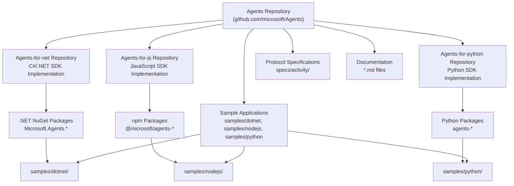
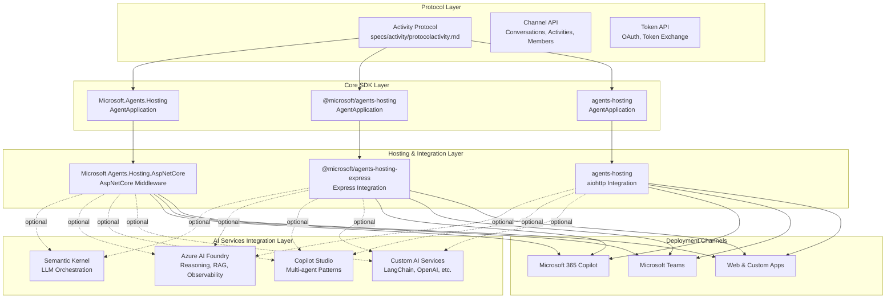
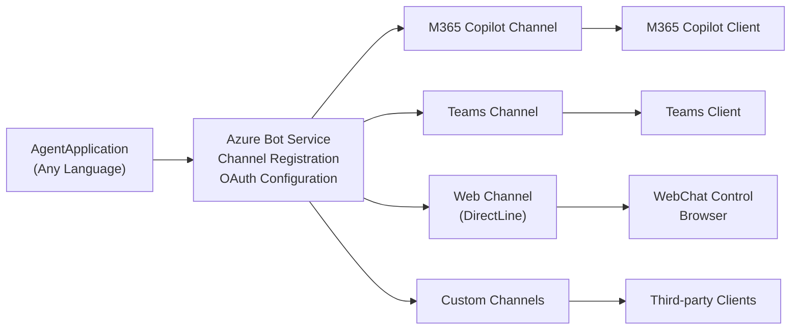
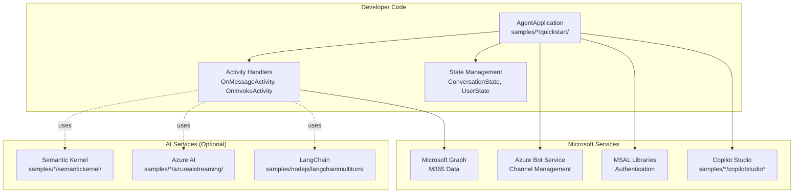
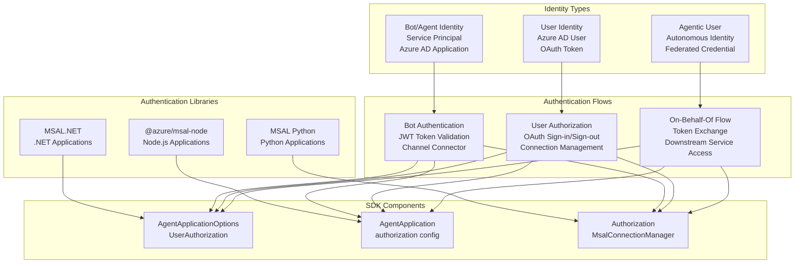

<!-- source: DeepWiki mcp.deepwiki.com · repo microsoft/Agents · page 1 Microsoft 365 Agents SDK Overview · fetched 2026-10-26 -->

# Microsoft 365 Agents SDK Overview

Relevant source files

The following files were used as context for generating this wiki page:

- [MCSandAgentsEcosystemLinks.md](MCSandAgentsEcosystemLinks.md)
- [README.md](README.md)

## Purpose and Scope

This document provides a comprehensive overview of the Microsoft 365 Agents SDK, explaining its purpose as an AI-agnostic framework for building conversational agents that deploy across Microsoft 365 Copilot, Microsoft Teams, and web applications. It covers the SDK's architecture, language implementations, deployment channels, and integration ecosystem.

For detailed information on specific topics, refer to:
- Core SDK concepts and terminology: [Core Concepts](#1.1)
- Technical architecture details: [System Architecture](#1.2)
- Language-specific development: [.NET Development](#7.2), [Node.js Development](#7.1), [Python Development](#7.3)
- Building your first agent: [Building Agents](#2)

**Sources**: [README.md:1-15]()

## What is the Microsoft 365 Agents SDK?

The Microsoft 365 Agents SDK is a multi-language framework that enables developers to create conversational agents with the following characteristics:

- **AI-Agnostic Architecture**: Choose any AI service, model, or orchestration framework (Semantic Kernel, Azure AI Foundry, LangChain, etc.)
- **Multi-Channel Deployment**: Build once, deploy to Microsoft 365 Copilot, Microsoft Teams, Web & Custom Apps, and more
- **Agent Container Pattern**: Pre-built scaffolding for state management, storage, and activity/event handling
- **Protocol-Based**: Built on standardized Activity Protocol ensuring interoperability across channels

The SDK is not prescriptive about AI implementation. Developers implement agentic patterns using the AI services of their choice, selecting one or more services, models, or agents to meet their specific requirements.

**Sources**: [README.md:1-11]()

## Key Capabilities

The SDK provides the following core capabilities:

| Capability | Description | Reference |
|------------|-------------|-----------|
| **Agent Container** | Manage state, storage, activities, and events | [AgentApplication Class](#2.1) |
| **Activity Processing** | Handle incoming messages, events, and invoke responses | [Activity Processing](#2.2) |
| **State Management** | Conversation, user, and turn-scoped state with storage backends | [Managing State](#2.3) |
| **Authentication** | Bot authentication, user OAuth flows, OBO token exchange | [Authentication and Authorization](#3) |
| **Rich Messaging** | Adaptive Cards, Hero Cards, media attachments | [Creating Messages and Cards](#2.4) |
| **Streaming** | Real-time AI response streaming | [Streaming Responses](#2.5) |
| **Multi-turn Dialogs** | Stateful conversation flows | [Multi-turn Dialogs](#2.6) |

**Sources**: [README.md:7-11]()

## Repository Structure and Language Implementations

The Microsoft 365 Agents SDK is implemented across three language-specific repositories. This repository serves as the entry point and contains cross-cutting documentation, specifications, and samples.

### Repository Links

| Language | Repository | Documentation | Primary Packages |
|----------|------------|---------------|------------------|
| **General** | [Agents Repository](https://github.com/microsoft/Agents) | [M365 Agents SDK Docs](https://aka.ms/M365-Agents-SDK-Docs) | Specifications, Samples |
| **C# / .NET** | [Agents-for-net](https://github.com/microsoft/Agents-for-net) | [.NET API Docs](https://learn.microsoft.com/dotnet/api/?view=m365-agents-sdk) | `Microsoft.Agents.*` |
| **JavaScript** | [Agents-for-js](https://github.com/microsoft/Agents-for-js) | [JS API Docs](https://learn.microsoft.com/javascript/api/overview/agents-overview) | `@microsoft/agents-*` |
| **Python** | [Agents-for-python](https://github.com/microsoft/Agents-for-python) | [Python API Docs](https://learn.microsoft.com/python/api/agent-sdk-python/agents-overview) | `agents-*` |

Language-specific issues should be opened in the corresponding repository. Cross-cutting issues can be opened in the main Agents repository.

**Sources**: [README.md:19-28](), [MCSandAgentsEcosystemLinks.md:47-57]()

## Four-Layer Architecture

The Microsoft 365 Agents SDK follows a four-layer architecture that separates protocol specifications, core SDK abstractions, hosting implementations, and AI service integrations.

### Architecture Diagram

### Layer Descriptions

**Protocol Layer**: Defines the Activity Protocol specification, Channel API (RESTful interfaces for conversations, activities, members, attachments), and Token API (OAuth and token exchange). These specifications are AI-agnostic and implementation-independent.

**Core SDK Layer**: Implements the `AgentApplication` class in each language, providing the agent container abstraction with state management, activity routing, event handlers, and storage interfaces.

**Hosting & Integration Layer**: Provides language-specific hosting frameworks:
- .NET: AspNetCore middleware and MSAL authentication
- JavaScript: Express.js integration and MSAL-node authentication  
- Python: aiohttp hosting and MSAL authentication

**AI Services Integration Layer**: Optional integrations with AI orchestration frameworks and services. Developers choose which services to integrate based on their requirements.

**Sources**: [README.md:1-11]()

## Deployment Channels

Agents built with the SDK can deploy to multiple channels without code changes. Each channel may expose channel-specific features that agents can optionally leverage.

### Supported Channels

| Channel | Description | Special Features |
|---------|-------------|------------------|
| **Microsoft 365 Copilot** | Enterprise AI assistant integrated across M365 apps | Enterprise data access, context-aware invocation |
| **Microsoft Teams** | Collaboration platform | Teams-specific cards, channel conversations, adaptive cards |
| **Web & Custom Apps** | Browser-based interfaces | WebChat control, custom UI integration |
| **Custom Channels** | Third-party platforms | Custom adapter implementation |

### Channel Architecture

Channel-specific implementation details are covered in:
- [Microsoft Teams Integration](#5.1)
- [Microsoft 365 Copilot Integration](#5.2)
- [Azure Bot Service Integration](#4.1)

**Sources**: [README.md:3-4]()

## Integration Ecosystem

The Microsoft 365 Agents SDK integrates with a rich ecosystem of AI services, agent platforms, and Microsoft services. The SDK's AI-agnostic design allows developers to select the services that best fit their requirements.

### Related SDKs and Services

| Service | Purpose | Integration Level |
|---------|---------|-------------------|
| **Semantic Kernel** | LLM orchestration with plugins and function chaining | Optional - integrate via agent handlers |
| **Azure AI Foundry** | Reasoning engines, RAG, observability, agent services | Optional - provides backend capabilities |
| **Copilot Studio** | Low-code agent builder, multi-agent orchestration | Bidirectional - build skills for or consume from |
| **Microsoft Graph** | M365 data access (files, mail, calendar, users) | Via authentication and API calls |
| **Azure Bot Service** | Channel registration, OAuth connections | Required for channel deployment |

### Integration Pattern

**Sources**: [README.md:34-50](), [MCSandAgentsEcosystemLinks.md:1-119]()

## Sample Applications

The repository includes sample applications organized by functionality and complexity. Samples exist for all three languages and demonstrate specific patterns and integrations.

### Sample Categories

| Category | Examples | Purpose |
|----------|----------|---------|
| **Getting Started** | `samples/*/quickstart/` | Basic echo agent in each language |
| **AI Integration** | `samples/*/azureaistreaming/` `samples/dotnet/semantickernel/` `samples/nodejs/langchainmultiturn/` | AI service integration patterns |
| **Authentication** | `samples/*/oboauthorization/` `samples/nodejs/autosignin/` | OAuth flows and token exchange |
| **Copilot Studio** | `samples/*/copilotstudioclient/` `samples/*/copilotstudioskill/` `samples/nodejs/copilotstudiowebchat/` | Copilot Studio integration |
| **Advanced** | `samples/dotnet/cards/` `samples/dotnet/genesyshandoff/` `samples/dotnet/retrievalbot/` | Complex scenarios |

Complete sample documentation is available at [Sample Applications](#6).

**Sources**: [README.md:13-17]()

## Development Tools and Environment

The SDK supports modern development workflows with recommended tooling for each language.

### Recommended VS Code Extensions

The repository includes a VS Code workspace configuration with recommended extensions:

| Extension | Purpose |
|-----------|---------|
| **ESLint** | JavaScript/TypeScript code quality |
| **C# Dev Kit** | .NET development and testing |
| **GitHub Copilot Chat** | AI-assisted development |
| **GitHub Codespaces** | Cloud-based development environments |
| **Adaptive Card Previewer** | Preview Adaptive Cards in real-time |

These extensions are listed in [.vscode/extensions.json]() and VS Code will prompt for installation when opening the workspace.

### Local Development Setup

For local development setup including dev tunnel configuration and the Agents Playground testing tool, see [Local Development](#4.2).

**Sources**: [README.md:74-86]()

## Authentication and Identity

The SDK implements a sophisticated authentication architecture supporting both bot authentication and user authorization flows.

### Authentication Components

**Key Authentication Concepts:**

- **Bot Authentication**: Validates incoming activities from channels using JWT tokens
- **User Authorization**: OAuth flows enabling agents to access user data with consent
- **On-Behalf-Of (OBO)**: Exchange user tokens for service tokens to access downstream APIs
- **Agentic Identity**: Three-tier architecture for autonomous agent operation

For comprehensive authentication documentation, see:
- [Authentication and Authorization](#3)
- [Bot Authentication](#3.1)
- [User Authentication](#3.2)
- [On-Behalf-Of (OBO) Authorization](#3.3)
- [Agentic Identity](#3.4)

**Sources**: [README.md:1-106]()

## Getting Started

To begin building with the Microsoft 365 Agents SDK:

1. **Choose Your Language**: Select .NET, JavaScript, or Python based on your team's expertise
2. **Review Quickstart Sample**: Navigate to `samples/<language>/quickstart/` for a basic echo agent
3. **Understand Core Concepts**: Read [Core Concepts](#1.1) and [System Architecture](#1.2)
4. **Set Up Development Environment**: Install recommended VS Code extensions and configure local environment
5. **Explore Advanced Samples**: Review samples matching your use case from [Sample Applications](#6)

### No M365 Copilot Subscription Required

A Microsoft 365 Copilot subscription is **not required** to start development. The SDK supports multiple channels, and local development can use the Agents Playground testing tool. M365 Copilot subscriptions are only needed for deploying to that specific channel.

**Sources**: [README.md:13-17]()

## Contributing

This project welcomes contributions and suggestions. Most contributions require agreeing to a Contributor License Agreement (CLA).

### For Microsoft Internal Developers

Internal Microsoft developers should join the Core Identity group [Agents SDK Contrib](https://coreidentity.microsoft.com/manage/Entitlement/entitlement/agentssdkint-upyj).

### For External Contributors

When submitting a pull request, a CLA bot will automatically determine if a CLA is needed and provide instructions. This is a one-time requirement across all Microsoft repositories using the CLA.

This project has adopted the [Microsoft Open Source Code of Conduct](https://opensource.microsoft.com/codeofconduct/).

**Sources**: [README.md:56-72]()

## Additional Resources

| Resource | Description |
|----------|-------------|
| [Official Documentation](https://aka.ms/M365-Agents-SDK-Docs) | Complete SDK documentation on Microsoft Learn |
| [M365 Agents and Copilot Studio Ecosystem](MCSandAgentsEcosystemLinks.md) | Related repositories, samples, and documentation |
| [Protocol Specifications](specs/activity/) | Activity Protocol, Channel API, Token API specifications |
| [Copilot Studio Samples](https://github.com/microsoft/CopilotStudioSamples) | Additional integration examples |
| [WebChat Samples](https://github.com/microsoft/BotFramework-WebChat/tree/main/samples) | Browser-based chat control customization |

**Sources**: [README.md:30-32](), [MCSandAgentsEcosystemLinks.md:1-119]()

---

