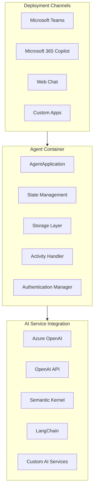
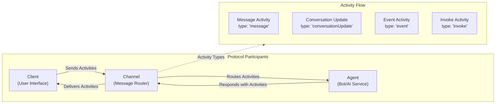
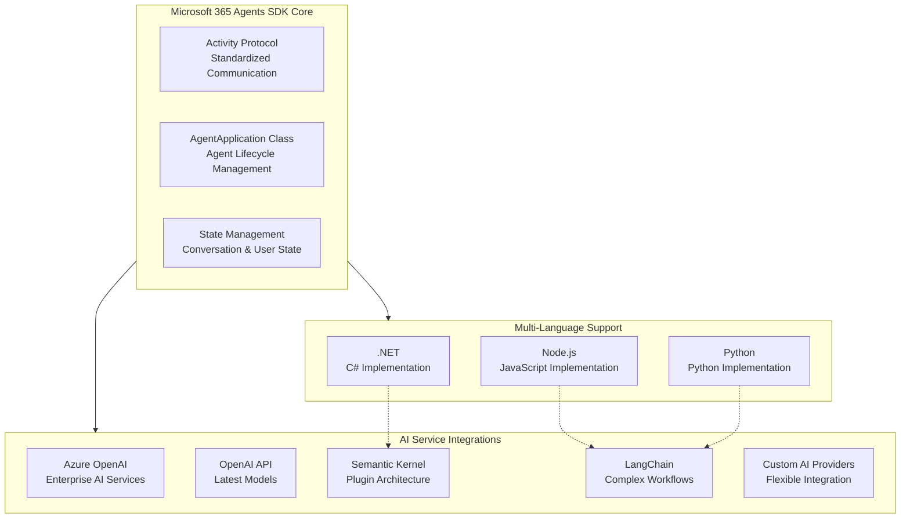
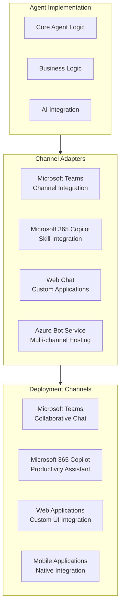
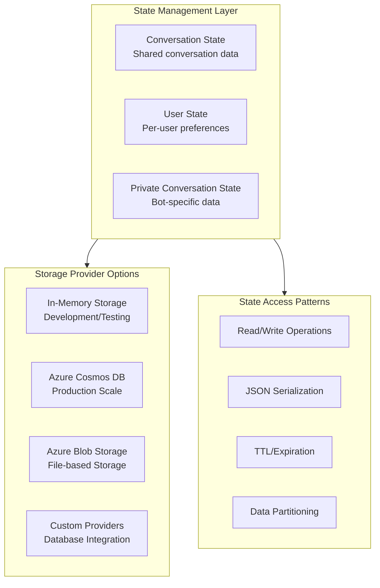
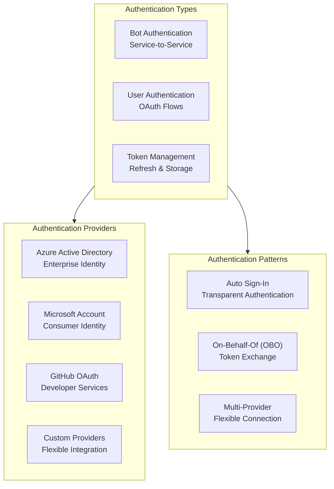
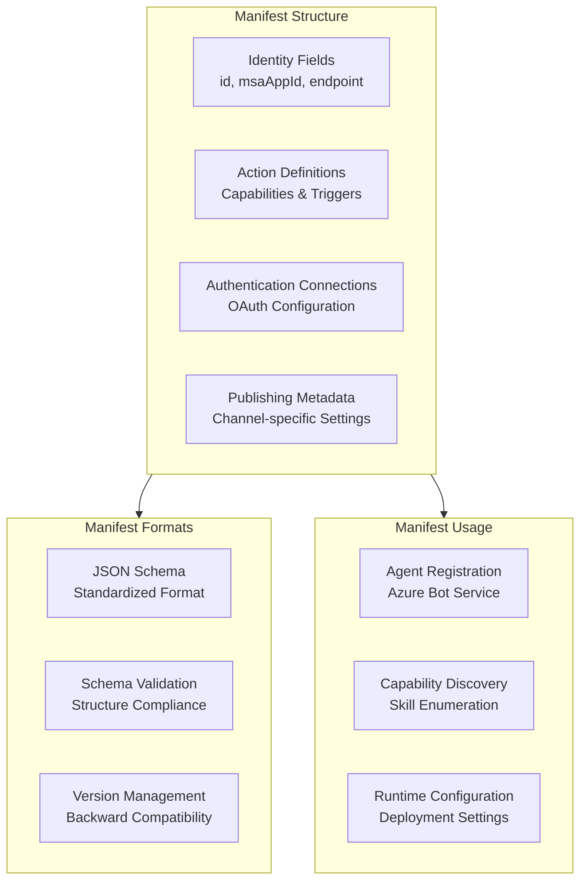

<!-- source: DeepWiki mcp.deepwiki.com · repo microsoft/Agents · page 1.1 Core Concepts · fetched 2026-10-26 -->

# Core Concepts

Relevant source files

The following files were used as context for generating this wiki page:

- [MCSandAgentsEcosystemLinks.md](MCSandAgentsEcosystemLinks.md)
- [README.md](README.md)
- [specs/activity/protocol-activity.md](specs/activity/protocol-activity.md)
- [specs/activity/protocol-cards.md](specs/activity/protocol-cards.md)
- [specs/channel-api/ChannelAPI-OpenAPI.yaml](specs/channel-api/ChannelAPI-OpenAPI.yaml)
- [specs/channel-api/TokenAPI-OpenAPI.yaml](specs/channel-api/TokenAPI-OpenAPI.yaml)
- [specs/manifest/bot-manifest.md](specs/manifest/bot-manifest.md)
- [specs/manifest/example.man](specs/manifest/example.man)
- [specs/manifest/manifest.json](specs/manifest/manifest.json)
- [specs/manifest/schemas/SchemaManifestTests/SchemaManifestTests.csproj](specs/manifest/schemas/SchemaManifestTests/SchemaManifestTests.csproj)
- [specs/manifest/schemas/SchemaManifestTests/SchemaManifestTests.sln](specs/manifest/schemas/SchemaManifestTests/SchemaManifestTests.sln)
- [specs/manifest/schemas/SchemaManifestTests/ValidateSchemaTests.cs](specs/manifest/schemas/SchemaManifestTests/ValidateSchemaTests.cs)
- [specs/manifest/schemas/readme.md](specs/manifest/schemas/readme.md)

This document explains the fundamental concepts of the Microsoft 365 Agents SDK, including agent containers, activity processing, technology-agnostic architecture, and channel deployment patterns. For specific implementation details in different languages, see [Node.js Development](#7.1), [.NET Development](#7.2), and [Python Development](#7.3). For detailed activity processing patterns, see [Activity Processing](#2.2).

## Agent Containers

The Microsoft 365 Agents SDK provides a standardized "container" architecture for building conversational agents. An agent container encapsulates the core functionality needed to handle conversational interactions, manage state, and integrate with various AI services.

The agent container provides:
- **Unified API**: Consistent interface across C#, JavaScript, and Python implementations
- **State Management**: Built-in conversation and user state persistence
- **Activity Processing**: Structured handling of incoming messages and events
- **Authentication**: Integrated user and service authentication patterns
- **Channel Abstraction**: Deploy to multiple channels without code changes

**Sources:** [README.md:7-12]()

## Activity Protocol

The Activity Protocol is the core communication schema used by the Microsoft 365 Agents SDK. Activities represent conversational actions made by humans, agents, and automated software.

### Activity Structure

Each activity contains standardized fields defined in the Activity Protocol specification:

| Field | Type | Purpose |
|-------|------|---------|
| `type` | string | Activity type (message, conversationUpdate, etc.) |
| `id` | string | Unique identifier assigned by channel |
| `timestamp` | datetime | UTC time when activity occurred |
| `from` | ChannelAccount | Sender information |
| `recipient` | ChannelAccount | Recipient information |
| `conversation` | ConversationAccount | Conversation context |
| `text` | string | Message text content |
| `attachments` | Attachment[] | Rich content attachments |

**Sources:** [specs/activity/protocol-activity.md:40-114](), [specs/activity/protocol-activity.md:335-490]()

## Technology-Agnostic Architecture

The SDK is designed to be technology-agnostic, allowing developers to integrate any AI service or framework without being locked into specific technologies.

This architecture enables:
- **AI Flexibility**: Choose from Azure OpenAI, OpenAI, Semantic Kernel, LangChain, or custom AI services
- **Language Freedom**: Implement agents in C#, JavaScript, or Python
- **Provider Agnostic**: Switch AI providers without changing core agent logic
- **Custom Integration**: Build adapters for proprietary AI services

**Sources:** [README.md:5-11](), [README.md:28-44]()

## Channel Deployment

Agents built with the SDK can be deployed across multiple channels using the same codebase, with channel-specific customizations handled through configuration.

**Deployment Patterns:**
- **Single Codebase**: One agent implementation deploys to multiple channels
- **Channel Customization**: Adapt behavior for specific channel capabilities
- **Unified Management**: Central configuration and monitoring across channels
- **Scalable Architecture**: Automatic scaling based on channel demands

**Sources:** [README.md:9-11]()

## State and Storage Management

The SDK provides built-in state management capabilities for maintaining conversation context and user information across interactions.

**State Types:**
- **Conversation State**: Shared across all participants in a conversation
- **User State**: Persistent per-user data across conversations
- **Private Conversation State**: Agent-specific data not shared with users

**Sources:** [README.md:9]()

## Authentication Patterns

The SDK supports multiple authentication patterns for both agent authentication and user authentication scenarios.

**Authentication Scenarios:**
- **Bot Authentication**: Service principal authentication for Azure Bot Service
- **User Sign-In**: OAuth flows for accessing user data (Microsoft Graph, GitHub, etc.)
- **Token Exchange**: On-behalf-of patterns for service-to-service calls
- **Multi-Provider**: Support for multiple authentication providers simultaneously

**Sources:** [specs/channel-api/TokenAPI-OpenAPI.yaml:13-489](), [specs/manifest/example.man:7-17]()

## Manifest System

Agents are described using structured manifest files that define capabilities, authentication connections, and deployment configuration.

**Manifest Components:**
- **Identity**: Unique identifiers and endpoint configuration
- **Actions**: Advertised capabilities and trigger definitions
- **Authentication**: OAuth connections and service provider configuration
- **Publishing**: Channel-specific metadata and discovery information

**Sources:** [specs/manifest/example.man:1-48](), [specs/manifest/bot-manifest.md:1-460]()

---

