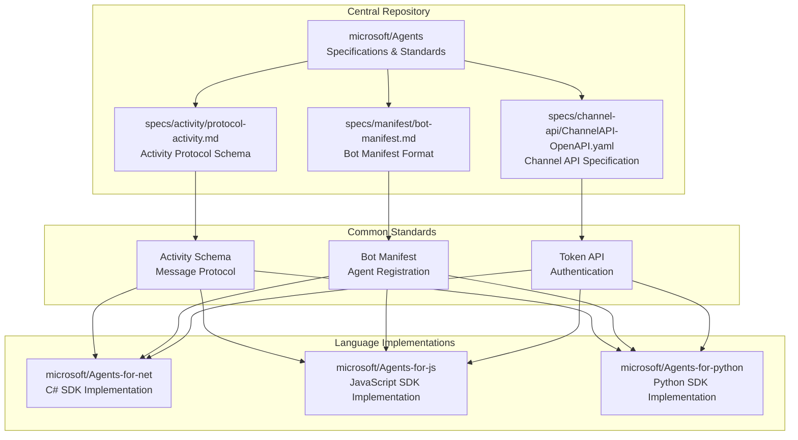
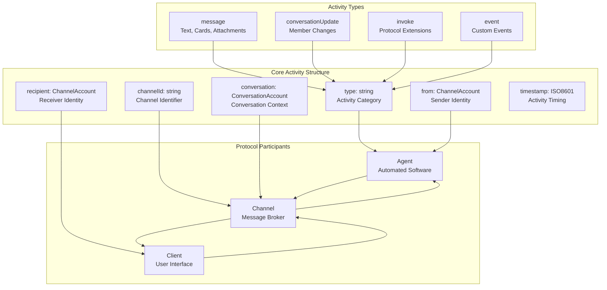
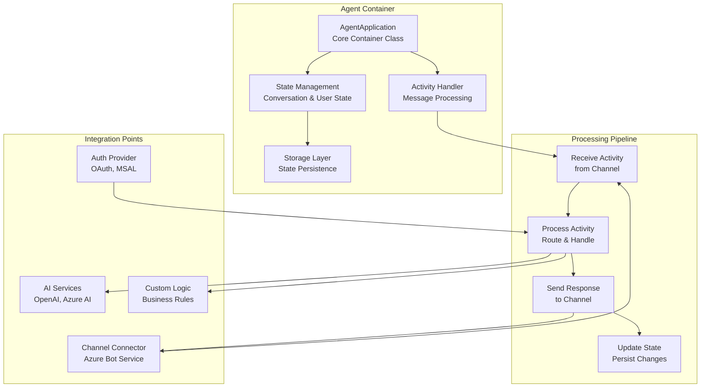
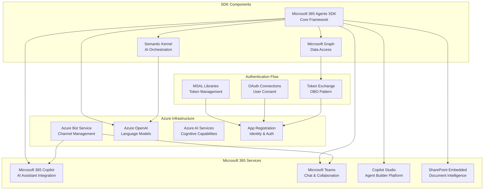
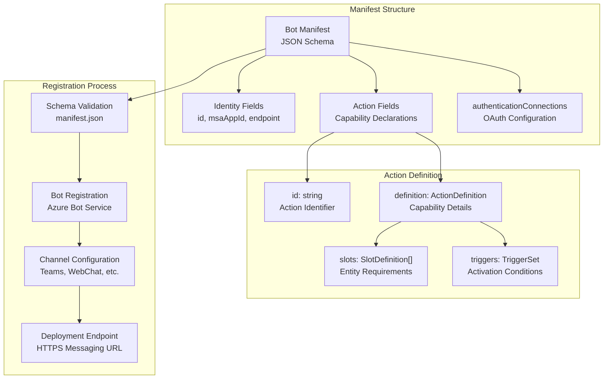
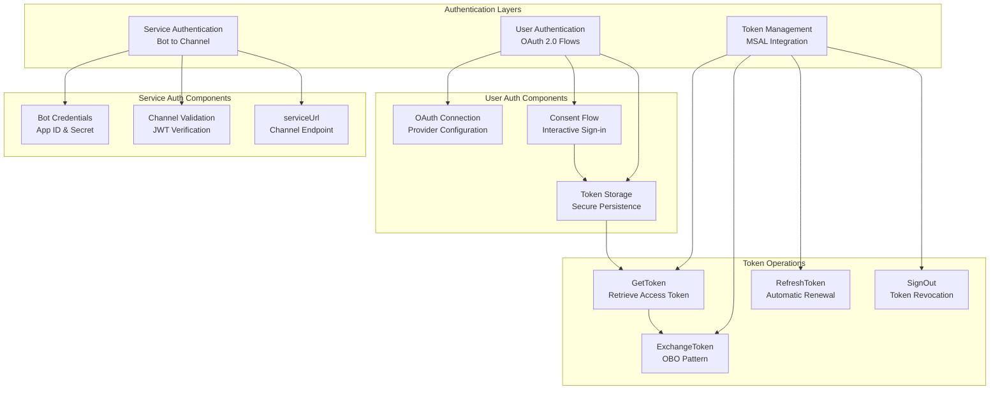
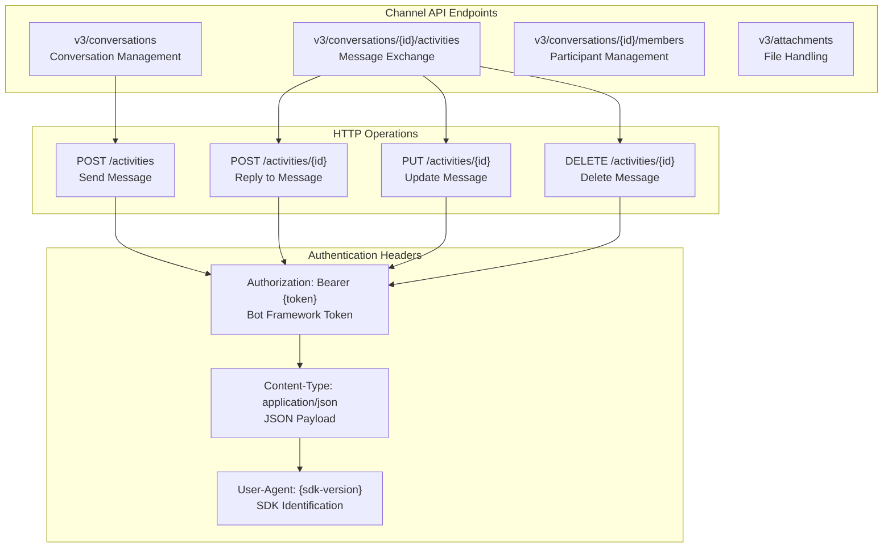
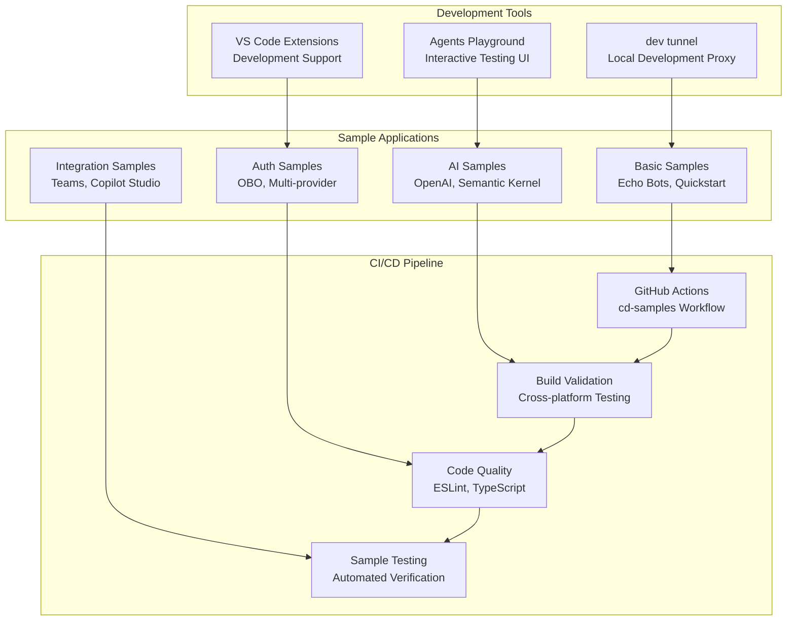

<!-- source: DeepWiki mcp.deepwiki.com · repo microsoft/Agents · page 1.2 System Architecture · fetched 2026-10-26 -->

# System Architecture

Relevant source files

The following files were used as context for generating this wiki page:

- [MCSandAgentsEcosystemLinks.md](MCSandAgentsEcosystemLinks.md)
- [README.md](README.md)
- [specs/activity/protocol-activity.md](specs/activity/protocol-activity.md)
- [specs/activity/protocol-cards.md](specs/activity/protocol-cards.md)
- [specs/channel-api/ChannelAPI-OpenAPI.yaml](specs/channel-api/ChannelAPI-OpenAPI.yaml)
- [specs/channel-api/TokenAPI-OpenAPI.yaml](specs/channel-api/TokenAPI-OpenAPI.yaml)
- [specs/manifest/bot-manifest.md](specs/manifest/bot-manifest.md)
- [specs/manifest/example.man](specs/manifest/example.man)
- [specs/manifest/manifest.json](specs/manifest/manifest.json)
- [specs/manifest/schemas/SchemaManifestTests/SchemaManifestTests.csproj](specs/manifest/schemas/SchemaManifestTests/SchemaManifestTests.csproj)
- [specs/manifest/schemas/SchemaManifestTests/SchemaManifestTests.sln](specs/manifest/schemas/SchemaManifestTests/SchemaManifestTests.sln)
- [specs/manifest/schemas/SchemaManifestTests/ValidateSchemaTests.cs](specs/manifest/schemas/SchemaManifestTests/ValidateSchemaTests.cs)
- [specs/manifest/schemas/readme.md](specs/manifest/schemas/readme.md)

This document describes the overall system architecture of the Microsoft 365 Agents SDK, including its multi-language implementation strategy, core protocol specifications, and integration patterns with the Microsoft ecosystem. This covers the foundational architectural decisions that enable technology-agnostic agent development across different programming languages and deployment targets.

For information about building specific agents, see [Building Agents](#2). For deployment-specific configurations, see [Deployment and Hosting](#4).

## Multi-Language SDK Architecture

The Microsoft 365 Agents SDK employs a distributed architecture where a central specification repository defines common protocols and standards, while language-specific implementations provide native developer experiences.

Sources: [README.md:13-22](), [specs/activity/protocol-activity.md:1-10](), [specs/manifest/bot-manifest.md:1-10]()

The architecture enables consistent behavior across languages while allowing each implementation to follow language-specific conventions and patterns. Each language repository contains native SDK libraries, sample applications, and language-specific documentation.

## Activity Protocol Foundation

The Activity Protocol serves as the core communication schema that enables interoperability between agents, channels, and clients across the entire ecosystem.

Sources: [specs/activity/protocol-activity.md:115-180](), [specs/activity/protocol-activity.md:335-500]()

The protocol defines numbered requirements using markers like `A2001` through `A3135` that specify mandatory and optional behaviors for senders and receivers. This ensures consistent implementation across different language SDKs and channel integrations.

## Agent Container Architecture

Each agent implementation follows a container pattern that provides state management, storage capabilities, and activity processing infrastructure.

Sources: [README.md:7-12](), [specs/activity/protocol-activity.md:106-114]()

The container architecture abstracts common agent functionality while allowing developers to focus on implementing business logic specific to their use cases. For detailed implementation patterns, see [AgentApplication Class](#2.1).

## Microsoft Ecosystem Integration

The SDK integrates with multiple Microsoft services through standardized APIs and authentication patterns.

Sources: [README.md:28-44](), [specs/channel-api/TokenAPI-OpenAPI.yaml:13-489]()

Integration follows Microsoft's security and compliance standards, with OAuth 2.0 flows for user authentication and service-to-service authentication patterns for backend integrations. For specific authentication implementations, see [Authentication](#3).

## Bot Manifest and Registration

The bot manifest format provides a standardized way to describe agent capabilities, authentication requirements, and deployment configurations.

Sources: [specs/manifest/bot-manifest.md:130-170](), [specs/manifest/example.man:1-48](), [specs/manifest/manifest.json:1-64]()

The manifest supports both inline action definitions and references to globally defined actions, enabling reusable agent capabilities across the ecosystem. The schema includes versioning and extensibility mechanisms for future enhancements.

## Authentication Architecture

The SDK implements a comprehensive authentication system supporting both user and service authentication patterns.

Sources: [specs/channel-api/TokenAPI-OpenAPI.yaml:80-282](), [specs/activity/protocol-activity.md:288-311]()

The authentication system supports multiple identity providers and implements secure token handling patterns including automatic refresh and proper token lifecycle management. For implementation details, see [Bot Authentication](#3.1) and [User Authentication](#3.2).

## Channel API Integration

The Channel API provides the transport layer for activity exchange between agents and Microsoft services.

Sources: [specs/channel-api/ChannelAPI-OpenAPI.yaml:143-188](), [specs/channel-api/ChannelAPI-OpenAPI.yaml:284-333]()

The API follows OpenAPI 3.0.3 specification and provides comprehensive error handling with structured error responses. All endpoints require proper authentication tokens and support both synchronous and asynchronous operation patterns.

## Development and Testing Infrastructure

The SDK provides comprehensive tooling for local development, testing, and continuous integration.

Sources: [README.md:64-76](), [README.md:50-62]()

The development infrastructure supports multiple hosting patterns including ASP.NET Core for .NET, Express.js for Node.js, and aiohttp for Python, ensuring developers can work within their preferred technology stacks while maintaining consistency across the ecosystem.

---

