<!-- source: DeepWiki mcp.deepwiki.com · repo microsoft/Agents · page 1.3 SDK Language Implementations · fetched 2026-10-26 -->

# SDK Language Implementations

<details>
<summary>Relevant source files</summary>

The following files were used as context for generating this wiki page:

- [.github/scripts/updatenode.sh](.github/scripts/updatenode.sh)
- [MCSandAgentsEcosystemLinks.md](MCSandAgentsEcosystemLinks.md)
- [README.md](README.md)
- [samples/dotnet/Agent Framework/AgentFrameworkWeather.csproj](samples/dotnet/Agent Framework/AgentFrameworkWeather.csproj)
- [samples/dotnet/GenesysHandoff/GenesysHandoff.csproj](samples/dotnet/GenesysHandoff/GenesysHandoff.csproj)
- [samples/dotnet/RetrievalBot/RetrievalBot.csproj](samples/dotnet/RetrievalBot/RetrievalBot.csproj)
- [samples/dotnet/auto-signin/AutoSignIn.csproj](samples/dotnet/auto-signin/AutoSignIn.csproj)
- [samples/dotnet/azure-ai-streaming/StreamingMessageAgent.csproj](samples/dotnet/azure-ai-streaming/StreamingMessageAgent.csproj)
- [samples/dotnet/copilotstudio-client/CopilotStudioClient.csproj](samples/dotnet/copilotstudio-client/CopilotStudioClient.csproj)
- [samples/dotnet/copilotstudio-skill/CopilotStudioEchoSkill.csproj](samples/dotnet/copilotstudio-skill/CopilotStudioEchoSkill.csproj)
- [samples/dotnet/obo-authorization/OBOAuthorization.csproj](samples/dotnet/obo-authorization/OBOAuthorization.csproj)
- [samples/dotnet/quickstart/QuickStart.csproj](samples/dotnet/quickstart/QuickStart.csproj)
- [samples/dotnet/semantic-kernel-multiturn/SemanticKernelMultiturn.csproj](samples/dotnet/semantic-kernel-multiturn/SemanticKernelMultiturn.csproj)
- [samples/nodejs/auto-signin/package-lock.json](samples/nodejs/auto-signin/package-lock.json)
- [samples/nodejs/azure-ai-streaming/package-lock.json](samples/nodejs/azure-ai-streaming/package-lock.json)
- [samples/nodejs/cards/package-lock.json](samples/nodejs/cards/package-lock.json)
- [samples/nodejs/copilotstudio-client/package-lock.json](samples/nodejs/copilotstudio-client/package-lock.json)
- [samples/nodejs/copilotstudio-webchat-react/package-lock.json](samples/nodejs/copilotstudio-webchat-react/package-lock.json)
- [samples/nodejs/langchain-multiturn/package-lock.json](samples/nodejs/langchain-multiturn/package-lock.json)
- [samples/nodejs/multi-turn-prompt/package-lock.json](samples/nodejs/multi-turn-prompt/package-lock.json)
- [samples/nodejs/obo-authorization/package-lock.json](samples/nodejs/obo-authorization/package-lock.json)
- [samples/nodejs/quickstart/package-lock.json](samples/nodejs/quickstart/package-lock.json)
- [samples/python/README.md](samples/python/README.md)
- [samples/python/obo-authorization/README.md](samples/python/obo-authorization/README.md)
- [samples/python/obo-authorization/env.TEMPLATE](samples/python/obo-authorization/env.TEMPLATE)
- [samples/python/obo-authorization/requirements.txt](samples/python/obo-authorization/requirements.txt)
- [samples/python/obo-authorization/src/agent.py](samples/python/obo-authorization/src/agent.py)
- [samples/python/obo-authorization/src/main.py](samples/python/obo-authorization/src/main.py)
- [samples/python/obo-authorization/src/start_server.py](samples/python/obo-authorization/src/start_server.py)

</details>


## Purpose and Scope

This document describes the three language implementations of the Microsoft 365 Agents SDK: .NET, JavaScript/TypeScript, and Python. It explains the package structure, architectural patterns, and language-specific hosting approaches used by each implementation while maintaining protocol-level compatibility. For information about the overall system architecture, see [System Architecture](#1.2). For language-specific development guides, see [Node.js Development](#7.1), [.NET Development](#7.2), and [Python Development](#7.3).

## Architectural Consistency Across Languages

All three SDK implementations adhere to the same Activity Protocol specification and provide consistent abstractions for agent development while leveraging language-specific idioms and frameworks.

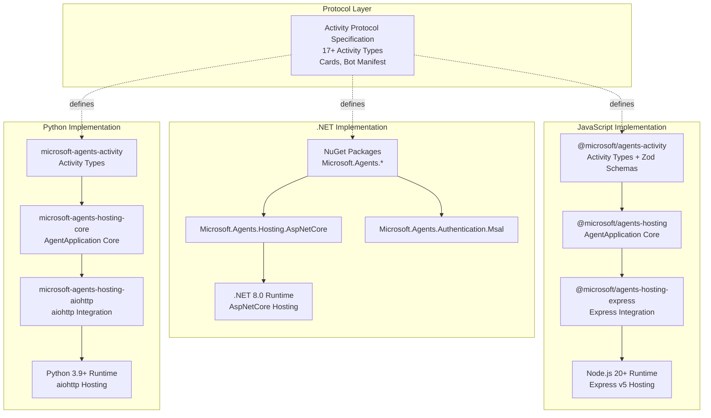

**Sources:** [README.md:19-28](), [samples/nodejs/azure-ai-streaming/package-lock.json:154-220](), [samples/python/obo-authorization/requirements.txt]()

### Common Architectural Layers

All implementations provide a layered architecture with separation of concerns:

| Layer | .NET | JavaScript | Python | Purpose |
|-------|------|------------|--------|---------|
| **Activity Protocol** | `Microsoft.Agents.Activity` | `@microsoft/agents-activity` | `microsoft-agents-activity` | Activity types, validation, schemas |
| **Core Hosting** | `Microsoft.Agents.Hosting` | `@microsoft/agents-hosting` | `microsoft-agents-hosting-core` | AgentApplication, TurnContext, state management |
| **Web Framework** | `Microsoft.Agents.Hosting.AspNetCore` | `@microsoft/agents-hosting-express` | `microsoft-agents-hosting-aiohttp` | HTTP server integration |
| **Authentication** | `Microsoft.Agents.Authentication.Msal` | MSAL integrated in hosting | `microsoft-agents-authentication-msal` | OAuth, MSAL, token management |
| **Extensions** | Various packages | `@microsoft/agents-hosting-dialogs`<br/>`@microsoft/agents-copilotstudio-client` | `microsoft-agents-copilotstudio-client` | Dialogs, Copilot Studio client |

**Sources:** [samples/nodejs/azure-ai-streaming/package-lock.json:154-220](), [samples/dotnet/quickstart/QuickStart.csproj:10-13](), [samples/python/obo-authorization/requirements.txt]()

## .NET SDK Structure

The .NET implementation targets .NET 8.0 and uses AspNetCore for hosting. Packages are distributed via NuGet with the `Microsoft.Agents.*` namespace.

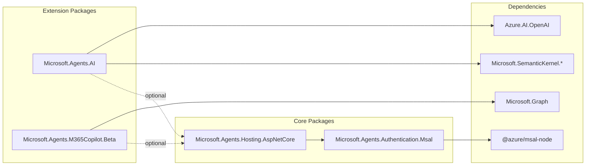

**Sources:** [samples/dotnet/quickstart/QuickStart.csproj:10-13](), [samples/dotnet/semantic-kernel-multiturn/SemanticKernelMultiturn.csproj:19-28](), [samples/dotnet/Agent Framework/AgentFrameworkWeather.csproj:14-23]()

### Package Versioning Pattern

.NET packages use a wildcard versioning pattern for SDK packages:

```csharp
// From QuickStart.csproj
<PackageReference Include="Microsoft.Agents.Authentication.Msal" Version="1.4.*-*" />
<PackageReference Include="Microsoft.Agents.Hosting.AspNetCore" Version="1.4.*-*" />
```

This allows automatic minor version updates while maintaining major version compatibility. External dependencies like `Azure.AI.OpenAI` and `Microsoft.SemanticKernel.*` use fixed version constraints.

**Sources:** [samples/dotnet/quickstart/QuickStart.csproj:11-12](), [samples/dotnet/semantic-kernel-multiturn/SemanticKernelMultiturn.csproj:26-27]()

### .NET Hosting Configuration

The .NET SDK uses AspNetCore's dependency injection and configuration system:

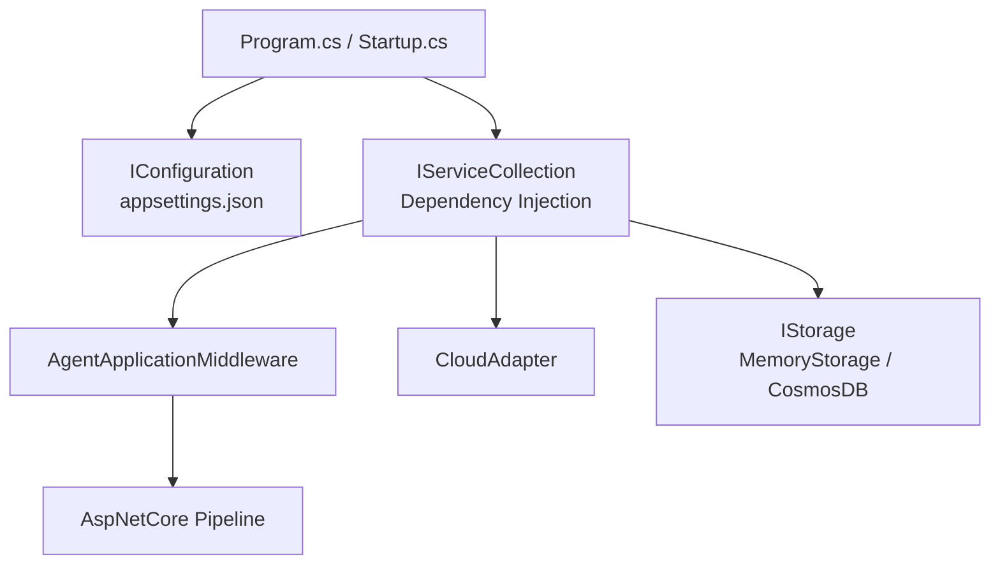

The SDK integrates with AspNetCore's middleware pipeline for request processing and authentication validation.

**Sources:** [samples/dotnet/quickstart/QuickStart.csproj:4](), [samples/dotnet/semantic-kernel-multiturn/SemanticKernelMultiturn.csproj:4]()

## JavaScript/TypeScript SDK Structure

The JavaScript implementation uses TypeScript and npm packages under the `@microsoft` scope. It requires Node.js 20.0.0 or higher and integrates with Express v5.

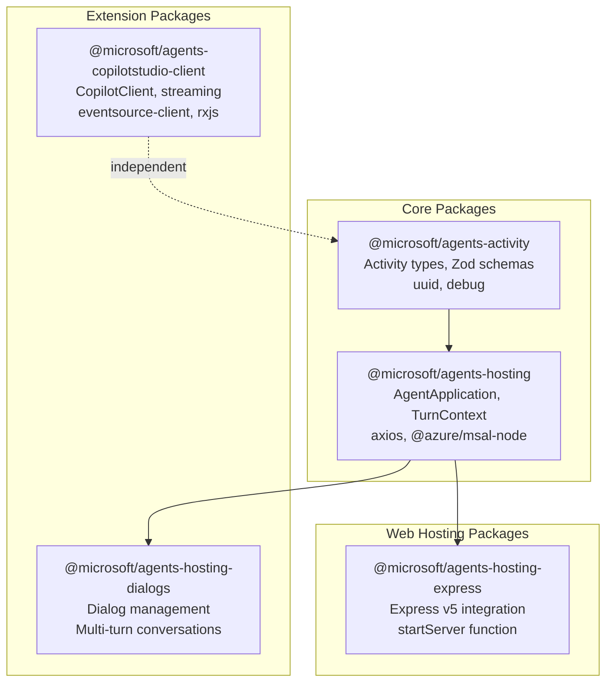

**Sources:** [samples/nodejs/azure-ai-streaming/package-lock.json:154-220](), [samples/nodejs/multi-turn-prompt/package-lock.json:12-13]()

### Package Dependency Graph

The Node.js packages have a clear dependency hierarchy:

| Package | Version | Key Dependencies | Purpose |
|---------|---------|------------------|---------|
| `@microsoft/agents-activity` | 1.1.1 | `zod@3.25.75`, `uuid@11.1.0`, `debug@4.4.3` | Protocol implementation with validation |
| `@microsoft/agents-hosting` | 1.1.1 | `@azure/msal-node@3.8.4`, `axios@1.13.2`, `jsonwebtoken@9.0.2` | Core hosting logic, auth, HTTP client |
| `@microsoft/agents-hosting-express` | 1.1.1 | `express@5.1.0`, `@microsoft/agents-hosting@1.1.1` | Express integration layer |
| `@microsoft/agents-hosting-dialogs` | 1.1.1 | `@microsoft/agents-hosting@1.1.1` | Dialog state management |
| `@microsoft/agents-copilotstudio-client` | 1.1.1 | `eventsource-client@1.2.0`, `rxjs@7.8.2` | Copilot Studio streaming client |

**Sources:** [samples/nodejs/azure-ai-streaming/package-lock.json:154-220](), [samples/nodejs/obo-authorization/package-lock.json:85-159](), [samples/nodejs/multi-turn-prompt/package-lock.json:12-13]()

### TypeScript and Zod Validation

The JavaScript SDK uses Zod for runtime type validation of Activity Protocol messages:

```typescript
// From @microsoft/agents-activity package
// Provides Zod schemas for activity validation
// See package-lock.json lines 154-189
```

Activities are validated using Zod schemas defined in `@microsoft/agents-activity`, ensuring type safety at runtime for protocol compliance.

**Sources:** [samples/nodejs/azure-ai-streaming/package-lock.json:154-189]()

### Express Hosting Integration

The `@microsoft/agents-hosting-express` package provides the `startServer` function that configures Express v5 with agent middleware:

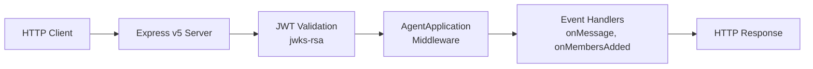

The middleware handles JWT validation, activity deserialization, turn context creation, and event handler dispatch.

**Sources:** [samples/nodejs/azure-ai-streaming/package-lock.json:208-220](), [samples/nodejs/quickstart/package-lock.json:129-141]()

## Python SDK Structure

The Python implementation uses pip packages under the `microsoft-agents-*` namespace and requires Python 3.9 or higher. It uses aiohttp for async HTTP handling.

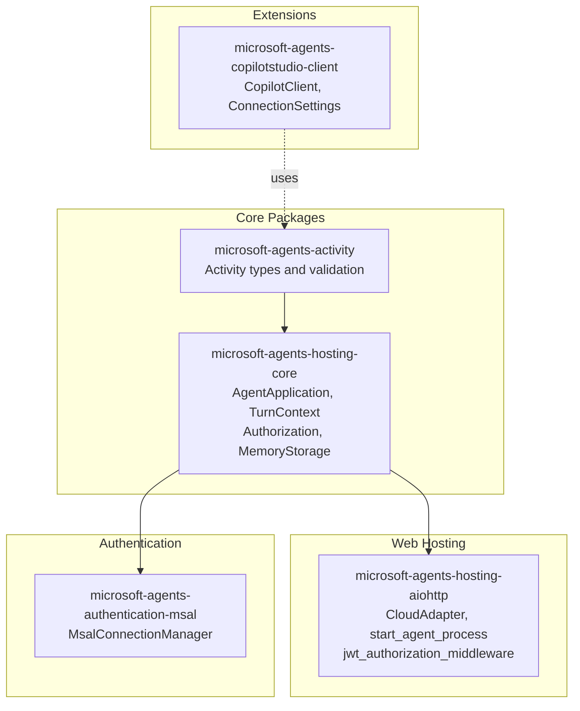

**Sources:** [samples/python/obo-authorization/requirements.txt](), [samples/python/obo-authorization/src/agent.py:8-24](), [samples/python/obo-authorization/src/start_server.py:1-8]()

### Python Package Dependencies

The Python SDK has the following package structure:

```python
# From requirements.txt
python-dotenv
aiohttp
microsoft-agents-activity
microsoft-agents-hosting-core
microsoft-agents-hosting-aiohttp
microsoft-agents-authentication-msal
microsoft-agents-copilotstudio-client
```

**Sources:** [samples/python/obo-authorization/requirements.txt]()

### Async/Await Pattern

Python SDK uses async/await throughout for non-blocking I/O:

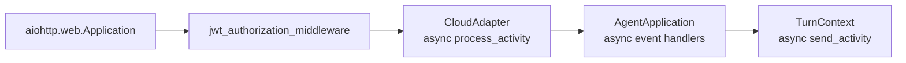

All agent handlers and activity processing methods are async coroutines, enabling efficient handling of concurrent requests.

**Sources:** [samples/python/obo-authorization/src/start_server.py:1-8](), [samples/python/obo-authorization/src/agent.py:8-24]()

### aiohttp Server Configuration

The Python SDK provides `start_agent_process` helper for server setup:

```python
# From samples/python/obo-authorization/src/start_server.py:10-19
def start_server(
    agent_app: AgentApplication,
    agent_config: AgentAuthConfiguration,
    connection_manager: MsalConnectionManager,
    port: int = 3978,
):
    adapter = CloudAdapter(agent_config, connection_manager)
    # Creates aiohttp.web.Application with JWT middleware
```

The function creates an `aiohttp.web.Application`, configures the `CloudAdapter`, and registers JWT validation middleware automatically.

**Sources:** [samples/python/obo-authorization/src/start_server.py:10-19]()

## Implementation Patterns Across Languages

### AgentApplication Pattern

All three implementations use a central `AgentApplication` class for registering event handlers:

| Language | Class/Function | Event Handler Registration | State Access |
|----------|----------------|---------------------------|--------------|
| **.NET** | `AgentApplication` | `.OnMessage(handler)`<br/>`.OnMembersAdded(handler)` | `TurnContext.TurnState` |
| **JavaScript** | `AgentApplication` | `.onMessage(handler)`<br/>`.onMembersAdded(handler)` | `TurnContext.turnState` |
| **Python** | `AgentApplication` | `.on_message(handler)`<br/>`.on_members_added(handler)` | `TurnContext.turn_state` |

Event handlers receive a `TurnContext` object providing access to the incoming activity, conversation state, and methods to send responses.

**Sources:** [samples/python/obo-authorization/src/agent.py:31-60]()

### TurnContext and TurnState

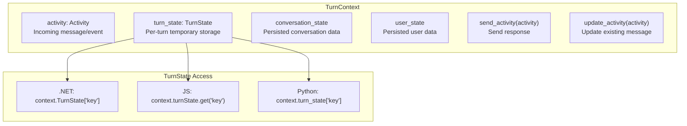

The `TurnState` object provides temporary storage for the duration of a turn, while conversation and user state persist across turns via configured storage providers.

**Sources:** [samples/python/obo-authorization/src/agent.py:31-60]()

### Storage Abstraction

All implementations provide storage abstractions with identical interfaces:

| Storage Type | .NET | JavaScript | Python | Use Case |
|--------------|------|------------|--------|----------|
| **Memory** | `MemoryStorage` | `MemoryStorage` | `MemoryStorage` | Development, testing |
| **Cosmos DB** | `CosmosDbPartitionedStorage` | `CosmosDbPartitionedStorage` | `CosmosDbPartitionedStorage` | Production state |
| **Blob Storage** | `BlobStorage` | `BlobStorage` | `BlobStorage` | Large attachments |

Storage is injected into `AgentApplication` during initialization and accessed via `TurnContext.conversationState` and `TurnContext.userState`.

**Sources:** [samples/python/obo-authorization/src/agent.py:31-32]()

### Authentication and Authorization

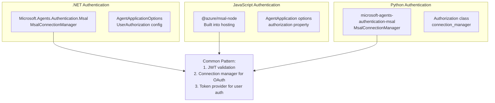

All implementations use MSAL for OAuth token management and provide connection managers for handling user authorization flows.

**Sources:** [samples/python/obo-authorization/src/agent.py:18](), [samples/nodejs/azure-ai-streaming/package-lock.json:131-153](), [samples/dotnet/quickstart/QuickStart.csproj:11]()

## Version Requirements and Runtime Compatibility

### Language Runtime Requirements

| Language | Minimum Version | Recommended | Notes |
|----------|----------------|-------------|-------|
| **.NET** | .NET 8.0 | .NET 8.0 | Uses modern C# features, nullable reference types |
| **JavaScript** | Node.js 20.0.0 | Node.js 22+ | Requires ES modules support |
| **Python** | Python 3.9 | Python 3.11+ | Uses async/await, type hints |

**Sources:** [samples/dotnet/quickstart/QuickStart.csproj:4](), [samples/nodejs/azure-ai-streaming/package-lock.json:165](), [samples/python/obo-authorization/README.md:10]()

### Web Framework Versions

| Language | Framework | Version | Key Features Used |
|----------|-----------|---------|-------------------|
| **.NET** | AspNetCore | 8.0 | Middleware pipeline, dependency injection, minimal APIs |
| **JavaScript** | Express | 5.1.0+ | Modern routing, async handlers, middleware |
| **Python** | aiohttp | Latest | Async request handling, middleware support |

Express v5 is specifically required for the JavaScript SDK, providing improved async support and modern JavaScript features.

**Sources:** [samples/nodejs/azure-ai-streaming/package-lock.json:680-722](), [samples/nodejs/obo-authorization/package-lock.json:593-634]()

### Cross-Platform Development

All three implementations support cross-platform development:

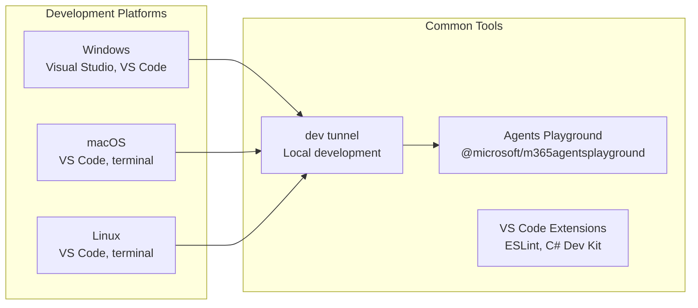

The `@microsoft/m365agentsplayground` npm package provides a testing tool available across all platforms, and dev tunnel enables local HTTPS endpoints for bot service connectivity.

**Sources:** [README.md:74-86](), [samples/nodejs/azure-ai-streaming/package-lock.json:221-230]()

## Repository and Package Distribution

### Source Code Repositories

Each language implementation maintains its own repository:

| Language | Repository | Distribution |
|----------|-----------|--------------|
| **.NET** | [Agents-for-net](https://github.com/Microsoft/Agents-for-net) | NuGet.org |
| **JavaScript** | [Agents-for-js](https://github.com/Microsoft/Agents-for-js) | npmjs.com |
| **Python** | [Agents-for-python](https://github.com/Microsoft/Agents-for-python) | PyPI |
| **General** | [Agents](https://github.com/Microsoft/Agents) | Samples, documentation |

The main [Agents](https://github.com/Microsoft/Agents) repository contains cross-cutting samples and documentation, while language-specific issues should be filed in the corresponding language repository.

**Sources:** [README.md:19-28](), [MCSandAgentsEcosystemLinks.md:16-38]()

### Package Naming Conventions

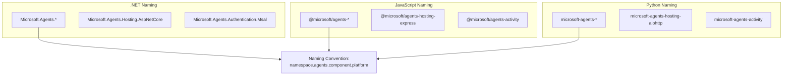

All packages follow a consistent naming pattern with language-specific conventions: PascalCase with dot separators for .NET, kebab-case with @ scope for JavaScript, and kebab-case with hyphen separators for Python.

**Sources:** [samples/dotnet/quickstart/QuickStart.csproj:11-12](), [samples/nodejs/azure-ai-streaming/package-lock.json:154-220](), [samples/python/obo-authorization/requirements.txt]()

---

