<!-- source: DeepWiki mcp.deepwiki.com · repo microsoft/Agents · page 2 Building Agents · fetched 2026-10-26 -->

# Building Agents

<details>
<summary>Relevant source files</summary>

The following files were used as context for generating this wiki page:

- [samples/nodejs/quickstart/README.md](samples/nodejs/quickstart/README.md)
- [samples/nodejs/quickstart/env.TEMPLATE](samples/nodejs/quickstart/env.TEMPLATE)
- [samples/nodejs/quickstart/package.json](samples/nodejs/quickstart/package.json)
- [samples/nodejs/quickstart/src/index.ts](samples/nodejs/quickstart/src/index.ts)
- [samples/nodejs/quickstart/tsconfig.json](samples/nodejs/quickstart/tsconfig.json)

</details>


This document provides a comprehensive guide to building agents using the Microsoft 365 Agents SDK across .NET, Node.js, and Python. It covers the core `AgentApplication` class, activity processing patterns, message handling, and multi-language implementation approaches. For deployment information, see [Deployment and Hosting](#4). For authentication patterns, see [Authentication](#3).

## Multi-Language Agent Architecture

The Microsoft 365 Agents SDK provides consistent architecture across .NET, Node.js, and Python implementations, centered around the `AgentApplication` class as the main container for agent logic and event handling.

### Cross-Platform Architecture Overview

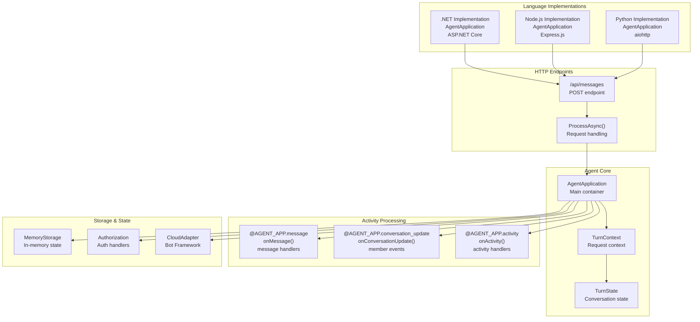

Sources: [samples/dotnet/auto-signin/README.md:1-134](), [samples/nodejs/langchain-multiturn/README.md:1-80](), [samples/python/auto-signin/src/agent.py:1-139](), [samples/python/cards/src/agent.py:1-78]()

### Language-Specific Hosting Patterns

| Language | Hosting Framework | Entry Point | Agent Registration |
|----------|------------------|-------------|-------------------|
| .NET | ASP.NET Core | `Program.cs` | `AddAgent<T>()` |
| Node.js | Express.js | `agent.ts` | `startServer(agent)` |
| Python | aiohttp | `main.py` | `start_server()` |

Sources: [samples/dotnet/quickstart/README.md:1-98](), [samples/nodejs/azure-ai-streaming/src/agent.ts:1-70](), [samples/python/auto-signin/src/start_server.py:1-32]()

## Core Components

### AgentApplication Class Across Languages

The `AgentApplication` class serves as the primary container for agent functionality across all language implementations, with language-specific patterns for configuration and handler registration.

#### .NET Implementation

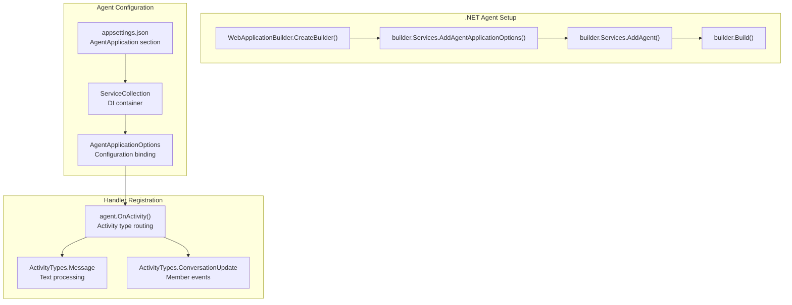

#### Node.js Implementation

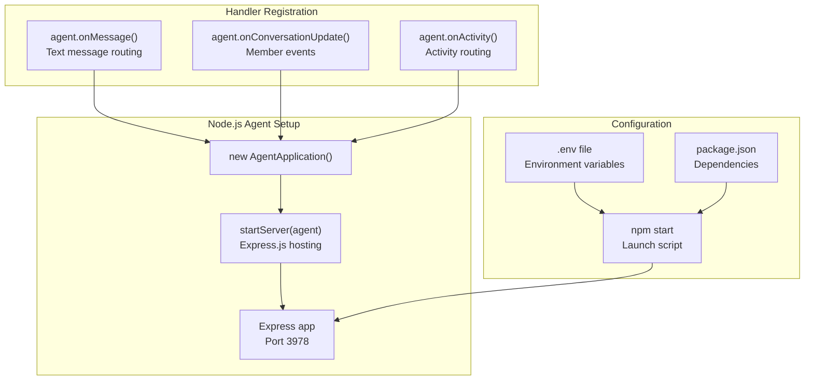

#### Python Implementation

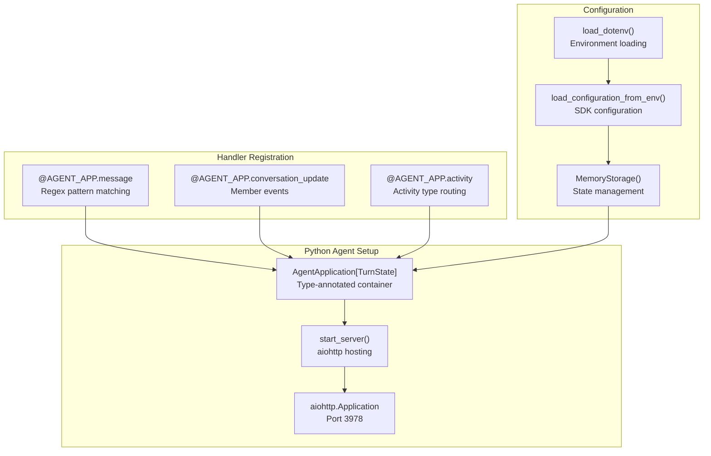

Sources: [samples/dotnet/auto-signin/README.md:18-97](), [samples/nodejs/azure-ai-streaming/src/agent.ts:7-69](), [samples/python/auto-signin/src/agent.py:28-52](), [samples/python/cards/src/agent.py:23-37]()

### HTTP Endpoint Configuration

All agent implementations expose an HTTP POST endpoint at `/api/messages` to receive Bot Framework activities. The endpoint configuration varies by language but follows the same processing pattern.

#### Language-Specific Endpoint Setup

| Language | Framework | Endpoint Registration | Adapter Class |
|----------|-----------|----------------------|---------------|
| .NET | ASP.NET Core | `app.MapPost("/api/messages")` | `IAgentHttpAdapter` |
| Node.js | Express.js | `startServer(agent)` | Built into hosting |
| Python | aiohttp | `APP.router.add_post("/api/messages")` | `CloudAdapter` |

#### Request Processing Flow

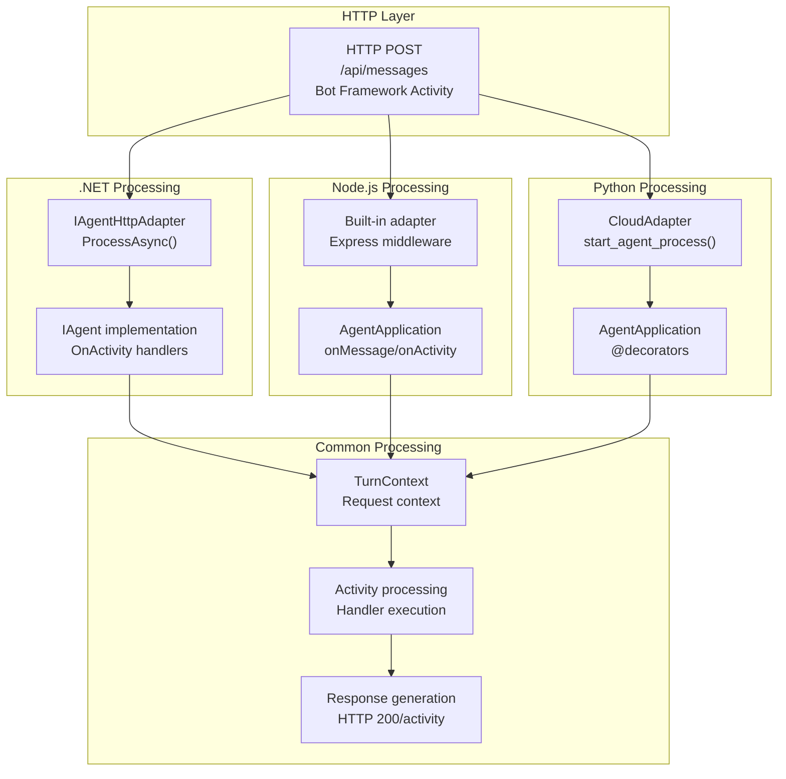

Sources: [samples/nodejs/azure-ai-streaming/src/agent.ts:69-70](), [samples/python/auto-signin/src/start_server.py:13-31](), [samples/python/cards/src/start_server.py:13-32]()

## Agent Lifecycle and Processing

The agent processing lifecycle follows a structured pattern from HTTP request to response, with turn-based processing and activity handling.

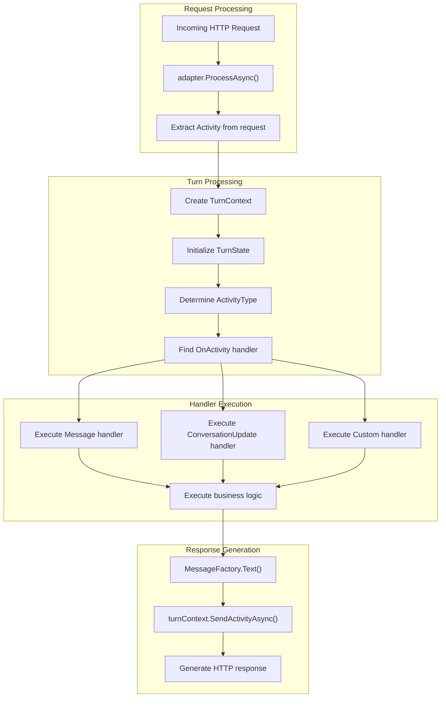

Sources: [docs/managingturns.md:1-30](), [docs/usingactivities.md:1-94](), [samples/basic/weather-agent/dotnet/Program.cs:69-72]()

## Activity Handling Patterns

Activities are the core communication units in the SDK. Each language implementation provides different patterns for registering handlers for various activity types.

### Activity Types and Constants

| Activity Type | .NET | Node.js | Python | Purpose |
|---------------|------|---------|---------|---------|
| Message | `ActivityTypes.Message` | `'message'` | `ActivityTypes.message` | Text, media, rich content |
| ConversationUpdate | `ActivityTypes.ConversationUpdate` | `'conversationUpdate'` | `ActivityTypes.conversation_update` | Member events |
| Typing | `ActivityTypes.Typing` | `'typing'` | `ActivityTypes.typing` | Typing indicators |
| Invoke | `ActivityTypes.Invoke` | `'invoke'` | `ActivityTypes.invoke` | Action invocations |

### Language-Specific Handler Registration

#### .NET Handler Pattern

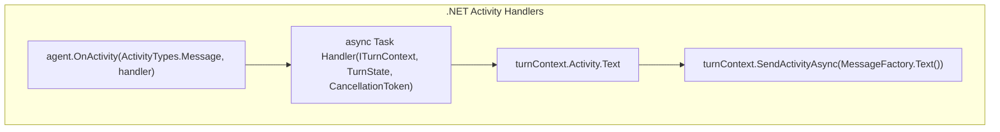

#### Node.js Handler Pattern

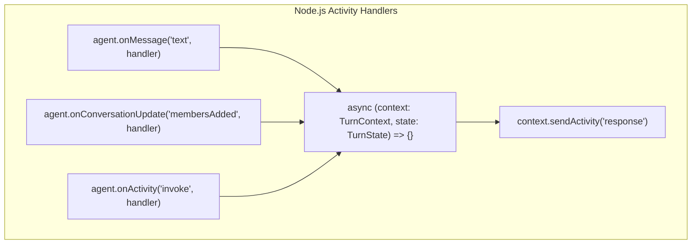

#### Python Decorator Pattern

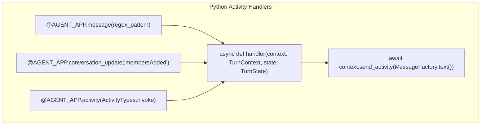

### Practical Handler Examples

#### Message Handler with Pattern Matching

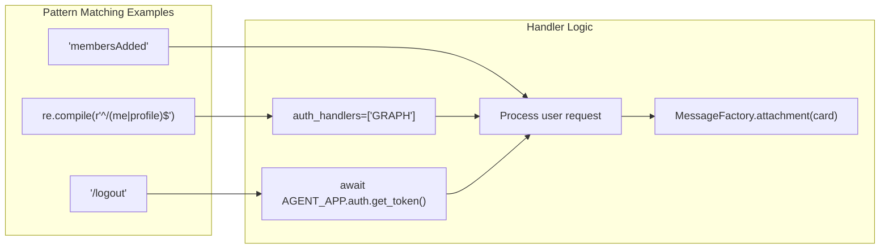

Sources: [samples/python/auto-signin/src/agent.py:55-93](), [samples/nodejs/azure-ai-streaming/src/agent.ts:9-23](), [samples/python/cards/src/agent.py:40-77]()

## Message Creation and Response Patterns

The SDK provides `MessageFactory` and `CardFactory` classes across all languages for creating different types of messages and responses. Each language implementation follows consistent patterns with language-specific syntax.

### MessageFactory Methods Across Languages

| Message Type | .NET | Node.js | Python | Purpose |
|--------------|------|---------|---------|---------|
| Text | `MessageFactory.Text()` | `context.sendActivity()` | `MessageFactory.text()` | Simple text messages |
| Attachment | `MessageFactory.Attachment()` | `MessageFactory.attachment()` | `MessageFactory.attachment()` | Cards and media |
| Adaptive Card | `CardFactory.AdaptiveCard()` | `CardFactory.adaptiveCard()` | `CardFactory.adaptive_card()` | Rich interactive cards |

### Language-Specific Message Creation

#### .NET Message Creation

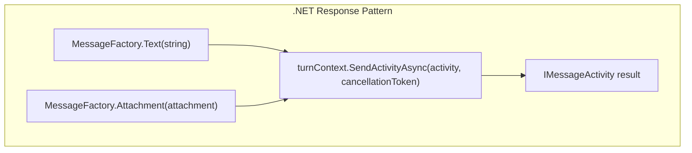

#### Node.js Message Creation

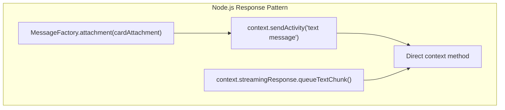

#### Python Message Creation

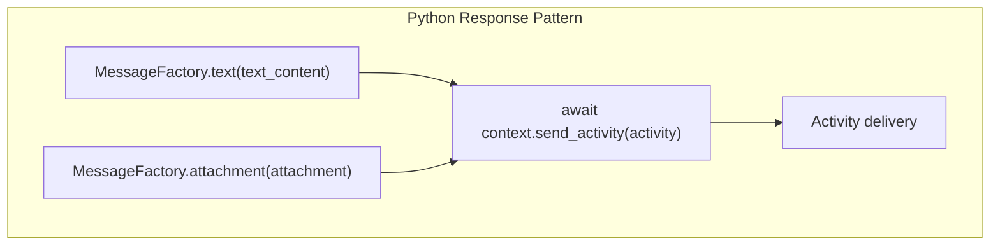

### Card Creation Examples

#### Adaptive Card Creation

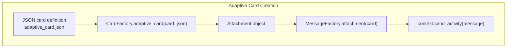

#### Hero Card Creation

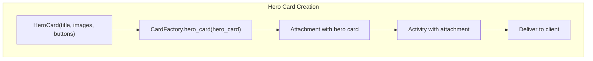

### Practical Message Examples

#### Text Response Pattern

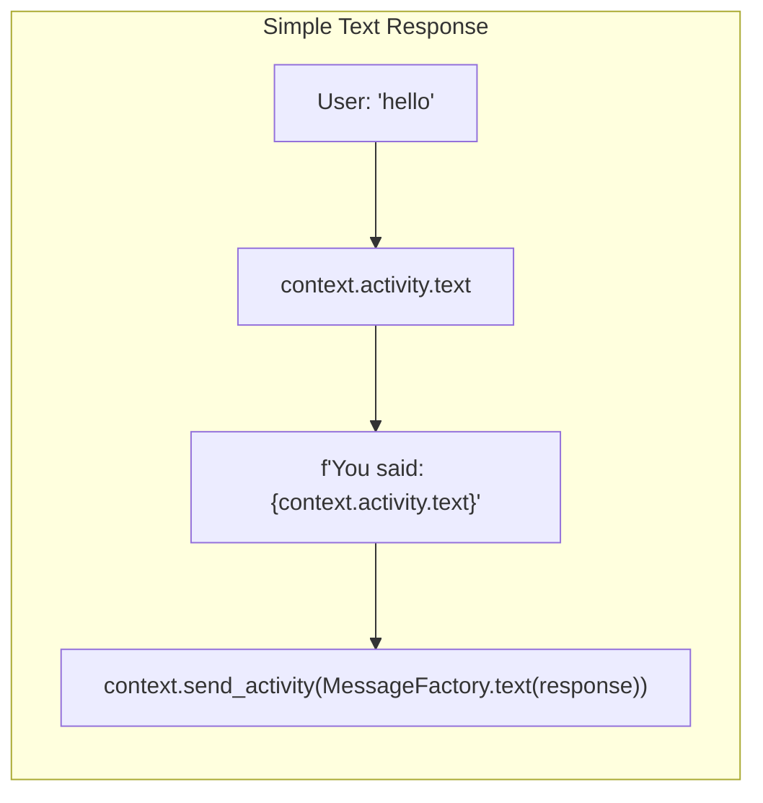

#### Profile Card Response Pattern

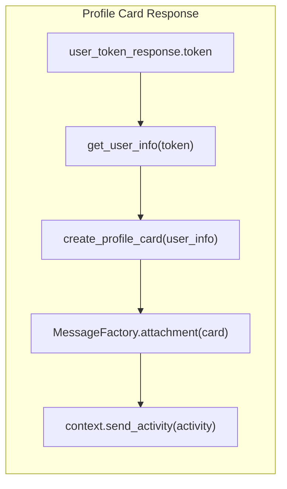

Sources: [samples/python/auto-signin/src/agent.py:83-93](), [samples/python/cards/src/card_messages.py:22-200](), [samples/nodejs/azure-ai-streaming/src/agent.ts:9-11](), [samples/python/auto-signin/src/cards.py:1-98]()

## Configuration Patterns Across Languages

Agent configuration varies by language but follows consistent patterns for authentication, AI services, and application settings. Each implementation uses language-appropriate configuration management.

### Configuration File Patterns

| Language | Config File | Loading Method | Example Variables |
|----------|-------------|----------------|-------------------|
| .NET | `appsettings.json` | `IConfiguration` binding | `AgentApplication:*` |
| Node.js | `.env` | `process.env.*` | `clientId`, `tenantId` |
| Python | `.env` | `load_dotenv()` | Environment variables |

### Language-Specific Configuration

#### .NET Configuration Structure

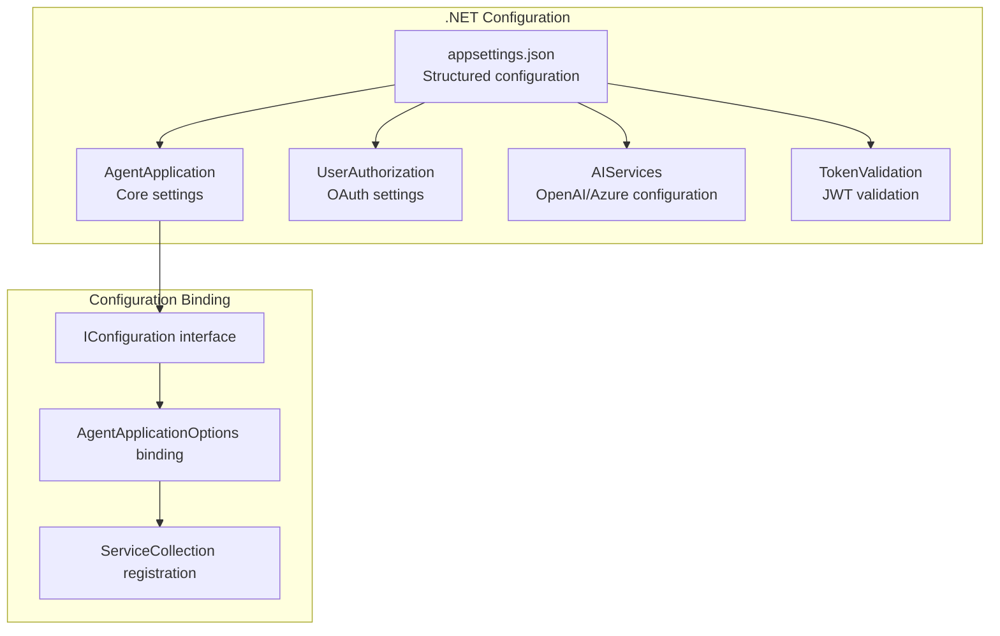

#### Node.js Configuration Structure

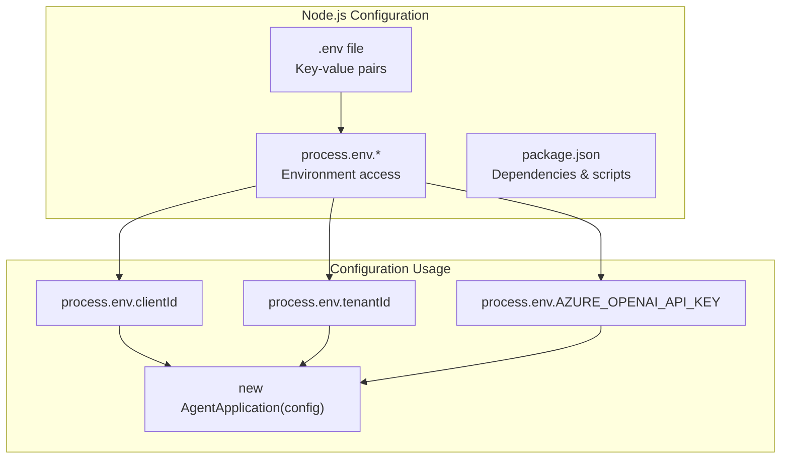

#### Python Configuration Structure

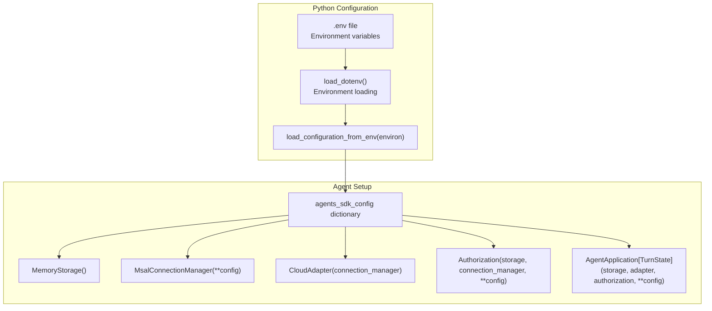

### Authentication Configuration Examples

#### OAuth Connection Configuration

```mermaid
graph TB
    subgraph "OAuth Configuration Pattern"
        AzureBotService["Azure Bot Service<br/>OAuth connections"]
        ConnectionNames["Connection names<br/>graph_connectionName<br/>github_connectionName"]
        AuthHandlers["Authorization handlers<br/>GRAPH, GITHUB"]
    end
    
    subgraph "Language-Specific Setup"
        DotNetHandlers["appsettings.json<br/>UserAuthorization.Handlers"]
        NodeJSHandlers[".env variables<br/>graph_connectionName="]
        PythonHandlers["Environment variables<br/>Auth handler names"]
    end
    
    AzureBotService --> ConnectionNames
    ConnectionNames --> AuthHandlers
    
    AuthHandlers --> DotNetHandlers
    AuthHandlers --> NodeJSHandlers
    AuthHandlers --> PythonHandlers
```

### AI Service Configuration

#### Azure OpenAI Configuration

```mermaid
graph LR
    subgraph "AI Configuration Variables"
        AzureEndpoint["AZURE_OPENAI_API_INSTANCE_NAME"]
        ApiKey["AZURE_OPENAI_API_KEY"]
        DeploymentName["AZURE_OPENAI_API_DEPLOYMENT_NAME"]
        ModelId["Model ID (gpt-4o-mini)"]
    end
    
    subgraph "Service Initialization"
        AzureClient["Azure OpenAI client"]
        SemanticKernel["Semantic Kernel integration"]
        LangChain["LangChain integration"]
        StreamingResponse["Streaming response setup"]
    end
    
    AzureEndpoint --> AzureClient
    ApiKey --> AzureClient
    DeploymentName --> AzureClient
    ModelId --> AzureClient
    
    AzureClient --> SemanticKernel
    AzureClient --> LangChain
    AzureClient --> StreamingResponse
```

Sources: [samples/dotnet/auto-signin/README.md:39-67](), [samples/nodejs/langchain-multiturn/README.md:16-28](), [samples/python/auto-signin/src/agent.py:28-52](), [samples/nodejs/azure-ai-streaming/README.md:14-21]()

## Storage and State Management

The SDK supports stateless and stateful agent patterns through the `IStorage` interface. State management includes conversation state, user state, and private state.

### Storage Implementations

| Storage Type | Class | Use Case |
|--------------|-------|----------|
| Memory | `MemoryStorage` | Development and testing |
| Blob | `BlobStorage` | Production persistence |
| Cosmos | `CosmosStorage` | Distributed scenarios |
| Custom | `IStorage` implementation | Specialized requirements |

### State Management Pattern

```mermaid
graph LR
    subgraph "State Types"
        ConversationState["Conversation State"]
        UserState["User State"]
        PrivateState["Private State"]
    end
    
    subgraph "Storage Layer"
        IStorage["IStorage interface"]
        MemoryStorage["MemoryStorage"]
        BlobStorage["BlobStorage"]
        CosmosStorage["CosmosStorage"]
    end
    
    subgraph "State Access"
        TurnState["TurnState"]
        StateAccessor["State accessors"]
        StateModification["State modification"]
    end
    
    ConversationState --> IStorage
    UserState --> IStorage
    PrivateState --> IStorage
    IStorage --> MemoryStorage
    IStorage --> BlobStorage
    IStorage --> CosmosStorage
    TurnState --> StateAccessor
    StateAccessor --> StateModification
    StateModification --> IStorage
```

Sources: [docs/managingturns.md:22-30](), [samples/basic/weather-agent/dotnet/Program.cs:57-60](), [samples/basic/azureai-streaming-poem-agent/dotnet/Program.cs:37-41]()

---

