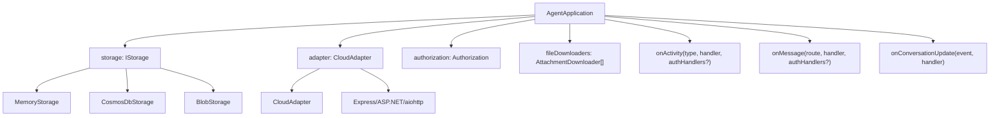
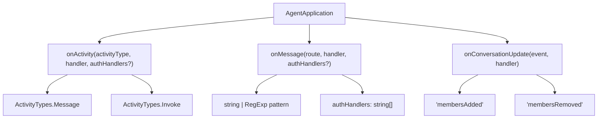
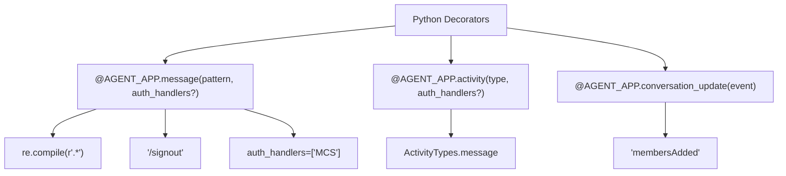
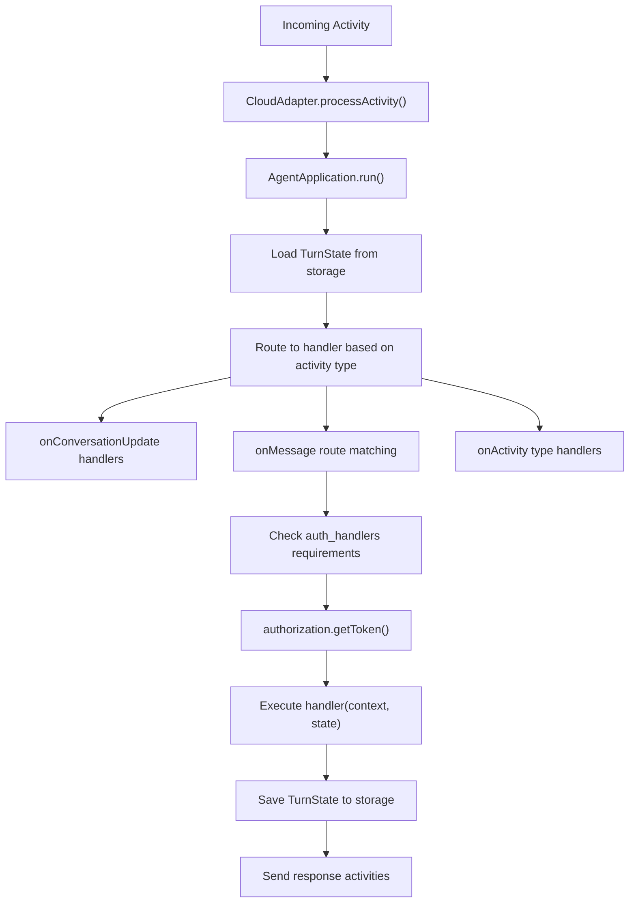
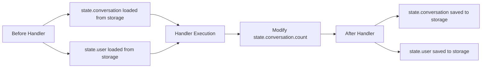
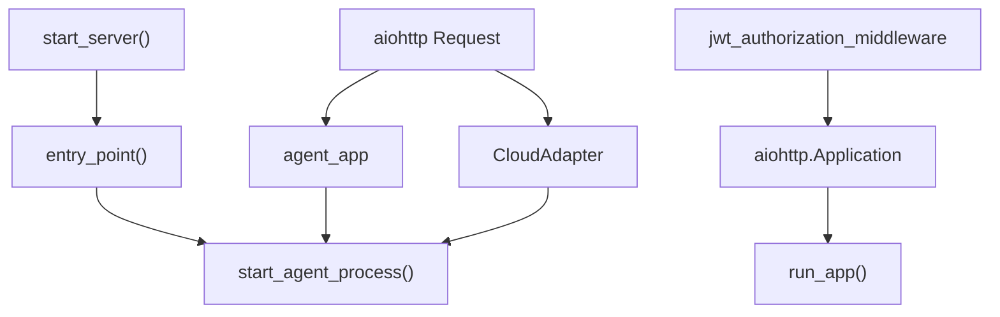

<!-- source: DeepWiki mcp.deepwiki.com · repo microsoft/Agents · page 2.1 AgentApplication Class · fetched 2026-10-26 -->

# AgentApplication Class

<details>
<summary>Relevant source files</summary>

The following files were used as context for generating this wiki page:

- [samples/nodejs/cards/env.TEMPLATE](samples/nodejs/cards/env.TEMPLATE)
- [samples/nodejs/copilotstudio-skill/env.TEMPLATE](samples/nodejs/copilotstudio-skill/env.TEMPLATE)
- [samples/nodejs/copilotstudio-skill/package-lock.json](samples/nodejs/copilotstudio-skill/package-lock.json)
- [samples/nodejs/copilotstudio-skill/package.json](samples/nodejs/copilotstudio-skill/package.json)
- [samples/nodejs/copilotstudio-skill/src/agent.ts](samples/nodejs/copilotstudio-skill/src/agent.ts)
- [samples/nodejs/multi-turn-prompt/env.TEMPLATE](samples/nodejs/multi-turn-prompt/env.TEMPLATE)
- [samples/nodejs/obo-authorization/env.TEMPLATE](samples/nodejs/obo-authorization/env.TEMPLATE)
- [samples/nodejs/obo-authorization/src/index.ts](samples/nodejs/obo-authorization/src/index.ts)
- [samples/nodejs/quickstart/README.md](samples/nodejs/quickstart/README.md)
- [samples/nodejs/quickstart/env.TEMPLATE](samples/nodejs/quickstart/env.TEMPLATE)
- [samples/nodejs/quickstart/package.json](samples/nodejs/quickstart/package.json)
- [samples/nodejs/quickstart/src/index.ts](samples/nodejs/quickstart/src/index.ts)
- [samples/nodejs/quickstart/tsconfig.json](samples/nodejs/quickstart/tsconfig.json)
- [samples/python/README.md](samples/python/README.md)
- [samples/python/obo-authorization/README.md](samples/python/obo-authorization/README.md)
- [samples/python/obo-authorization/env.TEMPLATE](samples/python/obo-authorization/env.TEMPLATE)
- [samples/python/obo-authorization/requirements.txt](samples/python/obo-authorization/requirements.txt)
- [samples/python/obo-authorization/src/agent.py](samples/python/obo-authorization/src/agent.py)
- [samples/python/obo-authorization/src/main.py](samples/python/obo-authorization/src/main.py)
- [samples/python/obo-authorization/src/start_server.py](samples/python/obo-authorization/src/start_server.py)

</details>


The `AgentApplication` class is the central orchestration point for building conversational agents using the Microsoft 365 Agents SDK. It provides the core framework for processing activities, managing state, handling authentication, and routing messages.

For activity processing patterns, see page [2.2]. For state management, see page [2.3]. For authentication, see section [3].

## Overview

`AgentApplication` serves as the primary entry point for agent functionality across Node.js, .NET, and Python. It coordinates the agent lifecycle including initialization, activity routing, middleware execution, and response generation.

**AgentApplication Core Components**


Sources: [samples/nodejs/quickstart/src/index.ts:23-26](), [samples/nodejs/obo-authorization/src/index.ts:7-14](), [samples/python/obo-authorization/src/agent.py:31-38]()
</thinking>

## Class Instantiation Patterns

### Node.js Direct Instantiation

The simplest Node.js pattern creates `AgentApplication` directly with options:

```typescript
const agentApp = new AgentApplication<ApplicationTurnState>({
  storage,
  fileDownloaders: [downloader]
})
```

Sources: [samples/nodejs/quickstart/src/index.ts:23-26]()

### Node.js Subclassing Pattern

For complex agents, extend `AgentApplication` and configure in the constructor:

```typescript
class OboApp extends AgentApplication<TurnState> {
  constructor () {
    super({
      storage: new MemoryStorage(),
      authorization: {
        graph: { text: 'Sign in with Microsoft Graph', title: 'Graph Sign In' }
      }
    })
    this.onConversationUpdate('membersAdded', this._status)
    this.authorization.onSignInSuccess(this._singinSuccess)
  }
}
```

Sources: [samples/nodejs/obo-authorization/src/index.ts:7-20]()

### Python Component Assembly Pattern

Python requires explicit assembly of components before instantiation:

```python
STORAGE = MemoryStorage()
CONNECTION_MANAGER = MsalConnectionManager(**agents_sdk_config)
ADAPTER = CloudAdapter(connection_manager=CONNECTION_MANAGER)
AUTHORIZATION = Authorization(STORAGE, CONNECTION_MANAGER, **agents_sdk_config)

AGENT_APP = AgentApplication[TurnState](
    storage=STORAGE, 
    adapter=ADAPTER, 
    authorization=AUTHORIZATION, 
    **agents_sdk_config
)
```

Sources: [samples/python/obo-authorization/src/agent.py:31-38]()

## Configuration Options

### Node.js AgentApplicationOptions

`AgentApplication` accepts an options object with the following properties:

| Property | Type | Purpose | Required |
|----------|------|---------|----------|
| `storage` | `IStorage` | State persistence implementation | No |
| `fileDownloaders` | `IFileDownloader[]` | Attachment download handlers | No |
| `authorization` | `AuthorizationConfig` | User authentication configuration | No |
| `adapter` | `CloudAdapter` | Platform communication adapter | No |

**AgentApplicationOptions Type Structure**
```mermaid
graph TD
    Options["AgentApplicationOptions<TState>"]
    
    Options --> storage["storage?: IStorage"]
    Options --> fileDownloaders["fileDownloaders?: IFileDownloader[]"]
    Options --> authorization["authorization?: AuthorizationConfig"]
    Options --> adapter["adapter?: CloudAdapter"]
    
    storage --> MemoryStorage["MemoryStorage"]
    storage --> CosmosDbStorage["CosmosDbStorage"]
    
    fileDownloaders --> AttachmentDownloader["AttachmentDownloader"]
    
    authorization --> handlers["handlers: Record<string, AuthHandlerConfig>"]
    handlers --> graph["graph: { text, title }"]
    handlers --> custom["custom: { text, title }"]
```

Sources: [samples/nodejs/quickstart/src/index.ts:23-26](), [samples/nodejs/obo-authorization/src/index.ts:9-14]()

### Python Configuration Dictionary

Python uses keyword arguments unpacked from configuration:

```python
agents_sdk_config = load_configuration_from_env(environ)

AGENT_APP = AgentApplication[TurnState](
    storage=STORAGE,
    adapter=ADAPTER,
    authorization=AUTHORIZATION,
    **agents_sdk_config  # Unpacked configuration
)
```

Configuration includes token validation, agent settings, and connection mappings loaded from environment variables.

Sources: [samples/python/obo-authorization/src/agent.py:28-38]()

## Event Handler Registration

### Node.js Handler Methods

Node.js provides multiple methods for registering handlers:

**Handler Registration Methods**


**Example: Activity Handler Registration**
```typescript
// Welcome message on member added
agentApp.onConversationUpdate('membersAdded', async (context: TurnContext, state: ApplicationTurnState) => {
  await context.sendActivity('Hello and Welcome!')
})

// Message handler with route pattern
agentApp.onMessage('/status', this._status)

// Activity handler with authentication
agentApp.onActivity('message', this._message, ['graph'])
```

Sources: [samples/nodejs/quickstart/src/index.ts:29-31](), [samples/nodejs/obo-authorization/src/index.ts:15-19]()

### Python Decorator Pattern

Python uses decorators to register handlers:

**Decorator-Based Handler Registration**


**Example: Decorator-Based Registration**
```python
@AGENT_APP.message("/signout")
async def signout(context: TurnContext, state: TurnState):
    await AGENT_APP.auth.sign_out(context)
    await context.send_activity("You have signed out")

@AGENT_APP.message(re.compile(r".*"), auth_handlers=["MCS"])
async def default_handler(context: TurnContext, _state: TurnState):
    # Process authenticated message
    pass
```

Sources: [samples/python/obo-authorization/src/agent.py:64-70](), [samples/python/obo-authorization/src/agent.py:77-78]()

## Handler Execution Flow

### Node.js Execution Pipeline

**Activity Processing Pipeline**


Sources: [samples/nodejs/quickstart/src/index.ts:29-41](), [samples/nodejs/obo-authorization/src/index.ts:15-19]()

### Authentication Handler Integration

Handlers can specify required authentication:

```typescript
// Node.js: Require 'graph' auth handler
agentApp.onActivity('message', this._message, ['graph'])

// Python: Require 'MCS' auth handler
@AGENT_APP.message(re.compile(r".*"), auth_handlers=["MCS"])
async def default_handler(context: TurnContext, _state: TurnState):
    pass
```

When auth handlers are specified, `AgentApplication` automatically:
1. Validates user is signed in
2. Acquires tokens via the Authorization component
3. Prompts for sign-in if required
4. Passes authenticated context to handler

Sources: [samples/nodejs/obo-authorization/src/index.ts:19](), [samples/python/obo-authorization/src/agent.py:77]()

## TurnState and Type Safety

### Type Parameters

`AgentApplication` supports generic type parameters for custom conversation state:

**Node.js TurnState Typing**
```typescript
interface ConversationState {
  count: number;
}
type ApplicationTurnState = TurnState<ConversationState>

const agentApp = new AgentApplication<ApplicationTurnState>({
  storage,
  fileDownloaders: [downloader]
})

// Handler receives typed state
agentApp.onActivity(ActivityTypes.Message, async (context: TurnContext, state: ApplicationTurnState) => {
  let count = state.conversation.count ?? 0
  state.conversation.count = ++count
  await context.sendActivity(`[${count}] You said: ${context.activity.text}`)
})
```

**Python TurnState Typing**
```python
AGENT_APP = AgentApplication[TurnState](
    storage=STORAGE,
    adapter=ADAPTER,
    authorization=AUTHORIZATION,
    **agents_sdk_config
)

@AGENT_APP.message("/status")
async def status_handler(context: TurnContext, state: TurnState):
    # Access typed state
    pass
```

Sources: [samples/nodejs/quickstart/src/index.ts:10-13](), [samples/nodejs/quickstart/src/index.ts:34-40](), [samples/python/obo-authorization/src/agent.py:36-38]()

### State Management

State is automatically loaded before handlers and saved after:

**State Lifecycle in Handlers**


Sources: [samples/nodejs/quickstart/src/index.ts:34-40]()

## Server Integration Patterns

Each language implementation provides specific patterns for integrating the `AgentApplication` with web servers:

### Python + aiohttp Integration



Sources: [samples/python/auto-signin/src/start_server.py:10-31](), [samples/python/cards/src/start_server.py:11-31]()

### Node.js + Express Integration

The Node.js implementation uses the `@microsoft/agents-hosting-express` package for Express.js integration, automatically handling the web server setup and routing.

Sources: [samples/nodejs/azure-ai-streaming/package-lock.json:220-230](), [samples/nodejs/quickstart/package-lock.json:12-14]()

### .NET + ASP.NET Core Integration

The .NET implementation integrates directly with ASP.NET Core through the `Microsoft.Agents.Hosting.AspNetCore` package, using standard .NET dependency injection patterns.

Sources: [samples/dotnet/quickstart/QuickStart.csproj:11-12]()

---

