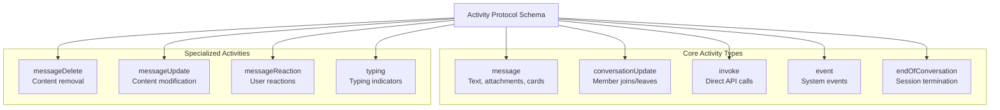
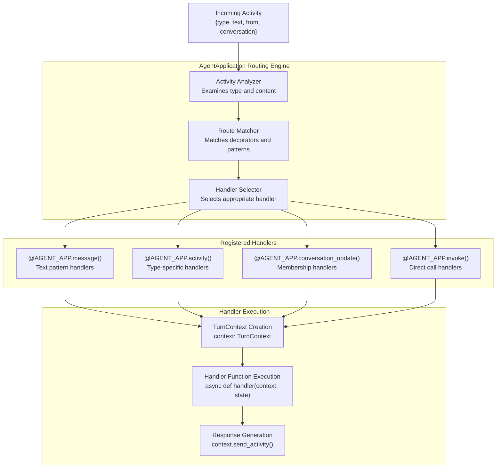
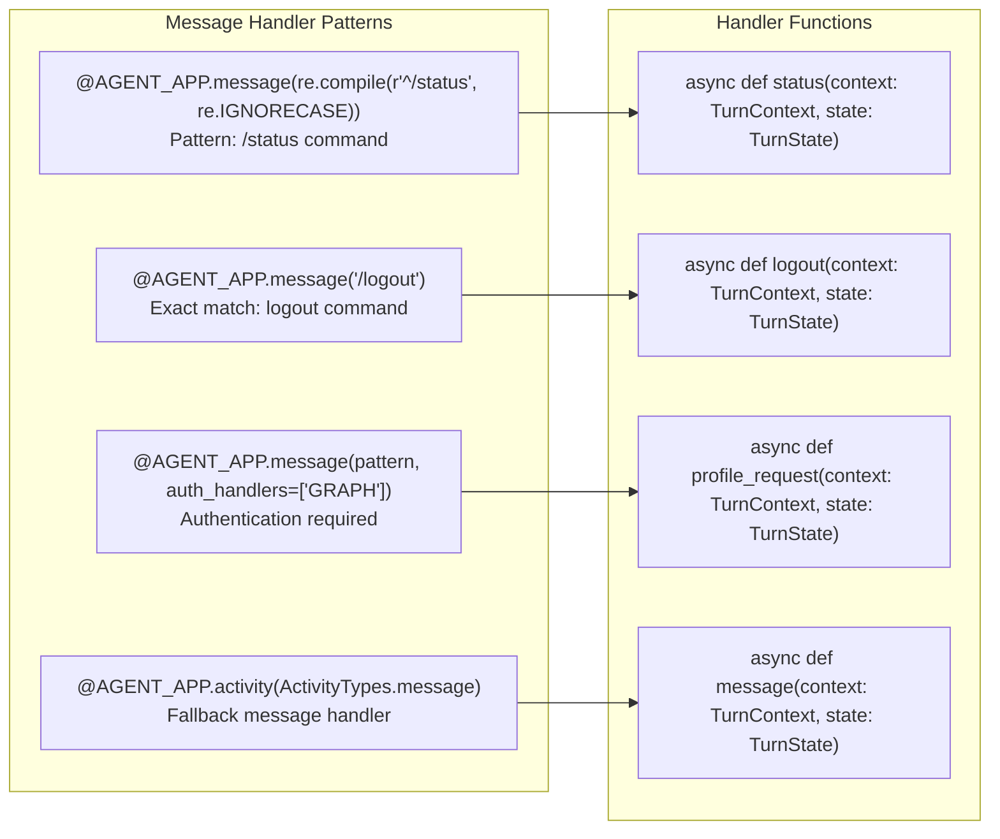
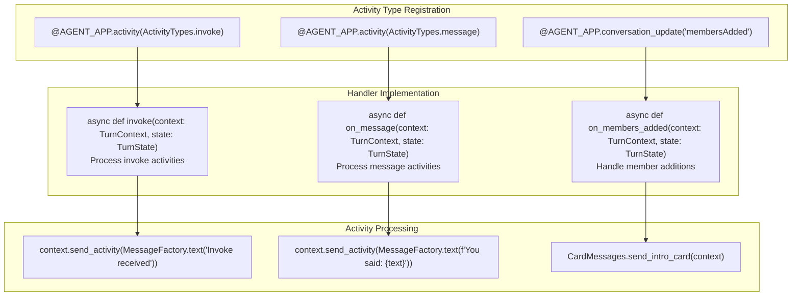
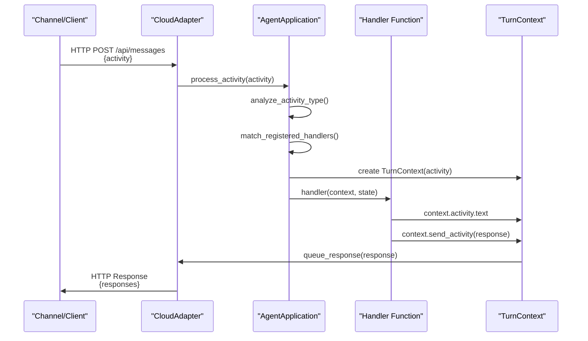
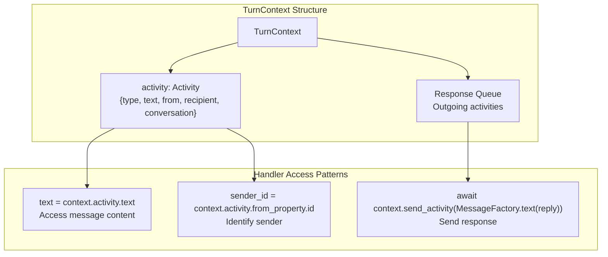
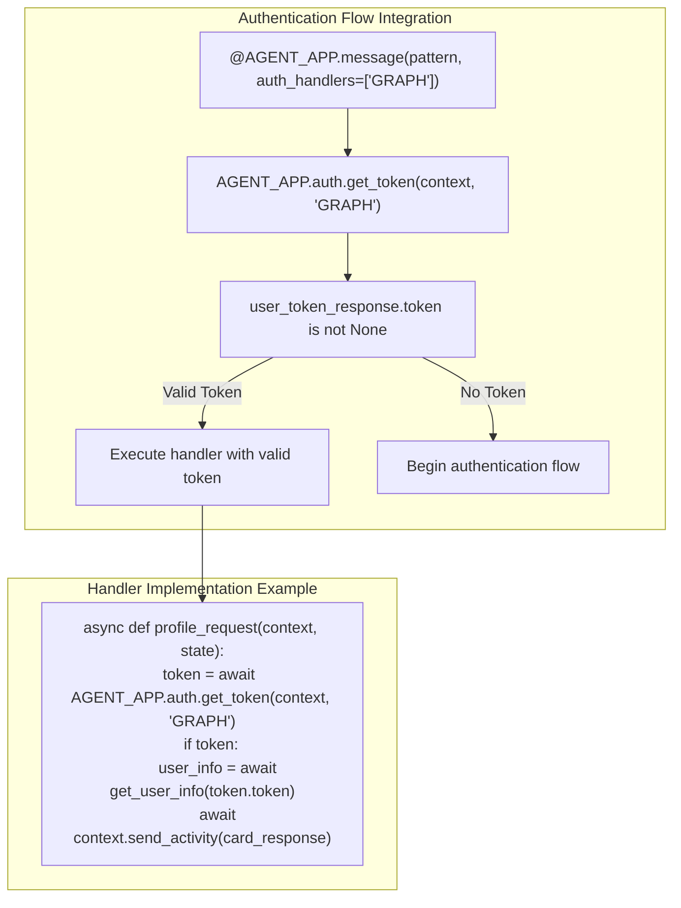

<!-- source: DeepWiki mcp.deepwiki.com · repo microsoft/Agents · page 2.2 Activity Processing · fetched 2026-10-26 -->

# Activity Processing

Relevant source files

The following files were used as context for generating this wiki page:

- [samples/nodejs/quickstart/README.md](samples/nodejs/quickstart/README.md)
- [samples/nodejs/quickstart/env.TEMPLATE](samples/nodejs/quickstart/env.TEMPLATE)
- [samples/nodejs/quickstart/package.json](samples/nodejs/quickstart/package.json)
- [samples/nodejs/quickstart/src/index.ts](samples/nodejs/quickstart/src/index.ts)
- [samples/nodejs/quickstart/tsconfig.json](samples/nodejs/quickstart/tsconfig.json)
- [specs/activity/protocol-activity.md](specs/activity/protocol-activity.md)
- [specs/activity/protocol-cards.md](specs/activity/protocol-cards.md)
- [specs/channel-api/ChannelAPI-OpenAPI.yaml](specs/channel-api/ChannelAPI-OpenAPI.yaml)
- [specs/channel-api/TokenAPI-OpenAPI.yaml](specs/channel-api/TokenAPI-OpenAPI.yaml)
- [specs/manifest/bot-manifest.md](specs/manifest/bot-manifest.md)
- [specs/manifest/example.man](specs/manifest/example.man)
- [specs/manifest/manifest.json](specs/manifest/manifest.json)
- [specs/manifest/schemas/SchemaManifestTests/SchemaManifestTests.csproj](specs/manifest/schemas/SchemaManifestTests/SchemaManifestTests.csproj)
- [specs/manifest/schemas/SchemaManifestTests/SchemaManifestTests.sln](specs/manifest/schemas/SchemaManifestTests/SchemaManifestTests.sln)
- [specs/manifest/schemas/SchemaManifestTests/ValidateSchemaTests.cs](specs/manifest/schemas/SchemaManifestTests/ValidateSchemaTests.cs)
- [specs/manifest/schemas/readme.md](specs/manifest/schemas/readme.md)

This document details how activities are processed, routed, and handled within agents built using the Microsoft 365 Agents SDK. It covers the activity routing system, handler registration patterns, and the processing flow from activity receipt to response generation.

For information about the core `AgentApplication` class and initialization, see [AgentApplication Class](#2.1). For details about state management across turns, see [Managing State](#2.3).

## Activity Types and Protocol

The Microsoft 365 Agents SDK processes activities conforming to the Activity Protocol specification, which defines a comprehensive schema for conversational interactions. Activities represent actions taken by humans, automated agents, or channels within chat applications.

**Sources:** [specs/activity/protocol-activity.md:1-570]()

## Activity Routing Architecture

The SDK provides a decorator-based routing system that maps incoming activities to handler functions based on activity type, content patterns, and conditions. The routing system operates through the `AgentApplication` class and its associated decorators.

**Sources:** [samples/python/auto-signin/src/agent.py:55-139](), [samples/python/cards/src/agent.py:40-77]()

## Handler Registration Patterns

The SDK supports multiple registration patterns for different activity types and matching criteria. Each pattern uses decorators that examine activity properties and route to appropriate handlers.

### Message Activity Handlers

Message handlers process text-based activities and support pattern matching through regular expressions or string comparisons.

**Sources:** [samples/python/auto-signin/src/agent.py:55-93](), [samples/python/auto-signin/src/agent.py:134-138]()

### Activity Type Handlers

Type-specific handlers process activities based on their `type` field, providing specialized processing for different activity categories.

**Sources:** [samples/python/auto-signin/src/agent.py:129-138](), [samples/python/cards/src/agent.py:40-77]()

## Activity Processing Flow

The activity processing flow represents the complete lifecycle from activity receipt through handler execution to response generation. The system uses the `TurnContext` class to provide access to activity data and response methods.

**Sources:** [samples/python/auto-signin/src/start_server.py:13-31](), [samples/python/cards/src/start_server.py:14-32]()

## TurnContext and Activity Access

The `TurnContext` class provides the primary interface for accessing activity data and generating responses within handler functions. It encapsulates the current activity and provides methods for response generation.

| Property/Method | Purpose | Example Usage |
|---|---|---|
| `context.activity` | Access current activity | `context.activity.text` |
| `context.activity.from_property` | Activity sender | `context.activity.from_property.id` |
| `context.activity.recipient` | Activity recipient | `context.activity.recipient.id` |
| `context.activity.conversation` | Conversation context | `context.activity.conversation.id` |
| `context.send_activity()` | Send response | `await context.send_activity(message)` |

**Sources:** [samples/python/auto-signin/src/agent.py:61-92](), [samples/python/cards/src/agent.py:46-76]()

## Authentication Integration

Activity processing can include authentication requirements through the `auth_handlers` parameter in decorators. This enables handlers to access authenticated user tokens for external API calls.

**Sources:** [samples/python/auto-signin/src/agent.py:80-93](), [samples/python/auto-signin/src/agent.py:95-127]()

## Response Generation Patterns

Handlers generate responses through the `TurnContext.send_activity()` method, supporting text messages, rich cards, and attachments. The system uses `MessageFactory` for creating different response types.

| Response Type | Factory Method | Use Case |
|---|---|---|
| Text Message | `MessageFactory.text(text)` | Simple text responses |
| Card Attachment | `MessageFactory.attachment(card)` | Rich interactive content |
| Multiple Attachments | `MessageFactory.attachment_layout(attachments, layout)` | Multiple cards/files |

**Sources:** [samples/python/cards/src/card_messages.py:198-200](), [samples/python/auto-signin/src/agent.py:87-88]()

---

