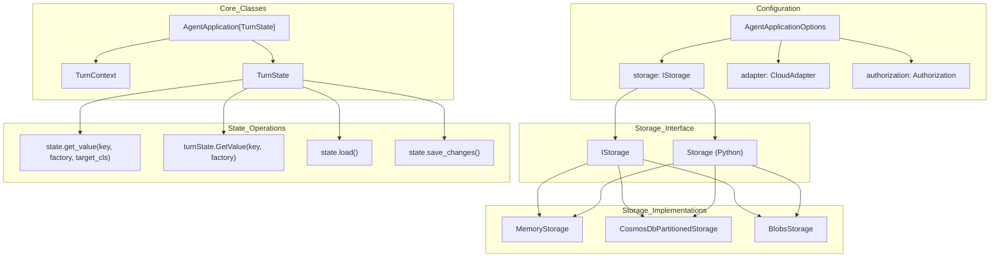
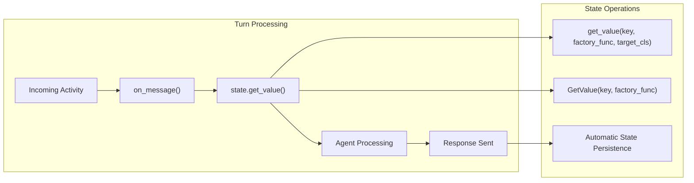
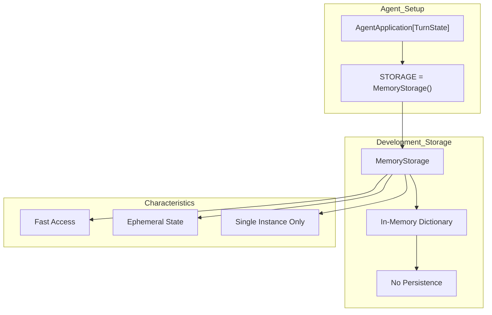
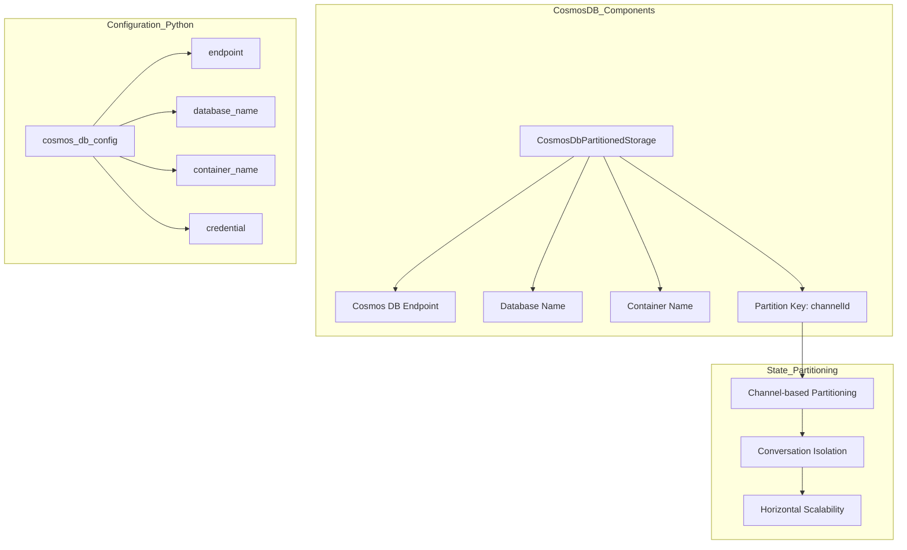
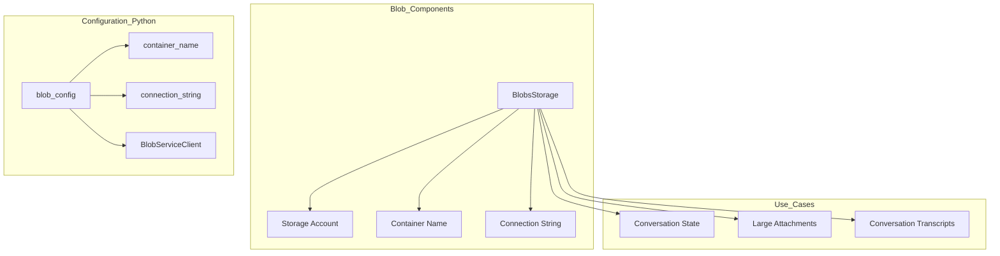
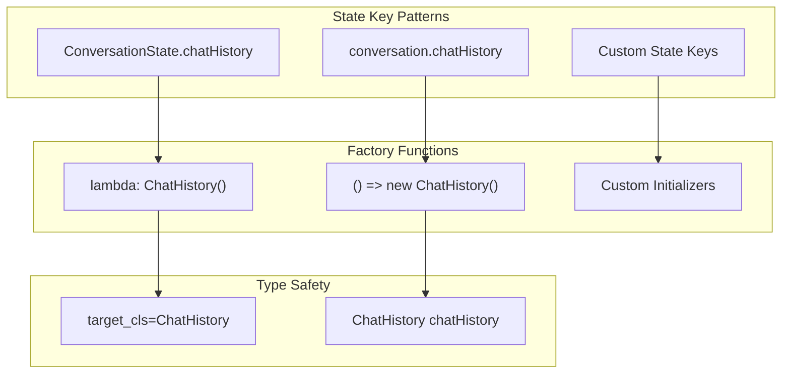
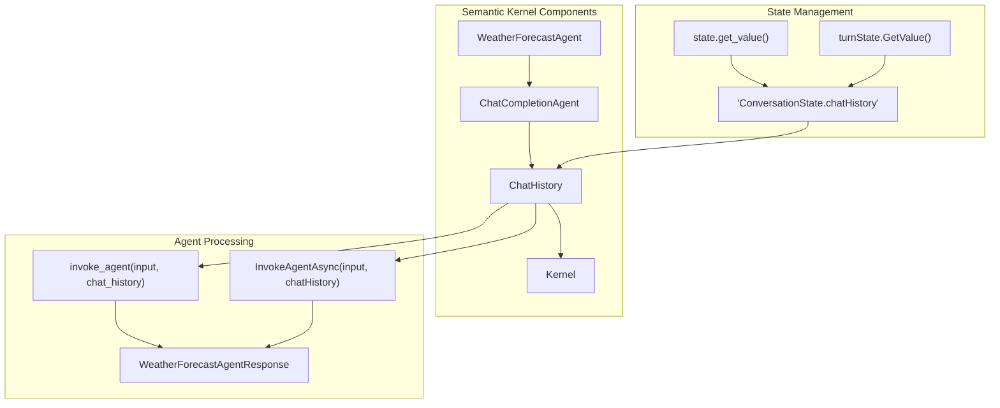
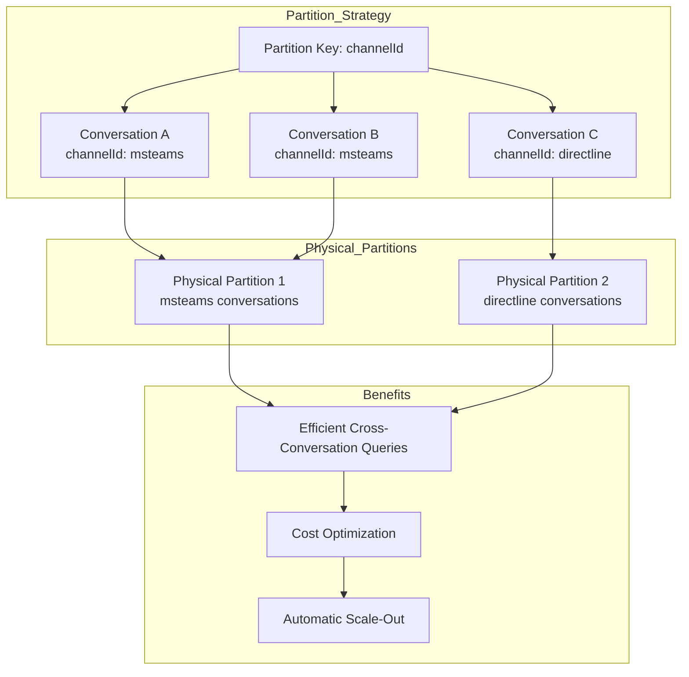
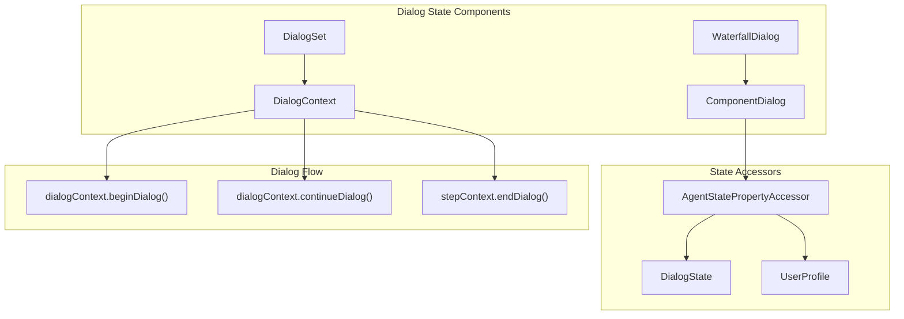

<!-- source: DeepWiki mcp.deepwiki.com · repo microsoft/Agents · page 2.3 Managing State · fetched 2026-10-26 -->

# Managing State

<details>
<summary>Relevant source files</summary>

The following files were used as context for generating this wiki page:

- [.github/scripts/updatenode.sh](.github/scripts/updatenode.sh)
- [AgentErrorCodes.md](AgentErrorCodes.md)
- [samples/nodejs/auto-signin/package-lock.json](samples/nodejs/auto-signin/package-lock.json)
- [samples/nodejs/azure-ai-streaming/package-lock.json](samples/nodejs/azure-ai-streaming/package-lock.json)
- [samples/nodejs/cards/package-lock.json](samples/nodejs/cards/package-lock.json)
- [samples/nodejs/copilotstudio-client/package-lock.json](samples/nodejs/copilotstudio-client/package-lock.json)
- [samples/nodejs/copilotstudio-webchat-react/package-lock.json](samples/nodejs/copilotstudio-webchat-react/package-lock.json)
- [samples/nodejs/langchain-multiturn/package-lock.json](samples/nodejs/langchain-multiturn/package-lock.json)
- [samples/nodejs/multi-turn-prompt/package-lock.json](samples/nodejs/multi-turn-prompt/package-lock.json)
- [samples/nodejs/obo-authorization/package-lock.json](samples/nodejs/obo-authorization/package-lock.json)
- [samples/nodejs/quickstart/package-lock.json](samples/nodejs/quickstart/package-lock.json)

</details>


This document covers state management in the Microsoft 365 Agents SDK, including turn state, conversation state, user state, and storage options. State management enables agents to maintain context across multiple turns in a conversation and persist information between interactions.

For information about activity processing within a single turn, see [Activity Processing](#2.2). For creating and managing multi-turn dialog flows, see [Multi-turn Dialogs](#2.6).

## State Architecture Overview

The Microsoft 365 Agents SDK provides a turn-based state management system. By default, agents are stateless, but the SDK supports optional state persistence through pluggable storage backends. The SDK provides three storage implementations:

- **MemoryStorage**: In-memory storage for development and testing
- **CosmosDB Storage**: Production-grade distributed storage with partitioning support
- **Blob Storage**: Azure Blob Storage for conversation state and attachments

### Core State Management Components

**State Management Architecture**



Sources: [AgentErrorCodes.md:26-32](), [samples/python/semantic-kernel-multiturn/src/app.py:26-29](), [samples/python/semantic-kernel-multiturn/src/app.py:44-46](), [samples/dotnet/semantic-kernel-multiturn/MyAgent.cs:19-31](), [samples/dotnet/semantic-kernel-multiturn/Program.cs:60]()

## Turn State Management

`TurnState` is the primary state container that manages state data for a single conversation turn. It provides methods to get and set values that persist across conversation turns.

### Turn State Lifecycle



### Python Implementation

The Python SDK uses `state.get_value()` to access conversation state with factory functions for initialization:

```python
# Access conversation state with ChatHistory
chat_history = state.get_value(
    "ConversationState.chatHistory", 
    lambda: ChatHistory(), 
    target_cls=ChatHistory
)
```

### .NET Implementation

The .NET SDK uses `turnState.GetValue()` to access conversation state:

```csharp
// Access conversation state with ChatHistory
ChatHistory chatHistory = turnState.GetValue("conversation.chatHistory", () => new ChatHistory());
```

Sources: [samples/python/semantic-kernel-multiturn/src/app.py:64-66](), [samples/dotnet/semantic-kernel-multiturn/MyAgent.cs:45]()

## Storage Implementations

The SDK provides three storage backend implementations, each suited for different deployment scenarios.

### MemoryStorage

In-memory storage for development and testing. State is not persisted between application restarts.

**MemoryStorage Configuration**



### CosmosDB Storage

Production-grade distributed storage with partition key support for multi-tenant scenarios.

**CosmosDB Storage Architecture**



CosmosDB storage uses `channelId` as the default partition key for efficient state distribution across conversations.

### Blob Storage

Azure Blob Storage for persisting conversation state and handling large attachments.

**Blob Storage Architecture**



Sources: [AgentErrorCodes.md:26-32](), [AgentErrorCodes.md:93-123]()

## Storage Configuration

Storage is configured when creating the `AgentApplication` instance. The SDK supports pluggable storage backends through the `IStorage` interface (C#) or `Storage` base class (Python).

### Python Storage Configuration

**MemoryStorage Configuration (Development)**

```python
# In-memory storage for development
from microsoft.agents.storage import MemoryStorage

STORAGE = MemoryStorage()
CONNECTION_MANAGER = MsalConnectionManager(**agents_sdk_config)
ADAPTER = CloudAdapter(connection_manager=CONNECTION_MANAGER)
AUTHORIZATION = Authorization(STORAGE, CONNECTION_MANAGER, **agents_sdk_config)

AGENT_APP = AgentApplication[TurnState](
    storage=STORAGE, 
    adapter=ADAPTER, 
    authorization=AUTHORIZATION, 
    **agents_sdk_config
)
```

**CosmosDB Storage Configuration (Production)**

```python
# CosmosDB storage for production
from microsoft.agents.storage.cosmos_db import CosmosDbPartitionedStorage
from azure.cosmos import CosmosClient

cosmos_client = CosmosClient(
    url=environ["COSMOS_DB_ENDPOINT"],
    credential=environ["COSMOS_DB_KEY"]
)

STORAGE = CosmosDbPartitionedStorage(
    cosmos_db_config={
        "client": cosmos_client,
        "database_name": environ["COSMOS_DB_DATABASE"],
        "container_name": environ["COSMOS_DB_CONTAINER"]
    }
)

AGENT_APP = AgentApplication[TurnState](
    storage=STORAGE,
    adapter=ADAPTER,
    authorization=AUTHORIZATION,
    **agents_sdk_config
)
```

**Blob Storage Configuration**

```python
# Blob storage for state and attachments
from microsoft.agents.storage.blobs import BlobsStorage
from azure.storage.blob import BlobServiceClient

blob_client = BlobServiceClient.from_connection_string(
    environ["AZURE_STORAGE_CONNECTION_STRING"]
)

STORAGE = BlobsStorage(
    blob_config={
        "client": blob_client,
        "container_name": environ["BLOB_CONTAINER_NAME"]
    }
)

AGENT_APP = AgentApplication[TurnState](
    storage=STORAGE,
    adapter=ADAPTER,
    authorization=AUTHORIZATION,
    **agents_sdk_config
)
```

### .NET Storage Configuration

**MemoryStorage Configuration (Development)**

```csharp
// In-memory storage for development
using Microsoft.Agents.Storage;

builder.Services.AddSingleton<IStorage, MemoryStorage>();
builder.AddAgent<MyAgent>();
```

**CosmosDB Storage Configuration (Production)**

```csharp
// CosmosDB storage for production
using Microsoft.Agents.Storage.CosmosDb;
using Microsoft.Azure.Cosmos;

var cosmosClient = new CosmosClient(
    configuration["CosmosDb:Endpoint"],
    configuration["CosmosDb:Key"]
);

builder.Services.AddSingleton<IStorage>(sp => 
    new CosmosDbPartitionedStorage(
        cosmosClient,
        configuration["CosmosDb:DatabaseName"],
        configuration["CosmosDb:ContainerName"]
    )
);

builder.AddAgent<MyAgent>();
```

**Blob Storage Configuration**

```csharp
// Blob storage for state and attachments
using Microsoft.Agents.Storage.Blobs;
using Azure.Storage.Blobs;

var blobServiceClient = new BlobServiceClient(
    configuration["AzureStorage:ConnectionString"]
);

builder.Services.AddSingleton<IStorage>(sp =>
    new BlobsStorage(
        blobServiceClient,
        configuration["AzureStorage:ContainerName"]
    )
);

builder.AddAgent<MyAgent>();
```

### JavaScript/TypeScript Storage Configuration

**MemoryStorage Configuration (Development)**

```typescript
// In-memory storage for development
import { MemoryStorage } from '@microsoft/agents-hosting';

const storage = new MemoryStorage();
const adapter = new CloudAdapter(connectionManager);
const authorization = new Authorization(storage, connectionManager, agentConfig);

const app = new AgentApplication({
    storage,
    adapter,
    authorization,
    ...agentConfig
});
```

**Storage Configuration Reference**

| Storage Type | Use Case | Persistence | Scalability | Configuration Complexity |
|-------------|----------|-------------|-------------|-------------------------|
| `MemoryStorage` | Development/Testing | None | Single Instance | Low |
| `CosmosDbPartitionedStorage` | Production Multi-tenant | Distributed | Horizontal | Medium |
| `BlobsStorage` | Large State/Attachments | Durable | Horizontal | Medium |

Sources: [samples/python/semantic-kernel-multiturn/src/app.py:26-46](), [samples/dotnet/semantic-kernel-multiturn/Program.cs:56-61](), [samples/nodejs/azure-ai-streaming/package-lock.json:190-207](), [AgentErrorCodes.md:93-123]()

## Conversation State Operations

Conversation state persists information for the duration of a conversation between the agent and user. The SDK provides methods for accessing and storing conversation-scoped data like chat history.

### State Access Patterns



### Python State Operations

```python
# Access chat history from conversation state
chat_history = state.get_value(
    "ConversationState.chatHistory", 
    lambda: ChatHistory(), 
    target_cls=ChatHistory
)

# Use the chat history in agent processing
forecast_response = await AGENT.invoke_agent(context.activity.text, chat_history)
```

### .NET State Operations

```csharp
// Access chat history from conversation state
ChatHistory chatHistory = turnState.GetValue("conversation.chatHistory", () => new ChatHistory());

// Use the chat history in agent processing
WeatherForecastAgentResponse forecastResponse = await _weatherAgent.InvokeAgentAsync(turnContext.Activity.Text, chatHistory);
```

Sources: [samples/python/semantic-kernel-multiturn/src/app.py:64-68](), [samples/dotnet/semantic-kernel-multiturn/MyAgent.cs:45-49]()

## Semantic Kernel Integration

The Microsoft 365 Agents SDK integrates with Semantic Kernel to provide AI-powered conversation capabilities with persistent state management.

### Agent and State Integration



### Python Semantic Kernel State Pattern

```python
# Initialize Semantic Kernel agent
AGENT = WeatherForecastAgent(
    AzureChatCompletion(
        api_version=environ["AZURE_OPENAI_API_VERSION"],
        endpoint=environ["AZURE_OPENAI_ENDPOINT"],
        ad_token_provider=token_provider,
        deployment_name=environ.get("AZURE_OPENAI_DEPLOYMENT_NAME", "gpt-4o"),
    )
)

# In message handler, retrieve chat history from state
@AGENT_APP.activity("message")
async def on_message(context: TurnContext, state: TurnState):
    chat_history = state.get_value(
        "ConversationState.chatHistory", lambda: ChatHistory(), target_cls=ChatHistory
    )
    
    forecast_response = await AGENT.invoke_agent(context.activity.text, chat_history)
```

### .NET Semantic Kernel State Pattern

```csharp
public class MyAgent : AgentApplication
{
    private WeatherForecastAgent? _weatherAgent;
    private readonly Kernel _kernel;

    protected async Task MessageActivityAsync(ITurnContext turnContext, ITurnState turnState, CancellationToken cancellationToken)
    {
        // Retrieve chat history from turn state
        ChatHistory chatHistory = turnState.GetValue("conversation.chatHistory", () => new ChatHistory());
        _weatherAgent = new WeatherForecastAgent(_kernel, serviceCollection.BuildServiceProvider());

        // Invoke agent with chat history
        WeatherForecastAgentResponse forecastResponse = await _weatherAgent.InvokeAgentAsync(turnContext.Activity.Text, chatHistory);
    }
}
```

Sources: [samples/python/semantic-kernel-multiturn/src/app.py:35-42](), [samples/python/semantic-kernel-multiturn/src/app.py:64-68](), [samples/dotnet/semantic-kernel-multiturn/MyAgent.cs:21-49]()

## State Persistence Across Turns

The SDK automatically handles state persistence between turns when using the configured storage backend. The `ChatHistory` maintained in conversation state allows for continuity across multiple conversation turns.

### Automatic State Persistence

```mermaid
graph LR
    subgraph "Turn 1"
        T1_Input["User Input"]
        T1_GetState["get_value('ConversationState.chatHistory')"]
        T1_EmptyHistory["ChatHistory() - Empty"]
        T1_AddMessage["add_user_message(input)"]
        T1_Response["Agent Response"]
    end
    
    subgraph "Turn 2"
        T2_Input["User Input"]
        T2_GetState["get_value('ConversationState.chatHistory')"]
        T2_ExistingHistory["ChatHistory - Previous Messages"]
        T2_AddMessage["add_user_message(input)"]
        T2_Response["Agent Response"]
    end
    
    T1_Input --> T1_GetState
    T1_GetState --> T1_EmptyHistory
    T1_EmptyHistory --> T1_AddMessage
    T1_AddMessage --> T1_Response
    
    T1_Response -.-> T2_Input
    T2_Input --> T2_GetState
    T2_GetState --> T2_ExistingHistory
    T2_ExistingHistory --> T2_AddMessage
    T2_AddMessage --> T2_Response
```



### Python Multi-Turn State Example

```python
@AGENT_APP.activity("message")
async def on_message(context: TurnContext, state: TurnState):
    # Retrieve existing chat history or create new one
    chat_history = state.get_value(
        "ConversationState.chatHistory", lambda: ChatHistory(), target_cls=ChatHistory
    )
    
    # Agent automatically adds user message to chat history and processes
    forecast_response = await AGENT.invoke_agent(context.activity.text, chat_history)
    
    # Chat history is automatically persisted with state
```

### .NET Multi-Turn State Example

```csharp
protected async Task MessageActivityAsync(ITurnContext turnContext, ITurnState turnState, CancellationToken cancellationToken)
{
    // Retrieve existing chat history or create new one
    ChatHistory chatHistory = turnState.GetValue("conversation.chatHistory", () => new ChatHistory());
    
    // Agent processes with chat history context
    WeatherForecastAgentResponse forecastResponse = await _weatherAgent.InvokeAgentAsync(turnContext.Activity.Text, chatHistory);
    
    // Chat history is automatically persisted with turn state
}
```

Sources: [samples/python/semantic-kernel-multiturn/src/app.py:58-68](), [samples/dotnet/semantic-kernel-multiturn/MyAgent.cs:33-49]()

## Production Storage Considerations

### CosmosDB Partition Key Strategy

CosmosDB storage uses partition keys to distribute state across the database for optimal performance and cost.

**Partition Key Architecture**



Default partition key is `channelId`, but custom partition strategies can be implemented by extending `CosmosDbPartitionedStorage`.

### Storage Error Handling

The SDK provides specific error codes for storage-related failures.

**Common Storage Error Codes (Python)**

| Error Code | Error Name | Description |
|-----------|-----------|-------------|
| -61012 | Failed to Read State | Cosmos DB read operation failed |
| -61013 | Failed to Write State | Cosmos DB write operation failed |
| -61014 | Invalid Partition Key | Partition key configuration error |
| -61101 | Blob Container Not Found | Blob storage container missing |
| -61102 | Failed to Upload Blob | Blob write operation failed |
| -61103 | Failed to Download Blob | Blob read operation failed |

**Storage Error Handling Pattern (Python)**

```python
from microsoft.agents.exceptions import AgentException

try:
    chat_history = state.get_value(
        "ConversationState.chatHistory", 
        lambda: ChatHistory(), 
        target_cls=ChatHistory
    )
except AgentException as e:
    if e.error_code == -61012:
        # Handle read failure - possibly reinitialize state
        logger.error(f"Failed to read state: {e.message}")
        chat_history = ChatHistory()
    elif e.error_code == -61013:
        # Handle write failure - retry or alert
        logger.error(f"Failed to write state: {e.message}")
        raise
```

### Advanced State Scenarios

**Semantic Kernel Agent State Management**

The WeatherForecastAgent demonstrates how to integrate Semantic Kernel agents with persistent conversation state.

**Python Agent State Integration**

```python
class WeatherForecastAgent:
    async def invoke_agent(self, input: str, chat_history: ChatHistory) -> dict[str, Any]:
        # Add user input to existing chat history
        chat_history.add_user_message(input)
        
        # Create agent thread and kernel
        thread = ChatHistoryAgentThread()
        kernel = Kernel()
        
        # Create ChatCompletionAgent with plugins
        agent = ChatCompletionAgent(
            service=self.client,
            name=WeatherForecastAgent.agent_name,
            instructions=WeatherForecastAgent.agent_instructions,
            kernel=kernel,
        )
        
        # Process with chat history context
        async for chat in agent.invoke(chat_history, thread=thread):
            chat_history.add_message(chat.content)
            resp += chat.content.content
```

**C# Agent State Integration**

```csharp
public class WeatherForecastAgent
{
    public async Task<WeatherForecastAgentResponse> InvokeAgentAsync(string input, ChatHistory chatHistory)
    {
        // Add user message to existing chat history
        ChatMessageContent message = new(AuthorRole.User, input);
        chatHistory.Add(message);
        
        // Create agent thread
        AgentThread thread = new ChatHistoryAgentThread();
        
        // Process with chat history context
        await foreach (ChatMessageContent response in this._agent.InvokeAsync(chatHistory, thread: thread))
        {
            chatHistory.Add(response);
            sb.Append(response.Content);
        }
    }
}
```

### Custom Storage Implementation

Developers can implement custom storage backends by implementing the `IStorage` interface (C#) or extending the `Storage` base class (Python).

**Custom Storage Interface (C#)**

```csharp
public interface IStorage
{
    Task<IDictionary<string, object>> ReadAsync(string[] keys, CancellationToken cancellationToken = default);
    Task WriteAsync(IDictionary<string, object> changes, CancellationToken cancellationToken = default);
    Task DeleteAsync(string[] keys, CancellationToken cancellationToken = default);
}
```

**Custom Storage Base Class (Python)**

```python
from microsoft.agents.storage import Storage

class CustomStorage(Storage):
    async def read(self, keys: List[str]) -> Dict[str, Any]:
        # Implement read logic
        pass
    
    async def write(self, changes: Dict[str, Any]) -> None:
        # Implement write logic
        pass
    
    async def delete(self, keys: List[str]) -> None:
        # Implement delete logic
        pass
```

Sources: [samples/python/semantic-kernel-multiturn/src/agent.py:54-84](), [samples/dotnet/semantic-kernel-multiturn/Agents/WeatherForecastAgent.cs:70-82](), [AgentErrorCodes.md:93-123]()

## Dialog State Management

For complex multi-turn scenarios, the SDK provides dialog-specific state management through the `@microsoft/agents-hosting-dialogs` package:



Example dialog state management:

```typescript
public async run (turnContext: TurnContext, accessor: AgentStatePropertyAccessor) {
  const dialogSet = new DialogSet(accessor)
  dialogSet.add(this)

  const dialogContext = await dialogSet.createContext(turnContext)
  const results = await dialogContext.continueDialog()
  if (results.status === DialogTurnStatus.empty) {
    await dialogContext.beginDialog(this.id)
  }
}
```

Sources: [samples/compat/multi-turn-prompt/nodejs/src/userProfileDialog.ts:62-71](), [samples/compat/multi-turn-prompt/nodejs/package.json:22]()

---

