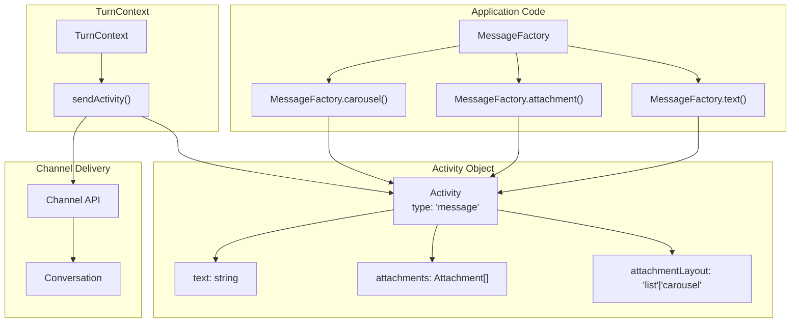
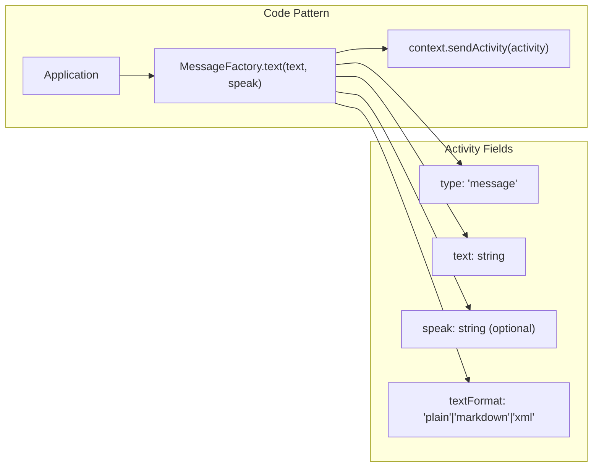
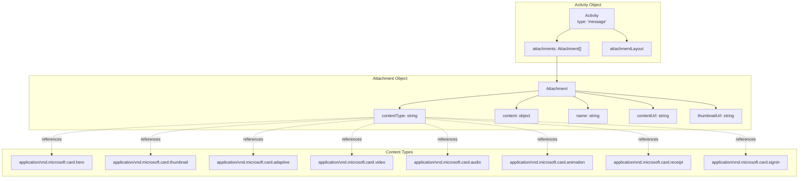
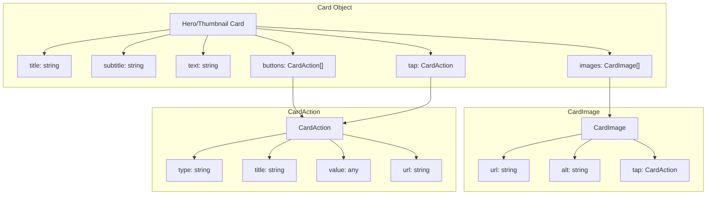
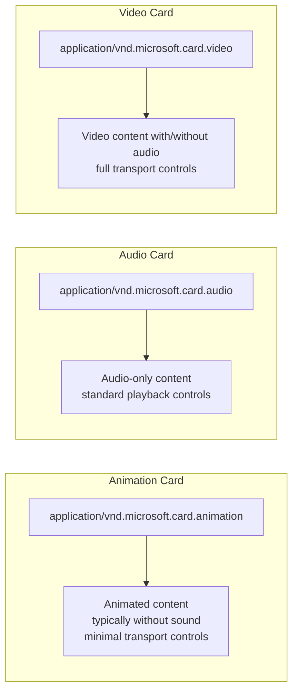
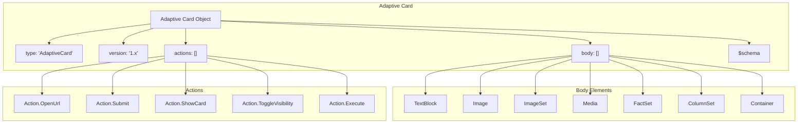
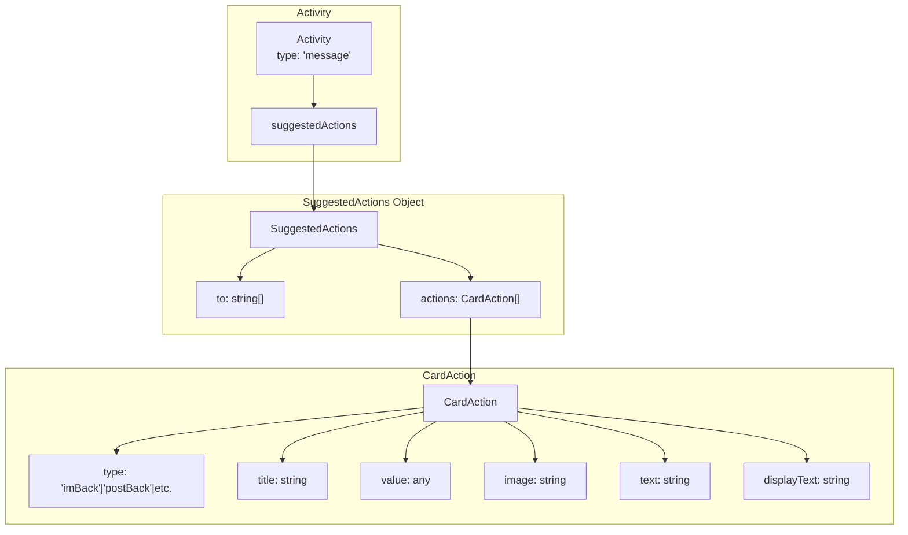

<!-- source: DeepWiki mcp.deepwiki.com · repo microsoft/Agents · page 2.4 Creating Messages and Cards · fetched 2026-10-26 -->

# Creating Messages and Cards

<details>
<summary>Relevant source files</summary>

The following files were used as context for generating this wiki page:

- [samples/nodejs/cards/env.TEMPLATE](samples/nodejs/cards/env.TEMPLATE)
- [samples/nodejs/copilotstudio-skill/env.TEMPLATE](samples/nodejs/copilotstudio-skill/env.TEMPLATE)
- [samples/nodejs/copilotstudio-skill/package-lock.json](samples/nodejs/copilotstudio-skill/package-lock.json)
- [samples/nodejs/copilotstudio-skill/package.json](samples/nodejs/copilotstudio-skill/package.json)
- [samples/nodejs/copilotstudio-skill/src/agent.ts](samples/nodejs/copilotstudio-skill/src/agent.ts)
- [samples/nodejs/multi-turn-prompt/env.TEMPLATE](samples/nodejs/multi-turn-prompt/env.TEMPLATE)
- [samples/nodejs/obo-authorization/env.TEMPLATE](samples/nodejs/obo-authorization/env.TEMPLATE)
- [samples/nodejs/obo-authorization/src/index.ts](samples/nodejs/obo-authorization/src/index.ts)
- [specs/activity/protocol-activity.md](specs/activity/protocol-activity.md)
- [specs/activity/protocol-cards.md](specs/activity/protocol-cards.md)
- [specs/channel-api/ChannelAPI-OpenAPI.yaml](specs/channel-api/ChannelAPI-OpenAPI.yaml)
- [specs/channel-api/TokenAPI-OpenAPI.yaml](specs/channel-api/TokenAPI-OpenAPI.yaml)
- [specs/manifest/bot-manifest.md](specs/manifest/bot-manifest.md)
- [specs/manifest/example.man](specs/manifest/example.man)
- [specs/manifest/manifest.json](specs/manifest/manifest.json)
- [specs/manifest/schemas/SchemaManifestTests/SchemaManifestTests.csproj](specs/manifest/schemas/SchemaManifestTests/SchemaManifestTests.csproj)
- [specs/manifest/schemas/SchemaManifestTests/SchemaManifestTests.sln](specs/manifest/schemas/SchemaManifestTests/SchemaManifestTests.sln)
- [specs/manifest/schemas/SchemaManifestTests/ValidateSchemaTests.cs](specs/manifest/schemas/SchemaManifestTests/ValidateSchemaTests.cs)
- [specs/manifest/schemas/readme.md](specs/manifest/schemas/readme.md)

</details>


This document explains how to create and send messages using the Microsoft 365 Agents SDK, including text messages, rich cards, and attachments. Messages are sent as Activity objects with type `message` and can contain text content, interactive cards, multimedia, and suggested actions.

For information about streaming responses in real-time, see [Streaming Responses](#2.5). For multi-turn conversation patterns, see [Multi-turn Dialogs](#2.6).

## Message Creation Overview

Messages in the Agents SDK are created using the `MessageFactory` helper class (or equivalent in each language) and sent via the `TurnContext.sendActivity()` method. The underlying protocol is defined by the Activity Protocol, which represents messages as Activity objects with `type: "message"`.

### Message Creation and Delivery Flow



**Sources:** [specs/activity/protocol-activity.md:335-485](), [samples/nodejs/copilotstudio-skill/src/agent.ts:1-26]()

## Basic Text Messages

The simplest message type contains only text content. The `MessageFactory.text()` method creates a text-only message activity.

### Creating Text Messages



**Example Usage:**

The quickstart samples demonstrate basic text message creation:

[samples/nodejs/copilotstudio-skill/src/agent.ts:9-10]()
```typescript
const welcomeText = `Hello from echo bot, running on version ${pjson.version}`
await context.sendActivity(MessageFactory.text(welcomeText, welcomeText))
```

[samples/nodejs/copilotstudio-skill/src/agent.ts:14-16]()
```typescript
const text = context.activity.text
const replyText = `Echo: ${text}`
await context.sendActivity(MessageFactory.text(replyText, replyText))
```

**Sources:** [samples/nodejs/copilotstudio-skill/src/agent.ts:1-26](), [samples/nodejs/obo-authorization/src/index.ts:22-45](), [specs/activity/protocol-activity.md:335-369]()

## Message Properties

Message activities support various properties to control formatting, speech synthesis, and user input expectations.

### Message Property Mapping

| Property | Type | Purpose | Default |
|----------|------|---------|---------|
| `text` | string | Text content for display | - |
| `textFormat` | string | Format type: `plain`, `markdown`, `xml` | `plain` |
| `speak` | string | Text-to-speech content (SSML or plain text) | - |
| `locale` | string | IETF BCP-47 language tag | - |
| `inputHint` | string | Expected input state: `accepting`, `expecting`, `ignoring` | `accepting` |
| `summary` | string | Fallback text for channels that don't support attachments | - |
| `importance` | string | Message priority: `low`, `normal`, `high` | `normal` |
| `expiration` | string | ISO 8601 timestamp for message expiration | - |

**Sources:** [specs/activity/protocol-activity.md:341-462]()

### Text Formatting

The `textFormat` field controls how the `text` field is interpreted:

- **`plain`**: Plain text without formatting (default)
- **`markdown`**: Markdown-formatted text with emphasis, lists, links, etc.
- **`xml`**: XML-formatted text (channel-specific support)

Channels that support markdown will render formatting appropriately and gracefully degrade on channels that don't support it.

**Sources:** [specs/activity/protocol-activity.md:349-369]()

### Speech Synthesis

The `speak` field provides content for text-to-speech systems using either plain text or SSML (Speech Synthesis Markup Language). When present, it replaces default speech rendering of the `text` field.

```typescript
// Example with speak field
await context.sendActivity({
  type: 'message',
  text: 'Hello!',
  speak: '<speak>Hello <emphasis>there</emphasis>!</speak>'
})
```

**Sources:** [specs/activity/protocol-activity.md:377-391]()

### Input Hints

The `inputHint` field indicates whether the agent expects user input:

- **`accepting`** (default): Agent is ready to accept input
- **`expecting`**: Agent is actively waiting for input (may display visual indicators)
- **`ignoring`**: Agent is not expecting input (may disable input controls)

Input hints are primarily used in channels with modal interfaces like voice assistants.

**Sources:** [specs/activity/protocol-activity.md:391-401]()

## Attachments and Cards

Attachments enable rich content delivery including cards, images, files, and multimedia. Each attachment has a `contentType` that identifies its format and a `content` object containing the attachment data.

### Attachment Structure



**Attachment Fields:**

| Field | Type | Description |
|-------|------|-------------|
| `contentType` | string | MIME type or card type identifier |
| `content` | object | The card or content object |
| `contentUrl` | string | URL to downloadable content |
| `name` | string | Name of the attachment |
| `thumbnailUrl` | string | URL to thumbnail image |

**Sources:** [specs/activity/protocol-activity.md:401-412](), [specs/activity/protocol-cards.md:1-52]()

### Attachment Layout

The `attachmentLayout` field controls how multiple attachments are displayed:

- **`list`** (default): Attachments displayed vertically in sequence
- **`carousel`**: Attachments displayed horizontally, allowing users to swipe/navigate

```typescript
// Carousel layout example
await context.sendActivity({
  type: 'message',
  attachmentLayout: 'carousel',
  attachments: [card1, card2, card3]
})
```

**Sources:** [specs/activity/protocol-activity.md:413-421]()

## Card Types

The Agents SDK supports multiple card types defined by the Activity Protocol Cards specification. Each card type has a specific `contentType` identifier and content schema.

### Card Type Taxonomy

```mermaid
graph TB
    CARDS["Activity Protocol Cards"]
    
    BASIC["Basic Cards"]
    MEDIA["Media Cards"]
    TRANS["Transaction Cards"]
    AUTH["Authentication Cards"]
    ADAPT["Adaptive Cards"]
    
    HERO["Hero Card<br/>application/vnd.microsoft.card.hero"]
    THUMB["Thumbnail Card<br/>application/vnd.microsoft.card.thumbnail"]
    
    VIDEO["Video Card<br/>application/vnd.microsoft.card.video"]
    AUDIO["Audio Card<br/>application/vnd.microsoft.card.audio"]
    ANIM["Animation Card<br/>application/vnd.microsoft.card.animation"]
    
    RECEIPT["Receipt Card<br/>application/vnd.microsoft.card.receipt"]
    SIGNIN["Signin Card<br/>application/vnd.microsoft.card.signin"]
    
    ADAPTIVE["Adaptive Card<br/>application/vnd.microsoft.card.adaptive"]
    
    CARDS --> BASIC
    CARDS --> MEDIA
    CARDS --> TRANS
    CARDS --> AUTH
    CARDS --> ADAPT
    
    BASIC --> HERO
    BASIC --> THUMB
    
    MEDIA --> VIDEO
    MEDIA --> AUDIO
    MEDIA --> ANIM
    
    TRANS --> RECEIPT
    AUTH --> SIGNIN
    
    ADAPT --> ADAPTIVE
```



**Sources:** [specs/activity/protocol-cards.md:1-52](), [specs/activity/protocol-cards.md:149-302]()

## Basic Cards

Basic cards (Hero and Thumbnail) present a combination of text, images, and interactive buttons. They differ primarily in image presentation style.

### Basic Card Structure



### Hero Card vs Thumbnail Card

| Feature | Hero Card | Thumbnail Card |
|---------|-----------|----------------|
| `contentType` | `application/vnd.microsoft.card.hero` | `application/vnd.microsoft.card.thumbnail` |
| Image Display | Large banner format | Small thumbnail format |
| Image Position | Prominent, typically full-width | Typically alongside text |
| Common Usage | Feature highlights, promotions | List items, compact displays |

**Common Fields:**

- **`title`**: Card title (string)
- **`subtitle`**: Card subtitle (string)
- **`text`**: Card body text (string)
- **`images`**: Array of `CardImage` objects
- **`buttons`**: Array of `CardAction` objects (interactive buttons)
- **`tap`**: `CardAction` triggered when card body is tapped

**Sources:** [specs/activity/protocol-cards.md:149-187]()

### Card Buttons (CardAction)

Buttons on cards are represented as `CardAction` objects with various action types:

| Action Type | Description | Uses `value` | Uses `url` |
|-------------|-------------|--------------|------------|
| `openUrl` | Opens a URL in browser | - | Yes |
| `imBack` | Sends message to bot (visible to user) | Yes | - |
| `postBack` | Sends message to bot (hidden from user) | Yes | - |
| `call` | Initiates phone call | - | Yes (tel: URL) |
| `playAudio` | Plays audio | - | Yes |
| `playVideo` | Plays video | - | Yes |
| `showImage` | Displays image | - | Yes |
| `downloadFile` | Downloads file | - | Yes |
| `signin` | Initiates OAuth sign-in flow | Yes | Yes |
| `messageBack` | Sends message with display text | Yes (object) | - |

**Sources:** [specs/activity/protocol-cards.md:129-144]()

## Media Cards

Media cards (Animation, Audio, Video) deliver rich multimedia content with playback controls.

### Media Card Properties

All media cards share these common properties:

| Property | Type | Description |
|----------|------|-------------|
| `title` | string | Media title |
| `subtitle` | string | Media subtitle |
| `text` | string | Descriptive text |
| `image` | object | Placeholder thumbnail with `url` field |
| `media` | array | Array of media source objects with `url` and `profile` fields |
| `buttons` | array | Interactive buttons (should not include playback controls) |
| `autoloop` | boolean | Whether to automatically restart (default: `true`) |
| `autostart` | boolean | Whether to start playing automatically (default: `true`) |
| `shareable` | boolean | Whether content can be shared (default: `true`) |
| `duration` | string | ISO 8601 duration format (e.g., "PT1M30S") |
| `aspect` | string | Aspect ratio: `16:9` or `4:3` |
| `value` | object | Programmatic payload |

### Media Card Types



**Animation Card** (`application/vnd.microsoft.card.animation`):
- Optimized for animated GIFs, short loops, visual effects
- Minimal or no transport controls
- Typically silent content

**Audio Card** (`application/vnd.microsoft.card.audio`):
- Audio-only content
- Should not contain video in the `media` array
- Standard audio playback controls

**Video Card** (`application/vnd.microsoft.card.video`):
- Video content with optional audio
- Full transport controls (play/pause/seek/volume)
- May include subtitles or captions

**Sources:** [specs/activity/protocol-cards.md:186-302]()

## Transaction and Authentication Cards

### Receipt Card

Receipt cards display purchase receipts or invoices with itemized lists and totals.

**Content Type:** `application/vnd.microsoft.card.receipt`

**Key Fields:**

| Field | Type | Description |
|-------|------|-------------|
| `title` | string | Receipt title |
| `facts` | array | Key-value pairs (e.g., Order ID, Date) |
| `items` | array | Line items with title, subtitle, text, image, price |
| `tap` | object | Action when card is tapped |
| `total` | string | Total amount |
| `tax` | string | Tax amount |
| `vat` | string | VAT amount |
| `buttons` | array | Action buttons |

The `items` array contains `receiptItem` objects, and `facts` contains simple key-value pairs for metadata display.

**Sources:** [specs/activity/protocol-cards.md:302-360]()

### Signin Card

Signin cards prompt users to authenticate via OAuth or other authentication mechanisms.

**Content Type:** `application/vnd.microsoft.card.signin`

**Key Fields:**

| Field | Type | Description |
|-------|------|-------------|
| `text` | string | Description text prompting sign-in |
| `buttons` | array | Sign-in buttons (typically one with `signin` action type) |

The button's action should have `type: "signin"` with the authentication URL in the `value` field.

**Sources:** [specs/activity/protocol-cards.md:360-400]()

## Adaptive Cards

Adaptive Cards are cross-platform, templated cards with advanced layout and interactive capabilities. They use their own schema defined at [adaptivecards.io](https://adaptivecards.io).

**Content Type:** `application/vnd.microsoft.card.adaptive`

Adaptive Cards are the recommended format for new card content due to their flexibility and broad platform support.

### Adaptive Card Structure



Adaptive Cards support:
- Flexible layout with containers, columns, and factsets
- Rich text with markdown
- Image galleries and media
- Input controls (text, number, date, toggle, choice sets)
- Multiple action types
- Conditional visibility and data binding
- Templating with data separation

**Sources:** [specs/activity/protocol-cards.md:36-42](), [specs/activity/protocol-activity.md:52]()

## Suggested Actions

Suggested actions provide quick-reply buttons that appear temporarily in the conversation, typically disappearing after selection.

### Suggested Actions Structure



**Fields:**

- **`to`**: Array of recipient IDs (optional, for targeting specific users)
- **`actions`**: Array of `CardAction` objects representing the quick-reply buttons

Suggested actions differ from card buttons in that they:
- Appear in a dedicated suggested actions area (not part of message content)
- Typically disappear after user selects one
- Are channel-dependent in behavior and appearance

**Example:**

```typescript
await context.sendActivity({
  type: 'message',
  text: 'What would you like to do?',
  suggestedActions: {
    actions: [
      { type: 'imBack', title: 'Option 1', value: 'option1' },
      { type: 'imBack', title: 'Option 2', value: 'option2' },
      { type: 'imBack', title: 'Option 3', value: 'option3' }
    ]
  }
})
```

**Sources:** [specs/activity/protocol-activity.md:431-433]()

## Message Expiration and Importance

### Message Expiration

The `expiration` field specifies when a message should be considered expired and should not be displayed. The value is an ISO 8601 datetime in UTC.

```typescript
// Message expires in 1 hour
const expirationTime = new Date(Date.now() + 3600000).toISOString()
await context.sendActivity({
  type: 'message',
  text: 'This offer expires soon!',
  expiration: expirationTime
})
```

Channels may hide or remove expired messages from conversation history.

**Sources:** [specs/activity/protocol-activity.md:445-450]()

### Message Importance

The `importance` field indicates message priority: `low`, `normal`, or `high` (default: `normal`). Channels may use this to adjust visual presentation or notification behavior.

```typescript
await context.sendActivity({
  type: 'message',
  text: 'Critical system alert',
  importance: 'high'
})
```

**Sources:** [specs/activity/protocol-activity.md:451-458]()

## Summary

Creating messages and cards in the Microsoft 365 Agents SDK involves:

1. **MessageFactory** for creating Activity objects with message content
2. **Activity properties** (`text`, `textFormat`, `speak`, `inputHint`, etc.) for controlling message behavior
3. **Attachments** array for delivering cards and rich content
4. **Card types** (Hero, Thumbnail, Media, Receipt, Signin, Adaptive) each with specific `contentType` and content schema
5. **CardAction objects** for interactive buttons with various action types
6. **SuggestedActions** for quick-reply buttons
7. **TurnContext.sendActivity()** for delivering messages to the channel

All message and card structures adhere to the Activity Protocol specification, ensuring consistent behavior across Microsoft 365 Copilot, Teams, and web channels.

**Sources:** [specs/activity/protocol-activity.md:335-485](), [specs/activity/protocol-cards.md:1-400](), [samples/nodejs/copilotstudio-skill/src/agent.ts:1-26]()

---

