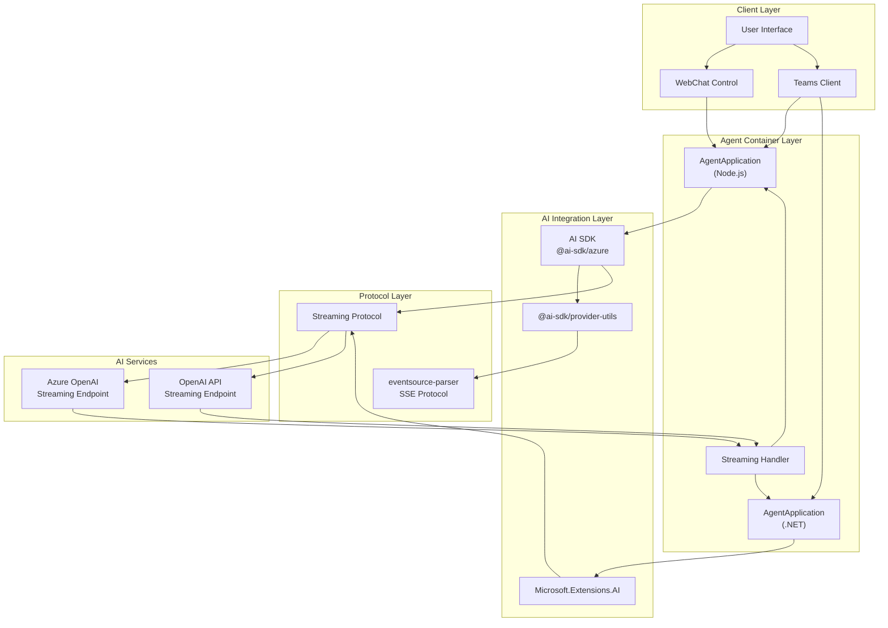
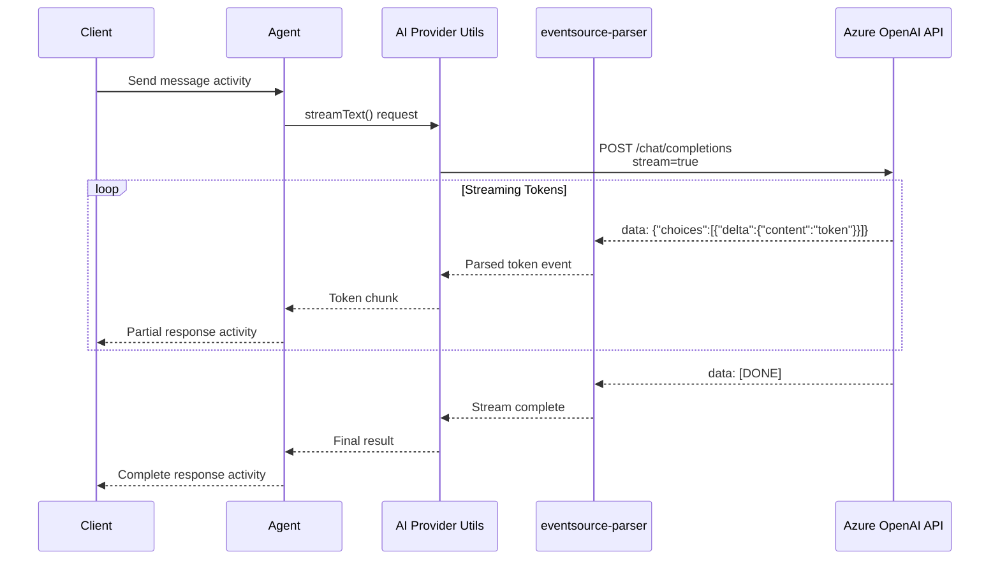
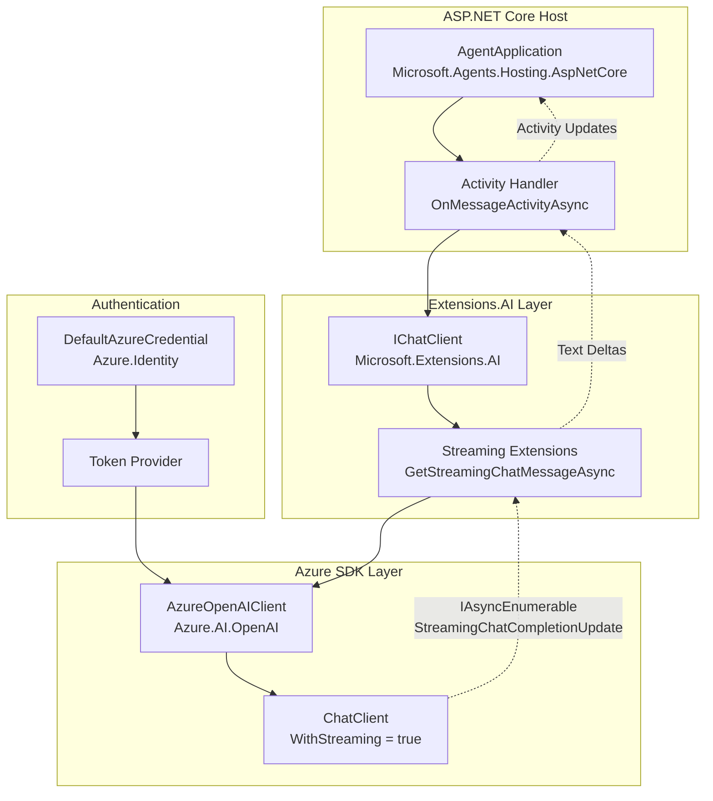
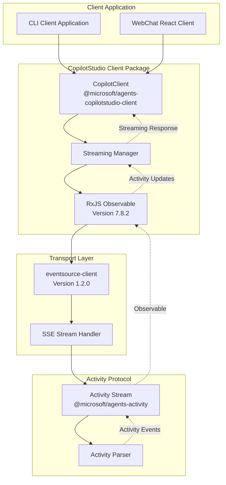
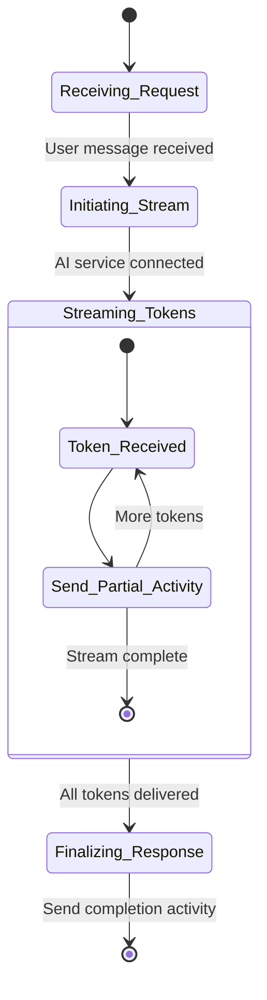
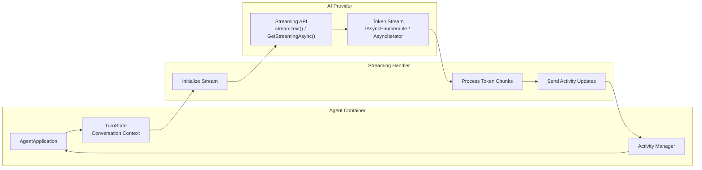

<!-- source: DeepWiki mcp.deepwiki.com · repo microsoft/Agents · page 2.5 Streaming Responses · fetched 2026-10-26 -->

# Streaming Responses

<details>
<summary>Relevant source files</summary>

The following files were used as context for generating this wiki page:

- [.github/scripts/updatenode.sh](.github/scripts/updatenode.sh)
- [samples/dotnet/Agent Framework/AgentFrameworkWeather.csproj](samples/dotnet/Agent Framework/AgentFrameworkWeather.csproj)
- [samples/dotnet/GenesysHandoff/GenesysHandoff.csproj](samples/dotnet/GenesysHandoff/GenesysHandoff.csproj)
- [samples/dotnet/RetrievalBot/RetrievalBot.csproj](samples/dotnet/RetrievalBot/RetrievalBot.csproj)
- [samples/dotnet/auto-signin/AutoSignIn.csproj](samples/dotnet/auto-signin/AutoSignIn.csproj)
- [samples/dotnet/azure-ai-streaming/StreamingMessageAgent.csproj](samples/dotnet/azure-ai-streaming/StreamingMessageAgent.csproj)
- [samples/dotnet/copilotstudio-client/CopilotStudioClient.csproj](samples/dotnet/copilotstudio-client/CopilotStudioClient.csproj)
- [samples/dotnet/copilotstudio-skill/CopilotStudioEchoSkill.csproj](samples/dotnet/copilotstudio-skill/CopilotStudioEchoSkill.csproj)
- [samples/dotnet/obo-authorization/OBOAuthorization.csproj](samples/dotnet/obo-authorization/OBOAuthorization.csproj)
- [samples/dotnet/quickstart/QuickStart.csproj](samples/dotnet/quickstart/QuickStart.csproj)
- [samples/dotnet/semantic-kernel-multiturn/SemanticKernelMultiturn.csproj](samples/dotnet/semantic-kernel-multiturn/SemanticKernelMultiturn.csproj)
- [samples/nodejs/auto-signin/package-lock.json](samples/nodejs/auto-signin/package-lock.json)
- [samples/nodejs/azure-ai-streaming/package-lock.json](samples/nodejs/azure-ai-streaming/package-lock.json)
- [samples/nodejs/cards/package-lock.json](samples/nodejs/cards/package-lock.json)
- [samples/nodejs/copilotstudio-client/package-lock.json](samples/nodejs/copilotstudio-client/package-lock.json)
- [samples/nodejs/copilotstudio-webchat-react/package-lock.json](samples/nodejs/copilotstudio-webchat-react/package-lock.json)
- [samples/nodejs/langchain-multiturn/package-lock.json](samples/nodejs/langchain-multiturn/package-lock.json)
- [samples/nodejs/multi-turn-prompt/package-lock.json](samples/nodejs/multi-turn-prompt/package-lock.json)
- [samples/nodejs/obo-authorization/package-lock.json](samples/nodejs/obo-authorization/package-lock.json)
- [samples/nodejs/quickstart/package-lock.json](samples/nodejs/quickstart/package-lock.json)

</details>


## Purpose and Scope

This document describes the streaming response architecture in the Microsoft 365 Agents SDK, which enables real-time AI-powered responses delivered incrementally to users. Streaming allows agents to send partial responses as they are generated, providing a more responsive user experience for AI-powered interactions.

For information about multi-turn conversation patterns and dialog management, see [Multi-turn Dialogs](#2.6). For general message creation and sending, see [Creating Messages and Cards](#2.4). For AI service integration patterns, see [AI Services Integration](#5.4).

## Streaming Architecture Overview

The SDK supports streaming responses through integration with AI providers that implement Server-Sent Events (SSE) protocol. Streaming enables tokens to be delivered progressively as the AI model generates them, rather than waiting for the complete response.

The streaming architecture consists of three primary layers:



**Sources:** [samples/nodejs/azure-ai-streaming/package-lock.json:1-679](), [samples/dotnet/azure-ai-streaming/StreamingMessageAgent.csproj:1-18](), [samples/dotnet/Agent Framework/AgentFrameworkWeather.csproj:10-12]()

## Server-Sent Events Protocol

Streaming responses use the Server-Sent Events (SSE) protocol to deliver incremental updates from AI services to the agent container. The `eventsource-parser` package (v3.0.6) handles parsing SSE streams in Node.js implementations.



The protocol layer ensures proper handling of:
- Incremental token delivery via `data:` prefixed lines
- Connection keep-alive with periodic heartbeats
- Error propagation through SSE error events
- Stream termination with `[DONE]` marker

**Sources:** [samples/nodejs/azure-ai-streaming/package-lock.json:672-679](), [samples/nodejs/azure-ai-streaming/package-lock.json:75-90]()

## Node.js Streaming Implementation

Node.js agents implement streaming through the AI SDK (`ai` package v5.0.52) with Azure provider integration (`@ai-sdk/azure` v2.0.30).

### Key Dependencies

| Package | Version | Purpose |
|---------|---------|---------|
| `ai` | 5.0.52 | Core AI SDK with streaming abstractions |
| `@ai-sdk/azure` | 2.0.30 | Azure OpenAI provider implementation |
| `@ai-sdk/provider` | 2.0.0 | Provider interface definitions |
| `@ai-sdk/provider-utils` | 3.0.9 | Utility functions including SSE parsing |
| `eventsource-parser` | 3.0.6 | SSE protocol parser |

### Streaming Flow in Node.js

```mermaid
graph LR
    subgraph "Agent Application"
        TURN_CONTEXT["TurnContext<br/>context.activity"]
        STREAM_HANDLER["Streaming<br/>Activity Handler"]
    end
    
    subgraph "AI SDK Layer"
        AI_STREAM["streamText()<br/>from 'ai' package"]
        AZURE_PROVIDER["createAzure()<br/>@ai-sdk/azure"]
        OPENAI_PROVIDER["@ai-sdk/openai"]
    end
    
    subgraph "Provider Utils"
        PROVIDER_UTILS["@ai-sdk/provider-utils<br/>Version 3.0.9"]
        EVENT_PARSER["eventsource-parser<br/>parseStream()"]
    end
    
    subgraph "Backend Services"
        AZURE_API["Azure.AI.OpenAI<br/>Streaming API"]
    end
    
    TURN_CONTEXT --> STREAM_HANDLER
    STREAM_HANDLER --> AI_STREAM
    AI_STREAM --> AZURE_PROVIDER
    AZURE_PROVIDER --> OPENAI_PROVIDER
    OPENAI_PROVIDER --> PROVIDER_UTILS
    PROVIDER_UTILS --> EVENT_PARSER
    EVENT_PARSER --> AZURE_API
    
    AZURE_API -.Token Stream.-> EVENT_PARSER
    EVENT_PARSER -.Parsed Events.-> PROVIDER_UTILS
    PROVIDER_UTILS -.Text Chunks.-> AI_STREAM
    AI_STREAM -.Streaming Updates.-> STREAM_HANDLER
    STREAM_HANDLER -.Activity Updates.-> TURN_CONTEXT
```



The Node.js implementation uses async iterators to consume streaming responses:

```typescript
// Conceptual flow - actual implementation in samples
const stream = await streamText({
  model: azure('gpt-4'),
  messages: conversationHistory
});

for await (const chunk of stream.textStream) {
  // Send partial response to client
  await context.sendActivity({
    type: 'message',
    text: chunk
  });
}
```

**Sources:** [samples/nodejs/azure-ai-streaming/package-lock.json:401-418](), [samples/nodejs/azure-ai-streaming/package-lock.json:17-32](), [samples/nodejs/azure-ai-streaming/package-lock.json:49-63](), [samples/nodejs/azure-ai-streaming/package-lock.json:64-90]()

## .NET Streaming Implementation

.NET agents implement streaming through `Microsoft.Extensions.AI.OpenAI` (v9.10.0-preview.1.25513.3) with Azure OpenAI integration (`Azure.AI.OpenAI` v2.1.0).

### Key Dependencies

| Package | Version | Purpose |
|---------|---------|---------|
| `Microsoft.Extensions.AI.OpenAI` | 9.10.0-preview | Unified AI abstractions with streaming |
| `Azure.AI.OpenAI` | 2.1.0 | Azure OpenAI SDK with streaming support |
| `Azure.Identity` | 1.17.1 | Authentication for Azure services |

### Streaming Configuration

The Agent Framework sample uses conditional compilation to enable streaming:

```xml
<PropertyGroup Condition="'$(Configuration)|$(Platform)'=='Debug|AnyCPU'">
  <DefineConstants>$(DefineConstants);UseStreaming</DefineConstants>
</PropertyGroup>
```

### .NET Streaming Architecture



The .NET implementation uses `IAsyncEnumerable<T>` for consuming streams:

```csharp
// Conceptual flow - actual implementation in samples
await foreach (var update in chatClient.GetStreamingChatMessageAsync(messages))
{
    if (update.ContentUpdate != null)
    {
        // Send partial response
        await turnContext.SendActivityAsync(
            new Activity { Type = ActivityTypes.Message, Text = update.ContentUpdate }
        );
    }
}
```

**Sources:** [samples/dotnet/azure-ai-streaming/StreamingMessageAgent.csproj:10-16](), [samples/dotnet/Agent Framework/AgentFrameworkWeather.csproj:10-12](), [samples/dotnet/Agent Framework/AgentFrameworkWeather.csproj:16-17](), [samples/dotnet/semantic-kernel-multiturn/SemanticKernelMultiturn.csproj:20-24]()

## Copilot Studio Streaming Integration

The `@microsoft/agents-copilotstudio-client` package (v1.1.1) provides streaming support for Copilot Studio agent communication using `eventsource-client` (v1.2.0) and RxJS observables (v7.8.2).



The client package supports streaming through RxJS observables, allowing reactive consumption of activity streams from Copilot Studio agents.

**Sources:** [samples/nodejs/copilotstudio-client/package-lock.json:70-84](), [samples/nodejs/copilotstudio-webchat-react/package-lock.json:1-27]()

## Streaming Response Patterns

### Progressive Token Delivery

Streaming enables progressive delivery of AI-generated content, providing immediate feedback to users:



### Error Handling in Streams

Streaming implementations must handle connection interruptions, timeout scenarios, and partial failures:

- **Connection Loss**: Gracefully terminate stream and send error activity
- **Timeout**: Apply timeouts to prevent indefinite waiting
- **Partial Response**: Preserve already-delivered tokens even if stream fails
- **Retry Logic**: Implement retry with exponential backoff for transient failures

**Sources:** [samples/nodejs/azure-ai-streaming/package-lock.json:75-90](), [samples/dotnet/azure-ai-streaming/StreamingMessageAgent.csproj:1-18]()

## Sample Implementations

### Node.js Azure AI Streaming Sample

Located at [samples/nodejs/azure-ai-streaming](), this sample demonstrates:
- Integration with `@ai-sdk/azure` provider
- Token-by-token streaming to clients
- Error handling and stream completion
- Environment configuration for Azure OpenAI endpoints

Key dependencies installed via [samples/nodejs/azure-ai-streaming/package-lock.json:6-11]():
- `@ai-sdk/azure` ^2.0.30
- `@microsoft/agents-hosting-express` ^1.1.0
- `ai` ^5.0.52

### .NET Azure AI Streaming Sample

Located at [samples/dotnet/azure-ai-streaming](), this sample demonstrates:
- Integration with `Microsoft.Extensions.AI.OpenAI`
- Async enumerable streaming pattern
- Azure identity-based authentication
- ASP.NET Core hosting integration

Key dependencies from [samples/dotnet/azure-ai-streaming/StreamingMessageAgent.csproj:10-16]():
- `Microsoft.Extensions.AI.OpenAI` 9.1.0-preview.1.25064.3
- `Azure.AI.OpenAI` 2.1.0
- `Azure.Identity` 1.17.1

### Agent Framework with Streaming

The Agent Framework sample at [samples/dotnet/Agent Framework]() includes conditional streaming support enabled through the `UseStreaming` compilation symbol defined in [samples/dotnet/Agent Framework/AgentFrameworkWeather.csproj:10-12]().

This demonstrates:
- Conditional compilation for streaming features
- Integration with Semantic Kernel streaming capabilities
- Weather agent with real-time AI responses

**Sources:** [samples/nodejs/azure-ai-streaming/package-lock.json:1-16](), [samples/dotnet/azure-ai-streaming/StreamingMessageAgent.csproj:1-18](), [samples/dotnet/Agent Framework/AgentFrameworkWeather.csproj:10-23]()

## Integration with Agent Container

Streaming responses integrate with the core `AgentApplication` class from `@microsoft/agents-hosting` (Node.js) or `Microsoft.Agents.Hosting.AspNetCore` (.NET):



The agent container manages streaming lifecycle:
1. **Initialization**: Configure streaming options in `AgentApplicationOptions`
2. **Turn Processing**: Begin stream on incoming message activity
3. **Token Handling**: Process tokens and create partial activities
4. **Completion**: Finalize response and update conversation state

**Sources:** [samples/nodejs/azure-ai-streaming/package-lock.json:190-207](), [samples/dotnet/azure-ai-streaming/StreamingMessageAgent.csproj:14-16]()

---

