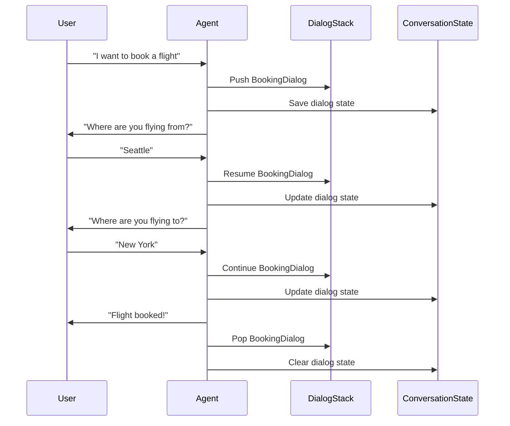
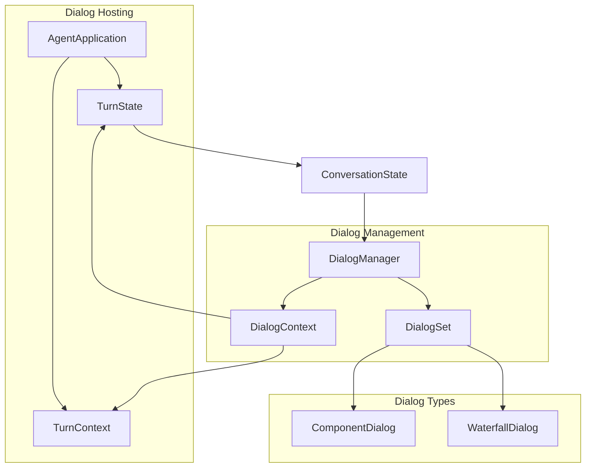
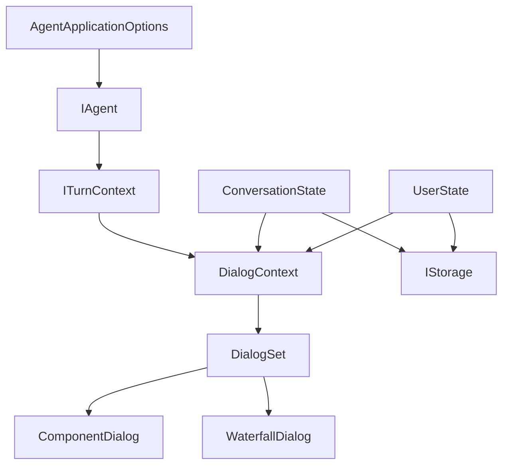
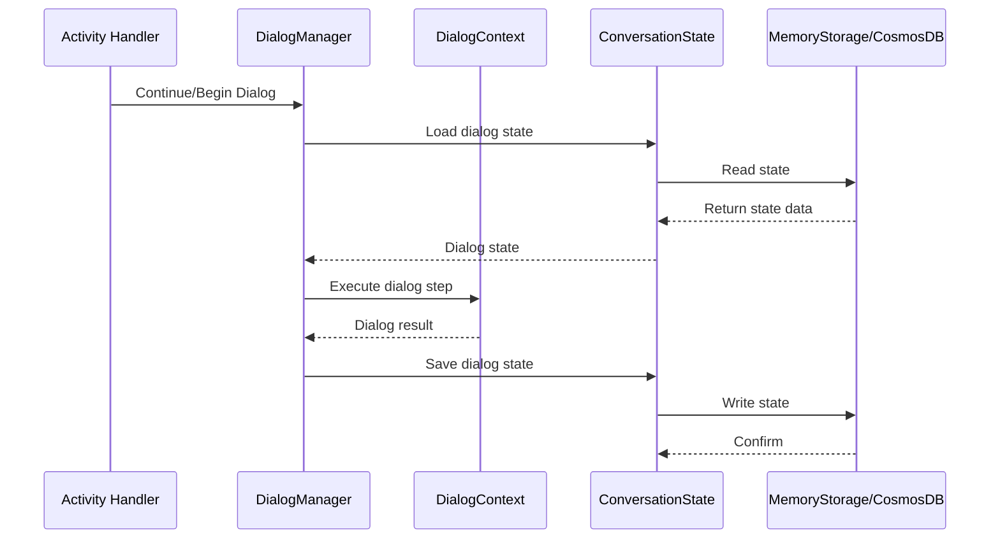
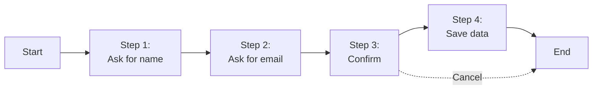
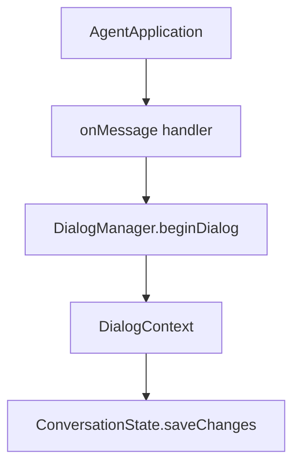
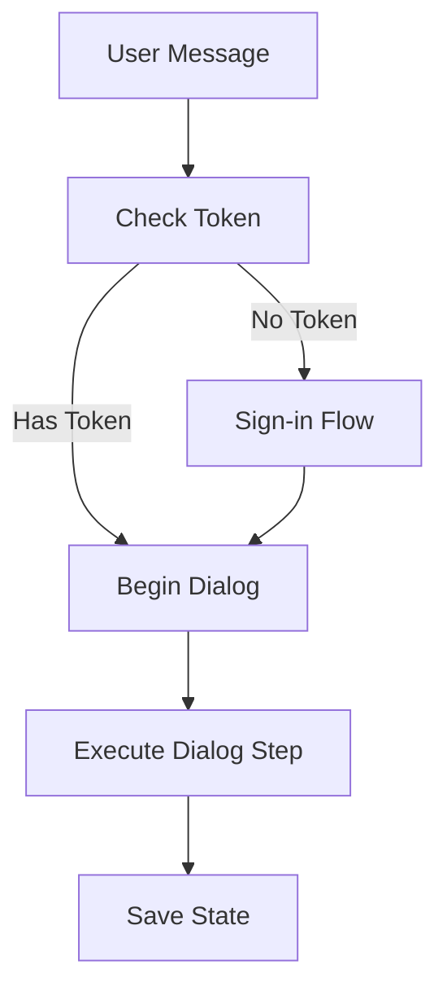
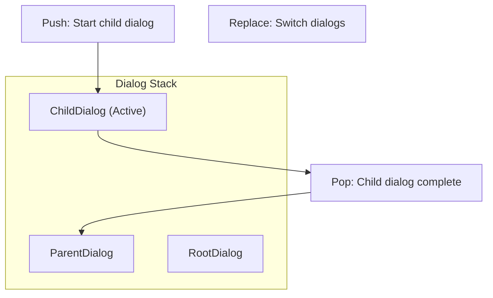
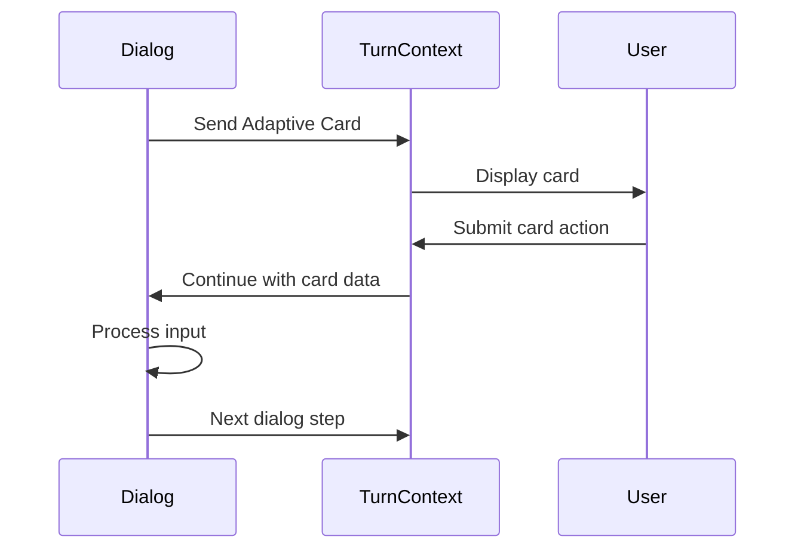

<!-- source: DeepWiki mcp.deepwiki.com · repo microsoft/Agents · page 2.6 Multi-turn Dialogs · fetched 2026-10-26 -->

# Multi-turn Dialogs

Relevant source files

The following files were used as context for generating this wiki page:

- [samples/dotnet/Agent Framework/AgentFrameworkWeather.csproj](samples/dotnet/Agent Framework/AgentFrameworkWeather.csproj)
- [samples/dotnet/GenesysHandoff/GenesysHandoff.csproj](samples/dotnet/GenesysHandoff/GenesysHandoff.csproj)
- [samples/dotnet/RetrievalBot/RetrievalBot.csproj](samples/dotnet/RetrievalBot/RetrievalBot.csproj)
- [samples/dotnet/auto-signin/AutoSignIn.csproj](samples/dotnet/auto-signin/AutoSignIn.csproj)
- [samples/dotnet/azure-ai-streaming/StreamingMessageAgent.csproj](samples/dotnet/azure-ai-streaming/StreamingMessageAgent.csproj)
- [samples/dotnet/copilotstudio-client/CopilotStudioClient.csproj](samples/dotnet/copilotstudio-client/CopilotStudioClient.csproj)
- [samples/dotnet/copilotstudio-skill/CopilotStudioEchoSkill.csproj](samples/dotnet/copilotstudio-skill/CopilotStudioEchoSkill.csproj)
- [samples/dotnet/obo-authorization/OBOAuthorization.csproj](samples/dotnet/obo-authorization/OBOAuthorization.csproj)
- [samples/dotnet/quickstart/QuickStart.csproj](samples/dotnet/quickstart/QuickStart.csproj)
- [samples/dotnet/semantic-kernel-multiturn/SemanticKernelMultiturn.csproj](samples/dotnet/semantic-kernel-multiturn/SemanticKernelMultiturn.csproj)
- [samples/nodejs/cards/env.TEMPLATE](samples/nodejs/cards/env.TEMPLATE)
- [samples/nodejs/copilotstudio-skill/env.TEMPLATE](samples/nodejs/copilotstudio-skill/env.TEMPLATE)
- [samples/nodejs/copilotstudio-skill/package-lock.json](samples/nodejs/copilotstudio-skill/package-lock.json)
- [samples/nodejs/copilotstudio-skill/package.json](samples/nodejs/copilotstudio-skill/package.json)
- [samples/nodejs/copilotstudio-skill/src/agent.ts](samples/nodejs/copilotstudio-skill/src/agent.ts)
- [samples/nodejs/multi-turn-prompt/env.TEMPLATE](samples/nodejs/multi-turn-prompt/env.TEMPLATE)
- [samples/nodejs/obo-authorization/env.TEMPLATE](samples/nodejs/obo-authorization/env.TEMPLATE)
- [samples/nodejs/obo-authorization/src/index.ts](samples/nodejs/obo-authorization/src/index.ts)

This document explains multi-turn conversation patterns and dialog management in the Microsoft Agents SDK. Multi-turn dialogs enable agents to maintain contextual conversations that span multiple message exchanges, such as collecting user information through a series of prompts, guiding users through complex workflows, or managing branching conversation paths.

**Scope**: This page covers dialog state management, dialog flow control, and patterns for implementing multi-turn conversations. For general state management across all activities, see [Managing State](#2.3). For basic message handling and activity processing, see [Activity Processing](#2.2).

## Core Concepts

### Turns vs Dialogs

A **turn** represents a single exchange in a conversation: the user sends a message, the agent processes it, and responds. Each activity received by the agent triggers a new turn.

A **dialog** is a stateful abstraction that spans multiple turns, maintaining context and controlling conversation flow. Dialogs track their position in a conversation sequence and persist state between turns.

**Diagram: Turn-based Dialog Flow**

A dialog maintains its state across these three turns, remembering the departure city while collecting the destination city.

Sources: [samples/nodejs/multi-turn-prompt/env.TEMPLATE:1-10]()

## Dialog Architecture

### Node.js Dialog System

The Node.js SDK provides dialog management through the `@microsoft/agents-hosting-dialogs` package, which builds on top of the core `@microsoft/agents-hosting` package.

**Diagram: Dialog Architecture Components**

Sources: [samples/nodejs/copilotstudio-skill/package-lock.json:118-135](), [samples/nodejs/copilotstudio-skill/src/agent.ts:1-26]()

### .NET Dialog System

The .NET SDK integrates dialogs through the Microsoft.Agents.Hosting.AspNetCore package with support for both legacy Bot Framework dialogs and modern dialog patterns.

**Diagram: .NET Dialog Architecture**

Sources: [samples/dotnet/semantic-kernel-multiturn/SemanticKernelMultiturn.csproj:1-31](), [samples/dotnet/Agent Framework/AgentFrameworkWeather.csproj:1-26]()

## Dialog State Management

### State Scopes

Dialog state is stored in `ConversationState`, which persists data across turns within a conversation. The dialog state is separate from other state scopes:

| State Scope | Lifetime | Purpose |
|-------------|----------|---------|
| `TurnState` | Single turn | Request-scoped data, not persisted |
| `ConversationState` | Entire conversation | Dialog stack, conversation-level data |
| `UserState` | All conversations with user | User preferences, profile data |

### Persisting Dialog State

Dialog state must be explicitly saved at the end of each turn. The `ConversationState` object manages serialization and storage.

**Node.js Pattern:**

**Diagram: Dialog State Persistence Flow**

Sources: [samples/nodejs/obo-authorization/src/index.ts:7-14](), [samples/dotnet/quickstart/QuickStart.csproj:10-12]()

### Storage Implementation

Dialog state is stored using the same storage abstractions as general state management:

- **Development**: `MemoryStorage` - in-memory, non-persistent
- **Production**: `CosmosDB` with blob storage for attachments
- **Custom**: Implement `IStorage` interface

The storage layer automatically handles:
- State serialization/deserialization
- Optimistic concurrency with eTags
- Partition key management

Sources: [samples/nodejs/obo-authorization/src/index.ts:10]()

## Dialog Types

### Component Dialogs

Component dialogs are reusable, self-contained dialog units that encapsulate specific conversation logic. They can contain child dialogs and manage their own dialog state.

**Characteristics:**
- Reusable across different parts of the agent
- Can be nested within other dialogs
- Maintain isolated state
- Define entry points and completion handlers

### Waterfall Dialogs

Waterfall dialogs execute a series of steps sequentially, ideal for linear conversation flows like forms or wizards.

**Diagram: Waterfall Dialog Flow**

Each step:
1. Executes logic (e.g., prompt user)
2. Returns control to the dialog system
3. Waits for user response
4. Continues to next step on next turn

### Prompt Dialogs

Prompt dialogs are specialized dialogs for collecting user input with built-in validation:

- **TextPrompt**: Collects text input
- **NumberPrompt**: Validates numeric input
- **ConfirmPrompt**: Yes/no confirmation
- **ChoicePrompt**: Multiple choice selection
- **DateTimePrompt**: Date/time input with parsing
- **AttachmentPrompt**: File uploads

Sources: [samples/nodejs/multi-turn-prompt/env.TEMPLATE:1-10]()

## Implementing Multi-turn Conversations

### Basic Dialog Pattern (Node.js)

**Diagram: Basic Dialog Implementation**

Implementation steps:
1. Initialize `AgentApplication` with storage
2. Create dialog set and add dialogs
3. In message handler, create dialog context
4. Continue or begin dialog based on state
5. Save conversation state at end of turn

Sources: [samples/nodejs/copilotstudio-skill/src/agent.ts:1-26](), [samples/nodejs/obo-authorization/src/index.ts:7-20]()

### Dialog with Authentication

For dialogs requiring user authentication, integrate with the authorization system:

**Diagram: Authenticated Dialog Flow**

The dialog can access tokens through the `TurnContext` and use them in dialog steps to call protected APIs.

Sources: [samples/nodejs/obo-authorization/src/index.ts:19-20](), [samples/nodejs/obo-authorization/env.TEMPLATE:1-21]()

### Handling Dialog Interruptions

Multi-turn dialogs must handle interruptions like:
- User typing "cancel" or "help"
- Session timeout
- Authentication expiry
- Context switching

**Pattern:**
1. Check for global commands before continuing dialog
2. Implement cancellation handlers
3. Save partial state for resumption
4. Provide clear feedback about dialog state

### Dialog Stack Management

The dialog system maintains a stack of active dialogs. Child dialogs are pushed onto the stack and popped when complete.

**Diagram: Dialog Stack Operations**

Operations:
- **Push**: Start new dialog (child)
- **Pop**: Complete current dialog
- **Replace**: Switch to different dialog
- **Clear**: End all dialogs

Sources: [samples/dotnet/semantic-kernel-multiturn/SemanticKernelMultiturn.csproj:1-31]()

## Integration Patterns

### Dialogs with AI Services

Multi-turn dialogs often integrate with AI services for intelligent conversation management:

**Semantic Kernel Integration (.NET):**
- Use `Microsoft.SemanticKernel.Agents.Core` for AI-powered dialog agents
- Combine dialog state with semantic kernel's conversation history
- Enable LLM-driven dialog branching

Sources: [samples/dotnet/semantic-kernel-multiturn/SemanticKernelMultiturn.csproj:23-25](), [samples/dotnet/RetrievalBot/RetrievalBot.csproj:26-29]()

**Azure AI Integration:**
- Stream AI responses within dialog steps
- Maintain conversation context across AI calls
- Use dialog state to augment AI prompts

Sources: [samples/dotnet/azure-ai-streaming/StreamingMessageAgent.csproj:11-12](), [samples/dotnet/Agent Framework/AgentFrameworkWeather.csproj:16-21]()

### Dialogs with Adaptive Cards

Multi-turn dialogs can present rich UI through Adaptive Cards:

**Diagram: Adaptive Card Dialog Interaction**

The dialog receives card submissions as activity values and processes them as dialog input.

Sources: [samples/dotnet/semantic-kernel-multiturn/SemanticKernelMultiturn.csproj:21](), [samples/dotnet/RetrievalBot/RetrievalBot.csproj:25]()

### Cross-Agent Dialogs

For multi-agent scenarios using Copilot Studio:

- Main agent initiates dialog
- Dialog step invokes skill agent
- Skill agent returns result
- Main agent continues dialog with result

Sources: [samples/dotnet/GenesysHandoff/GenesysHandoff.csproj:12](), [samples/dotnet/copilotstudio-client/CopilotStudioClient.csproj:12]()

## Best Practices

### State Management
- Always save `ConversationState` at the end of each turn
- Use appropriate state scope for data lifetime
- Implement state cleanup for completed dialogs
- Consider state size for serialization performance

### Dialog Design
- Keep individual dialog steps focused and atomic
- Implement timeout handling for long-running dialogs
- Provide clear progress indicators to users
- Allow users to cancel or restart dialogs

### Error Handling
- Implement error dialogs for recoverable failures
- Log dialog state transitions for debugging
- Provide fallback options when dialogs fail
- Clear dialog state on unrecoverable errors

### Testing
- Test dialog flows end-to-end
- Verify state persistence across turns
- Test interruption and cancellation scenarios
- Validate dialog stack operations

Sources: [samples/nodejs/copilotstudio-skill/package-lock.json:118-135](), [samples/dotnet/semantic-kernel-multiturn/SemanticKernelMultiturn.csproj:1-31]()

## Package Dependencies

### Node.js
- `@microsoft/agents-hosting`: Core agent runtime with `TurnContext` and `TurnState`
- `@microsoft/agents-hosting-dialogs`: Dialog management system
- `@microsoft/agents-activity`: Activity protocol types

Sources: [samples/nodejs/copilotstudio-skill/package-lock.json:118-135]()

### .NET
- `Microsoft.Agents.Hosting.AspNetCore`: Core hosting with dialog support
- `Microsoft.Agents.Authentication.Msal`: Authentication for secured dialogs
- `Microsoft.SemanticKernel.Agents.Core`: AI-powered dialog agents (optional)

Sources: [samples/dotnet/semantic-kernel-multiturn/SemanticKernelMultiturn.csproj:26-27](), [samples/dotnet/quickstart/QuickStart.csproj:11-12](), [samples/dotnet/obo-authorization/OBOAuthorization.csproj:10-12]()

---

