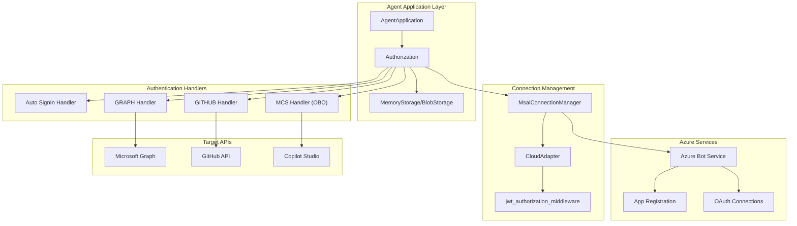
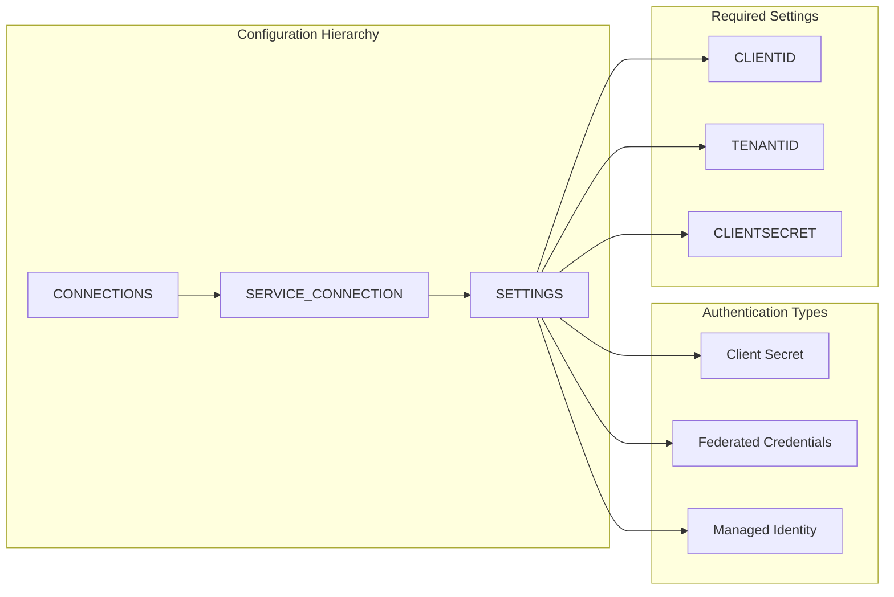
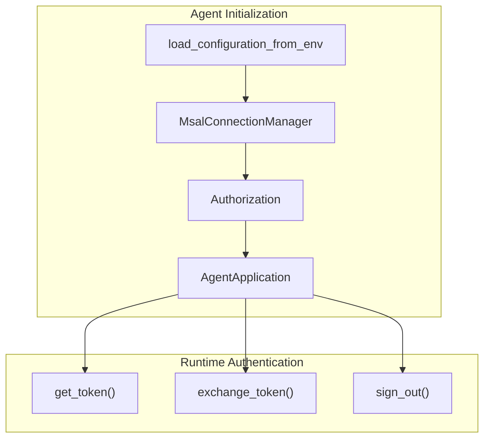
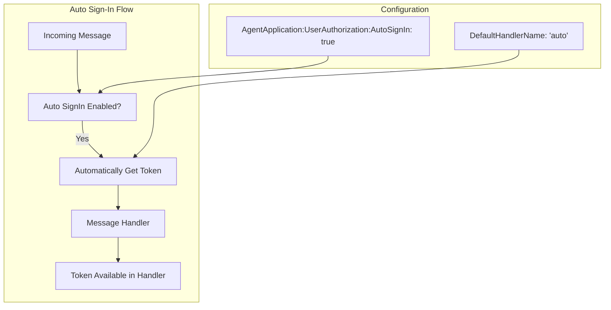
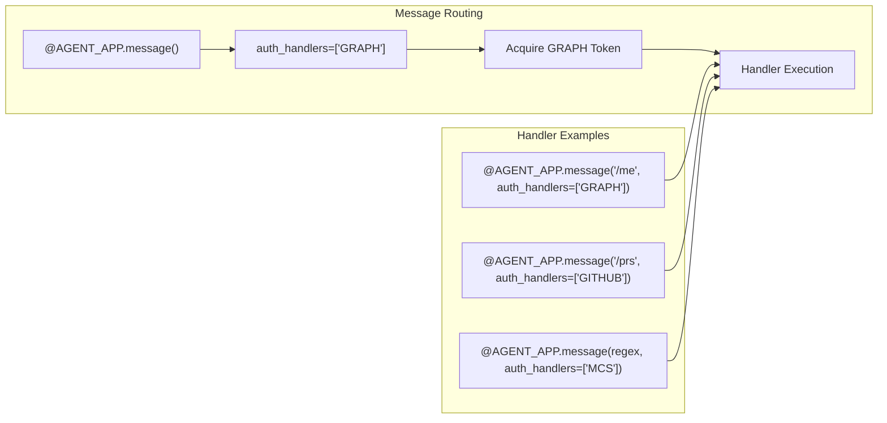
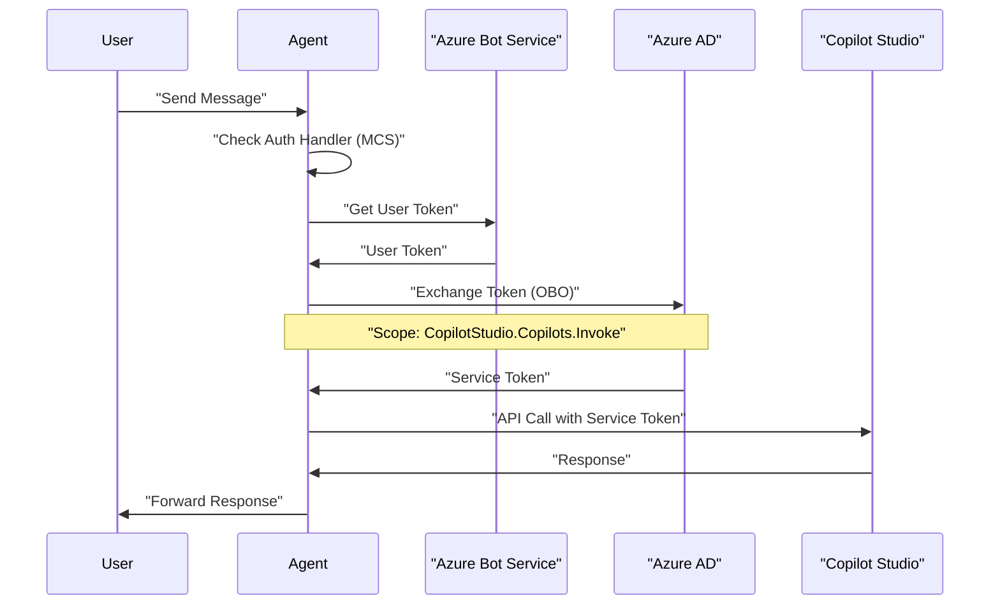
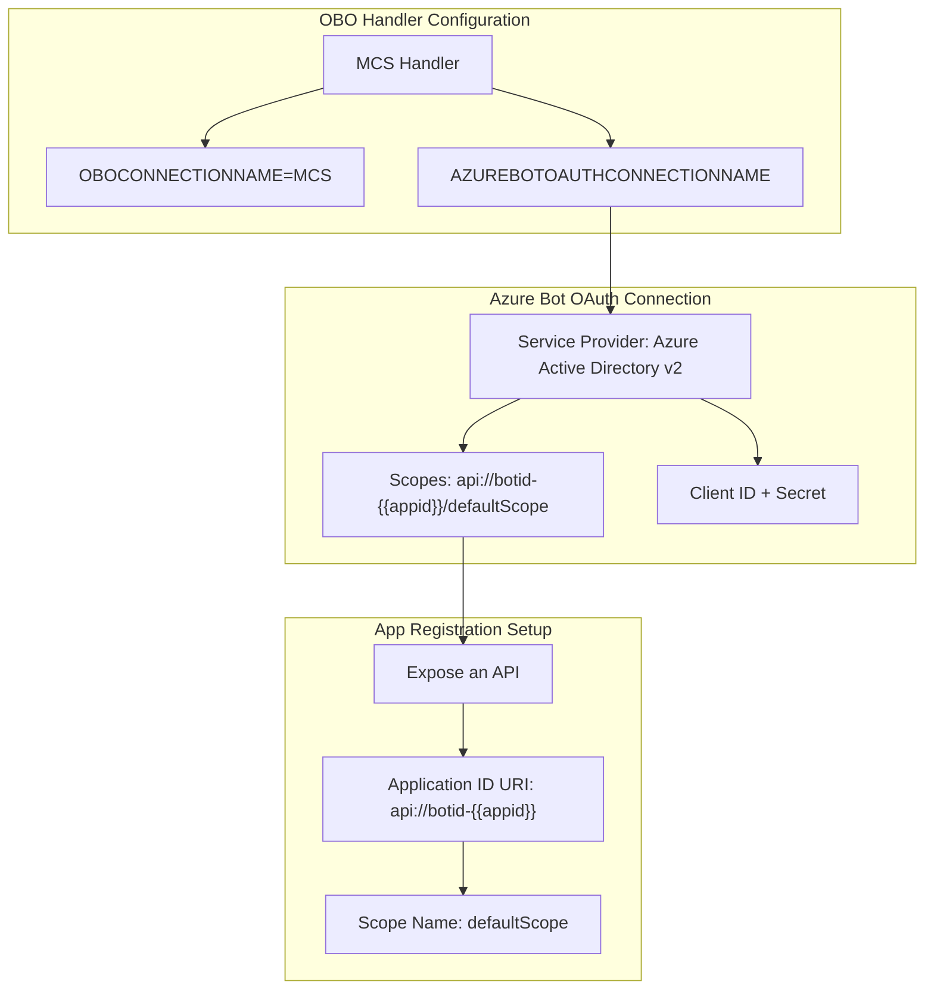
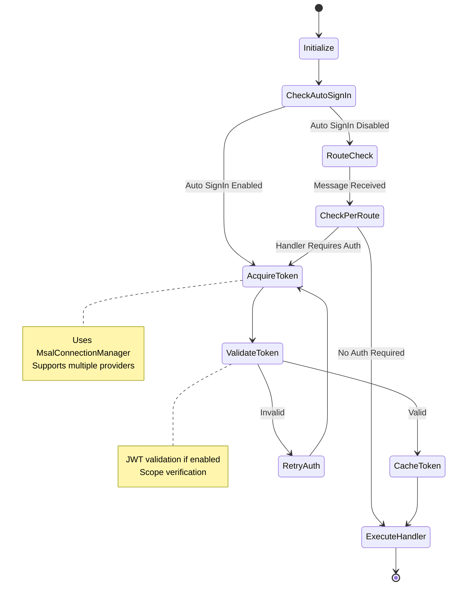

<!-- source: DeepWiki mcp.deepwiki.com · repo microsoft/Agents · page 3 Authentication and Authorization · fetched 2026-10-26 -->

# Authentication

<details>
<summary>Relevant source files</summary>

The following files were used as context for generating this wiki page:

- [.github/scripts/updatenode.sh](.github/scripts/updatenode.sh)
- [AgentErrorCodes.md](AgentErrorCodes.md)
- [samples/nodejs/auto-signin/package-lock.json](samples/nodejs/auto-signin/package-lock.json)
- [samples/nodejs/azure-ai-streaming/package-lock.json](samples/nodejs/azure-ai-streaming/package-lock.json)
- [samples/nodejs/cards/package-lock.json](samples/nodejs/cards/package-lock.json)
- [samples/nodejs/copilotstudio-client/package-lock.json](samples/nodejs/copilotstudio-client/package-lock.json)
- [samples/nodejs/copilotstudio-webchat-react/package-lock.json](samples/nodejs/copilotstudio-webchat-react/package-lock.json)
- [samples/nodejs/langchain-multiturn/package-lock.json](samples/nodejs/langchain-multiturn/package-lock.json)
- [samples/nodejs/multi-turn-prompt/package-lock.json](samples/nodejs/multi-turn-prompt/package-lock.json)
- [samples/nodejs/obo-authorization/package-lock.json](samples/nodejs/obo-authorization/package-lock.json)
- [samples/nodejs/quickstart/package-lock.json](samples/nodejs/quickstart/package-lock.json)

</details>


This document covers authentication and authorization patterns in the Microsoft 365 Agents SDK, including bot service authentication, user OAuth flows, and On-Behalf-Of (OBO) token exchange patterns. 

For information about building agents and message handling, see [Building Agents](#2). For deployment configuration, see [Deployment and Hosting](#4).

## Authentication Architecture Overview

The Microsoft 365 Agents SDK implements a multi-layered authentication system that handles both service authentication (bot-to-service) and user authentication (OAuth flows). The architecture supports multiple authentication handlers, automatic token acquisition, and token exchange patterns.



Sources: [samples/python/obo-authorization/src/agent.py:1-38](), [samples/python/auto-signin/src/agent.py:28-52](), [samples/dotnet/auto-signin/README.md:40-67]()

## Bot Service Authentication

Bot service authentication establishes the identity of the agent itself when communicating with Azure Bot Service and other Microsoft services. This is configured through connection settings that specify client credentials, tenant information, and authentication methods.

### Configuration Structure

The bot authentication configuration uses a hierarchical settings structure for different connection types:



| Setting | Purpose | Example |
|---------|---------|---------|
| `CONNECTIONS__SERVICE_CONNECTION__SETTINGS__CLIENTID` | Application ID from Azure App Registration | `12345678-1234-1234-1234-123456789012` |
| `CONNECTIONS__SERVICE_CONNECTION__SETTINGS__CLIENTSECRET` | Client secret for authentication | `your-secret-value` |
| `CONNECTIONS__SERVICE_CONNECTION__SETTINGS__TENANTID` | Azure Active Directory tenant ID | `87654321-4321-4321-4321-210987654321` |

Sources: [samples/python/obo-authorization/env.TEMPLATE:1-4](), [samples/python/obo-authorization/README.md:27-31]()

### Connection Manager Implementation

The `MsalConnectionManager` handles bot service authentication by managing MSAL (Microsoft Authentication Library) connections and providing authentication configurations to the agent application.



Sources: [samples/python/obo-authorization/src/agent.py:27-38](), [samples/python/auto-signin/src/agent.py:34-52]()

## User Authentication Patterns

User authentication in the SDK supports multiple OAuth providers and authentication flows, including automatic sign-in, per-route authorization, and multi-provider scenarios.

### Auto Sign-In Pattern

Auto sign-in automatically acquires user tokens for all incoming activities when `AutoSignIn` is enabled in the agent configuration. This pattern is useful when agents need the same token for most functionality.



The auto sign-in pattern is configured through agent application settings:

| Setting | Purpose | Value |
|---------|---------|-------|
| `AgentApplication:UserAuthorization:AutoSignIn` | Enable automatic token acquisition | `true` |
| `AgentApplication:UserAuthorization:DefaultHandlerName` | Default auth handler to use | `"auto"` |

Sources: [samples/dotnet/auto-signin/README.md:6-9](), [samples/dotnet/auto-signin/README.md:40-67]()

### Per-Route Authorization

Per-route authorization allows specific message handlers to request authentication with particular OAuth connections. This is implemented using the `auth_handlers` parameter in message decorators.



Implementation example from Python agent:

```python
@AGENT_APP.message(re.compile(r"^/(me|profile)$", re.IGNORECASE), auth_handlers=["GRAPH"])
async def profile_request(context: TurnContext, state: TurnState) -> None:
    user_token_response = await AGENT_APP.auth.get_token(context, "GRAPH")
```

Sources: [samples/python/auto-signin/src/agent.py:80-92](), [samples/python/auto-signin/src/agent.py:95-127]()

### Multi-Provider Authentication

The SDK supports multiple OAuth providers simultaneously, allowing agents to authenticate with different services using separate handlers.

| Handler Name | Provider | Scopes | Purpose |
|--------------|----------|--------|---------|
| `GRAPH` | Microsoft Graph | `User.Read` | User profile and Office 365 data |
| `GITHUB` | GitHub API | `repo, user` | Repository and user data |
| `MCS` | Copilot Studio | `CopilotStudio.Copilots.Invoke` | OBO token exchange |

Sources: [samples/python/auto-signin/src/agent.py:55-72](), [samples/python/obo-authorization/README.md:39-43]()

## On-Behalf-Of (OBO) Authorization

OBO authorization enables token exchange scenarios where an agent receives a user token and exchanges it for tokens to access other services on behalf of the user. This is commonly used for accessing Microsoft Copilot Studio agents and other Microsoft services.

### OBO Flow Architecture



### OBO Configuration

OBO flows require additional OAuth connection setup with specific API permissions and scope configurations.

**Required API Permissions:**
- `Dynamics CRM` with `user_impersonation`
- `Microsoft Graph` with `User.Read`
- `Power Platform API` with `CopilotStudio.Copilots.Invoke`

**Configuration Structure:**



Sources: [samples/python/obo-authorization/README.md:32-68](), [samples/python/obo-authorization/env.TEMPLATE:5-10]()

### OBO Implementation Pattern

The OBO pattern in the SDK uses the `exchange_token` method to convert user tokens into service tokens:

```python
async def get_client(context: TurnContext) -> CopilotClient:
    settings = ConnectionSettings(
        environment_id=environ.get("COPILOTSTUDIOAGENT__ENVIRONMENTID"),
        agent_identifier=environ.get("COPILOTSTUDIOAGENT__SCHEMANAME"),
        cloud=PowerPlatformCloud.PROD
    )
    
    scope = PowerPlatformEnvironment.get_token_audience(settings)
    token_response = await AGENT_APP.auth.exchange_token(context, [scope], "MCS")
    mcs_client = CopilotClient(settings, token_response.token)
    return mcs_client
```

Sources: [samples/python/obo-authorization/src/agent.py:45-61]()

## JWT Token Validation

JWT token validation provides security by verifying incoming tokens from Azure Bot Service. This is typically disabled during local development and enabled in production environments.

### Validation Configuration

```json
{
  "TokenValidation": {
    "Enabled": true,
    "Audiences": ["{{ClientId}}"],
    "TenantId": "{{TenantId}}"
  }
}
```

### Middleware Integration

The Python SDK uses `jwt_authorization_middleware` to handle token validation:

```python
APP = Application(middlewares=[jwt_authorization_middleware])
APP["agent_configuration"] = auth_configuration
```

Sources: [samples/python/obo-authorization/src/start_server.py:22-24](), [samples/dotnet/auto-signin/README.md:117-128]()

## Authentication Handler Lifecycle

The authentication system follows a consistent lifecycle for token acquisition, validation, and management across different authentication patterns.



Sources: [samples/python/auto-signin/src/agent.py:55-139](), [samples/python/obo-authorization/src/agent.py:64-92]()

## Configuration Reference

### Environment Variables

| Variable Pattern | Purpose | Example |
|------------------|---------|---------|
| `CONNECTIONS__SERVICE_CONNECTION__SETTINGS__*` | Bot service authentication | Client ID, Secret, Tenant |
| `CONNECTIONS__{PROVIDER}__SETTINGS__*` | OAuth provider configuration | GRAPH, GITHUB, MCS settings |
| `AGENTAPPLICATION__USERAUTHORIZATION__*` | User auth configuration | Handler settings, connection names |

### Handler Registration

Authentication handlers are registered in the agent application configuration and referenced by name in message decorators:

```python
# Handler configuration in environment
AGENTAPPLICATION__USERAUTHORIZATION__HANDLERS__MCS__SETTINGS__OBOCONNECTIONNAME=MCS
AGENTAPPLICATION__USERAUTHORIZATION__HANDLERS__MCS__SETTINGS__AZUREBOTOAUTHCONNECTIONNAME=MyOAuthConnection

# Handler usage in code
@AGENT_APP.message(regex_pattern, auth_handlers=["MCS"])
async def handler(context: TurnContext, state: TurnState):
    token_response = await AGENT_APP.auth.exchange_token(context, [scope], "MCS")
```

Sources: [samples/python/obo-authorization/env.TEMPLATE:9-10](), [samples/python/obo-authorization/src/agent.py:77-91]()

---

