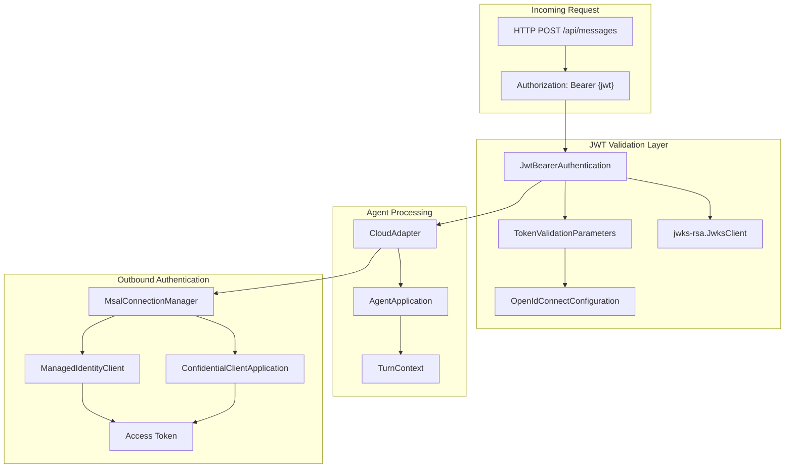
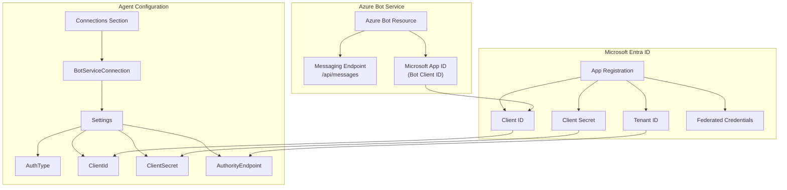
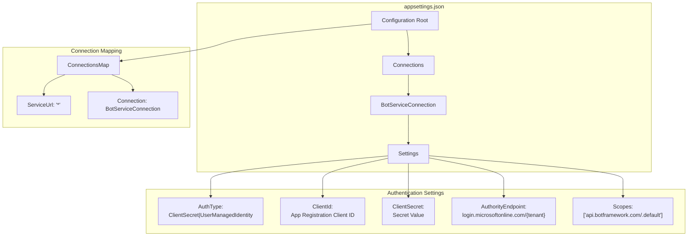
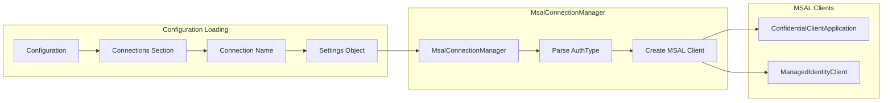
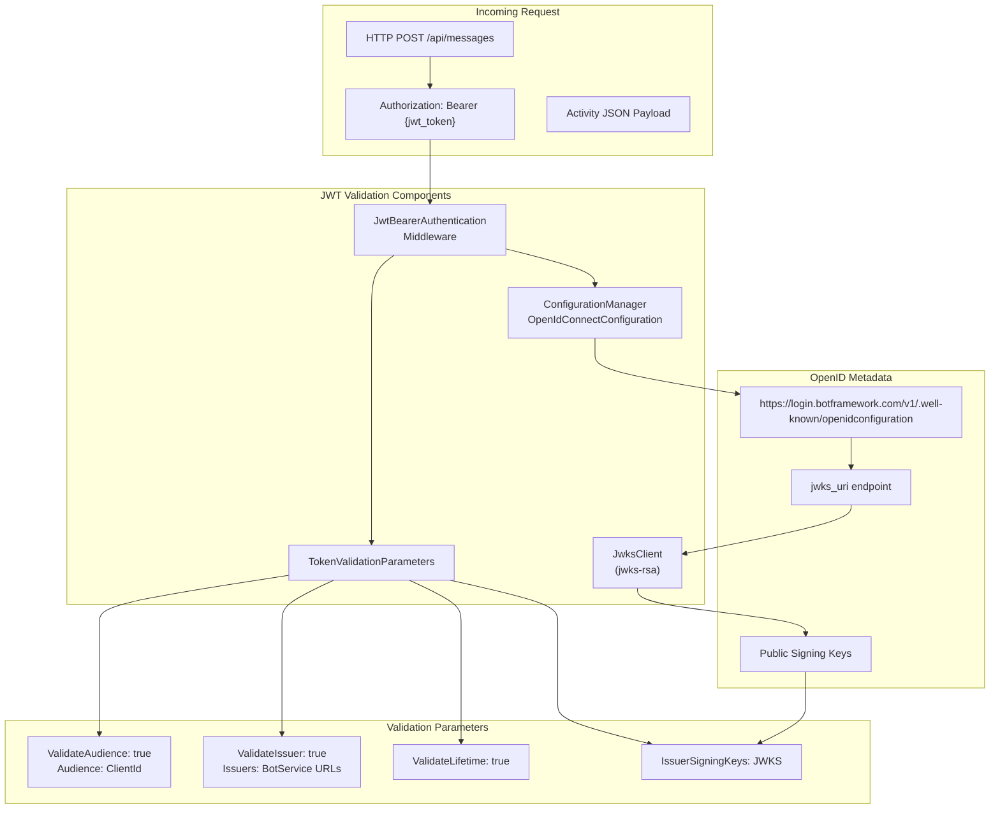
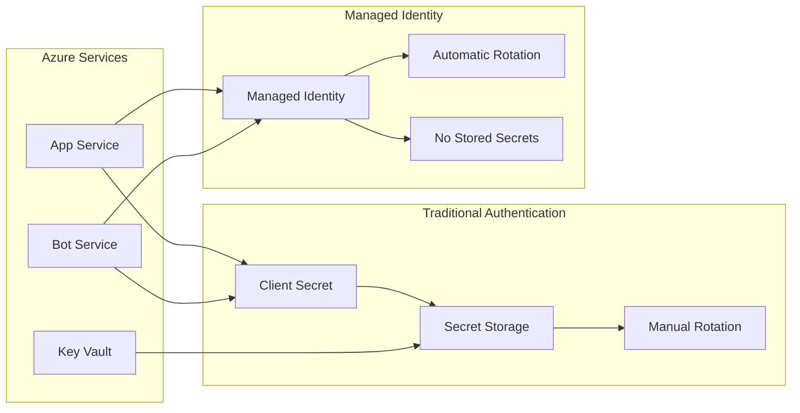

<!-- source: DeepWiki mcp.deepwiki.com · repo microsoft/Agents · page 3.1 Bot Authentication · fetched 2026-10-26 -->

# Bot Authentication

<details>
<summary>Relevant source files</summary>

The following files were used as context for generating this wiki page:

- [.github/scripts/updatenode.sh](.github/scripts/updatenode.sh)
- [AgentErrorCodes.md](AgentErrorCodes.md)
- [samples/dotnet/Agent Framework/.gitignore](samples/dotnet/Agent Framework/.gitignore)
- [samples/dotnet/Agent Framework/AspNetExtensions.cs](samples/dotnet/Agent Framework/AspNetExtensions.cs)
- [samples/dotnet/Agent Framework/appsettings.Playground.json](samples/dotnet/Agent Framework/appsettings.Playground.json)
- [samples/dotnet/Agent Framework/appsettings.json](samples/dotnet/Agent Framework/appsettings.json)
- [samples/dotnet/Samples.sln](samples/dotnet/Samples.sln)
- [samples/nodejs/auto-signin/package-lock.json](samples/nodejs/auto-signin/package-lock.json)
- [samples/nodejs/azure-ai-streaming/package-lock.json](samples/nodejs/azure-ai-streaming/package-lock.json)
- [samples/nodejs/cards/package-lock.json](samples/nodejs/cards/package-lock.json)
- [samples/nodejs/copilotstudio-client/package-lock.json](samples/nodejs/copilotstudio-client/package-lock.json)
- [samples/nodejs/copilotstudio-webchat-react/package-lock.json](samples/nodejs/copilotstudio-webchat-react/package-lock.json)
- [samples/nodejs/langchain-multiturn/package-lock.json](samples/nodejs/langchain-multiturn/package-lock.json)
- [samples/nodejs/multi-turn-prompt/package-lock.json](samples/nodejs/multi-turn-prompt/package-lock.json)
- [samples/nodejs/obo-authorization/package-lock.json](samples/nodejs/obo-authorization/package-lock.json)
- [samples/nodejs/quickstart/package-lock.json](samples/nodejs/quickstart/package-lock.json)

</details>


Bot authentication establishes the service identity of your agent and enables secure communication with Azure Bot Service. This page documents JWT token validation, connection configuration, and authentication provider setup.

Bot authentication is distinct from user authentication. For user OAuth flows, see [User Authentication](#3.2). For token exchange patterns, see [On-Behalf-Of (OBO) Authorization](#3.3). For agentic identity patterns, see [Agentic Identity](#3.4).

## Core Authentication Components

Bot authentication in the SDK relies on these key packages and classes:

### Node.js Components

| Package | Key Classes/Functions | Purpose |
|---------|----------------------|---------|
| `@azure/msal-node` | `ConfidentialClientApplication`, `ManagedIdentityClient` | Token acquisition from Microsoft Entra ID |
| `jsonwebtoken` | `verify()`, `decode()` | JWT signature verification |
| `jwks-rsa` | `JwksClient` | JSON Web Key Set retrieval for validation |
| `@microsoft/agents-hosting` | `AgentApplication`, `CloudAdapter` | Core hosting and adapter functionality |

Sources: [samples/nodejs/azure-ai-streaming/package-lock.json:140-153](), [samples/nodejs/obo-authorization/package-lock.json:88-101]()

### .NET Components

| Namespace | Key Classes | Purpose |
|-----------|------------|---------|
| `Microsoft.Agents.Authentication` | `MsalConnectionManager`, `AuthTypes` | Connection management and authentication type enumeration |
| `Microsoft.AspNetCore.Authentication.JwtBearer` | `JwtBearerOptions`, `TokenValidationParameters` | JWT validation middleware |
| `Microsoft.IdentityModel.Protocols.OpenIdConnect` | `OpenIdConnectConfiguration`, `ConfigurationManager` | OpenID metadata retrieval |
| `Microsoft.IdentityModel.Tokens` | `SecurityKey`, `TokenValidationParameters` | Cryptographic validation |

Sources: [samples/dotnet/Agent Framework/AspNetExtensions.cs:4-13]()

### Authentication Type Configuration

Bot Authentication Flow with Code Entities



Sources: [samples/dotnet/Agent Framework/AspNetExtensions.cs:25-30](), [samples/nodejs/obo-authorization/package-lock.json:88-101](), [samples/nodejs/azure-ai-streaming/package-lock.json:140-153]()

### Authentication Type Enum Values

The SDK supports multiple authentication patterns configured via `AuthType` property:

| AuthType Value | .NET Enum | Use Case |
|---------------|-----------|----------|
| `ClientSecret` | `AuthTypes.ClientSecret` | Development and production with stored secret |
| `ClientCertificate` | `AuthTypes.ClientCertificate` | Certificate-based authentication |
| `UserManagedIdentity` | `AuthTypes.UserManagedIdentity` | Azure user-assigned managed identity |
| `SystemManagedIdentity` | `AuthTypes.SystemManagedIdentity` | Azure system-assigned managed identity |

Sources: [samples/dotnet/Agent Framework/appsettings.json:27](), [AgentErrorCodes.md:64]()

## Azure Bot Service Integration

Azure Bot Service acts as the messaging endpoint that routes activities to your agent. The service validates your bot's identity using Microsoft Entra ID (formerly Azure AD) application credentials.

### Bot Registration Requirements

Azure Bot Service Registration Configuration



Sources: [samples/dotnet/Agent Framework/appsettings.json:24-35]()

### Messaging Endpoint Configuration

The messaging endpoint must be configured to route requests to your agent's `/api/messages` endpoint:

- **Local development with dev tunnel**: `https://{tunnel-id}.{region}.devtunnels.ms/api/messages`
- **Azure App Service**: `https://{app-name}.azurewebsites.net/api/messages`
- **Azure Container Apps**: `https://{container-app}.{region}.azurecontainerapps.io/api/messages`

The endpoint receives HTTP POST requests with Bot Framework activities in the request body, authenticated via JWT bearer tokens in the Authorization header.

Sources: [samples/dotnet/Agent Framework/appsettings.json:8-11]()

## Connection Configuration Structure

Bot authentication uses a hierarchical configuration structure under the `Connections` section. Each connection maps to a service URL pattern and contains authentication settings.

### .NET appsettings.json Structure

Configuration Schema for Bot Authentication



Sources: [samples/dotnet/Agent Framework/appsettings.json:24-41]()

Example configuration with client secret authentication:

```json
{
  "Connections": {
    "BotServiceConnection": {
      "Settings": {
        "AuthType": "ClientSecret",
        "AuthorityEndpoint": "https://login.microsoftonline.com/{{BOT_TENANT_ID}}",
        "ClientId": "{{BOT_ID}}",
        "ClientSecret": "{{CLIENT_SECRET}}",
        "Scopes": [
          "https://api.botframework.com/.default"
        ]
      }
    }
  },
  "ConnectionsMap": [
    {
      "ServiceUrl": "*",
      "Connection": "BotServiceConnection"
    }
  ]
}
```

The `ConnectionsMap` section maps Bot Framework service URLs to named connections. Using `"*"` as the service URL creates a default connection for all service endpoints.

Sources: [samples/dotnet/Agent Framework/appsettings.json:24-41]()

### Node.js Environment Configuration

Node.js agents typically load configuration from environment variables. The `@microsoft/agents-hosting` package reads these variables to configure authentication:

| Environment Variable | Configuration Property | Purpose |
|---------------------|----------------------|---------|
| `BOT_ID` | `ClientId` | Application (client) ID from App Registration |
| `CLIENT_SECRET` | `ClientSecret` | Client secret value |
| `BOT_TENANT_ID` | `TenantId` | Directory (tenant) ID |

The hosting package constructs the authority endpoint as `https://login.microsoftonline.com/{BOT_TENANT_ID}`.

Sources: [samples/nodejs/azure-ai-streaming/package-lock.json:140-153](), [samples/nodejs/obo-authorization/package-lock.json:129-145]()

### Configuration Loading in MsalConnectionManager

The `MsalConnectionManager` class (or `ConnectionManager` in Node.js) loads configuration and creates MSAL clients:



Sources: [samples/dotnet/Agent Framework/appsettings.json:24-35](), [samples/nodejs/azure-ai-streaming/package-lock.json:140-153]()

## JWT Token Validation

Incoming requests to the `/api/messages` endpoint must be validated to ensure they originate from Azure Bot Service. The SDK provides JWT bearer token validation using OpenID Connect discovery.

### JWT Validation Architecture

JWT Token Validation Flow with Code Components



Sources: [samples/dotnet/Agent Framework/AspNetExtensions.cs:19-95]()

### .NET TokenValidation Configuration

The `TokenValidation` section in `appsettings.json` controls JWT validation behavior:

```json
{
  "TokenValidation": {
    "Enabled": true,
    "Audiences": [
      "{{ClientId}}"
    ],
    "TenantId": "{{TenantId}}",
    "ValidIssuers": [
      "https://api.botframework.com"
    ],
    "IsGov": false
  }
}
```

Configuration keys:

| Key | Type | Purpose |
|-----|------|---------|
| `Enabled` | boolean | Enable/disable JWT validation (disable only for local testing) |
| `Audiences` | string[] | Expected audience values (typically the bot's client ID) |
| `TenantId` | string | Azure AD tenant ID for tenant-specific validation |
| `ValidIssuers` | string[] | Allowed issuer URLs (defaults to Azure Bot Service) |
| `IsGov` | boolean | Use government cloud endpoints |

Sources: [samples/dotnet/Agent Framework/appsettings.json:8-12](), [samples/dotnet/Agent Framework/AspNetExtensions.cs:31-50]()

### OpenID Connect Metadata Retrieval

The SDK uses `ConfigurationManager<OpenIdConnectConfiguration>` to retrieve and cache OpenID Connect metadata:

- **Public Cloud**: `https://login.botframework.com/v1/.well-known/openidconfiguration`
- **Government Cloud**: `https://login.botframework.azure.us/v1/.well-known/openidconfiguration`

The metadata endpoint provides:
- `issuer`: The token issuer identifier
- `jwks_uri`: Endpoint for JSON Web Key Set
- `token_endpoint`: Token endpoint URL

The `jwks_uri` contains public keys used to verify JWT signatures. The SDK caches these keys and refreshes them automatically.

Sources: [samples/dotnet/Agent Framework/AspNetExtensions.cs:51-95]()

### Node.js JWT Validation

Node.js agents use the `jsonwebtoken` and `jwks-rsa` packages for validation:

```javascript
import jwt from 'jsonwebtoken';
import jwksClient from 'jwks-rsa';

const client = jwksClient({
  jwksUri: 'https://login.botframework.com/v1/.well-known/keys'
});

function getKey(header, callback) {
  client.getSigningKey(header.kid, (err, key) => {
    const signingKey = key.publicKey || key.rsaPublicKey;
    callback(null, signingKey);
  });
}

jwt.verify(token, getKey, {
  audience: process.env.BOT_ID,
  issuer: 'https://api.botframework.com'
}, (err, decoded) => {
  // Handle validation result
});
```

The `@microsoft/agents-hosting` package provides built-in middleware that performs this validation automatically.

Sources: [samples/nodejs/azure-ai-streaming/package-lock.json:986-1002](), [samples/nodejs/obo-authorization/package-lock.json:986-1002]()

### Validation Error Codes

JWT validation failures result in specific error codes:

| Error Code | Description |
|------------|-------------|
| -60012 | Failed to acquire token from MSAL |
| -60013 | Invalid instance URL format |
| -40000 | MSAL authentication module configuration error |
| -40001 | Authentication connection not found |

See [AgentErrorCodes.md](#) for complete error documentation.

Sources: [AgentErrorCodes.md:73-96]()

## Local Development Setup

Local development requires exposing your agent to Azure Bot Service using a tunneling solution. The SDK supports development with dev tunnels and playground tools.

### Dev Tunnel Configuration

The `devtunnel` CLI creates secure tunnels to localhost:

```bash
# Create and start a tunnel on port 3978
devtunnel host -p 3978 --allow-anonymous

# Example output:
# Your tunnel is ready!
# Connect via: https://abc123-3978.usw3.devtunnels.ms
```

Update the Azure Bot Service messaging endpoint to: `https://abc123-3978.usw3.devtunnels.ms/api/messages`

### Agents Playground

The `@microsoft/m365agentsplayground` package provides a local testing environment that bypasses JWT validation:

| Package | Version | Purpose |
|---------|---------|---------|
| `@microsoft/m365agentsplayground` | 0.2.18 | Local testing tool with UI |

Usage:
```bash
npm install --save-dev @microsoft/m365agentsplayground
npx agentsplayground
```

The playground runs a local web interface and acts as a Bot Framework channel emulator without requiring Azure Bot Service configuration.

Sources: [samples/nodejs/azure-ai-streaming/package-lock.json:221-230](), [samples/nodejs/quickstart/package-lock.json:142-151]()

### Authentication Configuration for Development

Development environments should disable JWT validation or configure it appropriately:

```json
{
  "TokenValidation": {
    "Enabled": false
  }
}
```

For production-like local testing with JWT validation enabled, configure the `appsettings.Playground.json` profile:

```json
{
  "TokenValidation": {
    "Enabled": true,
    "Audiences": ["{{ClientId}}"],
    "TenantId": "{{TenantId}}"
  },
  "Connections": {
    "ServiceConnection": {
      "Settings": {
        "AuthType": "ClientSecret",
        "ClientId": "{{ClientId}}",
        "ClientSecret": "{{ClientSecret}}",
        "AuthorityEndpoint": "https://login.microsoftonline.com/{{TenantId}}"
      }
    }
  }
}
```

Sources: [samples/dotnet/Agent Framework/appsettings.Playground.json:2-7]()

### Authentication Type Support Matrix

| Authentication Type | Local Development | Azure Deployment | Configuration Complexity |
|-------------------|-------------------|------------------|------------------------|
| `ClientSecret` | ✅ Supported | ✅ Supported | Low |
| `ClientCertificate` | ✅ Supported | ✅ Supported | Medium |
| `UserManagedIdentity` | ❌ Not supported | ✅ Supported | Low (production) |
| `SystemManagedIdentity` | ❌ Not supported | ✅ Supported | Low (production) |

Managed Identity authentication requires Azure infrastructure and cannot be emulated locally. Use client secret or certificate authentication for local development.

Sources: [samples/dotnet/Agent Framework/appsettings.json:27](), [samples/dotnet/Agent Framework/appsettings.Playground.json:11-13]()

## Production Deployment

### Azure App Service Configuration

Production deployments require updating the Azure Bot messaging endpoint to point to your deployed service:

- **App Service**: `https://{{appServiceDomain}}/api/messages`
- **Container Apps**: `https://{{containerAppDomain}}/api/messages`

### Managed Identity Benefits

Managed Identity authentication eliminates the need for stored secrets:



Sources: [samples/dotnet/quickstart/README.md:84-86](), [samples/dotnet/auto-signin/README.md:84-86](), [samples/dotnet/semantic-kernel-multiturn/README.md:77-79]()

---

