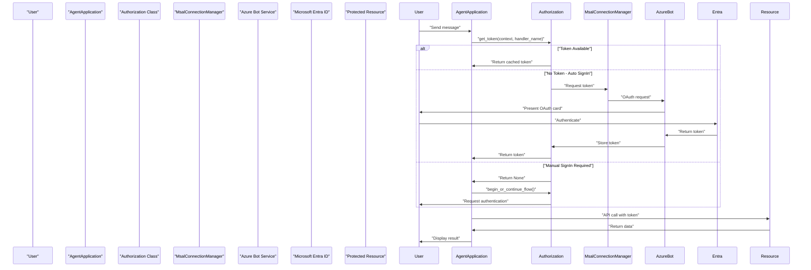
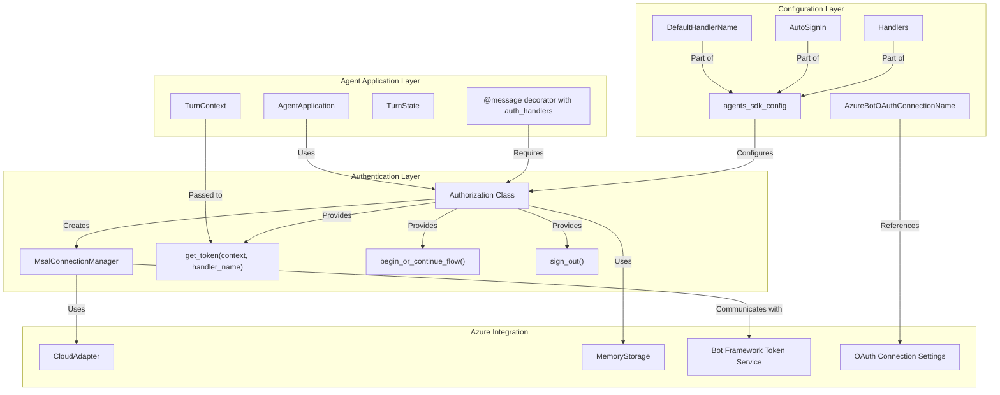

<!-- source: DeepWiki mcp.deepwiki.com · repo microsoft/Agents · page 3.2 User Authentication · fetched 2026-10-26 -->

# User Authentication

<details>
<summary>Relevant source files</summary>

The following files were used as context for generating this wiki page:

- [samples/nodejs/auto-signin/README.md](samples/nodejs/auto-signin/README.md)
- [samples/nodejs/auto-signin/env.TEMPLATE](samples/nodejs/auto-signin/env.TEMPLATE)
- [samples/nodejs/auto-signin/src/index.ts](samples/nodejs/auto-signin/src/index.ts)
- [samples/nodejs/auto-signin/src/userGraphClient.ts](samples/nodejs/auto-signin/src/userGraphClient.ts)
- [samples/nodejs/cards/env.TEMPLATE](samples/nodejs/cards/env.TEMPLATE)
- [samples/nodejs/copilotstudio-skill/env.TEMPLATE](samples/nodejs/copilotstudio-skill/env.TEMPLATE)
- [samples/nodejs/copilotstudio-skill/package-lock.json](samples/nodejs/copilotstudio-skill/package-lock.json)
- [samples/nodejs/copilotstudio-skill/package.json](samples/nodejs/copilotstudio-skill/package.json)
- [samples/nodejs/copilotstudio-skill/src/agent.ts](samples/nodejs/copilotstudio-skill/src/agent.ts)
- [samples/nodejs/multi-turn-prompt/env.TEMPLATE](samples/nodejs/multi-turn-prompt/env.TEMPLATE)
- [samples/nodejs/obo-authorization/env.TEMPLATE](samples/nodejs/obo-authorization/env.TEMPLATE)
- [samples/nodejs/obo-authorization/src/index.ts](samples/nodejs/obo-authorization/src/index.ts)

</details>


## Purpose and Scope

This document describes how to implement user authentication in agents built with the Microsoft 365 Agents SDK. It covers configuring authentication settings, setting up OAuth connections in Azure Bot Service, implementing different authentication flows, and using tokens to access resources on behalf of users.

For information about authenticating the agent/bot itself (service-to-service authentication), see [Bot Authentication](#3.1).

## Authentication Overview

User authentication in the Agents SDK enables agents to access protected resources (like Microsoft Graph APIs) on behalf of users. The SDK uses Azure Bot Service's OAuth capabilities for authentication, which provides secure token management and standardized authentication flows through the `Authorization` class and `MsalConnectionManager`.

## Authentication Flow Sequence



Sources:
- [samples/python/auto-signin/src/agent.py:36-48]()
- [samples/python/auto-signin/src/agent.py:62-92]()
- [samples/dotnet/auto-signin/README.md:5-9]()

## Authentication Methods

The SDK supports multiple authentication methods for different scenarios:

### 1. Automatic Sign-In

With automatic sign-in enabled, the `Authorization` class automatically attempts to get tokens when handlers are executed. Set `AutoSignIn: true` in configuration and tokens are acquired transparently.

**.NET Configuration:**
```json
"AgentApplication": {
  "UserAuthorization": {
    "DefaultHandlerName": "auto",
    "AutoSignIn": true,
    "Handlers": {
      "auto": {
        "Settings": {
          "AzureBotOAuthConnectionName": "{{connection_name}}",
          "Title": "SignIn for Sample",
          "Text": "Please sign in and send the 6-digit code"
        }
      }
    }
  }
}
```

**Python Implementation:**
```python
# Authorization handles automatic token acquisition
user_token_response = await AGENT_APP.auth.get_token(context, "GRAPH")
if user_token_response and user_token_response.token is not None:
    # Token available, proceed with API calls
    user_info = await get_user_info(user_token_response.token)
```

### 2. Per-Route Authentication

Use decorators or route-specific handlers to require authentication only for specific commands. This provides fine-grained control over when users need to authenticate.

**Python Per-Route Example:**
```python
@AGENT_APP.message(
    re.compile(r"^/(me|profile)$", re.IGNORECASE), 
    auth_handlers=["GRAPH"]
)
async def profile_request(context: TurnContext, state: TurnState) -> None:
    # Authentication handled automatically by decorator
    user_token_response = await AGENT_APP.auth.get_token(context, "GRAPH")
```

### 3. Multi-Provider Authentication

Configure multiple authentication handlers for accessing different services (e.g., Microsoft Graph and GitHub) within the same agent.

**Multi-Handler Configuration:**
```json
"Handlers": {
  "auto": {
    "Settings": {
      "AzureBotOAuthConnectionName": "graph_connection",
      "Title": "SignIn for Graph"
    }
  },
  "me": {
    "Settings": {
      "AzureBotOAuthConnectionName": "github_connection",
      "Title": "SignIn for GitHub"
    }
  }
}
```

**Multi-Provider Usage:**
```python
# Get different tokens for different services
graph_token = await AGENT_APP.auth.get_token(context, "GRAPH")
github_token = await AGENT_APP.auth.get_token(context, "GITHUB")
```

Sources:
- [samples/dotnet/auto-signin/README.md:40-67]()
- [samples/python/auto-signin/src/agent.py:80-92]()
- [samples/python/auto-signin/src/agent.py:95-126]()

## Authentication Components

The key classes and components involved in user authentication are:

## SDK Authentication Architecture



## Core Authentication Classes

| Class | Purpose | Key Methods |
|-------|---------|-------------|
| `Authorization` | Main authentication coordinator | `get_token()`, `begin_or_continue_flow()`, `sign_out()` |
| `MsalConnectionManager` | Manages MSAL connections to Azure | Token acquisition and management |
| `CloudAdapter` | Handles communication with Bot Service | Activity processing and OAuth flows |
| `AgentApplication` | Main application container | Exposes `auth` property for authentication |

Sources:
- [samples/python/auto-signin/src/agent.py:32-52]()
- [samples/python/cards/src/agent.py:29-37]()
- [samples/python/copilotstudio-skill/src/agent.py:22-29]()

## Configuring User Authentication

### 1. Agent Configuration

Authentication settings are configured in the agent's configuration file:

## Configuration Structure

| Section | Description |
|---------|-------------|
| `AgentApplication.UserAuthorization.DefaultHandlerName` | The default handler name for authentication |
| `AgentApplication.UserAuthorization.AutoSignIn` | Whether to automatically trigger sign-in |
| `AgentApplication.UserAuthorization.Handlers` | Named authentication handler configurations |
| `AgentApplication.UserAuthorization.Handlers.{name}.Settings.AzureBotOAuthConnectionName` | References Azure Bot Service OAuth connection |

## .NET Configuration Example

```json
"AgentApplication": {
  "UserAuthorization": {
    "DefaultHandlerName": "auto",
    "AutoSignIn": true,
    "Handlers": {
      "auto": {
        "Settings": {
          "AzureBotOAuthConnectionName": "{{auto_connection_name}}",
          "Title": "SignIn for Sample",
          "Text": "Please sign in and send the 6-digit code"
        }
      },
      "me": {
        "Settings": {
          "AzureBotOAuthConnectionName": "{{me_connection_name}}",
          "Title": "SignIn for Me",
          "Text": "Please sign in and send the 6-digit code"
        }
      }
    }
  }
}
```

## Python Configuration Loading

```python
# Load configuration from environment
load_dotenv()
agents_sdk_config = load_configuration_from_env(environ)

# Create authorization components
STORAGE = MemoryStorage()
CONNECTION_MANAGER = MsalConnectionManager(**agents_sdk_config)
AUTHORIZATION = Authorization(STORAGE, CONNECTION_MANAGER, **agents_sdk_config)

# Pass to AgentApplication
AGENT_APP = AgentApplication[TurnState](
    storage=STORAGE, 
    adapter=ADAPTER, 
    authorization=AUTHORIZATION, 
    **agents_sdk_config
)
```

Sources:
- [samples/dotnet/auto-signin/README.md:39-67]()
- [samples/python/auto-signin/src/agent.py:28-52]()
- [samples/python/cards/src/agent.py:24-37]()

### 2. Azure Bot Service Setup

To enable authentication, you need to:

1. Register an application in Microsoft Entra ID
2. Create an OAuth connection in Azure Bot Service
3. (Optional) Set up Federated Identity Credentials for enhanced security

#### Microsoft Entra ID App Registration

1. Create an app registration in the Microsoft Entra ID portal
2. Configure supported account types (Single tenant is required for FIC)
3. Set the redirect URL to the appropriate OAuth redirect URL

| Data Residency | Cloud | OAuth URL | OAuth Redirect URL |
|----------------|-------|-----------|-------------------|
| None | Public | https://token.botframework.com | https://token.botframework.com/.auth/web/redirect |
| Europe | Public | https://europe.token.botframework.com | https://europe.token.botframework.com/.auth/web/redirect |
| United States | Public | https://unitedstates.token.botframework.com | https://unitedstates.token.botframework.com/.auth/web/redirect |
| India | Public | https://india.token.botframework.com | https://india.token.botframework.com/.auth/web/redirect |
| None | Azure Government | https://token.botframework.azure.us | https://token.botframework.azure.us/.auth/web/redirect |
| None | Azure operated by 21Vianet | https://token.botframework.azure.cn | https://token.botframework.azure.cn/.auth/web/redirect |

4. Configure API permissions (e.g., Graph API permissions like `openid`, `profile`, `User.Read`, `User.ReadBasic.All`)

#### Federated Identity Credentials Setup

For enhanced security, configure Federated Identity Credentials:

1. Navigate to **Certificates & secrets** > **Federated Credentials**
2. Click **Add Credentials**
3. Choose **Other Issuer** scenario
4. Configure the connection:
   - **Issuer**: `https://login.microsoftonline.com/{customer-tenant-ID}/v2.0`
   - **Subject Identifier**: `/eid1/c/pub/t/{base64-encoded-tenant-ID}/a/{base64-encoded-app-ID}/{unique-identifier}`
   - **Audience**: `api://AzureADTokenExchange`

**Base64url Encoded Application IDs:**
| Encoded Value | Description |
|---------------|-------------|
| `9ExAW52n_ky4ZiS_jhpJIQ` | Bot Service Token Store |
| `ND1y8_Vv60yhSNmdzSUR_A` | Bot Framework Dev Portal |

Sources:
- [docs/HowTo/azurebot-user-authentication-fic.md:56-114]()

#### OAuth Connection Settings

In the Azure Bot Service:

1. Navigate to Configuration > OAuth Connection Settings
2. Create a new connection with the following settings:

| Setting | Value | Description |
|---------|-------|-------------|
| **Name** | `graph` (example) | Connection name referenced in agent code |
| **Service Provider** | `AAD v2 with Federated Credentials` | For enhanced security |
| **Client ID** | App registration client ID | Single tenant applications only for FIC |
| **Client Secret** | Leave empty for FIC | Not required when using federated credentials |
| **Unique Identifier** | Custom identifier | Used in federated credentials subject identifier |
| **Token Exchange URL** | `api://botid-{appId}` | For Teams SSO, otherwise leave blank |
| **Tenant ID** | Directory tenant ID | Use actual tenant ID for single tenant |
| **Scopes** | `openid profile User.Read User.ReadBasic.All` | Space-separated, case-sensitive list |

**Important Notes:**
- For Teams SSO, the Token Exchange URL format is **required**: `api://botid-{appId}`
- For Azure Bot Service, the default `api://{appid}` format is acceptable
- Scopes are case-sensitive and space-separated
- Single tenant applications are required for Federated Identity Credentials

Sources:
- [docs/HowTo/azurebot-user-authentication-fic.md:207-230]()

Sources:
- [docs/HowTo/azurebot-user-authentication-fic.md:25-161]()
- [samples/basic/authorization/README.md:15-99]()

## Using Authentication in Code

The `AgentApplication.auth` property provides the `Authorization` instance for working with user authentication:

### Key Methods

| Method | Description | Return Type |
|--------|-------------|-------------|
| `get_token(context, handler_name)` | Gets the token for the specified handler | `TokenResponse` or `None` |
| `begin_or_continue_flow(context, state, handler_name)` | Initiates or continues OAuth flow | `TokenResponse` or `None` |
| `sign_out(context)` | Signs out the user | `None` |

### Python Authentication Usage

## Basic Token Retrieval
```python
@AGENT_APP.message("/status")
async def status(context: TurnContext, state: TurnState) -> bool:
    # Get tokens for configured handlers
    tok_graph = await AGENT_APP.auth.get_token(context, "GRAPH")
    tok_github = await AGENT_APP.auth.get_token(context, "GITHUB")
    
    status_graph = tok_graph.token is not None
    status_github = tok_github.token is not None
    
    await context.send_activity(
        MessageFactory.text(
            f"Graph status: {'Connected' if status_graph else 'Not connected'}\n"
            f"GitHub status: {'Connected' if status_github else 'Not connected'}"
        )
    )
```

## Per-Route Authentication
```python
@AGENT_APP.message(
    re.compile(r"^/(me|profile)$", re.IGNORECASE), 
    auth_handlers=["GRAPH"]
)
async def profile_request(context: TurnContext, state: TurnState) -> None:
    user_token_response = await AGENT_APP.auth.get_token(context, "GRAPH")
    if user_token_response and user_token_response.token is not None:
        user_info = await get_user_info(user_token_response.token)
        activity = MessageFactory.attachment(create_profile_card(user_info))
        await context.send_activity(activity)
    else:
        await context.send_activity(
            MessageFactory.text('Token not available. Enter "login" to sign in.')
        )
```

## Manual Sign-Out Implementation
```python
@AGENT_APP.message("/logout")
async def logout(context: TurnContext, state: TurnState) -> None:
    await AGENT_APP.auth.sign_out(context)
    await context.send_activity(MessageFactory.text("You have been logged out."))
```

## Manual Authentication Flow
```python
async def pull_requests(context: TurnContext, state: TurnState) -> None:
    user_token_response = await AGENT_APP.auth.get_token(context, "GITHUB")
    if user_token_response and user_token_response.token is not None:
        # Use token to access GitHub API
        prs = await get_pull_requests("octocat", "Hello-World", user_token_response.token)
    else:
        # Initiate authentication flow
        token_response = await AGENT_APP.auth.begin_or_continue_flow(
            context, state, "GITHUB"
        )
```

Sources:
- [samples/python/auto-signin/src/agent.py:55-92]()
- [samples/python/auto-signin/src/agent.py:95-127]()
- [samples/python/auto-signin/src/agent.py:74-77]()

## Implementing Authentication Flows

### Automatic Sign-In Implementation

The automatic sign-in flow works by setting `AutoSignIn: true` and using route-specific authentication handlers:

**Per-Route Handler Configuration:**
```python
@AGENT_APP.message(
    re.compile(r"^/(me|profile)$", re.IGNORECASE), 
    auth_handlers=["GRAPH"]
)
async def profile_request(context: TurnContext, state: TurnState) -> None:
    # Authentication handled automatically by auth_handlers decorator
    user_token_response = await AGENT_APP.auth.get_token(context, "GRAPH")
    if user_token_response and user_token_response.token is not None:
        # Token available, proceed with API calls
        user_info = await get_user_info(user_token_response.token)
        activity = MessageFactory.attachment(create_profile_card(user_info))
        await context.send_activity(activity)
```

**Global Auto-SignIn Check:**
```python
@AGENT_APP.activity(ActivityTypes.message)
async def message(context: TurnContext, state: TurnState) -> None:
    # When AutoSignIn is enabled, tokens should be available automatically
    # This is the fallback handler for unmatched messages
    await context.send_activity(
        MessageFactory.text(f"You said: {context.activity.text}")
    )
```

### Manual Authentication Flow Implementation

For scenarios requiring explicit user consent or when `AutoSignIn` is disabled:

**Explicit Authentication Request:**
```python
async def pull_requests(context: TurnContext, state: TurnState) -> None:
    user_token_response = await AGENT_APP.auth.get_token(context, "GITHUB")
    if user_token_response and user_token_response.token is not None:
        # Token available, use it
        gh_prof = await get_current_profile(user_token_response.token)
        await context.send_activity(MessageFactory.attachment(create_profile_card(gh_prof)))
    else:
        # Token not available, initiate authentication flow
        token_response = await AGENT_APP.auth.begin_or_continue_flow(
            context, state, "GITHUB"
        )
        if token_response and token_response.token is not None:
            await context.send_activity(
                MessageFactory.text(f"GitHub token acquired, length: {len(token_response.token)}")
            )
        else:
            await context.send_activity(
                MessageFactory.text("Failed to obtain GitHub token.")
            )
```

### Authentication Status Check

Implement status checking to verify authentication state across multiple handlers:

**Multi-Handler Status:**
```python
@AGENT_APP.message(re.compile(r"^/(status|auth status|check status)", re.IGNORECASE))
async def status(context: TurnContext, state: TurnState) -> bool:
    await context.send_activity(MessageFactory.text("Welcome to the auto-signin demo"))
    
    # Check multiple authentication handlers
    tok_graph = await AGENT_APP.auth.get_token(context, "GRAPH")
    tok_github = await AGENT_APP.auth.get_token(context, "GITHUB")
    
    status_graph = tok_graph.token is not None
    status_github = tok_github.token is not None
    
    await context.send_activity(
        MessageFactory.text(
            f"Graph status: {'Connected' if status_graph else 'Not connected'}\n"
            f"GitHub status: {'Connected' if status_github else 'Not connected'}"
        )
    )
```

Sources:
- [samples/python/auto-signin/src/agent.py:80-92]()
- [samples/python/auto-signin/src/agent.py:95-127]()
- [samples/python/auto-signin/src/agent.py:55-71]()
- [samples/python/auto-signin/src/agent.py:134-139]()

## Troubleshooting

### Common Issues

1. **No token available**: 
   - Verify OAuth connection is properly configured in Azure Bot Service
   - Check that `AzureBotOAuthConnectionName` in agent configuration matches the connection name
   - Ensure the connection is using the correct service provider type

2. **Token permissions**: 
   - Verify app registration has necessary API permissions
   - Check that scopes are correctly configured (case-sensitive, space-separated)
   - Ensure admin consent has been granted for required permissions

3. **Federated Identity Credentials errors**:
   - Verify subject identifier format: `/eid1/c/pub/t/{base64-tenant}/a/{base64-app}/{unique-id}`
   - Check that audience is set to `api://AzureADTokenExchange`
   - Ensure issuer URL format is correct: `https://login.microsoftonline.com/{tenant-id}/v2.0`

4. **Single tenant restrictions**:
   - Federated Identity Credentials only support single tenant applications
   - Use specific tenant ID instead of "common" for FIC scenarios

5. **Local development issues**:
   - Managed Identity cannot be used for local development
   - Switch to Client Secret or Client Certificate for local testing
   - Consider separate bot registrations for development and production environments

6. **Teams SSO specific issues**:
   - Token Exchange URL must use format `api://botid-{appId}`
   - Ensure authorized client applications are configured with correct Microsoft 365 client IDs

### Testing Authentication

You can test your authentication configuration in Azure Bot Service:

1. Go to your bot resource
2. Navigate to Configuration > OAuth Connection Settings
3. Select your connection
4. Click "Test Connection" to verify it works correctly
5. First-time access will require user consent for the requested permissions
6. Successful test should show "Test Connection to your-connection-name Succeeded"

### Local Development Considerations

When developing locally, there are important authentication considerations:

**Development Tunneling:**
- Use `dev tunnels` for local development with external clients
- Requires `ClientSecret` or `Certificate` authentication
- **Federated Credentials and Managed Identity will not work via tunnel**
- Update Azure Bot messaging endpoint to `{tunnel-url}/api/messages`

**Local Testing Setup:**
```bash
# Start dev tunnel for local agent testing
devtunnel host -p 3978 --allow-anonymous
```

**Python Local Server Setup:**
```python
def start_server(
    agent_application: AgentApplication, 
    auth_configuration: AgentAuthConfiguration
):
    async def entry_point(req: Request) -> Response:
        agent: AgentApplication = req.app["agent_app"]
        adapter: CloudAdapter = req.app["adapter"]
        return await start_agent_process(req, agent, adapter)

    APP = Application(middlewares=[jwt_authorization_middleware])
    APP.router.add_post("/api/messages", entry_point)
    APP["agent_app"] = agent_application
    APP["adapter"] = agent_application.adapter

    run_app(APP, host="localhost", port=environ.get("PORT", 3978))
```

**Authentication Type Constraints:**
- **Local Development:** Client Secret or Certificate only
- **Deployed Agents:** All authentication types supported
- **Production:** Federated Credentials recommended for enhanced security

Sources:
- [samples/dotnet/auto-signin/README.md:70-82]()
- [samples/python/auto-signin/src/start_server.py:10-32]()
- [samples/python/cards/src/start_server.py:11-33]()

## Conclusion

User authentication in the Microsoft 365 Agents SDK provides a flexible way to access protected resources on behalf of users. By leveraging Azure Bot Service's OAuth capabilities, agents can securely authenticate users and access APIs like Microsoft Graph without handling sensitive credentials.

For complete examples, refer to the sample applications:
- AutoSignIn: Demonstrates automatic authentication
- ManualSignIn: Shows on-demand authentication

---

