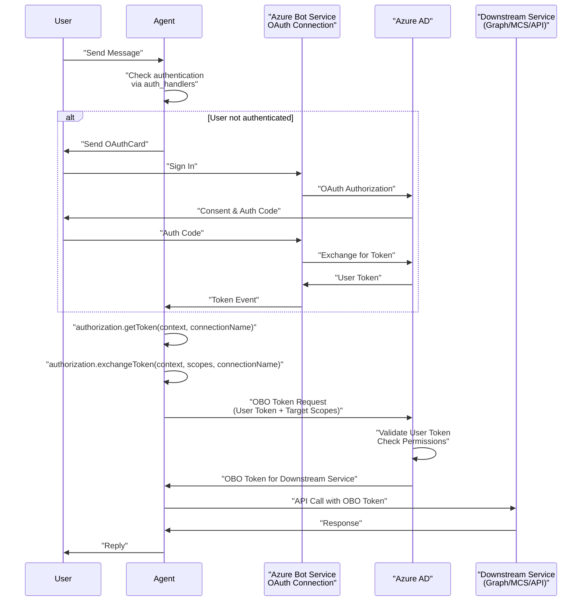
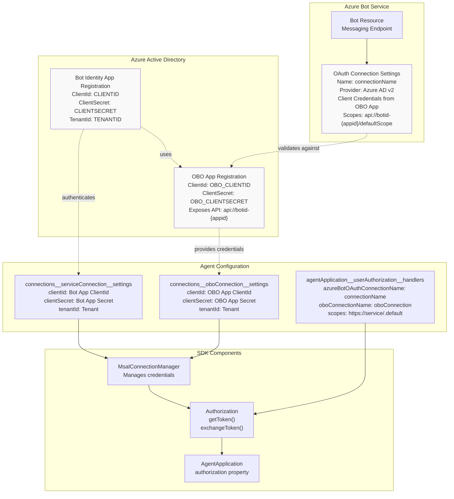
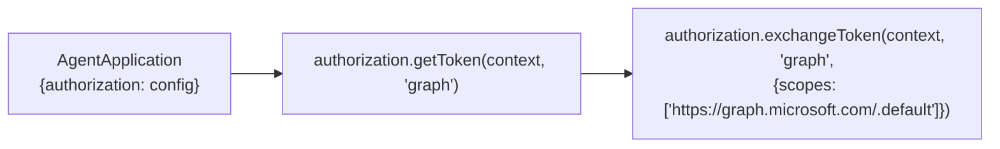
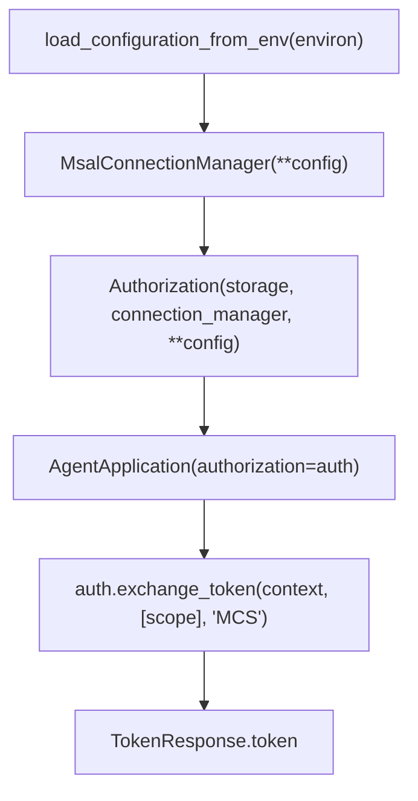
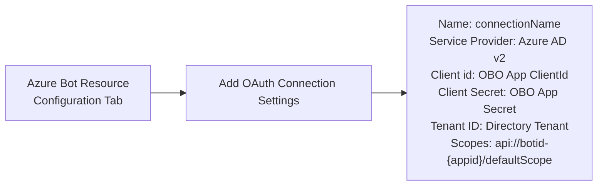
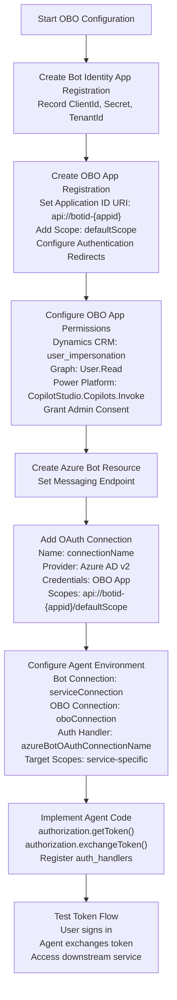

<!-- source: DeepWiki mcp.deepwiki.com · repo microsoft/Agents · page 3.3 On-Behalf-Of (OBO) Authorization · fetched 2026-10-26 -->

# On-Behalf-Of (OBO) Authorization

<details>
<summary>Relevant source files</summary>

The following files were used as context for generating this wiki page:

- [samples/nodejs/cards/env.TEMPLATE](samples/nodejs/cards/env.TEMPLATE)
- [samples/nodejs/copilotstudio-skill/env.TEMPLATE](samples/nodejs/copilotstudio-skill/env.TEMPLATE)
- [samples/nodejs/copilotstudio-skill/package-lock.json](samples/nodejs/copilotstudio-skill/package-lock.json)
- [samples/nodejs/copilotstudio-skill/package.json](samples/nodejs/copilotstudio-skill/package.json)
- [samples/nodejs/copilotstudio-skill/src/agent.ts](samples/nodejs/copilotstudio-skill/src/agent.ts)
- [samples/nodejs/multi-turn-prompt/env.TEMPLATE](samples/nodejs/multi-turn-prompt/env.TEMPLATE)
- [samples/nodejs/obo-authorization/env.TEMPLATE](samples/nodejs/obo-authorization/env.TEMPLATE)
- [samples/nodejs/obo-authorization/src/index.ts](samples/nodejs/obo-authorization/src/index.ts)
- [samples/python/README.md](samples/python/README.md)
- [samples/python/obo-authorization/README.md](samples/python/obo-authorization/README.md)
- [samples/python/obo-authorization/env.TEMPLATE](samples/python/obo-authorization/env.TEMPLATE)
- [samples/python/obo-authorization/requirements.txt](samples/python/obo-authorization/requirements.txt)
- [samples/python/obo-authorization/src/agent.py](samples/python/obo-authorization/src/agent.py)
- [samples/python/obo-authorization/src/main.py](samples/python/obo-authorization/src/main.py)
- [samples/python/obo-authorization/src/start_server.py](samples/python/obo-authorization/src/start_server.py)

</details>


## Purpose and Scope

This document details the On-Behalf-Of (OBO) token exchange flow for accessing downstream services on behalf of authenticated users in Microsoft 365 Agents. The OBO pattern enables agents to obtain tokens for downstream services (such as Microsoft Graph, Power Platform APIs, or Copilot Studio) using the user's identity context while maintaining proper security boundaries.

For information about initial user authentication and sign-in flows, see [User Authentication](#3.2). For details about agentic identity architecture and service principals, see [Agentic Identity](#3.4).

---

## Overview

The OBO authorization flow allows an agent to exchange a user token obtained through OAuth for a new token that can access a different service. This is essential when an agent needs to call downstream APIs on behalf of the user while maintaining the user's permissions and identity context.

**Key Characteristics:**
- Exchanges a user-delegated token for a service-specific token
- Maintains user identity and permissions across service boundaries
- Requires specific Azure AD application permissions and scopes
- Commonly used for accessing Microsoft Graph, Power Platform, and Copilot Studio APIs

Sources: [samples/python/obo-authorization/README.md:1-8](), [samples/nodejs/obo-authorization/src/index.ts:1-48]()

---

## Token Exchange Flow



**OBO Token Exchange Process**

The sequence above illustrates the complete OBO flow:

1. **Initial Authentication**: User authenticates through Azure Bot Service OAuth connection, obtaining a user token
2. **Token Acquisition**: Agent retrieves the user token via `authorization.getToken()`
3. **OBO Exchange**: Agent calls `authorization.exchangeToken()` with target service scopes
4. **Token Validation**: Azure AD validates the user token and checks delegated permissions
5. **New Token Issuance**: Azure AD issues a new token for the downstream service
6. **Service Access**: Agent uses the OBO token to call the downstream service

Sources: [samples/nodejs/obo-authorization/src/index.ts:22-32](), [samples/python/obo-authorization/src/agent.py:45-61]()

---

## Configuration Architecture



**Configuration Component Mapping**

The diagram above shows the relationship between Azure resources and SDK configuration:

| Component | Configuration Key | Purpose |
|-----------|------------------|---------|
| Bot Identity | `connections__serviceConnection__settings__clientId` | Authenticates agent with Azure Bot Service |
| OBO App | `connections__oboConnection__settings__clientId` | Provides credentials for token exchange |
| OAuth Connection | `agentApplication__userAuthorization__handlers__*__azureBotOAuthConnectionName` | Links to Azure Bot Service OAuth settings |
| OBO Connection Name | `agentApplication__userAuthorization__handlers__*__oboConnectionName` | References local connection configuration |
| Target Scopes | Used in `exchangeToken()` call | Specifies downstream service permissions |

Sources: [samples/python/obo-authorization/env.TEMPLATE:1-13](), [samples/nodejs/obo-authorization/env.TEMPLATE:1-21](), [samples/python/obo-authorization/README.md:24-68]()

---

## SDK Implementation

### Node.js Implementation

The Node.js SDK provides OBO functionality through the `Authorization` class configured in `AgentApplication`:



**Key Methods and Usage:**

| Method | Parameters | Returns | Purpose |
|--------|------------|---------|---------|
| `authorization.getToken(context, connectionName)` | `TurnContext`, connection name string | `TokenResponse` | Retrieves initial user token |
| `authorization.exchangeToken(context, connectionName, options)` | `TurnContext`, connection name, `{scopes: string[]}` | `TokenResponse` with OBO token | Exchanges user token for service token |

**Implementation Example:**

[samples/nodejs/obo-authorization/src/index.ts:7-20]() shows the agent configuration:
```typescript
class OboApp extends AgentApplication<TurnState> {
  constructor () {
    super({
      storage: new MemoryStorage(),
      authorization: {
        graph: { text: 'Sign in with Microsoft Graph', title: 'Graph Sign In' }
      }
    })
```

[samples/nodejs/obo-authorization/src/index.ts:22-32]() demonstrates token acquisition:
```typescript
private _status = async (context: TurnContext, state: TurnState): Promise<void> => {
  const tresp = await this.authorization.getToken(context, 'graph')
  // ... use token
  const oboToken = await this.authorization.exchangeToken(
    context, 
    'graph', 
    { scopes: ['https://graph.microsoft.com/.default'] }
  )
  // ... use OBO token
}
```

[samples/nodejs/obo-authorization/src/index.ts:19]() shows protected route registration with `auth_handlers`:
```typescript
this.onActivity('message', this._message, ['graph'])
```

Sources: [samples/nodejs/obo-authorization/src/index.ts:7-48]()

---

### Python Implementation

The Python SDK implements OBO through the `Authorization` class and `MsalConnectionManager`:



**Configuration Pattern:**

[samples/python/obo-authorization/src/agent.py:26-38]() shows initialization:
```python
agents_sdk_config = load_configuration_from_env(environ)
STORAGE = MemoryStorage()
CONNECTION_MANAGER = MsalConnectionManager(**agents_sdk_config)
AUTHORIZATION = Authorization(STORAGE, CONNECTION_MANAGER, **agents_sdk_config)
AGENT_APP = AgentApplication[TurnState](
    storage=STORAGE, 
    adapter=ADAPTER, 
    authorization=AUTHORIZATION, 
    **agents_sdk_config
)
```

**Token Exchange Implementation:**

[samples/python/obo-authorization/src/agent.py:45-61]() demonstrates the OBO exchange for Copilot Studio access:
```python
async def get_client(context: TurnContext) -> CopilotClient:
    settings = ConnectionSettings(
        environment_id=environ.get("COPILOTSTUDIOAGENT__ENVIRONMENTID"),
        agent_identifier=environ.get("COPILOTSTUDIOAGENT__SCHEMANAME"),
        cloud=PowerPlatformCloud.PROD,
    )
    scope = PowerPlatformEnvironment.get_token_audience(settings)
    token_response = await AGENT_APP.auth.exchange_token(context, [scope], "MCS")
    mcs_client = CopilotClient(settings, token_response.token)
    return mcs_client
```

**Protected Message Handler:**

[samples/python/obo-authorization/src/agent.py:77]() shows authentication enforcement via decorator:
```python
@AGENT_APP.message(re.compile(r".*"), auth_handlers=["MCS"])
async def default_handler(context: TurnContext, _state: TurnState):
    # Token already available via exchange_token
```

Sources: [samples/python/obo-authorization/src/agent.py:1-92]()

---

## Common Use Cases

### Accessing Microsoft Copilot Studio

The most common OBO use case in the samples is accessing Copilot Studio agents:

**Required Scopes:**
- `CopilotStudio.Copilots.Invoke` (Power Platform API permission)
- Computed dynamically via `PowerPlatformEnvironment.get_token_audience(settings)`

**Configuration Requirements:**
- App Registration with Dynamics CRM `user_impersonation` permission
- App Registration with Power Platform API `CopilotStudio.Copilots.Invoke` permission
- OAuth connection in Azure Bot Service with scope `api://botid-{appid}/defaultScope`

Sources: [samples/python/obo-authorization/README.md:32-60](), [samples/python/obo-authorization/src/agent.py:45-61]()

---

### Accessing Microsoft Graph

Another common scenario is accessing Microsoft Graph APIs:

**Required Scopes:**
- `https://graph.microsoft.com/.default` (includes all consented Graph permissions)
- Or specific scopes like `User.Read`, `Mail.Read`, etc.

**Implementation Pattern:**

Node.js example [samples/nodejs/obo-authorization/src/index.ts:30-31]():
```typescript
const oboToken = await this.authorization.exchangeToken(
  context, 
  'graph', 
  { scopes: ['https://graph.microsoft.com/.default'] }
)
```

Sources: [samples/nodejs/obo-authorization/src/index.ts:30-31](), [samples/python/obo-authorization/README.md:40-41]()

---

## Configuration Requirements

### Azure AD App Registrations

Two separate app registrations are required for OBO:

**1. Bot Identity App Registration:**
- Used for agent-to-Bot Service authentication
- Configured with client secret
- Referenced in `connections__serviceConnection__settings`

**2. OBO App Registration:**
- Used for user authentication and token exchange
- Requires specific configuration:
  - **Authentication**: 
    - Web platform: `https://token.botframework.com/.auth/web/redirect`
    - Mobile platform: `http://localhost`
  - **API Permissions**:
    - Dynamics CRM: `user_impersonation`
    - Microsoft Graph: `User.Read`
    - Power Platform API: `CopilotStudio.Copilots.Invoke`
    - Admin consent granted for tenant
  - **Expose an API**:
    - Application ID URI: `api://botid-{appid}`
    - Scope: `defaultScope` (Admins and users can consent)
  - **Client Secret**: Create and record for configuration

Sources: [samples/python/obo-authorization/README.md:32-51]()

---

### Azure Bot Service OAuth Connection

The OAuth connection bridges the agent and Azure AD:



**Configuration Steps:**

1. Navigate to Azure Bot resource → Configuration tab
2. Click "Add OAuth Connection Settings"
3. Configure:
   - **Name**: Used as `azureBotOAuthConnectionName` in agent config
   - **Service Provider**: `Azure Active Directory v2`
   - **Client id**: From OBO App Registration
   - **Client Secret**: From OBO App Registration
   - **Tenant ID**: Azure AD tenant identifier
   - **Scopes**: `api://botid-{appid}/defaultScope` where `{appid}` is OBO App ClientId

Sources: [samples/python/obo-authorization/README.md:53-60]()

---

### Agent Configuration Mapping

**Environment Variables Structure:**

| Configuration Area | Variable Pattern | Example |
|-------------------|------------------|---------|
| Bot Service Connection | `connections__serviceConnection__settings__*` | `CONNECTIONS__SERVICE_CONNECTION__SETTINGS__CLIENTID` |
| OBO Connection | `connections__oboConnection__settings__*` | `CONNECTIONS__MCS__SETTINGS__CLIENTID` |
| Connection Mapping | `connectionsMap__N__connection` / `serviceUrl` | Maps connection to service URL patterns |
| Auth Handler | `agentApplication__userAuthorization__handlers__*` | Specifies OAuth and OBO connection names |

**Python Configuration Example:**

[samples/python/obo-authorization/env.TEMPLATE:1-13]():
```bash
CONNECTIONS__SERVICE_CONNECTION__SETTINGS__CLIENTID=
CONNECTIONS__SERVICE_CONNECTION__SETTINGS__CLIENTSECRET=
CONNECTIONS__SERVICE_CONNECTION__SETTINGS__TENANTID=

CONNECTIONS__MCS__SETTINGS__CLIENTID=
CONNECTIONS__MCS__SETTINGS__CLIENTSECRET=
CONNECTIONS__MCS__SETTINGS__TENANTID=

AGENTAPPLICATION__USERAUTHORIZATION__HANDLERS__MCS__SETTINGS__AZUREBOTOAUTHCONNECTIONNAME=
AGENTAPPLICATION__USERAUTHORIZATION__HANDLERS__MCS__SETTINGS__OBOCONNECTIONNAME=MCS
```

**Node.js Configuration Example:**

[samples/nodejs/obo-authorization/env.TEMPLATE:1-21]():
```bash
connections__serviceConnection__settings__clientId=
connections__serviceConnection__settings__clientSecret=
connections__serviceConnection__settings__tenantId=

connections__oboConnection__settings__clientId=
connections__oboConnection__settings__clientSecret=
connections__oboConnection__settings__tenantId=

connectionsMap__0__connection=serviceConnection
connectionsMap__0__serviceUrl=*
connectionsMap__1__connection=oboConnection
connectionsMap__1__serviceUrl=obo

graph_connectionName=
graph_obo_connectionName=
graph_obo_connection=oboConnection
graph_obo_scopes=https://graph.microsoft.com/.default
```

Sources: [samples/python/obo-authorization/env.TEMPLATE:1-13](), [samples/nodejs/obo-authorization/env.TEMPLATE:1-21]()

---

## Security Considerations

### Token Scope Minimization

Always request the minimum required scopes for the downstream service. Avoid using overly broad scopes like `.default` unless necessary for the application's functionality.

### Token Caching

The SDK implementations handle token caching automatically, but developers should be aware:
- Tokens are cached per user and connection name
- OBO tokens may have shorter expiration times than initial user tokens
- The `exchange_token` method performs the exchange on each call (developers may implement additional caching logic)

[samples/python/obo-authorization/src/agent.py:57]() shows a note about token exchange frequency:
```python
# where are exchanging the token every time. You can be smarter about this.
token_response = await AGENT_APP.auth.exchange_token(context, [scope], "MCS")
```

### Admin Consent Requirements

OBO flows often require admin consent for the following permissions:
- Delegated permissions to downstream services (Graph, Power Platform, etc.)
- Application API permissions on the OBO App Registration

Ensure admin consent is granted before deploying to production environments.

Sources: [samples/python/obo-authorization/src/agent.py:57-59](), [samples/python/obo-authorization/README.md:40-43]()

---

## Authentication Handler Registration

Both Node.js and Python support declarative authentication enforcement through handler registration:

**Node.js Pattern:**

[samples/nodejs/obo-authorization/src/index.ts:19]() shows the third parameter specifying required auth handlers:
```typescript
this.onActivity('message', this._message, ['graph'])
```

**Python Pattern:**

[samples/python/obo-authorization/src/agent.py:77]() uses the `auth_handlers` parameter:
```python
@AGENT_APP.message(re.compile(r".*"), auth_handlers=["MCS"])
async def default_handler(context: TurnContext, _state: TurnState):
```

When authentication handlers are specified, the SDK automatically:
1. Checks for existing user token
2. Initiates sign-in flow if token not present
3. Only invokes the handler after successful authentication

Sources: [samples/nodejs/obo-authorization/src/index.ts:19](), [samples/python/obo-authorization/src/agent.py:77]()

---

## Complete OBO Setup Workflow



**Step-by-Step Checklist:**

1. ✅ Create Bot Identity App Registration with client secret
2. ✅ Create OBO App Registration with:
   - Application ID URI: `api://botid-{appid}`
   - Scope: `defaultScope`
   - Authentication platforms configured
3. ✅ Configure API Permissions on OBO App (Dynamics CRM, Graph, Power Platform)
4. ✅ Grant admin consent for tenant
5. ✅ Create Azure Bot Resource
6. ✅ Add OAuth Connection Settings linking to OBO App
7. ✅ Configure agent environment variables for both connections
8. ✅ Implement `exchangeToken()` calls in agent code
9. ✅ Register authentication handlers on protected routes
10. ✅ Test complete authentication and token exchange flow

Sources: [samples/python/obo-authorization/README.md:14-85]()

---

