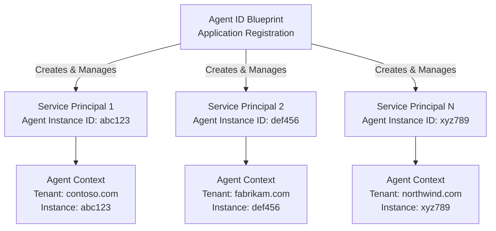
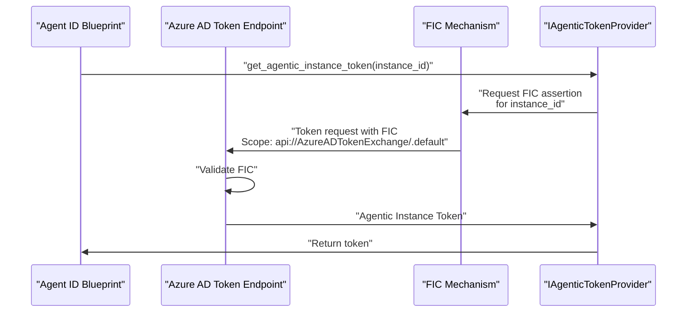
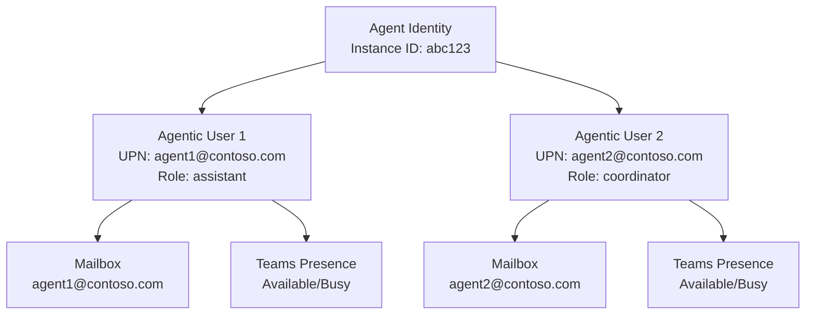
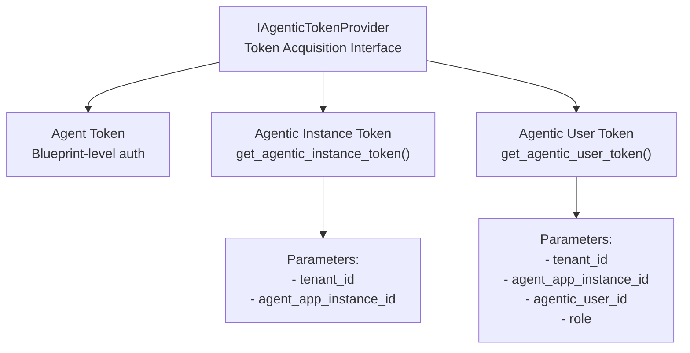
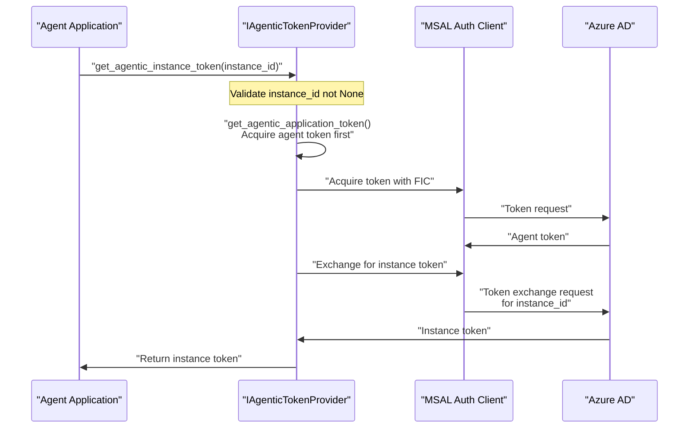
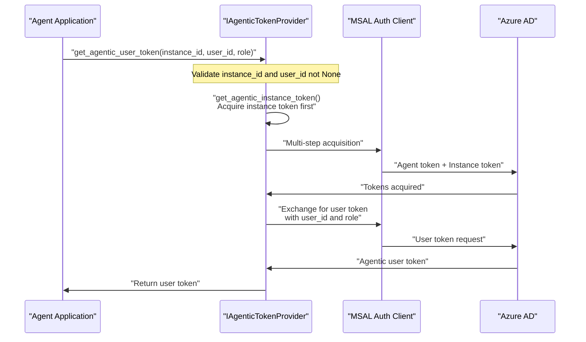
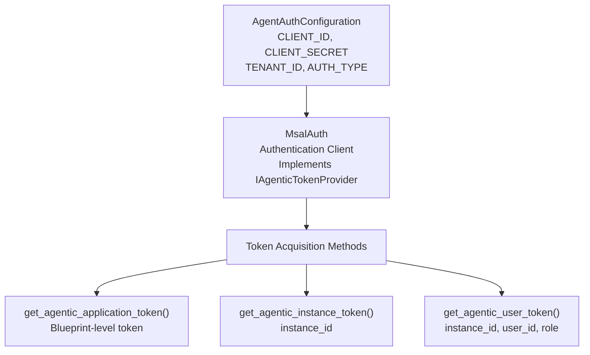
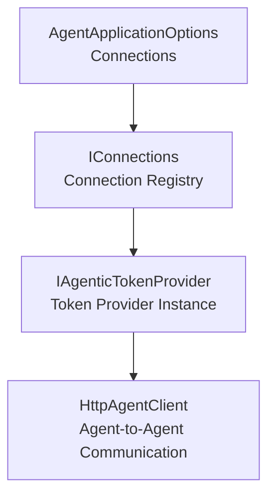
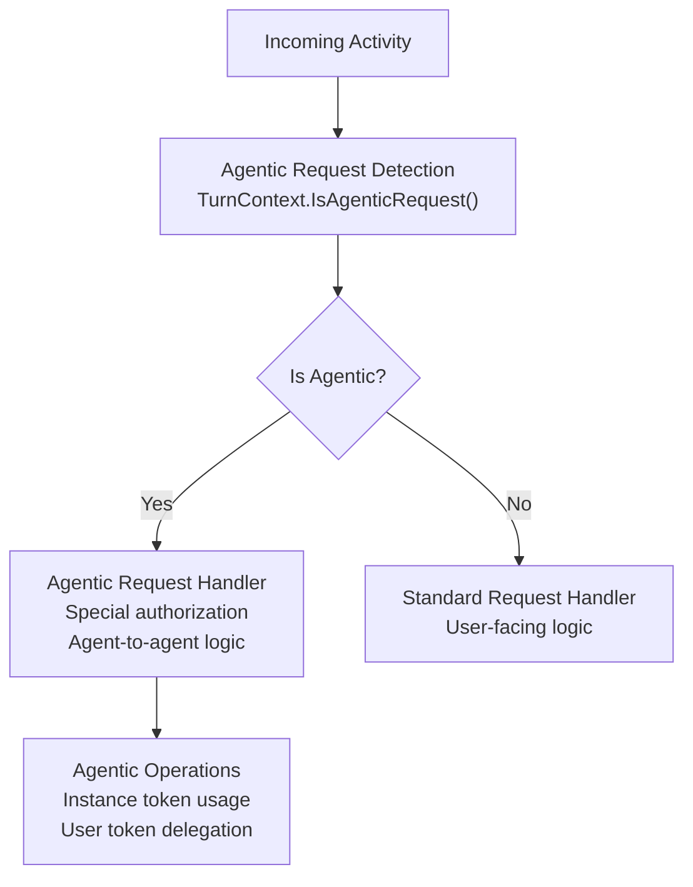
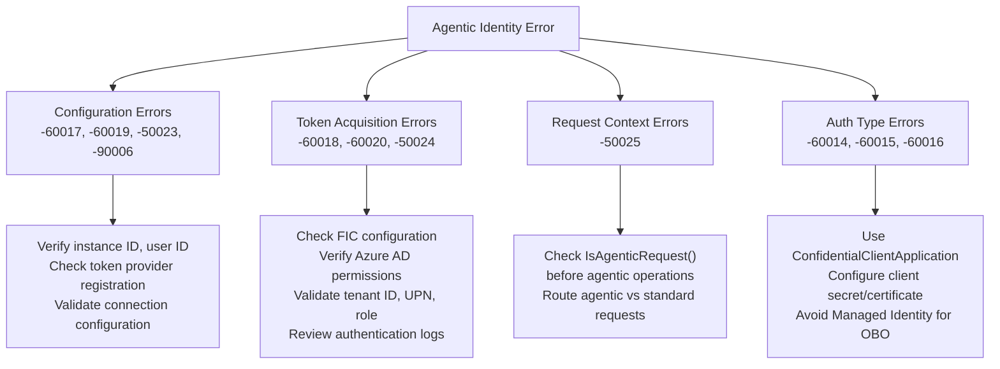

<!-- source: DeepWiki mcp.deepwiki.com · repo microsoft/Agents · page 3.4 Agentic Identity · fetched 2026-10-26 -->

# Agentic Identity

<details>
<summary>Relevant source files</summary>

The following files were used as context for generating this wiki page:

- [AgentErrorCodes.md](AgentErrorCodes.md)

</details>


## Purpose and Scope

This document explains the three-tier agentic identity architecture used by the Microsoft 365 Agents SDK to enable autonomous agents that can act like users within the Microsoft 365 ecosystem. The architecture consists of Agent ID Blueprints, Agent Identities, and Agentic Users, each serving a specific role in the authentication and authorization chain.

This page covers identity concepts specific to autonomous agent operations. For general bot authentication, see [Bot Authentication](#3.1). For user authentication and OAuth flows, see [User Authentication](#3.2). For On-Behalf-Of token exchange, see [OBO Authorization](#3.3).

## Overview: Three-Tier Identity Architecture

The Microsoft 365 Agents SDK implements a hierarchical identity model that allows autonomous agents to operate with user-like privileges while maintaining clear authorization boundaries. This model consists of three distinct identity layers, each with specific capabilities and restrictions.

### Identity Hierarchy

```mermaid
graph TB
    AAD["Azure Active Directory<br/>Tenant"]
    
    AAD --> Blueprint["Agent ID Blueprint<br/>Application Registration<br/>Manages Child Identities"]
    
    Blueprint --> AI1["Agent Identity<br/>Service Principal<br/>Agent Instance 1"]
    Blueprint --> AI2["Agent Identity<br/>Service Principal<br/>Agent Instance 2"]
    Blueprint --> AIN["Agent Identity<br/>Service Principal<br/>Agent Instance N"]
    
    AI1 --> AU1["Agentic User<br/>Autonomous Identity<br/>User-like Capabilities"]
    AI2 --> AU2["Agentic User<br/>Autonomous Identity<br/>User-like Capabilities"]
    AIN --> AUN["Agentic User<br/>Autonomous Identity<br/>User-like Capabilities"]
    
    Blueprint -.."FIC Impersonation"..-> TokenProvider["IAgenticTokenProvider<br/>Token Acquisition"]
    
    TokenProvider --> InstanceToken["Agentic Instance Token<br/>Agent Instance Auth"]
    TokenProvider --> UserToken["Agentic User Token<br/>User Delegation"]
```

**Sources:** [AgentErrorCodes.md:47-61]()

The hierarchy operates as follows:

| Layer | Type | Scope | Purpose |
|-------|------|-------|---------|
| **Agent ID Blueprint** | Application Registration | Single application across tenants | Defines agent logic, creates and manages child Agent Identities |
| **Agent Identity** | Service Principal | Single tenant, multiple per Blueprint | Represents agent instances, derived from Blueprint |
| **Agentic User** | Autonomous Identity | Single tenant, tied to specific Agent Identity | Acts like user account with mailbox, chat participation, etc. |

## Agent ID Blueprint

The Agent ID Blueprint is the top-level application registration in Azure Active Directory that represents the agent's business logic and orchestration capabilities. It serves as the parent identity that can create and manage multiple Agent Identities.

### Blueprint Characteristics

**Application Type:** The Blueprint is registered as a standard Azure AD application, typically matching the Agent ID configured in Azure Bot Service [AgentErrorCodes.md:52-54]().

**Multi-Tenant vs Single-Tenant:** While the Blueprint application registration can be configured for multi-tenant scenarios, each Agent Identity it creates is single-tenant, existing only in the tenant where the Blueprint is installed [AgentErrorCodes.md:56-57]().

**Management Capabilities:** The Blueprint has exclusive rights to create, configure, and manage its child Agent Identities. This parent-child relationship is enforced at the Azure AD level, preventing unauthorized identity creation [AgentErrorCodes.md:52-53]().

### Blueprint Configuration

Configuration typically involves setting the Blueprint's client ID in the agent's authentication settings:

```mermaid
graph LR
    Config["AgentAuthConfiguration<br/>CLIENT_ID"]
    Blueprint["Agent ID Blueprint<br/>Application Registration"]
    BotService["Azure Bot Service<br/>Bot Registration"]
    
    Config --> Blueprint
    Blueprint -.."Should Match"..-> BotService
```

**Sources:** [AgentErrorCodes.md:54](), [AgentErrorCodes.md:636-647]()

The `CLIENT_ID` in `AgentAuthConfiguration` should match the application ID of the Blueprint. This identifier is used throughout authentication flows to establish the Blueprint's identity when creating tokens for child Agent Identities.

## Agent Identity

Agent Identities are service principals derived from the Agent ID Blueprint. Each Agent Identity represents a specific instance of an autonomous agent and exists as an app-like identity within a single tenant.

### Identity Creation and Management

Agent Identities are created by their parent Blueprint through Azure AD APIs. The Blueprint uses its credentials to create service principals that inherit from its definition but operate as independent identities [AgentErrorCodes.md:56-57]().



**Sources:** [AgentErrorCodes.md:56-57]()

### Agent Instance ID

Each Agent Identity is associated with a unique Agent Application Instance ID, which serves as its identifier within the agent system [AgentErrorCodes.md:136-145]().

**Error -60017:** "Agent application instance Id must be provided" - This error occurs when attempting agentic token acquisition without providing the instance ID [AgentErrorCodes.md:136-145]().

The instance ID is required for:
- Acquiring agentic instance tokens [AgentErrorCodes.md:148-159]()
- Acquiring agentic user tokens [AgentErrorCodes.md:162-171]()
- Identifying the specific agent in multi-agent scenarios

### Federated Identity Credential (FIC) Impersonation

The Blueprint acquires tokens for its child Agent Identities through FIC impersonation. This mechanism allows the Blueprint to obtain tokens on behalf of Agent Identities without requiring separate credential management for each identity [AgentErrorCodes.md:56]().



**Sources:** [AgentErrorCodes.md:56](), [AgentErrorCodes.md:1486-1494]()

The FIC impersonation flow requires proper configuration of federated identity credentials in Azure AD, typically with the scope `api://AzureAdTokenExchange/.default` [AgentErrorCodes.md:1492]().

## Agentic User

Agentic Users are autonomous identities that act like user accounts within Microsoft 365. Each Agentic User is tied to a specific Agent Identity (its parent) and inherits authorization from the parent Agent Identity's Blueprint.

### User-Like Capabilities

Agentic Users support the features of normal user accounts with some restrictions for security [AgentErrorCodes.md:47-51]():

- **Mailboxes:** Can have email mailboxes
- **Chat Participation:** Can participate in Teams chats and channels
- **Presence:** May have presence indicators
- **Identity:** Appears in user directories and rosters

**Restrictions:** Security policies limit certain capabilities to prevent abuse. The specific restrictions depend on tenant configuration and compliance policies.

### Agentic User Identity

Each Agentic User is identified by a user principal name (UPN) and is associated with:
- A parent Agent Identity (via Agent Instance ID)
- A role within the agent system
- A tenant context [AgentErrorCodes.md:1486]()



**Sources:** [AgentErrorCodes.md:47-51](), [AgentErrorCodes.md:1486]()

## Token Acquisition Flows

The SDK provides three distinct token types for agentic operations, each serving a specific authentication scenario. These tokens are acquired through the `IAgenticTokenProvider` interface.

### Token Provider Interface



**Sources:** [AgentErrorCodes.md:1473-1480](), [AgentErrorCodes.md:136-184]()

**Error -50023:** "An instance of IAgenticTokenProvider not found or not supported" - This error occurs when a connection does not implement `IAgenticTokenProvider` or the provider is unavailable [AgentErrorCodes.md:1473-1480]().

### Agentic Instance Token Acquisition

Agentic instance tokens authenticate a specific agent instance (Agent Identity) for agent-to-agent communication or service access.



**Sources:** [AgentErrorCodes.md:148-159](), [AgentErrorCodes.md:176-184]()

**Error -60018:** "Failed to acquire agentic instance token or agent token for agent_app_instance_id {instance_id}" - This error occurs when the multi-step token acquisition process fails [AgentErrorCodes.md:148-159]().

The acquisition flow requires:
1. A valid agent application instance ID [AgentErrorCodes.md:136-145]()
2. Proper FIC configuration in Azure AD
3. Successful agent token acquisition as a prerequisite [AgentErrorCodes.md:176-184]()

### Agentic User Token Acquisition

Agentic user tokens authenticate operations performed on behalf of an Agentic User, enabling user-delegated permissions.



**Sources:** [AgentErrorCodes.md:162-184]()

**Error -60019:** "Agent application instance Id and agentic user Id must be provided" - Both identifiers are required for user token acquisition [AgentErrorCodes.md:162-171]().

**Error -60020:** "Failed to acquire instance token or agent token for agent_app_instance_id {instance_id} and agentic_user_id {user_id}" - This error occurs when prerequisite tokens cannot be acquired [AgentErrorCodes.md:176-184]().

The user token acquisition requires:
1. Valid agent application instance ID
2. Valid agentic user ID
3. Role specification [AgentErrorCodes.md:1486]()
4. Successful instance token acquisition as a prerequisite

### Token Provider Configuration Error

**Error -50024:** "Unable to get Agentic token for Tenant '{0}', InstanceId '{1}', UPN '{2}', Role '{3}'" - This comprehensive error provides context about all parameters when agentic token acquisition fails [AgentErrorCodes.md:1486-1494]().

**Likely causes:**
- Misconfigured federated identity credentials
- Missing API permissions for `api://AzureAdTokenExchange/.default`
- Invalid agent instance registration
- Incorrect tenant ID, UPN, or role values

## Configuration

### Python Configuration

In Python implementations, agentic authentication is configured through the `MsalAuth` and `AgentAuthConfiguration` classes:



**Sources:** [AgentErrorCodes.md:136-184]()

The `MsalAuth` class validates authentication type and configuration before attempting token acquisition [AgentErrorCodes.md:124-132]().

### C# Configuration

In .NET implementations, agentic identity is configured through `AgentApplicationOptions` and the connections system:



**Sources:** [AgentErrorCodes.md:1473-1480](), [AgentErrorCodes.md:1995-2002]()

**Error -90006:** "Token Provider '{0}' for Agent '{1}' not found" - This error occurs when an agent's configured token provider cannot be found in the connections registry [AgentErrorCodes.md:1995-2002]().

Configuration must ensure:
1. Token providers are registered in `IConnections` [AgentErrorCodes.md:1193-1207]()
2. Agent connection settings reference valid provider names [AgentErrorCodes.md:1995-2002]()
3. Providers implement `IAgenticTokenProvider` for agentic scenarios [AgentErrorCodes.md:1473-1480]()

### JavaScript Configuration

JavaScript/TypeScript implementations configure agentic identity through the authorization system in the `@microsoft/agents-hosting` package. The configuration follows similar patterns to Python and .NET, with token providers configured in the agent application options.

**Sources:** High-level diagrams indicate JavaScript support, though specific configuration details are primarily documented in Python and .NET sections.

## Agentic Request Detection

The SDK provides mechanisms to detect whether an incoming request is an agentic request, allowing handlers to apply appropriate logic and authorization checks.



**Sources:** [AgentErrorCodes.md:1498-1506]()

**Error -50025:** "Invalid operation '{0}' on a non-Agentic request" - This error occurs when code attempts agentic-specific operations on non-agentic requests [AgentErrorCodes.md:1498-1506]().

**Best Practice:** Always check if a request is agentic before calling agentic-specific APIs:

```
Check: turnContext.IsAgenticRequest()
Then: Call agentic token providers or agentic-specific methods
Otherwise: Handle as standard bot conversation
```

## Authentication Type Restrictions

Not all authentication types support agentic token acquisition. The SDK validates authentication configuration and raises errors when incompatible authentication methods are used.

### Managed Identity Limitations

**Error -60014:** "On-behalf-of flow is not supported with Managed Identity authentication" - Managed Identity cannot be used for OBO flows [AgentErrorCodes.md:99-108]().

**Error -60015:** "On-behalf-of flow is not supported with the current authentication type: {auth_type}" - Only Confidential Client Application supports OBO [AgentErrorCodes.md:112-121]().

**Supported Authentication Types:**

| Authentication Type | Agentic Tokens | OBO Support | FIC Support |
|---------------------|----------------|-------------|-------------|
| Client Secret (ConfidentialClientApplication) | ✓ | ✓ | ✓ |
| Client Certificate (ConfidentialClientApplication) | ✓ | ✓ | ✓ |
| Managed Identity (System) | Limited | ✗ | ✗ |
| Managed Identity (User) | Limited | ✗ | ✗ |

**Sources:** [AgentErrorCodes.md:99-132]()

**Error -60016:** "Authentication Type Not Supported" - This error indicates an unsupported or unrecognized authentication type [AgentErrorCodes.md:124-132]().

Agentic identity features require Confidential Client Application authentication (client secret or certificate) to support the full range of token exchange operations including FIC impersonation and OBO flows.

## Error Handling and Troubleshooting

### Common Agentic Identity Errors



**Sources:** [AgentErrorCodes.md:136-184](), [AgentErrorCodes.md:1473-1506](), [AgentErrorCodes.md:99-132]()

### Missing Instance ID

When you see **Error -60017**: "Agent application instance Id must be provided" [AgentErrorCodes.md:136-145]():

1. Verify instance ID is passed to token acquisition methods
2. Check agent registration in Microsoft 365 platform
3. Ensure instance ID is correctly extracted from agent context
4. Validate configuration includes instance ID mapping

### Token Acquisition Failures

When you see **Error -60018** or **-60020** [AgentErrorCodes.md:148-184]():

1. Enable detailed authentication logging
2. Verify FIC configuration in Azure AD app registration
3. Check that `api://AzureAdTokenExchange/.default` scope is configured
4. Confirm agent instance ID is registered and valid
5. Review Azure AD authentication logs for specific token request failures
6. Verify tenant ID matches where agent is deployed

### Provider Not Found

When you see **Error -50023** or **-90006** [AgentErrorCodes.md:1473-1480](), [AgentErrorCodes.md:1995-2002]():

1. Check `IConnections` configuration includes required providers
2. Verify token provider names in agent connection settings
3. Ensure providers implement `IAgenticTokenProvider`
4. Review dependency injection registration for connections
5. Validate configuration loading at application startup

### Invalid Agentic Operations

When you see **Error -50025**: "Invalid operation '{0}' on a non-Agentic request" [AgentErrorCodes.md:1498-1506]():

1. Add `turnContext.IsAgenticRequest()` check before agentic operations
2. Implement separate routing for agentic vs standard requests
3. Review activity properties to understand request type
4. Ensure agentic-specific handlers only execute for agentic contexts

### Token Acquisition Failed with Details

When you see **Error -50024** with full parameter context [AgentErrorCodes.md:1486-1494]():

**Check Tenant ID:** Verify the tenant ID matches the deployment environment

**Check Instance ID:** Confirm the agent instance is properly registered

**Check UPN:** Validate the Agentic User principal name is correct

**Check Role:** Ensure the role is properly defined in the agent system

**Check FIC:** Review federated identity credential configuration in Azure AD

**Check Permissions:** Verify API permissions are granted and consented for `api://AzureAdTokenExchange/.default`

## Security Considerations

### Authorization Boundaries

The three-tier architecture enforces clear authorization boundaries:

**Blueprint Level:** Controls creation and management of Agent Identities. Only the Blueprint can create or modify its child identities.

**Agent Identity Level:** Scoped to single tenant. Cannot operate across tenant boundaries without proper cross-tenant configuration.

**Agentic User Level:** Subject to same compliance and security policies as regular users, with additional restrictions to prevent abuse.

### Token Scope and Lifetime

Agentic tokens have specific scope and lifetime characteristics:

**Instance Tokens:** Short-lived, intended for immediate agent-to-agent communication or service calls. Should not be cached beyond their expiration.

**User Tokens:** Follow user token lifetime policies but are issued to autonomous identities. Subject to token refresh and revocation policies.

**Token Validation:** All agentic tokens include claims identifying the Blueprint, Agent Identity, and Agentic User (if applicable) for fine-grained authorization decisions.

### FIC Security

Federated Identity Credential (FIC) impersonation is a privileged operation:

**Configuration:** FIC must be explicitly configured in Azure AD for the Blueprint application
**Scope Restrictions:** Typically limited to `api://AzureAdTokenExchange/.default`
**Audit:** FIC token issuance is logged in Azure AD audit logs
**Rotation:** FIC credentials should be rotated according to security policies

**Sources:** [AgentErrorCodes.md:56](), [AgentErrorCodes.md:1486-1494]()

---

