<!-- source: DeepWiki mcp.deepwiki.com · repo microsoft/Agents · page 4 Deployment and Hosting · fetched 2026-10-26 -->

# Deployment and Hosting

<details>
<summary>Relevant source files</summary>

The following files were used as context for generating this wiki page:

- [MCSandAgentsEcosystemLinks.md](MCSandAgentsEcosystemLinks.md)
- [README.md](README.md)
- [samples/nodejs/quickstart/README.md](samples/nodejs/quickstart/README.md)
- [samples/nodejs/quickstart/env.TEMPLATE](samples/nodejs/quickstart/env.TEMPLATE)
- [samples/nodejs/quickstart/package.json](samples/nodejs/quickstart/package.json)
- [samples/nodejs/quickstart/src/index.ts](samples/nodejs/quickstart/src/index.ts)
- [samples/nodejs/quickstart/tsconfig.json](samples/nodejs/quickstart/tsconfig.json)

</details>


This document covers the deployment and hosting architecture for Microsoft 365 Agents SDK applications. It explains runtime environments, local development setup, Azure Bot Service integration, cloud deployment options, and storage configuration.

For information about the underlying Activity Protocol and Channel APIs that agents communicate through, see [Activity Protocol Specification](#8.2). For CI/CD pipeline details and automated build processes, see [CI/CD and Build Pipeline](#4.3). For local development workflows using the Agents Playground, see [Local Development](#4.2).

## Deployment Architecture Overview

Agents built with the Microsoft 365 Agents SDK follow a flexible deployment model that supports both local development and production hosting across multiple environments. All implementations share a common architecture regardless of language or hosting platform.

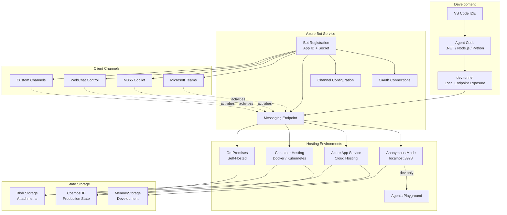

**Sources**: [README.md:1-106](), [samples/nodejs/quickstart/README.md:1-104]()

## Runtime Environments

The Microsoft 365 Agents SDK supports three language runtimes, each with specific version requirements and hosting integrations.

### Runtime Requirements

| Language | Minimum Version | Hosting Framework | Package Manager |
|----------|----------------|-------------------|-----------------|
| .NET | 8.0 | ASP.NET Core | NuGet |
| Node.js | 20+ (22 recommended) | Express.js v5 | npm |
| Python | 3.8+ | aiohttp | pip |

### Node.js Runtime Configuration

Node.js agents use the Express.js framework for HTTP hosting. The `@microsoft/agents-hosting-express` package provides the integration layer.

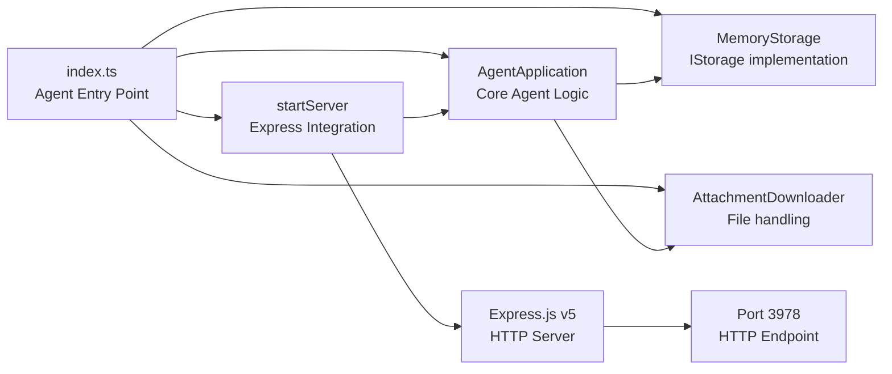

The basic agent initialization pattern is shown in [samples/nodejs/quickstart/src/index.ts:1-44]():

- Line 19: `MemoryStorage` is instantiated for development
- Line 21: `AttachmentDownloader` handles file downloads
- Lines 23-26: `AgentApplication` is created with storage and downloader configuration
- Line 43: `startServer` from `@microsoft/agents-hosting-express` starts the HTTP server

**Sources**: [samples/nodejs/quickstart/src/index.ts:1-44](), [samples/nodejs/quickstart/package.json:1-30]()

## Local Development Setup

Local development requires configuring the agent to run on `localhost` and exposing it for testing with client applications.

### Anonymous Mode Operation

Anonymous mode allows agents to run without Azure Bot Service authentication, suitable for initial development and testing with the Agents Playground.

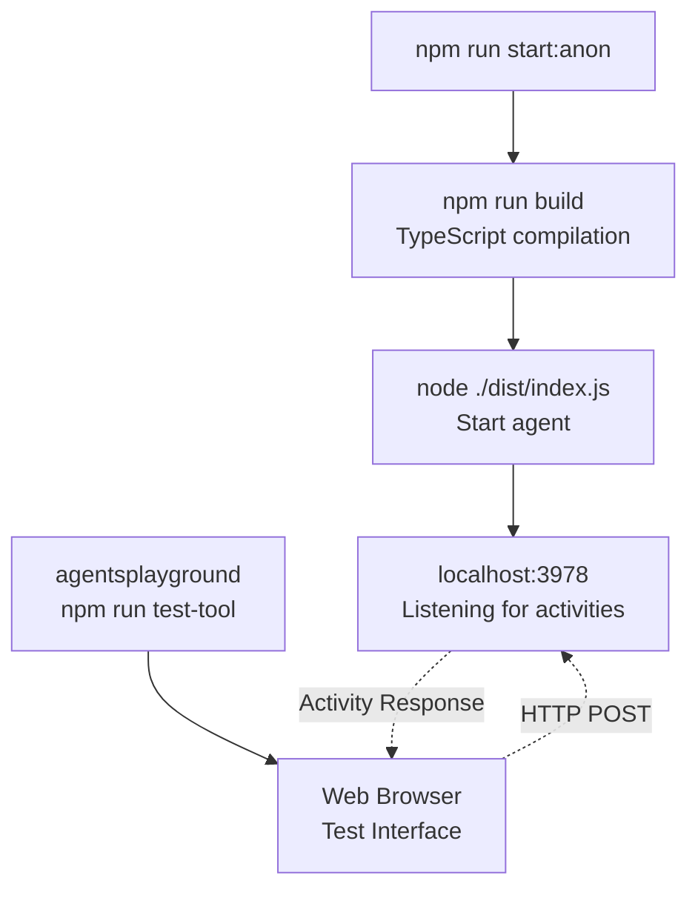

The anonymous mode is configured via npm scripts in [samples/nodejs/quickstart/package.json:1-30]():

- Line 14: `start:anon` runs the agent without environment variables
- Line 15: `start` uses `--env-file .env` for authenticated mode
- Line 16: `test-tool` launches the Agents Playground
- Line 17: `test` runs both agent and test tool in parallel

**Sources**: [samples/nodejs/quickstart/package.json:1-30](), [samples/nodejs/quickstart/README.md:26-66]()

### Dev Tunnel for External Access

Dev tunnel exposes the local agent endpoint to external services like Azure Bot Service for testing with real channels.

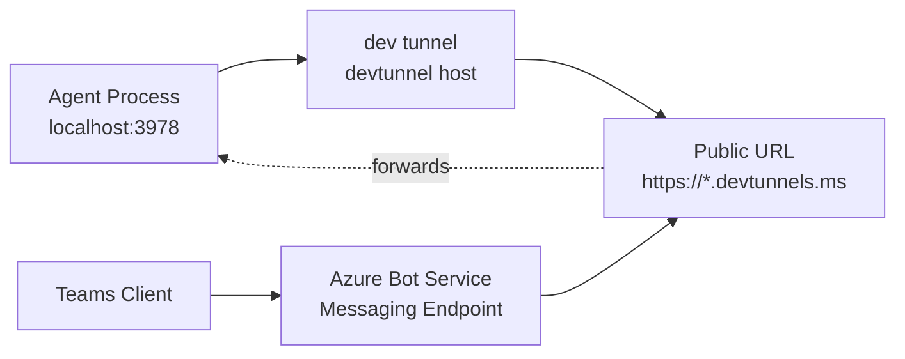

Dev tunnel setup as described in [samples/nodejs/quickstart/README.md:80-88]():

1. Install dev tunnel: `https://learn.microsoft.com/en-us/azure/developer/dev-tunnels/get-started`
2. Run: `devtunnel host -p 3978 --allow-anonymous`
3. Note the URL shown after "Connect via browser:"
4. Configure Azure Bot Service messaging endpoint to `{tunnel-url}/api/messages`

**Sources**: [samples/nodejs/quickstart/README.md:70-95]()

## Azure Bot Service Configuration

Azure Bot Service provides bot registration, channel management, and OAuth connection configuration. All production agents require an Azure Bot Service registration.

### Bot Registration Components

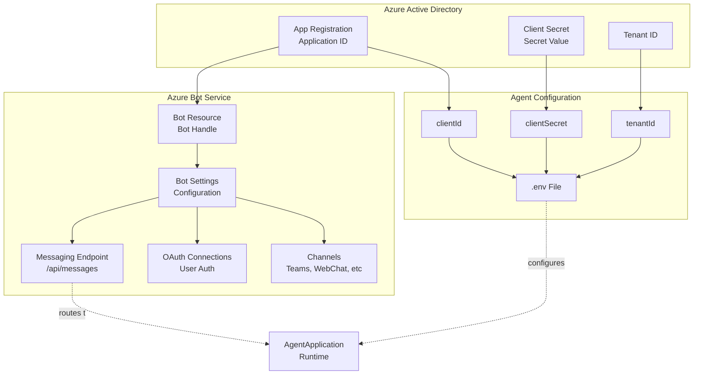

Configuration template is provided in [samples/nodejs/quickstart/env.TEMPLATE:1-10]():

- Line 2: `connections__serviceConnection__settings__clientId` - Application ID from App Registration
- Line 3: `connections__serviceConnection__settings__clientSecret` - Secret value from App Registration
- Line 4: `connections__serviceConnection__settings__tenantId` - Tenant ID where app is registered
- Lines 6-7: Connection mapping for service URLs
- Line 9: Debug logging configuration

**Sources**: [samples/nodejs/quickstart/env.TEMPLATE:1-10](), [samples/nodejs/quickstart/README.md:70-95]()

### Service Connection Configuration Pattern

The hierarchical configuration structure uses double underscores (`__`) to denote nested configuration objects:

```
connections__serviceConnection__settings__clientId
└─┬─────┘ └────────┬──────────┘ └───┬────┘ └───┬───┘
  │               │                  │          │
  Root         Connection       Settings    Property
               Name              Group        Name
```

The `connectionsMap` array maps connection names to service URLs:
- `connectionsMap__0__connection=serviceConnection` - Connection name
- `connectionsMap__0__serviceUrl=*` - Wildcard matches all service URLs

**Sources**: [samples/nodejs/quickstart/env.TEMPLATE:1-10]()

## Cloud Deployment Options

Production agents deploy to Azure App Services, container platforms, or on-premises infrastructure with production-grade storage backends.

### Azure App Service Deployment

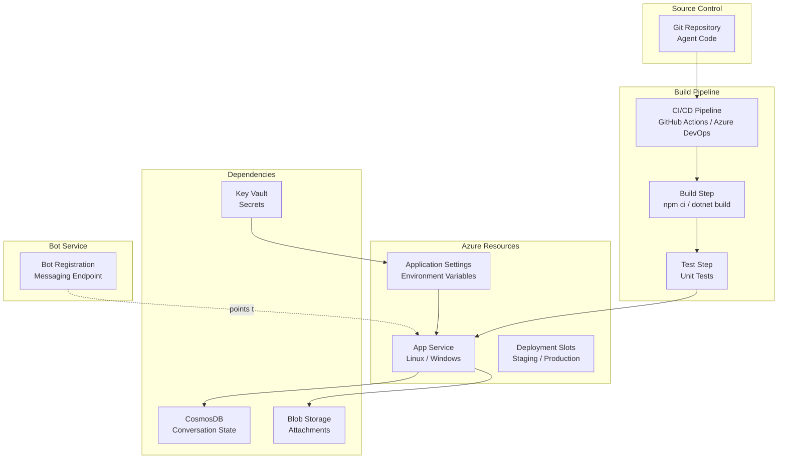

Deployment configuration requirements:

1. **Runtime Configuration**: Node.js 20+, .NET 8.0, or Python 3.8+ runtime
2. **Application Settings**: Environment variables from `.env` template
3. **Messaging Endpoint**: `https://{app-service-name}.azurewebsites.net/api/messages`
4. **Storage Connection Strings**: CosmosDB and Blob Storage connection strings
5. **Authentication Secrets**: Client ID, Client Secret, Tenant ID from Key Vault

**Sources**: [README.md:1-106](), [samples/nodejs/quickstart/README.md:96-98]()

### Container Deployment

Agents can be containerized using Docker and deployed to Kubernetes or Azure Container Instances:

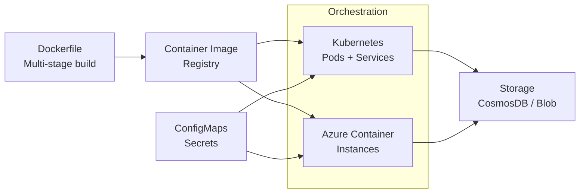

Container deployment considerations:
- Base image should include Node.js 20+, .NET 8.0, or Python 3.8+
- Multi-stage builds reduce final image size
- Environment variables injected via Kubernetes ConfigMaps or Secrets
- Health check endpoints for container orchestration
- Horizontal scaling requires stateless design with external storage

**Sources**: [README.md:1-106]()

## State and Storage Configuration

Agents require state storage for maintaining conversation context and blob storage for attachment handling.

### Storage Architecture

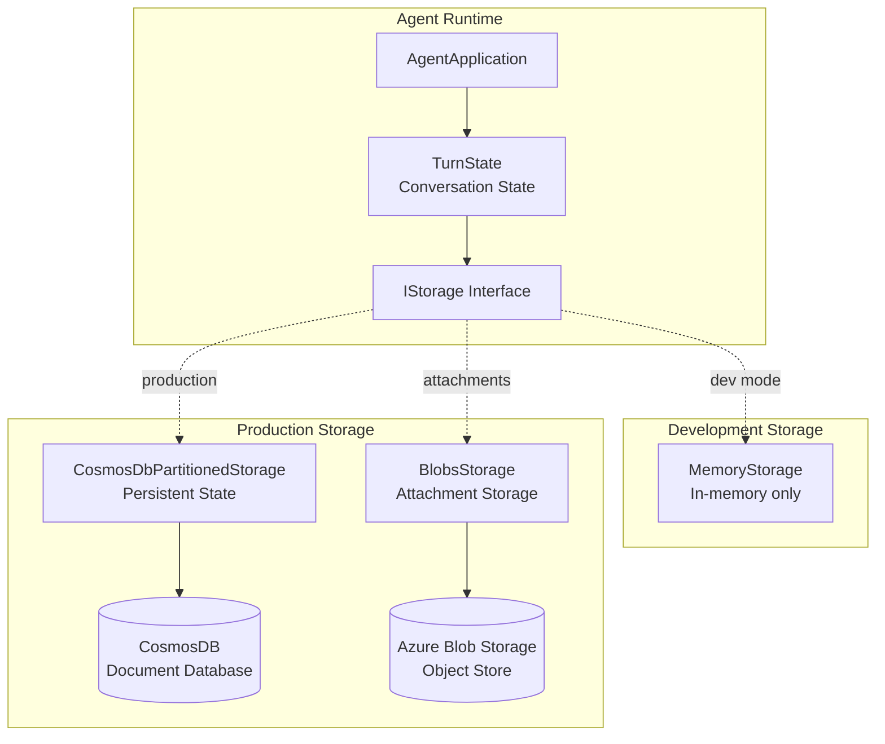

The `MemoryStorage` implementation shown in [samples/nodejs/quickstart/src/index.ts:15-19]():

```typescript
// Line 19: MemoryStorage instantiation for development
const storage = new MemoryStorage()
```

For production deployments:
- Replace `MemoryStorage` with `CosmosDbPartitionedStorage` for state persistence
- Configure `BlobsStorage` for attachment handling
- State survives agent restarts and supports clustered deployments
- CosmosDB provides partition key strategies for scaling

**Sources**: [samples/nodejs/quickstart/src/index.ts:15-19](), [samples/nodejs/quickstart/README.md:1-104]()

### MemoryStorage vs Production Storage

| Feature | MemoryStorage | CosmosDB + Blob |
|---------|---------------|-----------------|
| **Persistence** | None (lost on restart) | Persistent across restarts |
| **Scalability** | Single instance only | Horizontal scaling support |
| **Use Case** | Development and testing | Production deployments |
| **Configuration** | No configuration needed | Connection strings required |
| **Cost** | Free | Pay per usage |
| **Attachments** | In-memory | Blob Storage |

**Sources**: [samples/nodejs/quickstart/src/index.ts:15-26]()

## Environment Configuration Management

Configuration for deployed agents follows a hierarchical structure supporting both development and production scenarios.

### Configuration Hierarchy

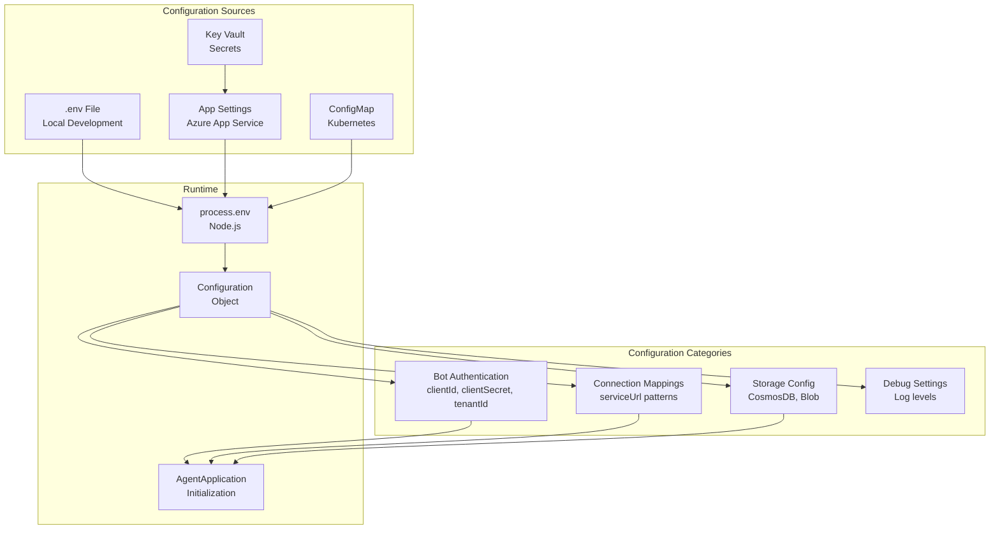

Configuration loading in Node.js uses the `--env-file` flag as shown in [samples/nodejs/quickstart/package.json:15]():

```json
"start": "node --env-file .env ./dist/index.js"
```

This loads environment variables from `.env` file before starting the agent process.

**Sources**: [samples/nodejs/quickstart/package.json:1-30](), [samples/nodejs/quickstart/env.TEMPLATE:1-10]()

### Secret Management Best Practices

1. **Never commit secrets to source control**: Use `.env` for local development, add to `.gitignore`
2. **Azure Key Vault for production**: Store `clientSecret` and connection strings in Key Vault
3. **App Service Configuration**: Reference Key Vault secrets in App Settings: `@Microsoft.KeyVault(SecretUri=...)`
4. **Managed Identity**: Use system-assigned or user-assigned managed identities to access Key Vault
5. **Least privilege**: Grant only necessary permissions to service principals

**Sources**: [samples/nodejs/quickstart/env.TEMPLATE:1-10](), [README.md:1-106]()

## Port and Endpoint Configuration

Agents expose HTTP endpoints for receiving activities from Azure Bot Service and other channels.

### Standard Endpoint Configuration

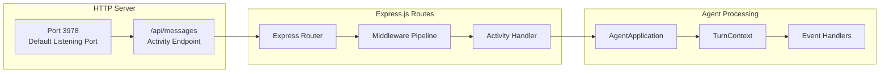

The `startServer` function from `@microsoft/agents-hosting-express` automatically:
- Starts Express.js server on port 3978
- Configures `/api/messages` route
- Sets up activity handling middleware
- Initializes JWT validation for bot authentication

Standard messaging endpoint format:
- **Local**: `http://localhost:3978/api/messages`
- **Dev Tunnel**: `https://{tunnel-id}.devtunnels.ms/api/messages`
- **Azure App Service**: `https://{app-name}.azurewebsites.net/api/messages`
- **Custom Domain**: `https://{custom-domain}/api/messages`

**Sources**: [samples/nodejs/quickstart/src/index.ts:43](), [samples/nodejs/quickstart/README.md:38-94]()

## Deployment Checklist

Before deploying an agent to production, verify the following:

### Pre-Deployment Requirements

| Category | Requirement | Verification |
|----------|-------------|--------------|
| **Bot Registration** | Azure Bot Service created | Azure Portal |
| **App Registration** | App ID and Secret generated | Azure AD |
| **Storage** | CosmosDB provisioned | Connection string tested |
| **Blob Storage** | Storage account created | Container exists |
| **Secrets** | Key Vault configured | Managed Identity assigned |
| **Endpoint** | Messaging endpoint configured | Bot Service settings |
| **Channels** | Required channels enabled | Teams, WebChat, etc. |

### Post-Deployment Validation

1. **Health Check**: Verify agent responds to health endpoint
2. **WebChat Test**: Test via Bot Service WebChat
3. **Teams Test**: Send message in Teams if enabled
4. **Authentication**: Verify OAuth flow completes
5. **State Persistence**: Confirm conversation state saves between messages
6. **Logging**: Check Application Insights for telemetry
7. **Error Handling**: Test error scenarios and verify graceful failure

**Sources**: [samples/nodejs/quickstart/README.md:70-104](), [README.md:1-106]()

## Multi-Environment Deployment Strategy

Production agent deployments typically follow a multi-environment strategy for safe releases.

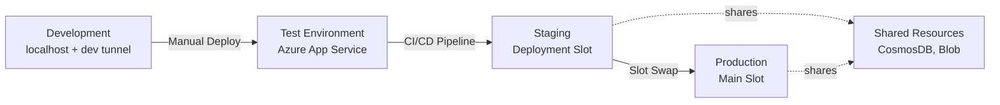

Environment-specific considerations:
- **Development**: Anonymous mode, MemoryStorage, dev tunnel
- **Test**: Azure Bot Service, test App ID, MemoryStorage or CosmosDB
- **Staging**: Production Bot Service, staging slot, production storage
- **Production**: Production slot, production secrets, monitoring enabled

Deployment slots enable:
- Zero-downtime deployments via slot swapping
- A/B testing with traffic splitting
- Quick rollback to previous version
- Independent configuration per slot

**Sources**: [README.md:1-106](), [samples/nodejs/quickstart/README.md:1-104]()

---

