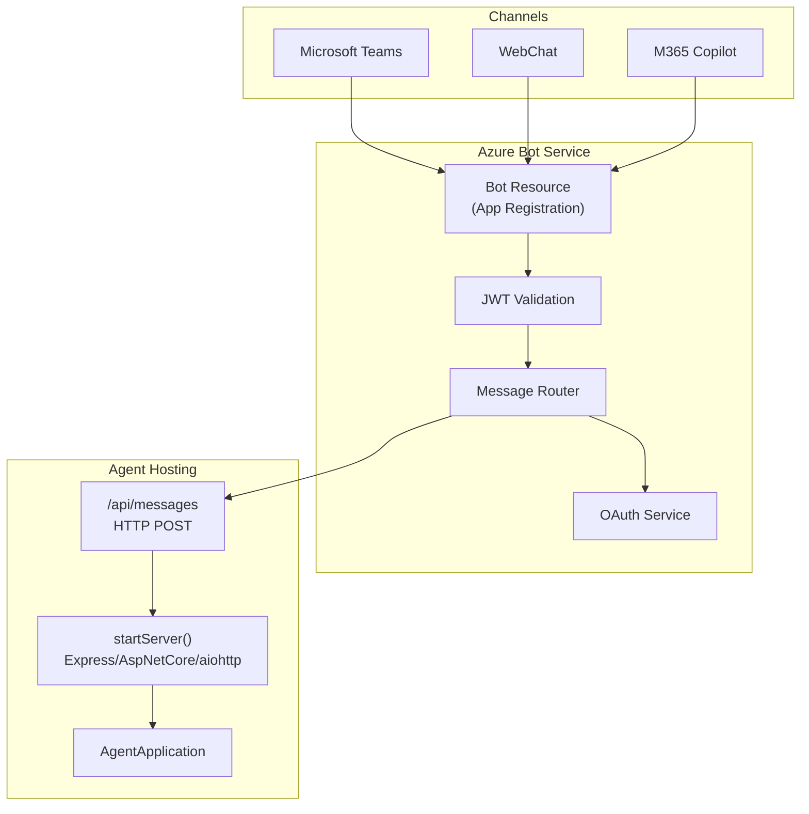
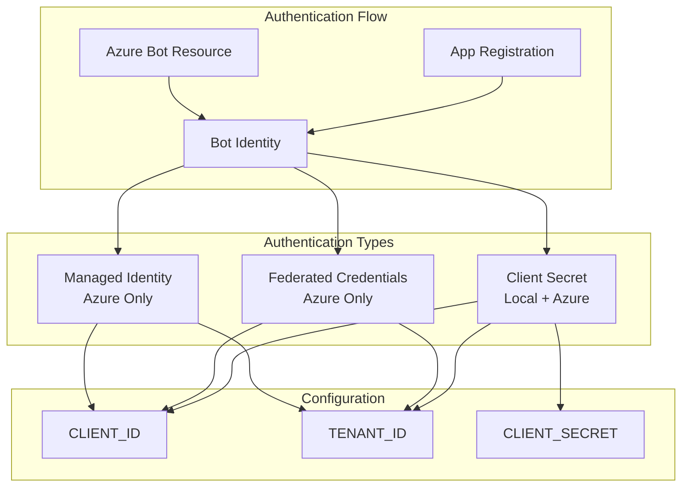
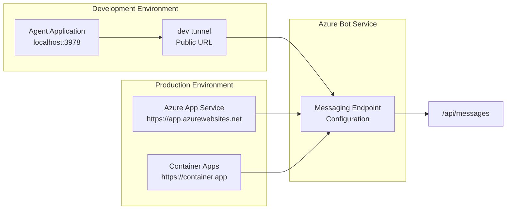
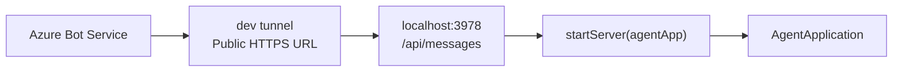
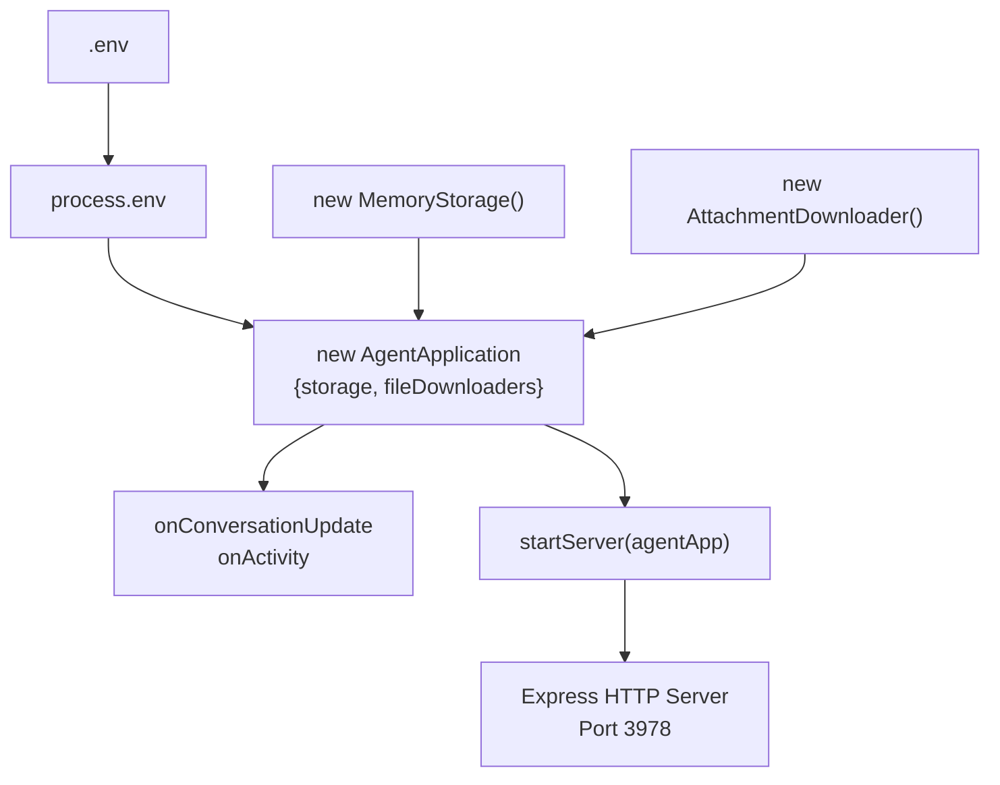
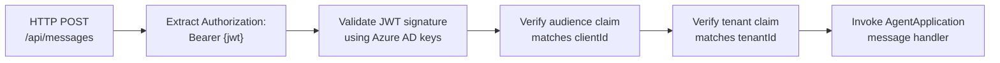
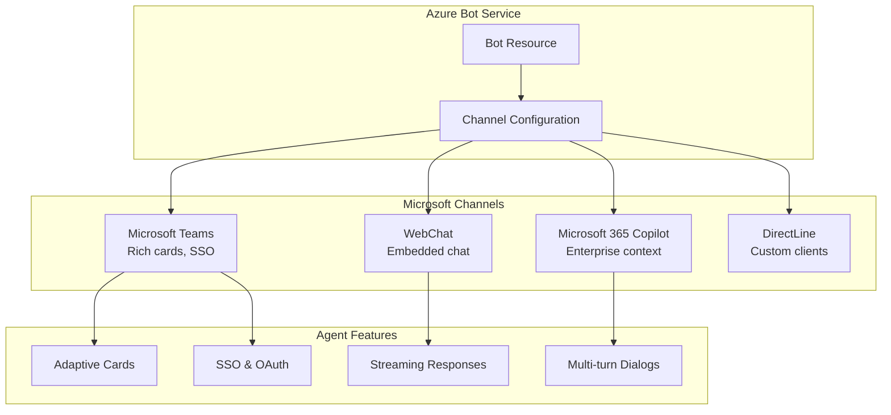

<!-- source: DeepWiki mcp.deepwiki.com · repo microsoft/Agents · page 4.1 Azure Bot Service Integration · fetched 2026-10-26 -->

# Azure Bot Service Integration

<details>
<summary>Relevant source files</summary>

The following files were used as context for generating this wiki page:

- [MCSandAgentsEcosystemLinks.md](MCSandAgentsEcosystemLinks.md)
- [README.md](README.md)
- [samples/nodejs/quickstart/README.md](samples/nodejs/quickstart/README.md)
- [samples/nodejs/quickstart/env.TEMPLATE](samples/nodejs/quickstart/env.TEMPLATE)
- [samples/nodejs/quickstart/package.json](samples/nodejs/quickstart/package.json)
- [samples/nodejs/quickstart/src/index.ts](samples/nodejs/quickstart/src/index.ts)
- [samples/nodejs/quickstart/tsconfig.json](samples/nodejs/quickstart/tsconfig.json)

</details>


This page covers how to configure and deploy Microsoft 365 Agents through Azure Bot Service, including bot resource creation, authentication setup, messaging endpoint configuration, and OAuth connections. This integration enables agents to receive messages from various channels like Microsoft Teams, WebChat, and Microsoft 365 Copilot.

For information about local development with dev tunnels, see [Local Development](#4.2). For CI/CD and deployment automation, see [CI/CD and Build Pipeline](#4.3).

## Azure Bot Service Overview

Azure Bot Service routes messages between channels (Teams, WebChat, M365 Copilot) and agent applications. The service handles JWT authentication, message serialization, and channel-specific protocol translation.

**Azure Bot Service Message Flow**



The agent receives Activity objects via POST to `/api/messages`. Node.js agents use `startServer()` from `@microsoft/agents-hosting-express` [samples/nodejs/quickstart/src/index.ts:43](), .NET agents use `AspNetCore`, and Python agents use `aiohttp`.

Sources: [samples/nodejs/quickstart/src/index.ts:3-43](), [samples/nodejs/quickstart/README.md:69-94]()

## Bot Resource Creation

Azure Bot Service requires a bot resource with associated App Registration for identity and authentication. The SDK supports three primary authentication methods, each with different deployment capabilities.

### Authentication Methods

| Authentication Type | Local Development | Azure Deployment | Token Source |
|-------------------|------------------|------------------|--------------|
| SingleTenant Client Secret | ✅ | ✅ | Client Secret |
| SingleTenant Federated Credentials | ❌ | ✅ | Federated Identity |
| User Assigned Managed Identity | ❌ | ✅ | Azure Managed Identity |



Sources: [samples/dotnet/auto-signin/README.md:26-34](), [samples/dotnet/quickstart/README.md:32-39](), [samples/python/obo-authorization/README.md:24-26]()

## Messaging Endpoint Configuration

The messaging endpoint is the URL where Azure Bot Service sends incoming activities to your agent. This endpoint must be publicly accessible and handle POST requests to `/api/messages`.

### Endpoint Configuration Patterns



### Development Endpoint Setup

Local development requires a public URL to receive messages from Azure Bot Service. The `dev tunnel` utility creates this endpoint:

```bash
devtunnel host -p 3978 --allow-anonymous
```

Configure the Bot Resource messaging endpoint to `{tunnel-url}/api/messages`. The agent application listens on port 3978 by default [samples/nodejs/quickstart/src/index.ts:43]().

**Dev Tunnel Message Flow**



### Production Endpoint Setup

Production deployments configure the messaging endpoint to the hosting service URL:

| Hosting Platform | Messaging Endpoint Format |
|-----------------|---------------------------|
| Azure App Service | `https://{app-service}.azurewebsites.net/api/messages` |
| Azure Container Apps | `https://{container-app}.{region}.azurecontainerapps.io/api/messages` |
| Custom Domain | `https://{domain}/api/messages` |

Sources: [samples/nodejs/quickstart/README.md:80-92](), [samples/nodejs/quickstart/src/index.ts:43]()

## Agent Application Configuration

Agent applications configure Azure Bot Service integration through environment variables (Node.js, Python) or configuration files (.NET).

### Node.js Configuration

Node.js agents use the `.env` file with hierarchical configuration keys [samples/nodejs/quickstart/env.TEMPLATE:1-9]():

```bash
# Bot Authentication
connections__serviceConnection__settings__clientId=<app-registration-id>
connections__serviceConnection__settings__clientSecret=<client-secret>
connections__serviceConnection__settings__tenantId=<tenant-id>

# Service URL Mapping
connectionsMap__0__connection=serviceConnection
connectionsMap__0__serviceUrl=*
```

**Node.js Agent Initialization**



The `AgentApplication` class [samples/nodejs/quickstart/src/index.ts:23-26]() initializes with:
- `storage`: `MemoryStorage` for development, CosmosDB/Blob for production
- `fileDownloaders`: Array of attachment downloaders for file handling

### .NET Configuration

.NET agents use `appsettings.json` with structured connection configuration:

```json
{
  "Connections": {
    "ServiceConnection": {
      "Settings": {
        "ClientId": "{{bot-app-id}}",
        "ClientSecret": "{{bot-secret}}",
        "TenantId": "{{tenant-id}}"
      }
    }
  }
}
```

### Python Configuration

Python agents use `load_configuration_from_env()` to parse environment variables into configuration dictionaries:

```python
agents_sdk_config = load_configuration_from_env(environ)
storage = MemoryStorage()
connection_manager = MsalConnectionManager(**agents_sdk_config)
cloud_adapter = CloudAdapter(connection_manager=connection_manager)
```

Sources: [samples/nodejs/quickstart/env.TEMPLATE:1-9](), [samples/nodejs/quickstart/src/index.ts:4-26]()

## OAuth Connection Setup

Azure Bot Service OAuth connections manage user tokens for Microsoft Graph, Dynamics 365, and custom APIs. Connections are configured at the Bot Resource level and referenced by connection name in agent code.

### OAuth Connection Flow

```mermaid
sequenceDiagram
    participant User
    participant AgentApplication["AgentApplication"]
    participant BotService["Azure Bot Service<br/>OAuth Service"]
    participant AAD["Azure AD"]
    participant GraphAPI["Microsoft Graph"]
    
    User->>AgentApplication: "Message Activity"
    AgentApplication->>BotService: "GetUserTokenAsync<br/>(connectionName)"
    
    alt "Token cached and valid"
        BotService->>AgentApplication: "Return access token"
    else "Token missing or expired"
        BotService->>AAD: "OAuth authorization request"
        AAD->>User: "Consent prompt<br/>(sign-in card)"
        User->>AAD: "Grant consent"
        AAD->>BotService: "Authorization code"
        BotService->>AAD: "Exchange for access token"
        AAD->>BotService: "Access token + refresh token"
        BotService->>AgentApplication: "Return access token"
    end
    
    AgentApplication->>GraphAPI: "API call with bearer token"
    GraphAPI->>AgentApplication: "API response"
    AgentApplication->>User: "Response message"
```

### OAuth Connection Configuration

OAuth connections require specific configuration for different scenarios:

| Connection Type | Use Case | Required Scopes |
|----------------|----------|-----------------|
| **Auto SignIn** | Automatic token for all messages | `User.Read`, custom scopes |
| **Per-Route Auth** | Token for specific handlers | Handler-specific scopes |
| **OBO Exchange** | Service-to-service calls | `api://botid-{appid}/defaultScope` |

For OBO authorization scenarios, connections require additional setup as shown in [samples/python/obo-authorization/README.md:32-67]():

1. **App Registration configuration**:
   - Redirect URI: `https://token.botframework.com/.auth/web/redirect`
   - API permissions: `Dynamics CRM`, `Graph`, `Power Platform API`
   - Exposed API scope: `api://botid-{{appid}}/defaultScope`

2. **Azure Bot OAuth connection**:
   - Service Provider: `Azure Active Directory v2`
   - Client credentials from App Registration
   - Scopes: `api://botid-{{appid}}/defaultScope`

Sources: [samples/python/obo-authorization/README.md:32-67](), [samples/dotnet/auto-signin/README.md:35-67]()

## JWT Token Validation

Production agents validate JWT tokens in incoming requests to verify the message originates from Azure Bot Service. Token validation verifies signature, audience, and tenant claims.

### Token Validation Configuration

**.NET Configuration** (`appsettings.json`):
```json
{
  "TokenValidation": {
    "Enabled": true,
    "Audiences": ["{{ClientId}}"],
    "TenantId": "{{TenantId}}"
  }
}
```

**Node.js Configuration**: Authentication is handled automatically by `startServer()` when `clientId` and `clientSecret` are configured in `.env` [samples/nodejs/quickstart/env.TEMPLATE:2-4]().

**Python Configuration**: `jwt_authorization_middleware` validates tokens using MSAL and JWT libraries in the aiohttp request pipeline.

### JWT Validation Flow



**Anonymous Mode**: Local development can run without authentication by omitting `clientId` configuration. The agent starts in anonymous mode [samples/nodejs/quickstart/README.md:26-39](), allowing testing without Azure Bot Service registration.

Sources: [samples/nodejs/quickstart/env.TEMPLATE:2-4](), [samples/nodejs/quickstart/README.md:26-39]()

## Channel Integration

Azure Bot Service enables agents to work across multiple Microsoft channels without code changes. Each channel may have specific capabilities and requirements.

### Supported Channels



### Teams Integration

Microsoft Teams provides the richest integration experience with features like:
- **Single Sign-On (SSO)**: Automatic user authentication
- **Rich UI**: Adaptive cards, message extensions
- **App manifest**: Deployment through Microsoft Admin Portal

Teams integration requires updating the app manifest as shown in [samples/dotnet/auto-signin/README.md:94-109]():
1. Replace `<<AAD_APP_CLIENT_ID>>` with bot's App ID
2. Replace `<<BOT_DOMAIN>>` with agent's public URL
3. Create `manifest.zip` with manifest, icons
4. Upload through Microsoft Admin Portal

Sources: [samples/dotnet/auto-signin/README.md:94-109](), [samples/dotnet/quickstart/README.md:64-81](), [samples/dotnet/semantic-kernel-multiturn/README.md:85-102]()

---

