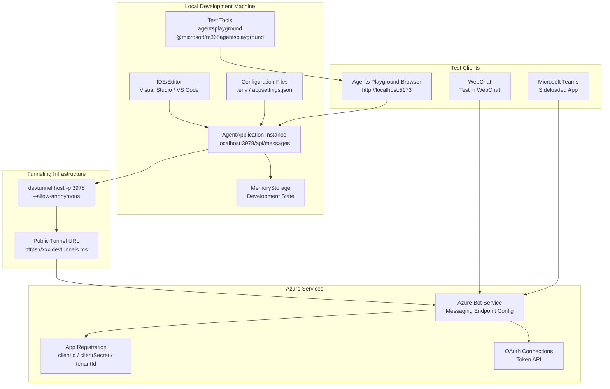
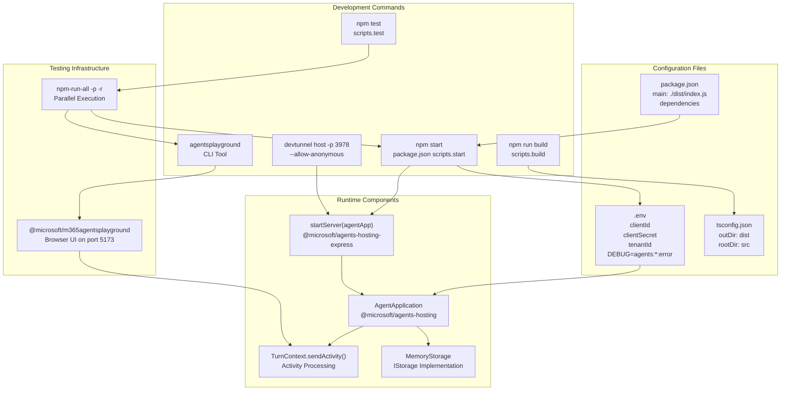
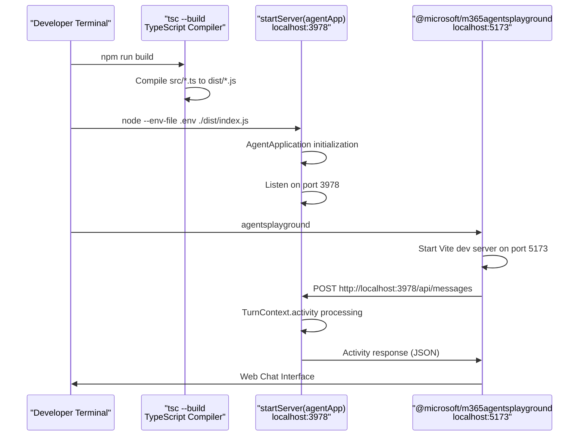
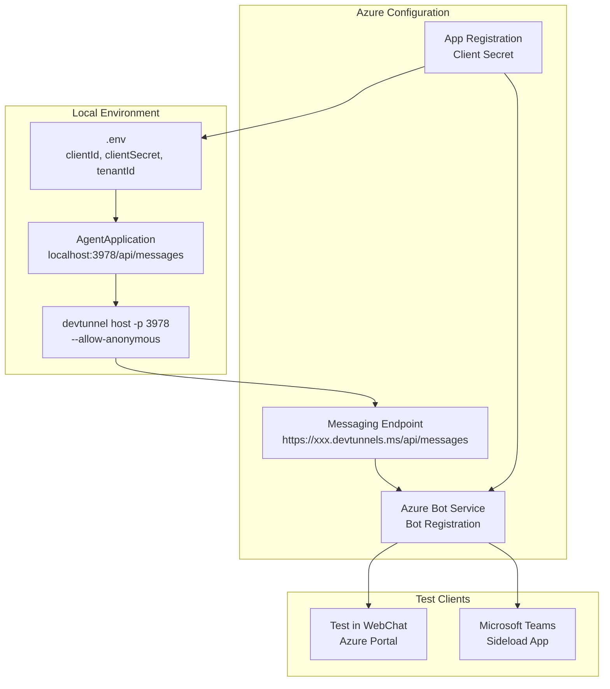
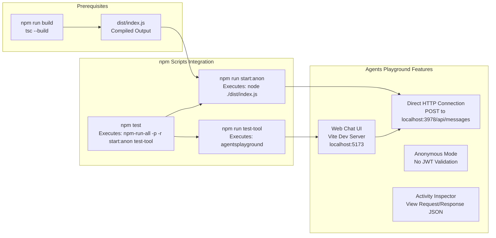

<!-- source: DeepWiki mcp.deepwiki.com · repo microsoft/Agents · page 4.2 Local Development · fetched 2026-10-26 -->

# Local Development

<details>
<summary>Relevant source files</summary>

The following files were used as context for generating this wiki page:

- [.github/workflows/cd-samples.yml](.github/workflows/cd-samples.yml)
- [eslint.config.js](eslint.config.js)
- [samples/nodejs/copilotstudio-webclient/web/index.html](samples/nodejs/copilotstudio-webclient/web/index.html)
- [samples/nodejs/quickstart/README.md](samples/nodejs/quickstart/README.md)
- [samples/nodejs/quickstart/env.TEMPLATE](samples/nodejs/quickstart/env.TEMPLATE)
- [samples/nodejs/quickstart/package.json](samples/nodejs/quickstart/package.json)
- [samples/nodejs/quickstart/src/index.ts](samples/nodejs/quickstart/src/index.ts)
- [samples/nodejs/quickstart/tsconfig.json](samples/nodejs/quickstart/tsconfig.json)

</details>


This page covers setting up and running Microsoft 365 Agents locally during development. It explains the tools, configuration, and workflows needed to develop, test, and debug agents on your local machine before deploying to production environments.

For information about deploying agents to production environments, see [Azure Bot Service Integration](#4.1). For details about the automated build and deployment processes, see [CI/CD and Build Pipeline](#4.3).

## Development Environment Overview

Local development of Microsoft 365 Agents involves running the `AgentApplication` on your local machine (typically on port 3978) while connecting to external services through dev tunnel. The agent application processes incoming `Activity` objects through the `/api/messages` endpoint and returns responses using the `TurnContext` API.

**Local Development Architecture**



**Sources:** [samples/nodejs/quickstart/README.md:35-41](), [samples/nodejs/quickstart/src/index.ts:19-26](), [samples/nodejs/quickstart/env.TEMPLATE:1-9]()

## Development Tools and Architecture

The local development environment uses specific npm scripts, configuration files, and runtime components to orchestrate the agent lifecycle.

**Development Command Flow**



**Sources:** [samples/nodejs/quickstart/package.json:8-18](), [samples/nodejs/quickstart/src/index.ts:3-6](), [samples/nodejs/quickstart/src/index.ts:19-26](), [samples/nodejs/quickstart/tsconfig.json:1-20]()

## Setting Up Local Development

### Prerequisites by Language

**Node.js Development:**
- Node.js version 20 or higher (verified with `node --version`)
- npm package manager
- TypeScript compiler (`typescript` package in devDependencies)
- dev tunnel tool

**Sources:** [samples/nodejs/quickstart/README.md:9-14](), [samples/nodejs/quickstart/package.json:26]()

**.NET Development:**
- .NET 8.0 SDK
- Visual Studio or Visual Studio Code
- dev tunnel tool
- Microsoft 365 Agents Toolkit (optional)

**Sources:** [samples/nodejs/quickstart/README.md:9-14]()

### Installing Dev Tunnel

Dev tunnel is essential for local development as it exposes your local agent to external services:

```bash
# Install dev tunnel (if not already installed)
# Follow: https://learn.microsoft.com/azure/developer/dev-tunnels/get-started

# Host tunnel with anonymous access on port 3978
devtunnel host -p 3978 --allow-anonymous
```

**Sources:** [samples/dotnet/auto-signin/README.md:74-78](), [samples/nodejs/langchain-multiturn/README.md:66-70]()

### Configuration Files

**Node.js Configuration (.env):**

The `.env` file configures the agent application through environment variables. The SDK uses a hierarchical configuration system with double-underscore separators:

```env
# Bot Identity Configuration
connections__serviceConnection__settings__clientId= # App ID from App Registration
connections__serviceConnection__settings__clientSecret= # Secret Value from App Registration
connections__serviceConnection__settings__tenantId= # Tenant ID

# Connection Mapping
connectionsMap__0__connection=serviceConnection
connectionsMap__0__serviceUrl=*

# Debug Logging
DEBUG=agents:*:error
```

The `connections__serviceConnection__settings__*` keys configure the MSAL authentication provider, while `connectionsMap__*` maps connection names to service URLs for the `AgentApplication` constructor.

**Sources:** [samples/nodejs/quickstart/env.TEMPLATE:1-9](), [samples/nodejs/quickstart/README.md:75-78]()

**.NET Configuration (appsettings.json):**

For .NET agents, `appsettings.json` configures the `AgentApplication` and token validation:

```json
{
  "AgentApplication": {
    "UserAuthorization": {
      "DefaultHandlerName": "auto",
      "AutoSignIn": true,
      "Handlers": {
        "auto": {
          "Settings": {
            "AzureBotOAuthConnectionName": "{{connection_name}}",
            "Title": "Sign In for Sample",
            "Text": "Please sign in and send the 6-digit code"
          }
        }
      }
    }
  },
  "TokenValidation": {
    "Enabled": false  // Disabled for local debugging
  }
}
```

The `TokenValidation.Enabled` setting must be `false` for local development with dev tunnel.

**Sources:** [samples/nodejs/quickstart/README.md:74-78]()

## Running Agents Locally

### Quick Start with Agents Playground

The Agents Playground (`@microsoft/m365agentsplayground`) provides a browser-based test client that connects directly to your local agent on port 3978.

**Agent Startup and Test Flow**



**Node.js Workflow:**

```bash
# Install dependencies (first time)
npm install

# Build TypeScript
npm run build

# Start the agent (Terminal 1)
npm start
# Output: "Server listening to port 3978 for appId  debug undefined"

# Start test tool (Terminal 2)
npm run test-tool
# OR
agentsplayground
# Opens browser at http://localhost:5173

# Alternative: Run both with single command
npm test
# Uses npm-run-all to run in parallel
```

The `npm test` script (defined in `package.json` as `npm-run-all -p -r start:anon test-tool`) starts both the agent and playground simultaneously.

**Sources:** [samples/nodejs/quickstart/package.json:13-17](), [samples/nodejs/quickstart/README.md:23-64](), [samples/nodejs/quickstart/src/index.ts:43]()

**.NET Workflow:**

```bash
# Install Agents Playground (one time)
winget install agentsplayground

# Start agent in VS/VS Code debug mode (F5)
# Agent starts on http://localhost:3978

# In separate command prompt:
agentsplayground
# Opens browser at http://localhost:5173
```

The .NET agent must be running (via `dotnet run` or Visual Studio debug) before starting the playground tool.

**Sources:** [samples/nodejs/quickstart/README.md:43-64]()

### Testing with Azure Bot Service

For testing with authentication, OAuth connections, and external integrations, you must configure an Azure Bot Service and use dev tunnel to expose your local agent.

**Azure Bot Integration Architecture**



**Setup Workflow:**

1. Create Azure Bot Resource (see page 4.1 for details)
2. Record `clientId`, `clientSecret`, and `tenantId` from App Registration
3. Configure `.env` file with these values
4. Start dev tunnel:
   ```bash
   devtunnel host -p 3978 --allow-anonymous
   ```
5. Note the tunnel URL displayed after `Connect via browser:` (e.g., `https://abc123.devtunnels.ms`)
6. Update Azure Bot **Messaging endpoint** to `{tunnel-url}/api/messages`
7. Start agent:
   ```bash
   npm start
   ```
8. Test via **Test in WebChat** in Azure Portal

**Sources:** [samples/nodejs/quickstart/README.md:69-93](), [samples/nodejs/quickstart/env.TEMPLATE:2-4]()

## Authentication Considerations for Local Development

### Authentication Type Constraints

Dev tunnel imposes specific constraints on authentication mechanisms. The tunnel infrastructure does not support Azure's advanced identity features that require callback URLs or platform verification.

| Authentication Type | Local Dev (dev tunnel) | Production (Azure App Service) |
|-------------------|----------------------|----------------------------|
| Client Secret | ✅ Supported | ✅ Supported |
| Certificate | ✅ Supported | ✅ Supported |
| Federated Credentials | ❌ Not Supported | ✅ Supported |
| Managed Identity | ❌ Not Supported | ✅ Supported |

For local development, you must configure a client secret in your App Registration and populate `connections__serviceConnection__settings__clientSecret` in `.env`.

**Sources:** [samples/nodejs/quickstart/env.TEMPLATE:3]()

### Token Validation Settings

The `AgentApplication` includes JWT token validation that verifies incoming requests are from Azure Bot Service. For local development with dev tunnel, this validation must be disabled.

**.env Configuration (Node.js):**
```env
# Token validation is implicitly disabled when using dev tunnel
# The SDK detects localhost/tunnel environments
DEBUG=agents:*:error
```

**.NET Configuration (appsettings.json):**
```json
{
  "TokenValidation": {
    "Enabled": false  // Must be false for dev tunnel
  }
}
```

**Production Configuration (.NET):**
```json
{
  "TokenValidation": {
    "Enabled": true,
    "Audiences": ["{{ClientId}}"],
    "TenantId": "{{TenantId}}"
  }
}
```

When `TokenValidation.Enabled` is `true`, the SDK validates the JWT token's audience, issuer, and signature against Azure AD endpoints.

**Sources:** [samples/nodejs/quickstart/env.TEMPLATE:9]()

## Testing Tools and Workflows

### Agents Playground Features

The `@microsoft/m365agentsplayground` package provides a Vite-based web interface for testing agents locally without Azure Bot Service configuration.

**Playground Architecture**



**Package.json Configuration:**

```json
{
  "scripts": {
    "start": "node --env-file .env ./dist/index.js",
    "start:anon": "node ./dist/index.js",
    "test-tool": "agentsplayground",
    "build": "tsc --build",
    "test": "npm-run-all -p -r start:anon test-tool"
  },
  "devDependencies": {
    "@microsoft/m365agentsplayground": "^0.2.16",
    "npm-run-all": "^4.1.5"
  }
}
```

The `start:anon` script runs the agent without loading `.env`, enabling anonymous testing. The `test` script uses `npm-run-all` with `-p` (parallel) and `-r` (race) flags to start both processes and terminate all when either exits.

**Sources:** [samples/nodejs/quickstart/package.json:8-17](), [samples/nodejs/quickstart/package.json:22-26]()

### Testing Workflow Patterns

The SDK supports two distinct testing modes based on configuration:

**Anonymous Mode (Agents Playground):**
- No `.env` file or Azure Bot Service required
- Agent runs with no `clientId` configuration
- Direct HTTP POST to `localhost:3978/api/messages`
- JWT token validation disabled automatically
- Suitable for testing message handling, state management, and basic agent logic
- Launched with: `npm run start:anon` + `agentsplayground`

**Azure-Connected Mode (WebChat):**
- Requires Azure Bot Service registration
- `.env` file with `clientId`, `clientSecret`, `tenantId`
- Dev tunnel exposes local agent with public URL
- Enables OAuth connection testing and user authentication flows
- Supports Teams integration and channel-specific features
- Launched with: `npm start` + `devtunnel host -p 3978`

The quickstart sample's `package.json` demonstrates both patterns through the `start:anon` and `start` scripts.

**Sources:** [samples/nodejs/quickstart/package.json:13-15](), [samples/nodejs/quickstart/README.md:26-64]()

## Common Development Commands

### Node.js Development Commands

The npm scripts follow a consistent pattern across all Node.js samples:

```bash
# Install dependencies
npm install
# Installs @microsoft/agents-hosting-express and devDependencies

# Build TypeScript to JavaScript
npm run build
# Executes: tsc --build
# Compiles src/*.ts to dist/*.js using tsconfig.json

# Start agent with environment variables
npm start
# Executes: node --env-file .env ./dist/index.js
# Requires .env file with clientId, clientSecret, tenantId

# Start agent in anonymous mode (no .env)
npm run start:anon
# Executes: node ./dist/index.js
# For testing without Azure Bot Service

# Start test tool (requires agent running)
npm run test-tool
# Executes: agentsplayground
# Opens browser at http://localhost:5173

# Combined test (parallel execution)
npm test
# Executes: npm-run-all -p -r start:anon test-tool
# Starts both agent and playground simultaneously
```

**Build Chain:**

The `package.json` includes pre-hooks that ensure proper build order:
- `prestart`: runs `npm run build` before `npm start`
- `prebuild`: runs `npm ci` before `npm run build`

**Sources:** [samples/nodejs/quickstart/package.json:9-17](), [samples/nodejs/quickstart/package.json:8]()

### .NET Development Commands

```bash
# Restore NuGet packages
dotnet restore

# Build application
dotnet build
# Compiles C# source and resolves Microsoft.Agents.* dependencies

# Run application
dotnet run
# Starts agent on http://localhost:3978

# Start in debug mode (Visual Studio)
# F5 or Debug > Start Debugging
# Enables breakpoint debugging in TurnContext handlers
```

The CI/CD workflow builds all .NET samples with a single command from the `samples/dotnet` directory: `dotnet build`.

**Sources:** [.github/workflows/cd-samples.yml:25-28]()

### Dev Tunnel Commands

```bash
# Host tunnel with anonymous access
devtunnel host -p 3978 --allow-anonymous

# Host tunnel with authentication (alternative)
devtunnel host -a -p 3978
```

**Sources:** [samples/nodejs/copilotstudio-skill/README.md:21-23](), [samples/dotnet/auto-signin/README.md:74-78]()

## Port and Endpoint Configuration

All sample agents use consistent port and endpoint patterns:

- **Standard Port:** 3978
- **Messaging Endpoint:** `/api/messages`
- **Local URL:** `http://localhost:3978`
- **Tunnel URL Pattern:** `https://{tunnel-id}.devtunnels.ms`
- **Full Endpoint:** `{base-url}/api/messages`

**Sources:** [samples/dotnet/auto-signin/README.md:80](), [samples/nodejs/langchain-multiturn/README.md:72]()

---

