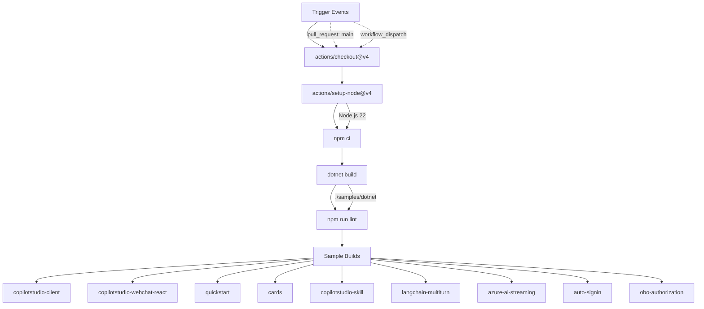
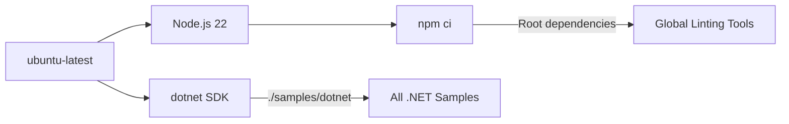
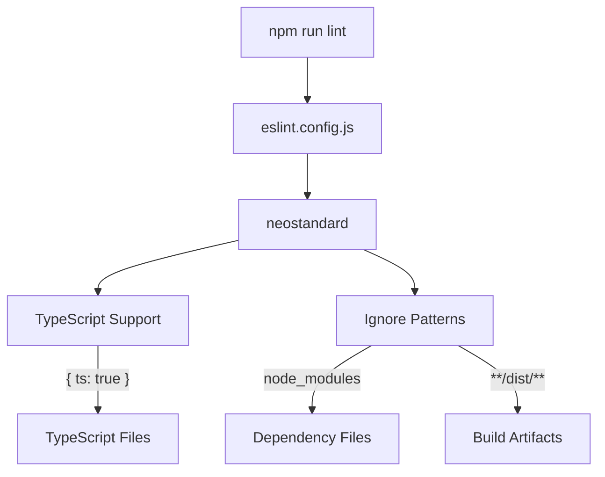
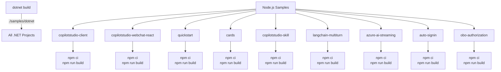
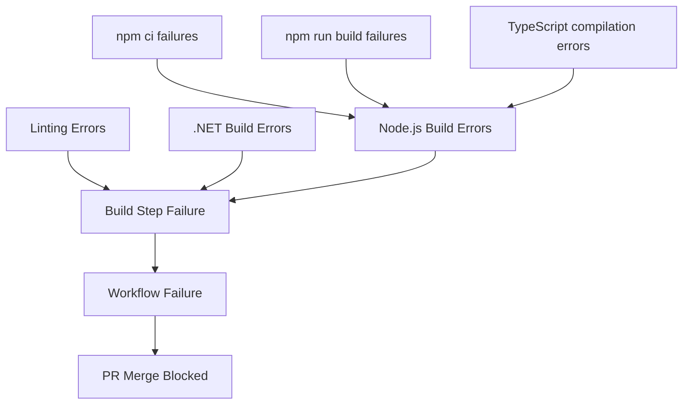

<!-- source: DeepWiki mcp.deepwiki.com · repo microsoft/Agents · page 4.3 CI/CD and Build Pipeline · fetched 2026-10-26 -->

# CI/CD and Build Pipeline

Relevant source files

The following files were used as context for generating this wiki page:

- [.github/workflows/cd-samples.yml](.github/workflows/cd-samples.yml)
- [eslint.config.js](eslint.config.js)
- [samples/nodejs/copilotstudio-webclient/web/index.html](samples/nodejs/copilotstudio-webclient/web/index.html)

## Purpose and Scope

This document covers the automated Continuous Integration and Continuous Deployment (CI/CD) pipeline that builds, tests, and validates the Microsoft 365 Agents SDK sample applications. The pipeline ensures code quality through linting, builds all sample applications across multiple programming languages, and validates that examples remain functional.

For information about local development setup and testing, see [Local Development](#4.2). For deployment strategies to production environments, see [Azure Bot Service Integration](#4.1).

## Pipeline Overview

The CI/CD system is implemented using GitHub Actions with a single workflow file that orchestrates the entire build and validation process. The pipeline runs on every pull request to the main branch and can be manually triggered via workflow dispatch.

**Pipeline Workflow: cd-samples Build Process**

Sources: [.github/workflows/cd-samples.yml:1-86]()

## Workflow Triggers and Configuration

The pipeline is configured to run automatically on specific events and can be manually triggered when needed.

| Trigger Type | Configuration | Purpose |
|--------------|---------------|---------|
| `pull_request` | Targets `main` branch | Validates changes before merge |
| `workflow_dispatch` | Manual trigger | On-demand builds and testing |

The workflow runs on `ubuntu-latest` runners and sets up a consistent environment with Node.js 22 for all build operations.

Sources: [.github/workflows/cd-samples.yml:3-11]()

## Build Environment Setup

The pipeline establishes a standardized build environment with the required runtime dependencies:

**Build Environment Components**

The environment setup includes:
- **Node.js 22**: Primary runtime for JavaScript/TypeScript samples and build tools
- **npm ci**: Clean installation of exact dependency versions from package-lock.json
- **.NET SDK**: Included in ubuntu-latest runner for C# sample builds

Sources: [.github/workflows/cd-samples.yml:17-23]()

## Code Quality and Linting

The pipeline enforces code quality standards through automated linting using ESLint with the neostandard configuration.

**Linting Configuration and Execution**

The linting process uses:
- **neostandard**: ESLint configuration with TypeScript support
- **Ignore patterns**: Excludes `node_modules` and `**/dist/**` directories
- **Pipeline integration**: Runs after dependency installation but before sample builds

Sources: [.github/workflows/cd-samples.yml:30-31](), [eslint.config.js:1-3]()

## Sample Application Builds

The pipeline builds each sample application individually to ensure they compile successfully and dependencies are resolved correctly. Each sample follows a consistent build pattern with language-specific variations.

**Individual Sample Build Process**

### .NET Sample Builds

The .NET samples are built collectively using a single `dotnet build` command in the `./samples/dotnet` directory, which automatically discovers and builds all C# projects.

### Node.js Sample Builds

Each Node.js sample is built individually with a consistent two-step process:
1. **`npm ci`**: Clean dependency installation using exact versions from package-lock.json
2. **`npm run build`**: TypeScript compilation and build artifact generation

| Sample Directory | Purpose | Build Commands |
|------------------|---------|----------------|
| `copilotstudio-client` | Copilot Studio integration client | `npm ci && npm run build` |
| `copilotstudio-webchat-react` | React-based web chat interface | `npm ci && npm run build` |
| `quickstart` | Basic agent quickstart example | `npm ci && npm run build` |
| `cards` | Rich card and UI demonstrations | `npm ci && npm run build` |
| `copilotstudio-skill` | Copilot Studio skill implementation | `npm ci && npm run build` |
| `langchain-multiturn` | LangChain multi-turn conversations | `npm ci && npm run build` |
| `azure-ai-streaming` | Streaming response demonstrations | `npm ci && npm run build` |
| `auto-signin` | Automatic sign-in authentication | `npm ci && npm run build` |
| `obo-authorization` | On-behalf-of authorization flow | `npm ci && npm run build` |

Sources: [.github/workflows/cd-samples.yml:25-86]()

## Build Failure Detection and Validation

The pipeline is configured to fail fast if any step encounters errors, ensuring that broken samples are detected immediately rather than silently ignored.

**Build Validation and Error Handling**

Each build step must complete successfully for the workflow to pass:
- **Linting failures**: Code style violations prevent merge
- **Dependency installation failures**: Missing or incompatible packages detected
- **Compilation failures**: TypeScript or .NET build errors caught early
- **Missing build scripts**: Ensures all samples have proper build configuration

The pipeline's fail-fast approach ensures that the main branch maintains build stability and all sample applications remain functional for developers.

Sources: [.github/workflows/cd-samples.yml:30-86]()

---

