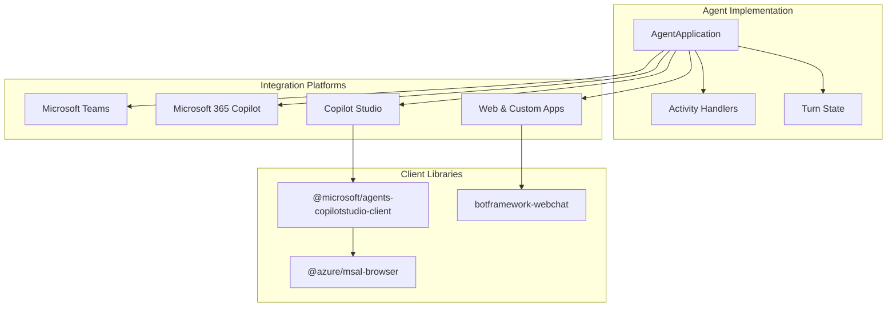
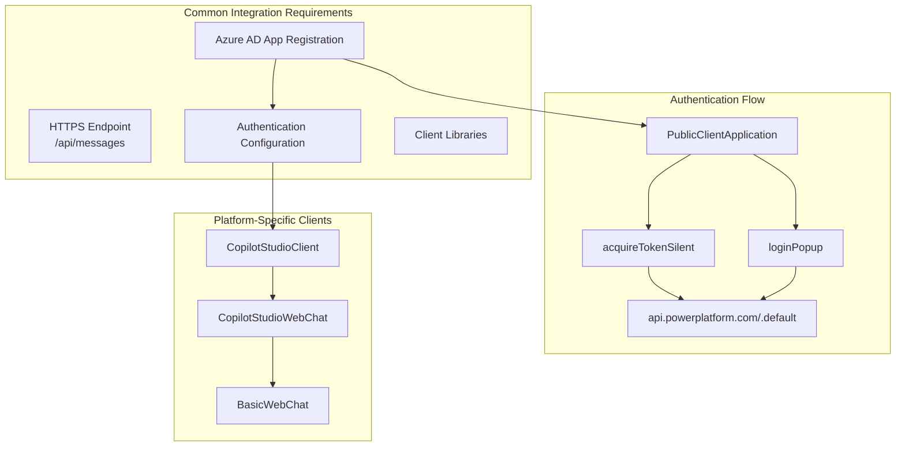
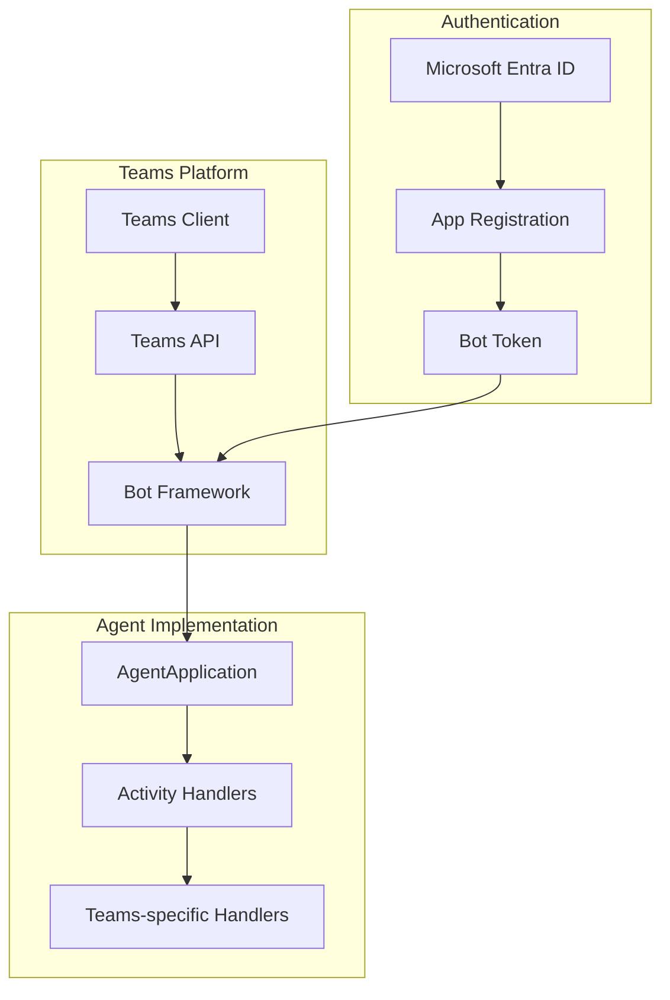
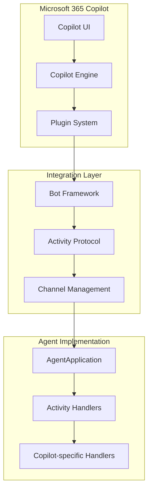
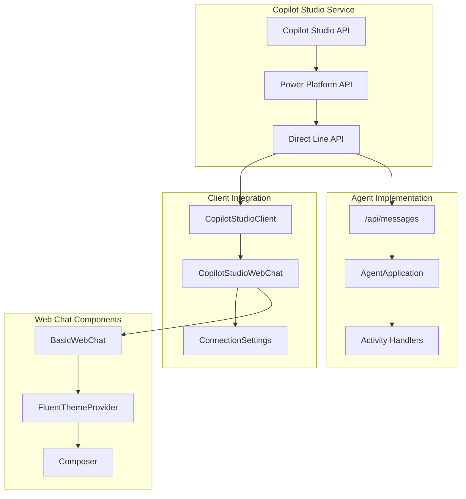
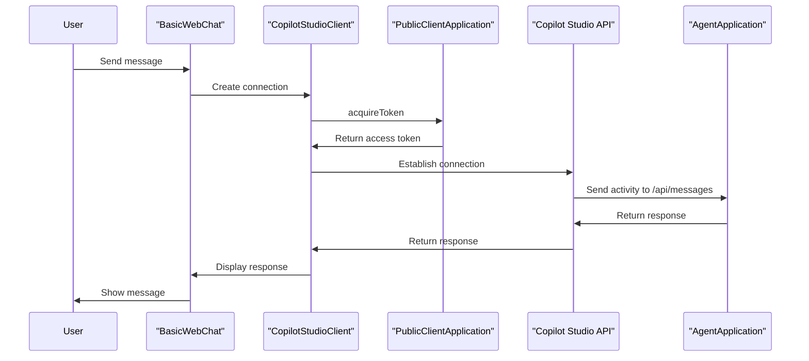
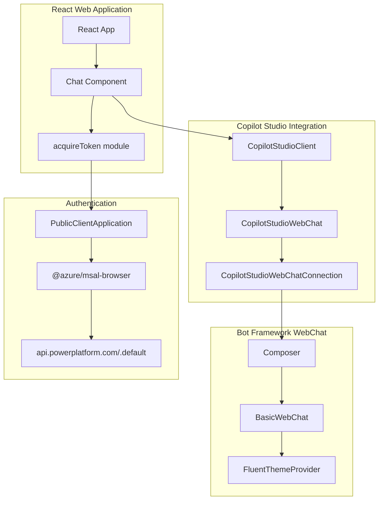
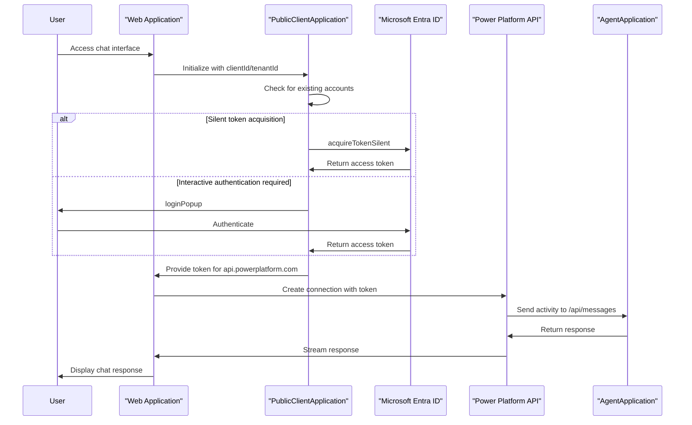

<!-- source: DeepWiki mcp.deepwiki.com · repo microsoft/Agents · page 5 Integration Options · fetched 2026-10-26 -->

# Integration Options

Relevant source files

The following files were used as context for generating this wiki page:

- [MCSandAgentsEcosystemLinks.md](MCSandAgentsEcosystemLinks.md)
- [README.md](README.md)

This document provides a comprehensive guide to the various integration options available for agents built with the Microsoft 365 Agents SDK. The SDK enables developers to build intelligent agents that can be surfaced in multiple Microsoft platforms including Microsoft Teams, Microsoft 365 Copilot, and Copilot Studio. This page focuses on the requirements, configurations, and best practices for each integration scenario.

For information about building agents, see [Building Agents](#2). For deployment and hosting details, see [Deployment and Hosting](#4).

## Integration Overview

The Microsoft 365 Agents SDK provides a unified programming model that allows your agent to be integrated with multiple platforms while maintaining a single codebase. The SDK supports deployment to channels of your choice, with scaffolding to handle the required communication patterns.

**Key Integration Target Platforms**:
- Microsoft Teams
- Microsoft 365 Copilot
- Copilot Studio
- Web & Custom Apps

### Agent Integration Architecture

Sources:
- [README.md:3-11]()
- [samples/basic/copilotstudio-webchat-react/package.json:17-18]()
- [samples/basic/copilotstudio-webchat-react/src/Chat.tsx:9]()

## Integration Requirements Common to All Platforms

Regardless of the target platform, all integrations with the Microsoft 365 Agents SDK share certain common requirements:

1. **Azure Active Directory App Registration**: Your agent requires an app registration in Azure AD with the appropriate permissions
2. **HTTPS Endpoint**: Your agent must be accessible over HTTPS at `/api/messages`
3. **Authentication Configuration**: Your agent needs proper authentication configured to validate incoming requests
4. **Client Library Integration**: Platform-specific client libraries handle the communication protocols

### Common Integration Components

Sources:
- [samples/basic/copilotstudio-webchat-react/src/acquireToken.ts:8-40]()
- [samples/basic/copilotstudio-webchat-react/src/Chat.tsx:37-39]()
- [samples/basic/copilotstudio-webchat-react/src/settings.EXAMPLE.js:8-34]()

## Microsoft Teams Integration

Microsoft Teams integration allows your agent to be available as a bot within the Teams environment. Users can interact with your agent in personal chats, group chats, or channels. The SDK provides scaffolding to handle the required communication patterns for Teams integration.

### Teams Integration Architecture

### Teams Integration Requirements

| Requirement | Description |
|-------------|-------------|
| **App Registration** | Azure AD app registration with Bot Framework permissions |
| **Bot Framework Registration** | Register the bot with Azure Bot Service |
| **Teams App Package** | Teams app manifest with bot configuration |
| **HTTPS Endpoint** | Publicly accessible endpoint at `/api/messages` |
| **Authentication** | Bot-to-bot authentication with Microsoft services |

Sources:
- [README.md:3-11]()

## Microsoft 365 Copilot Integration

Microsoft 365 Copilot integration allows your agent to be accessed as a plugin within the Microsoft 365 Copilot experience. This enables users to interact with your agent in the context of their Microsoft 365 work, leveraging the unified programming model provided by the SDK.

### Copilot Integration Architecture

### Copilot Integration Requirements

| Requirement | Description |
|-------------|-------------|
| **App Registration** | Azure AD app registration with Microsoft 365 permissions |
| **Plugin Manifest** | Copilot-specific manifest for plugin registration |
| **Activity Protocol** | Implementation of activity protocol for Copilot communication |
| **Context Awareness** | Agent must handle Microsoft 365 context and data |
| **Authentication** | Support for both bot and user authentication flows |

Sources:
- [README.md:3-11]()

## Copilot Studio Integration

Copilot Studio integration allows your agent to be used as a skill within Copilot Studio, enabling no-code or low-code orchestration and extension of your agent's capabilities. The SDK provides both agent and client integration patterns for Copilot Studio.

### Copilot Studio Integration Architecture

### Copilot Studio Client Configuration

The `ConnectionSettings` interface defines the required configuration for Copilot Studio integration:

| Setting | Description |
|---------|-------------|
| `appClientId` | App ID of the App Registration for authentication |
| `tenantId` | Tenant ID of the App Registration |
| `environmentId` | Environment ID of the Copilot Studio environment |
| `agentIdentifier` | Schema name of the Copilot to use |
| `directConnectUrl` | URL for direct connection to Copilot Studio service |

### Copilot Studio Integration Implementation

Sources:
- [samples/basic/copilotstudio-webchat-react/src/Chat.tsx:9-53]()
- [samples/basic/copilotstudio-webchat-react/src/settings.EXAMPLE.js:8-34]()
- [samples/basic/copilotstudio-webchat-react/src/acquireToken.ts:8-40]()

## Web Chat Integration

The Microsoft 365 Agents SDK can be integrated with web-based chat interfaces, allowing your agent to be embedded in web applications. The SDK provides React components and client libraries for building custom web chat experiences.

### Web Chat Integration Components

### Web Chat Implementation Pattern

The web chat integration follows a standard React pattern with authentication and connection management:

| Component | Responsibility |
|-----------|---------------|
| **Chat.tsx** | Main component orchestrating authentication and WebChat setup |
| **acquireToken.ts** | Handles Azure AD authentication flow using MSAL |
| **CopilotStudioClient** | Manages connection to Copilot Studio service |
| **BasicWebChat** | Renders the conversation UI with Bot Framework WebChat |
| **FluentThemeProvider** | Applies Fluent UI styling to the chat interface |

Sources:
- [samples/basic/copilotstudio-webchat-react/src/Chat.tsx:15-53]()
- [samples/basic/copilotstudio-webchat-react/src/acquireToken.ts:8-40]()
- [samples/basic/copilotstudio-webchat-react/package.json:15-21]()

## Integration Authentication Flow

Authentication is a critical aspect of agent integration. The following diagram illustrates the authentication flow when an agent is integrated with different platforms, specifically showing the MSAL-based authentication pattern used in web chat scenarios:

Sources:
- [samples/basic/copilotstudio-webchat-react/src/acquireToken.ts:8-40]()
- [samples/basic/copilotstudio-webchat-react/src/Chat.tsx:35-41]()

## Integration Comparison

The following table summarizes the key differences between the integration options:

| Feature | Microsoft Teams | Microsoft 365 Copilot | Copilot Studio | Web Chat |
|---------|----------------|----------------------|----------------|----------|
| **Client Library** | Bot Framework | Bot Framework | `@microsoft/agents-copilotstudio-client` | `botframework-webchat` |
| **Authentication** | Bot Framework Token | Bot Framework Token | MSAL + Power Platform API | MSAL + Direct Line |
| **Primary Scope** | Teams channels/chats | Microsoft 365 context | Copilot Studio flows | Custom web applications |
| **Main Use Case** | Team collaboration | M365 work integration | No/low-code orchestration | Custom branded interfaces |
| **Deployment** | Teams App Store | Microsoft 365 Admin | Copilot Studio portal | Web hosting |
| **UI Framework** | Teams UI | Microsoft 365 UI | Copilot Studio UI | `botframework-webchat` |

### Integration Technology Stack

| Platform | Key Technologies |
|----------|-----------------|
| **Web Chat** | React, esbuild, MSAL Browser, Bot Framework WebChat |
| **Copilot Studio** | CopilotStudioClient, Power Platform API, Direct Line |
| **Authentication** | Microsoft Entra ID, MSAL, Power Platform API scopes |
| **Agent Runtime** | AgentApplication, Activity Handlers, Turn State |

Sources:
- [samples/basic/copilotstudio-webchat-react/package.json:15-21]()
- [samples/basic/copilotstudio-webchat-react/src/acquireToken.ts:17-19]()
- [README.md:3-11]()

## Best Practices for Integration

When integrating your agent across multiple platforms, consider these best practices:

1. **Maintain a single codebase**:
   - Leverage the Microsoft 365 Agents SDK's unified programming model
   - Use conditional logic for platform-specific features

2. **Design for cross-platform compatibility**:
   - Use adaptive cards that work across all platforms
   - Avoid platform-specific UI elements when possible

3. **Manage manifests properly**:
   - Use placeholders for common values
   - Implement a manifest generation process to avoid duplicated settings

4. **Test across all target platforms**:
   - Ensure consistent behavior and appearance
   - Verify authentication flows on each platform

5. **Monitor and debug**:
   - Implement comprehensive logging
   - Track usage patterns across different integration points

## Conclusion

The Microsoft 365 Agents SDK provides flexible integration options that allow your agent to be surfaced across multiple Microsoft platforms while maintaining a single codebase. By understanding the requirements and configurations for each integration option, you can maximize the reach and utility of your agent.

For specific implementation details on each integration option, refer to the respective subpages:
- [Microsoft Teams Integration](#5.1)
- [Microsoft 365 Copilot Integration](#5.2)
- [Copilot Studio Integration](#5.3)

---

