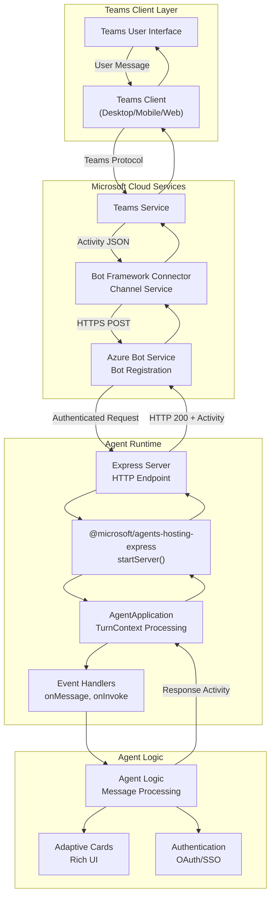
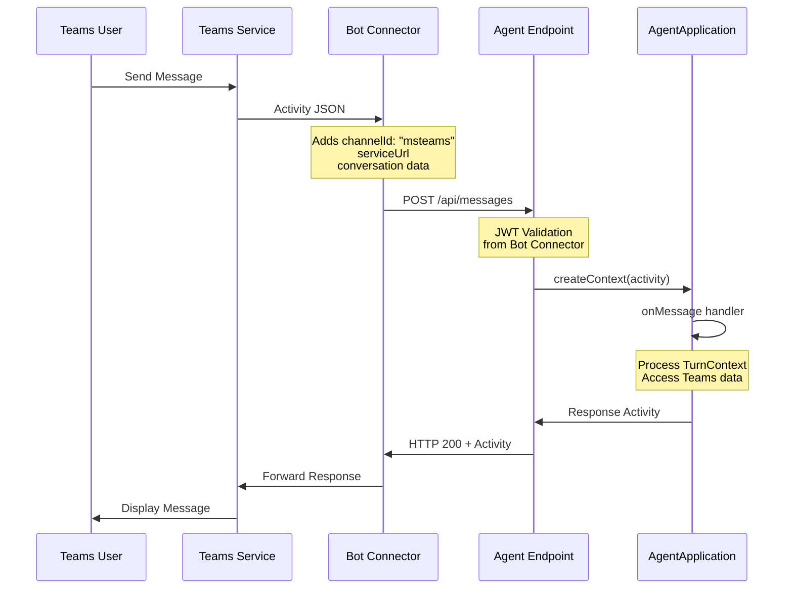
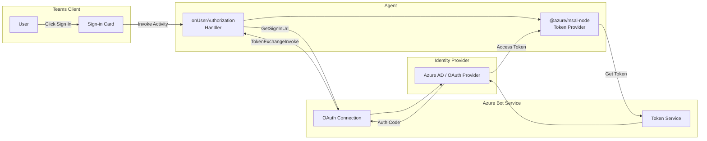
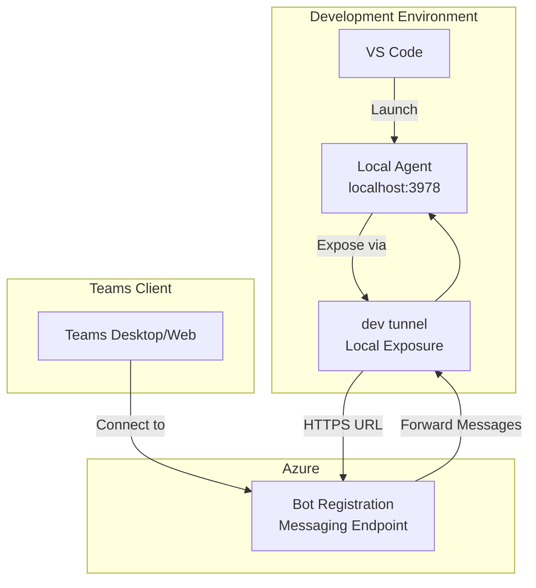
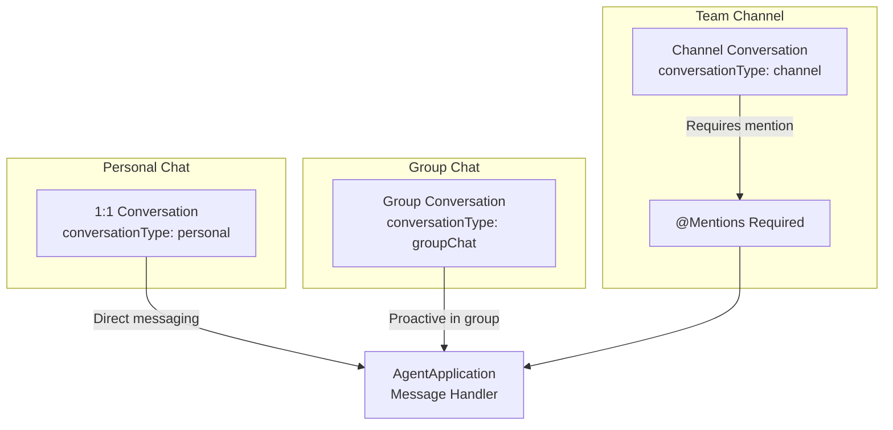
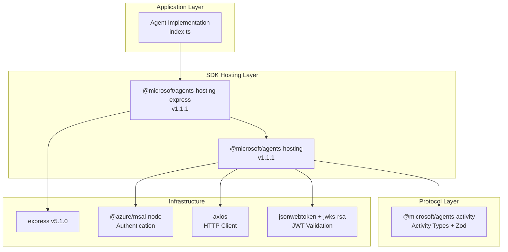

<!-- source: DeepWiki mcp.deepwiki.com · repo microsoft/Agents · page 5.1 Microsoft Teams Integration · fetched 2026-10-26 -->

# Microsoft Teams Integration

<details>
<summary>Relevant source files</summary>

The following files were used as context for generating this wiki page:

- [.github/scripts/updatenode.sh](.github/scripts/updatenode.sh)
- [MCSandAgentsEcosystemLinks.md](MCSandAgentsEcosystemLinks.md)
- [README.md](README.md)
- [samples/nodejs/auto-signin/package-lock.json](samples/nodejs/auto-signin/package-lock.json)
- [samples/nodejs/azure-ai-streaming/package-lock.json](samples/nodejs/azure-ai-streaming/package-lock.json)
- [samples/nodejs/cards/package-lock.json](samples/nodejs/cards/package-lock.json)
- [samples/nodejs/copilotstudio-client/package-lock.json](samples/nodejs/copilotstudio-client/package-lock.json)
- [samples/nodejs/copilotstudio-webchat-react/package-lock.json](samples/nodejs/copilotstudio-webchat-react/package-lock.json)
- [samples/nodejs/langchain-multiturn/package-lock.json](samples/nodejs/langchain-multiturn/package-lock.json)
- [samples/nodejs/multi-turn-prompt/package-lock.json](samples/nodejs/multi-turn-prompt/package-lock.json)
- [samples/nodejs/obo-authorization/package-lock.json](samples/nodejs/obo-authorization/package-lock.json)
- [samples/nodejs/quickstart/package-lock.json](samples/nodejs/quickstart/package-lock.json)

</details>


## Purpose and Scope

This page documents how agents built with the Microsoft 365 Agents SDK integrate with Microsoft Teams as a deployment channel. It covers the Teams-specific architecture, activity protocols, channel features, and configuration requirements. For information about deploying to M365 Copilot, see [Microsoft 365 Copilot Integration](#5.2). For general deployment and hosting concepts, see [Azure Bot Service Integration](#4.1).

Sources: [README.md:1-11]()

---

## Integration Overview

Microsoft Teams serves as one of the primary deployment channels for agents built with the M365 Agents SDK. The SDK provides a channel-agnostic architecture where the same agent code can deploy to Teams, M365 Copilot, WebChat, and custom applications without modification. Teams integration occurs through Azure Bot Service, which acts as the messaging gateway between Teams clients and agent endpoints.

The SDK's `AgentApplication` class processes Teams messages using the Activity Protocol, a channel-independent message format that abstracts Teams-specific wire protocols. This allows developers to build once and deploy everywhere while optionally customizing behavior for Teams-specific features.



**Teams Integration Architecture**

Sources: [README.md:3-11](), Diagram 1 from context

---

## Activity Protocol and Teams

### Activity Types

Teams communicates with agents using the Activity Protocol, which defines 17+ activity types. The `@microsoft/agents-activity` package provides Zod schema validation for all activity types, ensuring type-safe message handling.

| Activity Type | Teams Usage | SDK Handler |
|--------------|-------------|-------------|
| `message` | User sends text or rich message | `onMessage` |
| `conversationUpdate` | User joins/leaves channel or chat | `onConversationUpdate` |
| `messageReaction` | User adds reaction to message | `onMessageReaction` |
| `invoke` | Teams-specific invoke actions | `onInvoke` |
| `event` | System events and notifications | `onEvent` |
| `typing` | User typing indicator | `onTyping` |

### Activity Flow Pattern



**Teams Activity Flow Through SDK**

Sources: [samples/nodejs/azure-ai-streaming/package-lock.json:154-167](), [samples/nodejs/quickstart/package-lock.json:84-128]()

---

## Teams-Specific Features

### Channel Data

Teams includes additional metadata in the `channelData` property of activities. The SDK exposes this through `TurnContext`:

```typescript
// Accessing Teams-specific channel data
const channelData = context.activity.channelData;
// Contains: tenant, team, channel, meeting information
```

**Teams Channel Data Properties:**

| Property | Description | Availability |
|----------|-------------|-------------|
| `tenant.id` | Azure AD tenant identifier | All contexts |
| `team.id` | Team identifier | Team channels only |
| `channel.id` | Channel identifier | Team channels only |
| `meeting.id` | Meeting identifier | Meeting contexts |
| `teamsChannelId` | Explicit Teams channel ID | All contexts |
| `teamsTeamId` | Explicit Teams team ID | Team contexts |

### Adaptive Cards

Teams supports Adaptive Cards for rich UI elements. The SDK uses the Activity Protocol's `attachments` array to send cards:

```typescript
// Example card structure (not actual code from files)
const card = {
  contentType: "application/vnd.microsoft.card.adaptive",
  content: {
    type: "AdaptiveCard",
    version: "1.4",
    body: [/* card elements */]
  }
};
```

Sources: [samples/nodejs/cards/package-lock.json:1-14](), [samples/nodejs/auto-signin/package-lock.json:14-15]()

### Authentication

Teams supports OAuth authentication flows through Azure Bot Service. The SDK's authentication handlers (`onUserAuthorization`) manage sign-in and token exchange.



**Teams OAuth Flow**

Sources: [samples/nodejs/obo-authorization/package-lock.json:11-13](), [samples/nodejs/auto-signin/package-lock.json:12-13]()

---

## Configuration and Deployment

### Azure Bot Service Registration

Teams integration requires an Azure Bot Service registration that connects the Teams channel to the agent endpoint:

**Required Configuration:**

| Setting | Purpose | Location |
|---------|---------|----------|
| Microsoft App ID | Bot identity in Azure AD | Bot registration |
| Messaging Endpoint | HTTPS URL for agent | Bot settings |
| Teams Channel | Enable Teams connectivity | Channel configuration |
| OAuth Connections | Authentication providers | Bot connections |

### Bot Manifest

The bot manifest (`manifest.json`) defines the agent's capabilities and identity within Teams:

**Key Manifest Sections:**

```json
{
  "manifestVersion": "1.x",
  "id": "<app-id>",
  "bots": [{
    "botId": "<microsoft-app-id>",
    "scopes": ["personal", "team", "groupchat"],
    "supportsFiles": true,
    "isNotificationOnly": false
  }],
  "permissions": ["identity", "messageTeamMembers"],
  "validDomains": ["token.botframework.com"]
}
```

Sources: README context about Bot Manifest

### Local Development with Teams



**Local Development Architecture**

Sources: [README.md:74-86](), Diagram 6 from context

---

## Development Patterns

### Teams-Aware Agent Implementation

Agents use the same `AgentApplication` class regardless of deployment channel, with optional Teams-specific logic:

**Node.js Implementation:**

```typescript
// Reference implementation pattern from samples
// Uses @microsoft/agents-hosting-express
// File: samples/nodejs/*/index.ts pattern

import { startServer } from '@microsoft/agents-hosting-express';

const app = startServer({
  // AgentApplication configuration
});

// Event handlers are channel-agnostic
app.onMessage(async (context) => {
  // Check if running in Teams
  const isTeams = context.activity.channelId === 'msteams';
  
  if (isTeams) {
    // Access Teams-specific data
    const teamsData = context.activity.channelData;
  }
  
  // Standard message processing
  await context.sendActivity({ text: 'Response' });
});
```

Sources: [samples/nodejs/quickstart/package-lock.json:11-13](), [samples/nodejs/azure-ai-streaming/package-lock.json:8-10]()

### Conversation Types

Teams supports three conversation scopes that agents must handle:



**Teams Conversation Scopes**

Sources: README.md context about Teams customization

### Invoke Activities

Teams uses `invoke` activities for rich interactions like task modules, messaging extensions, and adaptive card actions:

| Invoke Name | Purpose | Response Required |
|------------|---------|-------------------|
| `signin/verifyState` | OAuth verification | Synchronous |
| `task/fetch` | Task module request | Task module response |
| `task/submit` | Task module submission | Optional continuation |
| `composeExtension/query` | Messaging extension search | Search results |
| `adaptiveCard/action` | Card button action | Card update or message |

Sources: Activity Protocol specification from context

---

## Dependency and Package Structure

### Node.js Teams Agent Stack



**Node.js Teams Agent Dependencies**

Sources: [samples/nodejs/quickstart/package-lock.json:111-141](), [samples/nodejs/azure-ai-streaming/package-lock.json:208-220]()

### Key Package Responsibilities

| Package | Version | Role |
|---------|---------|------|
| `@microsoft/agents-hosting-express` | 1.1.1 | Express.js integration, server startup |
| `@microsoft/agents-hosting` | 1.1.1 | Core AgentApplication, TurnContext, event handlers |
| `@microsoft/agents-activity` | 1.1.1 | Activity protocol types, Zod validation |
| `express` | 5.1.0+ | HTTP server for bot endpoint |
| `@azure/msal-node` | 3.8.4+ | OAuth token acquisition |
| `jsonwebtoken` | 9.0.0+ | JWT creation and verification |
| `jwks-rsa` | 3.2.0+ | JWT public key retrieval |

Sources: [samples/nodejs/quickstart/package-lock.json:84-141](), [samples/nodejs/cards/package-lock.json:112-142]()

---

## Testing and Debugging

### Agents Playground

The `@microsoft/m365agentsplayground` package provides local testing capabilities that simulate Teams messaging:

```bash
# Install playground
npm install --save-dev @microsoft/m365agentsplayground

# Run agent with playground
npm run start
```

Sources: [samples/nodejs/quickstart/package-lock.json:142-151](), [README.md:74-86]()

### Teams App Tester

The playground CLI includes a Teams app testing mode:

```bash
# Command from package
teamsapptester
```

This simulates Teams-specific activities including conversation updates, mentions, and invoke patterns.

Sources: [samples/nodejs/cards/package-lock.json:143-152]()

---

## Deployment Checklist

**Pre-deployment Requirements:**

1. ✓ Azure Bot Service registration created
2. ✓ Microsoft App ID and password configured
3. ✓ Teams channel enabled in bot registration
4. ✓ Messaging endpoint set to agent HTTPS URL
5. ✓ Bot manifest created with correct App ID
6. ✓ OAuth connections configured (if using authentication)
7. ✓ Agent deployed to Azure App Service or container
8. ✓ Environment variables set (App ID, Password, endpoint)

**Teams-Specific Validation:**

- Test in personal chat scope
- Test in group chat scope
- Test in team channel scope (with @mentions)
- Verify Adaptive Cards render correctly
- Test OAuth sign-in flow
- Validate file upload/download (if supported)
- Test messaging extensions (if implemented)
- Verify task modules (if implemented)

Sources: [README.md:1-50](), Diagram 6 from context

---

## Cross-Reference

- For general hosting concepts: [Local Development](#4.2)
- For Azure deployment: [Azure Bot Service Integration](#4.1)
- For authentication patterns: [User Authentication](#3.2) and [On-Behalf-Of Authorization](#3.3)
- For M365 Copilot specifics: [Microsoft 365 Copilot Integration](#5.2)
- For sample implementations: [Quickstart Samples](#6.1) and [Cards and Rich UI Samples](#6.3)

Sources: README.md table of contents

---

