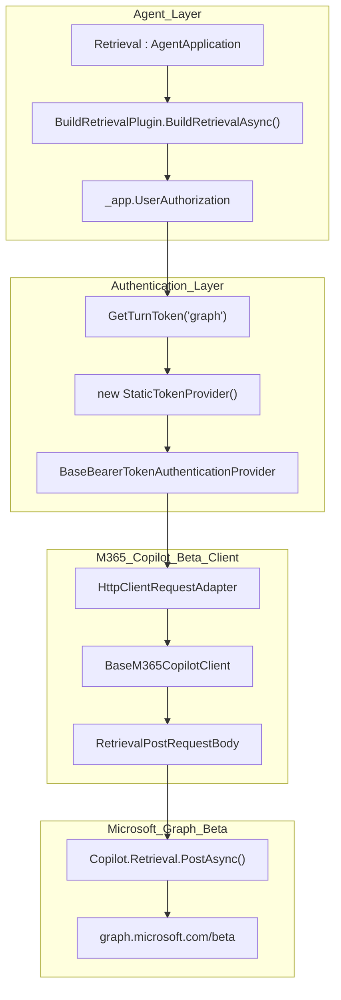
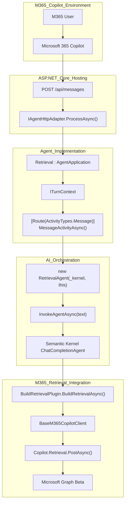
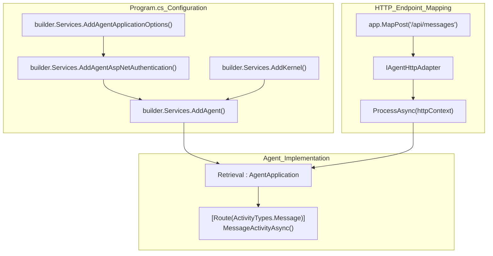
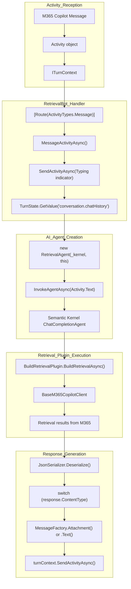
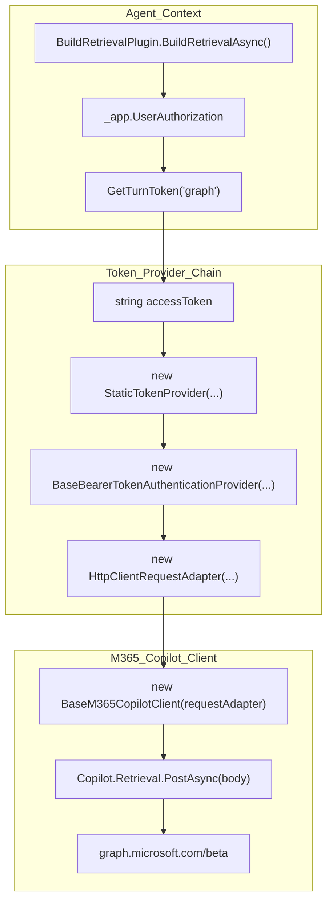
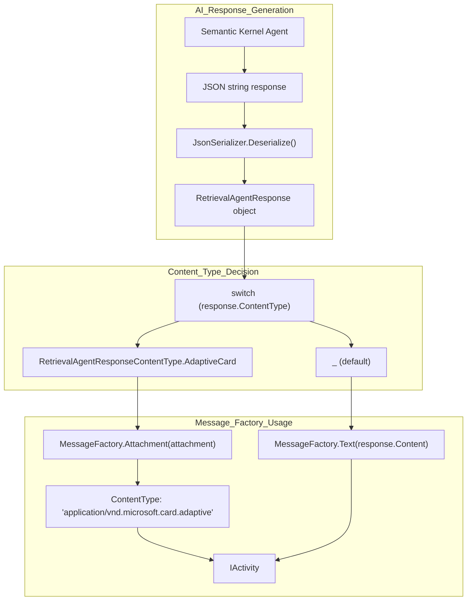
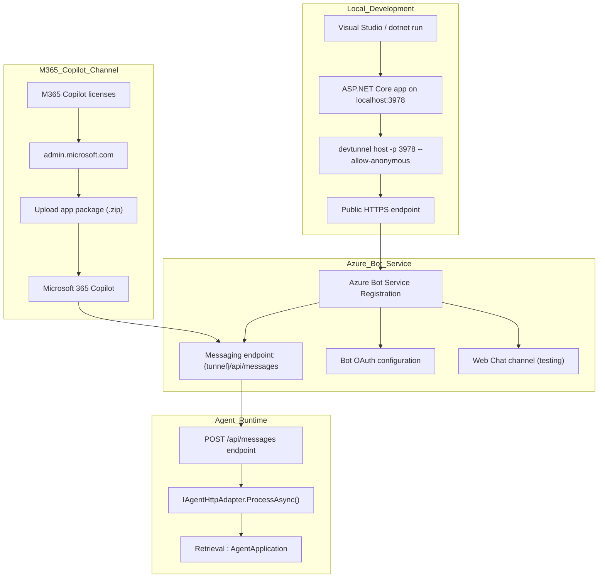
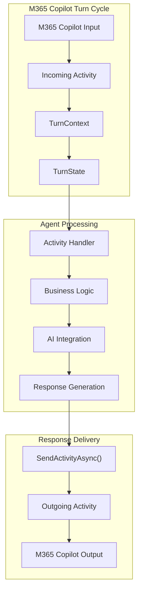

<!-- source: DeepWiki mcp.deepwiki.com · repo microsoft/Agents · page 5.2 Microsoft 365 Copilot Integration · fetched 2026-10-26 -->

# Microsoft 365 Copilot Integration

<details>
<summary>Relevant source files</summary>

The following files were used as context for generating this wiki page:

- [MCSandAgentsEcosystemLinks.md](MCSandAgentsEcosystemLinks.md)
- [README.md](README.md)
- [samples/dotnet/Agent Framework/AgentFrameworkWeather.csproj](samples/dotnet/Agent Framework/AgentFrameworkWeather.csproj)
- [samples/dotnet/GenesysHandoff/GenesysHandoff.csproj](samples/dotnet/GenesysHandoff/GenesysHandoff.csproj)
- [samples/dotnet/RetrievalBot/RetrievalBot.csproj](samples/dotnet/RetrievalBot/RetrievalBot.csproj)
- [samples/dotnet/auto-signin/AutoSignIn.csproj](samples/dotnet/auto-signin/AutoSignIn.csproj)
- [samples/dotnet/azure-ai-streaming/StreamingMessageAgent.csproj](samples/dotnet/azure-ai-streaming/StreamingMessageAgent.csproj)
- [samples/dotnet/copilotstudio-client/CopilotStudioClient.csproj](samples/dotnet/copilotstudio-client/CopilotStudioClient.csproj)
- [samples/dotnet/copilotstudio-skill/CopilotStudioEchoSkill.csproj](samples/dotnet/copilotstudio-skill/CopilotStudioEchoSkill.csproj)
- [samples/dotnet/obo-authorization/OBOAuthorization.csproj](samples/dotnet/obo-authorization/OBOAuthorization.csproj)
- [samples/dotnet/quickstart/QuickStart.csproj](samples/dotnet/quickstart/QuickStart.csproj)
- [samples/dotnet/semantic-kernel-multiturn/SemanticKernelMultiturn.csproj](samples/dotnet/semantic-kernel-multiturn/SemanticKernelMultiturn.csproj)

</details>


This page explains how to deploy agents built with the Microsoft 365 Agents SDK to Microsoft 365 Copilot, focusing on M365 Copilot-specific features including enterprise data integration via the Retrieval API.

For information about integrating with Microsoft Teams, see page 5.1. For Copilot Studio integration patterns, see page 5.3. For general deployment concepts, see page 4.1.

## Integration Overview

Microsoft 365 Copilot is a deployment channel for agents built with the Microsoft 365 Agents SDK. The SDK provides channel management capabilities that allow agents to be deployed to M365 Copilot, Teams, and other channels without requiring platform-specific code changes in the core agent logic.

**Note**: A Microsoft 365 Copilot subscription is not required to develop with the SDK unless specifically targeting the M365 Copilot channel for deployment.

### M365 Copilot-Specific Capabilities

The primary M365 Copilot-specific feature is the **Microsoft 365 Copilot Retrieval API**, which enables agents to:
- Ground responses using organizational data from Microsoft 365
- Query SharePoint documents and other enterprise content
- Filter results by SharePoint paths and metadata
- Return structured retrieval results to AI orchestration layers

The standard SDK features work uniformly across all channels:
- Receiving activities from users through the Activity Protocol
- Processing user interactions via the `AgentApplication` class
- Authentication flows for Microsoft 365 services via `UserAuthorization`
- Conversation state management through storage providers

Sources: [README.md:3-11](), [README.md:17]()

## Microsoft 365 Copilot Retrieval API Integration

The `Microsoft.Agents.M365Copilot.Beta` package provides beta support for the Microsoft 365 Copilot Retrieval API. This enables agents to query organizational data from Microsoft 365 and ground AI responses using enterprise content.

### Retrieval API Architecture

The following diagram shows the component flow for accessing the M365 Copilot Retrieval API:



### RetrievalPostRequestBody Configuration

The `RetrievalPostRequestBody` class supports the following properties for querying enterprise data:

| Property | Type | Description |
|----------|------|-------------|
| `QueryString` | `string` | User query for retrieval |
| `FilterExpression` | `string` | SharePoint path filter (e.g., tenant-specific paths) |
| `ResourceMetadata` | `string[]` | Additional metadata for filtering |
| `MaximumNumberOfResults` | `int` | Maximum number of results to return |

The RetrievalBot sample demonstrates this configuration in [samples/dotnet/RetrievalBot/Plugins/BuildRetrievalPlugin.cs:59-65]().

Sources: [samples/dotnet/RetrievalBot/Plugins/BuildRetrievalPlugin.cs:45-74](), [samples/dotnet/RetrievalBot/RetrievalBot.csproj:34]()

## Technical Architecture for M365 Copilot Integration

The RetrievalBot sample demonstrates a complete M365 Copilot integration including enterprise data retrieval. The following diagram shows the request flow from M365 Copilot through the agent to the Retrieval API:



The integration follows the standard Activity Protocol pattern where M365 Copilot interactions are received as `Activity` objects at the `/api/messages` endpoint. The agent processes these uniformly regardless of the channel, with M365 Copilot-specific features (like the Retrieval API) accessed via specialized plugins.

Sources: [samples/dotnet/RetrievalBot/Program.cs:75-78](), [samples/dotnet/RetrievalBot/RetrievalBot.cs:25-31](), [samples/dotnet/RetrievalBot/Plugins/BuildRetrievalPlugin.cs:35-74]()

## Agent Configuration for M365 Copilot

Agents targeting M365 Copilot use the same `AgentApplication` base class and configuration patterns as other channels. The agent-specific logic determines which M365 Copilot features to use.

### Service Registration and Endpoint Configuration

The following diagram shows the service registration and HTTP endpoint setup for M365 Copilot agents:



### Package Dependencies for M365 Copilot Features

Agents using M365 Copilot-specific features require these package references:

| Package | Purpose | RetrievalBot Reference |
|---------|---------|----------------------|
| `Microsoft.Agents.Authentication.Msal` | MSAL-based authentication | [samples/dotnet/RetrievalBot/RetrievalBot.csproj:30]() |
| `Microsoft.Agents.Hosting.AspNetCore` | ASP.NET Core hosting | [samples/dotnet/RetrievalBot/RetrievalBot.csproj:31]() |
| `Microsoft.Agents.M365Copilot.Beta` | M365 Copilot Retrieval API | [samples/dotnet/RetrievalBot/RetrievalBot.csproj:34]() |
| `Microsoft.Graph` | Microsoft Graph API | [samples/dotnet/RetrievalBot/RetrievalBot.csproj:22]() |
| `Microsoft.SemanticKernel.*` | AI orchestration (optional) | [samples/dotnet/RetrievalBot/RetrievalBot.csproj:26-29]() |

The standard agent packages (`Microsoft.Agents.Authentication.Msal`, `Microsoft.Agents.Hosting.AspNetCore`) are required for all agent implementations. The `Microsoft.Agents.M365Copilot.Beta` package is only needed when using the Retrieval API.

Sources: [samples/dotnet/RetrievalBot/Program.cs:58-64](), [samples/dotnet/RetrievalBot/Program.cs:75-78](), [samples/dotnet/RetrievalBot/RetrievalBot.csproj:22-34]()

## Activity Processing with Retrieval API

M365 Copilot interactions are processed through the standard Activity Protocol. The agent receives `Activity` objects with `ActivityTypes.Message` for user messages and processes them identically to other channels. The M365 Copilot-specific functionality (Retrieval API) is accessed through plugins during processing.

### Message Processing Flow

The RetrievalBot sample demonstrates the complete message processing flow with Retrieval API integration:



### Processing Steps with Code References

The message processing follows these steps in the RetrievalBot implementation:

1. **Activity Reception**: M365 Copilot sends message as `Activity` to `/api/messages` endpoint [samples/dotnet/RetrievalBot/Program.cs:75-78]()
2. **Routing**: `[Route(ActivityTypes.Message)]` attribute routes to `MessageActivityAsync()` [samples/dotnet/RetrievalBot/RetrievalBot.cs:25]()
3. **Typing Indicator**: Send typing activity for user feedback [samples/dotnet/RetrievalBot/RetrievalBot.cs:27-28]()
4. **Chat History Retrieval**: Get conversation history from `TurnState` [samples/dotnet/RetrievalBot/RetrievalBot.cs:30]()
5. **Agent Invocation**: Create `RetrievalAgent` and invoke with user query [samples/dotnet/RetrievalBot/RetrievalBot.cs:32-34]()
6. **Retrieval Plugin**: Semantic Kernel calls `BuildRetrievalAsync()` during AI processing [samples/dotnet/RetrievalBot/Plugins/BuildRetrievalPlugin.cs:35-74]()
7. **Response Formatting**: Parse JSON response and create appropriate message type [samples/dotnet/RetrievalBot/RetrievalBot.cs:43-51]()

Sources: [samples/dotnet/RetrievalBot/RetrievalBot.cs:25-55](), [samples/dotnet/RetrievalBot/Plugins/BuildRetrievalPlugin.cs:35-74](), [samples/dotnet/RetrievalBot/Program.cs:75-78]()

## Authentication for M365 Copilot APIs

M365 Copilot Retrieval API access requires authentication via Microsoft Graph. The SDK's `UserAuthorization` component handles token acquisition, and the `BuildRetrievalPlugin` demonstrates setting up authentication for the M365 Copilot client.

### Authentication Token Flow

The following diagram shows the authentication chain for accessing the M365 Copilot Retrieval API:



### Authentication Implementation

The authentication implementation in `BuildRetrievalPlugin` follows this sequence (from [samples/dotnet/RetrievalBot/Plugins/BuildRetrievalPlugin.cs:50-56]()):

1. **Token Acquisition**: Call `_app.UserAuthorization.GetTurnToken("graph")` to get the user's Graph API access token
2. **Token Provider**: Create `StaticTokenProvider` with the acquired token
3. **Bearer Authentication**: Wrap provider in `BaseBearerTokenAuthenticationProvider`
4. **HTTP Adapter**: Create `HttpClientRequestAdapter` with authentication and Graph Beta base URL
5. **Client Initialization**: Instantiate `BaseM365CopilotClient` with the configured adapter
6. **API Call**: Use `Copilot.Retrieval.PostAsync()` to query organizational data

The `GetTurnToken("graph")` method uses the configured MSAL authentication to retrieve a token scoped to Microsoft Graph on behalf of the user.

Sources: [samples/dotnet/RetrievalBot/Plugins/BuildRetrievalPlugin.cs:50-56]()

## Message Types and Response Formatting

M365 Copilot supports standard Activity Protocol message types. The `MessageFactory` class creates messages with different content types including text and Adaptive Cards. The RetrievalBot sample demonstrates AI-driven response formatting.

### Supported Message Types

| Message Type | Factory Method | Usage in RetrievalBot |
|--------------|---------------|---------------------|
| Text | `MessageFactory.Text(string)` | Default response format |
| Adaptive Cards | `MessageFactory.Attachment(Attachment)` | Structured data visualization |
| Typing Indicators | `Activity` with `ActivityTypes.Typing` | User feedback during processing |

### Response Generation Pattern

The RetrievalBot demonstrates dynamic response formatting based on AI-generated content type:



### RetrievalAgentResponse Schema

The AI agent returns responses in JSON format with this structure (defined in [samples/dotnet/RetrievalBot/Agents/RetrievalAgent.cs:38-44]()):

```json
{
    "contentType": "Text or AdaptiveCard only",
    "content": "The content of the response, may be plain text, or JSON based adaptive card"
}
```

The `ContentType` property determines whether to use `MessageFactory.Attachment()` for Adaptive Cards or `MessageFactory.Text()` for plain text responses. This is implemented in [samples/dotnet/RetrievalBot/RetrievalBot.cs:43-51]().

Sources: [samples/dotnet/RetrievalBot/RetrievalBot.cs:27-28,43-51](), [samples/dotnet/RetrievalBot/Agents/RetrievalAgent.cs:38-44]()

## Deployment to M365 Copilot

Deploying agents to M365 Copilot requires Azure Bot Service registration, M365 Copilot licensing (for Retrieval API access), and tenant-level configuration.

### Deployment Architecture



### Deployment Prerequisites

| Requirement | Details |
|-------------|---------|
| **M365 Copilot Licenses** | Required for users to access agents via M365 Copilot and for Retrieval API functionality |
| **Tenant Administrator** | Required to upload app package via [admin.microsoft.com](https://admin.microsoft.com) |
| **Azure Bot Service** | Bot registration with ClientId, ClientSecret, TenantId configured |
| **Dev Tunnel (Local)** | `devtunnel host -p 3978 --allow-anonymous` for local development |
| **SharePoint Content** | Documents must be indexed (allow 2+ hours after upload) |
| **AI Service Keys** | Azure OpenAI or OpenAI keys configured via `dotnet user-secrets` or environment variables |

### Local Development Setup Steps

1. **Configure Authentication**: Set Azure Bot Service credentials in `appsettings.json` or user secrets (ClientId, ClientSecret, TenantId)
2. **Configure AI Services**: Set OpenAI/Azure OpenAI keys via `dotnet user-secrets set "OpenAI:Key" "your-key"`
3. **Start Dev Tunnel**: Run `devtunnel host -p 3978 --allow-anonymous` to expose local agent
4. **Update Bot Registration**: Set Azure Bot messaging endpoint to `{tunnel-url}/api/messages`
5. **Configure Retrieval Filter**: Update `FilterExpression` in [samples/dotnet/RetrievalBot/Plugins/BuildRetrievalPlugin.cs:59-65]() with tenant-specific SharePoint path
6. **Run Agent**: Execute `dotnet run` in the project directory
7. **Test via Web Chat**: Use Azure Bot Service Web Chat channel before deploying to M365 Copilot

### Production Deployment

For production, deploy the ASP.NET Core application to Azure App Service or Azure Container Instances instead of using dev tunnel, and update the Azure Bot messaging endpoint accordingly.

Sources: [samples/dotnet/RetrievalBot/Program.cs:75-85](), [samples/dotnet/RetrievalBot/Plugins/BuildRetrievalPlugin.cs:59-65]()

## Turn Management and State

M365 Copilot interactions follow the SDK's turn-based processing model, where each user interaction represents a complete turn cycle.

### Turn Processing Flow



Agents remain stateless by default, with optional state management available through the SDK's storage providers.

Sources: [docs/managingturns.md:8-14](), [docs/managingturns.md:22-27]()

---

