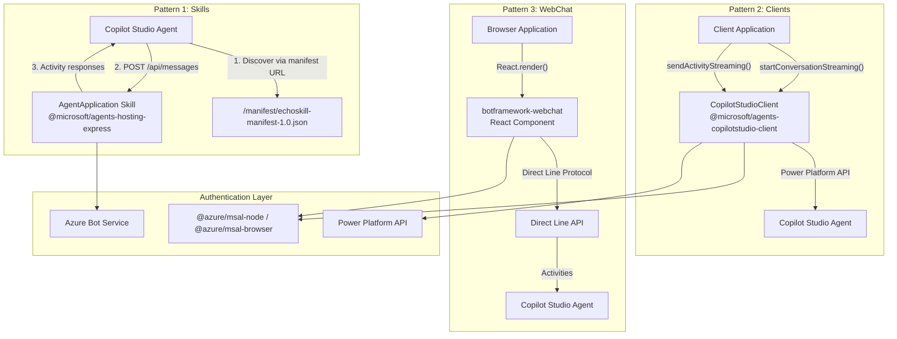
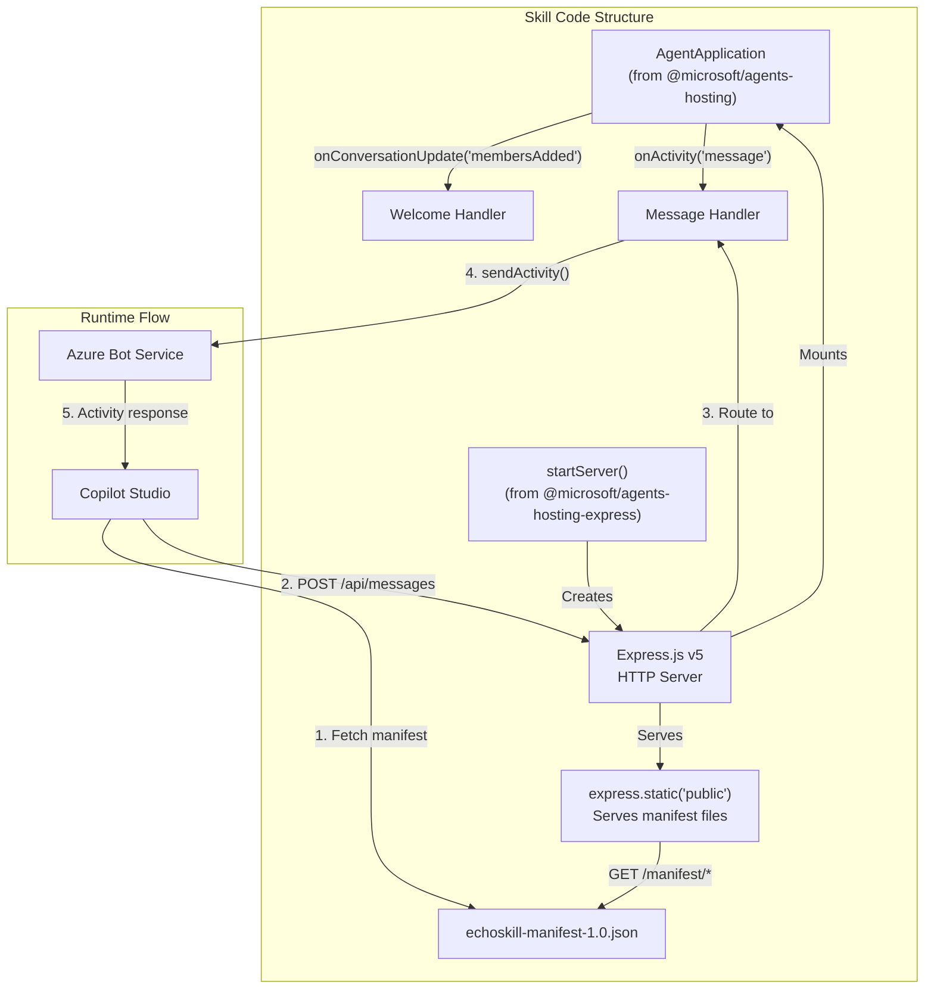
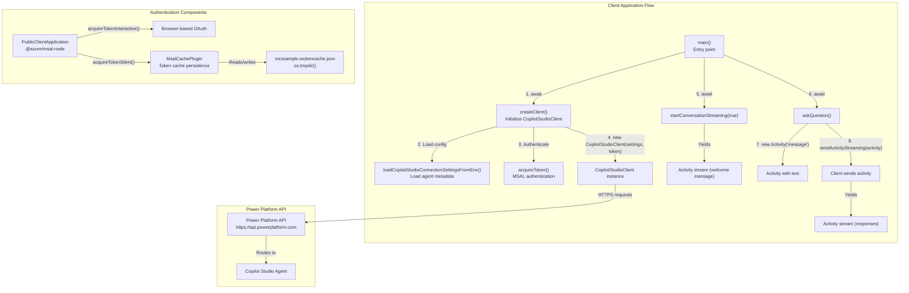
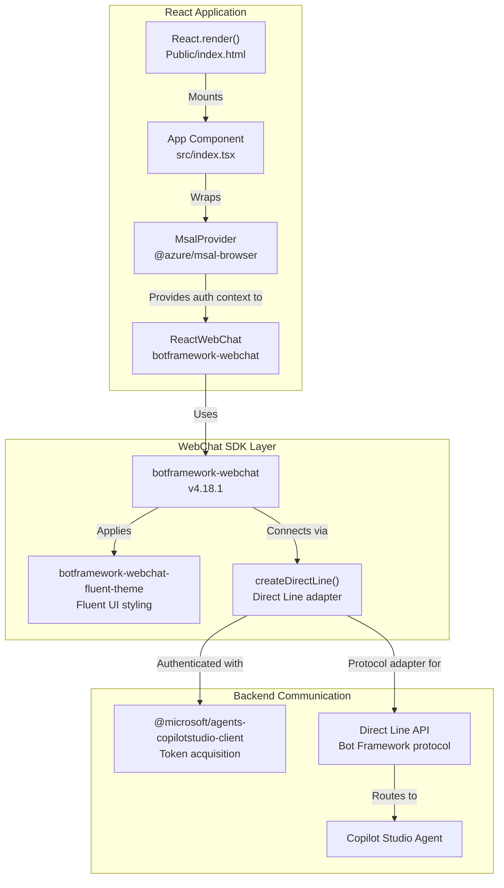

<!-- source: DeepWiki mcp.deepwiki.com · repo microsoft/Agents · page 5.3 Copilot Studio Integration · fetched 2026-10-26 -->

# Copilot Studio Integration

<details>
<summary>Relevant source files</summary>

The following files were used as context for generating this wiki page:

- [.vscode/settings.json](.vscode/settings.json)
- [samples/nodejs/auto-signin/package.json](samples/nodejs/auto-signin/package.json)
- [samples/nodejs/azure-ai-streaming/package.json](samples/nodejs/azure-ai-streaming/package.json)
- [samples/nodejs/cards/env.TEMPLATE](samples/nodejs/cards/env.TEMPLATE)
- [samples/nodejs/cards/package.json](samples/nodejs/cards/package.json)
- [samples/nodejs/cards/src/index.ts](samples/nodejs/cards/src/index.ts)
- [samples/nodejs/copilotstudio-client/package.json](samples/nodejs/copilotstudio-client/package.json)
- [samples/nodejs/copilotstudio-client/src/index.ts](samples/nodejs/copilotstudio-client/src/index.ts)
- [samples/nodejs/copilotstudio-skill/env.TEMPLATE](samples/nodejs/copilotstudio-skill/env.TEMPLATE)
- [samples/nodejs/copilotstudio-skill/package-lock.json](samples/nodejs/copilotstudio-skill/package-lock.json)
- [samples/nodejs/copilotstudio-skill/package.json](samples/nodejs/copilotstudio-skill/package.json)
- [samples/nodejs/copilotstudio-skill/src/agent.ts](samples/nodejs/copilotstudio-skill/src/agent.ts)
- [samples/nodejs/copilotstudio-webchat-react/package.json](samples/nodejs/copilotstudio-webchat-react/package.json)
- [samples/nodejs/copilotstudio-webchat-react/public/index.html](samples/nodejs/copilotstudio-webchat-react/public/index.html)
- [samples/nodejs/langchain-multiturn/package.json](samples/nodejs/langchain-multiturn/package.json)
- [samples/nodejs/multi-turn-prompt/env.TEMPLATE](samples/nodejs/multi-turn-prompt/env.TEMPLATE)
- [samples/nodejs/multi-turn-prompt/package.json](samples/nodejs/multi-turn-prompt/package.json)
- [samples/nodejs/obo-authorization/env.TEMPLATE](samples/nodejs/obo-authorization/env.TEMPLATE)
- [samples/nodejs/obo-authorization/package.json](samples/nodejs/obo-authorization/package.json)
- [samples/nodejs/obo-authorization/src/index.ts](samples/nodejs/obo-authorization/src/index.ts)

</details>


This document covers integration between the Microsoft 365 Agents SDK and Microsoft Copilot Studio, focusing on three integration patterns: building skills that Copilot Studio agents can invoke, creating clients that interact with Copilot Studio agents, and embedding WebChat interfaces in web applications. For broader Microsoft 365 ecosystem integration, see [Microsoft 365 Copilot Integration](#5.2).

## Integration Patterns

The Microsoft 365 Agents SDK supports three primary integration patterns with Copilot Studio:

**Integration Patterns Overview**



| Pattern | Package | Use Case | Authentication |
|---------|---------|----------|----------------|
| Skills | `@microsoft/agents-hosting-express` | Extend Copilot Studio with custom logic | Azure Bot Service |
| Clients | `@microsoft/agents-copilotstudio-client` | Programmatically invoke Copilot Studio agents | MSAL + Power Platform API |
| WebChat | `botframework-webchat` + `@microsoft/agents-copilotstudio-client` | Embed conversational UI in web apps | MSAL + Direct Line |

Sources: [samples/nodejs/copilotstudio-skill/src/agent.ts:1-26](), [samples/nodejs/copilotstudio-client/src/index.ts:1-140](), [samples/nodejs/copilotstudio-webchat-react/package.json:14-20]()

## Building Skills for Copilot Studio

### Skill Architecture

Skills are standard `AgentApplication` instances from `@microsoft/agents-hosting` that expose additional metadata through manifest files. The skill implementation uses the same agent hosting patterns as any other Microsoft 365 agent.

**Skill Implementation Structure**



**Sample Skill Implementation**

The echo skill demonstrates the minimal implementation pattern:

[samples/nodejs/copilotstudio-skill/src/agent.ts:1-26]()

Key implementation details:
- `skillAgent = new AgentApplication()` creates the core agent instance
- `onConversationUpdate('membersAdded')` handles initial welcome messages
- `onActivity('message')` processes incoming messages
- `startServer(skillAgent)` creates the Express server and mounts the agent
- `server.use(express.static('public'))` serves the manifest from the public directory

### Skill Manifest Configuration

Skills expose capabilities through a JSON manifest served as a static file. The manifest must be publicly accessible for Copilot Studio discovery.

**Manifest File Structure**

| Property | Description | Required |
|----------|-------------|----------|
| `$schema` | Bot Framework schema URL | Yes |
| `$id` | Unique skill identifier | Yes |
| `name` | Skill display name | Yes |
| `version` | Skill version (e.g., "1.0") | Yes |
| `description` | Skill description | Yes |
| `publisherName` | Publisher/organization name | Yes |
| `privacyUrl` | Privacy policy URL | Yes |
| `copyright` | Copyright notice | No |
| `license` | License information | No |
| `iconUrl` | Skill icon URL (PNG/JPG) | Yes |
| `tags` | Searchable tags array | No |
| `endpoints` | Array of bot endpoints | Yes |
| `endpoints[].name` | Endpoint name (e.g., "default") | Yes |
| `endpoints[].protocol` | Always "BotFrameworkV3" | Yes |
| `endpoints[].description` | Endpoint description | No |
| `endpoints[].endpointUrl` | Bot messaging endpoint URL | Yes |
| `endpoints[].msAppId` | Azure Bot App Registration ID | Yes |
| `activities` | Supported activity types | No |

**Manifest Hosting Requirements**

1. Manifest must be served from `{host-url}/manifest/echoskill-manifest-1.0.json`
2. Must be accessible via HTTPS in production
3. Must return `Content-Type: application/json`
4. Must be publicly accessible (no authentication required)

### Environment Configuration

Skills require Azure Bot Service connection settings:

[samples/nodejs/copilotstudio-skill/env.TEMPLATE:1-10]()

Configuration is loaded via hierarchical environment variable syntax:
- `connections__serviceConnection__settings__clientId` - App Registration Client ID
- `connections__serviceConnection__settings__clientSecret` - Client Secret
- `connections__serviceConnection__settings__tenantId` - Tenant ID
- `connectionsMap__0__connection` - Connection name mapping
- `connectionsMap__0__serviceUrl` - Service URL pattern (use `*` for all)

### Registering Skills in Copilot Studio

**Registration Process**

1. Deploy the skill agent to an accessible endpoint (Azure App Service, local with dev tunnel)
2. Verify manifest accessibility at `https://{your-endpoint}/manifest/echoskill-manifest-1.0.json`
3. In Copilot Studio: Settings → Skills → Add a skill
4. Enter the manifest URL
5. Copilot Studio validates:
   - Manifest JSON structure
   - Endpoint accessibility
   - Bot Framework protocol compatibility
6. Create topics with "Call an action" nodes referencing the skill

**Skill Invocation**

When Copilot Studio invokes a skill:
1. Sends a `message` activity to the skill's `/api/messages` endpoint
2. Skill processes via registered `onActivity('message')` handlers
3. Skill responds with one or more activities
4. Conversation continues until skill or Copilot Studio terminates

Sources: [samples/nodejs/copilotstudio-skill/src/agent.ts:1-26](), [samples/nodejs/copilotstudio-skill/package.json:15-18](), [samples/nodejs/copilotstudio-skill/env.TEMPLATE:1-10]()

## Creating Copilot Studio Clients

### Client Architecture

The `@microsoft/agents-copilotstudio-client` package provides the `CopilotStudioClient` class for programmatically invoking Copilot Studio agents via the Power Platform API. The client handles authentication, connection management, and activity streaming.

**Client Code Structure**



**Core Client API Methods**

The `CopilotStudioClient` provides two primary methods for interaction:

| Method | Parameters | Returns | Description |
|--------|------------|---------|-------------|
| `startConversationStreaming()` | `enableGreeting: boolean` | `AsyncIterableIterator<Activity>` | Initiates a conversation, optionally requesting a welcome message |
| `sendActivityStreaming()` | `activity: Activity` | `AsyncIterableIterator<Activity>` | Sends an activity and streams back response activities |

Both methods return async iterators that yield `Activity` objects as they arrive from the Copilot Studio agent.

### Authentication Implementation

**MSAL Configuration**

The client uses MSAL for acquiring Power Platform API tokens:

[samples/nodejs/copilotstudio-client/src/index.ts:17-61]()

Key authentication components:
- `PublicClientApplication` from `@azure/msal-node` handles OAuth flows
- `MsalCachePlugin` persists tokens to avoid repeated authentication prompts
- `acquireTokenInteractive()` launches browser for user authentication
- `acquireTokenSilent()` retrieves cached tokens for subsequent calls
- Token scope: `https://api.powerplatform.com/.default`

**Required Entra ID App Registration Settings**

| Setting | Value | Notes |
|---------|-------|-------|
| Platform | Public client/native | Mobile & desktop apps |
| Redirect URI | `http://localhost` | HTTP not HTTPS |
| Account types | Single tenant | Organization directory only |
| API Permissions | `CopilotStudio.Copilots.Invoke` (delegated) | Power Platform API |
| API Permissions | `user_impersonation` (delegated) | Dynamics CRM |

### Connection Settings

Copilot Studio agent metadata is loaded from environment variables:

```typescript
interface ConnectionSettings {
  environmentId: string;  // From Copilot Studio Settings → Advanced → Metadata
  schemaName: string;     // Agent's internal schema name
  tenantId: string;       // Azure AD tenant ID
  appClientId: string;    // App Registration client ID
}
```

The `loadCopilotStudioConnectionSettingsFromEnv()` function reads hierarchical environment variables following the pattern:
- `COPILOTSTUDIOAGENT__ENVIRONMENTID`
- `COPILOTSTUDIOAGENT__SCHEMANAME`
- `COPILOTSTUDIOAGENT__TENANTID`
- `COPILOTSTUDIOAGENT__AGENTAPPID`

### Streaming Conversation Pattern

**Console Client Implementation**

The sample client demonstrates streaming conversation patterns:

[samples/nodejs/copilotstudio-client/src/index.ts:129-139]()

Conversation flow:
1. `createClient()` initializes authenticated `CopilotStudioClient`
2. `startConversationStreaming(true)` requests initial greeting
3. Loop over activity stream to collect conversation ID
4. `askQuestion()` prompts user for input via `readline`
5. Create `Activity('message')` with user text and conversation ID
6. `sendActivityStreaming(activity)` sends message and streams responses
7. `printActivity()` displays responses as they arrive
8. Repeat until user types "exit" or receives `ActivityTypes.EndOfConversation`

**Activity Processing**

The client handles multiple activity types:

[samples/nodejs/copilotstudio-client/src/index.ts:106-127]()

Supported activity types:
- `ActivityTypes.Message` - Text responses with optional `suggestedActions`
- `ActivityTypes.Typing` - Typing indicator from agent
- `ActivityTypes.Event` - Custom event notifications
- `ActivityTypes.EndOfConversation` - Conversation termination signal

Sources: [samples/nodejs/copilotstudio-client/src/index.ts:1-140](), [samples/nodejs/copilotstudio-client/package.json:16-19]()

## WebChat Integration

### WebChat Architecture

The WebChat integration combines `botframework-webchat` React component with `@microsoft/agents-copilotstudio-client` to create browser-based conversational interfaces for Copilot Studio agents.

**WebChat Component Stack**



**Package Dependencies**

[samples/nodejs/copilotstudio-webchat-react/package.json:14-20]()

Key dependencies:
- `@azure/msal-browser` - Browser-based MSAL authentication
- `@microsoft/agents-copilotstudio-client` - Copilot Studio client SDK
- `botframework-webchat` - WebChat React component (v4.18.1-main branch)
- `botframework-webchat-fluent-theme` - Fluent UI theming for WebChat
- `react` v16.8.6 - React library (WebChat compatible version)
- `react-dom` v16.8.6 - React DOM rendering

### Build and Development

**Build Configuration**

The WebChat sample uses `esbuild` for bundling:

[samples/nodejs/copilotstudio-webchat-react/package.json:10-12]()

Build commands:
- `npm run build` - Bundle TypeScript/React to `public/dist/index.js`
- `npm start` - Watch mode with local dev server on `localhost:3000`

Build parameters:
- `--bundle` - Bundle all dependencies into single output file
- `--platform=browser` - Target browser environment
- `--target=esnext` - Use latest JavaScript features
- `--jsx=automatic` - Enable React 17+ automatic JSX transform
- `--servedir=./public` - Serve static files from public directory

### HTML Integration

The WebChat is embedded in a minimal HTML page:

[samples/nodejs/copilotstudio-webchat-react/public/index.html:1-15]()

Integration points:
- `<div id="root"></div>` - React mount point for WebChat component
- `<script src="./dist/index.js"></script>` - Loads bundled application
- `<link rel="stylesheet" href="index.css">` - Custom styling

### Authentication Flow

WebChat uses browser-based MSAL authentication:

1. `@azure/msal-browser` provides `PublicClientApplication` for browser OAuth
2. `MsalProvider` wraps the React component tree with authentication context
3. User authentication redirects to Azure AD login page
4. After successful login, MSAL acquires tokens for Power Platform API
5. Tokens are used to initialize Direct Line connection to Copilot Studio agent
6. WebChat component establishes Direct Line connection and renders UI

This enables authenticated conversations with Copilot Studio agents directly in web browsers.

Sources: [samples/nodejs/copilotstudio-webchat-react/package.json:1-27](), [samples/nodejs/copilotstudio-webchat-react/public/index.html:1-15]()

## Configuration Examples

### .NET Skill Configuration

**appsettings.json**
```json
{
  "CopilotStudioAgent": {
    "EnvironmentId": "your-environment-id",
    "SchemaName": "your-schema-name"
  }
}
```

### Python Client Configuration

**Environment Variables (.env)**
```bash
COPILOTSTUDIOAGENT__ENVIRONMENTID="12345678-1234-1234-1234-123456789012"
COPILOTSTUDIOAGENT__SCHEMANAME="cr123_copilot_name"  
COPILOTSTUDIOAGENT__TENANTID="87654321-4321-4321-4321-210987654321"
COPILOTSTUDIOAGENT__AGENTAPPID="11111111-2222-3333-4444-555555555555"
```

### Token Caching

The Python client implementation automatically caches authentication tokens in `.local_token_cache.json` to reduce authentication prompts during development and testing.

Sources: [samples/dotnet/obo-authorization/README.md:21-26](), [samples/python/copilotstudio-client/README.md:68-73](), [samples/python/copilotstudio-client/README.md:23]()

---

