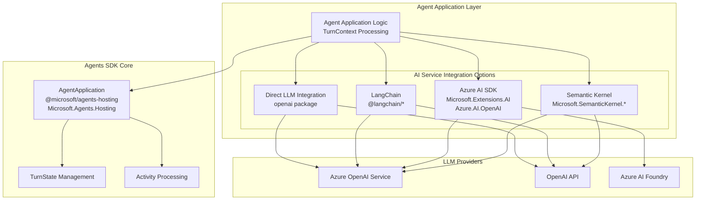
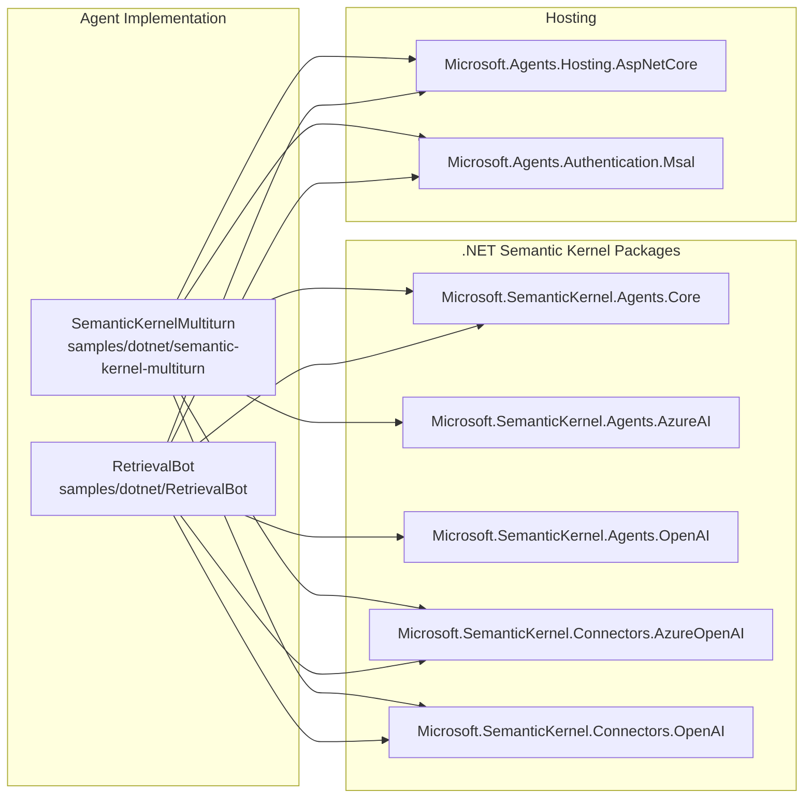
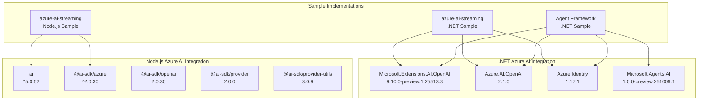
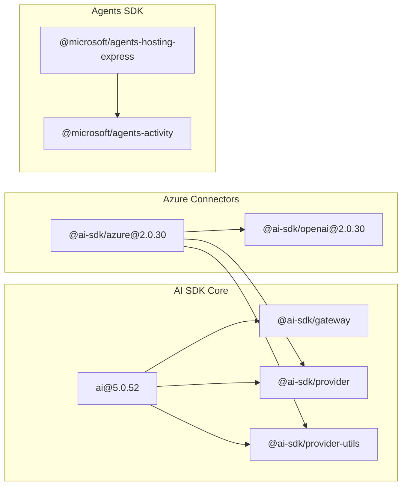
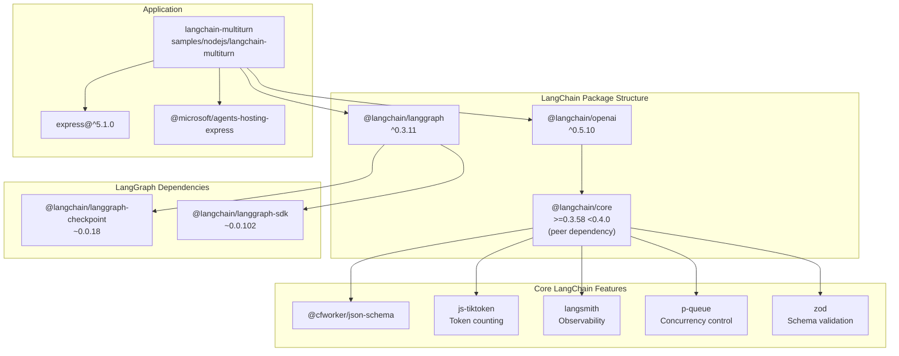
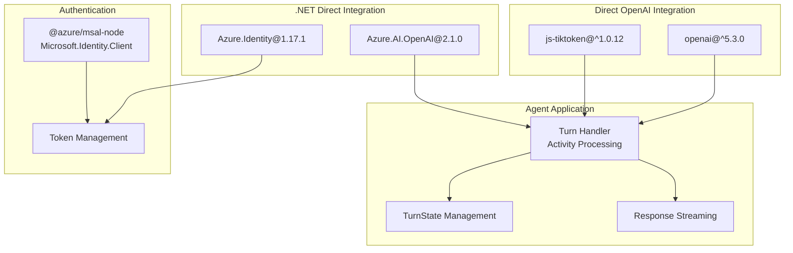
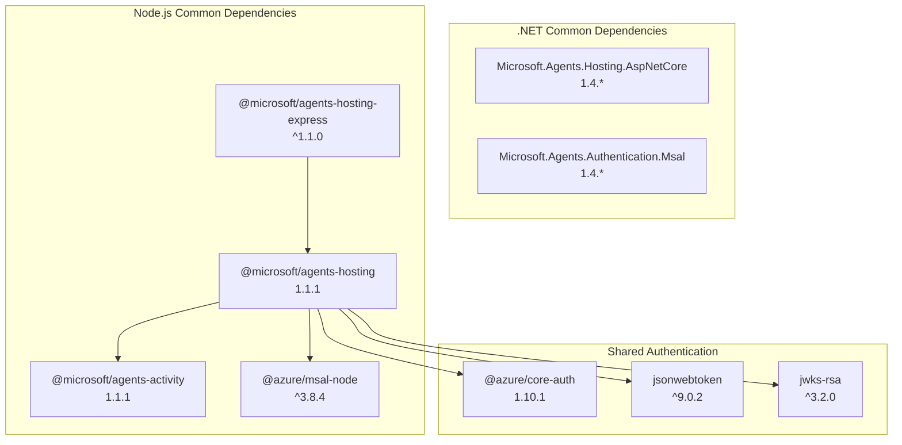

<!-- source: DeepWiki mcp.deepwiki.com · repo microsoft/Agents · page 5.4 AI Services Integration · fetched 2026-10-26 -->

# AI Services Integration

Relevant source files

The following files were used as context for generating this wiki page:

- [.github/scripts/updatenode.sh](.github/scripts/updatenode.sh)
- [MCSandAgentsEcosystemLinks.md](MCSandAgentsEcosystemLinks.md)
- [README.md](README.md)
- [samples/dotnet/Agent Framework/AgentFrameworkWeather.csproj](samples/dotnet/Agent Framework/AgentFrameworkWeather.csproj)
- [samples/dotnet/GenesysHandoff/GenesysHandoff.csproj](samples/dotnet/GenesysHandoff/GenesysHandoff.csproj)
- [samples/dotnet/RetrievalBot/RetrievalBot.csproj](samples/dotnet/RetrievalBot/RetrievalBot.csproj)
- [samples/dotnet/auto-signin/AutoSignIn.csproj](samples/dotnet/auto-signin/AutoSignIn.csproj)
- [samples/dotnet/azure-ai-streaming/StreamingMessageAgent.csproj](samples/dotnet/azure-ai-streaming/StreamingMessageAgent.csproj)
- [samples/dotnet/copilotstudio-client/CopilotStudioClient.csproj](samples/dotnet/copilotstudio-client/CopilotStudioClient.csproj)
- [samples/dotnet/copilotstudio-skill/CopilotStudioEchoSkill.csproj](samples/dotnet/copilotstudio-skill/CopilotStudioEchoSkill.csproj)
- [samples/dotnet/obo-authorization/OBOAuthorization.csproj](samples/dotnet/obo-authorization/OBOAuthorization.csproj)
- [samples/dotnet/quickstart/QuickStart.csproj](samples/dotnet/quickstart/QuickStart.csproj)
- [samples/dotnet/semantic-kernel-multiturn/SemanticKernelMultiturn.csproj](samples/dotnet/semantic-kernel-multiturn/SemanticKernelMultiturn.csproj)
- [samples/nodejs/auto-signin/package-lock.json](samples/nodejs/auto-signin/package-lock.json)
- [samples/nodejs/azure-ai-streaming/package-lock.json](samples/nodejs/azure-ai-streaming/package-lock.json)
- [samples/nodejs/cards/package-lock.json](samples/nodejs/cards/package-lock.json)
- [samples/nodejs/copilotstudio-client/package-lock.json](samples/nodejs/copilotstudio-client/package-lock.json)
- [samples/nodejs/copilotstudio-webchat-react/package-lock.json](samples/nodejs/copilotstudio-webchat-react/package-lock.json)
- [samples/nodejs/langchain-multiturn/package-lock.json](samples/nodejs/langchain-multiturn/package-lock.json)
- [samples/nodejs/multi-turn-prompt/package-lock.json](samples/nodejs/multi-turn-prompt/package-lock.json)
- [samples/nodejs/obo-authorization/package-lock.json](samples/nodejs/obo-authorization/package-lock.json)
- [samples/nodejs/quickstart/package-lock.json](samples/nodejs/quickstart/package-lock.json)

## Purpose and Scope

This document explains how to integrate AI services and LLM providers into agents built with the Microsoft 365 Agents SDK. The SDK is designed to be AI-agnostic, allowing developers to select and integrate the AI services that best meet their requirements. This page covers integration with Semantic Kernel, Azure AI Foundry, LangChain, and direct integration with various LLM providers including Azure OpenAI and OpenAI.

For deployment of AI-powered agents to specific channels, see [Microsoft Teams Integration](#5.1), [Microsoft 365 Copilot Integration](#5.2), and [Copilot Studio Integration](#5.3). For advanced patterns and best practices, see [AI Integration Patterns](#8.1).

## Integration Architecture Overview

The Microsoft 365 Agents SDK provides a flexible architecture where AI services integrate at the application layer, above the core agent container but within the activity processing pipeline. The SDK handles the conversational infrastructure while developers bring their choice of AI orchestration framework or direct LLM integration.

**Sources:** [README.md:1-50](), [samples/dotnet/Agent Framework/AgentFrameworkWeather.csproj:1-26](), [samples/nodejs/azure-ai-streaming/package-lock.json:1-50]()

## Semantic Kernel Integration

Semantic Kernel is Microsoft's SDK for LLM orchestration that integrates Large Language Models with conventional programming languages. The SDK supports multi-turn conversations, plugin chaining, and agent orchestration patterns.

### .NET Semantic Kernel Integration

The .NET samples demonstrate Semantic Kernel integration through the following package structure:

The Semantic Kernel integration enables:
- **Agent Orchestration**: Using `Microsoft.SemanticKernel.Agents.Core` for multi-agent patterns
- **Azure AI Integration**: Through `Microsoft.SemanticKernel.Agents.AzureAI` for Azure AI Foundry features
- **OpenAI Integration**: Via `Microsoft.SemanticKernel.Agents.OpenAI` for direct OpenAI API access
- **Model Connectors**: Using `Microsoft.SemanticKernel.Connectors.AzureOpenAI` and `Microsoft.SemanticKernel.Connectors.OpenAI`

**Sources:** [samples/dotnet/semantic-kernel-multiturn/SemanticKernelMultiturn.csproj:1-31](), [samples/dotnet/RetrievalBot/RetrievalBot.csproj:1-43]()

### Semantic Kernel Package Versions

| Package | Semantic Kernel Multiturn | RetrievalBot |
|---------|---------------------------|--------------|
| Microsoft.SemanticKernel.Agents.Core | 1.45.0 | 1.29.0-alpha |
| Microsoft.SemanticKernel.Agents.AzureAI | 1.45.0-preview | - |
| Microsoft.SemanticKernel.Agents.OpenAI | - | 1.29.0-alpha |
| Microsoft.SemanticKernel.Connectors.AzureOpenAI | 1.45.0 | 1.29.0 |
| Microsoft.SemanticKernel.Connectors.OpenAI | 1.45.0 | 1.29.0 |

**Sources:** [samples/dotnet/semantic-kernel-multiturn/SemanticKernelMultiturn.csproj:20-28](), [samples/dotnet/RetrievalBot/RetrievalBot.csproj:26-32]()

## Azure AI Foundry Integration

Azure AI Foundry provides comprehensive backend agent functionality including reasoning, retrieval augmented generation (RAG), and observability. The SDK integrates with Azure AI Foundry through the `Microsoft.Extensions.AI` abstraction layer and direct Azure SDK integration.

### .NET Azure AI SDK Integration

The .NET integration uses two primary approaches:

1. **Microsoft.Extensions.AI.OpenAI**: The unified AI abstraction layer providing model-agnostic interfaces
2. **Azure.AI.OpenAI**: Direct Azure OpenAI service integration

Key features:
- **Streaming Support**: Real-time response streaming through `IChatClient` interfaces
- **Azure Identity**: Managed identity and OAuth token-based authentication via `Azure.Identity`
- **Agent Framework**: Enhanced capabilities through `Microsoft.Agents.AI` preview package

**Sources:** [samples/dotnet/azure-ai-streaming/StreamingMessageAgent.csproj:1-19](), [samples/dotnet/Agent Framework/AgentFrameworkWeather.csproj:1-26]()

### Node.js AI SDK Integration

The Node.js integration leverages the Vercel AI SDK (`ai` package) with Azure-specific connectors:

The Node.js AI SDK provides:
- **Unified API**: Consistent interface across Azure OpenAI and OpenAI models through the `ai` package
- **Provider Abstraction**: Model-agnostic interfaces via `@ai-sdk/provider`
- **Streaming**: Built-in streaming support through `@ai-sdk/provider-utils` with `eventsource-parser`
- **Azure Integration**: Native Azure OpenAI support via `@ai-sdk/azure`

**Sources:** [samples/nodejs/azure-ai-streaming/package-lock.json:1-100](), [samples/nodejs/azure-ai-streaming/package-lock.json:401-418]()

## LangChain Integration

LangChain provides comprehensive tools for building LLM-powered applications with graph-based orchestration. The Node.js SDK integrates with LangChain through the LangGraph framework.

### LangChain Integration Features

The LangChain integration provides:

1. **Graph-Based Orchestration**: Using `@langchain/langgraph` for complex, stateful conversation flows
2. **OpenAI Integration**: Through `@langchain/openai` with support for Azure OpenAI
3. **State Management**: Via `@langchain/langgraph-checkpoint` for conversation state persistence
4. **Type Safety**: Using `zod` for schema validation and `@cfworker/json-schema` for JSON schema support
5. **Observability**: Built-in tracing and monitoring through `langsmith`
6. **Token Management**: Using `js-tiktoken` for accurate token counting

**Key Package Versions:**

| Package | Version | Purpose |
|---------|---------|---------|
| @langchain/langgraph | 0.3.12 | Graph orchestration framework |
| @langchain/openai | 0.5.18 | OpenAI/Azure OpenAI connector |
| @langchain/core | 0.3.80 (peer) | Core abstractions and utilities |
| @langchain/langgraph-checkpoint | 0.0.18 | State persistence |
| @langchain/langgraph-sdk | 0.0.112 | SDK utilities |

**Sources:** [samples/nodejs/langchain-multiturn/package-lock.json:1-250]()

## Direct LLM Provider Integration

For scenarios requiring direct control over LLM interactions, the SDK supports direct integration with LLM provider APIs without intermediate orchestration frameworks.

### Node.js Direct Integration

Direct OpenAI integration in Node.js uses:
- **openai** package (v5.3.0+) for API access
- **js-tiktoken** for token counting and management
- Manual conversation state management through `TurnState`

### .NET Direct Integration

Direct integration in .NET uses:
- **Azure.AI.OpenAI** (v2.1.0) for typed Azure OpenAI client
- **Azure.Identity** (v1.17.1) for managed identity authentication
- `IChatClient` abstraction from `Microsoft.Extensions.AI` for model-agnostic code

**Sources:** [samples/nodejs/langchain-multiturn/package-lock.json:202-217](), [samples/dotnet/azure-ai-streaming/StreamingMessageAgent.csproj:10-16]()

## Integration Pattern Comparison

The following table compares key characteristics of each integration approach:

| Feature | Semantic Kernel | Azure AI SDK | LangChain | Direct Integration |
|---------|----------------|--------------|-----------|-------------------|
| **Language Support** | .NET, Python | .NET, Node.js | Node.js, Python | All |
| **Primary Use Case** | Agent orchestration, plugin chaining | Streaming, Azure AI features | Graph-based workflows | Full control, simple scenarios |
| **State Management** | Built-in | Manual with TurnState | Built-in checkpointing | Manual with TurnState |
| **Token Counting** | Built-in | Via extensions | js-tiktoken | Manual |
| **Observability** | Limited | Azure Monitor integration | LangSmith | Manual |
| **Streaming Support** | Yes | Native | Yes | Yes |
| **Multi-Agent** | Native support | Manual orchestration | Native support | Manual orchestration |
| **Learning Curve** | Medium | Low | Medium-High | Low |

**Sources:** [README.md:34-50](), [samples/dotnet/semantic-kernel-multiturn/SemanticKernelMultiturn.csproj:1-31](), [samples/nodejs/azure-ai-streaming/package-lock.json:1-100](), [samples/nodejs/langchain-multiturn/package-lock.json:1-250]()

## Common Integration Dependencies

All AI service integrations share common dependencies for agent hosting and authentication:

### Shared Components

All integration patterns utilize:

1. **Agent Hosting**: Platform-specific hosting packages
   - .NET: `Microsoft.Agents.Hosting.AspNetCore`
   - Node.js: `@microsoft/agents-hosting-express`

2. **Authentication**: MSAL-based authentication
   - .NET: `Microsoft.Agents.Authentication.Msal`
   - Node.js: `@azure/msal-node` (integrated in `@microsoft/agents-hosting`)

3. **Activity Processing**: Core activity protocol handling
   - .NET: Built into hosting package
   - Node.js: `@microsoft/agents-activity`

4. **Token Management**: JWT validation and key management
   - `jsonwebtoken` for token parsing
   - `jwks-rsa` for key rotation support

**Sources:** [samples/dotnet/semantic-kernel-multiturn/SemanticKernelMultiturn.csproj:26-27](), [samples/nodejs/azure-ai-streaming/package-lock.json:190-207](), [samples/nodejs/quickstart/package-lock.json:111-128]()

## Sample Implementation Reference

The repository provides sample implementations for each integration approach:

| Sample | Language | AI Service | Location | Key Features |
|--------|----------|-----------|----------|--------------|
| Azure AI Streaming | .NET | Microsoft.Extensions.AI | samples/dotnet/azure-ai-streaming | Streaming responses, Azure Identity |
| Azure AI Streaming | Node.js | ai SDK | samples/nodejs/azure-ai-streaming | Vercel AI SDK, streaming |
| Agent Framework | .NET | Microsoft.Agents.AI | samples/dotnet/Agent Framework | Weather API integration, adaptive cards |
| Semantic Kernel Multiturn | .NET | Semantic Kernel | samples/dotnet/semantic-kernel-multiturn | Multi-turn conversations, agents |
| RetrievalBot | .NET | Semantic Kernel | samples/dotnet/RetrievalBot | RAG, Microsoft Graph integration |
| LangChain Multiturn | Node.js | LangChain | samples/nodejs/langchain-multiturn | Graph orchestration, stateful flows |

**Sources:** [samples/dotnet/azure-ai-streaming/StreamingMessageAgent.csproj:1-19](), [samples/nodejs/azure-ai-streaming/package-lock.json:1-50](), [samples/dotnet/Agent Framework/AgentFrameworkWeather.csproj:1-26](), [samples/dotnet/semantic-kernel-multiturn/SemanticKernelMultiturn.csproj:1-31](), [samples/dotnet/RetrievalBot/RetrievalBot.csproj:1-43](), [samples/nodejs/langchain-multiturn/package-lock.json:1-50]()

---

