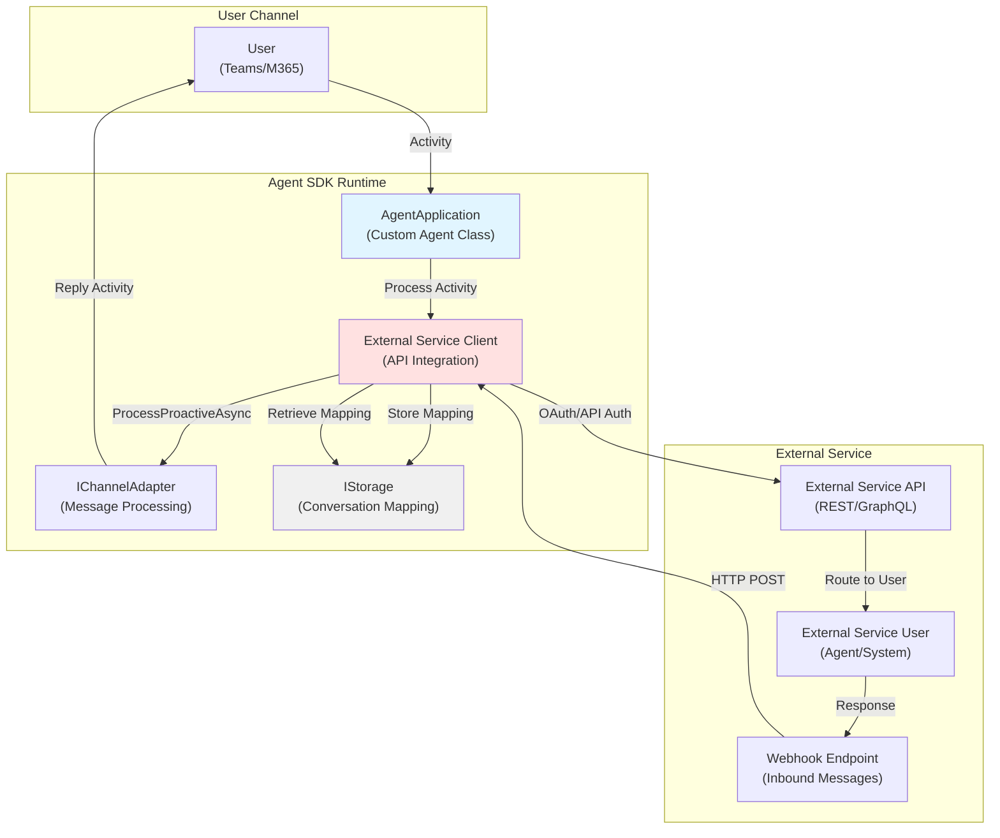
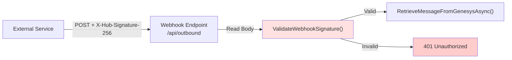
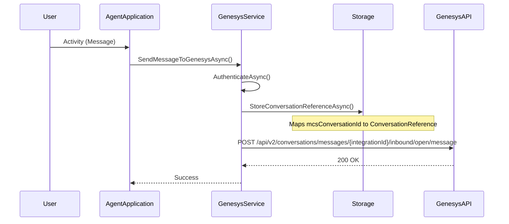
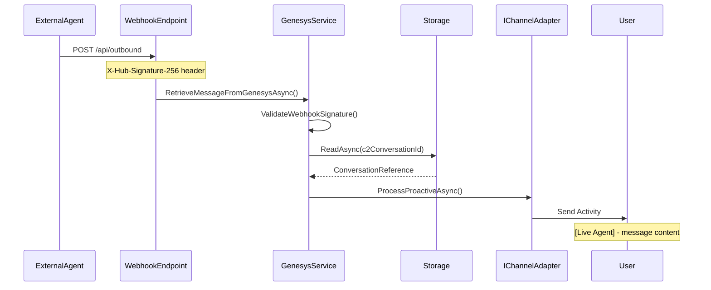
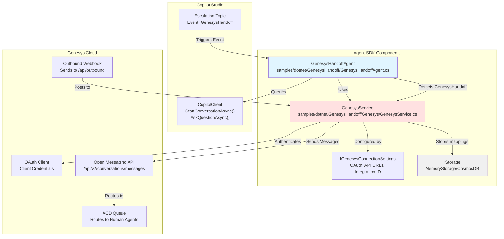
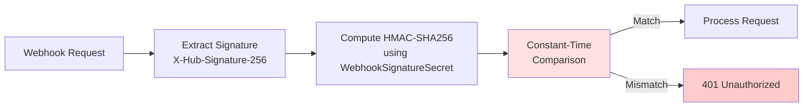
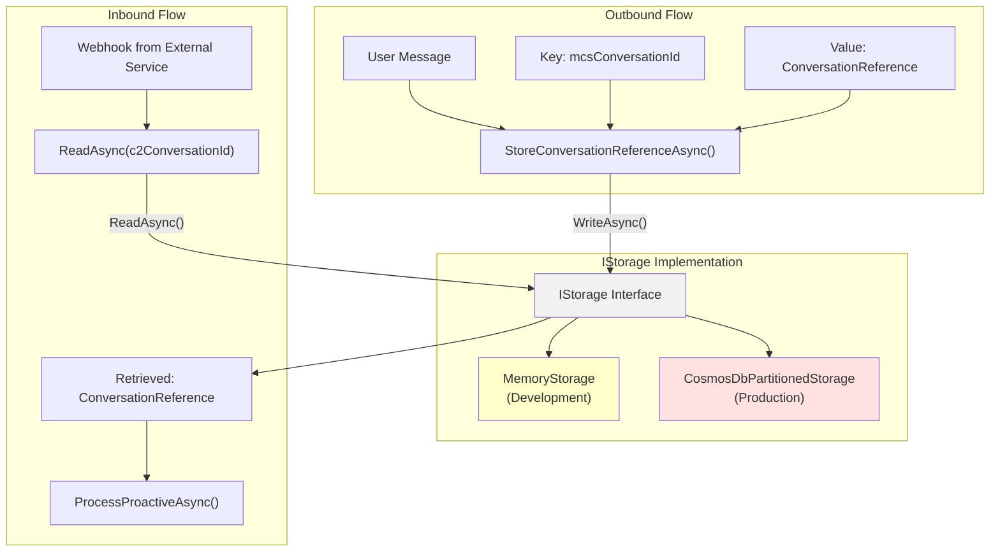

<!-- source: DeepWiki mcp.deepwiki.com · repo microsoft/Agents · page 5.5 External Service Integration · fetched 2026-10-26 -->

# External Service Integration

<details>
<summary>Relevant source files</summary>

The following files were used as context for generating this wiki page:

- [samples/dotnet/GenesysHandoff/Genesys/GenesysConnectionSetting.cs](samples/dotnet/GenesysHandoff/Genesys/GenesysConnectionSetting.cs)
- [samples/dotnet/GenesysHandoff/Genesys/GenesysService.cs](samples/dotnet/GenesysHandoff/Genesys/GenesysService.cs)
- [samples/dotnet/GenesysHandoff/Genesys/IGenesysConnectionSettings.cs](samples/dotnet/GenesysHandoff/Genesys/IGenesysConnectionSettings.cs)
- [samples/dotnet/GenesysHandoff/GenesysHandoffAgent.cs](samples/dotnet/GenesysHandoff/GenesysHandoffAgent.cs)
- [samples/dotnet/GenesysHandoff/Program.cs](samples/dotnet/GenesysHandoff/Program.cs)
- [samples/dotnet/GenesysHandoff/README.md](samples/dotnet/GenesysHandoff/README.md)
- [samples/dotnet/GenesysHandoff/appsettings.json](samples/dotnet/GenesysHandoff/appsettings.json)

</details>


## Purpose and Scope

This document describes patterns and practices for integrating Microsoft Agents with external third-party services such as contact center platforms, CRM systems, custom APIs, and other external systems beyond the Microsoft ecosystem. 

For integration with Microsoft services, see [Microsoft Teams Integration](#5.1), [Microsoft 365 Copilot Integration](#5.2), and [Copilot Studio Integration](#5.3). For AI service integration patterns, see [AI Services Integration](#5.4).

This page focuses on the architectural patterns, authentication mechanisms, message flow, and implementation details required to build bidirectional integrations with external services, using the Genesys Cloud contact center integration as a concrete example.

---

## Integration Architecture Overview

External service integrations typically follow a bidirectional message flow pattern where the agent acts as an intermediary between users and the external service. The integration must handle authentication with the external service, maintain conversation state mappings, and route messages in both directions.

### High-Level Architecture



**Sources:** [samples/dotnet/GenesysHandoff/README.md:505-512](), [samples/dotnet/GenesysHandoff/GenesysHandoffAgent.cs:1-192](), [samples/dotnet/GenesysHandoff/Genesys/GenesysService.cs:1-384]()

---

## Authentication Patterns

External service integrations require two distinct authentication mechanisms: agent-to-service authentication and webhook security validation.

### OAuth Client Credentials Flow

Most external service APIs use OAuth 2.0 Client Credentials flow for machine-to-machine authentication. The agent obtains an access token using client credentials and includes it in API requests.

| Component | Responsibility |
|-----------|----------------|
| **Client ID** | Identifies the application to the external service |
| **Client Secret** | Authenticates the application's identity |
| **OAuth Token URL** | Endpoint for obtaining access tokens |
| **Token Caching** | Reuses valid tokens to minimize authentication requests |

The `GenesysService` class implements OAuth authentication with token caching at [samples/dotnet/GenesysHandoff/Genesys/GenesysService.cs:150-180]():

```
AuthenticateAsync() acquires and caches tokens
- Checks cached token validity
- Requests new token if expired
- Uses semaphore for thread safety
- Caches token with 60-second expiry buffer
```

### Webhook Signature Validation

Inbound webhooks from external services must be validated to prevent unauthorized requests. HMAC-SHA256 signature validation ensures webhook authenticity.



The signature validation implementation at [samples/dotnet/GenesysHandoff/Genesys/GenesysService.cs:351-382]() performs:
- Extracts signature from `X-Hub-Signature-256` header
- Computes HMAC-SHA256 hash using configured secret
- Uses constant-time comparison to prevent timing attacks
- Returns 401 Unauthorized for invalid signatures

**Sources:** [samples/dotnet/GenesysHandoff/Genesys/GenesysService.cs:150-223](), [samples/dotnet/GenesysHandoff/Genesys/GenesysService.cs:351-382](), [samples/dotnet/GenesysHandoff/README.md:182-194]()

---

## Message Flow Patterns

External service integrations implement bidirectional message flow: outbound messages (user to external service) and inbound messages (external service to user).

### Outbound Message Flow

When a user sends a message during an escalated conversation, the agent forwards it to the external service API.



The outbound flow is implemented in [samples/dotnet/GenesysHandoff/Genesys/GenesysService.cs:41-46]() and processes:
1. OAuth token acquisition
2. Conversation reference storage
3. Message payload construction
4. API request to external service

### Inbound Message Flow (Proactive Messaging)

When an external service user (e.g., live agent) sends a message, the external service posts to a webhook endpoint. The agent retrieves the conversation reference and sends a proactive message to the user.



The inbound flow implementation at [samples/dotnet/GenesysHandoff/Genesys/GenesysService.cs:48-138]() handles:
1. Webhook signature validation
2. Payload deserialization (`GenesysOutboundPayload`)
3. Conversation reference retrieval from storage
4. Proactive message delivery via `IChannelAdapter.ProcessProactiveAsync()`

**Sources:** [samples/dotnet/GenesysHandoff/Genesys/GenesysService.cs:41-138](), [samples/dotnet/GenesysHandoff/README.md:505-512]()

---

## Genesys Integration Case Study

The Genesys Cloud integration demonstrates a complete external service integration pattern for human handoff scenarios, where conversations escalate from an automated agent to a live human agent in an external contact center.

### Integration Components



### Event-Driven Escalation

The escalation flow is triggered by a Copilot Studio event. The agent detects the event and initiates the handoff to Genesys.

At [samples/dotnet/GenesysHandoff/GenesysHandoffAgent.cs:110-118](), the agent:
1. Detects `ActivityTypes.Event` with name `"GenesysHandoff"`
2. Extracts conversation summary from `activity.Value`
3. Sets `IsEscalated` flag in conversation state
4. Sends initial message to Genesys with context

### Conversation State Management

The agent maintains state to track whether a conversation is escalated:

| State Property | Type | Purpose |
|----------------|------|---------|
| `MCSConversationId` | `string` | Maps to Copilot Studio conversation ID |
| `IsEscalated` | `bool` | Indicates if conversation is handled by external agent |

At [samples/dotnet/GenesysHandoff/GenesysHandoffAgent.cs:81-86](), the agent checks `IsEscalated` to determine message routing:
- If `true`, forwards messages to Genesys via `SendMessageToGenesysAsync()`
- If `false`, processes messages through Copilot Studio

### Session Reset Pattern

Because external services may not provide conversation end notifications, the agent implements a manual reset command. At [samples/dotnet/GenesysHandoff/GenesysHandoffAgent.cs:149-164](), the `-reset` command:
1. Retrieves `MCSConversationId` from conversation state
2. Deletes conversation reference from storage via `DeleteConversationReferenceAsync()`
3. Clears `MCSConversationId` and `IsEscalated` from state
4. Notifies user of reset

**Sources:** [samples/dotnet/GenesysHandoff/GenesysHandoffAgent.cs:1-192](), [samples/dotnet/GenesysHandoff/Genesys/GenesysService.cs:1-384](), [samples/dotnet/GenesysHandoff/README.md:1-512]()

---

## Implementation Components

### GenesysService Class Structure

The `GenesysService` class at [samples/dotnet/GenesysHandoff/Genesys/GenesysService.cs:22-384]() encapsulates all external service interaction logic:

| Method | Purpose | Key Operations |
|--------|---------|----------------|
| `SendMessageToGenesysAsync()` | Outbound message flow | Authenticate, store reference, send message |
| `RetrieveMessageFromGenesysAsync()` | Inbound webhook handler | Validate signature, retrieve reference, send proactive |
| `AuthenticateAsync()` | OAuth token management | Token caching, semaphore locking, expiry handling |
| `DeleteConversationReferenceAsync()` | Cleanup | Remove mapping from storage |
| `ValidateWebhookSignature()` | Security | HMAC-SHA256 signature verification |

### Service Registration and Dependency Injection

The external service client is registered as a singleton at [samples/dotnet/GenesysHandoff/Program.cs:34-40]():

```csharp
builder.Services.AddSingleton(sp =>
{
    var settings = new GenesysConnectionSetting(builder.Configuration.GetSection("Genesys"));
    genesysService = new GenesysService(settings, sp.GetService<IHttpClientFactory>()!, sp.GetService<IStorage>()!);
    return genesysService;
});
```

Dependencies:
- `IGenesysConnectionSettings`: Configuration values from `appsettings.json`
- `IHttpClientFactory`: For HTTP requests to external API
- `IStorage`: For conversation reference persistence

### Webhook Endpoint Registration

The webhook endpoint for inbound messages is registered at [samples/dotnet/GenesysHandoff/Program.cs:65-77]():

```csharp
app.MapPost("/api/outbound", async (HttpRequest request, HttpResponse response, IChannelAdapter channelAdapter, CancellationToken cancellationToken) =>
{
    await genesysService.RetrieveMessageFromGenesysAsync(request, channelAdapter, cancellationToken);
    response.StatusCode = StatusCodes.Status200OK;
    await response.WriteAsync("Proactive message sent.", cancellationToken);
});
```

This endpoint:
- Accepts HTTP POST requests from the external service
- Delegates to `GenesysService.RetrieveMessageFromGenesysAsync()`
- Requires `IChannelAdapter` for proactive messaging
- Returns 200 OK on successful processing

**Sources:** [samples/dotnet/GenesysHandoff/Genesys/GenesysService.cs:22-384](), [samples/dotnet/GenesysHandoff/Program.cs:1-91]()

---

## Configuration

External service integrations require configuration for API endpoints, authentication credentials, and integration identifiers.

### Configuration Schema

The Genesys configuration section in [samples/dotnet/GenesysHandoff/appsettings.json:57-64]() demonstrates the typical pattern:

```json
"Genesys": {
  "OauthUrl": "https://login.<region>.pure.cloud/oauth/token",
  "ApiUrl": "https://api.<region>.pure.cloud",
  "IntegrationId": "<GUID>",
  "ClientId": "<OAuth Client ID>",
  "ClientSecret": "<OAuth Client Secret>",
  "WebhookSignatureSecret": "<Webhook Secret>" // Optional but recommended
}
```

### IGenesysConnectionSettings Interface

The settings interface at [samples/dotnet/GenesysHandoff/Genesys/IGenesysConnectionSettings.cs:3-39]() defines required configuration properties:

| Property | Type | Purpose |
|----------|------|---------|
| `OauthUrl` | `string?` | OAuth token endpoint URL |
| `ApiUrl` | `string?` | Base API URL for service requests |
| `IntegrationId` | `string?` | Unique identifier for the integration instance |
| `ClientId` | `string?` | OAuth client identifier |
| `ClientSecret` | `string?` | OAuth client secret for authentication |
| `WebhookSignatureSecret` | `string?` | HMAC secret for webhook validation |

### Configuration Loading

The `GenesysConnectionSetting` implementation at [samples/dotnet/GenesysHandoff/Genesys/GenesysConnectionSetting.cs:64-75]() loads values from an `IConfigurationSection`:

```csharp
public GenesysConnectionSetting(IConfigurationSection config)
{
    if (config != null && config.Exists())
    {
        OauthUrl = config.GetValue<string>("OauthUrl");
        ApiUrl = config.GetValue<string>("ApiUrl");
        IntegrationId = config.GetValue<string>("IntegrationId");
        ClientId = config.GetValue<string>("ClientId");
        ClientSecret = config.GetValue<string>("ClientSecret");
        WebhookSignatureSecret = config.GetValue<string>("WebhookSignatureSecret");
    }
}
```

**Sources:** [samples/dotnet/GenesysHandoff/appsettings.json:57-64](), [samples/dotnet/GenesysHandoff/Genesys/IGenesysConnectionSettings.cs:3-39](), [samples/dotnet/GenesysHandoff/Genesys/GenesysConnectionSetting.cs:14-76]()

---

## Webhook Security

Webhook signature validation prevents unauthorized requests from reaching the agent. The validation process ensures that inbound webhooks originate from the trusted external service.

### HMAC-SHA256 Validation Flow



### Implementation Details

The validation implementation at [samples/dotnet/GenesysHandoff/Genesys/GenesysService.cs:351-382]() performs these steps:

1. **Extract Signature**: Reads `X-Hub-Signature-256` header from request
2. **Read Request Body**: Stores raw body for hash computation
3. **Compute Expected Hash**: 
   - Converts `WebhookSignatureSecret` to bytes
   - Computes HMAC-SHA256 hash of request body
   - Encodes result as Base64 with `sha256=` prefix
4. **Compare**: Uses `CryptographicOperations.FixedTimeEquals()` for timing-attack resistant comparison

### Configuration Considerations

| Setting | Behavior |
|---------|----------|
| `WebhookSignatureSecret` is set | Signature validation is enforced; invalid signatures return 401 |
| `WebhookSignatureSecret` is null/empty | Signature validation is skipped (development only) |

At [samples/dotnet/GenesysHandoff/Genesys/GenesysService.cs:60-66](), the service checks if validation is configured:

```csharp
if (!string.IsNullOrEmpty(_setting.WebhookSignatureSecret))
{
    if (!ValidateWebhookSignature(request, requestBody))
    {
        throw new UnauthorizedAccessException("Webhook signature validation failed. Request rejected.");
    }
}
```

**Production recommendation**: Always configure `WebhookSignatureSecret` to prevent unauthorized webhook requests.

**Sources:** [samples/dotnet/GenesysHandoff/Genesys/GenesysService.cs:48-138](), [samples/dotnet/GenesysHandoff/Genesys/GenesysService.cs:351-382](), [samples/dotnet/GenesysHandoff/README.md:182-194]()

---

## Storage and State Management

External service integrations require persistent storage to maintain bidirectional conversation mappings. The storage layer maps external service conversation identifiers to agent conversation references.

### Storage Architecture



### Conversation Reference Storage

The `StoreConversationReferenceAsync()` method at [samples/dotnet/GenesysHandoff/Genesys/GenesysService.cs:234-245]() stores the mapping:

```csharp
private async Task StoreConversationReferenceAsync(IActivity activity, string mcsConversationId, CancellationToken cancellationToken)
{
    var conversationReference = activity.GetConversationReference();
    
    await _storage.WriteAsync(
        new Dictionary<string, object>
        {
            { mcsConversationId, conversationReference }
        },
        cancellationToken
    );
}
```

The key is the external service conversation ID, and the value is a `ConversationReference` object containing:
- `Agent`: Agent identity information
- `Conversation`: Conversation ID and properties
- `User`: User identity
- `ChannelId`: Channel identifier
- `ServiceUrl`: Service endpoint URL

### Conversation Reference Retrieval

The `RetrieveMessageFromGenesysAsync()` method at [samples/dotnet/GenesysHandoff/Genesys/GenesysService.cs:76-81]() retrieves the mapping:

```csharp
var c2ConversationId = payload.Channel.To.Id;
var state = await _storage.ReadAsync([c2ConversationId], cancellationToken);

if (!state.TryGetValue(c2ConversationId, out var referenceObj) || referenceObj is not ConversationReference conversationReference)
{
    return; // No mapping found; message cannot be delivered
}
```

### Storage Implementation Selection

At [samples/dotnet/GenesysHandoff/Program.cs:27](), the sample uses `MemoryStorage` for development:

```csharp
builder.Services.AddSingleton<IStorage, MemoryStorage>();
```

For production deployments, the README at [samples/dotnet/GenesysHandoff/README.md:449-473]() recommends replacing with `CosmosDbPartitionedStorage`:

```csharp
builder.Services.AddSingleton<IStorage>(sp =>
{
    var cosmosDbStorageOptions = new CosmosDbPartitionedStorageOptions
    {
        CosmosDbEndpoint = "<your-cosmos-endpoint>",
        AuthKey = "<your-cosmos-auth-key>",
        DatabaseId = "<your-database-id>",
        ContainerId = "<your-container-id>"
    };
    return new CosmosDbPartitionedStorage(cosmosDbStorageOptions);
});
```

### Cleanup Operations

The `DeleteConversationReferenceAsync()` method at [samples/dotnet/GenesysHandoff/Genesys/GenesysService.cs:140-148]() removes mappings:

```csharp
public async Task DeleteConversationReferenceAsync(string mcsConversationId, CancellationToken cancellationToken)
{
    if (string.IsNullOrEmpty(mcsConversationId))
    {
        return;
    }
    
    await _storage.DeleteAsync([mcsConversationId], cancellationToken);
}
```

This is invoked during the `-reset` command to clean up completed conversations.

**Sources:** [samples/dotnet/GenesysHandoff/Genesys/GenesysService.cs:140-148](), [samples/dotnet/GenesysHandoff/Genesys/GenesysService.cs:234-245](), [samples/dotnet/GenesysHandoff/README.md:443-486](), [samples/dotnet/GenesysHandoff/Program.cs:23-27]()

---

## Message Payload Construction

External services often require specific message payload formats. The agent must transform SDK activities into the external service's expected structure.

### Outbound Payload Structure

The `BuildMessagePayload()` method at [samples/dotnet/GenesysHandoff/Genesys/GenesysService.cs:270-278]() constructs the outbound message:

```json
{
  "channel": {
    "messageId": "<activity.Id>",
    "from": {
      "nickname": "<activity.From.Name>",
      "id": "<mcsConversationId>",
      "idType": "Opaque"
    },
    "time": "2024-01-15T10:30:00.000Z"
  },
  "text": "<activity.Text>",
  "content": [/* attachments */]
}
```

### Channel Information

The `BuildChannelInfo()` method at [samples/dotnet/GenesysHandoff/Genesys/GenesysService.cs:280-293]() constructs metadata:
- `messageId`: SDK activity ID for deduplication
- `from.nickname`: User display name
- `from.id`: External service conversation identifier
- `from.idType`: Always "Opaque" for Open Messaging
- `time`: ISO 8601 timestamp

### Attachment Handling

The `BuildAttachmentContent()` method at [samples/dotnet/GenesysHandoff/Genesys/GenesysService.cs:295-311]() transforms SDK attachments:
- Filters out `text/html` attachments (adaptive cards may not be supported)
- Maps content types to media types (Image, Video, Audio, File)
- Includes `url`, `mime`, `fileName` metadata

The `DetermineMediaType()` method at [samples/dotnet/GenesysHandoff/Genesys/GenesysService.cs:328-338]() performs type mapping:

| Content Type | Media Type |
|--------------|------------|
| `image/png`, `image/jpeg`, `image/jpg`, `image/gif` | `Image` |
| `video/mp4`, `video/mpeg` | `Video` |
| `audio/mpeg`, `audio/wav` | `Audio` |
| `application/pdf` or other | `File` |

### Inbound Payload Processing

The inbound webhook payload is deserialized into a `GenesysOutboundPayload` object at [samples/dotnet/GenesysHandoff/Genesys/GenesysService.cs:68]():

```csharp
var payload = JsonSerializer.Deserialize<GenesysOutboundPayload>(requestBody);
```

The service extracts:
- `payload.Channel.To.Id`: External service conversation ID (used as storage key)
- `payload.Text`: Message text to send to user
- `payload.ContentData`: Attachments collection

At [samples/dotnet/GenesysHandoff/Genesys/GenesysService.cs:116-132](), attachments are transformed into SDK `Attachment` objects:

```csharp
foreach (var content in payload.ContentData)
{
    if (content.Attachment != null && !string.IsNullOrEmpty(content.Attachment.Mime) && !string.IsNullOrEmpty(content.Attachment.Url))
    {
        attachments.Add(new Attachment
        {
            ContentType = content.Attachment.Mime,
            ContentUrl = content.Attachment.Url,
            Name = content.Attachment.FileName
        });
    }
}
```

**Sources:** [samples/dotnet/GenesysHandoff/Genesys/GenesysService.cs:270-338](), [samples/dotnet/GenesysHandoff/Genesys/GenesysService.cs:68-137]()

---

## Best Practices

### Security Hardening

| Practice | Implementation |
|----------|----------------|
| **Webhook Signature Validation** | Always configure `WebhookSignatureSecret` in production to prevent unauthorized webhook requests |
| **Credential Storage** | Store OAuth credentials in Azure Key Vault or environment variables, never in source code |
| **HTTPS Enforcement** | Use HTTPS for all webhook endpoints; external services should POST to `https://` URLs only |
| **IP Allowlisting** | Consider restricting webhook endpoint access to external service IP ranges via Azure NSG or WAF |

### Production Storage

The sample uses `MemoryStorage` for development, which loses state on restart. Production deployments should use:
- **Azure Cosmos DB** via `CosmosDbPartitionedStorage` for globally distributed, highly available state
- **Azure Blob Storage** via `BlobsStorage` for simpler scenarios
- Implement appropriate partitioning strategies for scale

See [samples/dotnet/GenesysHandoff/README.md:443-486]() for migration instructions.

### Error Handling

At [samples/dotnet/GenesysHandoff/Genesys/GenesysService.cs:165-166](), the OAuth authentication ensures success:

```csharp
var response = await client.SendAsync(request, cancellationToken);
response.EnsureSuccessStatusCode();
```

Consider implementing:
- Retry logic with exponential backoff for transient failures
- Circuit breaker patterns for sustained external service outages
- Fallback messages when external service is unavailable
- Logging and telemetry for troubleshooting integration issues

### Conversation Lifecycle Management

External services may not provide explicit conversation end notifications. Implement:
- **Manual Reset Command**: Allow users to end escalated sessions (e.g., `-reset`)
- **Timeout Handling**: Detect inactive conversations and clean up mappings
- **User Notifications**: Inform users when escalation begins and ends

At [samples/dotnet/GenesysHandoff/GenesysHandoffAgent.cs:149-164](), the `-reset` command provides explicit lifecycle control.

### Token Caching

The `AuthenticateAsync()` method at [samples/dotnet/GenesysHandoff/Genesys/GenesysService.cs:150-180]() implements token caching:
- Stores token with expiry timestamp
- Subtracts 60-second buffer to refresh before expiration
- Uses `SemaphoreSlim` to prevent concurrent token requests
- Reduces authentication overhead and rate limiting issues

### Message Formatting

At [samples/dotnet/GenesysHandoff/Genesys/GenesysService.cs:112-114](), the service adds an agent prefix:

```csharp
var agentPrefix = "[Live Agent]";
var fullMessage = $"{agentPrefix} - {payload.Text}";
var replyActivity = MessageFactory.Text(fullMessage);
```

This clarifies message source to users. Consider:
- Adding timestamps for message ordering
- Including agent name/identifier if available
- Implementing typing indicators during agent response delays

### Testing and Validation

For comprehensive testing guidance, see [samples/dotnet/GenesysHandoff/README.md:325-410](). Key considerations:
- Use dev tunnels for local development and webhook testing
- Configure test queues and test agents in external service
- Verify webhook signature validation with valid and invalid signatures
- Test conversation reset and cleanup operations
- Validate attachment handling for various content types

**Sources:** [samples/dotnet/GenesysHandoff/README.md:424-494](), [samples/dotnet/GenesysHandoff/Genesys/GenesysService.cs:150-180](), [samples/dotnet/GenesysHandoff/GenesysHandoffAgent.cs:149-164]()

---

## Extension Patterns

The Genesys integration pattern can be extended to support other external services by:

1. **Creating Service-Specific Client**: Implement a service class similar to `GenesysService` with OAuth and API logic
2. **Defining Configuration Interface**: Create an interface for service-specific settings (URLs, credentials, identifiers)
3. **Implementing Message Transformation**: Map SDK activities to/from external service payloads
4. **Registering Webhook Endpoint**: Add a route to receive inbound messages from the external service
5. **Integrating with AgentApplication**: Detect service-specific events or commands to trigger handoff

This architecture supports integration with:
- **CRM Systems**: Salesforce, Dynamics 365, custom CRMs
- **Ticketing Systems**: ServiceNow, Jira, Zendesk
- **Contact Centers**: Five9, Twilio Flex, Amazon Connect
- **Custom APIs**: Internal enterprise systems, partner integrations

The core pattern remains consistent: authenticate to external API, maintain conversation reference mappings in storage, route messages bidirectionally, and validate inbound webhooks for security.

**Sources:** [samples/dotnet/GenesysHandoff/README.md:487-494](), [samples/dotnet/GenesysHandoff/Genesys/GenesysService.cs:1-384]()

---

