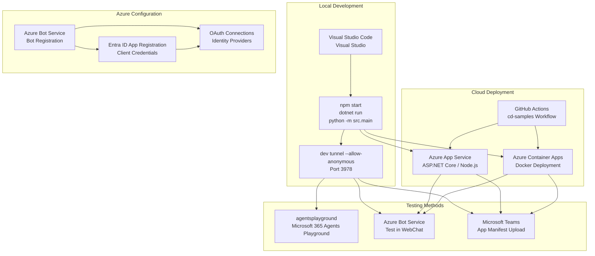
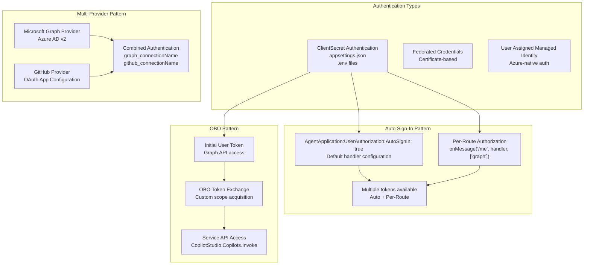
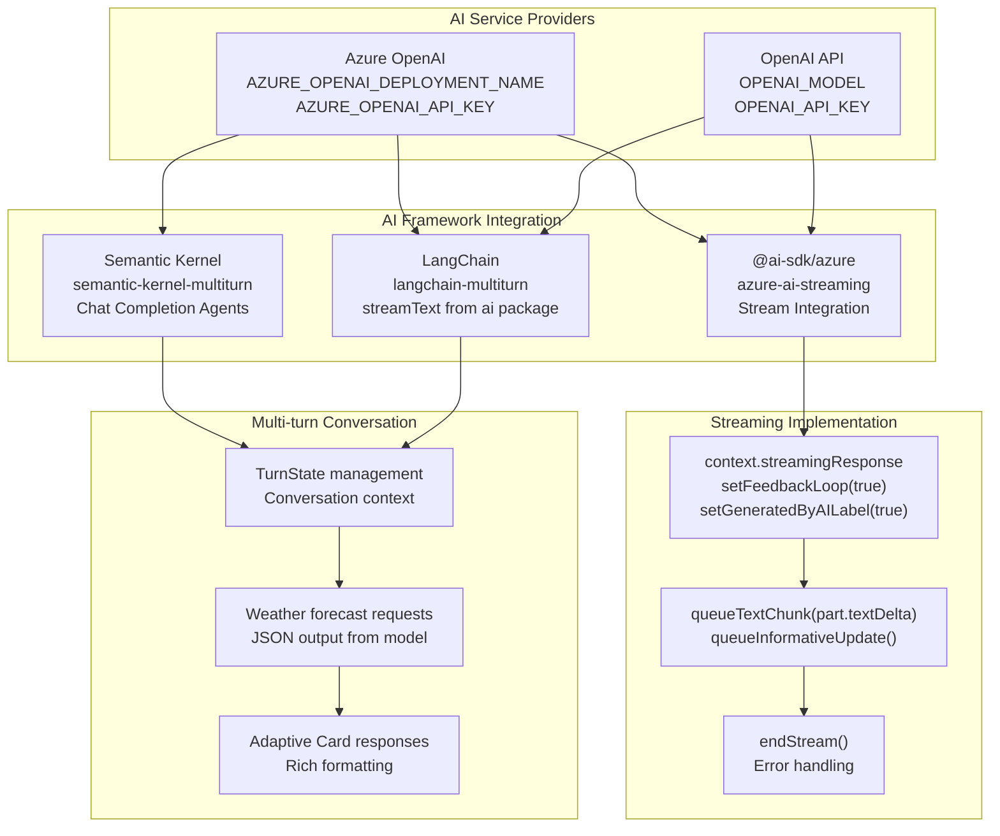
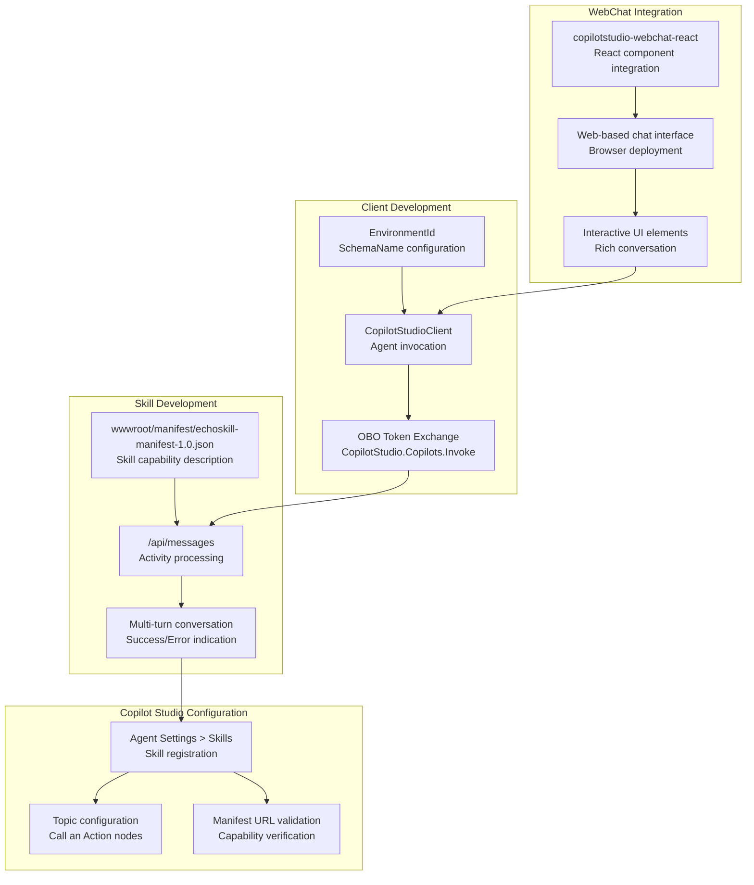
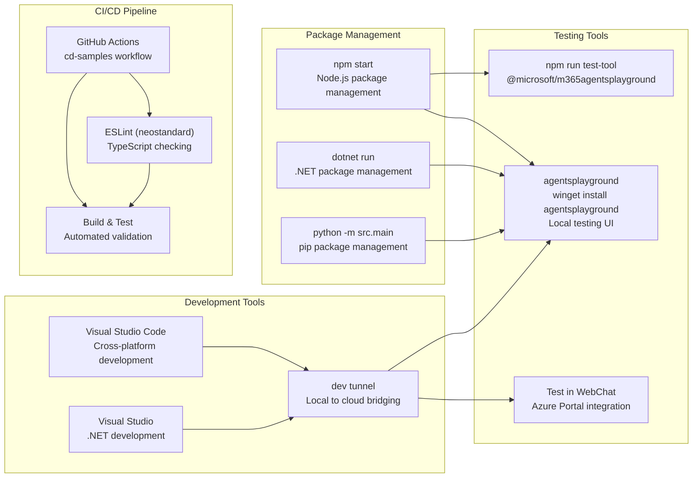

<!-- source: DeepWiki mcp.deepwiki.com · repo microsoft/Agents · page 6 Sample Applications · fetched 2026-10-26 -->

# Sample Applications

Relevant source files

The following files were used as context for generating this wiki page:

- [samples/README.md](samples/README.md)

This section provides a comprehensive guide to the sample applications included in the Microsoft 365 Agents SDK repository. The samples demonstrate various SDK capabilities, patterns, and integration scenarios across .NET, JavaScript, and Python implementations.

For detailed information about building agents using the core SDK classes, see [Building Agents](#2). For specific authentication implementation patterns, see [Authentication](#3). For deployment and hosting configurations, see [Deployment and Hosting](#4).

## Sample Categories and Structure

The sample applications are organized into multiple categories based on complexity and use case, distributed across three language implementations:

```mermaid
graph TB
    subgraph "Sample Organization"
        SamplesRoot["samples/"]
        DotNetSamples["samples/dotnet/"]
        NodeSamples["samples/nodejs/"]
        PythonSamples["samples/python/"]
    end
    
    subgraph "Basic Patterns"
        QuickStart["quickstart/"]
        Empty["Empty Agent"]
        Echo["Echo Bot"]
    end
    
    subgraph "Authentication Patterns"
        AutoSignIn["auto-signin/"]
        OBO["obo-authorization/"]
        MultiProvider["Multi-Provider OAuth"]
    end
    
    subgraph "AI Integration Patterns"
        SemanticKernel["semantic-kernel-multiturn/"]
        LangChain["langchain-multiturn/"]
        Streaming["azure-ai-streaming/"]
    end
    
    subgraph "Platform Integration"
        CopilotStudioSkill["copilotstudio-skill/"]
        CopilotStudioClient["copilotstudio-client/"]
        Cards["cards/"]
        WebChat["copilotstudio-webchat-react/"]
    end
    
    subgraph "Advanced Features"
        Retrieval["RetrievalBot/"]
        MultiTurn["multi-turn-prompt/"]
        ReactWebChat["copilotstudio-webchat-react/"]
    end
    
    SamplesRoot --> DotNetSamples
    SamplesRoot --> NodeSamples
    SamplesRoot --> PythonSamples
    
    DotNetSamples --> QuickStart
    DotNetSamples --> AutoSignIn
    DotNetSamples --> SemanticKernel
    DotNetSamples --> Streaming
    DotNetSamples --> CopilotStudioSkill
    DotNetSamples --> Retrieval
    
    NodeSamples --> Empty
    NodeSamples --> AutoSignIn
    NodeSamples --> LangChain
    NodeSamples --> Streaming
    NodeSamples --> Cards
    NodeSamples --> MultiTurn
    NodeSamples --> WebChat
```

Sources: [samples/README.md:1-9](), [samples/dotnet/README.md:1-12](), [samples/nodejs/README.md:1-15]()

## Sample Inventory by Language

The following table provides a comprehensive view of available samples across all supported languages:

| Category | .NET | JavaScript | Python | Description |
|----------|------|------------|--------|-------------|
| **Basic** | `quickstart` | Empty Agent | TBD | Simple echo functionality |
| **Authentication** | `auto-signin` | `auto-signin` | TBD | OAuth integration patterns |
| **Authentication** | `obo-authorization` | `obo-authorization` | TBD | On-Behalf-Of token exchange |
| **AI Integration** | `semantic-kernel-multiturn` | `langchain-multiturn` | TBD | Multi-turn AI conversations |
| **AI Integration** | `azure-ai-streaming` | `azure-ai-streaming` | TBD | Streaming AI responses |
| **Platform Integration** | `copilotstudio-skill` | `copilotstudio-skill` | TBD | Copilot Studio skills |
| **Platform Integration** | `copilotstudio-client` | `copilotstudio-client` | TBD | Copilot Studio clients |
| **Rich UI** | N/A | `cards` | TBD | Rich card interactions |
| **Dialog Management** | N/A | `multi-turn-prompt` | TBD | Multi-turn prompts |
| **Web Integration** | N/A | `copilotstudio-webchat-react` | TBD | React WebChat integration |
| **Data Retrieval** | `RetrievalBot` | N/A | TBD | Semantic Kernel retrieval |

Sources: [samples/dotnet/README.md:3-12](), [samples/nodejs/README.md:3-15]()

## Development and Testing Workflow

All samples follow a consistent development and testing workflow that supports both local development and cloud deployment:

Sources: [samples/dotnet/quickstart/README.md:13-27](), [samples/nodejs/langchain-multiturn/README.md:32-38](), [samples/dotnet/auto-signin/README.md:69-83]()

## Authentication Sample Patterns

The authentication samples demonstrate different OAuth and authorization patterns used across the Microsoft 365 ecosystem:

Sources: [samples/dotnet/auto-signin/README.md:6-9](), [samples/nodejs/auto-signin/README.md:5-12](), [samples/nodejs/obo-authorization/README.md:5-7]()

## AI Integration Architecture

The AI-powered samples showcase integration with various AI services and frameworks:

Sources: [samples/nodejs/azure-ai-streaming/src/agent.ts:1-70](), [samples/nodejs/langchain-multiturn/README.md:1-8](), [samples/dotnet/semantic-kernel-multiturn/README.md:1-8]()

## Copilot Studio Integration Patterns

The Copilot Studio samples demonstrate different integration approaches for skills and clients:

Sources: [samples/dotnet/copilotstudio-skill/README.md:10-18](), [samples/nodejs/copilotstudio-skill/README.md:1-4](), [samples/dotnet/obo-authorization/README.md:5-7]()

## Sample Configuration Patterns

Each sample follows consistent configuration patterns for different deployment scenarios:

| Configuration Type | .NET Implementation | JavaScript Implementation | Purpose |
|-------------------|-------------------|--------------------------|---------|
| **Bot Authentication** | `appsettings.json` | `.env` file | Client credentials and tenant configuration |
| **AI Service Configuration** | `AIServices` section | Environment variables | Azure OpenAI/OpenAI endpoint configuration |
| **OAuth Configuration** | `UserAuthorization` section | Connection name prefixes | Identity provider connections |
| **JWT Validation** | `TokenValidation` section | Not implemented | Production security validation |
| **Development Settings** | Debug mode defaults | Anonymous mode support | Local development configuration |

Sources: [samples/dotnet/auto-signin/README.md:39-67](), [samples/nodejs/auto-signin/README.md:34-61](), [samples/dotnet/semantic-kernel-multiturn/README.md:17-32]()

## Development Tools and Testing

The samples utilize several development tools and testing approaches:

Sources: [samples/dotnet/quickstart/README.md:13-27](), [samples/nodejs/azure-ai-streaming/package.json:10-15](), [samples/nodejs/cards/README.md:45-63]()

---

