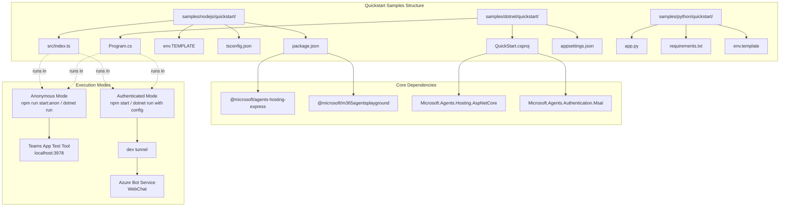
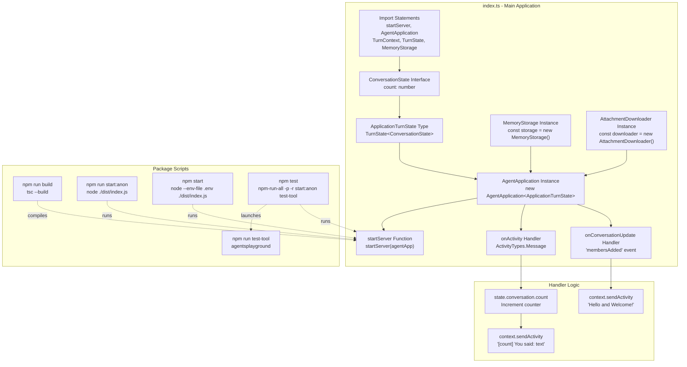
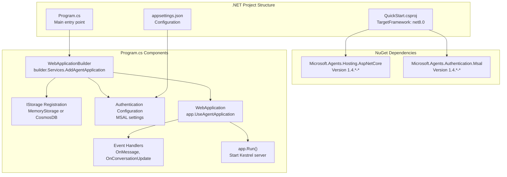

<!-- source: DeepWiki mcp.deepwiki.com · repo microsoft/Agents · page 6.1 Quickstart Samples · fetched 2026-10-26 -->

# Quickstart Samples

<details>
<summary>Relevant source files</summary>

The following files were used as context for generating this wiki page:

- [samples/dotnet/Agent Framework/AgentFrameworkWeather.csproj](samples/dotnet/Agent Framework/AgentFrameworkWeather.csproj)
- [samples/dotnet/GenesysHandoff/GenesysHandoff.csproj](samples/dotnet/GenesysHandoff/GenesysHandoff.csproj)
- [samples/dotnet/RetrievalBot/RetrievalBot.csproj](samples/dotnet/RetrievalBot/RetrievalBot.csproj)
- [samples/dotnet/auto-signin/AutoSignIn.csproj](samples/dotnet/auto-signin/AutoSignIn.csproj)
- [samples/dotnet/azure-ai-streaming/StreamingMessageAgent.csproj](samples/dotnet/azure-ai-streaming/StreamingMessageAgent.csproj)
- [samples/dotnet/copilotstudio-client/CopilotStudioClient.csproj](samples/dotnet/copilotstudio-client/CopilotStudioClient.csproj)
- [samples/dotnet/copilotstudio-skill/CopilotStudioEchoSkill.csproj](samples/dotnet/copilotstudio-skill/CopilotStudioEchoSkill.csproj)
- [samples/dotnet/obo-authorization/OBOAuthorization.csproj](samples/dotnet/obo-authorization/OBOAuthorization.csproj)
- [samples/dotnet/quickstart/QuickStart.csproj](samples/dotnet/quickstart/QuickStart.csproj)
- [samples/dotnet/semantic-kernel-multiturn/SemanticKernelMultiturn.csproj](samples/dotnet/semantic-kernel-multiturn/SemanticKernelMultiturn.csproj)
- [samples/nodejs/quickstart/README.md](samples/nodejs/quickstart/README.md)
- [samples/nodejs/quickstart/env.TEMPLATE](samples/nodejs/quickstart/env.TEMPLATE)
- [samples/nodejs/quickstart/package.json](samples/nodejs/quickstart/package.json)
- [samples/nodejs/quickstart/src/index.ts](samples/nodejs/quickstart/src/index.ts)
- [samples/nodejs/quickstart/tsconfig.json](samples/nodejs/quickstart/tsconfig.json)

</details>


The quickstart samples provide minimal echo agent implementations across all three SDK languages (.NET, Node.js, Python) demonstrating the fundamental patterns for creating and running M365 agents. These samples serve as starting points for developers new to the SDK and as templates for building custom agents.

For AI-integrated agents using Semantic Kernel or Azure AI, see [AI-Powered Agent Samples](#6.2). For authentication patterns beyond basic service authentication, see [Authentication Samples](#6.5).

## Overview

Each quickstart sample implements the same basic functionality: an echo agent that receives messages, maintains conversation state with a message counter, and responds by echoing the user's input prefixed with the count. The samples demonstrate:

- **AgentApplication initialization** with minimal configuration
- **Activity handler registration** for processing incoming messages
- **Conversation state management** using in-memory storage
- **Anonymous and authenticated modes** for local development and Azure deployment
- **Basic testing workflows** using the Teams App Test Tool or Azure Bot Service WebChat

All quickstart samples support two execution modes:
1. **Anonymous mode**: No authentication, suitable for local testing with the Teams App Test Tool
2. **Authenticated mode**: Uses MSAL for bot service authentication, required for Azure Bot Service integration

## Sample Organization



**Purpose**: This diagram shows the file structure of quickstart samples across languages and their relationship to core dependencies and execution modes.

**Sources**: [samples/nodejs/quickstart/package.json:1-29](), [samples/nodejs/quickstart/src/index.ts:1-44](), [samples/dotnet/quickstart/QuickStart.csproj:1-15](), [samples/nodejs/quickstart/README.md:1-104]()

## Key Components Demonstrated

### AgentApplication Initialization

All quickstart samples initialize an `AgentApplication` instance with minimal configuration:

| Component | Purpose | Configuration |
|-----------|---------|---------------|
| **Storage** | Persist conversation state | `MemoryStorage` for development; production should use CosmosDB or Blob storage |
| **FileDownloaders** | Handle attachment downloads | `AttachmentDownloader` instance (Node.js only in provided samples) |
| **TurnState** | Type-safe state management | Custom interface defining conversation properties (e.g., `count`) |

### Event Handlers

The samples demonstrate two primary activity handler patterns:

1. **Conversation Update Handler**: `onConversationUpdate('membersAdded')` - Sends welcome message when users join
2. **Message Handler**: `onActivity(ActivityTypes.Message)` - Processes all incoming text messages

### State Management

Each sample maintains a `ConversationState` with a `count` property that increments with each message. This demonstrates:
- State access via `state.conversation` property
- State mutation and automatic persistence
- Default value handling (e.g., `count ?? 0`)

**Sources**: [samples/nodejs/quickstart/src/index.ts:8-26](), [samples/nodejs/quickstart/README.md:1-104]()

## Node.js Quickstart Architecture



**Purpose**: This diagram maps the Node.js quickstart code entities to their functional roles in the application lifecycle.

**Sources**: [samples/nodejs/quickstart/src/index.ts:1-44](), [samples/nodejs/quickstart/package.json:1-29]()

### Node.js Implementation Details

The Node.js quickstart at [samples/nodejs/quickstart/src/index.ts:1-44]() demonstrates:

1. **Type Safety**: Custom `ConversationState` interface [samples/nodejs/quickstart/src/index.ts:10-12]() with type parameter `ApplicationTurnState` [samples/nodejs/quickstart/src/index.ts:13]()

2. **Storage Configuration**: `MemoryStorage` instance [samples/nodejs/quickstart/src/index.ts:19]() passed to `AgentApplication` constructor [samples/nodejs/quickstart/src/index.ts:23-26]()

3. **Welcome Handler**: `onConversationUpdate('membersAdded')` [samples/nodejs/quickstart/src/index.ts:29-31]() sends greeting when users join conversation

4. **Message Processing**: `onActivity(ActivityTypes.Message)` [samples/nodejs/quickstart/src/index.ts:34-41]() handler:
   - Accesses state: `state.conversation.count ?? 0` [samples/nodejs/quickstart/src/index.ts:36]()
   - Increments counter: `state.conversation.count = ++count` [samples/nodejs/quickstart/src/index.ts:37]()
   - Sends response: `context.sendActivity()` [samples/nodejs/quickstart/src/index.ts:40]()

5. **Server Initialization**: `startServer(agentApp)` [samples/nodejs/quickstart/src/index.ts:43]() from `@microsoft/agents-hosting-express` package

### Node.js Dependencies

The [samples/nodejs/quickstart/package.json:1-29]() specifies minimal dependencies:

| Package | Version | Purpose |
|---------|---------|---------|
| `@microsoft/agents-hosting-express` | ^1.1.0 | Express.js hosting integration with `startServer` function |
| `@microsoft/m365agentsplayground` | ^0.2.16 | Teams App Test Tool for local testing (dev dependency) |
| `typescript` | ^5.8.3 | TypeScript compiler (dev dependency) |
| `@types/node` | ^22.15.18 | Node.js type definitions (dev dependency) |

**Sources**: [samples/nodejs/quickstart/src/index.ts:1-44](), [samples/nodejs/quickstart/package.json:1-29]()

## .NET Quickstart Architecture



**Purpose**: This diagram illustrates the .NET quickstart's dependency injection and configuration patterns using AspNetCore.

**Sources**: [samples/dotnet/quickstart/QuickStart.csproj:1-15]()

### .NET Implementation Details

The .NET quickstart at [samples/dotnet/quickstart/QuickStart.csproj:1-15]() demonstrates AspNetCore hosting patterns:

1. **Target Framework**: .NET 8.0 [samples/dotnet/quickstart/QuickStart.csproj:4]()

2. **Language Settings**: 
   - Latest C# version [samples/dotnet/quickstart/QuickStart.csproj:5]()
   - Disabled implicit usings [samples/dotnet/quickstart/QuickStart.csproj:6]()
   - Nullable reference types enabled [samples/dotnet/quickstart/QuickStart.csproj:7]()

3. **Core Packages**:
   - `Microsoft.Agents.Hosting.AspNetCore` [samples/dotnet/quickstart/QuickStart.csproj:11]() provides AspNetCore integration
   - `Microsoft.Agents.Authentication.Msal` [samples/dotnet/quickstart/QuickStart.csproj:11]() provides MSAL-based authentication

The .NET implementation follows standard AspNetCore patterns with dependency injection for `IStorage`, `AgentApplication`, and authentication services. The `Program.cs` file (not in provided sources but referenced in other samples) would register services using `builder.Services.AddAgentApplication()` and configure middleware with `app.UseAgentApplication()`.

**Sources**: [samples/dotnet/quickstart/QuickStart.csproj:1-15]()

## Running Quickstart Samples

### Anonymous Mode (Local Development)

Anonymous mode runs the agent without authentication, suitable for local testing with the Teams App Test Tool.

#### Node.js Anonymous Mode

```bash
# Install dependencies
npm install

# Build TypeScript
npm run build

# Start in anonymous mode
npm run start:anon
```

The agent listens on `localhost:3978` with no `appId` configured. Expected output:
```
Server listening to port 3978 for appId  debug undefined
```

To run with the test tool in a single command:
```bash
npm test
```

This executes `npm-run-all -p -r start:anon test-tool` [samples/nodejs/quickstart/package.json:17](), which starts both the agent and the `agentsplayground` test tool [samples/nodejs/quickstart/package.json:16]() in parallel.

**Sources**: [samples/nodejs/quickstart/README.md:26-62](), [samples/nodejs/quickstart/package.json:9-17]()

### Authenticated Mode (Azure Bot Service)

Authenticated mode requires Azure Bot Service registration and MSAL configuration for production deployments.

#### Configuration Steps

1. **Create Azure Bot**: Follow [Azure Bot Service setup](https://learn.microsoft.com/en-us/microsoft-365/agents-sdk/azure-bot-create-single-secret) to obtain:
   - Application ID (Client ID)
   - Tenant ID
   - Client Secret

2. **Configure Environment Variables**:

   Node.js uses [samples/nodejs/quickstart/env.TEMPLATE:1-10]():
   
   ```
   connections__serviceConnection__settings__clientId=<App ID>
   connections__serviceConnection__settings__clientSecret=<Client Secret>
   connections__serviceConnection__settings__tenantId=<Tenant ID>
   
   connectionsMap__0__connection=serviceConnection
   connectionsMap__0__serviceUrl=*
   ```

   Rename `env.TEMPLATE` to `.env` and populate values [samples/nodejs/quickstart/README.md:75-78]().

3. **Configure Dev Tunnel**:
   
   ```bash
   devtunnel host -p 3978 --allow-anonymous
   ```
   
   Note the tunnel URL displayed after `Connect via browser:` [samples/nodejs/quickstart/README.md:81-87]().

4. **Update Azure Bot Endpoint**:
   
   Set **Messaging endpoint** in Azure portal to `{tunnel-url}/api/messages` [samples/nodejs/quickstart/README.md:89]().

5. **Start Agent**:
   
   ```bash
   npm start
   ```
   
   This runs `node --env-file .env ./dist/index.js` [samples/nodejs/quickstart/package.json:15](), loading environment variables from `.env`.

6. **Test in WebChat**: Access **Test in WebChat** from Azure portal [samples/nodejs/quickstart/README.md:93]().

**Sources**: [samples/nodejs/quickstart/README.md:69-94](), [samples/nodejs/quickstart/env.TEMPLATE:1-10](), [samples/nodejs/quickstart/package.json:15]()

## Testing and Interaction

### Teams App Test Tool

The Teams App Test Tool (`@microsoft/m365agentsplayground`) provides a browser-based interface for testing agents in anonymous mode.

**Launch test tool**:
```bash
npm run test-tool
```

This executes the `agentsplayground` CLI [samples/nodejs/quickstart/package.json:16](), which opens a web browser with the test interface connected to `localhost:3978`.

**Important**: The test tool only supports anonymous mode (no `clientId` configured) [samples/nodejs/quickstart/README.md:47-48]().

**Expected Behavior**:
1. Tool displays Teams-like chat interface
2. Agent sends welcome message: `Hello and Welcome!` [samples/nodejs/quickstart/README.md:66]()
3. User sends message
4. Agent responds with: `[1] You said: <message text>`
5. Counter increments with each message

Refresh the browser to start a new conversation and reset the counter [samples/nodejs/quickstart/README.md:64]().

**Sources**: [samples/nodejs/quickstart/README.md:43-65](), [samples/nodejs/quickstart/package.json:16]()

### Azure Bot Service WebChat

For authenticated testing, use Azure Bot Service's WebChat:

1. Complete authenticated mode configuration (see above)
2. Navigate to Azure portal > Bot resource > **Test in WebChat**
3. Send messages through the WebChat interface

This mode tests:
- Bot service authentication with MSAL
- JWT token validation
- Production-like message routing through Azure Bot Service
- Service-to-service authentication flows

**Sources**: [samples/nodejs/quickstart/README.md:69-94]()

## Sample Comparison

The following table compares implementation details across language samples:

| Aspect | Node.js | .NET | Python |
|--------|---------|------|--------|
| **Primary Package** | `@microsoft/agents-hosting-express` | `Microsoft.Agents.Hosting.AspNetCore` | `agents-hosting-aiohttp` |
| **Runtime** | Node.js 20+ | .NET 8.0 | Python 3.8+ |
| **Server Framework** | Express.js | AspNetCore Kestrel | aiohttp |
| **Config File** | `.env` (renamed from `env.TEMPLATE`) | `appsettings.json` | `.env` |
| **Build Command** | `npm run build` (TypeScript) | `dotnet build` | N/A (interpreted) |
| **Anonymous Run** | `npm run start:anon` | `dotnet run` | `python app.py` |
| **Authenticated Run** | `npm start` (loads `.env`) | `dotnet run` (loads `appsettings.json`) | `python app.py` |
| **Test Tool** | `agentsplayground` via `npm run test-tool` | Agents Playground (separate install) | Agents Playground (separate install) |
| **State Type Safety** | TypeScript interfaces | C# classes | Python type hints |
| **Storage Default** | `MemoryStorage` | `MemoryStorage` | `MemoryStorage` |

**Sources**: [samples/nodejs/quickstart/package.json:1-29](), [samples/dotnet/quickstart/QuickStart.csproj:1-15](), [samples/nodejs/quickstart/README.md:1-104]()

## Next Steps

After running a quickstart sample, developers can explore:

- **AI Integration**: Add LLM capabilities using samples in [AI-Powered Agent Samples](#6.2)
- **Rich UI**: Implement Adaptive Cards and interactive elements via [Cards and Rich UI Samples](#6.3)
- **Streaming**: Enable real-time responses through [Streaming and Real-time Samples](#6.4)
- **Authentication**: Implement user OAuth flows using [Authentication Samples](#6.5)
- **Multi-turn Dialogs**: Build complex conversation flows documented in [Managing State](#2.3) and [Multi-turn Dialogs](#2.6)
- **Production Deployment**: Configure persistent storage and deploy to Azure using [Deployment and Hosting](#4)

**Sources**: [samples/nodejs/quickstart/README.md:101-103]()

---

