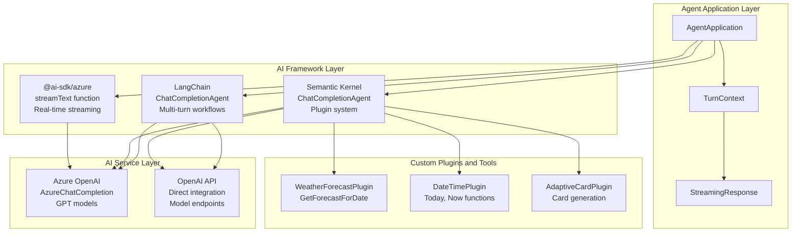
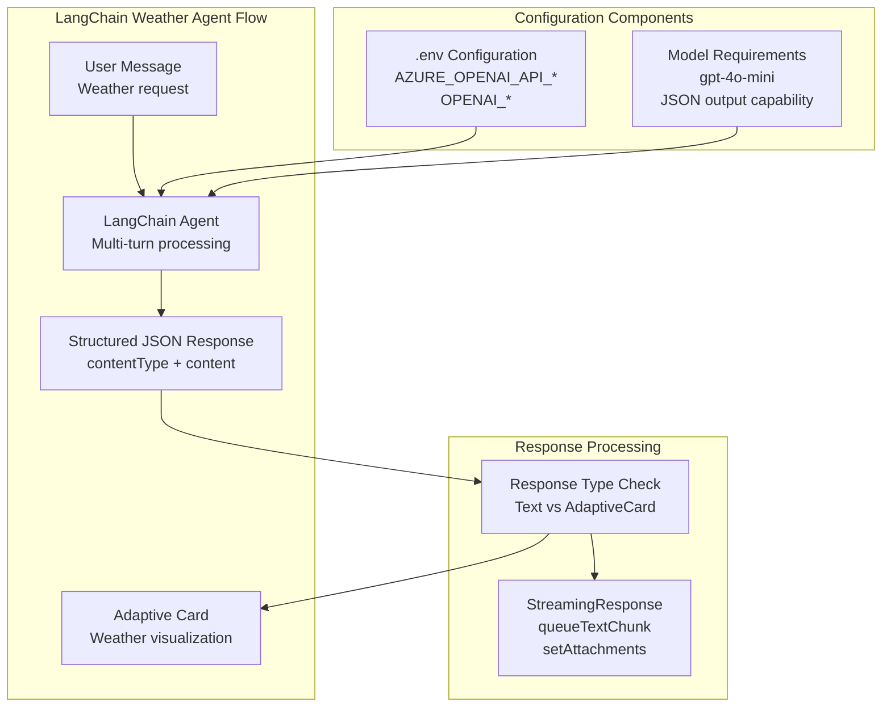
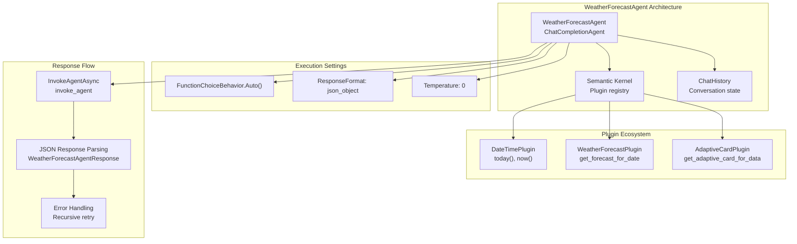
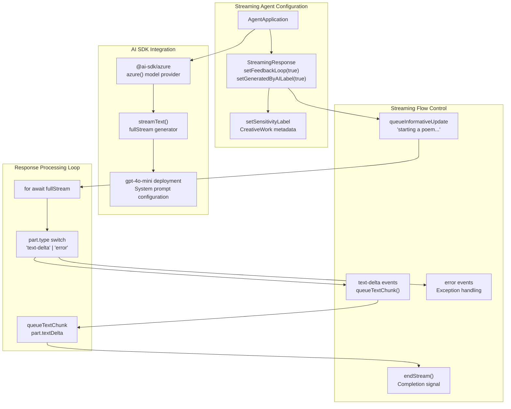
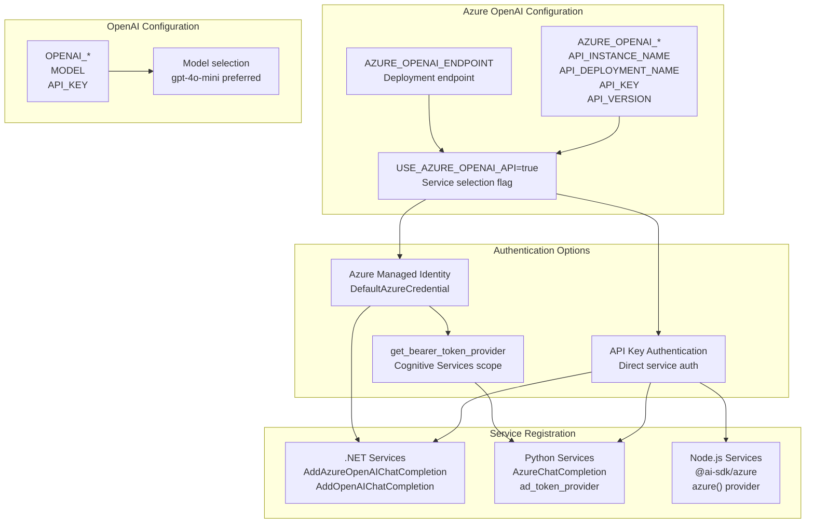
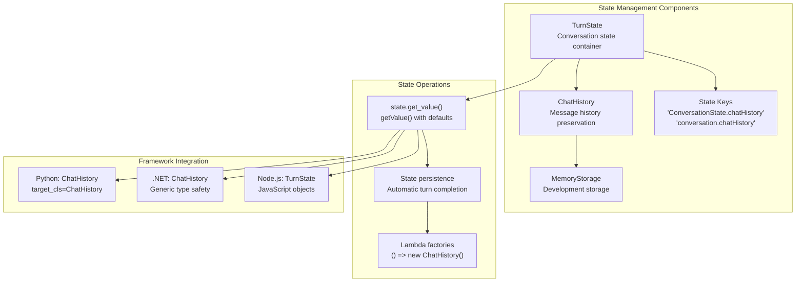
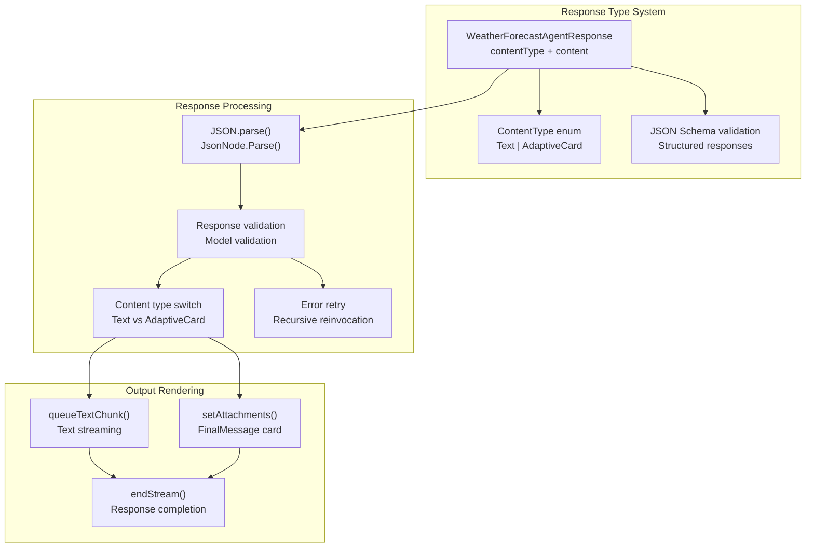

<!-- source: DeepWiki mcp.deepwiki.com · repo microsoft/Agents · page 6.2 AI-Powered Agent Samples · fetched 2026-10-26 -->

# AI-Powered Agent Samples

<details>
<summary>Relevant source files</summary>

The following files were used as context for generating this wiki page:

- [.github/scripts/updatenode.sh](.github/scripts/updatenode.sh)
- [samples/dotnet/Agent Framework/AgentFrameworkWeather.csproj](samples/dotnet/Agent Framework/AgentFrameworkWeather.csproj)
- [samples/dotnet/GenesysHandoff/GenesysHandoff.csproj](samples/dotnet/GenesysHandoff/GenesysHandoff.csproj)
- [samples/dotnet/RetrievalBot/RetrievalBot.csproj](samples/dotnet/RetrievalBot/RetrievalBot.csproj)
- [samples/dotnet/auto-signin/AutoSignIn.csproj](samples/dotnet/auto-signin/AutoSignIn.csproj)
- [samples/dotnet/azure-ai-streaming/StreamingMessageAgent.csproj](samples/dotnet/azure-ai-streaming/StreamingMessageAgent.csproj)
- [samples/dotnet/copilotstudio-client/CopilotStudioClient.csproj](samples/dotnet/copilotstudio-client/CopilotStudioClient.csproj)
- [samples/dotnet/copilotstudio-skill/CopilotStudioEchoSkill.csproj](samples/dotnet/copilotstudio-skill/CopilotStudioEchoSkill.csproj)
- [samples/dotnet/obo-authorization/OBOAuthorization.csproj](samples/dotnet/obo-authorization/OBOAuthorization.csproj)
- [samples/dotnet/quickstart/QuickStart.csproj](samples/dotnet/quickstart/QuickStart.csproj)
- [samples/dotnet/semantic-kernel-multiturn/SemanticKernelMultiturn.csproj](samples/dotnet/semantic-kernel-multiturn/SemanticKernelMultiturn.csproj)
- [samples/nodejs/auto-signin/package-lock.json](samples/nodejs/auto-signin/package-lock.json)
- [samples/nodejs/azure-ai-streaming/package-lock.json](samples/nodejs/azure-ai-streaming/package-lock.json)
- [samples/nodejs/cards/package-lock.json](samples/nodejs/cards/package-lock.json)
- [samples/nodejs/copilotstudio-client/package-lock.json](samples/nodejs/copilotstudio-client/package-lock.json)
- [samples/nodejs/copilotstudio-webchat-react/package-lock.json](samples/nodejs/copilotstudio-webchat-react/package-lock.json)
- [samples/nodejs/langchain-multiturn/package-lock.json](samples/nodejs/langchain-multiturn/package-lock.json)
- [samples/nodejs/multi-turn-prompt/package-lock.json](samples/nodejs/multi-turn-prompt/package-lock.json)
- [samples/nodejs/obo-authorization/package-lock.json](samples/nodejs/obo-authorization/package-lock.json)
- [samples/nodejs/quickstart/package-lock.json](samples/nodejs/quickstart/package-lock.json)

</details>


This page covers advanced agent samples that integrate artificial intelligence services and frameworks to create sophisticated conversational experiences. These samples demonstrate how to build agents that leverage large language models (LLMs), AI frameworks like Semantic Kernel and LangChain, and advanced features such as streaming responses and multi-turn conversations.

For basic agent functionality without AI integration, see [Basic Agent Samples](#6.1). For authentication patterns used with AI-powered agents, see [Authentication Samples](#6.5). For streaming capabilities without AI focus, see [Streaming and Real-time Samples](#6.4).

## Sample Categories by AI Integration

The AI-powered samples are organized by the AI frameworks and capabilities they demonstrate:

| Category | Languages | Key Features | Sample Names |
|----------|-----------|--------------|--------------|
| LangChain Integration | Node.js | Multi-turn conversations, JSON output | `langchain-multiturn` |
| Semantic Kernel Integration | .NET, Python | Plugin architecture, function calling | `semantic-kernel-multiturn` |  
| Streaming AI Responses | Node.js | Real-time content generation, feedback loops | `azure-ai-streaming` |

## AI-Powered Agent Architecture



Sources: [samples/nodejs/langchain-multiturn/README.md:1-80](), [samples/python/semantic-kernel-multiturn/src/app.py:1-86](), [samples/dotnet/semantic-kernel-multiturn/MyAgent.cs:1-87](), [samples/nodejs/azure-ai-streaming/src/agent.ts:1-70]()

## LangChain Integration Pattern

The LangChain sample demonstrates advanced multi-turn conversation handling with structured JSON responses:



### Key Implementation Details

The LangChain sample uses specific configuration patterns for reliable JSON output:

- **Model Requirements**: Requires `gpt-4o-mini` or newer for consistent JSON formatting [samples/nodejs/langchain-multiturn/README.md:7-7]()
- **Environment Variables**: Supports both Azure OpenAI and OpenAI configurations [samples/nodejs/langchain-multiturn/README.md:16-28]()
- **Structured Responses**: Implements JSON schema validation for response consistency

Sources: [samples/nodejs/langchain-multiturn/README.md:1-80]()

## Semantic Kernel Integration Pattern

Both Python and .NET implementations use Semantic Kernel's plugin architecture for extensible AI functionality:



### Plugin Implementation Examples

**Python Implementation**:
- `WeatherForecastPlugin.get_forecast_for_date()` [samples/python/semantic-kernel-multiturn/src/plugins/weather_forecast_plugin.py:9-26]()
- `DateTimePlugin.today()` and `DateTimePlugin.now()` [samples/python/semantic-kernel-multiturn/src/plugins/date_time_plugin.py:8-31]()
- `AdaptiveCardPlugin.get_adaptive_card_for_data()` [samples/python/semantic-kernel-multiturn/src/plugins/adaptive_card_plugin.py:8-31]()

**.NET Implementation**:
- `WeatherForecastPlugin.GetForecastForDate()` [samples/dotnet/semantic-kernel-multiturn/Plugins/WeatherForecastPlugin.cs:21-37]()
- `DateTimePlugin.Today()` and `DateTimePlugin.Now()` [samples/dotnet/semantic-kernel-multiturn/Plugins/DateTimePlugin.cs:22-53]()
- `AdaptiveCardPlugin.GetAdaptiveCardForData()` [samples/dotnet/semantic-kernel-multiturn/Plugins/AdaptiveCardPlugin.cs:18-32]()

Sources: [samples/python/semantic-kernel-multiturn/src/agent.py:1-102](), [samples/dotnet/semantic-kernel-multiturn/Agents/WeatherForecastAgent.cs:1-101](), [samples/python/semantic-kernel-multiturn/src/plugins/weather_forecast_plugin.py:1-27](), [samples/dotnet/semantic-kernel-multiturn/Plugins/WeatherForecastPlugin.cs:1-38]()

## Streaming AI Response Pattern

The Azure AI streaming sample demonstrates real-time content generation with advanced streaming features:



### Streaming Implementation Details

The streaming agent implements several advanced features:

- **Feedback Loop**: Enables user feedback collection with `context.streamingResponse.setFeedbackLoop(true)` [samples/nodejs/azure-ai-streaming/src/agent.ts:26-26]()
- **AI Generation Labels**: Sets AI-generated content labels with `setGeneratedByAILabel(true)` [samples/nodejs/azure-ai-streaming/src/agent.ts:27-27]()
- **Content Sensitivity**: Applies sensitivity metadata for compliance [samples/nodejs/azure-ai-streaming/src/agent.ts:28-28]()
- **Error Recovery**: Implements comprehensive error handling for streaming failures [samples/nodejs/azure-ai-streaming/src/agent.ts:60-66]()

Sources: [samples/nodejs/azure-ai-streaming/src/agent.ts:1-70](), [samples/nodejs/azure-ai-streaming/README.md:1-71]()

## Configuration Patterns for AI Services

All AI-powered samples follow consistent configuration patterns for service integration:



### Environment Configuration Examples

**Node.js LangChain Sample**:
```
AZURE_OPENAI_API_INSTANCE_NAME=
AZURE_OPENAI_API_DEPLOYMENT_NAME=
AZURE_OPENAI_API_KEY=
USE_AZURE_OPENAI_API=true
```

**Python Semantic Kernel Sample**:
- Uses `DefaultAzureCredential` for managed identity authentication [samples/python/semantic-kernel-multiturn/src/app.py:31-33]()
- Configures `AzureChatCompletion` with token provider [samples/python/semantic-kernel-multiturn/src/app.py:35-42]()

**.NET Semantic Kernel Sample**:
- Supports both Azure OpenAI and OpenAI through configuration [samples/dotnet/semantic-kernel-multiturn/Program.cs:29-47]()
- Uses dependency injection for service registration [samples/dotnet/semantic-kernel-multiturn/Program.cs:25-27]()

Sources: [samples/nodejs/langchain-multiturn/README.md:16-28](), [samples/python/semantic-kernel-multiturn/src/app.py:31-42](), [samples/dotnet/semantic-kernel-multiturn/Program.cs:29-47]()

## Multi-turn Conversation State Management

AI-powered agents require sophisticated state management for maintaining conversation context across multiple turns:



### State Management Implementation

**Python Implementation**:
- Uses `state.get_value()` with lambda factory for initialization [samples/python/semantic-kernel-multiturn/src/app.py:64-66]()
- Specifies `target_cls=ChatHistory` for type safety [samples/python/semantic-kernel-multiturn/src/app.py:64-66]()

**.NET Implementation**:
- Uses generic `turnState.GetValue<ChatHistory>()` with factory function [samples/dotnet/semantic-kernel-multiturn/MyAgent.cs:45-45]()
- Provides compile-time type safety for state objects

Sources: [samples/python/semantic-kernel-multiturn/src/app.py:64-66](), [samples/dotnet/semantic-kernel-multiturn/MyAgent.cs:45-45]()

## Response Format Handling

AI-powered agents implement structured response processing to handle different content types:



### Response Type Definitions

**Python Response Model**:
```python
class WeatherForecastAgentResponse(BaseModel):
    contentType: str = Literal["Text", "AdaptiveCard"]
    content: Union[dict, str]
```

**.NET Response Model**:
```csharp
public class WeatherForecastAgentResponse
{
    public WeatherForecastAgentResponseContentType ContentType { get; set; }
    public string? Content { get; set; }
}
```

The response processing includes error handling that reinvokes the agent when JSON parsing fails, ensuring reliable structured outputs.

Sources: [samples/python/semantic-kernel-multiturn/src/agent.py:19-22](), [samples/dotnet/semantic-kernel-multiturn/Agents/WeatherForecastAgentResponse.cs:18-27](), [samples/python/semantic-kernel-multiturn/src/agent.py:96-101](), [samples/dotnet/semantic-kernel-multiturn/Agents/WeatherForecastAgent.cs:96-99]()

---

