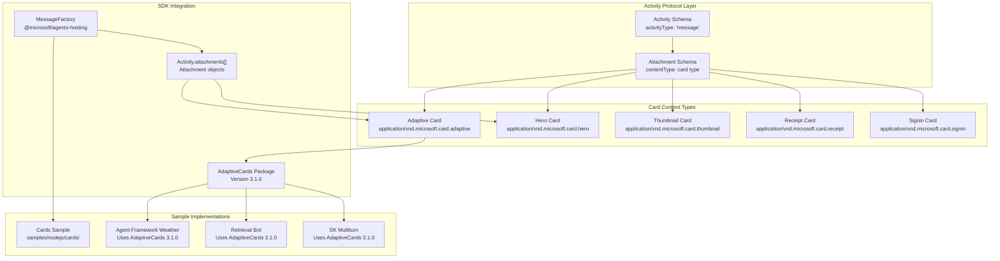
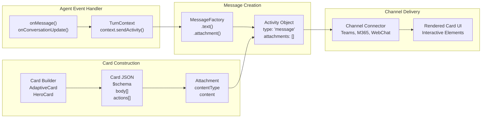
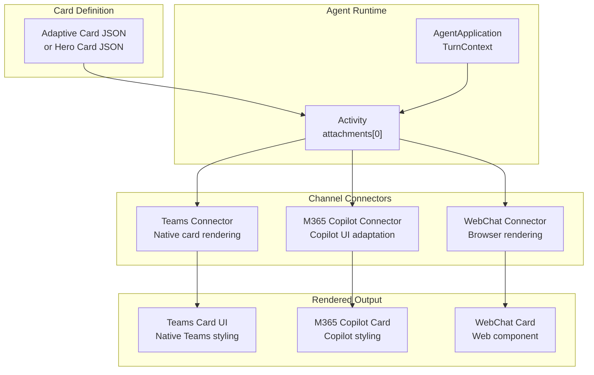

<!-- source: DeepWiki mcp.deepwiki.com · repo microsoft/Agents · page 6.3 Cards and Rich UI Samples · fetched 2026-10-26 -->

# Cards and Rich UI Samples

<details>
<summary>Relevant source files</summary>

The following files were used as context for generating this wiki page:

- [samples/dotnet/Agent Framework/AgentFrameworkWeather.csproj](samples/dotnet/Agent Framework/AgentFrameworkWeather.csproj)
- [samples/dotnet/GenesysHandoff/GenesysHandoff.csproj](samples/dotnet/GenesysHandoff/GenesysHandoff.csproj)
- [samples/dotnet/RetrievalBot/RetrievalBot.csproj](samples/dotnet/RetrievalBot/RetrievalBot.csproj)
- [samples/dotnet/auto-signin/AutoSignIn.csproj](samples/dotnet/auto-signin/AutoSignIn.csproj)
- [samples/dotnet/azure-ai-streaming/StreamingMessageAgent.csproj](samples/dotnet/azure-ai-streaming/StreamingMessageAgent.csproj)
- [samples/dotnet/copilotstudio-client/CopilotStudioClient.csproj](samples/dotnet/copilotstudio-client/CopilotStudioClient.csproj)
- [samples/dotnet/copilotstudio-skill/CopilotStudioEchoSkill.csproj](samples/dotnet/copilotstudio-skill/CopilotStudioEchoSkill.csproj)
- [samples/dotnet/obo-authorization/OBOAuthorization.csproj](samples/dotnet/obo-authorization/OBOAuthorization.csproj)
- [samples/dotnet/quickstart/QuickStart.csproj](samples/dotnet/quickstart/QuickStart.csproj)
- [samples/dotnet/semantic-kernel-multiturn/SemanticKernelMultiturn.csproj](samples/dotnet/semantic-kernel-multiturn/SemanticKernelMultiturn.csproj)
- [samples/nodejs/cards/env.TEMPLATE](samples/nodejs/cards/env.TEMPLATE)
- [samples/nodejs/copilotstudio-skill/env.TEMPLATE](samples/nodejs/copilotstudio-skill/env.TEMPLATE)
- [samples/nodejs/copilotstudio-skill/package-lock.json](samples/nodejs/copilotstudio-skill/package-lock.json)
- [samples/nodejs/copilotstudio-skill/package.json](samples/nodejs/copilotstudio-skill/package.json)
- [samples/nodejs/copilotstudio-skill/src/agent.ts](samples/nodejs/copilotstudio-skill/src/agent.ts)
- [samples/nodejs/multi-turn-prompt/env.TEMPLATE](samples/nodejs/multi-turn-prompt/env.TEMPLATE)
- [samples/nodejs/obo-authorization/env.TEMPLATE](samples/nodejs/obo-authorization/env.TEMPLATE)
- [samples/nodejs/obo-authorization/src/index.ts](samples/nodejs/obo-authorization/src/index.ts)

</details>


## Purpose and Scope

This document describes the cards sample application and demonstrates how to create and send rich UI elements including Adaptive Cards, Hero Cards, and other card types in Microsoft 365 Agents. The focus is on practical implementation patterns shown in the sample applications, particularly the Node.js cards sample and the use of the `AdaptiveCards` package in .NET samples.

For general information about message and card creation APIs, see [Creating Messages and Cards](#2.4). For AI-powered agents that may use cards as part of their responses, see [AI-Powered Agent Samples](#6.2).

## Cards Sample Overview

The primary cards sample is a Node.js application located in the `samples/nodejs/cards/` directory. This sample demonstrates various card types and interactive UI patterns that work across Microsoft Teams, M365 Copilot, and WebChat channels.

The sample uses the standard agent hosting architecture:
- `@microsoft/agents-hosting-express` for Express.js integration
- `@microsoft/agents-hosting` for core agent functionality
- `@microsoft/agents-activity` for Activity Protocol types

### Configuration

The cards sample requires standard agent authentication configuration:

| Configuration Key | Purpose |
|------------------|---------|
| `connections__serviceConnection__settings__clientId` | App Registration client ID |
| `connections__serviceConnection__settings__clientSecret` | App Registration client secret |
| `connections__serviceConnection__settings__tenantId` | Azure AD tenant ID |
| `connectionsMap__0__connection` | Connection name mapping |
| `connectionsMap__0__serviceUrl` | Service URL pattern |

**Sources:** [samples/nodejs/cards/env.TEMPLATE:1-10]()

## Card Types and SDK Integration



**Sources:** [samples/nodejs/cards/env.TEMPLATE:1-10](), [samples/dotnet/Agent Framework/AgentFrameworkWeather.csproj:15](), [samples/dotnet/RetrievalBot/RetrievalBot.csproj:25](), [samples/dotnet/semantic-kernel-multiturn/SemanticKernelMultiturn.csproj:21]()

## Adaptive Cards Package Integration

Multiple .NET samples demonstrate Adaptive Cards integration using the `AdaptiveCards` NuGet package version 3.1.0. This library provides strongly-typed card construction and rendering capabilities.

### .NET Samples Using Adaptive Cards

| Sample | Purpose | Card Usage |
|--------|---------|------------|
| Agent Framework Weather | AI-powered weather agent with streaming | Weather data display cards |
| Retrieval Bot | Semantic Kernel retrieval agent | Search result formatting |
| Semantic Kernel Multiturn | Multi-turn conversational agent | Conversation state display |

The package is consistently referenced across samples:

```xml
<PackageReference Include="AdaptiveCards" Version="3.1.0" />
```

**Sources:** [samples/dotnet/Agent Framework/AgentFrameworkWeather.csproj:15](), [samples/dotnet/RetrievalBot/RetrievalBot.csproj:25](), [samples/dotnet/semantic-kernel-multiturn/SemanticKernelMultiturn.csproj:21]()

## Message and Card Creation Flow



**Sources:** [samples/nodejs/copilotstudio-skill/src/agent.ts:8-20]()

## Card Actions and Interactive Elements

Cards support various action types for user interaction:

| Action Type | Purpose | Usage |
|-------------|---------|-------|
| `Action.Submit` | Submit data to agent | Form submission, button clicks |
| `Action.OpenUrl` | Open external URL | Documentation links, external resources |
| `Action.ShowCard` | Expand inline card | Progressive disclosure |
| `Action.Execute` | Universal action | Invoke agent functionality |

### Action Handling Pattern

When a user interacts with a card action, the agent receives an `invoke` activity type that must be handled:

```typescript
skillAgent.onActivity('message', async (context) => {
  const text = context.activity.text
  const replyText = `Echo: ${text}`
  await context.sendActivity(MessageFactory.text(replyText, replyText))
})
```

**Sources:** [samples/nodejs/copilotstudio-skill/src/agent.ts:13-20]()

## Adaptive Card Schema Structure

Adaptive Cards follow a JSON schema with these key elements:

| Element | Description | Required |
|---------|-------------|----------|
| `$schema` | Schema version URL | Yes |
| `type` | Must be "AdaptiveCard" | Yes |
| `version` | Card version (e.g., "1.5") | Yes |
| `body[]` | Array of card elements | No |
| `actions[]` | Array of card actions | No |

### Common Card Elements

| Element Type | Purpose |
|--------------|---------|
| `TextBlock` | Display text with formatting |
| `Image` | Display images |
| `ColumnSet` | Multi-column layout |
| `Container` | Group elements |
| `Input.Text` | Text input field |
| `Input.ChoiceSet` | Dropdown or radio buttons |

## Sample Project Dependencies

### Node.js Cards Sample

The cards sample uses a minimal dependency set focused on core agent functionality:

| Package | Version | Purpose |
|---------|---------|---------|
| `@microsoft/agents-hosting-express` | ^1.1.0 | Express server hosting |
| `express` | ^5.1.0 | HTTP server framework |

**Sources:** [samples/nodejs/copilotstudio-skill/package.json:15-18](), [samples/nodejs/copilotstudio-skill/package-lock.json:12-14]()

### .NET Samples with Cards

.NET samples include additional dependencies for AI and semantic capabilities alongside Adaptive Cards:

**Agent Framework Weather Sample:**
- `AdaptiveCards` 3.1.0 - Card construction
- `Azure.AI.OpenAI` 2.1.0 - AI integration
- `Microsoft.Extensions.AI.OpenAI` - AI abstractions
- `OpenWeatherMapSharp` 4.1.0 - Weather data

**Retrieval Bot Sample:**
- `AdaptiveCards` 3.1.0 - Card construction
- `Microsoft.SemanticKernel.Agents.Core` 1.29.0-alpha - SK agents
- `Microsoft.SemanticKernel.Agents.OpenAI` 1.29.0-alpha - OpenAI integration
- `Microsoft.Graph` 5.99.0 - Graph API access

**Semantic Kernel Multiturn Sample:**
- `AdaptiveCards` 3.1.0 - Card construction
- `Microsoft.SemanticKernel.Agents.AzureAI` 1.45.0-preview - Azure AI integration
- `Microsoft.SemanticKernel.Agents.Core` 1.45.0 - SK agents
- `Azure.Identity` 1.17.1 - Azure authentication

**Sources:** [samples/dotnet/Agent Framework/AgentFrameworkWeather.csproj:14-23](), [samples/dotnet/RetrievalBot/RetrievalBot.csproj:21-32](), [samples/dotnet/semantic-kernel-multiturn/SemanticKernelMultiturn.csproj:19-28]()

## Cross-Channel Card Rendering

Cards render consistently across deployment channels:



**Sources:** [samples/nodejs/cards/env.TEMPLATE:1-10](), [samples/nodejs/copilotstudio-skill/src/agent.ts:1-26]()

## Authentication Integration with Cards

Some samples combine cards with OAuth authentication flows. The OBO Authorization sample demonstrates how cards can be used with sign-in flows:

```typescript
class OboApp extends AgentApplication<TurnState> {
  constructor () {
    super({
      storage: new MemoryStorage(),
      authorization: {
        graph: { text: 'Sign in with Microsoft Graph', title: 'Graph Sign In' }
      }
    })
  }
}
```

The `authorization` configuration creates a sign-in card automatically when authentication is required.

**Sources:** [samples/nodejs/obo-authorization/src/index.ts:7-20]()

## Additional Samples Using Cards

Beyond the dedicated cards sample, several other samples demonstrate card usage:

### Copilot Studio Skill Sample

Uses cards to display welcome messages and version information:

```typescript
skillAgent.onConversationUpdate('membersAdded', async (context) => {
  const welcomeText = `Hello from echo bot, running on version ${pjson.version}`
  await context.sendActivity(MessageFactory.text(welcomeText, welcomeText))
})
```

**Sources:** [samples/nodejs/copilotstudio-skill/src/agent.ts:8-11]()

### Genesys Handoff Sample

Includes card-based UI for handoff scenarios to Genesys contact center:

**Dependencies:**
- `Microsoft.Agents.CopilotStudio.Client` 1.4.*-* - Client integration
- Can integrate cards for handoff status display

**Sources:** [samples/dotnet/GenesysHandoff/GenesysHandoff.csproj:10-12]()

## Environment Configuration

All card samples require the same basic environment configuration pattern used across agent samples:

```
connections__serviceConnection__settings__clientId=<app-id>
connections__serviceConnection__settings__clientSecret=<secret>
connections__serviceConnection__settings__tenantId=<tenant-id>
connectionsMap__0__connection=serviceConnection
connectionsMap__0__serviceUrl=*
DEBUG=agents:*:error
```

**Sources:** [samples/nodejs/cards/env.TEMPLATE:1-10](), [samples/nodejs/multi-turn-prompt/env.TEMPLATE:1-10](), [samples/nodejs/copilotstudio-skill/env.TEMPLATE:1-10]()

## Building and Running Card Samples

### Node.js Build Process

The cards sample follows the standard Node.js build pattern:

```json
"scripts": {
  "prebuild": "npm ci",
  "build": "tsc --build",
  "prestart": "npm run build",
  "start": "node --env-file .env dist/agent.js"
}
```

This ensures TypeScript compilation before running the agent with environment variables loaded from `.env`.

**Sources:** [samples/nodejs/copilotstudio-skill/package.json:5-10]()

### .NET Build Process

.NET samples use standard MSBuild with the following common properties:

| Property | Value | Purpose |
|----------|-------|---------|
| `TargetFramework` | net8.0 | Target .NET 8.0 runtime |
| `LangVersion` | latest | Use latest C# features |
| `Nullable` | enable | Enable nullable reference types |
| `ImplicitUsings` | disable/enable | Control implicit using directives |

**Sources:** [samples/dotnet/quickstart/QuickStart.csproj:3-8](), [samples/dotnet/auto-signin/AutoSignIn.csproj:3-7](), [samples/dotnet/copilotstudio-skill/CopilotStudioEchoSkill.csproj:3-7]()

---

