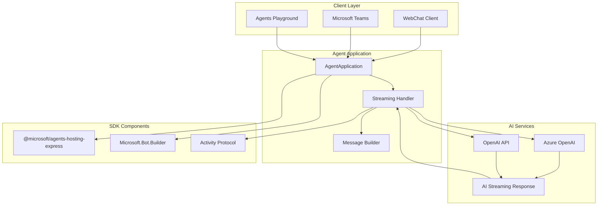
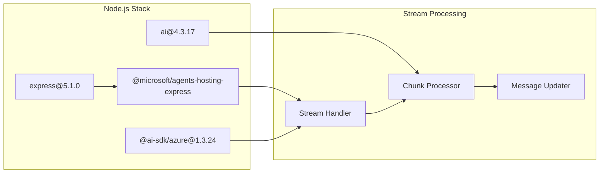
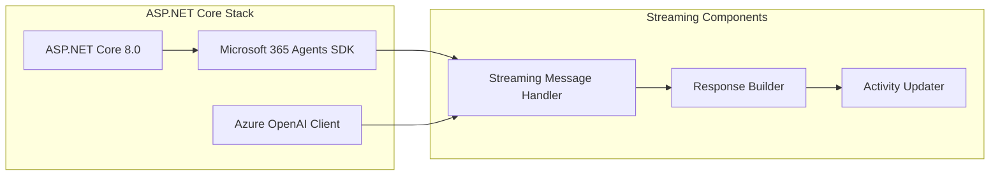
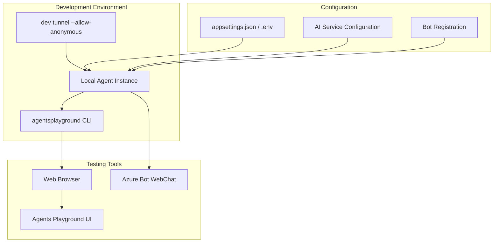
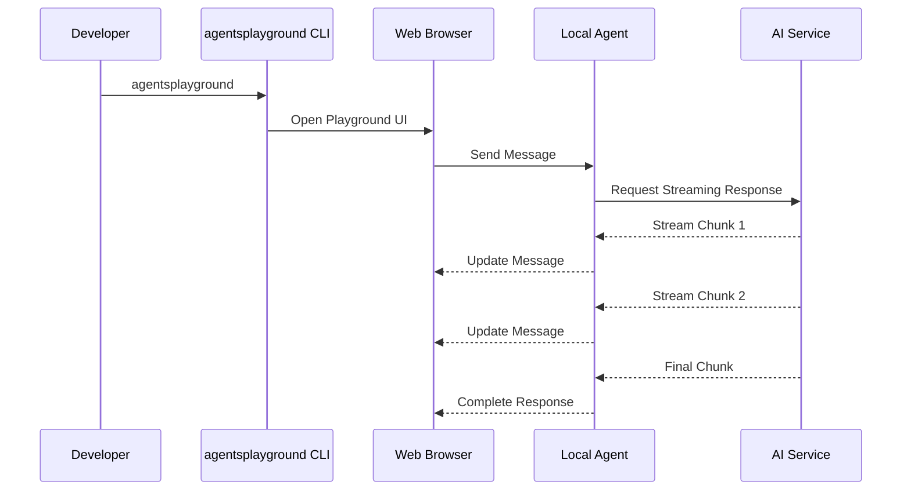

<!-- source: DeepWiki mcp.deepwiki.com · repo microsoft/Agents · page 6.4 Streaming and Real-time Samples · fetched 2026-10-26 -->

# Streaming and Real-time Samples

Relevant source files

The following files were used as context for generating this wiki page:

- [.github/scripts/updatenode.sh](.github/scripts/updatenode.sh)
- [samples/dotnet/Agent Framework/AgentFrameworkWeather.csproj](samples/dotnet/Agent Framework/AgentFrameworkWeather.csproj)
- [samples/dotnet/GenesysHandoff/GenesysHandoff.csproj](samples/dotnet/GenesysHandoff/GenesysHandoff.csproj)
- [samples/dotnet/RetrievalBot/RetrievalBot.csproj](samples/dotnet/RetrievalBot/RetrievalBot.csproj)
- [samples/dotnet/auto-signin/AutoSignIn.csproj](samples/dotnet/auto-signin/AutoSignIn.csproj)
- [samples/dotnet/azure-ai-streaming/StreamingMessageAgent.csproj](samples/dotnet/azure-ai-streaming/StreamingMessageAgent.csproj)
- [samples/dotnet/copilotstudio-client/CopilotStudioClient.csproj](samples/dotnet/copilotstudio-client/CopilotStudioClient.csproj)
- [samples/dotnet/copilotstudio-skill/CopilotStudioEchoSkill.csproj](samples/dotnet/copilotstudio-skill/CopilotStudioEchoSkill.csproj)
- [samples/dotnet/obo-authorization/OBOAuthorization.csproj](samples/dotnet/obo-authorization/OBOAuthorization.csproj)
- [samples/dotnet/quickstart/QuickStart.csproj](samples/dotnet/quickstart/QuickStart.csproj)
- [samples/dotnet/semantic-kernel-multiturn/SemanticKernelMultiturn.csproj](samples/dotnet/semantic-kernel-multiturn/SemanticKernelMultiturn.csproj)
- [samples/nodejs/auto-signin/package-lock.json](samples/nodejs/auto-signin/package-lock.json)
- [samples/nodejs/azure-ai-streaming/package-lock.json](samples/nodejs/azure-ai-streaming/package-lock.json)
- [samples/nodejs/cards/package-lock.json](samples/nodejs/cards/package-lock.json)
- [samples/nodejs/copilotstudio-client/package-lock.json](samples/nodejs/copilotstudio-client/package-lock.json)
- [samples/nodejs/copilotstudio-webchat-react/package-lock.json](samples/nodejs/copilotstudio-webchat-react/package-lock.json)
- [samples/nodejs/langchain-multiturn/package-lock.json](samples/nodejs/langchain-multiturn/package-lock.json)
- [samples/nodejs/multi-turn-prompt/package-lock.json](samples/nodejs/multi-turn-prompt/package-lock.json)
- [samples/nodejs/obo-authorization/package-lock.json](samples/nodejs/obo-authorization/package-lock.json)
- [samples/nodejs/quickstart/package-lock.json](samples/nodejs/quickstart/package-lock.json)

This document covers the streaming and real-time capabilities within the Microsoft 365 Agents SDK, focusing on progressive content delivery and live response streaming from AI services. The samples demonstrate how to implement streaming responses that provide immediate feedback to users while content is being generated.

For information about basic agent message handling, see [Basic Agent Samples](#6.1). For AI integration patterns without streaming, see [AI-Powered Agent Samples](#6.2).

## Overview

Streaming samples showcase real-time content delivery patterns where agents can send partial responses to users as content becomes available, rather than waiting for complete responses. This is particularly valuable for AI-powered agents that generate lengthy responses or perform time-consuming operations.

The SDK supports streaming through progressive message updates, allowing agents to:
- Stream AI-generated content as it's produced
- Provide real-time status updates during long operations
- Deliver chunked responses for better user experience
- Maintain conversation flow without blocking

Sources: [samples/dotnet/azure-ai-streaming/README.md:1-60](), [samples/dotnet/README.md:9]()

## Streaming Architecture

Sources: [samples/nodejs/azure-ai-streaming/package-lock.json:8-10](), [samples/dotnet/azure-ai-streaming/README.md:36-39]()

## Language-Specific Streaming Implementations

### Node.js Streaming Pattern

The Node.js implementation leverages the `@ai-sdk/azure` package for streaming Azure OpenAI responses and the `ai` package for stream processing utilities.

Sources: [samples/nodejs/azure-ai-streaming/package-lock.json:7-10]()

### .NET Streaming Pattern

The .NET implementation uses Azure OpenAI client libraries with the Microsoft 365 Agents SDK to handle streaming responses within ASP.NET Core applications.

Sources: [samples/dotnet/azure-ai-streaming/README.md:1-60](), [samples/dotnet/README.md:9]()

## Development Patterns

### Local Development Setup

Both Node.js and .NET streaming samples support local development using dev tunnels and the Agents Playground for testing streaming capabilities.

Sources: [samples/dotnet/azure-ai-streaming/README.md:17-26](), [samples/nodejs/azure-ai-streaming/package-lock.json:232-240]()

### Configuration Requirements

| Component | Node.js | .NET |
|-----------|---------|------|
| **AI Service Config** | `.env` file with API keys | `appsettings.json` AzureOpenAI section |
| **Hosting** | `@microsoft/agents-hosting-express` | ASP.NET Core with Agents SDK |
| **Development Tool** | `@microsoft/m365agentsplayground` | Agents Playground via winget |
| **Tunnel Port** | Default port (varies) | Port 3978 |

Sources: [samples/dotnet/azure-ai-streaming/README.md:45-53](), [samples/nodejs/azure-ai-streaming/package-lock.json:12-14]()

## Testing and Deployment

### Playground Integration

The streaming samples integrate with the Microsoft 365 Agents Playground for local testing and development. The playground provides a web-based interface for interacting with streaming agents and observing real-time response behavior.

Sources: [samples/nodejs/azure-ai-streaming/package-lock.json:232-240](), [samples/dotnet/azure-ai-streaming/README.md:17-26]()

### Production Deployment

Streaming samples can be deployed to Azure App Service or container environments, maintaining streaming capabilities in production scenarios. The deployment process follows standard agent deployment patterns with additional considerations for AI service connectivity and streaming performance.

Sources: [samples/dotnet/azure-ai-streaming/README.md:84-86]()

---

