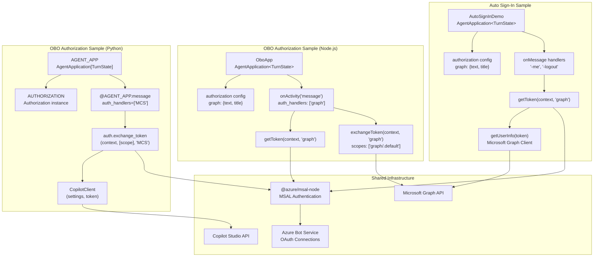
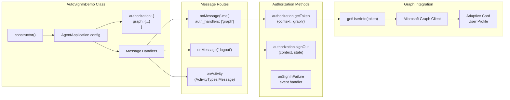
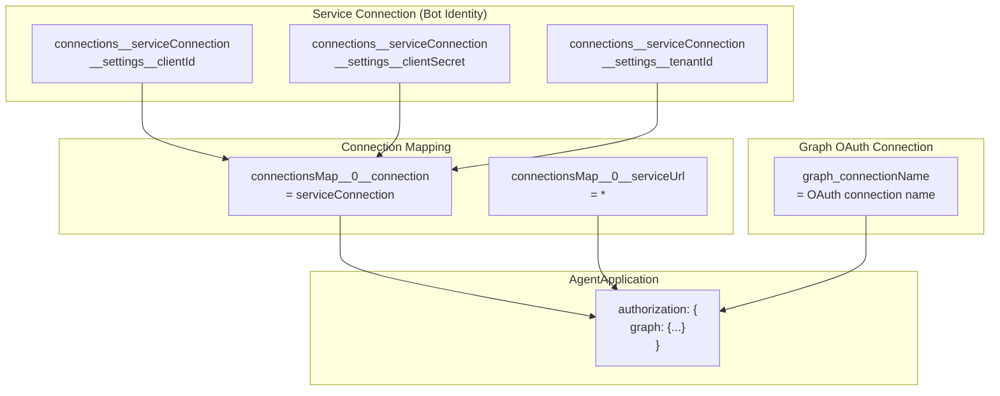
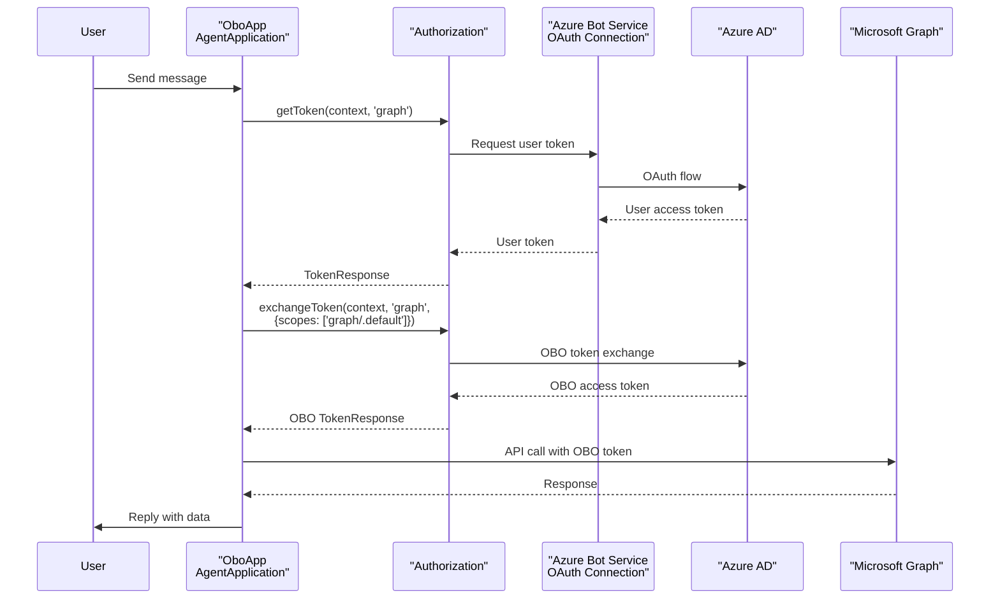
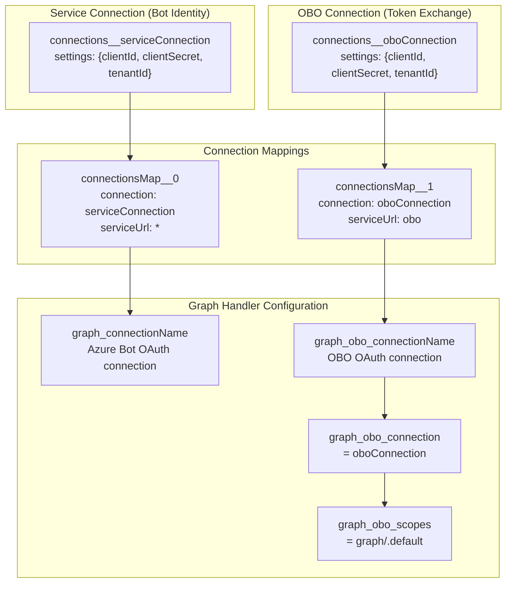
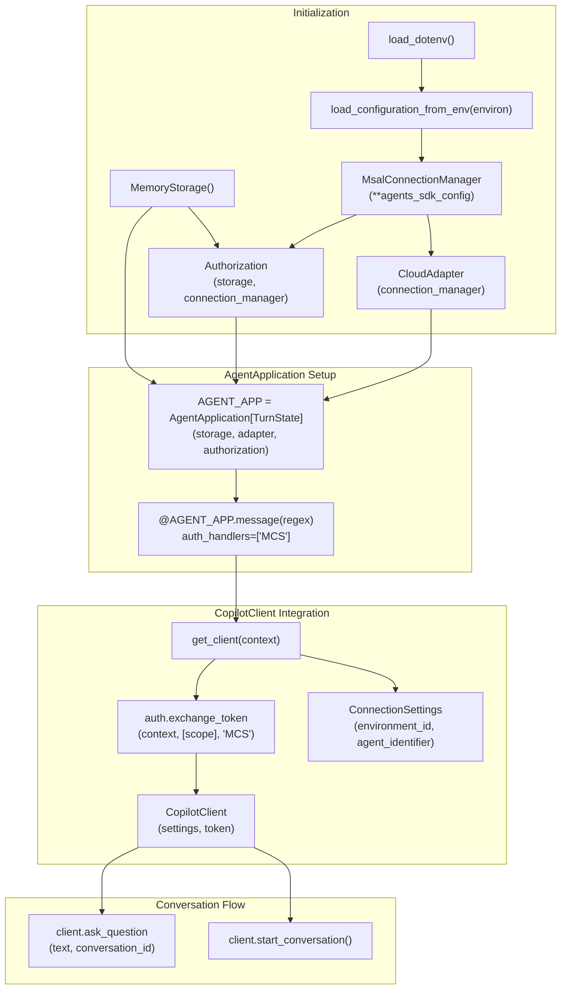
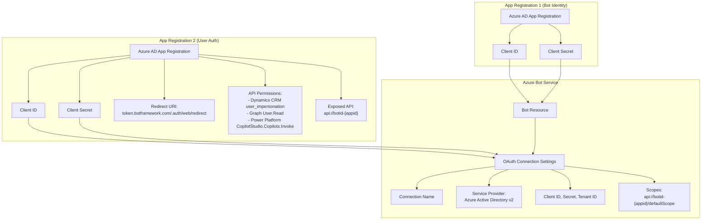
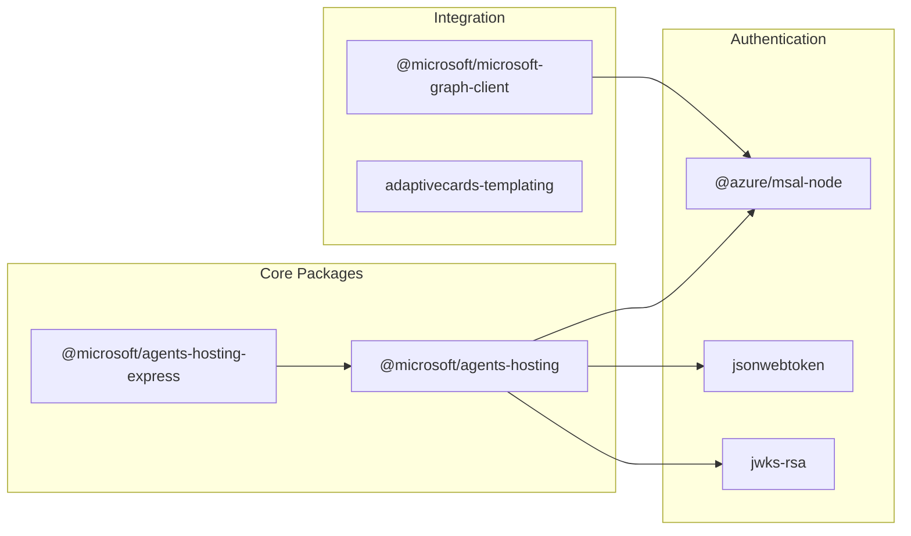

<!-- source: DeepWiki mcp.deepwiki.com · repo microsoft/Agents · page 6.5 Authentication Samples · fetched 2026-10-26 -->

# Authentication Samples

<details>
<summary>Relevant source files</summary>

The following files were used as context for generating this wiki page:

- [samples/nodejs/auto-signin/README.md](samples/nodejs/auto-signin/README.md)
- [samples/nodejs/auto-signin/env.TEMPLATE](samples/nodejs/auto-signin/env.TEMPLATE)
- [samples/nodejs/auto-signin/src/index.ts](samples/nodejs/auto-signin/src/index.ts)
- [samples/nodejs/auto-signin/src/userGraphClient.ts](samples/nodejs/auto-signin/src/userGraphClient.ts)
- [samples/nodejs/cards/env.TEMPLATE](samples/nodejs/cards/env.TEMPLATE)
- [samples/nodejs/copilotstudio-skill/env.TEMPLATE](samples/nodejs/copilotstudio-skill/env.TEMPLATE)
- [samples/nodejs/copilotstudio-skill/package-lock.json](samples/nodejs/copilotstudio-skill/package-lock.json)
- [samples/nodejs/copilotstudio-skill/package.json](samples/nodejs/copilotstudio-skill/package.json)
- [samples/nodejs/copilotstudio-skill/src/agent.ts](samples/nodejs/copilotstudio-skill/src/agent.ts)
- [samples/nodejs/multi-turn-prompt/env.TEMPLATE](samples/nodejs/multi-turn-prompt/env.TEMPLATE)
- [samples/nodejs/obo-authorization/env.TEMPLATE](samples/nodejs/obo-authorization/env.TEMPLATE)
- [samples/nodejs/obo-authorization/src/index.ts](samples/nodejs/obo-authorization/src/index.ts)
- [samples/python/README.md](samples/python/README.md)
- [samples/python/obo-authorization/README.md](samples/python/obo-authorization/README.md)
- [samples/python/obo-authorization/env.TEMPLATE](samples/python/obo-authorization/env.TEMPLATE)
- [samples/python/obo-authorization/requirements.txt](samples/python/obo-authorization/requirements.txt)
- [samples/python/obo-authorization/src/agent.py](samples/python/obo-authorization/src/agent.py)
- [samples/python/obo-authorization/src/main.py](samples/python/obo-authorization/src/main.py)
- [samples/python/obo-authorization/src/start_server.py](samples/python/obo-authorization/src/start_server.py)

</details>


## Purpose and Scope

This page documents the authentication sample applications that demonstrate various user authentication and authorization patterns in the Microsoft 365 Agents SDK. These samples show how to implement OAuth flows, On-Behalf-Of (OBO) token exchange, and automatic sign-in capabilities.

For general authentication concepts and architecture, see [Authentication and Authorization](#3). For bot service authentication, see [Bot Authentication](#3.1). For user authentication fundamentals, see [User Authentication](#3.2).

## Sample Overview

The SDK provides authentication samples across multiple languages demonstrating different authentication scenarios:

| Sample | Languages | Authentication Pattern | Key Features |
|--------|-----------|----------------------|--------------|
| Auto Sign-In | Node.js | OAuth with automatic sign-in | Graph API integration, silent token acquisition |
| OBO Authorization | Node.js, Python | On-Behalf-Of token exchange | Copilot Studio integration, downstream service access |

**Sources:** [samples/nodejs/auto-signin/README.md:1-96](), [samples/nodejs/obo-authorization/src/index.ts:1-49](), [samples/python/obo-authorization/README.md:1-122](), [samples/python/README.md:1-44]()

## Authentication Sample Architecture



**Sources:** [samples/nodejs/auto-signin/src/index.ts:10-48](), [samples/nodejs/obo-authorization/src/index.ts:7-48](), [samples/python/obo-authorization/src/agent.py:36-92]()

## Auto Sign-In Sample (Node.js)

### Overview

The auto sign-in sample demonstrates automatic user authentication with Microsoft Graph without explicit sign-in prompts. This pattern is particularly useful for Teams environments with SSO enabled.

### Key Components



**Sources:** [samples/nodejs/auto-signin/src/index.ts:10-48](), [samples/nodejs/auto-signin/src/userGraphClient.ts:1-36]()

### Configuration Structure

The auto sign-in sample requires specific environment configuration:



**Configuration Keys:**
- `connections__serviceConnection__settings__clientId`: Bot identity App ID
- `connections__serviceConnection__settings__clientSecret`: Bot client secret
- `connections__serviceConnection__settings__tenantId`: Azure AD tenant ID
- `graph_connectionName`: Name of OAuth connection in Azure Bot Service

**Sources:** [samples/nodejs/auto-signin/env.TEMPLATE:1-12](), [samples/nodejs/auto-signin/README.md:34-57]()

### Message Handler Registration

The sample demonstrates registering message handlers with authentication requirements:

```typescript
// Handler requiring authentication
this.onMessage('-me', this._profileRequest, ['graph'])

// Handler without authentication
this.onMessage('-logout', this._logout)
```

The third parameter `['graph']` specifies that the `graph` auth handler must successfully authenticate before the handler executes.

**Sources:** [samples/nodejs/auto-signin/src/index.ts:19-20]()

### Graph API Integration

The sample retrieves user information from Microsoft Graph:

**User Profile Retrieval Flow:**
1. `getUserInfo(token)` creates a `Client` with `CachedAuthProvider`
2. Calls `/me` endpoint to retrieve user profile
3. Attempts to retrieve user photo from `/me/photo/$value`
4. Returns formatted user data for Adaptive Card display

**Sources:** [samples/nodejs/auto-signin/src/userGraphClient.ts:12-33]()

## OBO Authorization Sample (Node.js)

### Overview

The OBO (On-Behalf-Of) authorization sample demonstrates token exchange patterns where an agent acquires a token on behalf of the authenticated user to access downstream services like Microsoft Graph or Copilot Studio.

### OBO Token Exchange Flow



**Sources:** [samples/nodejs/obo-authorization/src/index.ts:22-32]()

### Key Methods

The OBO sample uses three primary authorization methods:

| Method | Purpose | Parameters |
|--------|---------|------------|
| `getToken(context, 'graph')` | Acquire user's OAuth token | context, handler name |
| `exchangeToken(context, 'graph', {...})` | Exchange for OBO token | context, handler name, options with scopes |
| `signOut(context, state)` | Sign out user | context, turn state |

**Handler Registration with Authentication:**
```typescript
this.onActivity('message', this._message, ['graph'])
```

The `['graph']` parameter ensures authentication completes before message processing.

**Sources:** [samples/nodejs/obo-authorization/src/index.ts:7-46]()

### OBO Configuration Structure

The OBO sample requires two separate OAuth connections:



**Sources:** [samples/nodejs/obo-authorization/env.TEMPLATE:1-21]()

## OBO Authorization Sample (Python)

### Overview

The Python OBO sample demonstrates token exchange to access a Copilot Studio agent on behalf of the authenticated user.

### Python-Specific Architecture



**Sources:** [samples/python/obo-authorization/src/agent.py:1-92](), [samples/python/obo-authorization/src/main.py:1-18]()

### Authentication Handler Configuration

Python samples use a different configuration structure:

**Environment Variables:**
```
CONNECTIONS__SERVICE_CONNECTION__SETTINGS__CLIENTID
CONNECTIONS__SERVICE_CONNECTION__SETTINGS__CLIENTSECRET
CONNECTIONS__SERVICE_CONNECTION__SETTINGS__TENANTID

CONNECTIONS__MCS__SETTINGS__CLIENTID
CONNECTIONS__MCS__SETTINGS__CLIENTSECRET
CONNECTIONS__MCS__SETTINGS__TENANTID

AGENTAPPLICATION__USERAUTHORIZATION__HANDLERS__MCS__SETTINGS__AZUREBOTOAUTHCONNECTIONNAME
AGENTAPPLICATION__USERAUTHORIZATION__HANDLERS__MCS__SETTINGS__OBOCONNECTIONNAME=MCS
```

**Handler Registration:**
```python
@AGENT_APP.message(re.compile(r".*"), auth_handlers=["MCS"])
async def default_handler(context: TurnContext, _state: TurnState):
    # Handler code
```

The `auth_handlers=["MCS"]` parameter ensures the MCS authentication handler completes token acquisition before execution.

**Sources:** [samples/python/obo-authorization/env.TEMPLATE:1-13](), [samples/python/obo-authorization/src/agent.py:77-92]()

### Copilot Studio Integration

The Python sample demonstrates proxying messages to a Copilot Studio agent:

**Token Exchange and Client Creation:**
1. `get_client(context)` function creates `ConnectionSettings` with environment and agent identifiers
2. Determines token scope using `PowerPlatformEnvironment.get_token_audience(settings)`
3. Exchanges token: `auth.exchange_token(context, [scope], "MCS")`
4. Creates `CopilotClient(settings, token_response.token)`

**Conversation Management:**
```python
async for reply in mcs_client.start_conversation():
    if reply.type == ActivityTypes.message:
        await context.send_activity(reply.text)

async for reply in mcs_client.ask_question(context.activity.text, conversation_id):
    if reply.type == ActivityTypes.message:
        await context.send_activity(reply.text)
```

**Sources:** [samples/python/obo-authorization/src/agent.py:45-92]()

## Common Authentication Patterns

### Authorization Configuration Object

All authentication samples configure the `authorization` parameter in `AgentApplication`:

**Node.js Pattern:**
```typescript
new AgentApplication({
  storage: new MemoryStorage(),
  authorization: {
    graph: { text: 'Sign in with Microsoft Graph', title: 'Graph Sign In' }
  }
})
```

**Python Pattern:**
```python
AUTHORIZATION = Authorization(STORAGE, CONNECTION_MANAGER, **agents_sdk_config)

AGENT_APP = AgentApplication[TurnState](
    storage=STORAGE, 
    adapter=ADAPTER, 
    authorization=AUTHORIZATION, 
    **agents_sdk_config
)
```

The authorization configuration key (e.g., `graph`, `MCS`) must match:
1. The environment variable prefix (e.g., `graph_connectionName`)
2. The auth handler name in route registration
3. The handler name in `getToken()` and `exchangeToken()` calls

**Sources:** [samples/nodejs/auto-signin/src/index.ts:12-16](), [samples/nodejs/obo-authorization/src/index.ts:9-14](), [samples/python/obo-authorization/src/agent.py:34-38]()

### Sign-Out Implementation

All samples provide sign-out functionality:

**Node.js:**
```typescript
private _logout = async (context: TurnContext, state: TurnState): Promise<void> => {
  await this.authorization.signOut(context, state)
  await context.sendActivity(MessageFactory.text('user logged out'))
}
```

**Python:**
```python
@AGENT_APP.message("/signout")
async def signout(context: TurnContext, state: TurnState):
    await AGENT_APP.auth.sign_out(context)
    await context.send_activity("You have signed out")
```

**Sources:** [samples/nodejs/auto-signin/src/index.ts:24-27](), [samples/nodejs/obo-authorization/src/index.ts:34-37](), [samples/python/obo-authorization/src/agent.py:64-70]()

## Azure Bot Service Configuration

### OAuth Connection Setup

All authentication samples require OAuth connections configured in Azure Bot Service:



**Sources:** [samples/nodejs/auto-signin/README.md:20-65](), [samples/python/obo-authorization/README.md:24-68]()

### Required API Permissions

For OBO scenarios with Copilot Studio access, the user authentication app registration requires:

| API | Permission | Type |
|-----|-----------|------|
| Dynamics CRM | user_impersonation | Delegated |
| Microsoft Graph | User.Read | Delegated |
| Power Platform API | CopilotStudio.Copilots.Invoke | Delegated |

Admin consent must be granted for these permissions.

**Sources:** [samples/python/obo-authorization/README.md:39-43]()

## Local Development Setup

### Dev Tunnel Configuration

All authentication samples require a publicly accessible endpoint for OAuth callbacks:

**Starting Dev Tunnel:**
```bash
devtunnel host -p 3978 --allow-anonymous
```

**Azure Bot Configuration:**
1. Copy the tunnel URL from `Connect via browser:` output
2. Update bot's Messaging endpoint to `{tunnel-url}/api/messages`

**Sources:** [samples/nodejs/auto-signin/README.md:59-65](), [samples/python/obo-authorization/README.md:76-84]()

### Running the Samples

**Node.js:**
```bash
npm install
npm start
```

Application starts on `http://localhost:3978` and processes messages at `/api/messages`.

**Python:**
```bash
pip install -r requirements.txt
python -m src.main
```

Application starts with aiohttp serving on `localhost:3978`.

**Sources:** [samples/nodejs/auto-signin/README.md:67-69](), [samples/python/obo-authorization/README.md:86-111]()

## Testing Authentication Flows

### WebChat Testing

Access Azure Bot Service's "Test in WebChat" feature to verify authentication:

**Auto Sign-In Flow:**
1. Agent greets user with welcome message
2. Send `-me` to trigger profile request
3. If SSO is configured, token acquired silently
4. User profile displayed in Adaptive Card
5. Send `-logout` to sign out

**OBO Flow:**
1. Send `/status` to check token acquisition
2. Agent displays user token length
3. Agent displays OBO token length from exchange
4. Send any message to interact with downstream service
5. Send `/logout` or `/signout` to clear session

**Sources:** [samples/nodejs/auto-signin/README.md:87-91](), [samples/python/obo-authorization/README.md:114-117]()

## Dependencies

### Node.js Authentication Dependencies



**Key Dependencies:**
- `@azure/msal-node`: MSAL authentication provider
- `jsonwebtoken` and `jwks-rsa`: JWT validation
- `@microsoft/microsoft-graph-client`: Graph API calls

**Sources:** [samples/nodejs/copilotstudio-skill/package-lock.json:60-82](), [samples/nodejs/copilotstudio-skill/package-lock.json:911-932](), [samples/nodejs/copilotstudio-skill/package-lock.json:944-960]()

### Python Authentication Dependencies

```python
microsoft-agents-activity
microsoft-agents-hosting-core
microsoft-agents-hosting-aiohttp
microsoft-agents-authentication-msal
microsoft-agents-copilotstudio-client
```

**Key Packages:**
- `microsoft-agents-authentication-msal`: MSAL authentication for Python
- `microsoft-agents-hosting-core`: Core hosting with authorization support
- `microsoft-agents-copilotstudio-client`: Copilot Studio integration

**Sources:** [samples/python/obo-authorization/requirements.txt:1-7]()

## Related Resources

- For general authentication concepts, see [Authentication and Authorization](#3)
- For OBO flow details, see [On-Behalf-Of (OBO) Authorization](#3.3)
- For agentic identity architecture, see [Agentic Identity](#3.4)
- For Azure Bot Service setup, see [Azure Bot Service Integration](#4.1)
- For Copilot Studio integration, see [Copilot Studio Integration](#5.3)
- For all sample applications, see [Sample Applications](#6)

---

