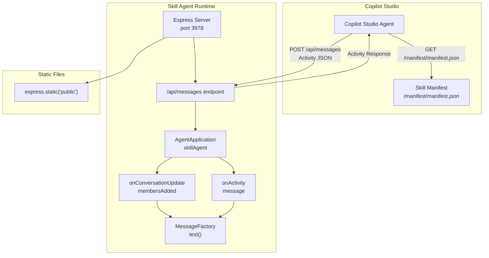
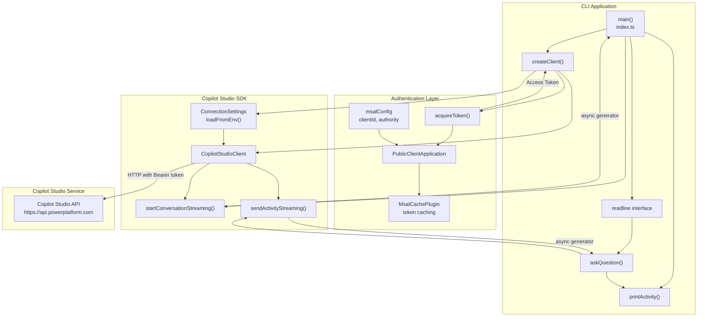
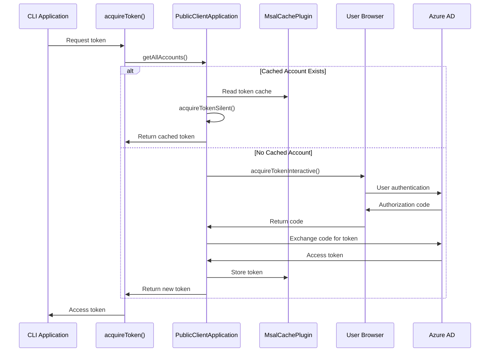
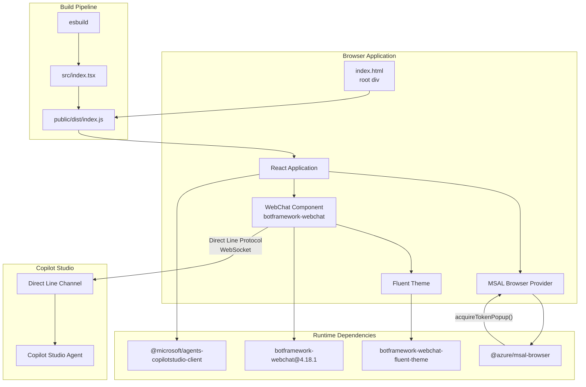

<!-- source: DeepWiki mcp.deepwiki.com · repo microsoft/Agents · page 6.6 Copilot Studio Integration Samples · fetched 2026-10-26 -->

# Copilot Studio Integration Samples

<details>
<summary>Relevant source files</summary>

The following files were used as context for generating this wiki page:

- [.vscode/settings.json](.vscode/settings.json)
- [samples/nodejs/auto-signin/package.json](samples/nodejs/auto-signin/package.json)
- [samples/nodejs/azure-ai-streaming/package.json](samples/nodejs/azure-ai-streaming/package.json)
- [samples/nodejs/cards/env.TEMPLATE](samples/nodejs/cards/env.TEMPLATE)
- [samples/nodejs/cards/package.json](samples/nodejs/cards/package.json)
- [samples/nodejs/cards/src/index.ts](samples/nodejs/cards/src/index.ts)
- [samples/nodejs/copilotstudio-client/package.json](samples/nodejs/copilotstudio-client/package.json)
- [samples/nodejs/copilotstudio-client/src/index.ts](samples/nodejs/copilotstudio-client/src/index.ts)
- [samples/nodejs/copilotstudio-skill/env.TEMPLATE](samples/nodejs/copilotstudio-skill/env.TEMPLATE)
- [samples/nodejs/copilotstudio-skill/package-lock.json](samples/nodejs/copilotstudio-skill/package-lock.json)
- [samples/nodejs/copilotstudio-skill/package.json](samples/nodejs/copilotstudio-skill/package.json)
- [samples/nodejs/copilotstudio-skill/src/agent.ts](samples/nodejs/copilotstudio-skill/src/agent.ts)
- [samples/nodejs/copilotstudio-webchat-react/package.json](samples/nodejs/copilotstudio-webchat-react/package.json)
- [samples/nodejs/copilotstudio-webchat-react/public/index.html](samples/nodejs/copilotstudio-webchat-react/public/index.html)
- [samples/nodejs/langchain-multiturn/package.json](samples/nodejs/langchain-multiturn/package.json)
- [samples/nodejs/multi-turn-prompt/env.TEMPLATE](samples/nodejs/multi-turn-prompt/env.TEMPLATE)
- [samples/nodejs/multi-turn-prompt/package.json](samples/nodejs/multi-turn-prompt/package.json)
- [samples/nodejs/obo-authorization/env.TEMPLATE](samples/nodejs/obo-authorization/env.TEMPLATE)
- [samples/nodejs/obo-authorization/package.json](samples/nodejs/obo-authorization/package.json)
- [samples/nodejs/obo-authorization/src/index.ts](samples/nodejs/obo-authorization/src/index.ts)

</details>


This document describes three sample applications demonstrating integration patterns between the Microsoft 365 Agents SDK and Copilot Studio. These samples show how to build agents that can be called by Copilot Studio (skills), how to programmatically interact with Copilot Studio agents (clients), and how to embed Copilot Studio agents in web applications (WebChat).

For general information about Copilot Studio as an AI service, see [Copilot Studio Integration](#5.3). For authentication patterns used in these samples, see [Authentication and Authorization](#3).

---

## Integration Patterns Overview

The Copilot Studio integration samples demonstrate three distinct architectural patterns:

```mermaid
graph TB
    subgraph "Pattern 1: Copilot Studio Skill"
        CS1["Copilot Studio Agent"]
        SKILL["Agent Application<br/>@microsoft/agents-hosting-express<br/>Echo Skill"]
        CS1 -->|"HTTP POST /api/messages"| SKILL
        SKILL -->|"Activity Response"| CS1
    end
    
    subgraph "Pattern 2: Copilot Studio Client"
        CLI["CLI Application<br/>CopilotStudioClient"]
        CS2["Copilot Studio Agent"]
        MSAL_CLI["MSAL Node<br/>PublicClientApplication"]
        
        CLI --> MSAL_CLI
        MSAL_CLI -->|"Access Token"| CLI
        CLI -->|"sendActivityStreaming()<br/>startConversationStreaming()"| CS2
        CS2 -->|"Activity Stream"| CLI
    end
    
    subgraph "Pattern 3: WebChat React"
        BROWSER["Browser React App"]
        WEBCHAT["BotFramework WebChat<br/>botframework-webchat"]
        CS3["Copilot Studio Agent"]
        MSAL_BROWSER["MSAL Browser<br/>PublicClientApplication"]
        
        BROWSER --> MSAL_BROWSER
        MSAL_BROWSER -->|"Access Token"| BROWSER
        BROWSER --> WEBCHAT
        WEBCHAT -->|"Direct Line Protocol"| CS3
    end
    
    style SKILL fill:#f9f9f9
    style CLI fill:#f9f9f9
    style BROWSER fill:#f9f9f9
```



**Pattern 1: Skill** - An agent built with the SDK that Copilot Studio invokes as an external skill. The skill receives Activities via HTTP and responds synchronously.

**Pattern 2: Client** - A standalone application that communicates with Copilot Studio programmatically. Used for CLI tools, backend integrations, or testing.

**Pattern 3: WebChat** - A browser-based UI that embeds Copilot Studio using the WebChat control with MSAL authentication for direct browser-to-Copilot Studio communication.

**Sources:** [samples/nodejs/copilotstudio-skill/src/agent.ts:1-26](), [samples/nodejs/copilotstudio-client/src/index.ts:1-140](), [samples/nodejs/copilotstudio-webchat-react/package.json:1-28]()

---

## Copilot Studio Skill Sample

The Copilot Studio Skill sample demonstrates how to create an agent that can be registered as a skill in Copilot Studio and invoked by Copilot Studio agents.

### Skill Architecture



The skill is implemented as a standard `AgentApplication` hosted via Express. Copilot Studio discovers the skill via a manifest file served from static content and communicates using the Activity Protocol.

**Sources:** [samples/nodejs/copilotstudio-skill/src/agent.ts:1-26]()

### Skill Implementation

The skill implementation uses the `AgentApplication` class to handle incoming Activities:

| Component | Type | Purpose |
|-----------|------|---------|
| `skillAgent` | `AgentApplication` | Core agent container receiving Activities from Copilot Studio |
| `startServer()` | Function | Starts Express server with automatic `/api/messages` endpoint |
| `onConversationUpdate()` | Event Handler | Responds when new members join conversation |
| `onActivity('message')` | Event Handler | Processes incoming message Activities |
| `MessageFactory.text()` | Factory Method | Creates text message Activities for responses |
| `express.static('public')` | Middleware | Serves manifest and other static files |

The core implementation is in [samples/nodejs/copilotstudio-skill/src/agent.ts:6-26]():

- Line 6: Creates `AgentApplication` instance
- Lines 8-11: Handles conversation member additions with welcome message
- Lines 13-20: Echoes received messages back to caller
- Line 22: Starts Express server with agent
- Line 25: Adds static file serving for manifest

**Sources:** [samples/nodejs/copilotstudio-skill/src/agent.ts:1-26]()

### Skill Configuration

The skill requires service connection credentials configured via environment variables:

| Environment Variable | Purpose |
|---------------------|---------|
| `connections__serviceConnection__settings__clientId` | App Registration client ID for bot authentication |
| `connections__serviceConnection__settings__clientSecret` | Client secret for bot authentication |
| `connections__serviceConnection__settings__tenantId` | Azure AD tenant ID |
| `connectionsMap__0__connection` | Maps connection name to service connection |
| `connectionsMap__0__serviceUrl` | Service URL pattern (`*` for all) |

These credentials authenticate the skill when receiving Activities from Copilot Studio via Azure Bot Service.

**Sources:** [samples/nodejs/copilotstudio-skill/env.TEMPLATE:1-10]()

### Skill Dependencies

The skill sample uses minimal dependencies:

```
@microsoft/agents-hosting-express@1.1.0
  └── @microsoft/agents-hosting@1.1.1
      └── @microsoft/agents-activity@1.1.1
express@5.1.0
@microsoft/microsoft-graph-client@3.0.7 (optional, for Graph integration)
```

The `@microsoft/agents-hosting-express` package provides the `startServer()` function that automatically configures Express with the `/api/messages` endpoint and JWT validation middleware.

**Sources:** [samples/nodejs/copilotstudio-skill/package.json:1-23](), [samples/nodejs/copilotstudio-skill/package-lock.json:136-148]()

---

## Copilot Studio Client Sample

The Copilot Studio Client sample demonstrates programmatic interaction with Copilot Studio agents using the `CopilotStudioClient` class. This pattern is used for CLI tools, backend integrations, or automated testing.

### Client Architecture



The client follows a pattern of authentication → client creation → streaming interaction. All communication with Copilot Studio uses async generators for real-time response streaming.

**Sources:** [samples/nodejs/copilotstudio-client/src/index.ts:1-140]()

### Authentication Flow

The client implements interactive MSAL authentication with token caching:



The authentication implementation is in [samples/nodejs/copilotstudio-client/src/index.ts:17-61]():

- Lines 18-37: MSAL configuration with cache plugin
- Lines 38-44: Token request scopes and browser opening
- Lines 46-59: Token acquisition logic with silent refresh

The `MsalCachePlugin` stores tokens in `mcssample.tockencache.json` in the system temp directory for reuse across sessions.

**Sources:** [samples/nodejs/copilotstudio-client/src/index.ts:17-61]()

### Client Interaction Flow

The main interaction loop uses async generators for streaming:

| Function | Purpose | Lines |
|----------|---------|-------|
| `createClient()` | Creates authenticated `CopilotStudioClient` instance | 63-69 |
| `main()` | Entry point, starts conversation and interaction loop | 129-137 |
| `askQuestion()` | Prompts user input and sends to Copilot Studio | 76-99 |
| `printActivity()` | Formats and displays received Activities | 106-127 |

**Key implementation details:**

1. **Starting a conversation** [samples/nodejs/copilotstudio-client/src/index.ts:132-135]():
   - Calls `startConversationStreaming(true)` to begin new conversation
   - Iterates async generator to receive initial Activities
   - Extracts `conversationId` for subsequent messages

2. **Sending messages** [samples/nodejs/copilotstudio-client/src/index.ts:83-96]():
   - Creates Activity with `type: 'message'` and user text
   - Includes conversation ID in subsequent turns
   - Uses `sendActivityStreaming()` for real-time responses
   - Iterates async generator until `EndOfConversation` received

3. **Activity handling** [samples/nodejs/copilotstudio-client/src/index.ts:107-126]():
   - Processes `Message`, `Typing`, and `Event` activity types
   - Displays markdown-formatted text
   - Shows suggested actions when present

**Sources:** [samples/nodejs/copilotstudio-client/src/index.ts:63-140]()

### Client Configuration

The client requires Copilot Studio connection settings loaded from environment:

| Setting Property | Environment Variable | Purpose |
|-----------------|---------------------|---------|
| `appClientId` | App Registration for interactive auth | `COPILOT_STUDIO_APP_CLIENT_ID` |
| `tenantId` | Azure AD tenant | `COPILOT_STUDIO_TENANT_ID` |
| `botId` | Copilot Studio bot identifier | `COPILOT_STUDIO_BOT_ID` |
| `environmentId` | Power Platform environment | `COPILOT_STUDIO_ENVIRONMENT_ID` |
| `tokenEndpoint` | Optional custom token endpoint | `COPILOT_STUDIO_TOKEN_ENDPOINT` |

The `loadCopilotStudioConnectionSettingsFromEnv()` function (from `@microsoft/agents-copilotstudio-client`) reads these values and validates required fields.

**Sources:** [samples/nodejs/copilotstudio-client/src/index.ts:64]()

### Client Dependencies

```
@microsoft/agents-copilotstudio-client@1.1.0
  └── @microsoft/agents-activity@1.1.1
@azure/msal-node@3.5.3
  └── @azure/msal-common@15.13.3
open@10.1.2 (opens browser for auth)
```

The `@microsoft/agents-copilotstudio-client` package provides the `CopilotStudioClient` class, which internally uses the Activity Protocol to communicate with Copilot Studio's Power Platform API.

**Sources:** [samples/nodejs/copilotstudio-client/package.json:1-27]()

---

## WebChat React Integration Sample

The WebChat React sample demonstrates browser-based integration with Copilot Studio using the BotFramework WebChat control and MSAL browser authentication.

### WebChat Architecture



The WebChat sample uses a standard React application pattern with esbuild for bundling. MSAL Browser handles authentication in the browser, and the WebChat control establishes a WebSocket connection to Copilot Studio via Direct Line.

**Sources:** [samples/nodejs/copilotstudio-webchat-react/package.json:1-28](), [samples/nodejs/copilotstudio-webchat-react/public/index.html:1-15]()

### WebChat Components

| Package | Version | Purpose |
|---------|---------|---------|
| `@microsoft/agents-copilotstudio-client` | 1.1.0 | Copilot Studio connection utilities |
| `@azure/msal-browser` | 4.13.1 | Browser-based MSAL authentication |
| `botframework-webchat` | 4.18.1-main.20251101.54e519d | WebChat control for bot UI |
| `botframework-webchat-fluent-theme` | 4.18.1-main.20251101.54e519d | Fluent Design theme for WebChat |
| `react` | 16.8.6 | React framework |
| `react-dom` | 16.8.6 | React DOM rendering |

The sample uses specific pre-release versions of WebChat with Fluent theme support for modern Microsoft 365 UI consistency.

**Sources:** [samples/nodejs/copilotstudio-webchat-react/package.json:14-21]()

### WebChat Build Process

The build configuration uses esbuild for fast bundling:

```
npm run build
  └── esbuild src/index.tsx --bundle --platform=browser --target=esnext --outdir=public/dist --jsx=automatic

npm start  
  └── npm run build -- --watch --serve=localhost:3000 --servedir=./public
```

Build parameters:
- `--bundle`: Creates single bundle file
- `--platform=browser`: Targets browser environment
- `--target=esnext`: Uses latest JavaScript features
- `--jsx=automatic`: Automatic React JSX transform (React 17+)
- `--watch`: Rebuilds on file changes
- `--serve=localhost:3000`: Development server
- `--servedir=./public`: Serves from public directory

The built application is served from [samples/nodejs/copilotstudio-webchat-react/public/index.html:1-15]() with the bundle loaded from `./dist/index.js`.

**Sources:** [samples/nodejs/copilotstudio-webchat-react/package.json:10-13]()

---

## Common Configuration Patterns

### Connection Settings Structure

All Copilot Studio samples use hierarchical configuration via environment variables. The pattern follows a nested structure:

```
connections__<connectionName>__settings__<property>
```

For service connections:
```bash
connections__serviceConnection__settings__clientId=<app-id>
connections__serviceConnection__settings__clientSecret=<secret>
connections__serviceConnection__settings__tenantId=<tenant-id>
```

For connection mapping:
```bash
connectionsMap__0__connection=serviceConnection
connectionsMap__0__serviceUrl=*
```

This hierarchical configuration is parsed by the SDK into connection objects used by authentication middleware.

**Sources:** [samples/nodejs/copilotstudio-skill/env.TEMPLATE:1-10](), [samples/nodejs/obo-authorization/env.TEMPLATE:1-21]()

### Debug Logging

All samples support debug logging via the `DEBUG` environment variable:

```bash
DEBUG=agents:*:error,agents:*:info,agents:*:warn
```

Available namespaces:
- `agents:*:error` - Error messages
- `agents:*:info` - Informational messages  
- `agents:*:warn` - Warning messages
- `agents:*:debug` - Detailed debug traces

The wildcard `*` matches all components within the agents packages.

**Sources:** [samples/nodejs/copilotstudio-skill/env.TEMPLATE:9](), [samples/nodejs/obo-authorization/env.TEMPLATE:20]()

### Package Versioning

All three samples use aligned versions of the agents packages:

| Package | Version | Used By |
|---------|---------|---------|
| `@microsoft/agents-activity` | 1.1.1 | All (transitive) |
| `@microsoft/agents-hosting` | 1.1.1 | Skill (transitive) |
| `@microsoft/agents-hosting-express` | 1.1.0 | Skill |
| `@microsoft/agents-copilotstudio-client` | 1.1.0 | Client, WebChat |

Version alignment ensures consistent Activity Protocol behavior across skill and client scenarios.

**Sources:** [samples/nodejs/copilotstudio-skill/package.json:15-18](), [samples/nodejs/copilotstudio-client/package.json:16-19](), [samples/nodejs/copilotstudio-webchat-react/package.json:14-17]()

---

## Sample Comparison Matrix

| Feature | Copilot Studio Skill | Copilot Studio Client | WebChat React |
|---------|---------------------|----------------------|---------------|
| **Direction** | Receives from CS | Sends to CS | Sends to CS |
| **Runtime** | Node.js server | Node.js CLI | Browser |
| **Authentication** | Service Principal | MSAL Interactive | MSAL Browser |
| **Protocol** | Activity via HTTP POST | Activity via SDK | Direct Line WebSocket |
| **Use Case** | Extend CS with custom logic | Programmatic CS interaction | Embed CS in web app |
| **Hosting** | Express server | Local process | Static web hosting |
| **Key Package** | `agents-hosting-express` | `agents-copilotstudio-client` | `botframework-webchat` |
| **State Management** | AgentApplication | Stateless | WebChat internal |
| **UI** | None (headless) | CLI readline | WebChat control |

**Sources:** [samples/nodejs/copilotstudio-skill/package.json:1-23](), [samples/nodejs/copilotstudio-client/package.json:1-27](), [samples/nodejs/copilotstudio-webchat-react/package.json:1-28]()

---

