<!-- source: DeepWiki mcp.deepwiki.com · repo microsoft/Agents · page 6.7 Advanced Integration Samples · fetched 2026-10-26 -->

# Advanced Integration Samples

Relevant source files

The following files were used as context for generating this wiki page:

- [samples/dotnet/Agent Framework/AgentFrameworkWeather.csproj](samples/dotnet/Agent Framework/AgentFrameworkWeather.csproj)
- [samples/dotnet/GenesysHandoff/Genesys/GenesysConnectionSetting.cs](samples/dotnet/GenesysHandoff/Genesys/GenesysConnectionSetting.cs)
- [samples/dotnet/GenesysHandoff/Genesys/GenesysService.cs](samples/dotnet/GenesysHandoff/Genesys/GenesysService.cs)
- [samples/dotnet/GenesysHandoff/Genesys/IGenesysConnectionSettings.cs](samples/dotnet/GenesysHandoff/Genesys/IGenesysConnectionSettings.cs)
- [samples/dotnet/GenesysHandoff/GenesysHandoff.csproj](samples/dotnet/GenesysHandoff/GenesysHandoff.csproj)
- [samples/dotnet/GenesysHandoff/GenesysHandoffAgent.cs](samples/dotnet/GenesysHandoff/GenesysHandoffAgent.cs)
- [samples/dotnet/GenesysHandoff/Program.cs](samples/dotnet/GenesysHandoff/Program.cs)
- [samples/dotnet/GenesysHandoff/README.md](samples/dotnet/GenesysHandoff/README.md)
- [samples/dotnet/GenesysHandoff/appsettings.json](samples/dotnet/GenesysHandoff/appsettings.json)
- [samples/dotnet/RetrievalBot/RetrievalBot.csproj](samples/dotnet/RetrievalBot/RetrievalBot.csproj)
- [samples/dotnet/auto-signin/AutoSignIn.csproj](samples/dotnet/auto-signin/AutoSignIn.csproj)
- [samples/dotnet/azure-ai-streaming/StreamingMessageAgent.csproj](samples/dotnet/azure-ai-streaming/StreamingMessageAgent.csproj)
- [samples/dotnet/copilotstudio-client/CopilotStudioClient.csproj](samples/dotnet/copilotstudio-client/CopilotStudioClient.csproj)
- [samples/dotnet/copilotstudio-skill/CopilotStudioEchoSkill.csproj](samples/dotnet/copilotstudio-skill/CopilotStudioEchoSkill.csproj)
- [samples/dotnet/obo-authorization/OBOAuthorization.csproj](samples/dotnet/obo-authorization/OBOAuthorization.csproj)
- [samples/dotnet/quickstart/QuickStart.csproj](samples/dotnet/quickstart/QuickStart.csproj)
- [samples/dotnet/semantic-kernel-multiturn/SemanticKernelMultiturn.csproj](samples/dotnet/semantic-kernel-multiturn/SemanticKernelMultiturn.csproj)

This document covers advanced integration samples within the Microsoft 365 Agents SDK that demonstrate complex multi-service orchestration patterns. These samples show how to integrate agents with external contact center platforms, Microsoft 365 services, and sophisticated AI frameworks to build production-ready solutions.

For general AI integration patterns, see [AI Integration Patterns](#8.1). For authentication setup required by these samples, see [Authentication and Authorization](#3).

## Overview

The advanced integration samples demonstrate complex scenarios that go beyond basic agent functionality:

| Sample | Integration Type | Key Technologies | Use Case |
|--------|-----------------|------------------|----------|
| **GenesysHandoff** | Third-party contact center | Genesys Cloud Open Messaging API, Copilot Studio | Live agent handoff with conversation context preservation |
| **RetrievalBot** | Microsoft 365 data retrieval | M365 Copilot Retrieval API, Semantic Kernel, SharePoint | Knowledge grounding with enterprise data |
| **Agent Framework** | Advanced AI orchestration | Azure OpenAI, Microsoft.Extensions.AI, Custom Plugins | Multi-plugin weather agent with streaming |

These samples represent production-grade integration patterns suitable for enterprise deployments.

Sources: [samples/dotnet/GenesysHandoff/README.md:1-17](), [samples/dotnet/RetrievalBot/README.md:1-8](), [samples/dotnet/Agent Framework/AgentFrameworkWeather.csproj]()

## GenesysHandoff Sample

The **GenesysHandoff** sample demonstrates seamless conversation handoff from a Microsoft Copilot Studio agent to a live agent in Genesys Cloud. This pattern is essential for contact center integrations where automated agents handle routine queries but can escalate complex issues to human agents while preserving full conversation context.

### Integration Architecture

The GenesysHandoff sample implements bidirectional message flow between Microsoft Teams users, the Agent SDK, and Genesys Cloud agents:

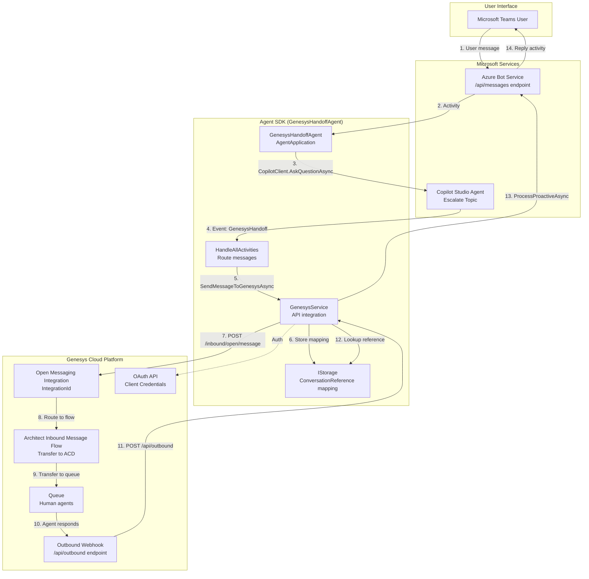

Sources: [samples/dotnet/GenesysHandoff/README.md:505-512](), [samples/dotnet/GenesysHandoff/GenesysHandoffAgent.cs:1-192](), [samples/dotnet/GenesysHandoff/Genesys/GenesysService.cs:1-384]()

### Key Components

#### GenesysHandoffAgent Class

The `GenesysHandoffAgent` extends `AgentApplication` and coordinates the handoff flow:

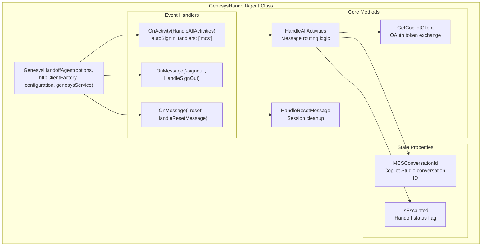

Sources: [samples/dotnet/GenesysHandoff/GenesysHandoffAgent.cs:16-192]()

The agent maintains conversation state using two key properties stored in `turnState.Conversation`:

| Property | Type | Purpose |
|----------|------|---------|
| `MCSConversationId` | `string` | Maps to Copilot Studio conversation ID and Genesys conversation ID |
| `IsEscalated` | `bool` | Tracks whether conversation has been handed off to Genesys |

Sources: [samples/dotnet/GenesysHandoff/GenesysHandoffAgent.cs:25-26]()

#### GenesysService Integration

The `GenesysService` class handles all Genesys Cloud API interactions:

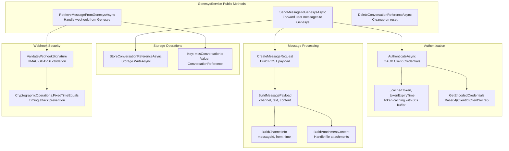

Sources: [samples/dotnet/GenesysHandoff/Genesys/GenesysService.cs:22-384]()

### Configuration Requirements

The GenesysHandoff sample requires extensive configuration across multiple platforms:

#### Genesys Cloud Configuration

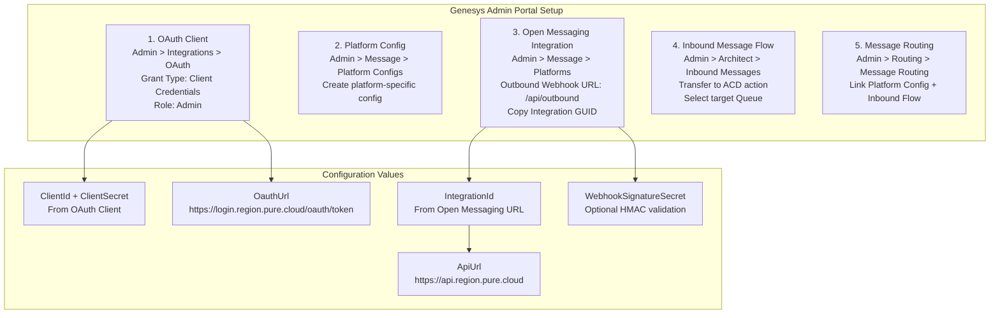

Sources: [samples/dotnet/GenesysHandoff/README.md:114-195]()

#### Application Configuration

The `appsettings.json` structure for GenesysHandoff:

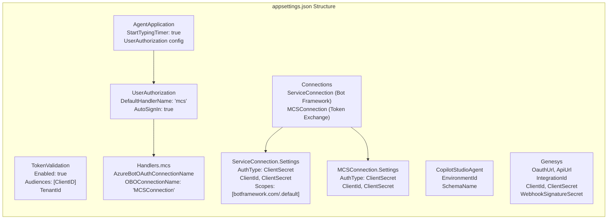

Sources: [samples/dotnet/GenesysHandoff/appsettings.json:1-72]()

### Message Flow and State Management

The conversation state transitions through distinct phases:

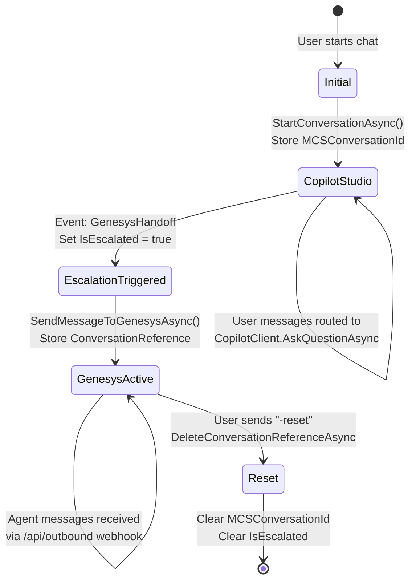

Sources: [samples/dotnet/GenesysHandoff/GenesysHandoffAgent.cs:63-123](), [samples/dotnet/GenesysHandoff/README.md:414-420]()

### Security Considerations

The sample implements HMAC-SHA256 webhook signature validation:

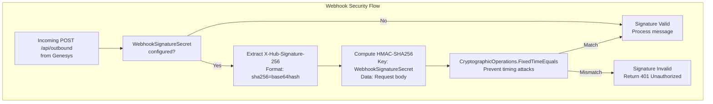

Sources: [samples/dotnet/GenesysHandoff/Genesys/GenesysService.cs:340-382](), [samples/dotnet/GenesysHandoff/README.md:182-195]()

### Deployment Considerations

The sample supports both local development and Azure deployment:

| Environment | Endpoint Configuration | Storage Recommendation |
|-------------|------------------------|------------------------|
| **Local Development** | Dev tunnel URL (e.g., `https://abc123.devtunnels.ms`) | `MemoryStorage` (default) |
| **Azure Production** | App Service URL (e.g., `https://youragent.azurewebsites.net`) | `CosmosDbPartitionedStorage` |

**Important**: `MemoryStorage` does not persist across restarts. For production deployments, configure `CosmosDbPartitionedStorage` to maintain conversation mappings during application restarts.

Sources: [samples/dotnet/GenesysHandoff/README.md:443-486](), [samples/dotnet/GenesysHandoff/Program.cs:23-27]()

## RetrievalBot Sample

The **RetrievalBot** sample demonstrates retrieval-augmented generation (RAG) patterns using the Microsoft 365 Copilot Retrieval API. This sample creates an intelligent agent that can search and retrieve information from SharePoint sites and present it in a conversational format with Semantic Kernel orchestration.

### Architecture Overview

The RetrievalBot follows a layered architecture that integrates Semantic Kernel with the Microsoft 365 Copilot Retrieval API:

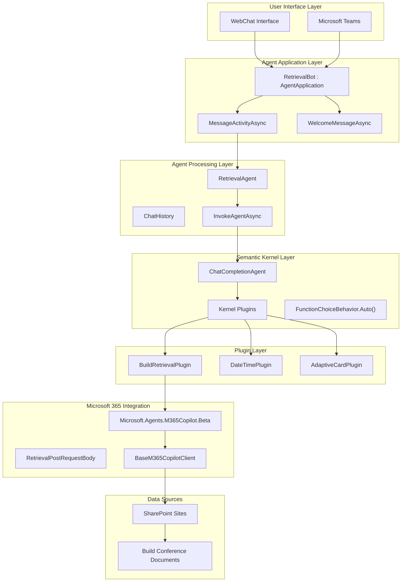

Sources: [samples/dotnet/RetrievalBot/RetrievalBot.cs:16-69](), [samples/dotnet/RetrievalBot/Agents/RetrievalAgent.cs:18-114](), [samples/dotnet/RetrievalBot/Plugins/BuildRetrievalPlugin.cs:35-76]()

## Core Components

### RetrievalBot AgentApplication

The `RetrievalBot` class extends `AgentApplication` and serves as the main entry point for handling conversational activities:

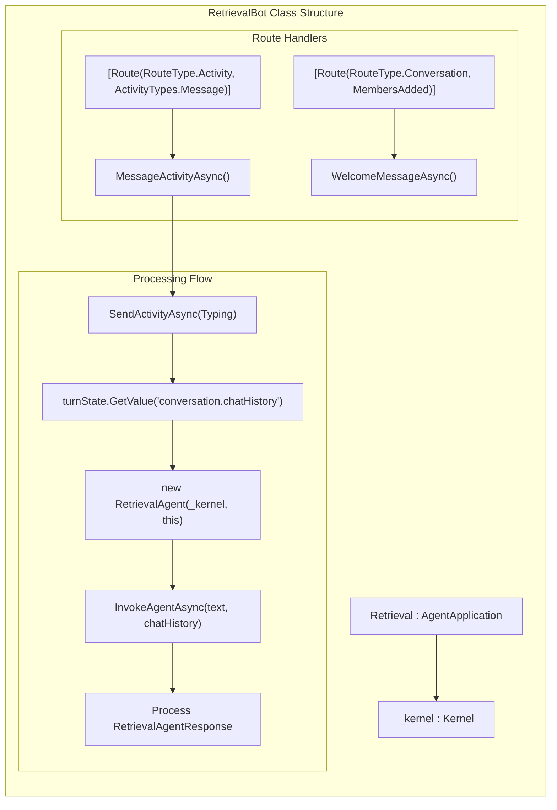

Sources: [samples/dotnet/RetrievalBot/RetrievalBot.cs:16-69]()

### RetrievalAgent Processing

The `RetrievalAgent` class orchestrates the AI processing using Semantic Kernel's `ChatCompletionAgent`:

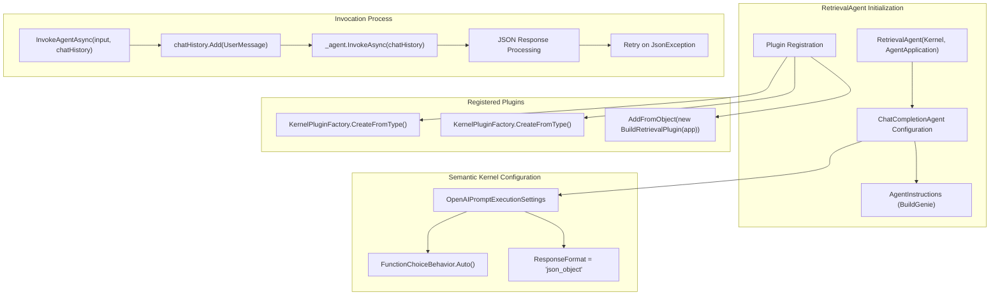

Sources: [samples/dotnet/RetrievalBot/Agents/RetrievalAgent.cs:18-114]()

### BuildRetrievalPlugin Integration

The `BuildRetrievalPlugin` is the core component that integrates with the Microsoft 365 Copilot Retrieval API:

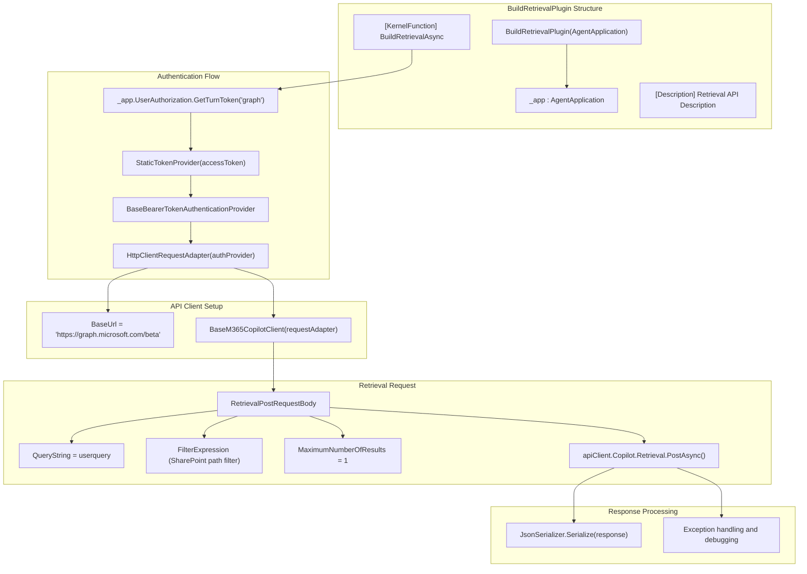

Sources: [samples/dotnet/RetrievalBot/Plugins/BuildRetrievalPlugin.cs:35-76]()

## Authentication and Data Access

The retrieval samples require specific authentication configuration to access Microsoft 365 Copilot Retrieval API:

| Requirement | Configuration | Purpose |
|-------------|---------------|---------|
| **Copilot Licenses** | Tenant-level Copilot licensing | Required for Retrieval API access |
| **Graph Token** | `_app.UserAuthorization.GetTurnToken("graph")` | Authenticates API calls |
| **SharePoint Access** | User permissions to SharePoint sites | Data source access |
| **Filter Expression** | `(path:"https://<tenantname>.sharepoint.com/sites/")` | Scopes retrieval to specific sites |

The authentication flow uses the agent's `UserAuthorization` to obtain Graph tokens and creates a `BaseBearerTokenAuthenticationProvider` for the M365 Copilot client.

Sources: [samples/dotnet/RetrievalBot/Plugins/BuildRetrievalPlugin.cs:50-56]()

## Configuration Requirements

### Prerequisites

The RetrievalBot sample requires the following setup:

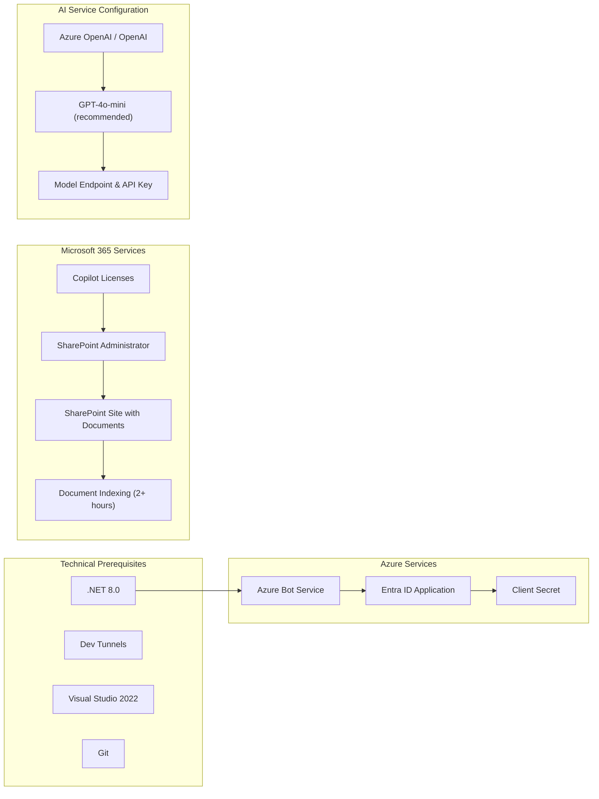

Sources: [samples/dotnet/RetrievalBot/README.md:9-21]()

### Application Settings

The sample uses standard ASP.NET Core configuration patterns with the following key settings:

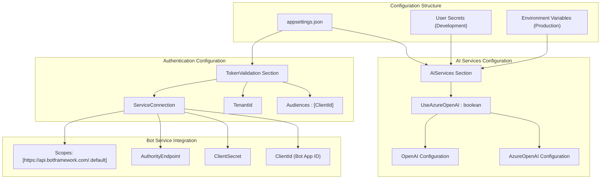

Sources: [samples/dotnet/RetrievalBot/README.md:78-110](), [samples/dotnet/RetrievalBot/Program.cs:33-51]()

## Sample Queries and Use Cases

The RetrievalBot is designed for Microsoft Build conference preparation and supports various query patterns:

| Query Type | Example Query | Handled By |
|------------|---------------|------------|
| **Greetings** | "Hey there!" | `WelcomeMessageAsync` |
| **Build Sessions** | "Can you give me a snapshot of all the sessions that Contoso is doing at Build 2025?" | `BuildRetrievalPlugin.BuildRetrievalAsync` |
| **Date Calculations** | "How many days till Build 2025?" | `DateTimePlugin.DaysToBuild` |
| **Email Requests** | "Can you send a mail to Adele Vance requesting for a Demo run this Friday?" | Future Graph API integration |

The agent responds with either plain text or Adaptive Cards based on the `RetrievalAgentResponse.ContentType`:

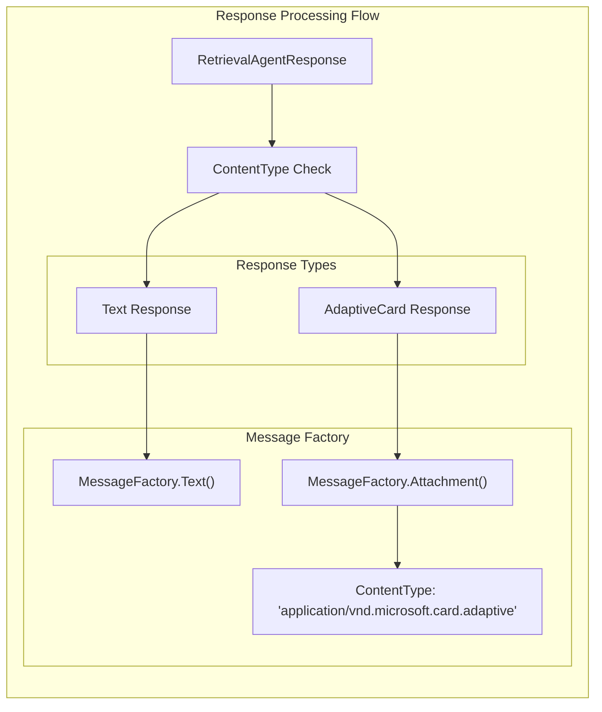

## Agent Framework Sample

The **Agent Framework** sample (located in `samples/dotnet/Agent Framework/`) demonstrates advanced AI orchestration patterns using Azure OpenAI with the `Microsoft.Extensions.AI` abstraction layer. This sample showcases streaming responses, custom plugin development, and multi-service integration.

### Technology Stack

The Agent Framework sample uses the following NuGet packages:

| Package | Version | Purpose |
|---------|---------|---------|
| `Microsoft.Agents.AI` | 1.0.0-preview | Core agent AI abstractions |
| `Microsoft.Extensions.AI.OpenAI` | 9.10.0-preview | Extensions.AI integration with OpenAI |
| `Azure.AI.OpenAI` | 2.1.0 | Azure OpenAI client SDK |
| `Azure.Identity` | 1.17.1 | Azure authentication |
| `AdaptiveCards` | 3.1.0 | Rich UI card rendering |
| `OpenWeatherMapSharp` | 4.1.0 | Weather API integration |

Sources: [samples/dotnet/Agent Framework/AgentFrameworkWeather.csproj:14-23]()

### Streaming Configuration

The project uses conditional compilation to enable streaming responses:

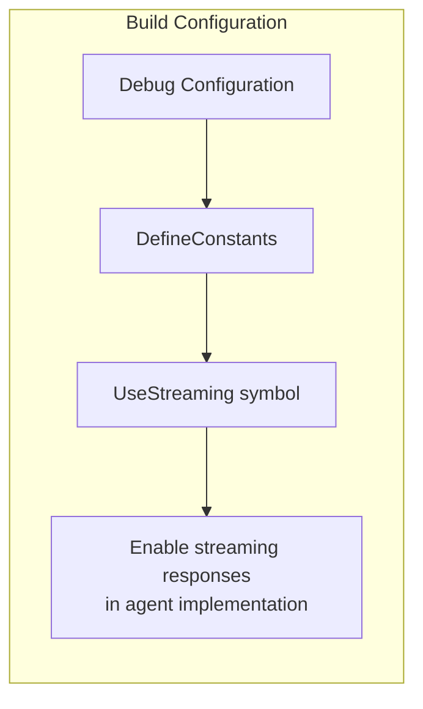

Sources: [samples/dotnet/Agent Framework/AgentFrameworkWeather.csproj:10-12]()

This pattern demonstrates conditional feature enablement for streaming AI responses, which is particularly useful for real-time conversational experiences.

## Common Integration Patterns

Across all advanced integration samples, several common patterns emerge:

### Authentication and Token Management

All samples use the `Microsoft.Agents.Authentication.Msal` package for authentication:

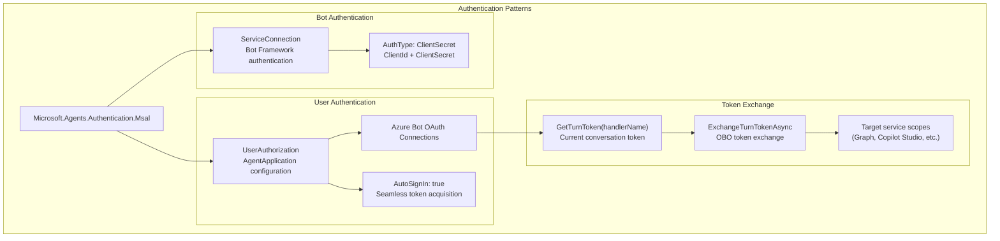

Sources: [samples/dotnet/GenesysHandoff/GenesysHandoffAgent.cs:42](), [samples/dotnet/GenesysHandoff/GenesysHandoffAgent.cs:187](), [samples/dotnet/RetrievalBot/Plugins/BuildRetrievalPlugin.cs:50]()

### State Management

All samples use the `IStorage` abstraction for conversation state:

| Sample | State Keys | Storage Type | Purpose |
|--------|-----------|--------------|---------|
| **GenesysHandoff** | `MCSConversationId`, `IsEscalated`, `{conversationId}` (mapping) | `MemoryStorage` (dev), `CosmosDbPartitionedStorage` (prod) | Track handoff state and conversation mappings |
| **RetrievalBot** | `conversation.chatHistory` | `MemoryStorage` | Maintain multi-turn conversation context |
| **Agent Framework** | Turn-based state | `MemoryStorage` | Session-scoped agent state |

Sources: [samples/dotnet/GenesysHandoff/Program.cs:23-27](), [samples/dotnet/GenesysHandoff/Genesys/GenesysService.cs:234-245]()

### HTTP Client Management

All samples use `IHttpClientFactory` for HTTP operations:

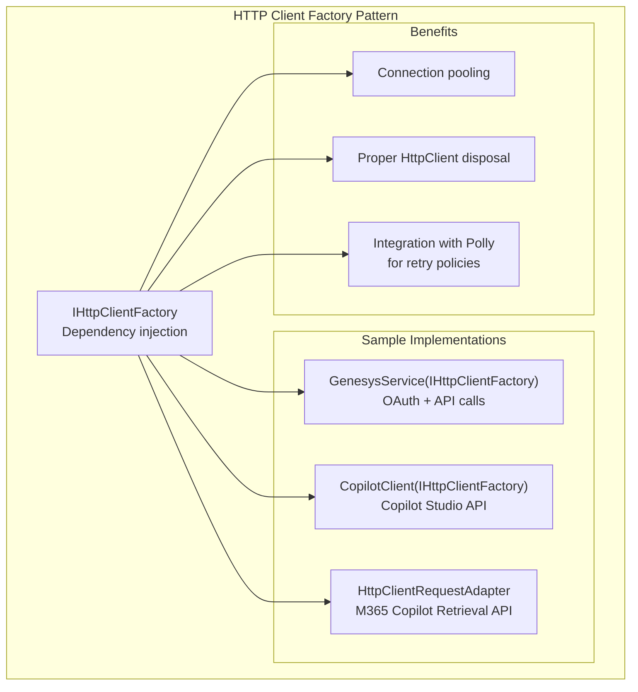

Sources: [samples/dotnet/GenesysHandoff/GenesysHandoffAgent.cs:22](), [samples/dotnet/GenesysHandoff/Program.cs:18](), [samples/dotnet/RetrievalBot/Plugins/BuildRetrievalPlugin.cs:52-56]()

## Best Practices for Advanced Integrations

Based on the advanced integration samples, the following best practices are recommended:

### Security

1. **Webhook Signature Validation**: Always validate webhook signatures using HMAC-SHA256 with constant-time comparison to prevent timing attacks
2. **Token Caching**: Implement token caching with appropriate expiration buffers (60 seconds recommended) to reduce authentication overhead
3. **Secret Management**: Use Azure Key Vault or User Secrets for development; never commit secrets to source control

Sources: [samples/dotnet/GenesysHandoff/Genesys/GenesysService.cs:340-382](), [samples/dotnet/GenesysHandoff/Genesys/GenesysService.cs:150-180]()

### State Management

1. **Persistent Storage**: Use `CosmosDbPartitionedStorage` for production deployments to survive application restarts
2. **State Cleanup**: Implement cleanup handlers (e.g., `-reset` command) to allow users to clear session state
3. **Conversation Mapping**: Store bidirectional mappings between internal conversation IDs and external system IDs

Sources: [samples/dotnet/GenesysHandoff/README.md:443-486](), [samples/dotnet/GenesysHandoff/GenesysHandoffAgent.cs:149-164]()

### Error Handling

1. **Exception Logging**: Log full exception details including stack traces for debugging external API integrations
2. **Graceful Degradation**: Provide meaningful error messages to users when external services are unavailable
3. **Retry Logic**: Implement appropriate retry policies for transient failures in external API calls

Sources: [samples/dotnet/RetrievalBot/Plugins/BuildRetrievalPlugin.cs:68-75](), [samples/dotnet/GenesysHandoff/GenesysHandoffAgent.cs:43-46]()

### Configuration Management

1. **Structured Configuration**: Use nested configuration sections with clear naming conventions
2. **Environment-Specific Settings**: Support different configurations for development, staging, and production
3. **Connection Mapping**: Use `ConnectionsMap` to support multiple service endpoints per environment

Sources: [samples/dotnet/GenesysHandoff/appsettings.json:1-72](), [samples/dotnet/RetrievalBot/README.md:78-110]()

Sources: [samples/dotnet/RetrievalBot/README.md:125-129](), [samples/dotnet/RetrievalBot/RetrievalBot.cs:42-54](), [samples/dotnet/GenesysHandoff/README.md:423-495]()

## Integration with Microsoft 365 Copilot API

The sample demonstrates the Beta version of the Microsoft 365 Copilot Retrieval API through the `Microsoft.Agents.M365Copilot.Beta` package:

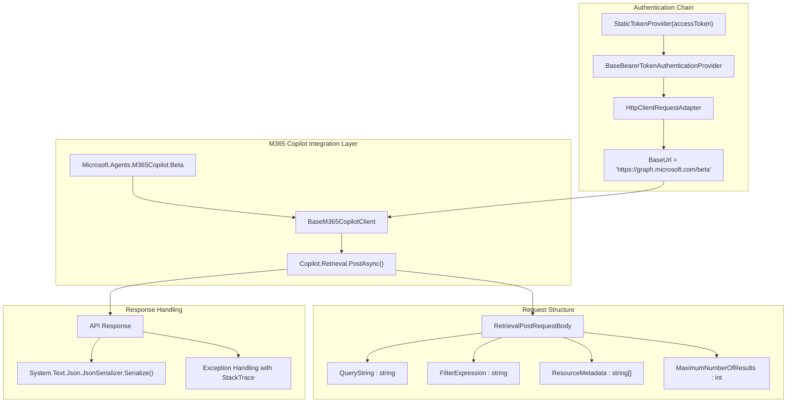

Sources: [samples/dotnet/RetrievalBot/Plugins/BuildRetrievalPlugin.cs:52-73](), [samples/dotnet/RetrievalBot/RetrievalBot.csproj:34]()

---

