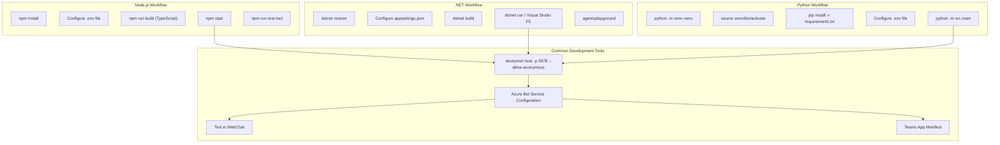
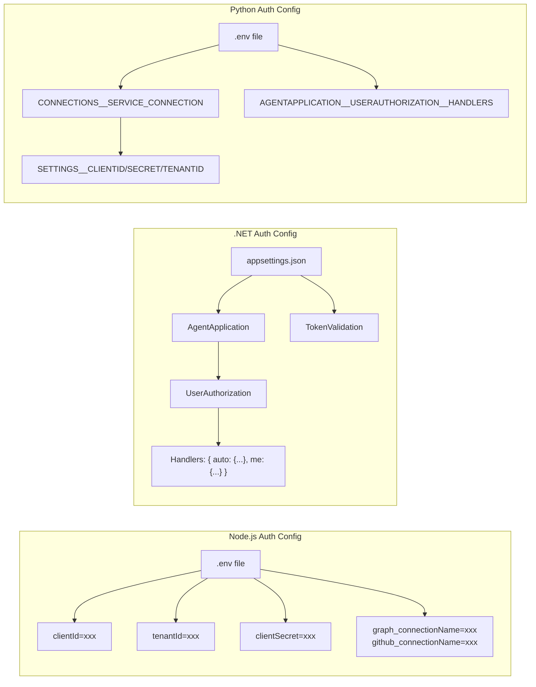
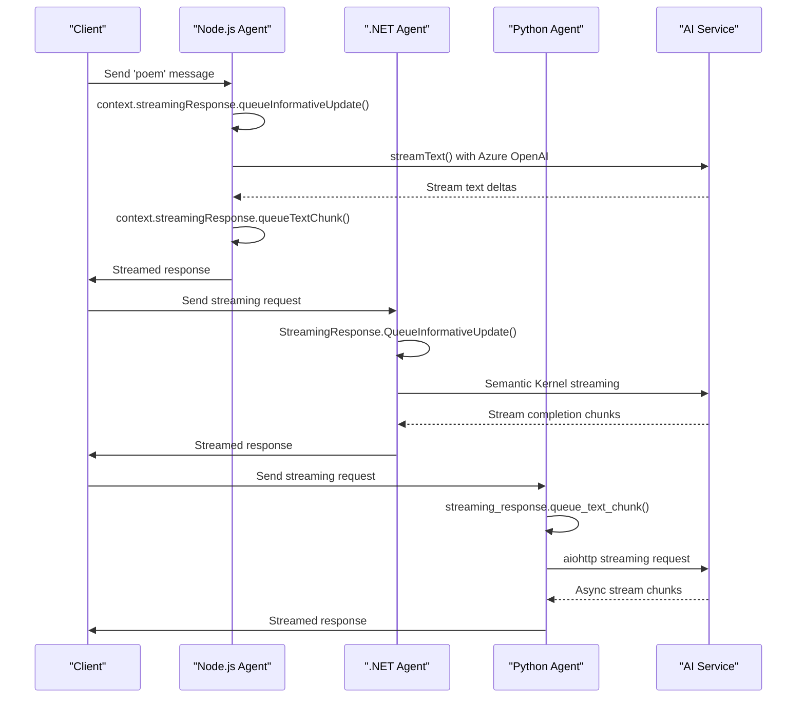
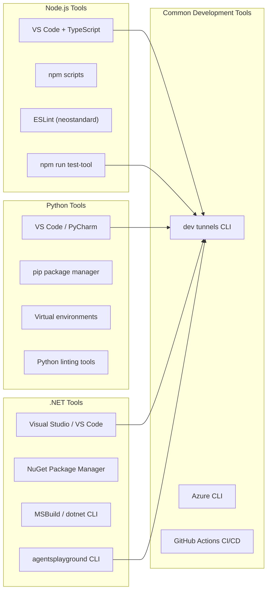
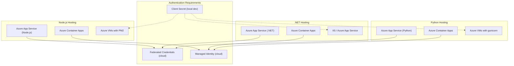

<!-- source: DeepWiki mcp.deepwiki.com · repo microsoft/Agents · page 7 Language-Specific Guides · fetched 2026-10-26 -->

# Language-Specific Guides

<details>
<summary>Relevant source files</summary>

The following files were used as context for generating this wiki page:

- [MCSandAgentsEcosystemLinks.md](MCSandAgentsEcosystemLinks.md)
- [README.md](README.md)

</details>


This document provides detailed guides for developing agents using the Microsoft 365 Agents SDK across different programming languages. It covers language-specific patterns, hosting frameworks, configuration approaches, and development workflows for Node.js, .NET, and Python implementations.

For general agent building concepts, see [Building Agents](#2). For platform-specific deployment information, see [Deployment and Hosting](#4).

## Multi-Language Architecture Overview

The Microsoft 365 Agents SDK provides consistent functionality across three primary programming languages, each with language-specific hosting and configuration patterns.

### Language Implementation Comparison

```mermaid
graph TB
    subgraph "Node.js Implementation"
        NodeSDK["@microsoft/agents-hosting-express"]
        NodeFramework["Express.js Framework"]
        NodeConfig[".env Configuration"]
        NodePkg["npm Package Manager"]
        NodeRuntime["node --env-file .env"]
    end
    
    subgraph ".NET Implementation"
        DotNetSDK["Microsoft.Agents.Hosting.AspNetCore"]
        DotNetFramework["ASP.NET Core Framework"]
        DotNetConfig["appsettings.json Configuration"]
        DotNetPkg["NuGet Package Manager"]
        DotNetRuntime["dotnet run"]
    end
    
    subgraph "Python Implementation"
        PythonSDK["microsoft-agents-sdk"]
        PythonFramework["aiohttp Framework"]
        PythonConfig[".env Configuration"]
        PythonPkg["pip Package Manager"]
        PythonRuntime["python -m src.main"]
    end
    
    subgraph "Common Core Concepts"
        AgentApp["AgentApplication Class"]
        MessageHandling["Message Handler Registration"]
        StateManagement["Turn State Management"]
        AuthHandlers["Authentication Handlers"]
        StreamingResp["Streaming Response Support"]
    end
    
    NodeSDK --> AgentApp
    DotNetSDK --> AgentApp
    PythonSDK --> AgentApp
    
    AgentApp --> MessageHandling
    AgentApp --> StateManagement
    AgentApp --> AuthHandlers
    AgentApp --> StreamingResp
```



Sources: [samples/nodejs/README.md:1-15](), [samples/dotnet/README.md:1-12](), [samples/python/auto-signin/README.md:1-104]()

## Development Environment Patterns

Each language implementation follows consistent development patterns while leveraging language-specific tooling and conventions.

### Development Workflow by Language



Sources: [samples/nodejs/cards/README.md:14-61](), [samples/dotnet/quickstart/README.md:13-23](), [samples/python/cards/README.md:34-60]()

## Configuration Patterns

### Configuration File Structures

| Language | Configuration File | Format | Key Sections |
|----------|------------------|--------|--------------|
| Node.js | `.env` | Key-Value Pairs | `clientId`, `tenantId`, `clientSecret`, connection names |
| .NET | `appsettings.json` | JSON Hierarchy | `AgentApplication`, `TokenValidation`, `ConnectionStrings` |
| Python | `.env` | Key-Value Pairs | `CONNECTIONS__SERVICE_CONNECTION__SETTINGS__*` |

### Authentication Configuration Comparison



Sources: [samples/nodejs/auto-signin/README.md:36-60](), [samples/dotnet/auto-signin/README.md:39-67](), [samples/python/auto-signin/README.md:27-51]()

## Message Handler Registration Patterns

### Language-Specific Handler Syntax

**Node.js Handler Registration:**
```typescript
// Route-based handlers with optional auth
this.onMessage('/me', this._profileRequest, ['graph'])
this.onMessage('/prs', this._pullRequests, ['github'])
this.onMessage('/status', this._status, ['graph', 'github'])
```

**.NET Handler Registration:**
```csharp
// Attribute-based routing with auth handlers
[AgentHandler("me", RequiredAuth = "me")]
public async Task<object> MeHandler(TurnContext context, TurnState state)
```

**Python Handler Registration:**
```python
# Decorator-based routing with auth handlers
@AGENT_APP.message("/me", auth_handlers=["GRAPH"])
@AGENT_APP.message("/prs", auth_handlers=["GITHUB"])
@AGENT_APP.message("/status")
```

Sources: [samples/nodejs/auto-signin/README.md:7-11](), [samples/dotnet/auto-signin/README.md:8-9](), [samples/python/auto-signin/README.md:7-12]()

## Streaming Response Implementation

### Framework-Specific Streaming Patterns



Sources: [samples/nodejs/azure-ai-streaming/src/agent.ts:25-67](), [samples/dotnet/azure-ai-streaming/README.md:1-111]()

## AI Integration Frameworks

### Language-Specific AI Framework Usage

| Language | Primary AI Frameworks | Integration Pattern | Configuration |
|----------|----------------------|-------------------|---------------|
| Node.js | `@ai-sdk/azure`, `langchain` | Direct streaming with `streamText()` | `.env` with Azure OpenAI keys |
| .NET | `Microsoft.SemanticKernel` | Kernel plugins and chat completion | `appsettings.json` AI services section |
| Python | `semantic-kernel`, Custom async | aiohttp async patterns | `.env` with service endpoints |

### AI Service Configuration Patterns

```mermaid
graph TB
    subgraph "Node.js AI Config"
        NodeAISDK["@ai-sdk/azure"]
        NodeConfig["AZURE_OPENAI_DEPLOYMENT_NAME<br/>AZURE_RESOURCE_NAME<br/>AZURE_API_KEY"]
        NodeLangChain["langchain integration"]
        NodeStream["streamText() function"]
    end
    
    subgraph ".NET AI Config"
        DotNetSK["Microsoft.SemanticKernel"]
        DotNetConfig["AIServices.AzureOpenAI<br/>DeploymentName, Endpoint, ApiKey"]
        DotNetPlugins["Kernel plugins"]
        DotNetChat["IChatCompletionService"]
    end
    
    subgraph "Python AI Config"
        PythonSK["semantic-kernel"]
        PythonConfig["Azure OpenAI environment variables"]
        PythonAsync["aiohttp async integration"]
        PythonCustom["Custom AI service implementations"]
    end
    
    NodeAISDK --> NodeStream
    NodeConfig --> NodeAISDK
    NodeLangChain --> NodeStream
    
    DotNetSK --> DotNetChat
    DotNetConfig --> DotNetSK
    DotNetPlugins --> DotNetSK
    
    PythonSK --> PythonAsync
    PythonConfig --> PythonSK
    PythonCustom --> PythonAsync
```



Sources: [samples/nodejs/azure-ai-streaming/package.json:2-6](), [samples/nodejs/langchain-multiturn/README.md:16-28](), [samples/dotnet/semantic-kernel-multiturn/README.md:17-32]()

## Package Management and Dependencies

### Core SDK Packages by Language

**Node.js Dependencies:**
- `@microsoft/agents-hosting-express` - Express.js hosting
- `@microsoft/m365agentsplayground` - Local testing tool
- `@ai-sdk/azure` - Azure OpenAI integration
- `ai` - AI streaming utilities

**.NET Dependencies:**
- `Microsoft.Agents.Hosting.AspNetCore` - ASP.NET Core hosting
- `Microsoft.SemanticKernel` - AI orchestration
- `Microsoft.Graph` - Microsoft Graph integration

**Python Dependencies:**
- `microsoft-agents-sdk` - Core SDK functionality
- `aiohttp` - Async HTTP framework
- `msal` - Microsoft authentication

### Development Tool Integration



Sources: [samples/nodejs/azure-ai-streaming/package.json:7-16](), [samples/dotnet/quickstart/README.md:11](), [samples/python/copilotstudio-client/README.md:7-14]()

## Local Development Setup

### Port and Hosting Conventions

All language implementations standardize on port `3978` for local development with consistent dev tunnel usage:

```bash
# Common across all languages
devtunnel host -p 3978 --allow-anonymous
```

### Testing Tool Integration

| Language | Local Test Tool | Command | Purpose |
|----------|----------------|---------|---------|
| Node.js | `@microsoft/m365agentsplayground` | `npm run test-tool` | Web-based agent testing |
| .NET | `agentsplayground` | `agentsplayground` | Standalone playground tool |
| Python | Custom test clients | Direct HTTP calls | Framework-specific testing |

Sources: [samples/nodejs/cards/README.md:49-53](), [samples/dotnet/quickstart/README.md:17-22](), [samples/python/cards/README.md:23-27]()

## Deployment and Production Considerations

### Hosting Platform Compatibility



Sources: [samples/dotnet/quickstart/README.md:32-58](), [samples/nodejs/copilotstudio-skill/README.md:34-41](), [samples/python/copilotstudio-skill/README.md:35-46]()

---

