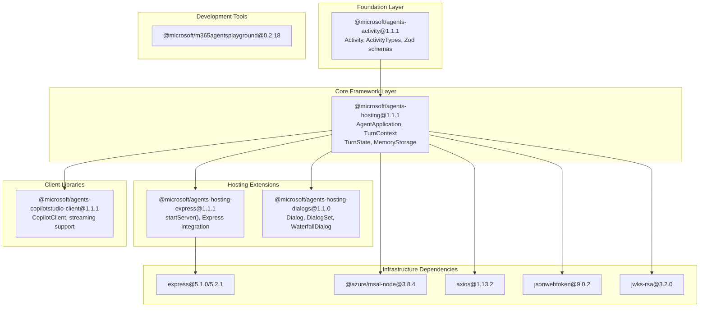
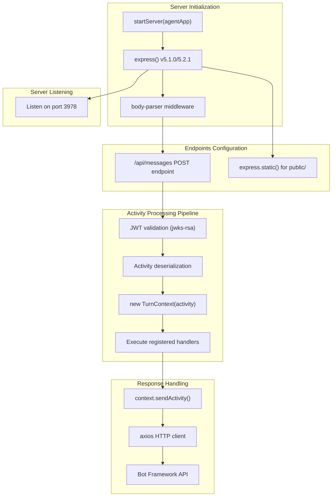
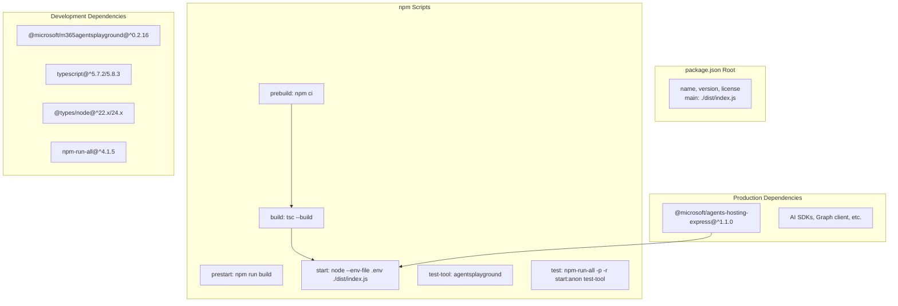
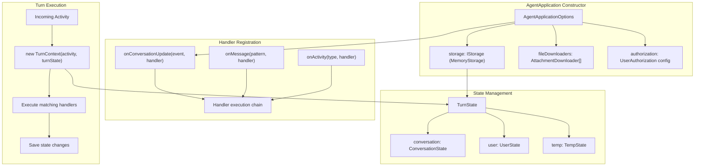
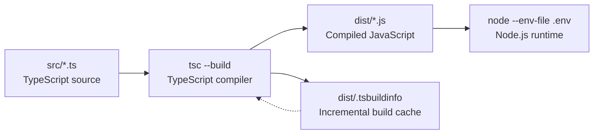

<!-- source: DeepWiki mcp.deepwiki.com · repo microsoft/Agents · page 7.1 Node.js Development · fetched 2026-10-26 -->

# Node.js Development

<details>
<summary>Relevant source files</summary>

The following files were used as context for generating this wiki page:

- [.github/scripts/updatenode.sh](.github/scripts/updatenode.sh)
- [samples/nodejs/auto-signin/package-lock.json](samples/nodejs/auto-signin/package-lock.json)
- [samples/nodejs/azure-ai-streaming/package-lock.json](samples/nodejs/azure-ai-streaming/package-lock.json)
- [samples/nodejs/cards/env.TEMPLATE](samples/nodejs/cards/env.TEMPLATE)
- [samples/nodejs/cards/package-lock.json](samples/nodejs/cards/package-lock.json)
- [samples/nodejs/copilotstudio-client/package-lock.json](samples/nodejs/copilotstudio-client/package-lock.json)
- [samples/nodejs/copilotstudio-skill/env.TEMPLATE](samples/nodejs/copilotstudio-skill/env.TEMPLATE)
- [samples/nodejs/copilotstudio-skill/package-lock.json](samples/nodejs/copilotstudio-skill/package-lock.json)
- [samples/nodejs/copilotstudio-skill/package.json](samples/nodejs/copilotstudio-skill/package.json)
- [samples/nodejs/copilotstudio-skill/src/agent.ts](samples/nodejs/copilotstudio-skill/src/agent.ts)
- [samples/nodejs/copilotstudio-webchat-react/package-lock.json](samples/nodejs/copilotstudio-webchat-react/package-lock.json)
- [samples/nodejs/langchain-multiturn/package-lock.json](samples/nodejs/langchain-multiturn/package-lock.json)
- [samples/nodejs/multi-turn-prompt/env.TEMPLATE](samples/nodejs/multi-turn-prompt/env.TEMPLATE)
- [samples/nodejs/multi-turn-prompt/package-lock.json](samples/nodejs/multi-turn-prompt/package-lock.json)
- [samples/nodejs/obo-authorization/env.TEMPLATE](samples/nodejs/obo-authorization/env.TEMPLATE)
- [samples/nodejs/obo-authorization/package-lock.json](samples/nodejs/obo-authorization/package-lock.json)
- [samples/nodejs/obo-authorization/src/index.ts](samples/nodejs/obo-authorization/src/index.ts)
- [samples/nodejs/quickstart/README.md](samples/nodejs/quickstart/README.md)
- [samples/nodejs/quickstart/env.TEMPLATE](samples/nodejs/quickstart/env.TEMPLATE)
- [samples/nodejs/quickstart/package-lock.json](samples/nodejs/quickstart/package-lock.json)
- [samples/nodejs/quickstart/package.json](samples/nodejs/quickstart/package.json)
- [samples/nodejs/quickstart/src/index.ts](samples/nodejs/quickstart/src/index.ts)
- [samples/nodejs/quickstart/tsconfig.json](samples/nodejs/quickstart/tsconfig.json)

</details>


This guide covers Node.js-specific development patterns, Express.js hosting configurations, and npm package management for building agents with the Microsoft 365 Agents SDK. It focuses on the JavaScript/TypeScript implementation and Node.js ecosystem integration.

For general agent building concepts, see [Building Agents](#2). For deployment specifics, see [Deployment and Hosting](#4). For sample applications, see [Sample Applications](#6).

## SDK Architecture for Node.js

The Node.js implementation of the Microsoft 365 Agents SDK is distributed across several npm packages that form a layered dependency hierarchy:

### Package Dependency Tree



**Sources:** [samples/nodejs/azure-ai-streaming/package-lock.json:154-220](), [samples/nodejs/quickstart/package-lock.json:84-141](), [samples/nodejs/multi-turn-prompt/package-lock.json:112-145]()

### Core Package Responsibilities

| Package | Version | Purpose | Key Exports |
|---------|---------|---------|-------------|
| `@microsoft/agents-activity` | 1.1.1 | Activity protocol implementation with Zod validation | `Activity`, `ActivityTypes`, `MessageFactory` |
| `@microsoft/agents-hosting` | 1.1.1 | Core agent application framework | `AgentApplication`, `TurnContext`, `TurnState`, `MemoryStorage`, `AttachmentDownloader` |
| `@microsoft/agents-hosting-express` | 1.1.1 | Express.js v5 integration layer | `startServer()` function |
| `@microsoft/agents-hosting-dialogs` | 1.1.0 | Multi-turn dialog management | `Dialog`, `DialogSet`, `WaterfallDialog`, `ComponentDialog` |
| `@microsoft/agents-copilotstudio-client` | 1.1.1 | Copilot Studio client with streaming | `CopilotClient`, streaming APIs |

**Sources:** [samples/nodejs/azure-ai-streaming/package-lock.json:154-167](), [samples/nodejs/quickstart/package-lock.json:84-141](), [samples/nodejs/multi-turn-prompt/package-lock.json:112-145]()

### Package Dependency Details

The `@microsoft/agents-hosting` package includes several critical dependencies:

- **@azure/msal-node** (v3.8.4): OAuth token acquisition and management
- **axios** (v1.13.2): HTTP client for Bot Framework API calls
- **jsonwebtoken** (v9.0.2): JWT token validation
- **jwks-rsa** (v3.2.0): Public key retrieval for JWT validation
- **object-path** (v0.11.8): State object manipulation

**Sources:** [samples/nodejs/quickstart/package-lock.json:111-127](), [samples/nodejs/obo-authorization/package-lock.json:129-145]()

## Express.js Hosting Pattern

Node.js agents use Express.js v5.x for hosting through the `@microsoft/agents-hosting-express` package. The hosting layer provides automatic server configuration and Bot Framework integration.

### Express.js Server Lifecycle



**Sources:** [samples/nodejs/quickstart/package-lock.json:129-141](), [samples/nodejs/copilotstudio-skill/package-lock.json:136-148](), [samples/nodejs/cards/package-lock.json:130-142]()

### Basic Server Configuration

The standard Express.js hosting setup uses the `startServer` function:

```typescript
import { startServer } from '@microsoft/agents-hosting-express'
import { AgentApplication, TurnState, MemoryStorage } from '@microsoft/agents-hosting'

const storage = new MemoryStorage()
const agentApp = new AgentApplication<TurnState>({ storage })

// Start Express server with agent
const server = startServer(agentApp)

// Optionally serve static files
server.use(express.static('public'))
```

**Sources:** [samples/nodejs/quickstart/src/index.ts:3-5](), [samples/nodejs/quickstart/src/index.ts:19-23](), [samples/nodejs/copilotstudio-skill/src/agent.ts:22-25]()

The `startServer()` function automatically:
- Creates Express.js v5 application instance
- Configures `/api/messages` POST endpoint for Bot Framework protocol
- Sets up `body-parser` middleware for JSON parsing
- Configures JWT validation using `jwks-rsa` and `jsonwebtoken`
- Starts HTTP server listening on port 3978
- Returns Express application for additional customization

### Custom Server Configuration

Agents can extend the Express server after initialization:

```typescript
const server = startServer(skillAgent)
server.use(express.static('public'))
```

**Sources:** [samples/nodejs/copilotstudio-skill/src/agent.ts:22-25]()

## Package Management with npm

### Standard Package Structure

Node.js agents follow a consistent package.json structure across all samples:

### Sample package.json Structure



**Sources:** [samples/nodejs/quickstart/package.json:1-29](), [samples/nodejs/copilotstudio-skill/package.json:1-23]()

### Node.js Runtime Requirements

All SDK packages enforce Node.js version 20 or higher:

| Package | Node.js Requirement | Reason |
|---------|-------------------|---------|
| `@microsoft/agents-activity` | >=20.0.0 | Modern ESM and TypeScript features |
| `@microsoft/agents-hosting` | >=20.0.0 | Core runtime dependencies |
| `@microsoft/agents-hosting-express` | >=20.0.0 | Express v5 compatibility |
| Express v5 | >=18 | Modern HTTP server features |

**Sources:** [samples/nodejs/quickstart/package-lock.json:33-45](), [samples/nodejs/azure-ai-streaming/package-lock.json:164-166](), [samples/nodejs/obo-authorization/package-lock.json:112-114]()

### Standard npm Scripts

Common npm scripts across all samples:

```json
{
  "scripts": {
    "prebuild": "npm ci",
    "build": "tsc --build",
    "prestart": "npm run build",
    "start": "node --env-file .env ./dist/index.js",
    "start:anon": "node ./dist/index.js",
    "test-tool": "agentsplayground",
    "test": "npm-run-all -p -r start:anon test-tool"
  }
}
```

The `prebuild`, `prestart` hooks ensure TypeScript compilation occurs before execution. The `--env-file .env` flag (Node.js 20+) loads environment variables without additional packages.

**Sources:** [samples/nodejs/quickstart/package.json:9-18]()

### Dependency Update Automation

The repository includes automated dependency management through CI/CD scripts:

```bash
for dir in samples/nodejs/*/; do
    if [ -d "$dir" ]; then
        echo "Updating $dir"
        (cd "$dir" && rm -rf node_modules/ package-lock.json && npm install)
    fi
done
```

**Sources:** [.github/scripts/updatenode.sh:4-8]()

## Development Patterns

### AgentApplication Initialization and Configuration



**Sources:** [samples/nodejs/quickstart/src/index.ts:3-26](), [samples/nodejs/obo-authorization/src/index.ts:7-20]()

### Message Handling Patterns

The `AgentApplication` class provides multiple handler registration methods:

#### 1. Conversation Update Handlers

```typescript
agentApp.onConversationUpdate('membersAdded', async (context: TurnContext, state: ApplicationTurnState) => {
  await context.sendActivity('Hello and Welcome!')
})
```

**Sources:** [samples/nodejs/quickstart/src/index.ts:29-31]()

#### 2. Message Pattern Handlers

```typescript
this.onMessage('/status', this._status)
this.onMessage('/logout', this._logout)
```

**Sources:** [samples/nodejs/obo-authorization/src/index.ts:17-18]()

#### 3. Activity Type Handlers

```typescript
agentApp.onActivity(ActivityTypes.Message, async (context: TurnContext, state: ApplicationTurnState) => {
  let count = state.conversation.count ?? 0
  state.conversation.count = ++count
  await context.sendActivity(`[${count}] You said "${context.activity.text}"`)
})
```

**Sources:** [samples/nodejs/quickstart/src/index.ts:34-40]()

#### 4. Authorization-Gated Handlers

```typescript
this.onActivity('message', this._message, ['graph'])
```

This pattern requires successful authentication with the `graph` connection before executing the handler.

**Sources:** [samples/nodejs/obo-authorization/src/index.ts:19]()

### State Management Pattern

Custom conversation state is defined via TypeScript interfaces:

```typescript
interface ConversationState {
  count: number;
}
type ApplicationTurnState = TurnState<ConversationState>

const agentApp = new AgentApplication<ApplicationTurnState>({ storage })
```

State is automatically loaded at turn start and saved at turn end:

```typescript
let count = state.conversation.count ?? 0
state.conversation.count = ++count
```

**Sources:** [samples/nodejs/quickstart/src/index.ts:10-13](), [samples/nodejs/quickstart/src/index.ts:36-37]()

## TypeScript Configuration

All Node.js samples use TypeScript with a standardized configuration for compilation:

### Standard tsconfig.json

```json
{
  "compilerOptions": {
    "incremental": true,
    "lib": ["ES2021"],
    "target": "es2019",
    "module": "commonjs",
    "declaration": true,
    "sourceMap": true,
    "composite": true,
    "strict": true,
    "moduleResolution": "node",
    "esModuleInterop": true,
    "skipLibCheck": true,
    "forceConsistentCasingInFileNames": true,
    "resolveJsonModule": true,
    "rootDir": "src",
    "outDir": "dist",
    "tsBuildInfoFile": "dist/.tsbuildinfo"
  }
}
```

**Sources:** [samples/nodejs/quickstart/tsconfig.json:1-21]()

### Key Configuration Details

| Setting | Value | Purpose |
|---------|-------|---------|
| `target` | `es2019` | Compiled JavaScript output target |
| `module` | `commonjs` | CommonJS module format for Node.js |
| `lib` | `ES2021` | TypeScript library features |
| `strict` | `true` | Enable all strict type checking |
| `rootDir` | `src` | TypeScript source files location |
| `outDir` | `dist` | Compiled JavaScript output location |
| `incremental` | `true` | Faster rebuilds with .tsbuildinfo |
| `composite` | `true` | Enable project references |

### Build and Execution Flow



**Sources:** [samples/nodejs/quickstart/tsconfig.json:1-21](), [samples/nodejs/quickstart/package.json:9-15]()

The compilation process uses `tsc --build` which leverages the `.tsbuildinfo` file for incremental compilation, significantly speeding up subsequent builds.

## Development Tools Integration

### Microsoft 365 Agents Playground

The `@microsoft/m365agentsplayground` package (v0.2.18) provides local testing without Azure Bot Service:

```bash
npm run test-tool  # Starts agentsplayground CLI
```

The playground creates a web-based chat interface accessible at `http://localhost:3978` for testing agents in anonymous mode.

**Sources:** [samples/nodejs/quickstart/package-lock.json:142-151](), [samples/nodejs/cards/package-lock.json:143-152]()

### Parallel Testing Setup

Samples use `npm-run-all` for concurrent agent and playground execution:

```json
{
  "scripts": {
    "start:anon": "node ./dist/index.js",
    "test-tool": "agentsplayground",
    "test": "npm-run-all -p -r start:anon test-tool"
  }
}
```

The `-p` flag runs commands in parallel, `-r` terminates all on first exit.

**Sources:** [samples/nodejs/quickstart/package.json:14-17]()

### Environment Configuration Pattern

All samples use `.env` files loaded via Node.js 20's `--env-file` flag:

```bash
cp env.TEMPLATE .env
node --env-file .env ./dist/index.js
```

### Standard Environment Variables

```
# Azure Bot Service authentication
connections__serviceConnection__settings__clientId=<app-id>
connections__serviceConnection__settings__clientSecret=<secret>
connections__serviceConnection__settings__tenantId=<tenant-id>

# Connection mapping
connectionsMap__0__connection=serviceConnection
connectionsMap__0__serviceUrl=*

# Debug logging
DEBUG=agents:*:error
```

**Sources:** [samples/nodejs/quickstart/env.TEMPLATE:1-10](), [samples/nodejs/copilotstudio-skill/env.TEMPLATE:1-10](), [samples/nodejs/cards/env.TEMPLATE:1-10]()

### OAuth Connection Configuration

For OAuth-enabled agents (OBO, auto-signin):

```
# OAuth connection for user token acquisition
connections__oboConnection__settings__clientId=<oauth-app-id>
connections__oboConnection__settings__clientSecret=<oauth-secret>
connections__oboConnection__settings__tenantId=<tenant-id>
connections__oboConnection__settings__scopes=https://graph.microsoft.com/.default

# Map connection to Graph API
authorizationMap__graph__connection=oboConnection
```

**Sources:** [samples/nodejs/obo-authorization/env.TEMPLATE:1-15]()

### Dependency Update Automation

The repository includes a shell script for batch dependency updates:

```bash
#!/bin/bash
for dir in samples/nodejs/*/; do
    if [ -d "$dir" ]; then
        echo "Updating $dir"
        (cd "$dir" && rm -rf node_modules/ package-lock.json && npm install)
    fi
done
```

This script removes `node_modules` and `package-lock.json`, then reinstalls dependencies with the latest compatible versions.

**Sources:** [.github/scripts/updatenode.sh:1-9]()

## Sample Applications Architecture

The Node.js samples demonstrate different agent patterns and SDK features:

### Sample Directory Organization

```mermaid
graph TB
    subgraph "samples/nodejs/"
        quickstart["quickstart/<br/>Basic echo agent"]
        cards["cards/<br/>Adaptive Cards demo"]
        multiTurn["multi-turn-prompt/<br/>Dialog-based conversations"]
        azureAI["azure-ai-streaming/<br/>Azure OpenAI streaming"]
        langchain["langchain-multiturn/<br/>LangChain integration"]
        autoSignin["auto-signin/<br/>Automatic Graph auth"]
        obo["obo-authorization/<br/>OBO token exchange"]
        csSkill["copilotstudio-skill/<br/>CS skill endpoint"]
        csClient["copilotstudio-client/<br/>CLI CS client"]
        csWebChat["copilotstudio-webchat-react/<br/>React WebChat UI"]
    end
    
    subgraph "Hosting Patterns"
        expressHosting["@microsoft/agents-hosting-express"]
        dialogHosting["@microsoft/agents-hosting-dialogs"]
        
        quickstart --> expressHosting
        cards --> expressHosting
        azureAI --> expressHosting
        langchain --> expressHosting
        autoSignin --> expressHosting
        obo --> expressHosting
        csSkill --> expressHosting
        
        multiTurn --> dialogHosting
    end
    
    subgraph "Client Patterns"
        clientLib["@microsoft/agents-copilotstudio-client"]
        
        csClient --> clientLib
        csWebChat --> clientLib
    end
```



**Sources:** [samples/nodejs/quickstart/package.json:1-5](), [samples/nodejs/multi-turn-prompt/package-lock.json:11-14](), [samples/nodejs/copilotstudio-client/package-lock.json:11-14]()

### Sample Dependencies by Category

#### Basic Agent Samples

| Sample | Key Dependencies | Entry Point |
|--------|------------------|-------------|
| `quickstart/` | `@microsoft/agents-hosting-express@^1.1.0` | `src/index.ts` |
| `cards/` | `@microsoft/agents-hosting@^1.1.0`, `@microsoft/agents-hosting-express@^1.1.0` | `src/index.ts` |

**Sources:** [samples/nodejs/quickstart/package.json:19-20](), [samples/nodejs/cards/package-lock.json:11-15]()

#### AI-Integrated Agents

| Sample | AI Framework | Additional Dependencies |
|--------|--------------|------------------------|
| `azure-ai-streaming/` | Azure OpenAI | `@ai-sdk/azure@^2.0.30`, `ai@^5.0.52` |
| `langchain-multiturn/` | LangChain | `@langchain/langgraph@^0.3.11`, `@langchain/openai@^0.5.10` |

**Sources:** [samples/nodejs/azure-ai-streaming/package-lock.json:7-10](), [samples/nodejs/langchain-multiturn/package-lock.json:11-16]()

#### Authentication Samples

| Sample | Authentication Pattern | Graph Integration |
|--------|----------------------|-------------------|
| `auto-signin/` | Automatic SSO sign-in | `@microsoft/microsoft-graph-client@^3.0.7` |
| `obo-authorization/` | On-Behalf-Of token exchange | `@microsoft/microsoft-graph-types@^2.40.0` (devDep) |

**Sources:** [samples/nodejs/auto-signin/package-lock.json:11-16](), [samples/nodejs/obo-authorization/package-lock.json:11-16]()

#### Copilot Studio Integration

| Sample | Type | Key Package |
|--------|------|-------------|
| `copilotstudio-skill/` | Agent as skill | `@microsoft/agents-hosting-express@^1.1.0`, `@microsoft/microsoft-graph-client@^3.0.7` |
| `copilotstudio-client/` | CLI client | `@microsoft/agents-copilotstudio-client@^1.1.0`, `@azure/msal-node@^3.5.3` |
| `copilotstudio-webchat-react/` | Browser client | `@microsoft/agents-copilotstudio-client@^1.1.0`, `@azure/msal-browser@^4.13.1`, `botframework-webchat@4.18.1` |

**Sources:** [samples/nodejs/copilotstudio-skill/package.json:15-18](), [samples/nodejs/copilotstudio-client/package-lock.json:11-14](), [samples/nodejs/copilotstudio-webchat-react/package-lock.json:11-17]()

#### Dialog Management

| Sample | Dialog Framework | Key Package |
|--------|------------------|-------------|
| `multi-turn-prompt/` | WaterfallDialog pattern | `@microsoft/agents-hosting-dialogs@^1.1.0` |

**Sources:** [samples/nodejs/multi-turn-prompt/package-lock.json:11-14]()

## Local Development Workflow

The standard development workflow for Node.js agents follows this pattern:

1. **Project Setup**:
   ```bash
   npm install
   cp env.TEMPLATE .env
   ```

2. **Development Mode**:
   ```bash
   npm start          # Start agent
   npm run test-tool  # Start playground (separate terminal)
   ```

3. **Azure Integration** (optional):
   ```bash
   devtunnel host -p 3978 --allow-anonymous
   ```

**Sources:** [samples/nodejs/cards/README.md:17-35](), [samples/nodejs/auto-signin/README.md:63-67]()

This workflow enables rapid development and testing without requiring cloud deployment during the development phase.

---

