<!-- source: DeepWiki mcp.deepwiki.com · repo microsoft/Agents · page 7.2 .NET Development · fetched 2026-10-26 -->

# .NET Development

<details>
<summary>Relevant source files</summary>

The following files were used as context for generating this wiki page:

- [samples/dotnet/Agent Framework/.gitignore](samples/dotnet/Agent Framework/.gitignore)
- [samples/dotnet/Agent Framework/AgentFrameworkWeather.csproj](samples/dotnet/Agent Framework/AgentFrameworkWeather.csproj)
- [samples/dotnet/Agent Framework/AspNetExtensions.cs](samples/dotnet/Agent Framework/AspNetExtensions.cs)
- [samples/dotnet/Agent Framework/appsettings.Playground.json](samples/dotnet/Agent Framework/appsettings.Playground.json)
- [samples/dotnet/Agent Framework/appsettings.json](samples/dotnet/Agent Framework/appsettings.json)
- [samples/dotnet/GenesysHandoff/GenesysHandoff.csproj](samples/dotnet/GenesysHandoff/GenesysHandoff.csproj)
- [samples/dotnet/RetrievalBot/RetrievalBot.csproj](samples/dotnet/RetrievalBot/RetrievalBot.csproj)
- [samples/dotnet/Samples.sln](samples/dotnet/Samples.sln)
- [samples/dotnet/auto-signin/AutoSignIn.csproj](samples/dotnet/auto-signin/AutoSignIn.csproj)
- [samples/dotnet/azure-ai-streaming/StreamingMessageAgent.csproj](samples/dotnet/azure-ai-streaming/StreamingMessageAgent.csproj)
- [samples/dotnet/copilotstudio-client/CopilotStudioClient.csproj](samples/dotnet/copilotstudio-client/CopilotStudioClient.csproj)
- [samples/dotnet/copilotstudio-skill/CopilotStudioEchoSkill.csproj](samples/dotnet/copilotstudio-skill/CopilotStudioEchoSkill.csproj)
- [samples/dotnet/obo-authorization/OBOAuthorization.csproj](samples/dotnet/obo-authorization/OBOAuthorization.csproj)
- [samples/dotnet/quickstart/QuickStart.csproj](samples/dotnet/quickstart/QuickStart.csproj)
- [samples/dotnet/semantic-kernel-multiturn/SemanticKernelMultiturn.csproj](samples/dotnet/semantic-kernel-multiturn/SemanticKernelMultiturn.csproj)

</details>


This page documents the .NET-specific architecture, NuGet package structure, AspNetCore hosting patterns, and solution organization for building Microsoft 365 Agents using C#. It focuses on the technical implementation details specific to the .NET SDK.

For general agent concepts, see [Microsoft 365 Agents SDK Overview](#1). For authentication patterns, see [Authentication and Authorization](#3). For deployment, see [Deployment and Hosting](#4).

## Solution Organization

The .NET samples are organized in a unified Visual Studio solution (`Samples.sln`) that demonstrates various agent patterns and integration scenarios. All projects target .NET 8.0 and use the SDK-style project format.

### Solution Structure

**Solution Projects by Category**

```mermaid
graph TB
    SamplessSln["Samples.sln"]
    
    subgraph "Quickstart & Basic"
        QuickStart["QuickStart.csproj"]
        StreamingMessageAgent["StreamingMessageAgent.csproj"]
    end
    
    subgraph "AI Integration"
        SemanticKernelMultiturn["SemanticKernelMultiturn.csproj"]
        AgentFrameworkWeather["AgentFrameworkWeather.csproj"]
        RetrievalBot["RetrievalBot.csproj"]
    end
    
    subgraph "Copilot Studio"
        CopilotStudioClient["CopilotStudioClient.csproj"]
        CopilotStudioEchoSkill["CopilotStudioEchoSkill.csproj"]
    end
    
    subgraph "Authentication"
        AutoSignIn["AutoSignIn.csproj"]
        OBOAuthorization["OBOAuthorization.csproj"]
    end
    
    subgraph "Advanced Integration"
        GenesysHandoff["GenesysHandoff.csproj"]
    end
    
    SamplessSln --> QuickStart
    SamplessSln --> StreamingMessageAgent
    SamplessSln --> SemanticKernelMultiturn
    SamplessSln --> AgentFrameworkWeather
    SamplessSln --> RetrievalBot
    SamplessSln --> CopilotStudioClient
    SamplessSln --> CopilotStudioEchoSkill
    SamplessSln --> AutoSignIn
    SamplessSln --> OBOAuthorization
    SamplessSln --> GenesysHandoff
```

**Sources:** [samples/dotnet/Samples.sln:1-84]()

### Project Types

The solution includes two primary project types:

| Project Type | SDK | Usage |
|-------------|-----|-------|
| `Microsoft.NET.Sdk.Web` | Web applications | Agent hosting with AspNetCore |
| `Microsoft.NET.Sdk.Worker` | Worker services | Client applications without web hosting |

**Sources:** [samples/dotnet/quickstart/QuickStart.csproj:1-15](), [samples/dotnet/copilotstudio-client/CopilotStudioClient.csproj:1-16]()

## NuGet Package Structure

### Core SDK Packages

The .NET SDK is distributed as a set of NuGet packages with consistent versioning using wildcard patterns (`1.4.*-*` for preview releases).

**Core Package Dependencies**

| Package | Purpose | Used By |
|---------|---------|---------|
| `Microsoft.Agents.Hosting.AspNetCore` | AspNetCore hosting adapter, middleware, and HTTP handling | All web-hosted agents |
| `Microsoft.Agents.Authentication.Msal` | MSAL-based authentication providers for bot and user auth | All agents requiring authentication |
| `Microsoft.Agents.CopilotStudio.Client` | Client SDK for Copilot Studio integration | CopilotStudio samples |
| `Microsoft.Agents.AI` | AI integration abstractions | AgentFramework sample |
| `Microsoft.Agents.M365Copilot.Beta` | M365 Copilot-specific extensions (beta) | RetrievalBot sample |

**Sources:** [samples/dotnet/quickstart/QuickStart.csproj:10-13](), [samples/dotnet/Agent Framework/AgentFrameworkWeather.csproj:18-20](), [samples/dotnet/RetrievalBot/RetrievalBot.csproj:30-31]()

### AI Service Integrations

Samples demonstrate integration with various AI frameworks through standard NuGet packages:

**AI Framework Packages**

| Package | Version Pattern | Purpose | Sample |
|---------|----------------|---------|--------|
| `Azure.AI.OpenAI` | `2.1.0` | Azure OpenAI direct client | StreamingMessageAgent, AgentFramework |
| `Azure.Identity` | `1.17.1` | Azure credential providers | Multiple samples |
| `Microsoft.SemanticKernel.Agents.Core` | `1.29.0-alpha` to `1.45.0` | Semantic Kernel agent orchestration | SemanticKernel, RetrievalBot |
| `Microsoft.SemanticKernel.Agents.OpenAI` | `1.29.0-alpha` | OpenAI-specific SK agents | RetrievalBot |
| `Microsoft.SemanticKernel.Agents.AzureAI` | `1.45.0-preview` | Azure AI SK agents | SemanticKernel |
| `Microsoft.SemanticKernel.Connectors.AzureOpenAI` | `1.29.0` to `1.45.0` | Azure OpenAI connector for SK | SemanticKernel, RetrievalBot |
| `Microsoft.Extensions.AI.OpenAI` | `9.1.0-preview.1.25064.3` to `9.10.0-preview.1.25513.3` | Microsoft Extensions AI abstraction | StreamingMessageAgent, AgentFramework |

**Sources:** [samples/dotnet/azure-ai-streaming/StreamingMessageAgent.csproj:11-16](), [samples/dotnet/semantic-kernel-multiturn/SemanticKernelMultiturn.csproj:20-28](), [samples/dotnet/RetrievalBot/RetrievalBot.csproj:22-32](), [samples/dotnet/Agent Framework/AgentFrameworkWeather.csproj:15-23]()

### Additional Dependencies

| Package | Version | Purpose |
|---------|---------|---------|
| `AdaptiveCards` | `3.1.0` | Adaptive Card rendering and manipulation |
| `Microsoft.Graph` | `5.99.0` | Microsoft Graph API client |
| `Microsoft.Identity.Client.Extensions.Msal` | `4.67.2` | MSAL token cache extensions |
| `OpenWeatherMapSharp` | `4.1.0` | Weather API client (sample-specific) |

**Sources:** [samples/dotnet/Agent Framework/AgentFrameworkWeather.csproj:15](), [samples/dotnet/RetrievalBot/RetrievalBot.csproj:22](), [samples/dotnet/copilotstudio-client/CopilotStudioClient.csproj:11]()

## AspNetCore Hosting Architecture

### WebApplication Bootstrap Pattern

All .NET agents use the `WebApplicationBuilder` pattern for service configuration and middleware setup. The standard bootstrap sequence follows ASP.NET Core minimal API conventions.

**Program.cs Bootstrap Flow**

```mermaid
graph TB
    WebApplicationBuilderCreateBuilder["WebApplicationBuilder.CreateBuilder(args)"]
    ServicesConfiguration["IServiceCollection Configuration"]
    
    subgraph "Service Registration"
        AddAgentApplicationOptions["builder.Services.AddAgentApplicationOptions()"]
        AddAgent["builder.Services.AddAgent<TAgent>()"]
        AddStorage["builder.Services.AddSingleton<IStorage>()"]
        AddAuthentication["builder.Services.AddAgentAspNetAuthentication()"]
    end
    
    Build["builder.Build()"]
    
    subgraph "Middleware Pipeline"
        UseAuthentication["app.UseAuthentication()"]
        UseAuthorization["app.UseAuthorization()"]
    end
    
    MapPost["app.MapPost(\"/api/messages\", ...)"]
    Run["app.Run()"]
    
    WebApplicationBuilderCreateBuilder --> ServicesConfiguration
    ServicesConfiguration --> AddAgentApplicationOptions
    AddAgentApplicationOptions --> AddAgent
    AddAgent --> AddStorage
    AddStorage --> AddAuthentication
    AddAuthentication --> Build
    Build --> UseAuthentication
    UseAuthentication --> UseAuthorization
    UseAuthorization --> MapPost
    MapPost --> Run
```

**Sources:** [samples/dotnet/quickstart/QuickStart.csproj:1-15](), [samples/dotnet/Agent Framework/AspNetExtensions.cs:55-215]()

### Service Registration Extensions

The SDK provides extension methods on `IServiceCollection` for agent registration:

| Extension Method | Purpose | Typical Usage |
|-----------------|---------|---------------|
| `AddAgentApplicationOptions(IConfiguration)` | Loads `AgentApplicationOptions` from configuration | All samples |
| `AddAgent<TAgent>()` | Registers agent implementation as scoped service | All samples |
| `AddSingleton<IStorage, TImplementation>()` | Registers storage provider | All samples |
| `AddAgentAspNetAuthentication(IConfiguration, string)` | Configures JWT bearer authentication | Samples requiring auth validation |

**Sources:** [samples/dotnet/Agent Framework/AspNetExtensions.cs:55-67]()

### HTTP Request Processing

The `/api/messages` endpoint delegates to `IAgentHttpAdapter.ProcessAsync()` for activity processing:

**HTTP Processing Pipeline**

```mermaid
graph LR
    HttpContext["HttpContext"]
    MapPost["\"/api/messages\" MapPost"]
    IAgentHttpAdapter["IAgentHttpAdapter"]
    ProcessAsync["adapter.ProcessAsync(request, response, agent)"]
    ActivityDeserialization["Activity Deserialization"]
    AgentTurnProcessing["Agent Turn Processing"]
    ResponseSerialization["Response Serialization"]
    
    HttpContext --> MapPost
    MapPost --> IAgentHttpAdapter
    IAgentHttpAdapter --> ProcessAsync
    ProcessAsync --> ActivityDeserialization
    ActivityDeserialization --> AgentTurnProcessing
    AgentTurnProcessing --> ResponseSerialization
```

This pattern abstracts HTTP concerns from agent logic, allowing the same agent code to work across hosting environments.

**Sources:** [samples/dotnet/quickstart/QuickStart.csproj:1-15]()

## Configuration Patterns

### appsettings.json Structure

Agent configuration follows standard ASP.NET Core configuration patterns with agent-specific sections.

**Standard Configuration Sections**

```mermaid
graph TB
    appsettingsjson["appsettings.json"]
    
    subgraph "Agent Configuration"
        AgentApplicationOptions["AgentApplicationOptions"]
        StartTypingTimer["StartTypingTimer: bool"]
        RemoveRecipientMention["RemoveRecipientMention: bool"]
        NormalizeMentions["NormalizeMentions: bool"]
    end
    
    subgraph "Authentication"
        TokenValidation["TokenValidation"]
        Audiences["Audiences: string[]"]
        TenantId["TenantId: string"]
        
        Connections["Connections"]
        BotServiceConnection["BotServiceConnection"]
        AuthType["AuthType: string"]
        ClientId["ClientId: string"]
        ClientSecret["ClientSecret: string"]
        Scopes["Scopes: string[]"]
        
        ConnectionsMap["ConnectionsMap"]
        ServiceUrl["ServiceUrl: string"]
    end
    
    subgraph "AI Services"
        AIServices["AIServices"]
        AzureOpenAI["AzureOpenAI"]
        DeploymentName["DeploymentName: string"]
        Endpoint["Endpoint: string"]
        ApiKey["ApiKey: string"]
    end
    
    subgraph "AspNetCore"
        Logging["Logging"]
        AllowedHosts["AllowedHosts: string"]
    end
    
    appsettingsjson --> AgentApplicationOptions
    AgentApplicationOptions --> StartTypingTimer
    AgentApplicationOptions --> RemoveRecipientMention
    AgentApplicationOptions --> NormalizeMentions
    
    appsettingsjson --> TokenValidation
    TokenValidation --> Audiences
    TokenValidation --> TenantId
    
    appsettingsjson --> Connections
    Connections --> BotServiceConnection
    BotServiceConnection --> AuthType
    BotServiceConnection --> ClientId
    BotServiceConnection --> ClientSecret
    BotServiceConnection --> Scopes
    
    appsettingsjson --> ConnectionsMap
    ConnectionsMap --> ServiceUrl
    
    appsettingsjson --> AIServices
    AIServices --> AzureOpenAI
    AzureOpenAI --> DeploymentName
    AzureOpenAI --> Endpoint
    AzureOpenAI --> ApiKey
    
    appsettingsjson --> Logging
    appsettingsjson --> AllowedHosts
```

**Sources:** [samples/dotnet/Agent Framework/appsettings.json:1-51]()

### Environment-Specific Configuration

Projects support environment-specific configuration files following ASP.NET Core conventions:

| File | Purpose | Git Tracking |
|------|---------|--------------|
| `appsettings.json` | Base configuration with placeholders | Tracked |
| `appsettings.Development.json` | Development overrides | Ignored (.gitignore) |
| `appsettings.Playground.json` | Agents Playground specific config | Tracked (with tokens removed) |
| `appsettings.Production.json` | Production overrides | Ignored (.gitignore) |

**Sources:** [samples/dotnet/Agent Framework/.gitignore:214-219](), [samples/dotnet/Agent Framework/appsettings.Playground.json:1-32]()

### User Secrets Integration

Projects use ASP.NET Core User Secrets for local development credentials:

**User Secrets in .csproj**

```xml
<PropertyGroup>
    <UserSecretsId>7a8f9d79-5c4c-495f-8d56-1db8168ef8bd</UserSecretsId>
</PropertyGroup>
```

Each project has a unique `UserSecretsId` GUID for isolated secret storage.

**Sources:** [samples/dotnet/Agent Framework/AgentFrameworkWeather.csproj:6](), [samples/dotnet/semantic-kernel-multiturn/SemanticKernelMultiturn.csproj:8](), [samples/dotnet/RetrievalBot/RetrievalBot.csproj:8]()

### ConnectionsMap Pattern

The `ConnectionsMap` array maps service URLs to named connections, enabling multi-tenant or multi-region configurations:

```json
"ConnectionsMap": [
    {
        "ServiceUrl": "*",
        "Connection": "BotServiceConnection"
    }
]
```

The wildcard `"*"` matches all service URLs, while specific URLs can be configured for granular control.

**Sources:** [samples/dotnet/Agent Framework/appsettings.json:36-41]()

## Authentication Patterns

### Custom AspNetCore Authentication Extension

The AgentFramework sample demonstrates a sophisticated custom authentication extension (`AddAgentAspNetAuthentication()`) that handles both Azure Bot Service tokens and standard Entra ID tokens.

**TokenValidationOptions Configuration**

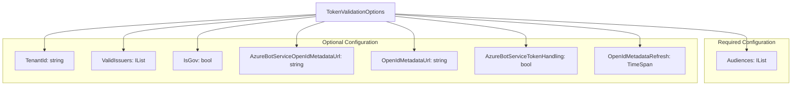

**Sources:** [samples/dotnet/Agent Framework/AspNetExtensions.cs:217-259]()

### JWT Bearer Authentication Flow

The custom extension configures `JwtBearerEvents` to dynamically select the appropriate `ConfigurationManager` based on token issuer:

**Dynamic ConfigurationManager Selection**

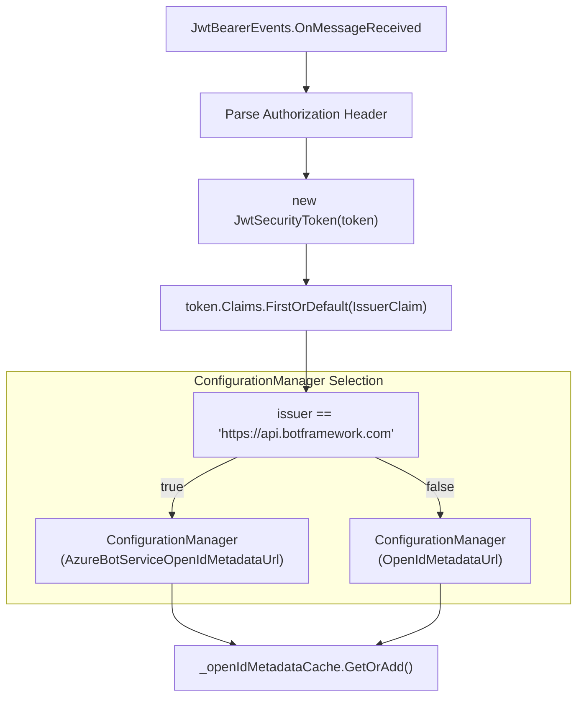

This pattern enables the same authentication middleware to validate both Azure Bot Service tokens (using BotFramework authority) and Entra ID tokens (using Azure AD authority).

**Sources:** [samples/dotnet/Agent Framework/AspNetExtensions.cs:149-199]()

### Default Issuer Configuration

When `ValidIssuers` is not specified, the extension defaults to Azure Bot Service public cloud issuers:

| Issuer Type | URL Pattern |
|-------------|-------------|
| BotFramework API | `https://api.botframework.com` |
| BotFramework Tenant v1 | `https://sts.windows.net/d6d49420-f39b-4df7-a1dc-d59a935871db/` |
| BotFramework Tenant v2 | `https://login.microsoftonline.com/d6d49420-f39b-4df7-a1dc-d59a935871db/v2.0` |
| Custom Tenant v1 (if TenantId provided) | `https://sts.windows.net/{TenantId}/` |
| Custom Tenant v2 (if TenantId provided) | `https://login.microsoftonline.com/{TenantId}/v2.0` |

**Sources:** [samples/dotnet/Agent Framework/AspNetExtensions.cs:92-109]()

## AI Service Integration Patterns

### Microsoft.SemanticKernel Integration

Samples demonstrate two patterns for Semantic Kernel integration: connectors and agents.

**Semantic Kernel with Connectors (SemanticKernelMultiturn)**

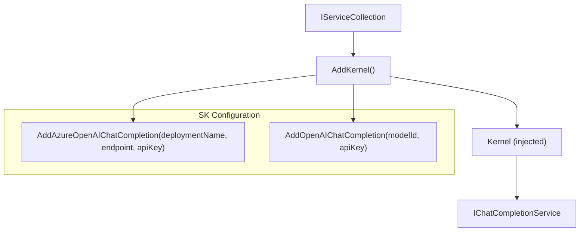

| Package | Version | Purpose |
|---------|---------|---------|
| `Microsoft.SemanticKernel.Connectors.AzureOpenAI` | `1.45.0` | Azure OpenAI connector |
| `Microsoft.SemanticKernel.Connectors.OpenAI` | `1.45.0` | OpenAI connector |

**Sources:** [samples/dotnet/semantic-kernel-multiturn/SemanticKernelMultiturn.csproj:24-25]()

**Semantic Kernel Agents (RetrievalBot)**

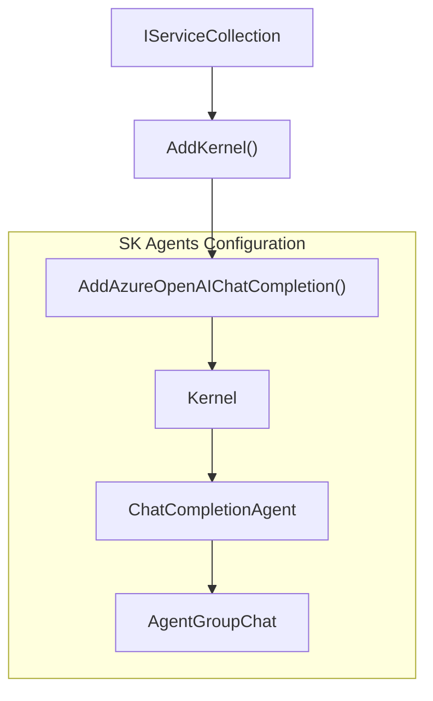

| Package | Version | Purpose |
|---------|---------|---------|
| `Microsoft.SemanticKernel.Agents.Core` | `1.29.0-alpha` | Agent orchestration abstractions |
| `Microsoft.SemanticKernel.Agents.OpenAI` | `1.29.0-alpha` | OpenAI-specific agent implementations |

**Sources:** [samples/dotnet/RetrievalBot/RetrievalBot.csproj:26-29]()

### Azure.AI.OpenAI Direct Client

StreamingMessageAgent demonstrates direct Azure OpenAI client usage without Semantic Kernel:

**Direct OpenAI Client Registration**

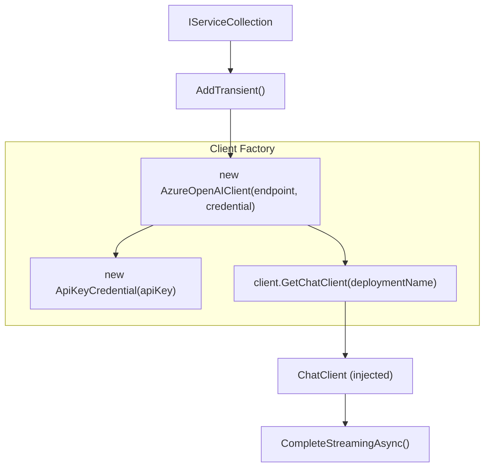

| Package | Version | Purpose |
|---------|---------|---------|
| `Azure.AI.OpenAI` | `2.1.0` | Azure OpenAI client library |
| `Azure.Identity` | `1.17.1` | Azure authentication |

**Sources:** [samples/dotnet/azure-ai-streaming/StreamingMessageAgent.csproj:11-13]()

### Microsoft.Extensions.AI Abstraction

AgentFrameworkWeather uses the new `Microsoft.Extensions.AI` abstraction layer:

**Microsoft.Extensions.AI with OpenAI**

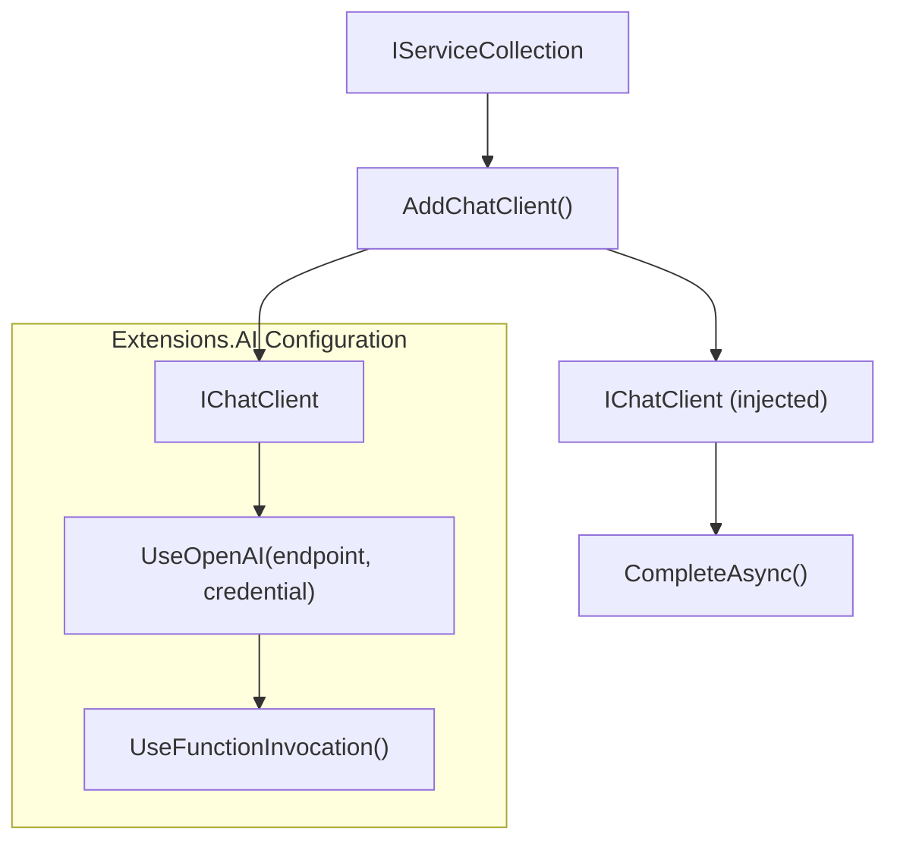

| Package | Version | Purpose |
|---------|---------|---------|
| `Microsoft.Extensions.AI.OpenAI` | `9.10.0-preview.1.25513.3` | Extensions.AI OpenAI integration |
| `Microsoft.Agents.AI` | `1.0.0-preview.251009.1` | Agent-specific AI extensions |

**Sources:** [samples/dotnet/Agent Framework/AgentFrameworkWeather.csproj:18-21]()

## Project Configuration Patterns

### Common .csproj Properties

All .NET agent projects share common property settings:

| Property | Value | Purpose |
|----------|-------|---------|
| `TargetFramework` | `net8.0` | .NET 8.0 runtime |
| `LangVersion` | `latest` | Latest C# language features |
| `ImplicitUsings` | `disable` or `enable` | Varies by sample complexity |
| `Nullable` | `enable` | Nullable reference types enabled |
| `UserSecretsId` | Unique GUID | User Secrets storage |

**Sources:** [samples/dotnet/quickstart/QuickStart.csproj:3-8](), [samples/dotnet/semantic-kernel-multiturn/SemanticKernelMultiturn.csproj:3-9]()

### Conditional Compilation

Some samples use conditional compilation for feature flags:

```xml
<PropertyGroup Condition="'$(Configuration)|$(Platform)'=='Debug|AnyCPU'">
    <DefineConstants>$(DefineConstants);UseStreaming</DefineConstants>
</PropertyGroup>
```

The `UseStreaming` symbol enables streaming-specific code paths in Debug builds.

**Sources:** [samples/dotnet/Agent Framework/AgentFrameworkWeather.csproj:10-12]()

### Compiler Warnings Suppression

AI-related samples suppress experimental feature warnings for preview packages:

```xml
<PropertyGroup>
    <NoWarn>$(NoWarn);SKEXP0110;SKEXP0010</NoWarn>
</PropertyGroup>
```

| Warning Code | Description |
|-------------|-------------|
| `SKEXP0110` | Semantic Kernel experimental API |
| `SKEXP0010` | Semantic Kernel experimental feature |

**Sources:** [samples/dotnet/RetrievalBot/RetrievalBot.csproj:7](), [samples/dotnet/semantic-kernel-multiturn/SemanticKernelMultiturn.csproj:7]()

## Sample Implementation Types

### Basic Agent Template

The Empty Agent provides the minimal implementation pattern:

```mermaid
graph TB
    EmptyAgent["EmptyAgent"]
    AgentApplication["AgentApplication"]
    
    subgraph "Minimal Setup"
        AddOptions["AddAgentApplicationOptions()"]
        AddAgent["AddAgent<MyAgent>()"]
        AddStorage["AddSingleton<IStorage>()"]
        MapEndpoint["MapPost(\"/api/messages\")"]
    end
    
    EmptyAgent --> AgentApplication
    EmptyAgent --> AddOptions
    EmptyAgent --> AddAgent
    EmptyAgent --> AddStorage
    EmptyAgent --> MapEndpoint
```

**Sources:** [samples/basic/empty-agent/dotnet/Program.cs:14-50]()

### AI-Powered Agent

The Weather Agent demonstrates AI integration with external services:

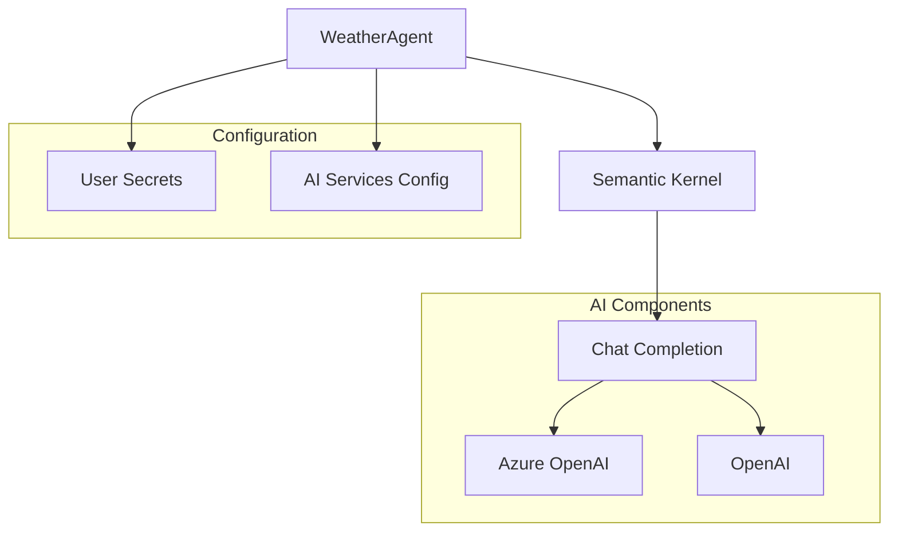

**Sources:** [samples/basic/weather-agent/dotnet/Program.cs:16-81]()

### Streaming Response Agent

The Streaming Agent shows how to implement real-time AI responses:

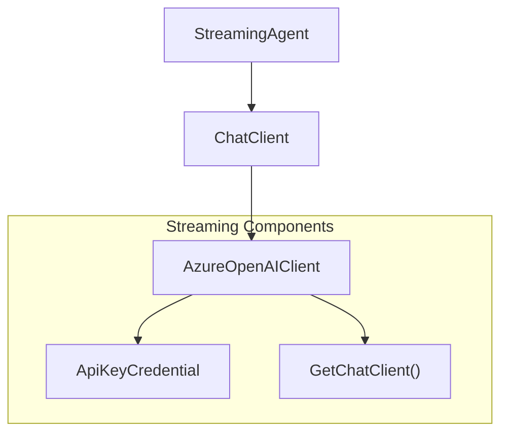

**Sources:** [samples/basic/azureai-streaming-poem-agent/dotnet/Program.cs:18-62]()

### Copilot Studio Skill

The Echo Skill demonstrates agent-to-agent communication patterns:

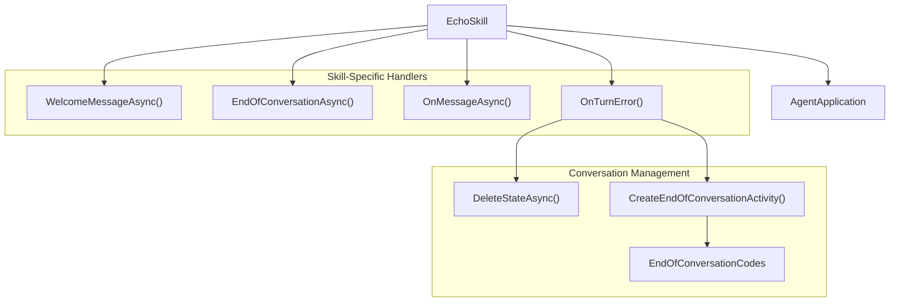

**Sources:** [samples/complex/copilotstudio-skill/dotnet/EchoSkill.cs:13-72]()

## Development Environment Setup

### Prerequisites

- .NET 8.0 SDK
- Visual Studio 2022 or VS Code
- Azure CLI (for authentication)
- Dev tunnels (for local development)

### Local Development Configuration

For local development, agents typically run on `localhost:3978`:

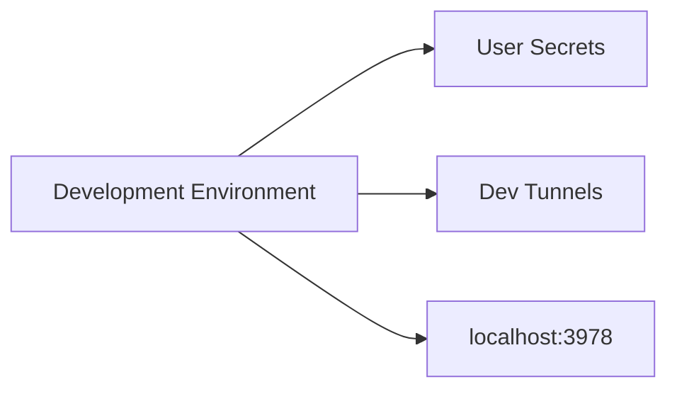

**Sources:** [samples/basic/weather-agent/dotnet/Program.cs:74-79]()

---

