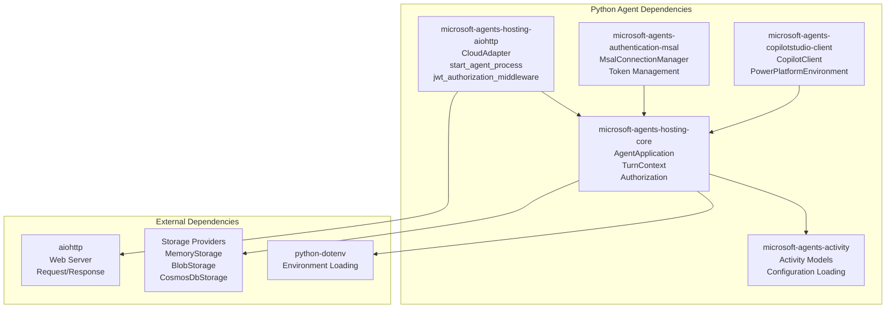
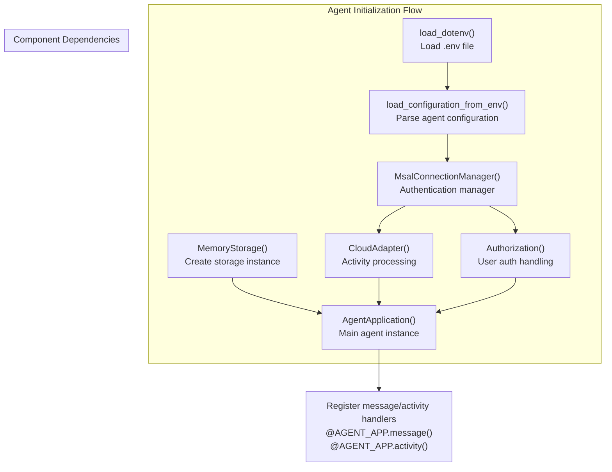
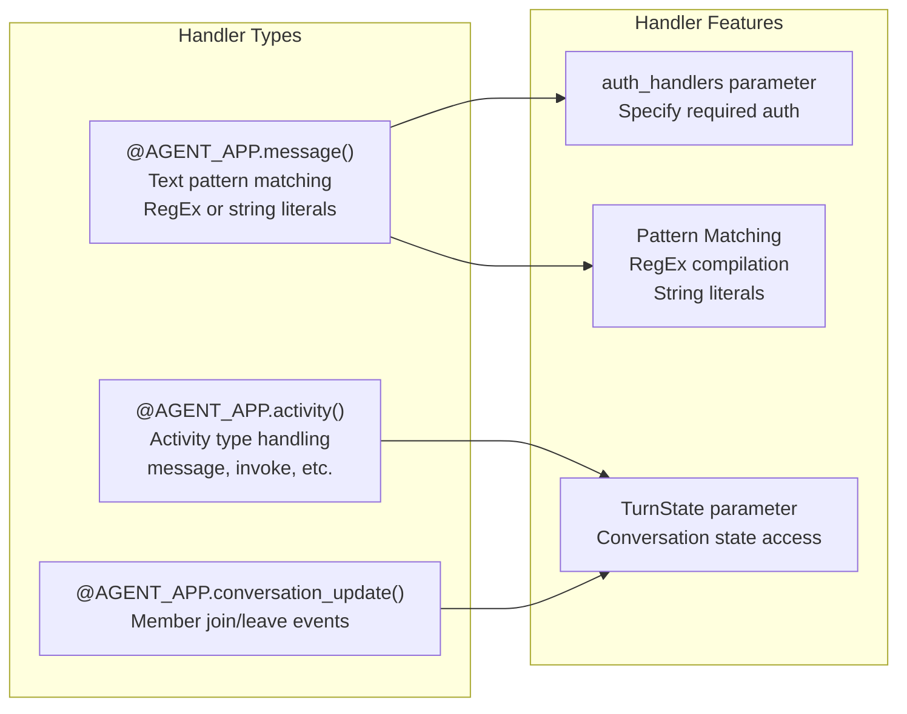
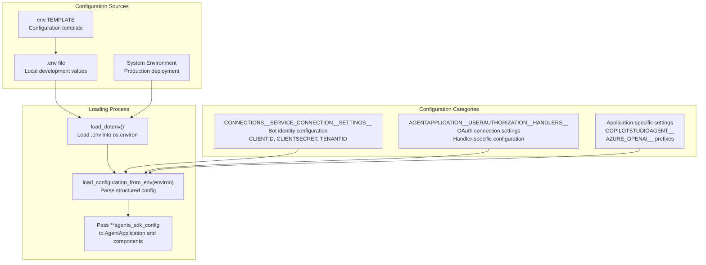
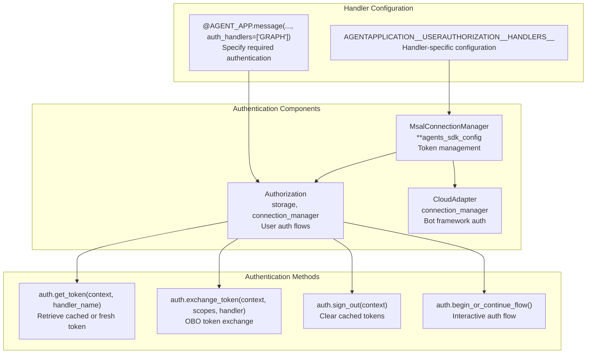
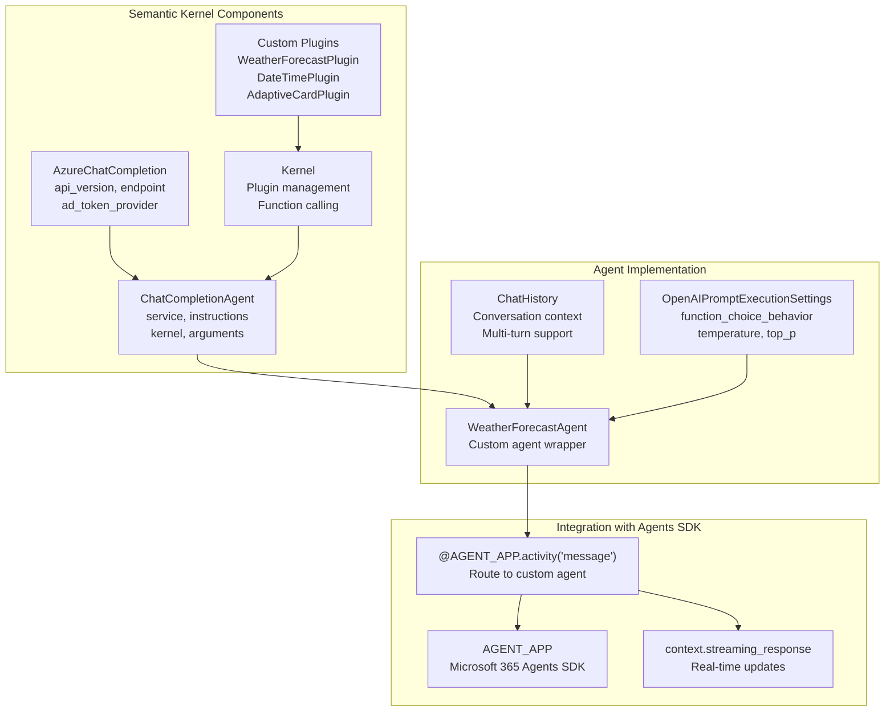

<!-- source: DeepWiki mcp.deepwiki.com · repo microsoft/Agents · page 7.3 Python Development · fetched 2026-10-26 -->

# Python Development

<details>
<summary>Relevant source files</summary>

The following files were used as context for generating this wiki page:

- [MCSandAgentsEcosystemLinks.md](MCSandAgentsEcosystemLinks.md)
- [README.md](README.md)
- [samples/python/README.md](samples/python/README.md)
- [samples/python/obo-authorization/README.md](samples/python/obo-authorization/README.md)
- [samples/python/obo-authorization/env.TEMPLATE](samples/python/obo-authorization/env.TEMPLATE)
- [samples/python/obo-authorization/requirements.txt](samples/python/obo-authorization/requirements.txt)
- [samples/python/obo-authorization/src/agent.py](samples/python/obo-authorization/src/agent.py)
- [samples/python/obo-authorization/src/main.py](samples/python/obo-authorization/src/main.py)
- [samples/python/obo-authorization/src/start_server.py](samples/python/obo-authorization/src/start_server.py)

</details>


This page covers Python-specific development patterns, hosting, and implementation details for building agents using the Microsoft 365 Agents SDK. It focuses on the Python package structure, aiohttp hosting, configuration management, and common development patterns found across Python sample applications.

For general agent building concepts, see [Building Agents](#2). For authentication implementation details, see [Authentication](#3).

## Project Structure and Dependencies

Python agents in the Microsoft 365 Agents SDK follow a consistent project structure and dependency pattern across all sample applications.

### Package Dependencies

All Python samples use a core set of Microsoft Agents packages with specific functionality:

| Package | Purpose |
|---------|---------|
| `microsoft-agents-activity` | Activity models and types |
| `microsoft-agents-hosting-core` | Core agent application framework |
| `microsoft-agents-hosting-aiohttp` | aiohttp web server hosting |
| `microsoft-agents-authentication-msal` | MSAL authentication integration |
| `microsoft-agents-copilotstudio-client` | Copilot Studio client integration |



Sources: [samples/python/obo-authorization/requirements.txt:1-7](), [samples/python/README.md:14-44]()

### Import Structure Changes

**Important:** Recent updates changed the Python import structure from `microsoft.agents` to `microsoft_agents` (using underscores instead of dots). All imports must use the new underscore format:

```python
# Core hosting functionality
from microsoft_agents.hosting.core import TurnContext, AgentApplication
from microsoft_agents.hosting.aiohttp import CloudAdapter, start_agent_process
from microsoft_agents.activity import load_configuration_from_env
from microsoft_agents.authentication.msal import MsalConnectionManager
```

Sources: [samples/python/README.md:14-44]()

## Core Agent Application Pattern

All Python agents follow a consistent initialization and configuration pattern using the `AgentApplication` class and supporting components.

### Standard Initialization Pattern



The standard pattern across all Python samples:

```python
# Environment and configuration
load_dotenv()
agents_sdk_config = load_configuration_from_env(environ)

# Core components
STORAGE = MemoryStorage()
CONNECTION_MANAGER = MsalConnectionManager(**agents_sdk_config)
ADAPTER = CloudAdapter(connection_manager=CONNECTION_MANAGER)
AUTHORIZATION = Authorization(STORAGE, CONNECTION_MANAGER, **agents_sdk_config)

# Agent application
AGENT_APP = AgentApplication[TurnState](
    storage=STORAGE, 
    adapter=ADAPTER, 
    authorization=AUTHORIZATION, 
    **agents_sdk_config
)
```

Sources: [samples/python/obo-authorization/src/agent.py:26-38](), [samples/python/auto-signin/src/agent.py:28-40](), [samples/python/semantic-kernel-multiturn/src/app.py:23-46]()

### Message Handler Registration

Python agents use decorators to register message and activity handlers:



Sources: [samples/python/obo-authorization/src/agent.py:64-91](), [samples/python/auto-signin/src/agent.py:55-138]()

## aiohttp Hosting Architecture

All Python agents use aiohttp as the web server framework with a standardized hosting pattern.

### Server Initialization Pattern

```mermaid
graph TB
    subgraph "aiohttp Server Setup"
        CreateApp["Application()<br/>middlewares=[jwt_authorization_middleware]"]
        AddRoute["router.add_post('/api/messages', entry_point)"]
        SetupContext["app['agent_app'] = agent_application<br/>app['adapter'] = adapter<br/>app['agent_configuration'] = auth_config"]
        StartServer["run_app(APP, host='localhost', port=3978)"]
    end
    
    subgraph "Request Processing"
        IncomingRequest["HTTP POST<br/>/api/messages<br/>Bot Framework Activity"]
        JWTMiddleware["jwt_authorization_middleware<br/>Token validation"]
        EntryPoint["entry_point(req: Request)<br/>Extract agent & adapter from app context"]
        ProcessAgent["start_agent_process()<br/>req, agent, adapter"]
        Response["HTTP Response<br/>Activity responses"]
    end
    
    CreateApp --> AddRoute
    AddRoute --> SetupContext
    SetupContext --> StartServer
    
    IncomingRequest --> JWTMiddleware
    JWTMiddleware --> EntryPoint
    EntryPoint --> ProcessAgent
    ProcessAgent --> Response
```



Standard server startup pattern used across all samples:

```python
def start_server(agent_application: AgentApplication, auth_configuration: AgentAuthConfiguration):
    async def entry_point(req: Request) -> Response:
        agent: AgentApplication = req.app["agent_app"]
        adapter: CloudAdapter = req.app["adapter"]
        return await start_agent_process(req, agent, adapter)

    APP = Application(middlewares=[jwt_authorization_middleware])
    APP.router.add_post("/api/messages", entry_point)
    APP["agent_configuration"] = auth_configuration
    APP["agent_app"] = agent_application
    APP["adapter"] = agent_application.adapter

    run_app(APP, host="localhost", port=environ.get("PORT", 3978))
```

Sources: [samples/python/obo-authorization/src/start_server.py:10-32](), [samples/python/semantic-kernel-multiturn/src/start_server.py:11-32]()

### Main Entry Point Pattern

All Python samples use a consistent main entry point pattern:

```python
# Enable logging for Microsoft Agents library
import logging
ms_agents_logger = logging.getLogger("microsoft_agents")
ms_agents_logger.addHandler(logging.StreamHandler())
ms_agents_logger.setLevel(logging.INFO)

from .agent import AGENT_APP, CONNECTION_MANAGER
from .start_server import start_server

start_server(
    agent_application=AGENT_APP,
    auth_configuration=CONNECTION_MANAGER.get_default_connection_configuration(),
)
```

Sources: [samples/python/obo-authorization/src/main.py:4-17](), [samples/python/semantic-kernel-multiturn/src/main.py:6-18]()

## Configuration Management

Python agents use environment-based configuration with `.env` files and the `load_configuration_from_env` function.

### Environment Configuration Pattern



### Configuration Structure Example

Configuration follows a hierarchical structure with double underscores (`__`) as separators:

```bash
# Bot service connection
CONNECTIONS__SERVICE_CONNECTION__SETTINGS__CLIENTID=<app-id>
CONNECTIONS__SERVICE_CONNECTION__SETTINGS__CLIENTSECRET=<secret>
CONNECTIONS__SERVICE_CONNECTION__SETTINGS__TENANTID=<tenant>

# User authorization handlers
AGENTAPPLICATION__USERAUTHORIZATION__HANDLERS__MCS__SETTINGS__AZUREBOTOAUTHCONNECTIONNAME=<connection-name>
AGENTAPPLICATION__USERAUTHORIZATION__HANDLERS__MCS__SETTINGS__OBOCONNECTIONNAME=MCS

# Application-specific settings
COPILOTSTUDIOAGENT__SCHEMANAME=<schema-name>
COPILOTSTUDIOAGENT__ENVIRONMENTID=<environment-id>
```

Sources: [samples/python/obo-authorization/env.TEMPLATE:1-13]()

## Authentication Integration Patterns

Python agents integrate with MSAL (Microsoft Authentication Library) for handling both bot authentication and user authentication flows.

### MSAL Connection Manager Setup



### OBO (On-Behalf-Of) Pattern

The OBO authorization sample demonstrates token exchange for accessing external services:

```python
async def get_client(context: TurnContext) -> CopilotClient:
    settings = ConnectionSettings(
        environment_id=environ.get("COPILOTSTUDIOAGENT__ENVIRONMENTID"),
        agent_identifier=environ.get("COPILOTSTUDIOAGENT__SCHEMANAME"),
        cloud=PowerPlatformCloud.PROD,
    )
    
    scope = PowerPlatformEnvironment.get_token_audience(settings)
    token_response = await AGENT_APP.auth.exchange_token(context, [scope], "MCS")
    mcs_client = CopilotClient(settings, token_response.token)
    return mcs_client
```

Sources: [samples/python/obo-authorization/src/agent.py:45-61]()

### Auto Sign-in Pattern

The auto sign-in sample shows multi-provider authentication with automatic token handling:

```python
@AGENT_APP.message(re.compile(r"^/(me|profile)$", re.IGNORECASE), auth_handlers=["GRAPH"])
async def profile_request(context: TurnContext, state: TurnState) -> None:
    user_token_response = await AGENT_APP.auth.get_token(context, "GRAPH")
    if user_token_response and user_token_response.token:
        user_info = await get_user_info(user_token_response.token)
        activity = MessageFactory.attachment(create_profile_card(user_info))
        await context.send_activity(activity)
```

Sources: [samples/python/auto-signin/src/agent.py:80-92]()

## AI Integration Patterns

Python agents integrate with various AI services and frameworks, particularly Azure OpenAI and Semantic Kernel.

### Semantic Kernel Integration



Example Semantic Kernel agent implementation:

```python
AGENT = WeatherForecastAgent(
    AzureChatCompletion(
        api_version=environ["AZURE_OPENAI_API_VERSION"],
        endpoint=environ["AZURE_OPENAI_ENDPOINT"],
        ad_token_provider=token_provider,
        deployment_name=environ.get("AZURE_OPENAI_DEPLOYMENT_NAME", "gpt-4o"),
    )
)

@AGENT_APP.activity("message")
async def on_message(context: TurnContext, state: TurnState):
    context.streaming_response.queue_informative_update("Working on a response...")
    
    chat_history = state.get_value("ConversationState.chatHistory", 
                                   lambda: ChatHistory(), target_cls=ChatHistory)
    
    forecast_response = await AGENT.invoke_agent(context.activity.text, chat_history)
    context.streaming_response.queue_text_chunk(forecast_response.content)
    await context.streaming_response.end_stream()
```

Sources: [samples/python/semantic-kernel-multiturn/src/app.py:35-85](), [samples/python/semantic-kernel-multiturn/src/agent.py:44-101]()

## Sample Applications Overview

The Python SDK includes eight sample applications demonstrating different agent capabilities and integration patterns:

| Sample | Purpose | Key Features |
|--------|---------|--------------|
| `quickstart` | Simplest agent | Basic message handling |
| `auto-signin` | OAuth authentication | Graph + GitHub multi-provider auth |
| `obo-authorization` | OBO token exchange | Copilot Studio integration |
| `semantic-kernel-multiturn` | AI integration | Weather agent with Semantic Kernel |
| `azure-ai-streaming` | Streaming responses | Real-time OpenAI streaming |
| `copilotstudio-client` | Console client | Copilot Studio consumption |
| `cards` | Rich UI | Adaptive cards and rich content |
| `copilotstudio-skill` | Echo bot skill | Copilot Studio skill development |

All samples follow the consistent patterns described above for project structure, hosting, configuration, and authentication integration.

Sources: [samples/python/README.md:1-12]()

---

