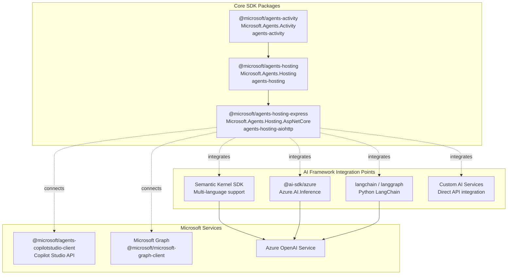
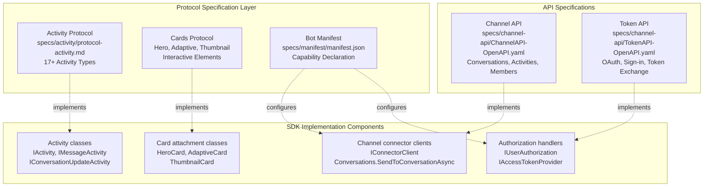
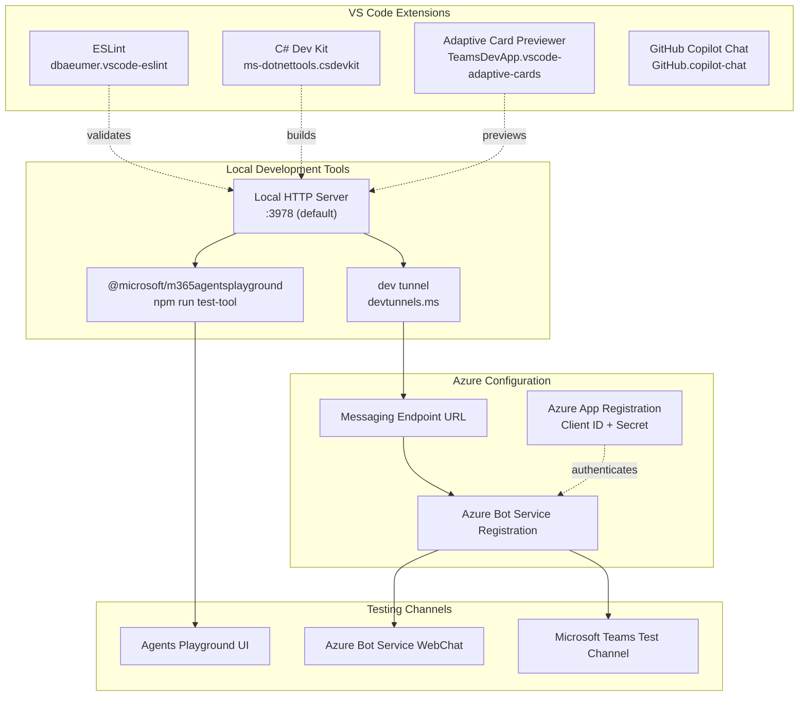
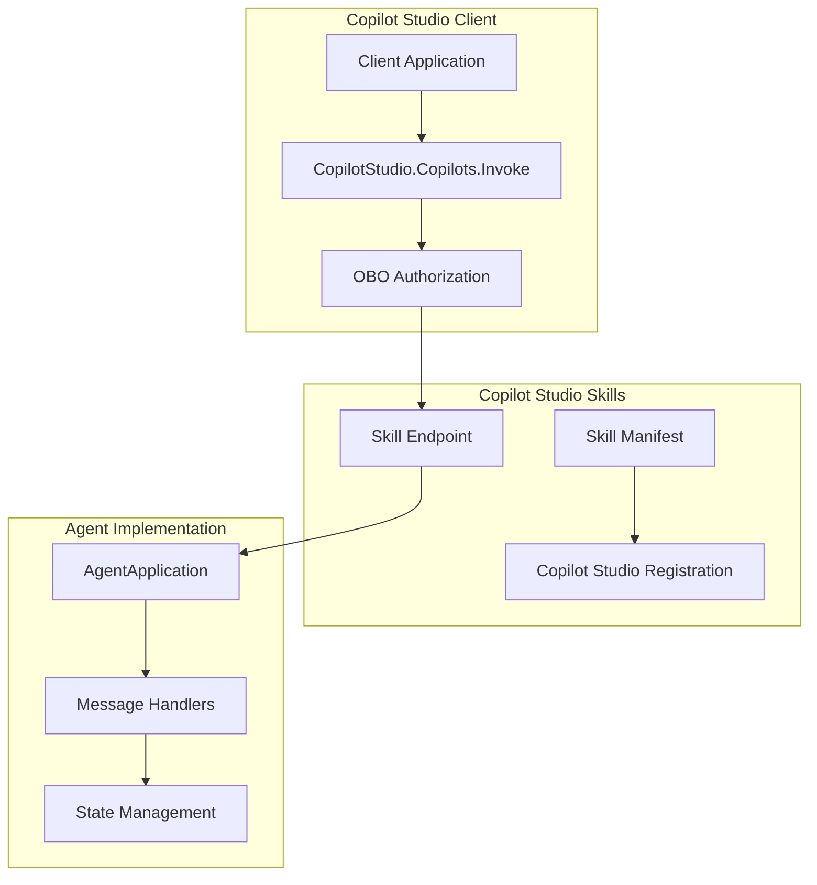
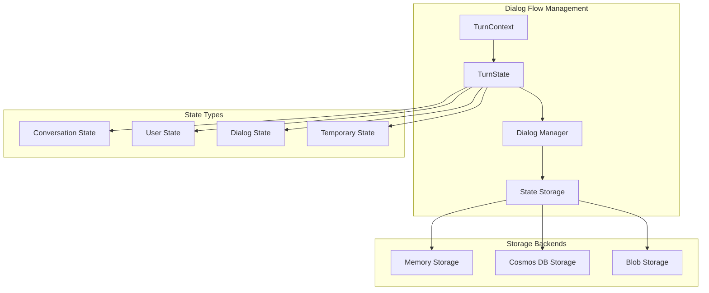

<!-- source: DeepWiki mcp.deepwiki.com · repo microsoft/Agents · page 8 Advanced Topics · fetched 2026-10-26 -->

# Advanced Topics

Relevant source files

The following files were used as context for generating this wiki page:

- [MCSandAgentsEcosystemLinks.md](MCSandAgentsEcosystemLinks.md)
- [README.md](README.md)

This section covers advanced development concepts for the Microsoft 365 Agents SDK. These topics assume familiarity with [Building Agents](#2), [Authentication and Authorization](#3), and [Deployment and Hosting](#4).

The advanced topics are organized into four main areas:

- **AI Integration Patterns** ([Section 8.1](#8.1)) - Integrating with Semantic Kernel, Azure AI Foundry, LangChain, and custom AI services
- **Activity Protocol Specification** ([Section 8.2](#8.2)) - Complete protocol specification for activities, cards, manifests, and APIs
- **Error Handling and Troubleshooting** ([Section 8.3](#8.3)) - Error codes, debugging strategies, and issue reporting
- **Development Tools and Debugging** ([Section 8.4](#8.4)) - Tools including agents playground, dev tunnel, and VS Code extensions

For sample implementations demonstrating these concepts, see [Sample Applications](#6).

## SDK Architecture and Extension Points

The Microsoft 365 Agents SDK provides a layered architecture that separates the core agent container from AI services and external integrations. This design enables developers to select AI frameworks and services based on specific requirements.

### SDK Core and Extension Architecture

The following diagram shows the relationship between core SDK packages and external service integrations:

**Key Integration Points:**

| Language | Core Package | Hosting Package | AI Framework Examples |
|----------|--------------|-----------------|----------------------|
| Node.js | `@microsoft/agents-hosting` | `@microsoft/agents-hosting-express` | `@ai-sdk/azure`, `langchain`, `@langchain/langgraph` |
| .NET | `Microsoft.Agents.Hosting` | `Microsoft.Agents.Hosting.AspNetCore` | Semantic Kernel, Azure.AI.Inference |
| Python | `agents-hosting` | `agents-hosting-aiohttp` | LangChain, Azure AI SDK |

**Sources:** [README.md:1-106](), [MCSandAgentsEcosystemLinks.md:1-119]()

### AI Service Integration Overview

The SDK supports multiple AI integration patterns. See [AI Integration Patterns](#8.1) for detailed documentation on:

- Integrating with Semantic Kernel for LLM orchestration
- Using Azure AI Foundry for reasoning and RAG patterns
- Implementing LangChain for complex multi-agent workflows
- Direct API integration with Azure OpenAI and other providers
- Streaming response patterns with `StreamingResponse` API

**Sources:** [README.md:34-50]()

## Protocol and API Architecture

The SDK implements the Activity Protocol specification, which defines the message format, authentication patterns, and service discovery mechanisms used across all channels.

### Protocol Layers and SDK Implementation

The following diagram maps protocol specifications to SDK implementation components:

**Protocol Components:**

| Protocol Area | Specification Location | SDK Implementation |
|--------------|----------------------|-------------------|
| Activity Types | `specs/activity/protocol-activity.md` | `IActivity`, `IMessageActivity`, `IConversationUpdateActivity` |
| Cards | `specs/activity/cards.md` | `HeroCard`, `AdaptiveCard`, `ThumbnailCard` classes |
| Channel API | `specs/channel-api/ChannelAPI-OpenAPI.yaml` | `IConnectorClient`, `Conversations` resource |
| Token API | `specs/channel-api/TokenAPI-OpenAPI.yaml` | `IUserAuthorization`, `IAccessTokenProvider` |
| Bot Manifest | `specs/manifest/manifest.json` | Service configuration and registration |

See [Activity Protocol Specification](#8.2) for complete protocol documentation including:

- Activity schema and validation rules
- Card format specifications
- Channel API endpoints and request/response formats
- Token API authentication flows
- Bot manifest structure and service discovery

**Sources:** [README.md:1-106](), [MCSandAgentsEcosystemLinks.md:46-58]()

## Error Handling and Troubleshooting

The SDK provides structured error handling patterns and diagnostic tools for identifying and resolving issues during development and production operation.

### Error Handling Architecture

Error handling spans multiple layers from protocol validation through application logic:

| Error Type | Layer | Handling Mechanism |
|-----------|-------|-------------------|
| Protocol Errors | Activity validation | Schema validation, error activities |
| Authentication Errors | Token management | Token refresh, user authorization handlers |
| Application Errors | Message handlers | Try-catch blocks, error logging |
| Service Errors | External API calls | Retry policies, fallback responses |

Common error scenarios and resolution strategies are documented in [Error Handling and Troubleshooting](#8.3), including:

- Error code reference and diagnostic messages
- Common authentication and authorization issues
- State management errors and recovery patterns
- Network connectivity and timeout handling
- Channel-specific error scenarios

**Sources:** [README.md:74-86]()

## Development Tools and Workflow

The SDK ecosystem includes tools for local development, testing, and debugging agents before production deployment.

### Development Tools Ecosystem

The following diagram shows the relationship between development tools and the agent runtime:

**Recommended VS Code Extensions:**

| Extension | Package ID | Purpose |
|----------|------------|---------|
| ESLint | `dbaeumer.vscode-eslint` | JavaScript/TypeScript linting |
| C# Dev Kit | `ms-dotnettools.csdevkit` | .NET development and testing |
| Adaptive Card Previewer | `TeamsDevApp.vscode-adaptive-cards` | Card design and validation |
| GitHub Copilot Chat | `GitHub.copilot-chat` | AI-assisted development |

**Testing Tools:**

| Tool | Command | Purpose |
|------|---------|---------|
| Agents Playground | `npm run test-tool` | Local testing with UI |
| dev tunnel | `devtunnel host -p 3978` | Expose local endpoint to Azure |
| Azure WebChat | Azure Portal | Browser-based testing |

See [Development Tools and Debugging](#8.4) for detailed documentation on:

- Setting up local development environment
- Using dev tunnel for local testing
- Agents Playground features and configuration
- Debugging techniques and logging patterns
- VS Code integration and recommended workflows

**Sources:** [README.md:74-86]()

## Advanced Integration Patterns

### Copilot Studio Integration Architecture

The SDK supports both skill development for Copilot Studio and client applications that consume Copilot Studio agents.

Sources: [samples/nodejs/copilotstudio-skill/README.md:1-58](), [samples/nodejs/obo-authorization/README.md:1-86]()

### Multi-turn Dialog Management

Advanced dialog patterns support complex conversational flows with persistent state management and context preservation.

Sources: [samples/nodejs/multi-turn-prompt/README.md:14]()

This advanced topics coverage demonstrates the enterprise-ready capabilities of the Microsoft 365 Agents SDK, from low-level protocol specifications to high-level AI integration patterns, providing the foundation for building sophisticated conversational agents that integrate seamlessly with the Microsoft 365 ecosystem.

---

