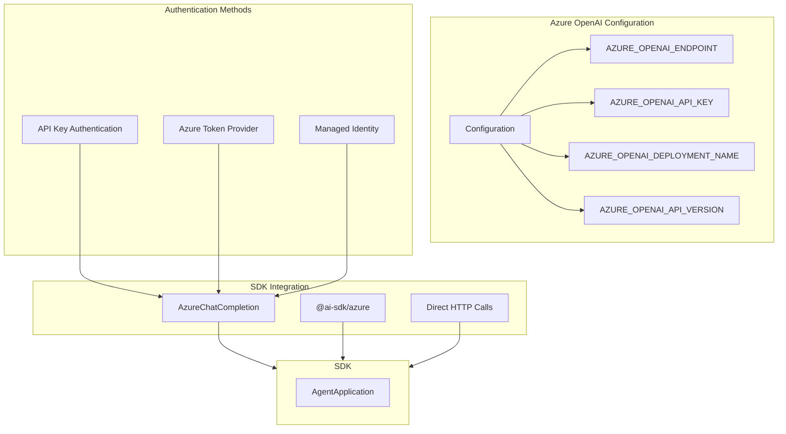
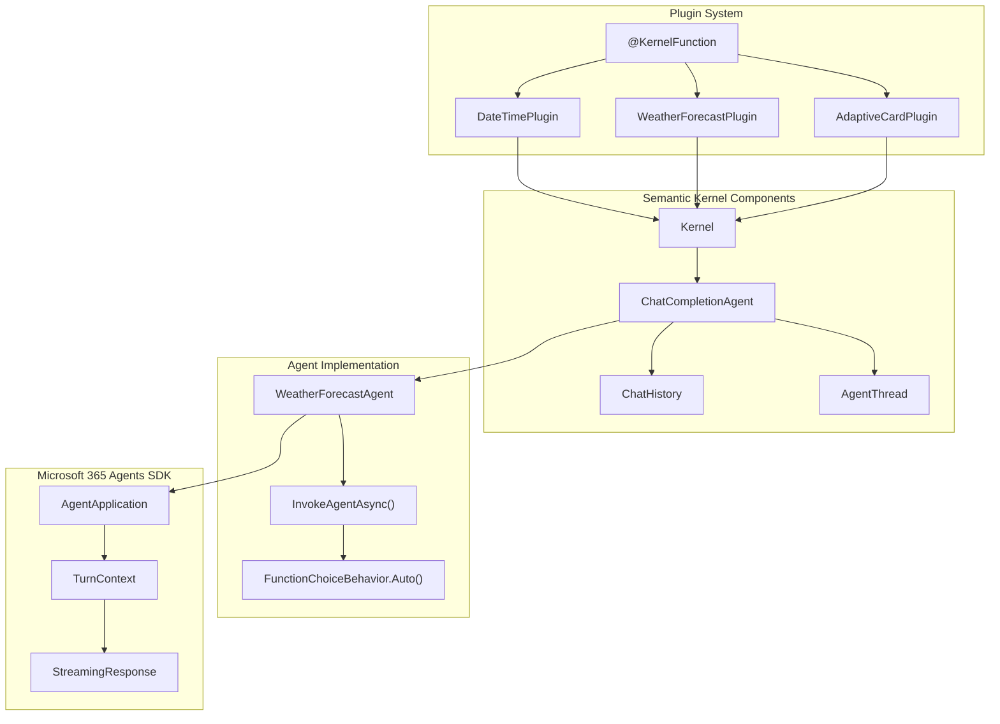
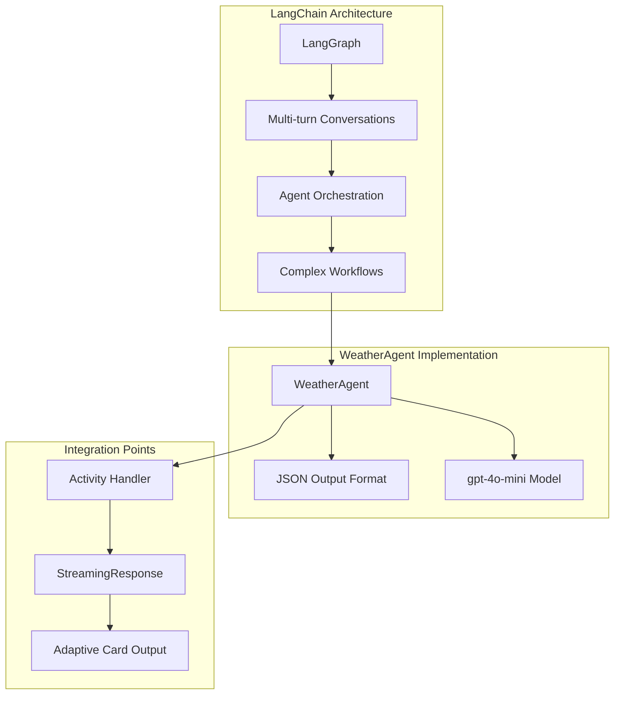
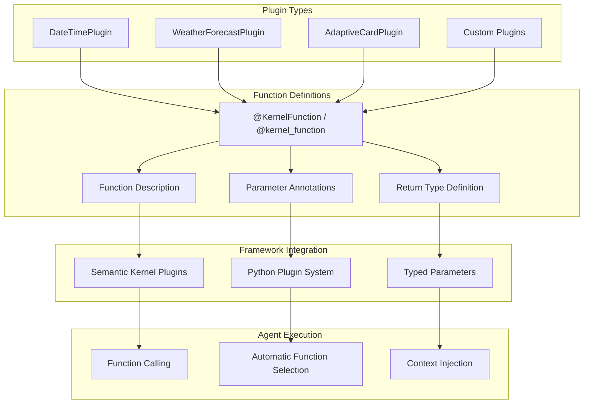
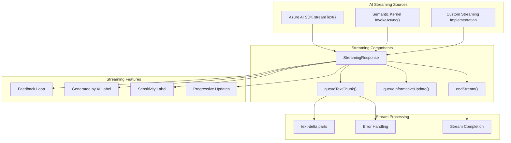
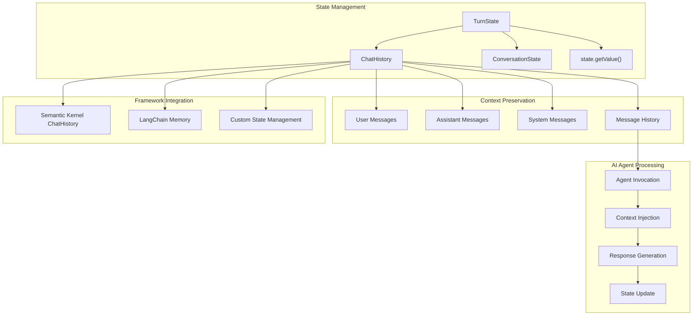
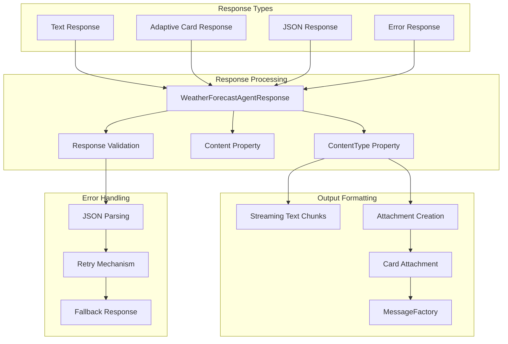

<!-- source: DeepWiki mcp.deepwiki.com · repo microsoft/Agents · page 8.1 AI Integration Patterns · fetched 2026-10-26 -->

# AI Integration

Relevant source files

The following files were used as context for generating this wiki page:

- [.github/scripts/updatenode.sh](.github/scripts/updatenode.sh)
- [MCSandAgentsEcosystemLinks.md](MCSandAgentsEcosystemLinks.md)
- [README.md](README.md)
- [samples/dotnet/Agent Framework/AgentFrameworkWeather.csproj](samples/dotnet/Agent Framework/AgentFrameworkWeather.csproj)
- [samples/dotnet/GenesysHandoff/GenesysHandoff.csproj](samples/dotnet/GenesysHandoff/GenesysHandoff.csproj)
- [samples/dotnet/RetrievalBot/RetrievalBot.csproj](samples/dotnet/RetrievalBot/RetrievalBot.csproj)
- [samples/dotnet/auto-signin/AutoSignIn.csproj](samples/dotnet/auto-signin/AutoSignIn.csproj)
- [samples/dotnet/azure-ai-streaming/StreamingMessageAgent.csproj](samples/dotnet/azure-ai-streaming/StreamingMessageAgent.csproj)
- [samples/dotnet/copilotstudio-client/CopilotStudioClient.csproj](samples/dotnet/copilotstudio-client/CopilotStudioClient.csproj)
- [samples/dotnet/copilotstudio-skill/CopilotStudioEchoSkill.csproj](samples/dotnet/copilotstudio-skill/CopilotStudioEchoSkill.csproj)
- [samples/dotnet/obo-authorization/OBOAuthorization.csproj](samples/dotnet/obo-authorization/OBOAuthorization.csproj)
- [samples/dotnet/quickstart/QuickStart.csproj](samples/dotnet/quickstart/QuickStart.csproj)
- [samples/dotnet/semantic-kernel-multiturn/SemanticKernelMultiturn.csproj](samples/dotnet/semantic-kernel-multiturn/SemanticKernelMultiturn.csproj)
- [samples/nodejs/auto-signin/package-lock.json](samples/nodejs/auto-signin/package-lock.json)
- [samples/nodejs/azure-ai-streaming/package-lock.json](samples/nodejs/azure-ai-streaming/package-lock.json)
- [samples/nodejs/cards/package-lock.json](samples/nodejs/cards/package-lock.json)
- [samples/nodejs/copilotstudio-client/package-lock.json](samples/nodejs/copilotstudio-client/package-lock.json)
- [samples/nodejs/copilotstudio-webchat-react/package-lock.json](samples/nodejs/copilotstudio-webchat-react/package-lock.json)
- [samples/nodejs/langchain-multiturn/package-lock.json](samples/nodejs/langchain-multiturn/package-lock.json)
- [samples/nodejs/multi-turn-prompt/package-lock.json](samples/nodejs/multi-turn-prompt/package-lock.json)
- [samples/nodejs/obo-authorization/package-lock.json](samples/nodejs/obo-authorization/package-lock.json)
- [samples/nodejs/quickstart/package-lock.json](samples/nodejs/quickstart/package-lock.json)

This page covers the integration of AI services and frameworks with the Microsoft 365 Agents SDK. It focuses on connecting agents to various AI providers, implementing conversational AI patterns, and utilizing AI frameworks for enhanced agent capabilities.

For authentication with AI services, see [Authentication](#3). For streaming responses from AI services, see [Streaming Responses](#2.5). For building multi-turn AI conversations, see [Multi-turn Dialogs](#2.6).

## AI Service Providers

The Microsoft 365 Agents SDK supports multiple AI service providers, allowing developers to choose the best fit for their needs while maintaining consistent agent patterns.

### Azure OpenAI Integration

Azure OpenAI provides enterprise-grade AI services with enhanced security and compliance features. The SDK supports both direct integration and framework-based approaches.

**Sources:** [samples/dotnet/semantic-kernel-multiturn/Program.cs:31-34](), [samples/python/semantic-kernel-multiturn/src/app.py:31-42](), [samples/nodejs/azure-ai-streaming/src/agent.ts:33]()

### OpenAI Direct Integration

Direct OpenAI integration provides access to the latest OpenAI models and features without Azure-specific configurations.

**Sources:** [samples/dotnet/semantic-kernel-multiturn/Program.cs:43-47](), [samples/nodejs/langchain-multiturn/README.md:24-25]()

### Configuration Patterns

AI service configuration follows consistent environment variable patterns across all language implementations:

| Provider | Configuration Variables | Purpose |
|----------|------------------------|---------|
| Azure OpenAI | `AZURE_OPENAI_ENDPOINT`, `AZURE_OPENAI_API_KEY`, `AZURE_OPENAI_DEPLOYMENT_NAME` | Azure-hosted OpenAI service |
| OpenAI | `OPENAI_API_KEY`, `OPENAI_MODEL` | Direct OpenAI API access |
| Provider Selection | `USE_AZURE_OPENAI_API` | Toggle between providers |

**Sources:** [samples/nodejs/langchain-multiturn/README.md:16-28](), [samples/nodejs/azure-ai-streaming/README.md:16-20]()

## AI Framework Integration

The SDK integrates with multiple AI frameworks, each providing different capabilities and architectural patterns for building intelligent agents.

### Semantic Kernel Integration

Semantic Kernel provides a plugin-based architecture for building AI agents with function calling capabilities and chat completion services.

**Sources:** [samples/dotnet/semantic-kernel-multiturn/Agents/WeatherForecastAgent.cs:45-62](), [samples/python/semantic-kernel-multiturn/src/agent.py:63-77]()

### LangChain Integration

LangChain provides advanced agent orchestration capabilities with multi-turn conversation management and complex workflow support.

**Sources:** [samples/nodejs/langchain-multiturn/README.md:1-7](), [samples/nodejs/langchain-multiturn/README.md:38]()

### Azure AI SDK Integration

The Azure AI SDK provides streaming capabilities and modern AI service integration patterns.

**Sources:** [samples/nodejs/azure-ai-streaming/src/agent.ts:1-6](), [samples/nodejs/azure-ai-streaming/package.json:3-5]()

## Plugin Architecture and Function Calling

The plugin architecture enables AI agents to call external functions and services, extending their capabilities beyond natural language processing.

### Plugin Implementation Patterns

Plugins follow consistent patterns across different frameworks, providing reusable components for common agent functionalities.

**Sources:** [samples/dotnet/semantic-kernel-multiturn/Plugins/DateTimePlugin.cs:22-23](), [samples/python/semantic-kernel-multiturn/src/plugins/weather_forecast_plugin.py:9-12](), [samples/dotnet/semantic-kernel-multiturn/Plugins/WeatherForecastPlugin.cs:21-22]()

### Function Implementation Examples

Function implementations provide specific capabilities that AI agents can invoke automatically based on conversation context.

| Plugin | Functions | Purpose |
|--------|-----------|---------|
| `DateTimePlugin` | `Today()`, `Now()`, `Date()` | Current date/time information |
| `WeatherForecastPlugin` | `GetForecastForDate()` | Weather data retrieval |
| `AdaptiveCardPlugin` | `GetAdaptiveCardForData()` | Rich card generation |

**Sources:** [samples/dotnet/semantic-kernel-multiturn/Plugins/DateTimePlugin.cs:22-53](), [samples/python/semantic-kernel-multiturn/src/plugins/weather_forecast_plugin.py:13-26](), [samples/dotnet/semantic-kernel-multiturn/Plugins/AdaptiveCardPlugin.cs:18-32]()

## Streaming AI Responses

Streaming responses provide real-time AI content delivery, enhancing user experience with progressive content updates and feedback mechanisms.

### Streaming Implementation Patterns

**Sources:** [samples/nodejs/azure-ai-streaming/src/agent.ts:26-29](), [samples/nodejs/azure-ai-streaming/src/agent.ts:44-66](), [samples/python/semantic-kernel-multiturn/src/app.py:60-85]()

## Multi-turn Conversation Management

Multi-turn conversations require state management and context preservation across multiple interaction cycles.

### Conversation State Patterns

**Sources:** [samples/dotnet/semantic-kernel-multiturn/MyAgent.cs:45](), [samples/python/semantic-kernel-multiturn/src/app.py:64-68](), [samples/dotnet/semantic-kernel-multiturn/Agents/WeatherForecastAgent.cs:70-82]()

## Agent Response Processing

AI agents generate responses in various formats that require processing and formatting before delivery to users.

### Response Format Handling

AI agents often generate structured responses that require parsing and conditional processing based on content type.

**Sources:** [samples/dotnet/semantic-kernel-multiturn/MyAgent.cs:59-73](), [samples/python/semantic-kernel-multiturn/src/app.py:69-85](), [samples/dotnet/semantic-kernel-multiturn/Agents/WeatherForecastAgentResponse.cs:9-27]()

## Configuration and Setup

AI integration requires proper configuration of services, authentication, and framework-specific settings.

### Service Registration Patterns

Different language implementations follow consistent patterns for registering AI services and dependencies.

| Language | Service Registration | Configuration Source |
|----------|---------------------|---------------------|
| .NET | `AddAzureOpenAIChatCompletion()`, `AddKernel()` | appsettings.json, User Secrets |
| Node.js | Environment variables, Direct instantiation | .env files |
| Python | Environment variables, DefaultAzureCredential | .env files, Environment |

**Sources:** [samples/dotnet/semantic-kernel-multiturn/Program.cs:25-47](), [samples/python/semantic-kernel-multiturn/src/app.py:23-42](), [samples/nodejs/langchain-multiturn/README.md:16-28]()

---

